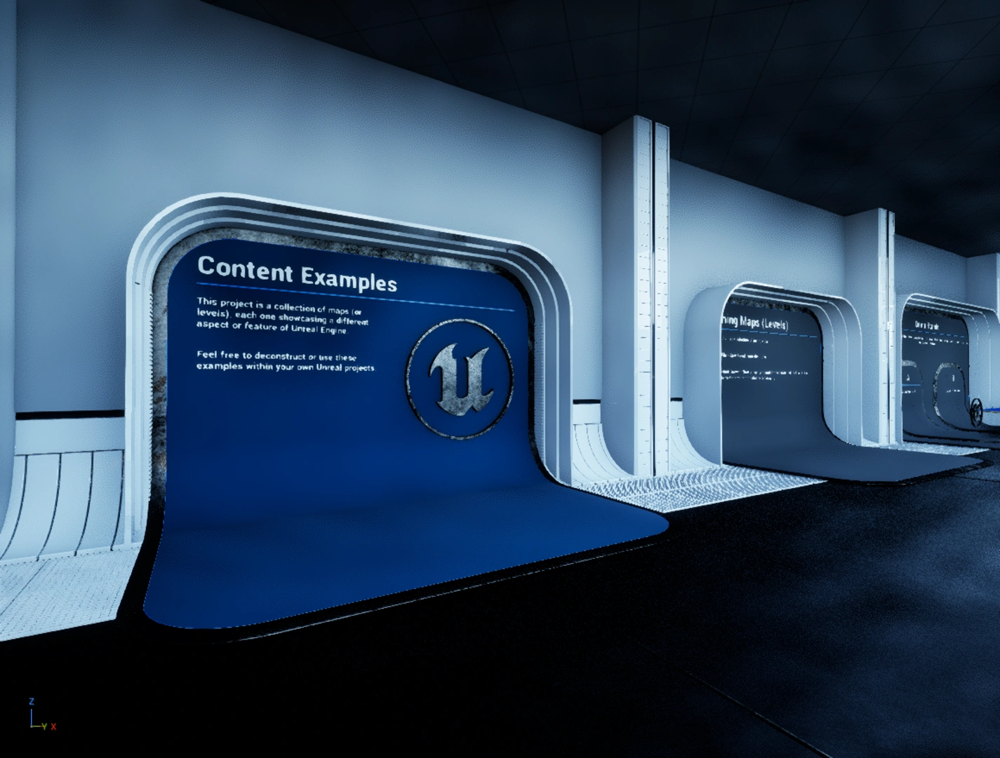
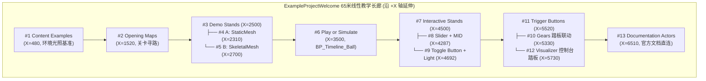
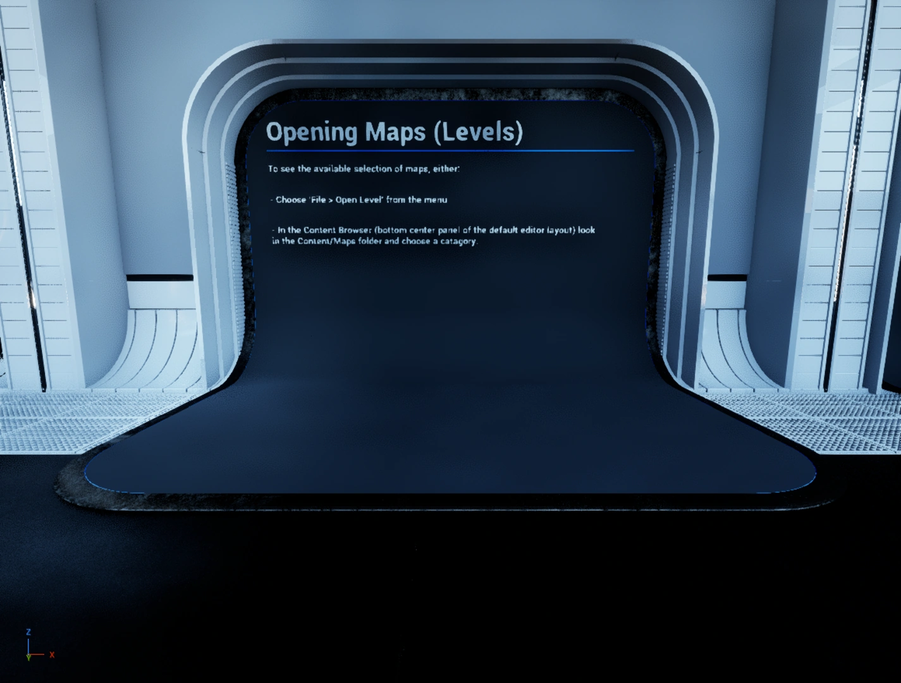
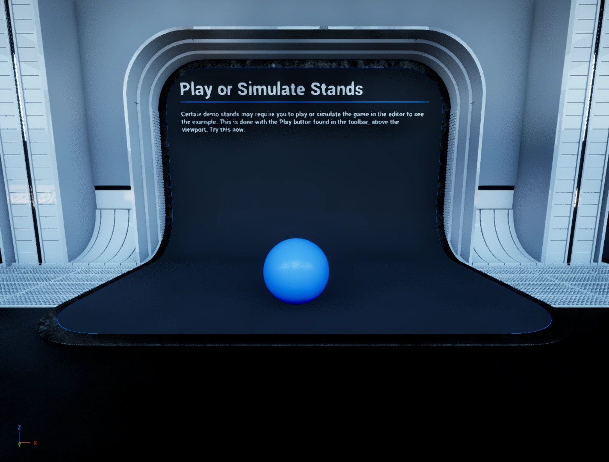
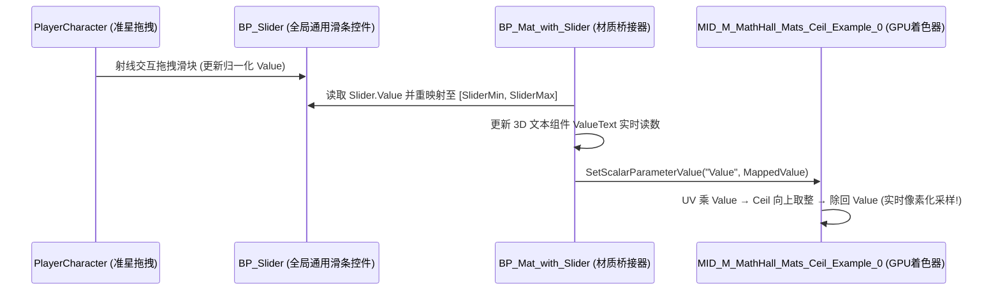
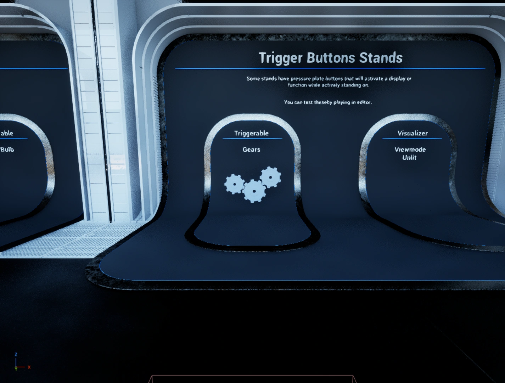

# 00 · 欢迎大厅与 DemoRoom 展厅系统全解（`ExampleProjectWelcome` & `TemplateRoom`）

> **本篇实测拆解关卡档案**
> - **主关卡路径**：`/Game/Maps/ExampleProjectWelcome`（关卡总 Actor 数：`45` | 展台数：`13` | 示例 Actor 数：`18`）
> - **母版子关卡路径**：`/Game/Global/DemoRoom/TemplateRoom`（关卡总 Actor 数：`19` | 展台数：`4` | 示例 Actor 数：`4`）
> - **关卡脚本类**：`/Game/Maps/ExampleProjectWelcome.ExampleProjectWelcome_C`
> - **关联核心基座资产**：`BP_DemoRoom`、`BP_DemoDisplay`、`BP_Slider`、`BP_Mat_with_Slider`、`BP_ButtonLight_Bulb_Basic`、`BP_PressureButton_BPIInteract_Child`、`BP_Visulizer_PressureButton`、`DocumentationActor`

---

## 一、 踏入虚幻引擎的“活体百科博物馆”

当你第一次在 Unreal Engine 编辑器中双击打开 **Content Examples（内容示例）** 工程时，迎接你的默认启动地图正是 **`/Game/Maps/ExampleProjectWelcome`**。

很多心急的开发者一进工程，往往直接去内容浏览器里翻找炫酷的流体、破碎或者次世代材质地图，把这座看似简单的“欢迎走廊”一带而过。但作为一名技术美术（TA）或引擎工程师，如果我们将视角拉高就会发现一个极具启发性的工程事实：**Content Examples 横跨十余年版本演进、容纳了 60 余张大型专题地图与上千个独立实验台，却始终保持着高度一致的空间尺度、光照基准与交互手感——支撑这一切的，正是浓缩在 `ExampleProjectWelcome` 与 `TemplateRoom` 里的标准化展厅工程架构！**

在正式开启后续几十个硬核技术专章之前，请随我一起走入这座编号 `00` 的迎宾长廊。我们将做两件事：
1. **读懂“使用说明书”**：把欢迎大厅里从 `#1` 到 `#13` 的每一个展台（包括主展台与台面上的微型子展台）逐一拆开，摸清静态资产、PIE 运行时模拟、三维滑条动态改参、按钮通信、重力踏板控制台指令以及官方文档锚点的完整交互规则；
2. **解剖“造馆脚手架”**：深入 `/Game/Global/DemoRoom/TemplateRoom` 母版关卡，看懂 Epic 官方团队是如何用一套模块化模板在几十张地图之间统一曝光、色温与受控实验环境的。

---

## 二、 欢迎大厅空间动线与交互架构鸟瞰

站在欢迎大厅起点（X 坐标约 `480` 处）向走廊深处望去，整座展厅沿着 **X 轴正方向** 线性铺开，一直延伸到 `X = 6510` 厘米（约 65 米长）。

仔细观察实测提取的 13 个 `BP_DemoDisplay` 展牌坐标，你会发现官方策划采用了一种非常精巧的**“主展台 + 嵌套微型子展台”双层空间叙事结构**：
- **主展台（`Z = 0`，共 7 座）**：每隔约 `1000 cm`（10 米标准跨度）布置一座大型凹槽展龛（如 `#1, #2, #3, #6, #7, #11, #13`），承载大段教学导览文本；
- **台面微型子展台（`Z = 10`，共 6 座）**：在 `#3`、`#7`、`#11` 等综合性主展台内部，又在台面上微缩嵌套了 `Z = 10` 的小型 `BP_DemoDisplay`（如 `#4 A`、`#5 B`、`#8 Interactive`、`#9/#10 Triggerable`、`#12 Visualizer`），让玩家在一米之内就能直观对比不同交互原语！

下面，让我们沿着走廊从西向东，对全部 **13 座展台** 进行 100% 零遗漏的逐台深度拆解。

---

## 三、 `ExampleProjectWelcome` 逐展台（#1 ~ #13）全量实测拆解

### 展台 #1：`Content Examples` — 工程宣言与全局环境光基准

- **空间元数据**：展牌 Label `BP_DemoDisplay1` | 坐标 `(480, -900, 0)`
- **官方展牌原文**：
  > *This project is a collection of maps (or levels), each one showcasing a different aspect or feature of Unreal Engine. Feel free to deconstruct or use these examples within your own Unreal projects.*
  > （本工程是一系列关卡的集合，每张关卡展示虚幻引擎的不同侧面或特性。欢迎随时拆解这些示例，或直接将它们用于你自己的虚幻项目。）

#### 1.1 为什么第一座展台旁边集中摆放了全图所有的天气与光源 Actor？
在编辑器大纲视图中选中展台 `#1` 周边区域，MCP 实测扫描出了 **6 个核心 Actor**。除了展台正中央旋转展示的虚幻引擎金属徽标外，整张地图的**大气、天光、太阳光与高度雾**全部锚定在入口起点附近！这正是官方关卡管理的整洁习惯：**将所有影响全局渲染环境的“世界级 Actor”集中摆放在入口 `#1` 展台处，避免散落在几十米外的角落难以排查。**

#### 1.2 展台内陈列 Actor 与底层参数精解（共 6 个）

| Actor 名称 | 类名 (`Class`) | 关键组件与 MCP 实测参数 | 架构职责解析 |
| :--- | :--- | :--- | :--- |
| **`DirectionalLight`** | `/Script/Engine.DirectionalLight` | `LightComponent0`: `Intensity = 6`, `LightColor = (1, 1, 1, 1)`, `CastShadows = true`, `Mobility = Movable` | **主太阳平行光**：采用全动态（`Movable`）移动性配合 Lumen 实时全局光照，强度设为温和的 `6`（避免室内天窗过曝）。 |
| **`SkyLight`** | `/Script/Engine.SkyLight` | `SkyLightComponent0`: `Intensity = 3`, `LightColor = (1, 1, 1, 1)`, `CastShadows = true`, `Mobility = Movable` | **实时天空漫反射补光**：强度调高至 `3`，确保背光展龛内部依然明亮通透，看清暗部材质细节。 |
| **`SkyAtmosphere`** | `/Script/Engine.SkyAtmosphere` | `SkyAtmosphereComponent` | **物理大气散射层**：基于瑞利散射（Rayleigh）与米氏散射（Mie）实时合成头顶天窗外的自然蓝天。 |
| **`ExponentialHeightFog`** | `/Script/Engine.ExponentialHeightFog` | `HeightFogComponent0` | **指数高度雾**：为 65 米长廊远端提供柔和的空气透视感，消除生硬的无穷远背景感。 |
| **`Actor`** | `/Script/Engine.Actor` | `ChaosDebugDrawComponent_0` | **Chaos 物理调试绘制宿主**：挂载底层物理调试渲染组件，供运行态可视化碰撞框与射线。 |
| **`UELogo`** | `/Script/Engine.StaticMeshActor` | `StaticMesh`: `/Game/Global/DemoRoom/Meshes/UELogo` `OverrideMaterials[0]`: `/Game/Global/DemoRoom/Materials/M_Metal` | **迎宾主雕塑**：静态网格体引擎徽标，覆写了展厅全局拉丝金属材质 `M_Metal`，直观反射展厅环境光。 |

---

### 展台 #2：`Opening Maps (Levels)` — 60+ 专题展厅的寻路指南

- **空间元数据**：展牌 Label `BP_DemoDisplay2` | 坐标 `(1520, -900, 0)`

- **官方展牌原文**：
  > *To see the available selection of maps, either:*
  > *- Choose 'File > Open Level' from the menu*
  > *- In the Content Browser (bottom center panel of the default editor layout) look in the Content/Maps folder and choose a catagory.*

#### 2.1 展台设计解析与高效浏览技巧
这座展台没有堆放多余的三维摆件（示例 Actor 数为 `0`），而是纯粹以图文展板引导新玩家定位 **`/Game/Maps/`** 目录。
在最新版 Content Examples 中，`/Game/Maps/` 已经由早期的扁平大目录重构为了清晰的分类子文件夹（如 `Material/`、`Lighting/`、`Blueprint/`、`Animation/`、`Physics/`、`AI/`、`VFX/`、`Geometry/`、`Level/`、`UI/`、`Audio/`、`Misc/`）。

> [!TIP]
> **资深开发者的三条高效逛馆秘籍**
> 1. **快捷键秒开内容抽屉**：在 UE5 默认界面中，随时按下 **`Ctrl + Space`（空格）** 即可呼出底部 `Content Drawer`，直接导航至 `All > Content > Maps`，无需去顶部菜单层层点击。
> 2. **善用内容浏览器过滤器**：在 `/Game/Maps` 根目录勾选过滤器 **`Level`（关卡）**，60 多张色彩编码为橙色的关卡图标会一屏尽收眼底！
> 3. **查看资产引用关系（Reference Viewer）**：看中某个展台上的惊艳材质或蓝图时，在视口单击选中该 Actor，按下 **`Ctrl + B`** 直接在内容浏览器高亮定位源资产，再按 **`Alt + Shift + R`** 打开引用查看器，瞬间摸清它的上下游依赖链！

---

### 展台 #3：`Demo Stands` — 受控对照实验台的哲学

- **空间元数据**：展牌 Label `BP_DemoDisplay3` | 坐标 `(2500, -890, 0)`
- **官方展牌原文**：
  > *Each level will typically show a series of demo stands, like the miniature ones shown below. Each stand shows a different example of the topic covered by that map.*
  > （每张关卡通常展示一排演示展台，就像下方陈列的微缩展台一样。每个展台分别演示该地图主题下的一个独立特性示例。）

#### 3.1 为什么要用“一字排开的独立凹槽”来教引擎技术？
在科学研究中，验证某一个参数的作用有一个黄金法则——**控制变量法（Controlled Variables）**。
`#3` 号主展台本身作为外框容器（坐标 `X = 2500, Z = 0`），在其台面左右两侧（`X = 2310` 与 `X = 2700`，高度抬升至 `Z = 10`）并排嵌入了 **`#4 A`** 与 **`#5 B`** 两座微型展台。这种“一个大命题包裹多个横向对比子样本”的布局，在后续材质、物理、动画地图中无处不在：相同的灯光角度、相同的背景灰阶、相同的观察距离，唯一改变的只有你要学习的那个引擎开关。

---

### 展台 #4：`A` — 静态网格体展品范式（`Example Static Mesh`）

- **空间元数据**：展牌 Label `BP_DemoDisplay4` | 坐标 `(2310, -880, 10)`（嵌套于 `#3` 主展台左侧）
- **官方展牌原文**：`Example Static Mesh`

#### 4.1 展台陈列资产拆解
- **`UELogo2`**（`StaticMeshActor`，`/Script/Engine.StaticMeshActor`）
  - `StaticMesh`: `/Game/Global/DemoRoom/Meshes/UELogo.UELogo`
  - `OverrideMaterials[0]`: `/Game/Global/DemoRoom/Materials/M_Metal.M_Metal`

#### 4.2 底层机制点拨
`StaticMeshActor` 是虚幻世界里开销最低、最纯粹的几何体载体：它的顶点缓冲（Vertex Buffer）常驻显存且不会发生骨骼蒙皮形变，天然支持硬件实例化合批（ISM）与 Nanite 虚拟微多边形管线。值得注意的是，这里通过实例级属性 **`OverrideMaterials`** 在关卡中直接将材质槽 `[0]` 覆写为 `M_Metal`，而无需修改 `UELogo` 网格体源资产本身的默认材质——这也是多展台复用同一个预览球（如后续材质展厅的 `SM_MatPreviewMesh_01`）却能呈现千百种材质效果的核心手段。

---

### 展台 #5：`B` — 骨骼网格体展品范式（`Example Skeletal Mesh`）

- **空间元数据**：展牌 Label `BP_DemoDisplay5` | 坐标 `(2700, -880, 10)`（嵌套于 `#3` 主展台右侧）
- **官方展牌原文**：`Example Skeletal Mesh`

#### 5.1 展台陈列资产拆解
- **`SK_DinoDragon`**（`SkeletalMeshActor`，`/Script/Engine.SkeletalMeshActor`）
  - `SkinnedAsset`: `/Game/ExampleContent/IKRig/Mesh/DinoDragon/SK_DinoDragon.SK_DinoDragon`（来自 `IKRig` 示例目录的恐龙飞龙角色资产）
  - `AnimClass`: `None` | `OverrideMaterials`: `[]` | `PhysicsAssetOverride`: `None` | `MeshDeformer`: `None`

#### 5.2 底层机制点拨
与左侧 `#4` 的静态网格体相对，`SkeletalMeshActor` 内部承载着一套层级骨骼树（Skeleton）与顶点蒙皮权重矩阵。实测数据显示，此处 `SK_DinoDragon` 的 `AnimClass` 与 `MeshDeformer` 均保持为 `None`，因此它静止定格在绑定姿态（Bind Pose / Reference Pose）。在后续第 06 章的 `Animation_IKRig`、`Animation_Deformer` 等展厅中，正是这只小恐龙将挂上动画蓝图、全身 IK 解算器乃至 GPU 双四元数变形器，演绎鲜活的角色运动！

---

### 展台 #6：`Play or Simulate Stands` — 编辑器运行态（PIE）与模拟态（SIE）

- **空间元数据**：展牌 Label `BP_DemoDisplay6` | 坐标 `(3500, -900, 0)`

- **官方展牌原文**：
  > *Certain demo stands may require you to play or simulate the game in the editor to see the example. This is done with the Play button found in the toolbar, above the viewport. Try this now.*
  > （部分演示展台需要你在编辑器中点击“运行（Play）”或“模拟（Simulate）”才能看到动态效果。点击视口上方工具栏中的 Play 按钮即可，现在就试试吧！）

#### 6.1 为什么不点 Play 球就不跳？编辑态与运行态的生命周期鸿沟
在未点击 Play 的静态编辑视口下，只执行蓝图的 **`Construction Script`（构造脚本）** 与材质着色器（如 `Time` 节点驱动的材质动画），而所有的 **`BeginPlay`** 事件、`Tick` 帧循环、物理刚体解算以及 **Timeline（时间轴组件）** 都处于冻结状态！

#### 6.2 展台陈列 Actor 与材质节点全拆解
- **核心展品 Actor**：`BP_Timeline_Ball`（类：`/Game/ExampleContent/Blueprints/Blueprints/BP_Timeline_Ball.BP_Timeline_Ball_C`，父类 `Actor`）
  - **组件结构**：包含底座组件 `Base`、弹跳球体组件 `Ball`（引用引擎标准球 `/Engine/EditorMeshes/EditorSphere`，覆写材质 `M_ShinyPlastic`）以及核心驱动器 **`Bounce`（`TimelineComponent` 时间轴组件）**。
  - **运行原理**：一旦按下 **`Alt + P`**（Play In Editor, PIE）或 **`Alt + S`**（Simulate In Editor, SIE，无需附身第一人称角色即可保持自由编辑器相机观察！），`Bounce` 时间轴立即开始循环播放浮点高度曲线，每帧更新 `Ball` 组件的相对 Z 轴坐标，呈现出富有弹性的抛物线弹跳动画。
- **关联材质深拆**：`/Game/ExampleContent/Blueprints/Materials/M_ShinyPlastic`
  - **核心属性**：`materialDomain = MD_Surface` | `blendMode = BLEND_Opaque` | `shadingModel = MSM_DefaultLit` | 勾选了 `bUsedWithSkeletalMesh = true` 与 `bUsedWithSplineMeshes = true`
  - **3 个材质表达式节点精确连线**：
    1. `MaterialExpressionVectorParameter_0`（参数名 `"Color"`，默认值 `RGBA = (0, 0.162029, 0.745404, 1)` 深邃宝石蓝）$\rightarrow$ 输出 `RGB` 连入 **`MP_BaseColor`**；
    2. `MaterialExpressionConstant_0`（常量值 **`0.2`**）$\rightarrow$ 连入 **`MP_Roughness`**（低粗糙度造就清亮锐利的高光反射，精准还原光滑硬塑料质感！）；
    3. `MaterialExpressionVectorParameter_3`（参数名 `"Emissive"`，默认值 `(0, 0, 0, 0)`）$\rightarrow$ 输出 `RGB` 连入 **`MP_EmissiveColor`**（预留给蓝图运行时发光闪烁的可调接口）。

> [!TIP]
> **实战快捷键推荐：`Alt + S`（Simulate） vs `Alt + P`（Play）**
> 逛纯观察类动态展台（如粒子特效、物理布料、时间轴动画）时，按 **`Alt + S`** 进入 **Simulate（模拟模式）** 最为惬意——所有游戏逻辑与物理全部真实运转，但你的视角依然是自由飞行的编辑器摄像机，还能随时在视口里点选正在运动的 Actor，在右侧细节面板实时偷看它跳动的变量数值！而遇到需要按按钮、拉滑条的交互展台时，再按 **`Alt + P`** 附身第一人称角色操作。

---

### 展台 #7：`Interactive Stands` — 实时人机交互总纲

- **空间元数据**：展牌 Label `BP_DemoDisplay` | 坐标 `(4500, -900, 0)`
- **官方展牌原文**：
  > *Some stands have a button or slider you can interact with in order to make something happen. You can test these buttons and sliders by playing in editor.*
  > （部分展台配有可交互的按钮或滑条，用来触发特定效果。你可以在编辑器运行模式（PIE）下亲自测试它们。）

#### 7.1 交互总纲设计
与 `#3` 展台同理，`#7` 号主展台作为交互展示母龛，内部左右两侧嵌入了 **`#8 Interactive`（连续量滑条交互）** 与 **`#9 Triggerable`（离散量开关按钮交互）** 两大经典交互范式，构成了整个 Content Examples 工程参数实验的左膀右臂。

---

### 展台 #8：`Interactive` — 物理三维滑条驱动动态材质实例（`Slider`）

- **空间元数据**：展牌 Label `BP_DemoDisplay11` | 坐标 `(4287, -890, 10)`（嵌套于 `#7` 主展台左侧）
- **官方展牌原文**：`Slider`

#### 8.1 为什么这个微型展台堪称“蓝图 × 材质联动”的教科书？
在 PIE 模式下走到 `#8` 展台前，用屏幕中心准星对准滑块按住鼠标左键左右拖拽，你会看到上方展示板上的虚幻 Logo 图案随着滑条数值实时产生**马赛克阶梯像素化（Mosaic / Pixelation）渐变**！
这一小套机关由 **2 个解耦协作的蓝图 Actor** 和 **1 个数学演示材质** 组成：

#### 8.2 展台陈列 Actor 与内部节点深拆（共 2 个 Actor + 1 个核心材质）
1. **`BP_Slider`**（类：`/Game/Global/Blueprints/BP_Slider.BP_Slider_C`，父类 `Actor`）
   - **视觉组件构成**：由滑块按钮 `Slider`（`Slider_Button`）、轨道底座 `Base`（`SM_SliderBase`）、两端封口帽 `SM_SliderBase_Cap` / `SM_SliderBase_Cap1` 以及平滑动画 `Timeline_0` 拼接而成。
   - **21 个完备工程变量**：实测提取出 `Start`、`End`、`InUse`、`Sensetivity`、`Value`、`StartValue`、`Vertical`（支持横竖两种摆放！）、`bIsActive`、`Ishovered`、`bIsNotClamped`、`bAllowScroll`（支持滚轮微调）、`interactiondistance`、`SliderBase_MID`、`AutoMove`、`AutoMoveSpeed`、`Flip Numbers`、`Range`、`Draw Text Markers`，并暴露事件分发器 **`OnReleaseSliderED`**。这是一套工业级可复用的 3D 世界空间 UI 控件！
2. **`BP_Mat_with_Slider`**（类：`/Game/ExampleContent/Math_Hall/Blueprint/BP_Mat_with_Slider.BP_Mat_with_Slider_C`，来自数学大厅 `Math_Hall` 的通用材质调试台）
   - **组件与实例引用**：包含展示面板网格 `Displaymesh`（使用 `S_MathHall_DisplayButton_01`，运行前已在构造脚本中自动创建并绑定动态材质实例 `MID_M_MathHall_Mats_Ceil_Example_0`）、玩家接近检测胶囊体 `Capsule1`，以及实时显示参数名与当前浮点数的 3D 文本组件 `ValueHeader` 与 `ValueText`。
   - **14 个配置变量**：通过公开 `Material`、`Slider`（实例拾取指向旁边的 `BP_Slider`）、`Name of variable`、`SliderMin`、`Slider Max` 等变量，策划无需写一行代码，就能把任意材质的任意标量参数挂载到滑条上实时拉动！
3. **底层着色器算法拆解**：`/Game/ExampleContent/Math_Hall/Materials/M_MathHall_Mats_Ceil_Example`
   - **6 个材质表达式还原经典 UV 栅格化公式**：
     - 节点清单：`TextureCoordinate_7`、标量参数 `ScalarParameter_3`（`"Value"`，默认值 **`50`**）、`Multiply_9`、`Ceil_0`（向上取整函数 $\lceil x \rceil$）、`Divide_1`、贴图采样 `TextureSample_24`（采样 `/Game/ExampleContent/Decals/Textures/T_UE_Logo_Simple_M`，`SAMPLERTYPE_LinearColor`）连入 **`MP_BaseColor`**。
     - **数学本质**：
       $$\text{UV}_{\text{pixelated}} = \frac{\lceil \text{UV} \times \text{Value} \rceil}{\text{Value}}$$
       当滑条把 `Value` 调大（如 `50`）时，UV 被切分为 $50 \times 50$ 个细密台阶，图案清晰；当滑条把 `Value` 拉小（如 `5`）时，连续变化的 UV 被 `Ceil` 强行拍平为 $5 \times 5$ 个大色块，瞬间实现零额外开销的 GPU 马赛克滤镜！

---

### 展台 #9：`Triggerable ` — 自锁切换按钮与电灯泡通信（`Light Bulb`）

- **空间元数据**：展牌 Label `BP_DemoDisplay10` | 坐标 `(4692, -890, 10)`（嵌套于 `#7` 主展台右侧）
- **官方展牌原文**：`Light Bulb`

#### 9.1 蓝图直接引用通信（Direct Blueprint Communication）的最小闭环
走到 `#9` 展台前对准红色按钮按下鼠标左键或 `E` 键，按钮下陷变绿，上方的白炽灯泡应声点亮；再按一次，灯泡熄灭。这里展示了两个独立 Actor 之间最直观的**跨实例引用通信**：

1. **开关控制端：`BP_ButtonLight_Bulb_Basic`**（路径：`/Game/ExampleContent/Blueprint_Communication/Blueprints/BP_ButtonLight_Bulb_Basic`）
   - **继承体系**：父类为全局交互基类 **`/Game/Global/Blueprints/Interactive/BP_Button_Parent_Toggle.BP_Button_Parent_Toggle_C`**（自锁式双态开关基类，自带碰撞盒 `ButtonCollision`、按钮网格 `Display_Button`、状态指示灯动态材质 `MID_M_Button2_0` 以及 `onButtonEnabled` / `onButtonDisabled` 事件回调）。
   - **跨 Actor 绑定**：子类仅新增了 1 个公开（Instance Editable）成员变量 **`Target light_0`**，在关卡实例参数中直接用吸管指向场景里的 `BP_Light_Bulb_Basic_214`！
2. **受控执行端：`BP_Light_Bulb_Basic`**（路径：`/Game/ExampleContent/Blueprint_Communication/Blueprints/BP_Light_Bulb_Basic`）
   - **组件与光影细节**：
     - `Light bulb` 静态网格组件：使用 `SM_Lightbulb`，挂载双材质槽动态材质实例（玻璃泡壳 `MID_M_Light_Bulb_Glass_0` + 钨丝发光材质），点灯时同步点亮材质自发光（Emissive）；
     - `Light` 点光源组件：默认初始状态 **`Intensity = 0`**（熄灭），光色为温暖的白炽灯色温 **`RGB = (1.0, 0.921569, 0.768628)`**，衰减半径 `AttenuationRadius = 350`，关闭投影（`CastShadows = false` 节省实时阴影开销），移动性为 `Movable`。

---

### 展台 #10：`Triggerable ` — 蓝图接口解耦与三齿轮联动（`Gears`）

- **空间元数据**：展牌 Label `BP_DemoDisplay9` | 坐标 `(5330, -890, 10)`（嵌套于 `#11` 主展台左侧）

- **官方展牌原文**：`Gears`

#### 10.1 从“硬引用耦合”进化到“接口多态通信（Blueprint Interface）”
仔细对比 `#9`（电灯泡）与 `#10`（齿轮组）的按钮类名，你会发现一个极其重要的架构升级！
- 在 `#9` 中，按钮类叫 `BP_ButtonLight_Bulb_Basic`，它内部硬编码了 `Target light_0` 类型——这意味着这个按钮**只能控制灯泡，换一扇门或一组齿轮就得重写一个按钮子类**！
- 而在 `#10` 中，地面上的踏板实例 `BP_Button` 使用的是 **`BP_PressureButton_BPIInteract_Child_C`**（父类为 `BP_PressureButton_Parent_BPIInteract_C`）！名字里的 **`BPIInteract`** 正是蓝图接口（Blueprint Interface）的缩写：踏板根本不关心对面摆的是齿轮、火焰还是音乐盒，只要玩家踩上触发盒 `Trigger`，踏板就向目标发送一条标准接口消息，实现了**触发器与受控物之间的 100% 解耦**！

#### 10.2 展台陈列 Actor 与齿轮传动逻辑拆解（共 2 个 Actor）
1. **`BP_Gears`**（路径：`/Game/ExampleContent/Blueprints/Blueprints/BP_Gears.BP_Gears_C`，父类 `Actor`）
   - **组件构成**：在底座 `Base` 上啮合排布了 **`Gear 1`、`Gear 2`、`Gear 3`** 三个相同的齿轮网格体 `/Game/ExampleContent/Blueprints/Meshes/SM_Gear`。
   - **核心变量**：`On/off`（默认 `false` 停转）、`Delta seconds`（`0`）、`Rotation Speed`。当接收到踏板踩下的激活信号后，`On/off` 置为 `true`，每帧根据 `Delta seconds * Rotation Speed` 驱动三个齿轮正反转咬合旋转（相邻齿轮角速度符号相反，避免轮齿穿模！）；玩家离开踏板后立即置回 `false` 停转。
2. **`BP_Button`**（路径：`/Game/ExampleContent/Blueprints/Blueprints/BP_PressureButton_BPIInteract_Child`）
   - **组件构成**：底座网格 `/Game/Global/DemoRoom/Meshes/Button`（槽位 `[1]` 挂载发光圈动态材质 `MID_M_Button_Emissive_0`）、盒体碰撞器 `Trigger` 以及下压位移时间轴 `Press`。

---

### 展台 #11：`Trigger Buttons Stands` — 重力感应踏板的设计哲学

- **空间元数据**：展牌 Label `BP_DemoDisplay8` | 坐标 `(5520, -900, 0)`
- **官方展牌原文**：
  > *Some stands have pressure plate buttons that will activate a display or function while actively standing on. You can test theseby playing in editor.*
  > （部分展台配有重力感应踏板，只有当你站在踏板上时才会激活对应的展示或功能。你可以在编辑器运行模式下测试它们。）

#### 11.1 工程性能优化启示：按需唤醒（On-Demand Activation）
主展台 `#11` 统领着左侧 `#10`（机械齿轮）与右侧 `#12`（视口可视化模式切换）。正如我们在全卷总导读中强调的：**重力踏板是大型演示/测试关卡的性能救星**。在真实游戏研发建设“白盒特性试验场（Gym Map）”时，强烈建议借鉴 `BP_PressureButton` 模式——把消耗大量 GPU/CPU 算力的实验对象绑定在踏板的 `BeginOverlap` / `EndOverlap` 生命周期上，做到“人来开机、人走断电”，让一张测试地图轻松承载上百个测试用例而依然保持 120 FPS 满帧！

---

### 展台 #12：`Visualizer` — 踩下踏板秒切引擎视口缓冲（`Viewmode Unlit`）

- **空间元数据**：展牌 Label `BP_DemoDisplay12` | 坐标 `(5730, -890, 10)`（嵌套于 `#11` 主展台右侧）
- **官方展牌原文**：`Viewmode Unlit`

#### 12.1 展台陈列资产深拆：`BP_Visulizer_PressureButton`
在 PIE 模式下走上 `#12` 展台前方的特制踏板 `BP_VizPressureButton`，整个屏幕瞬间剥离所有光影明暗，切换到了纯净的 **`Unlit`（无光照基础色缓冲）** 视图模式；一脚迈出踏板，实时光影立刻恢复如初！

- **资产路径**：`/Game/Global/Blueprints/Interactive/BP_Visulizer_PressureButton.BP_Visulizer_PressureButton_C`（父类 `Actor`）
- **视觉组件构成**：
  - 专属按钮底座 `SM_VizButton`（覆写指示灯材质 `MID_M_VisulizerEmissive_Inst_0`）；
  - 参考立方体 `Cube`（`/Engine/BasicShapes/Cube`，覆写 `M_Display` 材质，用于直观对比切前/切后的明暗消隐变化）；
  - 悬浮控制台提示文本 `Title` 与 `ConsoleText`（直接把当前执行的控制台命令打印在半空中教给玩家！）。
- **11 个精巧控制变量全解析**：
  - 核心命令对：**`EnterCommand`**（踩下时调用 `Execute Console Command`，此处填入 `"viewmode unlit"`）与 **`ExitCommand`**（离开时执行 `"viewmode lit"` 还原默认光照视图），配合布尔开关 `UseExitCommand?`；
  - 健壮的重叠计数保护：**`OverlappedActors`** 数组——防止玩家胶囊体与武器/挂件多次触发重叠事件导致状态错乱；
  - UI 与灯效定制：`Button material`、`DefaultEmissiveValue`、`TextSize`、`ShowCommandText`、`TextColor`、`LED Should Toggle`、`BypassReverseLED`。

> [!NOTE]
> **跨展厅预告**：记住这个长着方形图标的 `BP_Visulizer_PressureButton`！在后面的 `Lighting_Realtime`（切 Lumen 全局光照缓冲）、`Geometry_Nanite`（切 Nanite 簇/三角形彩色视图 `r.Nanite.Visualize`）和 `Material_Substrate`（切物质板字节复杂度热力图）展厅里，你将频频踩上它来透视引擎底层的渲染缓冲区！

---

### 展台 #13：`Documentation Actors` — 视口内的绿色问号锚点

- **空间元数据**：展牌 Label `BP_DemoDisplay7` | 坐标 `(6510, -900, 0)`（走廊最东端终点站）
- **官方展牌原文**：
  > *Throughout this project, you will see these green question mark icons. These link you to the relevant official documentation section. Simply select the green icon, then click the "Open Help Documentation" button, located in the Details panel.*
  > （在整个工程中，你会经常看到这种绿色的问号图标。它们直接链接到对应的虚幻官方文档章节。只需在视口中选中绿色问号图标，然后点击右侧细节面板中的“Open Help Documentation”按钮即可。）

#### 13.1 展台陈列资产拆解
- **`Using Content Examples Documentation2`**（引擎原生 C++ 类：`/Script/Engine.DocumentationActor`）
  - **架构价值**：`UDocumentationActor` 是 Unreal Engine 专门为教学模板与团队内部规范沉淀内置的轻量级编辑器 Actor（仅在编辑器视口渲染广告牌图标，`bHiddenInGame = true` 运行时自动隐身零开销）。在企业级大型项目团队中，你同样可以在主材质测试场或插件示例图里摆放 `DocumentationActor`，将链接指向团队内部的知识库或自定义文档路径，打造“自解释（Self-Documenting）”的工程资产库！

#### 13.2 关卡全局辅助 Actor 补充说明
除了上述 13 座展台外，关卡持久层还包含 1 个全局系统级 Actor：
- **`InstancedFoliageActor`**（`/Script/Foliage.InstancedFoliageActor`）：虚幻引擎植被与实例化散布工具自动维护的全局单例宿主 Actor（当前关卡实例参数与组件为空 `[]`）。

---

## 四、 幕后造馆母版深拆：`/Game/Global/DemoRoom/TemplateRoom`

逛完了热闹的迎宾大厅，很多喜欢自己动手搭测试场的技术美术一定会问：**“如果我想在自己的项目里新建一张像 Content Examples 一样干净、专业、带标准展龛的白盒测试地图，官方是从零开始建的吗？”**

答案就藏在 `/Game/Global/DemoRoom/TemplateRoom` 这张仅有 **19 个 Actor、4 座骨架展台** 的母版关卡里！

### 4.1 `TemplateRoom` 的工程定位与逐展台（#1 ~ #4）独立深拆

`TemplateRoom` 是 Epic 关卡设计师制作所有新特性地图时的 **“空白克隆母版（Clean Slate Level Template）”**。每当引擎新增一项重磅特性（比如 PCG 或 StateTree），工程师只需将 `TemplateRoom` 复制另存为新地图，拉长 `BP_DemoRoom` 走廊格数，再复制里面的 `BP_DemoDisplay` 填入文案即可开工！

下面将 `TemplateRoom` 内部的 **4 座标准占位展台** 逐一独立拆解：

#### TemplateRoom 展台 #1：`Title` — 起点占位台与物理调试底座
- **空间元数据**：展牌 Label `BP_DemoDisplay4` | 坐标 `(510, -900, 0)`
- **官方展牌原文**：`Example paragraph line 1 Example paragraph line 2`
- **展台内陈列 Actor（1 个）**：
  - **`Actor`**（`/Script/Engine.Actor`）：挂载 `ChaosDebugDrawComponent_0` 物理调试绘制组件。所有克隆自 `TemplateRoom` 的子地图（包括我们刚看完的 `ExampleProjectWelcome` 以及后续全部材质地图）在 `#1` 号展台处全都原封不动继承了这个调试宿主 Actor！

#### TemplateRoom 展台 #2：`Title` — 宽跨度纯净空白展位模板
- **空间元数据**：展牌 Label `BP_DemoDisplay` | 坐标 `(2010, -900, 0)`
- **官方展牌原文**：`Example paragraph line 1 Example paragraph line 2`
- **展台内陈列 Actor（0 个）**：不预置任何冗余几何体，且与 `#1` 号展台拉开了 `1500 cm`（15 米）的宽跨度，供关卡设计师直接 Alt+拖拽复制生成任意数量的新展位。

#### TemplateRoom 展台 #3：`Title` — 物理大气散射宿主展位
- **空间元数据**：展牌 Label `BP_DemoDisplay2` | 坐标 `(3000, -900, 0)`（回归标准 `1000 cm` 步长）
- **官方展牌原文**：`Example paragraph line 1 Example paragraph line 2`
- **展台内陈列 Actor（1 个）**：
  - **`SkyAtmosphere`**（`/Script/Engine.SkyAtmosphere`）：挂载 `SkyAtmosphereComponent`，为整座模板展厅天窗外提供标准地球大气瑞利/米氏散射天空背景。

#### TemplateRoom 展台 #4：`Title` — 标准 10:1 高反差主光/天光基准台
- **空间元数据**：展牌 Label `BP_DemoDisplay3` | 坐标 `(4000, -900, 0)`
- **官方展牌原文**：`Example paragraph line 1 Example paragraph line 2`
- **展台内陈列 Actor（2 个）**：
  - **`DirectionalLight`**（`/Script/Engine.DirectionalLight`）：`LightComponent0` 实测 `Intensity = 10`、`LightColor = (1, 1, 1, 1)`、`CastShadows = true`、`Mobility = Stationary`（固定光源混合阴影模式，兼顾静态烘焙质量与动态物体级联阴影）。
  - **`SkyLight`**（`/Script/Engine.SkyLight`）：`SkyLightComponent0` 实测 `Intensity = 1`、`LightColor = (1, 1, 1, 1)`、`CastShadows = true`、`Mobility = Movable`。

### 4.2 对比 `TemplateRoom` 与 `ExampleProjectWelcome` 的光照微调细节

把这两张表放在一起对比，你能立刻捕捉到专业技术美术对测试场光照的细腻调校：
1. **太阳光与天光光比（Key-to-Fill Ratio）的演变**：
   - 在母版 `TemplateRoom` 中，`DirectionalLight` 为 `Intensity = 10`（`Stationary` 固定移动性），`SkyLight` 为 `Intensity = 1`，光比高达 **10 : 1**——这种高反差硬光非常适合凸显法线贴图凹凸与锐利投影（正如你马上要在下一章 `Material_Properties` 看到的那样，`Material_Properties` 100% 沿用了 `10 : 1` 的母版光比！）；
   - 而在 `ExampleProjectWelcome` 迎宾厅中，为了让新玩家阅读大量白底展板时不刺眼、暗部飞龙模型不死黑，设计师特意将主光降至 `Intensity = 6`（改为全动态 `Movable`），并将 `SkyLight` 提亮至 `Intensity = 3`，把光比柔化到了舒适的 **2 : 1**！
2. **统一的 `Y = -900, Z = 0` 基准线**：
   注意到了吗？无论是 `ExampleProjectWelcome`、`TemplateRoom`，还是接下来我们要深入探索的所有材质展厅，每一座主展牌 `BP_DemoDisplay` 的 Y 轴坐标几乎严丝合缝地锁定在 **`Y = -900`**，展位横向步长严格遵循 **`1000 cm`（10 米）** 的整数倍（`500 -> 1500 -> 2500 -> 3500...`）！这种网格化（Grid-Snapped）强迫症般的严谨规范，保证了模块化墙板与顶棚光照探针严丝合缝，绝无漏光裂缝。

---

## 五、 实战落地指南：如何在你自己的项目中搭建“标准化白盒试验场”

读完本章，在前往下一座材质殿堂之前，强烈建议你将 Content Examples 的这套 **Gym Map（特性白盒试验场）工程方法论** 沉淀到你自己的项目研发管线中：

> [!IMPORTANT]
> **团队级 LookDev / 玩法白盒试验场（Gym Level）搭建四原则**
> 1. **锁定中性灰环境与固定曝光**：切勿在带有强烈黄昏滤镜或开启了剧烈自动曝光（Auto Exposure）的实景关卡里调材质！像 `TemplateRoom` 一样建立一张纯中性灰背景（18% 灰阶反照率墙面）、纯白光源（`LightColor = (1, 1, 1)`）且锁定手动曝光的标准实验室，你的 PBR 材质放到任何真实关卡才不会偏色。
> 2. **用 `ISM` 构造脚本替代手工拼墙**：仿照 `BP_DemoRoom` 用 `InstancedStaticMeshComponent` 程序化生成测试格，增删测试用例只需改一个整数变量，且 DrawCall 恒定极低。
> 3. **参数调试可视化（`BP_Slider` + `MID`）**：当策划或美术纠结某个 Shader 阈值（如溶解宽度、像素化粒度、风力强度）时，不要在编辑器里反复改材质再切窗口看——放一个 `BP_Mat_with_Slider` 让他们在运行态自己拉滑条找最佳手感刻度，记下 `ValueText` 显示的数字直接定稿！
> 4. **重度模拟必配重力踏板（`BP_PressureButton`）**：粒子、流体、破碎、大群 AI 测试用例一律默认休眠，踩板激活、离板冻结，永保测试图丝滑流畅。

热身完毕！现在，让我们推开 `/Game/Maps/Material/` 目录的第一扇大门——走进 **`01_Material_Properties`**，彻底征服决定虚幻渲染管线生死命门的**材质属性与混合着色模式**！
