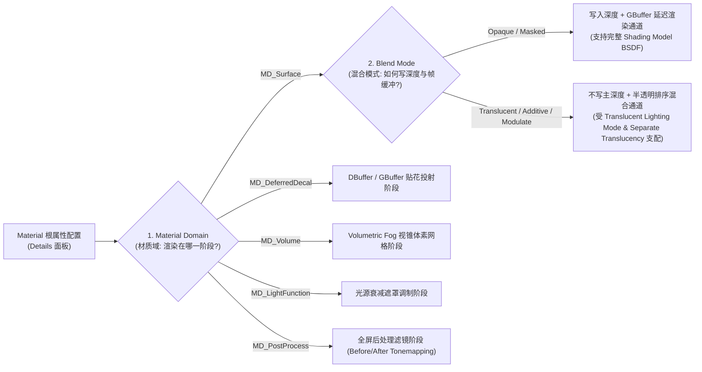
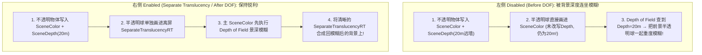

# 01 · 材质基础属性与混合着色模式（`Material_Properties`）

> **本篇实测拆解关卡档案**
> - **关卡路径**：`/Game/Maps/Material/Material_Properties`（关卡总 Actor 数：`117` | 展台数：`11` | 示例 Actor 数：`51`）
> - **关卡脚本类**：`/Game/Maps/Material/Material_Properties.Material_Properties_C`
> - **核心资产目录**：`/Game/ExampleContent/Materials/Materials/`（涵盖 `M_Opaque`、`M_Masked`、`M_Translucent`、`M_Additive`、`M_Modulated`、8 大着色模型样本、3 种半透明光照模式、`M_Decal`、`M_Volume`、分离半透明与折射深度偏移样本）

---

## 一、 为什么连第一根节点线之前，必须先看懂左侧 Details 面板？

许多刚接触虚幻材质编辑器的美术同学都有一个肌肉记忆：新建一个材质球，打开图表就开始拖 `TextureSample`、`Multiply`、`Lerp` 疯狂连线；等到发现“为什么我的玻璃没有高光反射？”、“为什么树叶贴花投不出镂空影子？”、“为什么景深一开前面的半透明特效全糊成一团？”时，才手忙脚乱地在蓝图和节点图里找原因。

其实，**真正决定一个材质在 GPU 渲染管线中“走哪条高速公路、写哪几张缓冲区、按什么物理方程受光”的总开关，根本不在节点图表里，而在材质编辑器左下角的 `Details`（细节属性面板）中！**

欢迎来到材质专题的第一座殿堂——**`/Game/Maps/Material/Material_Properties`**。这条长达 **105 米**（`X` 坐标从 `505` 延伸至 `10498`）、包含 **11 座受控对照展台** 的长廊，几乎不用复杂的连线（绝大多数示例材质只有 **1~3 个常量节点**，并且统一使用标志性的琥珀橙色 `RGB = (1.0, 0.49358, 0)` 作为固定基准色！），纯粹通过切换根材质属性，将虚幻延迟/前向混合渲染管线的底层分流逻辑扒得清清楚楚。

在逐台逛展之前，先用一张管线路由图建立全局视野：

现在，让我们从 `#1` 号展台出发，逐一解剖全部 **11 座展台** 的渲染真相与 MCP 实测参数。

---

## 二、 `Material_Properties` 逐展台（#1 ~ #11）全量实测拆解

### 展台 #1：`Different Material Properties` — 高反差材质评测光场

- **空间元数据**：展牌 Label `BP_DemoDisplay20` | 坐标 `(505, -900, 0)`

#### 1.1 为什么材质评测场要把主光源拉到 `Intensity = 10`？
与上一章迎宾大厅温和的 `6 : 3` 柔光不同，在评测材质属性（尤其是高光反射、次表面透射与半透明阴影）时，平淡的漫射光会掩盖着色模型的差异。因此，官方在 `#1` 号展台处配置了 **10 : 1 的高对比度阳光/天光比**，并额外架设了一盏局部聚光灯！

#### 1.2 展台陈列 Actor 与底层参数清单（共 6 个）
- **`DirectionalLight`**（`/Script/Engine.DirectionalLight`）：`Intensity = 10`，纯白光 `(1, 1, 1, 1)`，`CastShadows = true`，`Mobility = Movable`（全动态主光，提供清晰的亮暗交界线与背光透射条件）。
- **`SkyLight`**（`/Script/Engine.SkyLight`）：`Intensity = 1`，纯白光，`CastShadows = true`，`Mobility = Movable`（克制的环境天光，保留深邃的背光面以便观察次表面散射与自发光）。
- **`SpotLight`**（`/Script/Engine.SpotLight`）：`Intensity = 10`，衰减半径 `AttenuationRadius = 2106.370361`，`CastShadows = true`，`Mobility = Stationary`（固定聚光灯，为入口区域提供局部高光点缀）。
- **`SkyAtmosphere`**、**`ExponentialHeightFog`**、**`Actor`**（挂载 `ChaosDebugDrawComponent_0`）：维持标准测试厅天空盒、远景雾效与物理调试基座。

---

### 展台 #2：`BlendMode` — 五大混合模式的帧缓冲合成方程与性能生死线

- **空间元数据**：展牌 Label `BP_DemoDisplay19` | 坐标 `(1505, -900, 0)`
- **展台内 3D 悬浮文字标签**：`Opaque` | `Masked` | `Translucent` | `Additive` | `Modulated`

#### 2.1 为什么要分出五种混合模式？GPU 光栅化合并阶段（Output Merger）在算什么？
当一个像素通过像素着色器（Pixel Shader）算出源颜色 $C_{\text{src}}$ 和不透明度 $\alpha$ 后，GPU 并不会无脑覆盖屏幕原来已经画好的背景颜色 $C_{\text{dst}}$，而是根据 **`BlendMode`（混合模式）** 执行不同的硬件混合公式，并决定**是否更新深度缓冲（Z-Buffer）**。

#### 2.2 展台 5 个预览球 Actor 与内部材质节点逐一深拆
展台上并排陈列着 5 个引擎标准材质预览网格体 `/Engine/EngineMeshes/SM_MatPreviewMesh_01`，统一采用基准琥珀橙色 **`RGB = (1.0, 0.49358, 0.0)`** 进行公平对照：

1. **`SM_MatPreviewMesh_01` $\rightarrow$ `M_Opaque`（`BLEND_Opaque` 不透明）**
   - **连接引脚与节点（共 1 个）**：`Constant3Vector_3` `(1, 0.49358, 0)` $\rightarrow$ **`MP_BaseColor`**（`MSM_DefaultLit`）。
   - **底层方程与性能**：$C_{\text{out}} = C_{\text{src}}$。**开启 Z-Write 且完美支持硬件 Early-Z（提前深度剔除）**！GPU 在跑昂贵的像素着色器之前就能直接扔掉被挡住的像素，**零 Overdraw，完整写入 GBuffer，是项目中 90% 常规模型必须坚守的性能铁律**。
2. **`SM_MatPreviewMesh_5` $\rightarrow$ `M_Masked`（`BLEND_Masked` 二值遮罩镂空）**
   - **连接引脚与节点（共 2 个）**：`Constant3Vector_1` `(1, 0.49358, 0)` $\rightarrow$ **`MP_BaseColor`**；贴图采样 `TextureSample_1`（采样黑白棋盘格 `/Game/Global/Textures/T_Checker_128` 的 `R` 通道）$\rightarrow$ **`MP_OpacityMask`**。
   - **底层方程与性能**：非黑即白！当像素的 `OpacityMask` 小于阈值 `opacityMaskClipValue`（实测默认 `0.3333`）时，编译出的 HLSL 执行 `clip(-1)` 直接丢弃该像素；大于等于阈值的部分则**作为 100% 不透明像素写入深度与完整 GBuffer**！
   - **注意陷阱**：因为 GPU 必须跑完 Pixel Shader 才知道该像素会不会被 `clip()` 丢弃，所以 `Masked` 会**局部推迟该绘制调用的硬件 Early-Z（变为 Late-Z）**。在桌面端开销温和，但在移动端 Tile-Based GPU（TBDR）上大面积叠层树叶仍需警惕隐藏面消除（HSR）打断开销！
3. **`SM_MatPreviewMesh_2` $\rightarrow$ `M_Translucent`（`BLEND_Translucent` 标准半透明）**
   - **连接引脚与节点（共 2 个）**：向量参数 `"Color"` `(1, 0.49358, 0, 1)` $\rightarrow$ **`MP_BaseColor`**；常量 `Constant_5`（**`0.5`**）$\rightarrow$ **`MP_Opacity`**。
   - **底层方程与性能**：标准线性插值（Alpha Blending）：
     $$C_{\text{out}} = \alpha \cdot C_{\text{src}} + (1 - \alpha) \cdot C_{\text{dst}}$$
     由于此运算**不满足交换律**（先画红玻璃再画蓝玻璃 $\neq$ 先画蓝再画红），引擎必须关闭 Z-Write，在延迟管线主通道画完之后，按物体包围盒中心从远到近（Back-to-Front）排序逐层叠画。一旦两个交叉的半透明网格体互相缠绕，就会引发经典的**半透明排序穿插闪烁（Sorting Popping）**与高昂的 **Overdraw**！
4. **`SM_MatPreviewMesh_3` $\rightarrow$ `M_Additive`（`BLEND_Additive` 线性加色混合）**
   - **连接引脚与节点（共 2 个）**：`Constant3Vector_6` `(1, 0.49358, 0)` $\rightarrow$ **`MP_BaseColor`**；常量 `Constant_10`（**`0.5`**）$\rightarrow$ **`MP_Opacity`**。
   - **底层方程与性能**：能量直接累加到背景上：
     $$C_{\text{out}} = \alpha \cdot C_{\text{src}} + C_{\text{dst}}$$
     注意看视口实拍图里的第四个球：它浑身通透发亮，重叠区域自动变白！因为加法**严格满足数学交换律**（$A + B + C = B + A + C$），无论前后顺序怎么排，最终像素亮度完全一致！因此它是制作激光、火焰、魔法全息投影、星云粒子时的免排序神器（缺点是在纯白雪地背景上加什么都还是白色，看不清轮廓）。
5. **`SM_MatPreviewMesh_4` $\rightarrow$ `M_Modulated`（`BLEND_Modulate` 正片叠底相乘混合）**
   - **核心属性特殊点**：实测注意！前四个球都是 `MSM_DefaultLit`，唯独 `M_Modulated` 强制使用了 **`shadingModel = MSM_Unlit`**！
   - **连接引脚与节点（共 1 个）**：`Constant3Vector_4` `(1, 0.49358, 0)` $\rightarrow$ **`MP_EmissiveColor`**（无 `Opacity` 引脚！）。
   - **底层方程与性能**：与背景颜色逐通道相乘染色：
     $$C_{\text{out}} = C_{\text{src}} \times C_{\text{dst}}$$
     任何小于 `1.0` 的颜色乘上去都会让背景变暗（乘 `1.0` 纯白相当于完全透明不变，乘 `0.0` 纯黑变成死黑）。同样满足乘法交换律，非常适合制作染色滤光玻璃、污渍暗角或复古假阴影贴片（注意：由于不吃雾效，在浓雾关卡里远处的 Modulate 粒子可能会显出黑影轮廓，现代项目亦常用 `AlphaComposite` 预乘混合替代）。

---

### 展台 #3：`ShadingModel` — 八大着色模型的微观物理光学博弈

- **空间元数据**：展牌 Label `BP_DemoDisplay12` | 坐标 `(2490, -900, 0)`
- **展台内 3D 悬浮文字标签**：`Subsurface Profile` | `Default Lit` | `Two Sided Foliage` | `Unlit (Emissive)` | `Hair` | `SubSurface` | `ClearCoat` | `Cloth`

#### 3.1 同样是橙色不透明球，为什么换个 Shading Model 质感天差地别？
如果说 `BlendMode` 决定了“像素怎么叠”，那么 **`ShadingModel`（着色模型）** 就决定了延迟光照阶段用哪一套 **BSDF（双向散射分布函数）** 来计算光线照到表面后的反射与内部散射！在 GBuffer 中，每个像素都会用专门的 `ShadingModelID` 位标记自己的身份。

#### 3.2 展台 8 个预览球资产与实测连线全景拆解

| 展品 Actor | 材质资产名称 | 底层 `ShadingModel` | MCP 实测已连接主引脚与精确参数值 | 物理光学特征与核心适用场景 |
| :--- | :--- | :--- | :--- | :--- |
| **`SM_MatPreviewMesh_27`** | `M_Opaque_SSP` | `MSM_SubsurfaceProfile` | • `MP_BaseColor`: `(0.940678, 0.4643, 0)` • `MP_Opacity`: 参数 `"SubsurfaceDistance" = 1` • 关联资产: `Demo_SSP` (`SubsurfaceProfile`) | **屏幕空间卷积次表面散射**：在后处理阶段对高光以外的漫反射缓冲按红绿蓝不同散射半径做双边高斯模糊。**3A 写实人类皮肤、蜡烛、温润软玉的首选**！ |
| **`SM_MatPreviewMesh_12`** | `M_Opaque` | `MSM_DefaultLit` | • `MP_BaseColor`: `(1, 0.49358, 0)` | **标准迪士尼/GGX 微表面模型**：Lambert 漫反射 + Trowbridge-Reitz GGX 镜面高光。覆盖金属、木材、石材、塑料等 90% 常规固体。 |
| **`SM_MatPreviewMesh_31`** | `M_Opaque_TwoSidedFoliage` | `MSM_TwoSidedFoliage` | • `MP_BaseColor`: `(1, 0.49358, 0)` • `MP_SubsurfaceColor`: 宝蓝 `(0, 0.170257, 1)` | **双面薄片透射模型**：专为树叶、花瓣、纸灯笼设计！正面走常规受光，当阳光从背面射来时，按包裹漫反射（Wrap Lighting）透出鲜亮的 `SubsurfaceColor`（此处故意填宝蓝色形成强烈冷暖透光对比！）。 |
| **`SM_MatPreviewMesh_26`** | `M_Opaque_Unlit` | `MSM_Unlit` | • `MP_EmissiveColor`: `(1, 0.49358, 0)` | **无光照自发光模型**：彻底跳过所有直接光/阴影/法线计算，直接向场景颜色缓冲输出恒定辐射度。开销最低，用于天空球、UI 面板、灯管灯芯。 |
| **`SM_MatPreviewMesh_28`** | `M_Opaque_Hair` | `MSM_Hair` | • `MP_Normal`: `TexCoord_0` $\to$ `Multiply_0` $\to$ `Subtract_0` + `DeriveNormalZ_0`（模拟发丝切线方向） • `MP_FrontMaterial`: `SubstrateShadingModels_0`（色值 `(1, 0.49358, 0)`） | **Marschner 毛发纤维散射模型**：模拟光线穿过圆柱形角蛋白鳞片的 $R$（表面白高光）、$TT$（背光透射）与 $TRT$（内部二次反射彩色副高光）双高光带！*(注：MCP 实测捕获到该资产内部已桥接 `MaterialExpressionSubstrateShadingModels_0` 兼容节点！)* |
| **`SM_MatPreviewMesh_13`** | `M_Opaque_SubSurface` | `MSM_Subsurface` | • `MP_EmissiveColor`: `(0.940678, 0.4643, 0)` • `MP_Opacity`: `"SubsurfaceDistance" = 0.3` • `MP_SubsurfaceColor`: `(0, 0.170257, 1)` | **低开销体积次表面散射**：不依赖屏幕空间模糊，直接通过阴影图厚度估算背光穿透与环绕漫反射。比 `SubsurfaceProfile` 便宜，适合冰块、果冻、远景中低精度玉石。 |
| **`SM_MatPreviewMesh_25`** | `M_Opaque_Clearcoat` | `MSM_ClearCoat` | • `MP_BaseColor`: `(1, 0.49358, 0)` | **双层清漆涂层模型**：底层可拥有独立的粗糙度与金属底漆法线，顶层叠加一层 $\text{IOR}=1.5$ 的光滑透明聚氨酯清漆高光。专为豪车烤漆、钢琴烤漆、上了亮油的碳纤维与实木地板而生。 |
| **`SM_MatPreviewMesh_24`** | `M_Opaque_Cloth` | `MSM_Cloth` | • `MP_SubsurfaceColor`（重映射为 `Fuzz Color` 绒毛色）: `(1, 0.49358, 0)` | **Charlie / Ashikhmin 织物微绒毛散射**：普通 GGX 高光集中在正中心，而丝绒、棉麻布料表面的直立细小纤维会在**边缘掠射角（Grazing Angle）产生强烈的逆向散射泛白光晕（Sheen/Fuzz）**！ |

---

### 展台 #4：`Translucent Lighting Mode` — 半透明物体的“省钱 vs 画质”三级阶梯

- **空间元数据**：展牌 Label `BP_DemoDisplay13` | 坐标 `(3510, -900, 0)`
- **展台内 3D 悬浮文字标签**：`VolumetricNonDirectional` | `VolumetricDirectional` | `Surface` | `(Metallic Material to show reflections)`

#### 4.1 为什么你的半透明玻璃默认像一团糊糊的果冻，一点镜面反光都没有？
这是虚幻新手踩坑率 **Top 1** 的大坑！在延迟渲染器中，半透明材质没有写进 GBuffer，假如每个半透明粒子像素都去遍历全场景几十盏光源算完整法线高光，显卡当场就会罢工。因此，引擎默认把半透明材质的光照模式设成了最廉价的 **`Volumetric NonDirectional`（无方向体积光照）**——它只去一张低分辨率 3D 半透明光照体积纹理（Translucency Lighting Volume，默认 $64^3$ 体素）里查一个环境平均亮度，**完全无视法线，也根本不算镜面高光**！

#### 4.2 展台 3 个半透明球的阶梯对比与节点实测
1. **`SM_MatPreviewMesh_9` $\rightarrow$ `M_Translucent`（`TLM_VolumetricNonDirectional`）**
   - **实测参数**：`BaseColor = (1, 0.49358, 0)`，`Opacity = 0.5`。
   - **视觉与开销**：**最便宜！** 无视表面法线朝向，整个球体均匀受光，毫无立体体积感。**完美契合滚滚浓烟、粉尘雾气等本就没有固定硬表面的粒子特效**。
2. **`SM_MatPreviewMesh_10` $\rightarrow$ `M_Translucent_VolDirectional`（`TLM_VolumetricDirectional`）**
   - **实测参数**：`BaseColor = (1, 0.49358, 0)`，`Opacity = 0.5`，切换至 `TLM_VolumetricDirectional`。
   - **视觉与开销**：从 3D 光照体积中读取二阶球谐函数（Spherical Harmonics）的主光源方向信息，开始结合**像素法线（Normal）** 计算明暗面漫反射！立体感瞬间显现，但依然**没有镜面高光反射（Specular = 0）**。适合带法线贴图的厚重云团、半透明水花精灵。
3. **`SM_MatPreviewMesh_11` $\rightarrow$ `M_Translucent_Surface`（`TLM_Surface` / Surface TranslucencyVolume）**
   - **实测参数玄机**：注意看它的 4 个节点——除了 `BaseColor = (1, 0.49358, 0)` 和 `Opacity = 0.5` 外，官方特意多连了 **`Constant_23 = 1` 到 `MP_Metallic`** 以及 `Constant_24` 到 `MP_Roughness`，还在头顶专门挂了一行提示标签 `(Metallic Material to show reflections)`！
   - **视觉与开销**：开启表面模式后，半透明材质终于解锁了 **`Metallic`、`Specular`、`Roughness` 引脚**，能够采样反射捕获球（Reflection Captures / SkyLight Cubemap）呈现出清晰的金属/玻璃环境倒影！
   - **进阶补充**：如果你制作的是挡风玻璃或展示柜玻璃，连来自多盏动态点光源的精确高光点都要保留，还可在细节面板勾选最顶配（也最昂贵）的 **`Surface ForwardShading`（表面前向着色）**！

---

### 展台 #5：`Two Sided` — 背面剔除（Back-face Culling）与双面法线翻转

- **空间元数据**：展牌 Label `BP_DemoDisplay14` | 坐标 `(4490, -900, 0)`
- **展台内 3D 悬浮文字标签**：`One Sided` | `Two Sided`

#### 5.1 为什么左边的半透明立方体看起来像“少了三面墙的破盒子”，右边才有厚重玻璃盒的质感？
在光栅化图形学中，为了节省一半的像素填充算力，GPU 默认开启 **背面剔除（Back-face Culling）**：通过检查投影到屏幕上的三角形三个顶点是顺时针还是逆时针绕序（Winding Order），只要判定是背朝摄像机的内壁面，硬件直接一刀剪掉不画！
对于实心石头（`Opaque`），你本来就看不见石头肚子里的背面，剔除掉天经地义；但对于**半透明玻璃杯、镂空铁丝网笼子、单面树叶纸片或飘扬的旗帜**，一旦剪掉背面，穿过透明前壁往里看就会空空如也！

#### 5.2 展台 2 个立方体 Actor 与材质实测对比
- **`SM_Cube`**（使用 `/Game/Global/Meshes/SM_DemoCube`，覆写 `M_Translucent`，`twoSided = false`）：只能看到朝向相机的前、上、侧三个面，内部后壁全部被剔除消失。
- **`SM_Cube2`**（使用同一个 `SM_DemoCube`，覆写 `M_Translucent_2sided`，唯一区别是 **`twoSided = true`**，节点同样为 `BaseColor = (1, 0.49358, 0)` 与 `Opacity = 0.5`）：立方体全部 6 个面（前 3 面 + 透过前壁看到的后 3 面内壁）全部参与光栅化叠加，立刻呈现出真实亚克力盒子的空间深度感！

> [!WARNING]
> **性能与法线避坑指南**
> 1. **切勿无脑全局勾选 `Two Sided`**：对于封闭不透明硬表面模型，误勾 `Two Sided` 会白白关闭背面剔除，导致硬件光栅化三角形吞吐负担翻倍，甚至引发阴影贴图自遮挡痤疮（Shadow Acne）！
> 2. **`TwoSidedSign` 节点妙用**：勾选 `Two Sided` 后，引擎会自动将背面像素的顶点法线翻转乘以 `-1` 以保证背面正确受光。如果你想做一张“正面印红桃 A、背面印棋盘花纹”的单面扑克牌，只需在材质里拖出 **`TwoSidedSign`** 节点（正面输出 `+1`，背面输出 `-1`）连入 `Lerp` 即可零增面实现正反异图！

---

### 展台 #6：`Material Domain` — 跳出三维网格表面的五大材质疆域

- **空间元数据**：展牌 Label `BP_DemoDisplay15` | 坐标 `(5500, -900, 0)`
- **展台内 3D 悬浮文字标签**：`Surface` | `Deferred Decal` | `Volume` | `Light Function` | `Post Process` | `Blendable` | `(move inside of volume to see effect)`

#### 6.1 材质不只是“蒙在模型上的皮”！
在虚幻引擎中，一套统一的节点化 HLSL 编译器被复用到了渲染管线的各个角落（除了此处展出的 5 种外，还有专供 UMG 界面的 `MD_UI`）。`#6` 号展台一口气摆出了 **5 类完全异构的宿主 Actor**，演示同一套材质语法如何化身为固体表面、墙面贴花、局部体积雾团、灯光投影胶片以及全屏滤镜：

1. **疆域一：`Surface`（表面材质）**
   - **宿主 Actor**：`SM_MatPreviewMesh_14` $\rightarrow$ 赋予 `M_Opaque`（`materialDomain = MD_Surface`）。最标准的网格表面着色器。
2. **疆域二：`Deferred Decal`（延迟贴花材质）**
   - **宿主 Actor**：`M_Decal`（`DecalActor`，投影盒尺寸 `DecalSize = (1, 1, 1)`，`SortOrder = 0`）。
   - **材质深拆 `/Game/ExampleContent/Materials/Materials/M_Decal`**：`materialDomain = MD_DeferredDecal`，`blendMode = BLEND_Translucent`。内部 3 个节点：橙色常量 `(1, 0.49358, 0)` $\rightarrow$ `MP_BaseColor`；裂纹法线贴图 `/Game/Global/Textures/T_Crackle_N` $\rightarrow$ **`MP_Normal`**；粗糙度常量 $\rightarrow$ `MP_Roughness`。无需改动地板网格一个顶点，直接把逼真的立体龟裂纹烙印在展台地面上！
3. **疆域三：`Volume`（局部体积雾材质）**
   - **宿主 Actor**：`Cube`（`/Engine/BasicShapes/Cube`，覆写 `/Game/ExampleContent/Materials/Materials/M_Volume`）。
   - **材质深拆 `M_Volume`**：**`materialDomain = MD_Volume`**，**`blendMode = BLEND_Additive`**！
   - **6 个节点还原 3D 球形雾团算法**：将当前体素世界坐标 `WorldPosition_0` 与立方体中心世界坐标 `ObjectPositionWS_0` 送入 **`SphereMask_0`**（半径 `Constant_1 = 75` cm，柔和衰减硬度 `Constant_2`），输出球形密度遮罩连入消光/散射引脚（底层槽位映射为 `MP_SubsurfaceColor`），搭配橙色反照率 `(1, 0.49358, 0)` 连入 `MP_BaseColor`！当全局开启指数高度雾的 `Volumetric Fog` 时，这个普通方块内部就会悬浮起一团真实吃光投影的橙色三维雾球！
4. **疆域四：`Light Function`（灯光函数材质）**
   - **宿主 Actor**：`SpotLight1`（`SpotLight`，强度高达 `104.7069`，暖黄光色 `(1, 0.690196, 0, 1)`，衰减半径 `512`，`Mobility = Movable`，`CastShadows = false`）。
   - **底层机制**：将 `materialDomain = MD_LightFunction` 的灰度材质赋给光源的 `Light Function Material` 插槽，就像在舞台聚光灯镜头前插了一片镂空花纹幻灯片（Gobo），可用于低成本模拟树影婆娑、电扇旋转投影、水底焦散（Caustics）或手电筒光斑纹理！
5. **疆域五：`Post Process`（后处理可混合材质 Blendable）**
   - **宿主 Actor**：`PostProcessVolume`（局部包围盒 `bUnbound = false`，过渡柔和半径 `BlendRadius = 100`，`BlendWeight = 1`）。
   - **互动体验**：正如悬浮标签提示的 `(move inside of volume to see effect)`，当你把摄像机推进这个无形的 `PostProcessVolume` 盒体内部时，挂载在 `Post Process Materials` 数组里的 `MD_PostProcess` 材质就会接管全屏像素，通过对 `SceneTexture:PostProcessInput0` 做采样扭曲或调色，实现夜视仪、水下波纹、中毒眩晕或扫描线滤镜！

---

### 展台 #7：`Separate Translucency` — 拯救被景深（DOF）糊成马赛克的半透明特效

- **空间元数据**：展牌 Label `BP_DemoDisplay16` | 坐标 `(6485, -900, 0)`
- **展台内 3D 悬浮文字标签**：`Disabled` | `Post Process` | `Depth of Field` | `Enabled`

#### 7.1 为什么开了电影级景深之后，近处的玻璃瞄准镜或护盾全糊了？
这是一个直击渲染管线执行顺序的经典痛点！
景深（Depth of Field, DOF）后处理是怎么知道屏幕上哪个像素该清晰、哪个像素该模糊的？**它查的是场景深度缓冲（Scene Depth Buffer）！**
可是别忘了我们在展台 `#2` 学到的铁律：**半透明物体默认是不写入深度缓冲的！**
假如一个半透明球摆在摄像机正前方 1 米的对焦清晰处，而它背后 20 米外是一堵处于远景失焦区的墙：
- 如果半透明球在 **DOF 之前** 就直接画进了主场景颜色缓冲里（即 **关闭 Separate Translucency / `Before DOF`**），等到跑 DOF 时，GPU 一查这个像素的深度，读到的却是 **20 米外那堵后墙的深度**！于是，明明近在眼前的半透明球，被冤枉地跟着后墙一起糊成了一团浆糊！
- 反之，如果开启 **`Separate Translucency`（在 UE5 中演进为 `Translucency Pass = After DOF`，默认开启！）**，引擎会把这些半透明物体单独画进一张离屏缓冲区（Separate Translucency Buffer），等主场景跑完景深模糊之后，再把清晰锐利的半透明图层无损合成回画面上！

#### 7.2 展台 8 个陈列 Actor 精密对照拆解
为了让你在同一个镜头里同时看到焦内、焦外与前后遮挡关系，官方在中央架设了带可视边框 `SM_PostProcessVisualizer` 的强景深体积 **`PostProcessVolume_2`**（`bUnbound = false`, `BlendRadius = 100`），并在左右两侧各按前、中、后纵深摆放了 **3 颗半透明材质球**：
- **左侧 `Disabled` 组（3 颗球，关闭分离半透明）**：
  - 前后橙色球 `SM_MatPreviewMesh_19` & `SM_MatPreviewMesh_15`：使用 `M_Translucent_notseperate`（`Color = (1, 0.49358, 0)`，`Opacity = 0.5`）；
  - 中间朱红色实例球 `SM_MatPreviewMesh_17`：使用材质实例 `M_Translucent_notseperate_Inst`（覆写 `Color = (1, 0.139179, 0, 1)`）。走近观察可见，受背后远景深度拖累，整组球边缘惨遭景深误伤模糊！
- **右侧 `Enabled` 组（3 颗球，开启分离半透明）**：
  - 前后橙色球 `SM_MatPreviewMesh_20` & `SM_MatPreviewMesh_16`：使用默认开启分离半透明的 `M_Translucent`；
  - 中间深红实例球 `SM_MatPreviewMesh_18`：使用 `M_Translucent_Inst`（覆写 `Color = (1, 0.08042, 0, 1)`）。透过模糊失焦的后景，前景球体依然保持着刀锋般锐利的轮廓！

> [!TIP]
> **实战双向取舍技巧**：默认开启 `After DOF` 固然能防止前景玻璃/全息准星被背景深度误糊，但如果你的半透明特效**本来就是远景散景里的发光萤火虫或远处瀑布水雾**，开启 `After DOF` 反而会让它在模糊的远山前突兀地过于清晰！此时应主动将该远景水雾材质切换为 **`Before DOF`**，让它自然融入电影感浅景深散景（Bokeh）中！

---

### 展台 #8：`Volumetric Directional Lighting Intensity` — 半透明球谐方向光对比度旋钮

- **空间元数据**：展牌 Label `BP_DemoDisplay17` | 坐标 `(7490, -900, 0)`
- **展台内 3D 悬浮文字标签**：`0.5` | `1.0` | `5`

#### 8.1 为什么烟雾团上了法线贴图还是显得“太肉、立体感不够”？
回到展台 `#4` 讲过的 `TLM_VolumetricDirectional` 模式：由于半透明光照体积（Translucency Volume）是一张低频平滑的二阶球谐纹理，直接用它点乘粒子法线时，亮部与暗部的明暗过渡往往偏柔和。为此，材质细节面板专门提供了一个艺术强化旋钮——**`Directional Lighting Intensity`（方向光照强度）**！

#### 8.2 展台 3 颗预览球实测对比
3 颗材质球具有完全相同的节点图（仅 `Constant3Vector_5` `(1, 0.49358, 0)` $\to$ `BaseColor`，`Constant_5 = 0.5` $\to$ `Opacity`，光照模式同为 `TLM_VolumetricDirectional`），唯一改变的是根属性 `Directional Lighting Intensity`：
1. **`SM_MatPreviewMesh_23` $\rightarrow$ `M_Translucent_VolDirectional_intensityLow`（标签 `0.5`）**：压低法线方向性权重，趋近于无方向均匀散射，质感轻柔朦胧（适合薄雾、轻纱）。
2. **`SM_MatPreviewMesh_21` $\rightarrow$ `M_Translucent_VolDirectional`（标签 `1.0`）**：物理基准默认值，呈现自然的迎光面与背光面过渡。
3. **`SM_MatPreviewMesh_22` $\rightarrow$ `M_Translucent_VolDirectional_intensityHigh`（标签 `5`）**：将法线受光方向性放大 5 倍，球体迎光侧强烈高亮、背光侧浓郁压暗，体积雕塑感爆棚（非常适合强化翻滚爆炸黑烟的“菜花状”团块立体感！）。

---

### 展台 #9：`Opacity Mask Clip Value` — `clip()` 裁剪阈值对镂空边缘胖瘦的精确手术

- **空间元数据**：展牌 Label `BP_DemoDisplay18` | 坐标 `(8485, -900, 0)`
- **展台内 3D 悬浮文字标签**：`Greyscale Mask` | `0.01` | `0.33` | `0.8`

#### 9.1 为什么同一张遮罩贴图，改一个数字就能让树叶“变胖”或“枯萎变瘦”？
在 `BLEND_Masked` 模式下，哪怕你连入 `Opacity Mask` 引脚的是一张带有柔和灰阶过渡（`0.0 ~ 1.0`）的灰度图，最终屏幕像素也绝对没有半透明中间态——全凭 **`Opacity Mask Clip Value`** 这把手术刀一刀切：
$$\text{Visible} = \begin{cases} \text{Keep (保留渲染)}, & \text{if } \text{Mask}(u,v) \ge \text{OpacityMaskClipValue} \\ \text{Discard / clip(-1) (丢弃镂空)}, & \text{if } \text{Mask}(u,v) < \text{OpacityMaskClipValue} \end{cases}$$

#### 9.2 展台 4 块平面网格（`SM_Plane_100x100`）节点与阈值全拆解
为了让你一眼看懂裁剪原理，官方先把原始灰度贴图摊开摆在最左边，随后依次展示三个梯度的裁剪结果（全部采样 `/Game/Global/Textures/T_Pattern_M` 的 **`G` 绿色通道**，`SAMPLERTYPE_Masks` 线性采样！）：

1. **`SM_Plane_100x100` $\rightarrow$ `M_MaskTextureViz`（标签 `Greyscale Mask`）**
   - **属性与连线**：`BLEND_Opaque` + `MSM_Unlit`，将 `T_Pattern_M` 的 `G` 通道直接连入 `MP_EmissiveColor`。可以看到原图中心最白（接近 `1.0`），向外侧呈平滑渐变灰阶衰减直至纯黑（`0.0`）。
2. **`SM_Plane_100x101` $\rightarrow$ `M_Masked_ClipValueLow`（标签 `0.01`）**
   - **MCP 实测阈值**：`opacityMaskClipValue = 0.009999999776`（即 **`0.01`**）。只要灰度值稍微高于纯黑一丁点就全部保留，因此保留下来的橙色花纹面积最饱满肥厚！
3. **`SM_Plane_100x102` $\rightarrow$ `M_Masked_ClipValueDefault`（标签 `0.33`）**
   - **MCP 实测阈值**：`opacityMaskClipValue = 0.3332999945`（虚幻引擎所有新建材质的出厂默认值 **`0.3333`**！），切在灰阶三分之一处，花纹粗细适中。
4. **`SM_Plane_100x103` $\rightarrow$ `M_Masked_ClipValueHigh`（标签 `0.8`）**
   - **MCP 实测阈值**：`opacityMaskClipValue = 0.8000000119`（即 **`0.8`**）。门槛极高，只有原图中心最亮大于 `0.8` 的核心骨架才能幸存，花纹变得极度纤细骨感！

> [!TIP]
> **两大高阶制作秘籍**
> 1. **远景植被 Mipmap 保体积（Preserve Coverage）**：树叶在远处缩成小像素采样低级 Mipmap 时，灰度边缘会与透明背景平均变暗，导致远处的树冠在固定 `0.333` 阈值下严重“秃顶掉叶子”！记得在树叶贴图编辑器中将 `Mip Gen Settings` 调整或开启 Alpha Coverage 保持，或在材质中随相机距离动态微降裁剪基准。
> 2. **动态溶解特效原理**：你在游戏里见到的怪物死后“灰飞烟灭溶解”特效，本质上正是拿一张噪波灰度图连进 `Opacity Mask`，然后在材质里用参数动态减去一个从 `0` 涨到 `1` 的偏移量（等价于把 Clip 刀口从 `0.01` 一路推向 `1.0`），再沿着刀口边缘（`abs(Mask - Threshold) < EdgeWidth`）加一圈橙红火星 `Emissive`！

---

### 展台 #10：`Cast Translucent Shadow as Masked` — 让半透明材质投下刀刻般的镂空硬阴影

- **空间元数据**：展牌 Label `BP_DemoDisplay` | 坐标 `(9485, -900, 0)`
- **展台内 3D 悬浮文字标签**：`Disabled` | `Enabled`

#### 10.1 为什么半透明窗花在地上投不出清晰的镂空动态影子？
在实时阴影贴图（Shadow Map / Virtual Shadow Maps）渲染阶段，光源视角渲染的同样是一张**只记录最近距离的单层深度图（Shadow Depth Pass）**。
对于 `BLEND_Translucent` 半透明材质，动态光源默认要么完全不投射阴影，要么投出一整块模糊暗淡的方块影，无法精准镂空贴图透明处。而勾选材质细节面板中的 **`Cast Dynamic Shadow as Masked`（将半透明阴影按遮罩模式投射）** 后，该材质在主画面里依然保持丝滑柔美的半透明混合，但在**渲染阴影深度图时，会自动化身 `Masked` 材质，按照 `Opacity` 与 `OpacityMaskClipValue (0.3333)` 精确裁剪阴影深度**！

#### 10.2 展台 2 块平面网格对比拆解
两块 `SM_Plane_100x100` 悬空摆放，节点连线 100% 相同（均为 `BLEND_Translucent`，橙色常量 `(1, 0.49358, 0)` $\to$ `MP_BaseColor`，花纹贴图 `T_Pattern_M` 的 `G` 通道 $\to$ `MP_Opacity`）：
- **左侧 `SM_Plane_100x104` $\rightarrow$ `M_Translucent_StaticShadow`（`Disabled`）**：未开启遮罩动态阴影，动态平行光穿过半透明花纹板后，无法在展台台面上投射出清晰的几何镂空阴影。
- **右侧 `SM_Plane_100x105` $\rightarrow$ `M_Translucent_StaticShadowMasked`（`Enabled`）**：开启该开关后，花纹板既保留了边缘柔和的 Alpha 渐变半透明本体，又在后方台面上投下了边缘锐利、孔洞分明的镂空花纹影子！这是制作蕾丝窗纱、彩绘玻璃窗、半透明昆虫翅膀时的必备开关。

---

### 展台 #11：`Refraction Depth Bias` — 根治屏幕空间折射的“前景穿帮重影（Self-Bleed）”

- **空间元数据**：展牌 Label `BP_DemoDisplay9` | 坐标 `(10498, -900, 0)`（长廊压轴展台）
- **展台内 3D 悬浮文字标签**：`Refraction Depth Bias = 0` | `Refraction Depth Bias = 15`

#### 11.1 为什么插在水面里的木桩或角色大腿，会在水面上折射出一圈诡异的“错位鬼影”？
这是实时水体与玻璃材质最经典的屏幕空间伪影（Screen-Space Refraction Artifact）！
虚幻引擎的实时折射（非光线追踪模式下）本质上是**屏幕空间 UV 扭曲**：当渲染水晶球或水面像素 $(u, v)$ 时，根据折射率（此处 `Refraction = 1.4`）把采样坐标偏移到了 $(u + \Delta u, v + \Delta v)$ 去读取已经画好的 `SceneColor`。
**灾难就在这时发生了**：如果 $(u + \Delta u, v + \Delta v)$ 那个位置恰好挡着一个**比水面离摄像机更近的前景物体**（或者半插在玻璃球表面交界处的物体），物理上玻璃球背后根本不可能折射出它“前面”的东西！但无脑偏移的 UV 却把前景物体的颜色生生拽进了玻璃球内部，形成一圈恶心的橙色膨胀鬼影！

**`Refraction Depth Bias`（折射深度偏移）** 就是专治这个毛病的深度守门员：在读取偏移像素前，对比玻璃自身深度与目标采样点的 `SceneDepth`——凡是比玻璃深度还要靠前（超出 Bias 容差范围）的前景像素，拒绝采样其扭曲色，从而彻底斩断前景渗色！

#### 11.2 展台 4 颗嵌套球体（`Attenuation_sphere_01`）精密实验拆解
官方在这里设计了两组“透明折射球 + 不透明橙色实心球相交穿插”的对照实验，均使用网格体 `/Game/ExampleContent/Effects/Meshes/Attenuation_sphere_01`：
- **左组（标签 `Refraction Depth Bias = 0`）**：
  - 折射球 `Attenuation_sphere_01`（材质 `M_RefractionDepthBias`）与不透明橙色球 `Attenuation_sphere_4`（材质 `M_Opaque`）交错。
  - **节点实测**：`refractionMethod = RM_IndexOfRefraction`，`Constant_7 = 0.1` 同时连入 `MP_BaseColor` 与 `MP_Opacity`（高透玻璃），**`Constant_8 = 1.4` 连入 `MP_Refraction`**（模拟折射率 1.4 的光学玻璃）。当深度偏移为 `0` 时，两球交界边缘处橙色球的颜色发生了明显的不自然溢出扭曲。
- **右组（标签 `Refraction Depth Bias = 15`）**：
  - 折射球 `Attenuation_sphere_2`（材质 `M_RefractionDepthBiasHigh`）与不透明橙色球 `Attenuation_sphere_3`（`M_Opaque`）交错。
  - **节点实测**：内部 2 个常量节点（`0.1` 与 `1.4`）与左球分毫不差，仅将材质细节面板中的 **`Refraction Depth Bias` 调高至 `15`**！交界处错位的橙色拉伸伪影被干净利落地裁切消除。

*(注：关卡持久层另含 1 个全局空容器 `InstancedFoliageActor`。)*

---

## 三、 本章实战总结与材质根属性速查铁律

走完 `Material_Properties` 全部 11 座展台，请将以下四条工程铁律刻进你的项目 Code Review 清单中：

| 检查维度 | 黄金法则与实战避坑要点 |
| :--- | :--- |
| **1. 混合模式优先级** | 永远遵循 **`Opaque` > `Masked`（配合 `DitherOpacityMask` 伪半透明） > `Additive` > `Translucent`** 的性能降序！能用不透明决不用遮罩，能用抖动遮罩决不开真半透明。 |
| **2. 半透明高光迷思** | 玻璃没反光不要去狂拉 `Specular`，先检查 `Translucency Lighting Mode` 是否还停在默认的 `Volumetric NonDirectional`——改成 **`Surface TranslucencyVolume`** 或 **`Surface ForwardShading`** 才能唤醒镜面反射！ |
| **3. 景深与半透明排序** | 瞄准镜、近景能量盾糊成一团？开启 **`After DOF`（Separate Translucency）**；远景瀑布水雾、发光尘埃在散景里太突兀？主动改回 **`Before DOF`**！ |
| **4. 水面岸边鬼影修复** | 角色趟水或礁石出水处有一圈诡异重影？适当调节水材质或材质实例中的 **`Refraction Depth Bias`**（每个 Material Instance 都默认暴露了这个全局标量参数，正如我们在展台 `#7` 的实例 JSON 中亲眼看到的 `RefractionDepthBias = 0`！）。 |

现在，我们已经摸透了材质编辑器的“骨架总开关（Details 属性）”。下一篇，让我们走进紧邻的姊妹大馆 **`02_Material_Nodes`**，把主材质节点上的每一个输入引脚逐一拆个底朝天！
