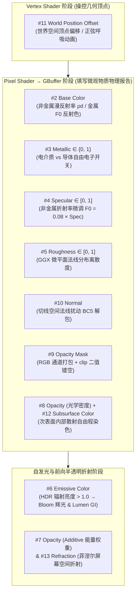

# 02 · 核心材质节点与 PBR 物理引脚全解（`Material_Nodes`）

> **本篇实测拆解关卡档案**
> - **关卡路径**：`/Game/Maps/Material/Material_Nodes`（关卡总 Actor 数：`151` | 展台数：`13` | 示例 Actor 数：`52`）
> - **关卡脚本类**：`/Game/Maps/Material/Material_Nodes.Material_Nodes_C`
> - **核心资产目录**：`/Game/ExampleContent/Material_Nodes/Materials/`、`/Game/ExampleContent/SubsurfaceScattering/Materials/`、`/Game/ExampleContent/PostProcessing/Materials/`

---

## 一、 从“调色玄学”走向“物理定律”：主材质节点的十大核心引脚

在上一篇 `Material_Properties` 中，我们拨动了材质编辑器左侧 `Details` 面板里的渲染管线总闸。现在，当我们把目光移向材质图表正中央那个硕大的深灰色输出节点（Main Material Node）时，真正的 **PBR（Physically Based Rendering，基于物理的渲染）** 之旅才刚刚开始。

很多从早期次世代（Diffuse + Specular + Glossiness 工作流）转过来的美术，或者刚入门的程序员，面对 `Base Color`、`Metallic`、`Specular`、`Roughness`、`Emissive Color`、`Opacity`、`Opacity Mask`、`Normal`、`World Position Offset`、`Subsurface Color`、`Refraction` 这一长串引脚时，最容易犯的错误就是**“望文生义”**：
- 以为物体不够亮就去拉高 `Base Color` 甚至加一点 `Emissive`；
- 以为想让石头反光更强就把黑白高光贴图插进 `Specular`；
- 以为 `Metallic = 0.5` 能做出拉丝半金属质感；
- 以为次表面材质里的 `Opacity = 0` 会让角色皮肤变成透明隐身人……

为了彻底消灭这些认知误区，Epic 官方打造了全长 **125 米**（`X` 从 `515` 延伸至 `12497`）、包含 **13 座展台** 的 **`/Game/Maps/Material/Material_Nodes`** 展厅。这座展厅的设计极其克制而纯粹：**每一座展台只单独点亮主材质节点上的某一个输入引脚，将其余变量全部冻结**，用铁一般的物理对比让你亲眼看见每个引脚背后的微表面散射方程（Microfacet BRDF）与顶点着色魔法。

让我们沿着这条 125 米长的 PBR 大道，逐一拆解全部 **13 座展台** 的实测资产与数学原理！

---

## 二、 `Material_Nodes` 逐展台（#1 ~ #13）全量实测拆解

### 展台 #1：`Material Nodes` — 标准物理评测光场初始化

- **空间元数据**：展牌 Label `BP_DemoDisplay13` | 坐标 `(515, -900, 0)`
- **官方展牌原文**：`Descriptions of the Different Material Inputs`（不同材质输入引脚详解）

#### 1.1 展台环境 Actor 实测配置（共 6 个）
与 `Material_Properties` 保持严谨一致的评测基准，`#1` 号展台处锚定了全图的受控光场：
- **`DirectionalLight`**：`Intensity = 10`，纯白光 `(1, 1, 1, 1)`，`CastShadows = true`，`Mobility = Movable`。
- **`SkyLight`**：`Intensity = 1`，纯白光 `(1, 1, 1, 1)`，`CastShadows = true`，`Mobility = Movable`。
- **`SpotLight`**：`Intensity = 8`（略低于上一关的 `10`），衰减半径 `AttenuationRadius = 2000`，`CastShadows = true`，`Mobility = Stationary`。
- **`SkyAtmosphere`**、**`ExponentialHeightFog`**、**`Actor`**（`ChaosDebugDrawComponent_0`）：提供物理天空反射源（对后续 `#3 Metallic` 和 `#5 Roughness` 镜面球观察天空倒影至关重要！）。

---

### 展台 #2：`BaseColor` — 物质固有反照率与参数化覆写初体验

- **空间元数据**：展牌 Label `BP_DemoDisplay1` | 坐标 `(1515, -900, 0)`
- **展台内 3D 悬浮文字标签**：`Material` / `Base Color White` | `Material Instance` / `Base Color modified to Red` | `Material` / `Base Color is Grass Texture` | `Material Instance` / `Base Color is modified to` / `Brick Texture`

#### 2.1 `Base Color` 在物理上到底是什么？为什么不能把阴影画进贴图里？
在传统非 PBR 时代，美术画的是 `Diffuse Map`（漫反射贴图），习惯把砖缝里的死黑阴影和高光亮边直接画在贴图上。而在虚幻的 PBR 管线中，**`Base Color` 代表的是完全剥离了环境光影的纯净“固有反照率（Albedo）”**：
- 当 **`Metallic = 0`（电介质/非金属）** 时，`Base Color` 定义了穿透表面后被次表层色素散射出来的**漫反射光比例 $\rho_d$**；
- 当 **`Metallic = 1`（导体/纯金属）** 时，金属内部没有漫反射，`Base Color` 的身份瞬间切换为**垂直入射镜面反射率 $F_0$（即金属高光本身的颜色，如黄金的明黄色、紫铜的玫瑰金色）**！

#### 2.2 展台 6 个陈列 Actor 与内部节点精准拆解
这座展台分左右两组，提前剧透了“母材质参数 + 材质实例覆写”的优雅工作流：
1. **左组（纯色三维向量参数组，2 颗预览球）**：
   - `SM_MatPreviewMesh_01` $\rightarrow$ 母材质 **`M_BaseColor`**：内部仅 1 个节点 `MaterialExpressionVectorParameter_4`（参数名 `"Color"`，默认值纯白 `(1, 1, 1, 1)`）输出 `RGB` 连入 **`MP_BaseColor`**。
   - `SM_MatPreviewMesh_2` $\rightarrow$ 子材质实例 **`M_BaseColor_Inst`**：继承自 `M_BaseColor`，零 Shader 重编译直接将向量参数 `"Color"` 覆写为鲜红色 **`(1, 0.0348, 0, 1)`**。
2. **右组（二维贴图采样参数组，2 块展板 + 2 颗预览球）**：
   - 贴图预览板 `SM_Plane1000_512`（挂载 `T_TextureVisz_Inst2`）直接平铺展示原始草地贴图 `/Game/ExampleContent/Landscapes/Textures/T_GroundGrass_D`；
   - `SM_MatPreviewMesh_3` $\rightarrow$ 母材质 **`M_BaseColor_Texture`**：使用可参数化的贴图采样节点 `TextureSampleParameter2D_0`（参数名 `"BaseColor"`，默认赋草地贴图 `T_GroundGrass_D`，`SAMPLERTYPE_Color` 自动进行 sRGB $\to$ Linear 伽马解码！）输出 `RGB` 连入 **`MP_BaseColor`**（图表内还预置了一个未连入主引脚的草地法线采样 `TextureSample_3`）。
   - 贴图预览板 `SM_Plane1000_513`（挂载 `T_TextureVisz_Inst3`）展示替换后的红砖贴图 `/Game/ExampleContent/Material_Nodes/Textures/T_Bricks_D`；
   - `SM_MatPreviewMesh_4` $\rightarrow$ 子材质实例 **`M_BaseColor_Texture_Inst`**：继承自 `M_BaseColor_Texture`，在实例中一键将 `"BaseColor"` 贴图参数替换为 `T_Bricks_D`！

> [!IMPORTANT]
> **PBR 反照率安全色域红线（Photometric Albedo Range）**
> 仔细看 `#2` 展台最左边那个填了纯白 `(1, 1, 1)` 的演示球——在 `Intensity = 10` 的阳光直射下，它的亮部几乎已经一片惨白死曝！
> 在真实自然界中，**最黑的木炭/煤块反照率约为线性值 `0.04`（sRGB 约 `50`），最洁白的新鲜积雪反照率也只有线性值 `0.81 ~ 0.85`（sRGB 约 `235`）**！做写实项目时，切忌给非金属填入 `< 0.02` 的死黑或 `> 0.85` 的死白，开启编辑器视口 **`View Mode > Optimization Viewmodes / Lit > PBR Validate`**（或检查 Lumen 表面反照率）是资深 TA 的必备肌肉记忆。

---

### 展台 #3：`Metallic` — 导体与电介质的量子分水岭

- **空间元数据**：展牌 Label `BP_DemoDisplay2` | 坐标 `(2500, -900, 0)`
- **展台内 3D 悬浮文字标签**：`Metallic = 0` / `Non-Metal Surfaces` / `Plastic` / `Wood` / `etc.` | `Metallic = 0.5` / `any value between 0 and 1` / `is a very rare usecase` | `Metallic = 1` / `Metal Surfaces` / `Metal` / `Mirror -like surfaces`

#### 3.1 为什么官方把“很少用 0 到 1 中间值”直接写在了展台大字标签上？
从凝聚态物理角度看，自然界物质按外层自由电子特性严格分为两大阵营：
1. **电介质（Dielectrics / 绝缘体，`Metallic = 0`）**：木头、石头、塑料、水、皮肤、陶瓷、甚至**铁锈**！光线射入后会穿透进物质表层发生多次散射形成漫反射（Diffuse），而表面垂直镜面反射只占微弱的 **约 4% 白光**。
2. **导体（Conductors / 纯金属，`Metallic = 1`）**：金、银、铜、铬、铝、抛光钢铁。金属内部的自由电子海会瞬间屏蔽并吸收穿透进内部的电磁波，导致**漫反射彻底归零（$\text{Diffuse} = 0$）**！全部入射能量要么被吸收，要么在表面直接镜面反射出来，且高光会被染上金属自身的 `Base Color`！

正因一个纯物质不可能是“半个导体半个绝缘体”，所以展台正中央特意挂出醒目警示：**`Metallic = 0.5 — any value between 0 and 1 is a very rare usecase`（0 到 1 之间的任何中间值都是极其罕见的特例）**！唯一合理出现 `0.3 ~ 0.7` 灰阶的情况，是生锈铁皮上“裸露纯铁（`1`）”与“表面薄灰尘/氧化铁锈（`0`）”在贴图像素交界处的过渡遮罩！

#### 3.2 展台 3 颗预览球继承链与参数实测
- **`SM_MatPreviewMesh_5` $\rightarrow$ `M_Metallic_0`**（继承自母材质 `M_Metallic`）：标量参数 `"Metallic" = 0`。表面呈现柔和的白色高光点与饱满的漫反射体积感，典型的塑料/漆面质感。
- **`SM_MatPreviewMesh_6` $\rightarrow$ `M_Metallic_05`**（继承自 `M_Metallic_0`）：`"Metallic" = 0.5`。漫反射压暗一半，镜面反射增强一半，呈现半金属混合态。
- **`SM_MatPreviewMesh_7` $\rightarrow$ `M_Metallic_1`**（继承自 `M_Metallic_05`）：`"Metallic" = 1`。漫反射彻底消失（背对亮光处映出深邃的展厅地面环境色），整个球体化作一颗清晰倒映出天空与走廊顶棚的铬合金钢球！

---

### 展台 #4：`Specular` — 全虚幻引擎最容易被误用的引脚没有之一！

- **空间元数据**：展牌 Label `BP_DemoDisplay3` | 坐标 `(3520, -900, 0)`
- **展台内 3D 悬浮文字标签**：`Specular = 0` | `Specular = 0.5` / `if nothing connected it defaults to 0.5` / `mostly used to mask out reflections for micro shadowing in the Material` / `a grayscale value` | `Specular = 1`

#### 4.1 揭秘 `Specular = 0.5` 背后的菲涅尔折射率方程！
为什么不连线时 `Specular` 默认是 **`0.5`**，而不是 `0` 或 `1`？
在光学中，光线垂直射入折射率为 $n$（Index of Refraction, IOR）的非金属表面时，菲涅尔反射率 $F_0$ 由下式严格决定：
$$F_0 = \left( \frac{n - 1}{n + 1} \right)^2$$
统计地球上绝大多数常见非金属（玻璃 $n \approx 1.5$、聚碳酸酯塑料 $n \approx 1.58$、清漆 $n \approx 1.5$、石英石 $n \approx 1.54$），代入 $n = 1.5$ 可得：
$$F_0 = \left( \frac{1.5 - 1}{1.5 + 1} \right)^2 = (0.2)^2 = 0.04 \quad (\text{即 } 4\% \text{ 镜面反射率！})$$
虚幻引擎为了把常见电介质的 $F_0 \in [0\%, 8\%]$ 线性映射到艺术家好调的 `[0.0, 1.0]` 标量区间，在着色器底层写下了这行极其简洁的换算公式：
$$F_{0,\text{dielectric}} = 0.08 \times \text{Specular}$$
- 当 **`Specular = 0.5`（默认不连线）** 时：$F_0 = 0.08 \times 0.5 = 0.04$（完美命中 $\text{IOR} = 1.5$ 的物理常数！）；
- 当 **`Specular = 0.25`** 时：$F_0 = 0.02$（精确对应清水 $\text{IOR} = 1.333$ 的 2% 垂直反射率！）；
- 当 **`Specular = 1.0`** 时：$F_0 = 0.08$（对应高折射率宝石/水晶 $\text{IOR} \approx 1.8$）；
- **注意：当 `Metallic = 1` 时，`Specular` 引脚完全失效（被自动忽略）**，因为纯金属的 $F_0$ 完全由 `Base Color` 接管！

#### 4.2 展台 3 颗纯黑底色球实测拆解与“微阴影遮罩（Cavity）”高级技法
为了让读者不被漫反射干扰、纯粹用肉眼看清这 0% $\to$ 4% $\to$ 8% 的微弱镜面反射变化，官方在母材质 **`M_Specular`** 中使了一招绝妙设计——**用 `Constant3Vector_19 = (0, 0, 0)` 把 `BaseColor` 彻底锁死为纯黑**！
1. **`SM_MatPreviewMesh_9` $\rightarrow$ `M_Specular_01`（`Specular = 0`）**：$F_0 = 0$，垂直反射彻底归零，球体像吞噬一切光线的黑洞绒布。
2. **`SM_MatPreviewMesh_8` $\rightarrow$ `M_Specular`（默认 `Specular = 0.5`）**：标准 4% 菲涅尔高光，呈现出深邃黑曜石/黑钢琴烤漆质感。
3. **`SM_MatPreviewMesh_10` $\rightarrow$ `M_Specular_1`（`Specular = 1`）**：8% 强反射，中心高光点与天空倒影亮度翻倍！

> [!TIP]
> **官方标签钦点的唯一高频用法：缝隙微阴影（Micro-Shadowing / Cavity Mask）**
> 正如展台标签所写：`mostly used to mask out reflections for micro shadowing in the Material`！
> 环境光遮蔽（`Ambient Occlusion` 引脚）默认只压暗间接天光漫反射，挡不住动态手电筒照进皮肤毛孔或衣服针脚深缝里的刺眼白高光（俗称“缝隙漏光油腻感”）。实战中，把烘焙好的 **`Cavity Map`（缝隙曲率图，平处为 `1`，深坑为 `0`）乘以 `0.5` 连入 `Specular`**，就能把毛孔和砖缝深处的镜面反光精准摁灭，质感瞬间提升一个世代！

---

### 展台 #5：`Roughness` — 微表面法线分布与能量守恒之美

- **空间元数据**：展牌 Label `BP_DemoDisplay4` | 坐标 `(4500, -900, 0)`
- **展台内 3D 悬浮文字标签**：`Roughness = 0` | `Roughness = 0.5` | `Roughness = 0.8`

#### 5.1 为什么越粗糙的高光斑越大，中心亮度却越暗？
在微观尺度下，没有任何物体表面是绝对平整的，而是由无数微小镜面（Microfacets）组成。虚幻引擎采用业界黄金标准 **Trowbridge-Reitz GGX 法线分布函数 $D(\mathbf{h})$**（其中重映射参数 $\alpha = \text{Roughness}^2$，保证视觉上从 `0` 到 `1` 均匀线性变模糊）：
$$D_{\text{GGX}}(\mathbf{n}, \mathbf{h}, \alpha) = \frac{\alpha^2}{\pi \left( (\mathbf{n} \cdot \mathbf{h})^2 (\alpha^2 - 1) + 1 \right)^2}$$
遵循严格的**能量守恒定律（Energy Conservation）**：反射出来的总光通量不能凭空增加。
- 当 **`Roughness = 0`** 时，所有微平面朝向完全一致，所有反射光高度聚焦在一个针尖大小的太阳圆盘高光上，峰值极度耀眼；
- 当 **`Roughness = 0.8`** 时，微平面朝向杂乱发散，同样多的光能量被摊薄到了一大片宽阔模糊的光晕里，峰值亮度自然大幅回落！

#### 5.2 展台 3 颗预览球实测参数
- **`SM_MatPreviewMesh_11` $\rightarrow$ `M_Roughness`**（`Constant_0` 连入 `BaseColor`，标量参数 `"Roughness" = 0`）：完美镜面反射，清晰照出展厅每一根灯条轮廓。
- **`SM_MatPreviewMesh_12` $\rightarrow$ `M_Roughness_05`**（覆写 `"Roughness" = 0.5`）：哑光缎面塑料质感，高光晕开成柔和圆斑。
- **`SM_MatPreviewMesh_13` $\rightarrow$ `M_Roughness_08`**（覆写 `"Roughness" = 0.8`）：粗粝石膏/粉笔质感，高光极其微弱宽散。

---

### 展台 #6：`Emissive` — 超越 `1.0` 的 HDR 自发光、Bloom 辉光与 Lumen 照明

- **空间元数据**：展牌 Label `BP_DemoDisplay5` | 坐标 `(5510, -900, 0)`
- **展台内 3D 悬浮文字标签**：`Emissive` / `White` | `Emissive` / `Orange Brightness > 1` | `Emissive` / `Blue Brightness > 1`

#### 6.1 为什么把自发光乘以 `20` 甚至 `29.5` 后，球心会发白、周围会泛起彩色光晕？
在虚幻引擎的 **HDR（高动态范围，16 位浮点 `SceneColor`）** 管线中，颜色值根本不受 `[0, 1]` 的束缚！
当你把大于 `1.0` 的高能量辐射值输入 `MP_EmissiveColor` 时，会同时触发三大引擎奇观：
1. **镜头卷积辉光（Post-Process Bloom）**：超出曝光阈值的超高亮像素会在后处理阶段向四周邻域溢出散射，形成梦幻的霓虹彩色光晕；
2. **ACES 电影级色调映射高光去饱和（Highlight Desaturation）**：就像真实数码相机拍摄红色激光或橙色灯丝一样，能量高达 `20+` 的球体正中心在经过 ACES Filmic Tonemapper 压缩进屏幕 `[0, 1]` 时会自动向纯白靠拢，形成极具真实感的 **“白炽高亮核心 + 高饱和橙/蓝边缘辉光”**！
3. **Lumen 免费自发光全局光照（Emissive GI）**：看实拍图里 `#6` 展台的灰色凹槽内壁和台面——根本没放任何橙色或蓝色点光源，仅仅靠这两颗自发光材质球的 Lumen 屏幕追踪与表面缓存辐射，就把旁边的墙面和地板真实染成了温暖的橙光与幽冷的蓝光！

#### 6.2 展台 3 颗自发光球精确参数拆解
- **`SM_MatPreviewMesh_14` $\rightarrow$ 母材质 `M_Emissive`**：`Constant_2` 锁黑 `BaseColor`；由向量参数 `"EmissiveColor" = (1, 1, 1, 1)` 乘以（`Multiply_1`）标量参数 `"EmissiveBrightness" = 1` 连入 **`MP_EmissiveColor`**。亮度刚好为 `1.0`，只保持纯白平涂，几乎不触发额外辉光。
- **`SM_MatPreviewMesh_15` $\rightarrow$ `M_Emissive_Inst`（炽热熔岩橙）**：MCP 实测覆写 `"EmissiveColor" = (1.0, 0.475449, 0.212282, 1)`，**`"EmissiveBrightness" = 20.271557`**！
- **`SM_MatPreviewMesh_16` $\rightarrow$ `M_Emissive_Inst_2`（电弧等离子蓝）**：继承自 `M_Emissive_Inst`，覆写 `"EmissiveColor" = (0.351, 0.635585, 1.0, 1)`，**`"EmissiveBrightness" = 29.503387`**！

> [!WARNING]
> **Lumen 自发光噪点避坑铁律**：虽然在 UE5 Lumen 下自发光材质能直接照亮场景，但如果发光物体**面积极小且亮度极高**（例如一根细小的霓虹灯丝乘上 `500` 倍亮度），Lumen 有限的屏幕/世界空间光线很难稳定命中这根细丝，会导致周围墙面出现闪烁的荧光斑点（Fireflies / Blotchy Noise）！实战中，面积小于 10 厘米却需要大范围照亮房间的灯具，请保持适度 `Emissive` 做视觉辉光，同时配一盏低开销 `RectLight` / `PointLight` 负责干净照明！

---

### 展台 #7：`Opacity`（半透明/叠加模式）— 透明度与能量混合权重

- **空间元数据**：展牌 Label `BP_DemoDisplay6` | 坐标 `(6495, -900, 0)`
- **展台内 3D 悬浮文字标签**：`Opacity = 0.1` | `Opacity = 0.5` | `Opacity = 0.9`

#### 7.1 展台 3 颗预览球实测拆解（注意：`BLEND_Additive` 细节！）
MCP 深度扫描揭示了一个单靠肉眼很容易漏掉的细节：母材质 **`M_Opacity`** 的混合模式并不是 `BLEND_Translucent`，而是 **`blendMode = BLEND_Additive`（线性加色混合）**！
- **母材质节点构成（共 2 个）**：`Constant_4 = 1` 连入 `MP_BaseColor`（纯白亮色），标量参数 `"Opacity"`（默认值 `0.5`）连入 **`MP_Opacity`**。
- **三档梯度实例对比**：
  1. `SM_MatPreviewMesh_17` $\rightarrow$ `M_Opacity_Inst`：**`Opacity = 0.1`**（仅将 10% 的源光能量叠加到背景墙上，呈现极淡的幽灵残影）；
  2. `SM_MatPreviewMesh_18` $\rightarrow$ `M_Opacity`：**`Opacity = 0.5`**（50% 叠加权重，半透光亮）；
  3. `SM_MatPreviewMesh_19` $\rightarrow$ `M_Opacity_Inst_Inst`：**`Opacity = 0.9`**（90% 高强度叠加，几乎呈现高亮白炽实体感）。

---

### 展台 #8：`Opacity`（次表面散射模式）— 同名引脚的“第二重人格”：光学厚度控制！

- **空间元数据**：展牌 Label `BP_DemoDisplay12` | 坐标 `(7509, -900, 0)`
- **展台内 3D 悬浮文字标签**：`SubSurface Scattering Off` | `Opacity = 0` | `Opacity = 0.5` | `SubSurface Scattering On` | `Opacity = 1`

#### 8.1 为什么连了 `Opacity = 0`，这颗球居然没有变透明消失，反而变得像熟透的红蜡烛？
这就是官方为什么要紧挨着摆两座都叫 **`Opacity`** 的展台（`#7` 与 `#8`）！
在虚幻材质系统中，当你的混合模式是 **`BLEND_Opaque`（不透明）**，而着色模型切换为 **`MSM_Subsurface`（或 `MSM_SubsurfaceProfile`）** 时，原本灰掉的 `Opacity` 引脚会重新亮起——但此时它**绝不是控制看穿背景墙的 Alpha 透明度，而是控制物质阻挡内部散射光的“光学密度（Optical Density）”**！
- **`Opacity = 0`**：散射阻力最小，光线能极深地穿透整个模型，薄壁与边缘几乎完全被内部散射色浸透；
- **`Opacity = 1`**：光学密度极大（彻底浑浊），内部次表面散射被基本掐断，退化回接近普通硬塑料的不透光外观！

#### 8.2 展台 4 颗蜡质肤色球实测对比（引用 `/Game/ExampleContent/SubsurfaceScattering/Materials/`）
1. **`SM_MatPreviewMesh_41` $\rightarrow$ `M_NOSSS_Inst`（对照组：`SubSurface Scattering Off`）**：使用常规 `DefaultLit`，肤色向量 `"BaseColor" = (0.84337, 0.529523, 0.353741, 1)`。明暗交界线（Terminator）生硬发灰，毫无血色生命感，像死板的塑料假人模特。
2. **`SM_MatPreviewMesh_43` $\rightarrow$ `M_SubsurfaceScattering_Inst_LOW`（`Opacity = 0`）**：开启次表面散射，光学密度降至 `0`，阳光大量穿透球体内部，暗部泛起通透浓郁的暖红蜡质感。
3. **`SM_MatPreviewMesh_42` $\rightarrow$ `M_SubsurfaceScattering_Inst`（`Opacity = 0.5`）**：相同的肤色 `BaseColor`，内部散射色 `"SubsurfaceColor" = (0.389831, 0, 0, 1)`（深动脉血红），配合适中的 `Opacity = 0.5`——明暗交界线处呈现出极自然的红润血色带！
4. **`SM_MatPreviewMesh_40` $\rightarrow$ `M_SubsurfaceScattering_Inst_High`（`Opacity = 1`）**：将 `Opacity` 拉满至 `1`，深层透光被大幅封锁，质感重新变硬变厚重。

> [!TIP]
> **角色皮肤厚度图（Thickness Map）绑定法则**：做写实角色耳朵、鼻翼与手指时，切记将烘焙的模型局部厚度图（耳廓薄处偏黑 `0.1`，头骨厚处偏白 `0.9`）连入次表面材质的 `Opacity` 引脚，这样逆光时只有薄薄的耳廓和指缝会透出红光，而脑门不会变成诡异的红灯笼！

---

### 展台 #9：`OpacityMask` — 工业级 RGB 通道打包术与 `StaticComponentMaskParameter`

- **空间元数据**：展牌 Label `BP_DemoDisplay7` | 坐标 `(8502, -900, 0)`
- **展台内 3D 悬浮文字标签**：`Opacity Mask from` / `Red Texture Channel` | `Opacity Mask =` | `Opacity Mask from` / `Green Texture Channel` | `Opacity Mask from` / `Blue Texture Channel`

#### 9.1 为什么要把三张毫无关系的黑白遮罩塞进同一张彩色贴图的 R、G、B 通道里？
在实时渲染中，**显存带宽（VRAM Bandwidth）与贴图采样器数量（Texture Samplers）寸土寸金**！如果每做一个镂空图案、粗糙度图、金属度图都单独存一张灰度 PNG，显卡要发三次采样指令。
标准工业管线采用 **通道打包（Channel Packing）**：把三张完全不同的灰度花纹分别塞进一张贴图（此处为 `/Game/Global/Textures/T_Pattern_M`）的 **R（红）、G（绿）、B（蓝）** 三个独立通道中！一张贴图的显存开销，白嫖三张遮罩资产！

#### 9.2 展台 4 块平面展板与 `StaticComponentMaskParameter` 黑科技拆解
1. **原图可视化板 `SM_Plane1000_514` $\rightarrow$ `T_TextureVisz`**：展示打包后的五彩贴图 `T_Pattern_M`（注意采样类型为 **`SAMPLERTYPE_Masks`**——强制关闭 sRGB 伽马曲线，确保 0.5 的数据读出来就是精确的线性 0.5！）。
2. **R 通道裁剪板 `SM_Plane1000_516` $\rightarrow$ 母材质 `M_OpacityMask`**：`BLEND_Masked`，橙色 `BaseColor = (1, 0.49358, 0)`。`T_Pattern_M` 采样后没有死连某个单通道，而是连入了 **`MaterialExpressionStaticComponentMaskParameter_0`（参数名 `"MaskChannel"`）** 再进 `MP_OpacityMask`！默认勾选 `R` 通道，裁出第一种条纹图案。
3. **G 通道裁剪板 `SM_Plane1000_517` $\rightarrow$ `M_OpacityMask_Inst`**：在材质实例中将 `"MaskChannel"` 勾选切换为 **`G`（绿色通道）**，瞬间切换为圆环花纹！
4. **B 通道裁剪板 `SM_Plane1000_518` $\rightarrow$ `M_OpacityMask_Inst_Inst`**：在二级实例中切换为 **`B`（蓝色通道）**，裁出第三种几何图案！

---

### 展台 #10：`Normal` — 切线空间微雕魔法与 `WrongCompression` 压缩陷阱

- **空间元数据**：展牌 Label `BP_DemoDisplay8` | 坐标 `(9497, -900, 0)`
- **展台内 3D 悬浮文字标签**：`No Normal Map` | `Normal Map =` | `Normal Map` / `Bricks`

#### 10.1 顶点数一模一样的圆球，是怎么欺骗大脑长出深深凹陷的砖缝的？
左侧球和右侧球都是同一个光滑球体 `SM_MatPreviewMesh_01`，连一个多余的顶点都没加！右侧球之所以呈现出凹凸分明的立体红砖表面，是因为 **`MP_Normal`（切线空间法线贴图）** 逐像素篡改了送入光照方程的表面朝向向量 $\mathbf{N}$：
- 切线空间以表面局部 **切线 $\mathbf{T}$（对应红通道 $X$）、副切线 $\mathbf{B}$（对应绿通道 $Y$）、几何法线 $\mathbf{N}$（对应蓝通道 $Z$）** 为正交基底；
- 由于贴图只能存 `[0, 1]` 无符号数，平整法线 $(0, 0, 1)$ 编码存储为 $\text{RGB} = (0.5, 0.5, 1.0)$——这就是为什么所有切线空间法线贴图看起来都是一片标志性的蓝紫色！

#### 10.2 MCP 实测挖出的隐藏彩蛋：为什么要专门建一张 `T_Bricks_N_WrongCompression`？
看看 MCP 从展台中央那块法线展示板 `SM_Plane1000_515`（`T_TextureVisz_Inst`）里扒出来的贴图引用名，你一定会会心一笑：
- 展示板上用的贴图叫 **`/Game/ExampleContent/Material_Nodes/Textures/T_Bricks_N_WrongCompression`**！
- 而右边真实砖球 `SM_MatPreviewMesh_24`（`M_Normal`）里用的则是正牌法线贴图 **`T_Bricks_N`**（`SAMPLERTYPE_Normal`）！

**为什么要分两张图？这里藏着虚幻法线压缩的核心底层机制：**
1. 当你把一张法线贴图的压缩格式正确设为 **`Normalmap (BC5 / DXT5nm)`**（如 `T_Bricks_N`）时，引擎执行三大硬件级优化：自动把 `[0,1]` 重映射回 `[-1,1]`、**直接丢弃整个蓝色 B 通道**以腾出双倍比特精度专门压缩 `R(X)` 与 `G(Y)` 两个独立 8-bit 块，然后在采样器里用勾股定理实时重建 $Z$ 分量：
   $$N_z = \sqrt{\max\left(0, \; 1 - N_x^2 - N_y^2\right)}$$
2. 正因正牌 `BC5` 法线丢掉了蓝通道且值域是 `[-1,1]`，如果直接把它塞进普通彩色展板材质 `T_TextureVisz`（期待 `SAMPLERTYPE_Masks/Color`）就会报错或变成怪异的黄绿色！所以官方制作人特意复制了一份用普通颜色压缩的 `T_Bricks_N_WrongCompression` 挂在展板上给你看“Photoshop 里看到的蓝紫色原貌”！
3. **实战反面警示**：在你的项目里，如果美术导入法线贴图时没带 `_N` 后缀，导致引擎误按普通彩色图（`Default DXT1/BC1 + sRGB`）压缩（真成了 `WrongCompression`！），不仅法线方向会因 sRGB 曲线彻底歪斜导致砖块光照左右颠倒，还会产生严重的 4x4 块状马赛克阶梯噪点！

---

### 展台 #11：`WorldPositionOffset` — 零骨骼 GPU 顶点变形与正弦呼吸动画

- **空间元数据**：展牌 Label `BP_DemoDisplay9` | 坐标 `(10497, -900, 0)`
- **展台内 3D 悬浮文字标签**：`No Offset` | `Offset` / `in direction of a Vector` | `Offset` / `in direction of Vertex Normal` | `Offset` / `in Direction of Vertex Normal` / `Animated with a sine wave`

#### 11.1 从像素着色器跨入顶点着色器（Vertex Shader）！
前面所有展台改的都是像素颜色与微平面朝向，模型的真实轮廓剪影纹丝不动。而连入 **`MP_WorldPositionOffset`（简称 WPO）** 的三维向量 $\Delta \mathbf{P}_{\text{ws}}$，会在 GPU 顶点着色阶段直接加到每个顶点的世界坐标上：
$$\mathbf{P}'_{\text{world}} = \mathbf{P}_{\text{world}} + \Delta \mathbf{P}_{\text{WPO}}$$

#### 11.2 展台 4 颗预览球的三级进阶拆解
1. **`SM_MatPreviewMesh_25` $\rightarrow$ `M_WorldPositionOffset1`（`No Offset` 基准对照）**：
   - 节点构成：`Constant_0 = 1` 连入 `BaseColor`；向量参数 `"Direction" = (0, 0, 0, 1)` 乘以（`Multiply_1`）标量参数 `"Distance" = 0` 连入 `MP_WorldPositionOffset`。偏移量为零，球体静止在原地。
2. **`SM_MatPreviewMesh_26` $\rightarrow$ `M_WorldPositionOffset1_Inst`（固定向量整体平移）**：
   - MCP 实测参数：`"Direction" = (0.962538, 0.271028, 1.0)`，`"Distance" = 50`！整颗球的所有顶点齐刷刷向斜上方偏移了约 70 厘米悬浮在半空——**但如果你在编辑器里选中它，会发现它的坐标轴枢轴点（Pivot Gizmo）和物理碰撞盒依然死死留在下面的展台底座上！**
3. **`SM_MatPreviewMesh_27` $\rightarrow$ `M_WorldPositionOffset2_Inst`（沿顶点法线膨胀胖化）**：
   - 母材质 `M_WorldPositionOffset2` 将固定方向换成了 **`VertexNormalWS`（世界空间顶点法线）**，实例覆写 **`"Distance" = 28.157251`**。每个顶点沿着各自球面法线向外推开 28.16 厘米，整颗材质球像充气气球一样均匀膨胀了一大圈！
4. **`SM_MatPreviewMesh_28` $\rightarrow$ `M_WorldPositionOffset3_Inst`（正弦波实时呼吸动画）**：
   - 母材质 `M_WorldPositionOffset3` 引入了 `Time` $\times$ `"Speed"` $\to$ `Sine` 正弦周期振荡，实例覆写 **`"Distance" = 10`**，**`"Speed" = 1`**。无需点击 Play 运行游戏，单在编辑器视口里就能看到这颗球沿法线方向一呼一吸周期律动！这正是风吹麦浪、水面涟漪、心脏跳动与软体史莱姆零 CPU 骨骼开销的底层基石。

---

### 展台 #12：`SubSurfaceColor` — 掌控光在血肉与寒冰内部的散射滤色

- **空间元数据**：展牌 Label `BP_DemoDisplay10` | 坐标 `(11497, -900, 0)`
- **展台内 3D 悬浮文字标签**：`Black` / `No SubSurfaceColor` | `Blue` | `Red`

#### 12.1 展台 3 颗次表面球实测参数对比
在固定散射距离标量 `"SubsurfaceDistance" = 0.496547` 的前提下，通过三级材质实例对比内部散射颜色（`MP_SubsurfaceColor`）对质感冷暖的决定性塑造：
1. **`SM_MatPreviewMesh_33` $\rightarrow$ `M_SubSurfaceColor_Inst`（`Black / No SubSurfaceColor`）**：`"SubsurfaceColor" = (0, 0, 0, 1)` 纯黑。进入物质内部的光被 100% 吸收，无任何内部透射光溢出，等价于关闭次表面散射。
2. **`SM_MatPreviewMesh_34` $\rightarrow$ `M_SubSurfaceColor_Inst_Inst`（`Blue` 千年寒冰）**：覆写 `"SubsurfaceColor" = (0, 0.084147, 0.423729, 1)` 深海冰蓝。背光侧与薄边透出幽冷清澈的蓝光，瞬间化作冰雕与蓝玉质感。
3. **`SM_MatPreviewMesh_35` $\rightarrow$ `M_SubSurfaceColor_Inst_Inst_Inst`（`Red` 温热血肉/红玛瑙）**：覆写 `"SubsurfaceColor" = (0.508475, 0.073317, 0.00511, 1)` 浓郁暗红。光线穿透边缘时染上温暖赤红，精准模拟毛细血管血红蛋白滤光效应。

---

### 展台 #13：`Refraction` — 折射率（IOR）与菲涅尔边缘遮罩防撕裂技法

- **空间元数据**：展牌 Label `BP_DemoDisplay11` | 坐标 `(12497, -900, 0)`（全馆压轴第 13 站）
- **展台内 3D 悬浮文字标签**：`Refraction = 1` / `Off` | `Refraction = 1.4` | `Refraction = 1.4` / `Masked by Fresnel`

#### 13.1 为什么实测在三颗玻璃球背后专门竖了红、绿、蓝三块彩色渐变板？
在纯灰色墙壁前，透明玻璃的光学折射很难用肉眼分辨。因此官方特意在球体正后方并排摆放了 3 块高对比彩色背景板（使用 `/Game/ExampleContent/PostProcessing/Meshes/SM_DemoPlate`）：
- `SM_DemoPlate_2`（绿板 `M_Gradient_Green`，`"Color2" = (0, 1, 0, 1)`）
- `SM_DemoPlate_3`（红板 `M_Gradient_Red`，`"Color2" = (1, 0, 0, 1)`）
- `SM_DemoPlate`（蓝板 `M_Gradient_Blue`，`"Color2" = (0, 0, 1, 1)`）

#### 13.2 展台 3 颗玻璃球与“Fresnel 调制折射”经典连线深拆
1. **`SM_MatPreviewMesh_38` $\rightarrow$ `M_Refraction_Inst`（`Refraction = 1 / Off`）**：
   - 空气与真空的物理折射率正是 $\text{IOR} = 1.0$！当 `Refraction = 1` 时，光线穿过球面不发生任何偏折，背后的红绿蓝渐变条纹笔直穿过玻璃球，毫无透镜放大/扭曲感（相当于平白浪费了折射通道开销）。
2. **`SM_MatPreviewMesh_36` $\rightarrow$ `M_Refraction_Inst_0`（固定 `Refraction = 1.4`）**：
   - MCP 实测精确值为 **`"Refraction" = 1.41628`**。整颗球均匀应用 1.42 倍屏幕空间 UV 偏移。虽然有了强烈的凸透镜扭曲感，但仔细观察球体最外圈轮廓线：由于屏幕空间折射是单层 2D 偏移，外边缘处背景色发生了突兀的硬切断跳变！
3. **`SM_MatPreviewMesh_37` $\rightarrow$ `M_RefractionFresnel`（`Refraction = 1.4 Masked by Fresnel` 大师级解法！）**：
   - **核心属性**：`BLEND_Translucent` + `TLM_Surface`（开启表面反射！）+ `RM_IndexOfRefraction`。
   - **7 个材质表达式节点完整还原**：
     - `Constant_9 = 1` 同时连入 `MP_BaseColor` 与 `MP_Metallic`，搭配 `Constant_4`（`Roughness`）与 `Constant_6 = 0.5`（`Opacity`），赋予玻璃晶莹的表面高光；
     - **核心折射插值链**：调用引擎材质函数 **`Fresnel_Function`**（计算视线 $\mathbf{V}$ 与法线 $\mathbf{N}$ 夹角，正中心趋近 `0`，边缘掠射角趋近 `1`）作为 Alpha 权重，送入 **`LinearInterpolate_0`（Lerp）**，在 `Constant_10 = 1.0`（无折射）与标量参数 `"Refraction" = 1.4` 之间平滑过渡，最终连入 **`MP_Refraction`**！
   - **视觉神效**：球体正中心与边缘之间获得了极其自然丝滑的曲率透镜渐变（模拟出真实厚壁吹制玻璃器皿边缘曲率剧增、中心平滑的视觉心理预期，彻底消除了生硬的屏幕空间切割感）！

*(注：关卡持久层另含 1 个全局空容器 `InstancedFoliageActor`。)*

---

## 三、 PBR 核心材质节点实战速查表与性能红线

逛完 `Material_Nodes` 全部 13 座展台，我们将主材质引脚的物理规范浓缩为一张案头速查表：

| 主材质引脚 | 物理值域 / 数据类型 | 写实 PBR 黄金准则与常见大忌 |
| :--- | :--- | :--- |
| **`Base Color`** | `RGB` 线性 `[0.04, 0.85]` | 严禁烘焙环境死黑阴影；纯金属处填真实金属反射色（金/银/铜），非金属严禁超过 `0.85` 防过曝。 |
| **`Metallic`** | 标量 `0.0` 或 `1.0` | **非黑即白二元属性**！铁锈、泥巴、油漆涂层面一律填 `0`；仅在裸金属与锈迹交界处允许贴图灰阶过渡。 |
| **`Specular`** | 标量 `[0, 1]`（默认 `0.5`） | 默认 `0.5` = 4% 物理反射（$\text{IOR}=1.5$），**95% 非金属保持不连线**！高频技巧：`CavityMap * 0.5` 连入此脚消除深缝油腻反光。 |
| **`Roughness`** | 标量 `[0, 1]`（sRGB 必须关！） | 粗糙度/金属度/AO 打包贴图（ORM）**必须取消勾选贴图 `sRGB`（使用 `Masks` 采样器）**，否则伽马曲线会让整个材质比 Substance Painter 里油腻发亮一倍！ |
| **`Normal`** | 切线向量 `[-1, 1]`（`BC5`） | 贴图压缩必须为 `Normalmap (BC5)`！需要调法线强弱时，用 `(1, 1, Intensity)` 乘以法线，或使用 `FlattenNormal` 函数，切勿把 Z 通道乘成 `0`！ |
| **`World Position Offset`** | 世界位移 `(cm)` | 仅动 GPU 顶点不动 CPU 碰撞与裁剪盒！大幅度偏移务必调大网格组件的 `Bounds Scale`（如 `1.5`），在 Nanite 网格上还需设置 `Max World Position Offset Displacement` 防止簇剔除破洞！ |

掌握了单个材质球里的全部物理节点，下一个严峻的工程问题立刻浮出水面：**一个大型开放世界游戏里有 5000 种不同颜色的砖墙、木板和布料，难道我们要复制 5000 个材质球让显卡编译三天三夜吗？**

请随我步入第三座材质展厅——**`03_Material_Instances`**，揭开虚幻引擎工业化量产体系的核心支柱：**母子材质继承与动态材质实例（MID）**！
