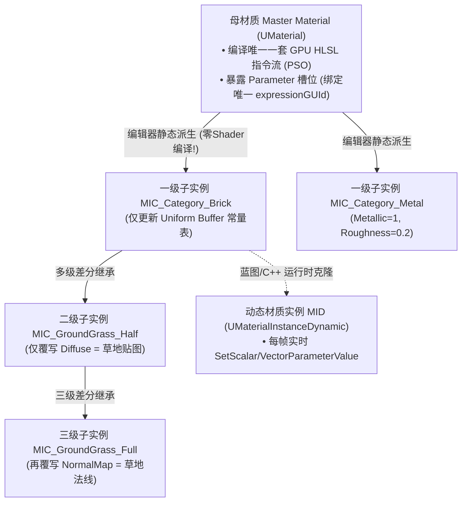
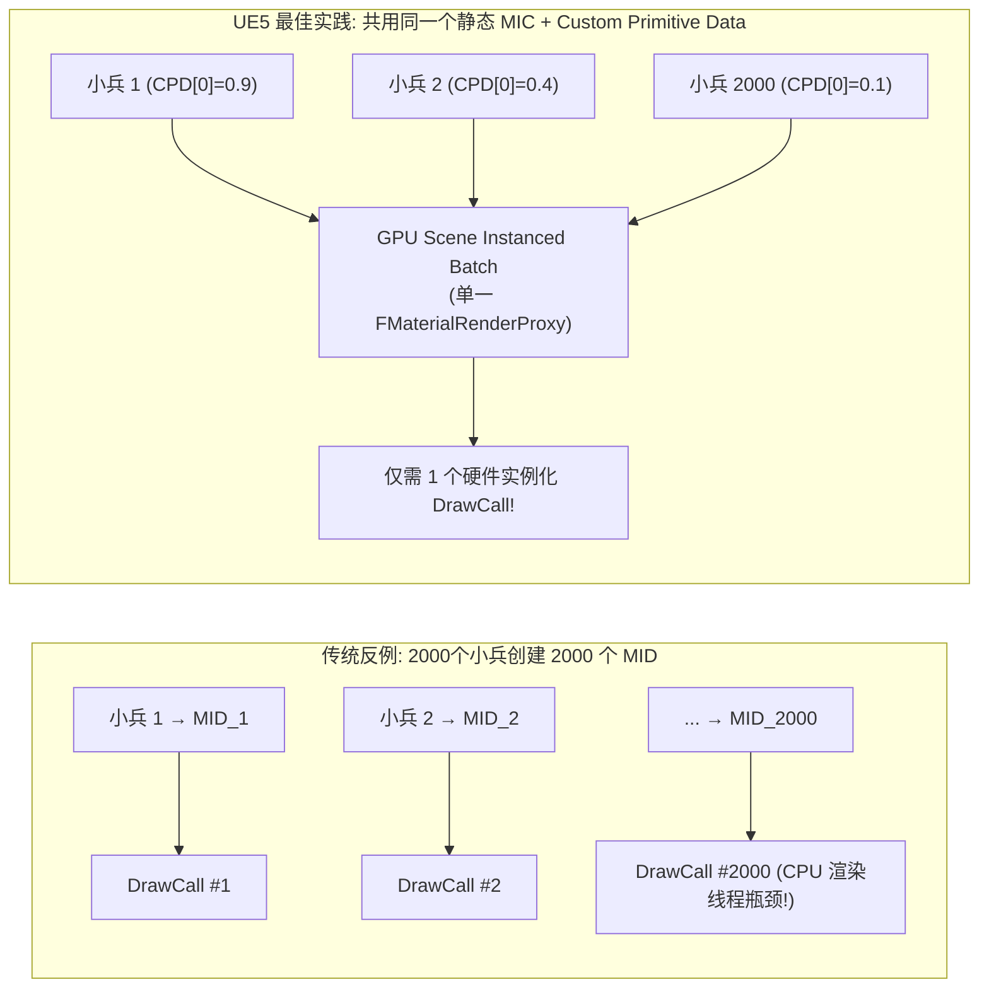

# 03 · 母子材质继承与动态材质实例 MID（`Material_Instances`）

> **本篇实测拆解关卡档案**
> - **关卡路径**：`/Game/Maps/Material/Material_Instances`（关卡总 Actor 数：`72` | 展台数：`5` | 示例 Actor 数：`23`）
> - **关卡脚本类**：`/Game/Maps/Material/Material_Instances.Material_Instances_C`
> - **核心资产目录**：`/Game/ExampleContent/MaterialInstances/Materials/`（涵盖 `M_StandardMaterial`、`M_StandardMaterialwithParamters`、多级继承实例链 `..._Inst_Inst_Inst` 及参数分组母材质 `M_StandardMaterialwithGroups`）

---

## 一、 为什么说“不会用材质实例的团队，注定被 Shader 编译地狱拖垮”？

想象这样一个真实的惨痛研发场景：
你的团队正在开发一款写实城市开放世界游戏，美术外包提交了 800 栋建筑、3000 件街头道具。如果每一位模型师都新建一个独立的 `Material`（材质球，`M_BrickWall_01`、`M_BrickWall_02`……`M_WoodChair_899`），会发生什么灾难？

1. **编译地狱（Shader Permutation Explosion）**：在虚幻引擎中，每一个独立的 `UMaterial` 并不是只生成一段代码——引擎必须为它与静态网格、骨骼网格、Nanite、Lumen 表面缓存、阴影深度、雾效等数十种渲染通道做笛卡尔积，编译出**几十甚至上百个底层 HLSL 着色器变体（Shaders）**！3000 个独立母材质意味着动辄 **30 万+ 个着色器**，打开工程要卡在 `Compiling Shaders (320,000)` 上整整两个小时！
2. **PSO 切换卡顿（Pipeline State Object Hitching）**：运行时玩家一转视角，GPU 被迫在几百个完全不同的编译着色器程序（PSO）之间疯狂切换上下文，引发致命的帧率掉帧尖峰（Stutter）！
3. **全局维护噩梦**：美术总监突然说“全城所有建筑材质都要统一加上雨天积水潮湿效果”——难道要人工打开 3000 个材质球逐个连线保存重编吗？


解开这个死结的唯一银弹，就陈列在 **`/Game/Maps/Material/Material_Instances`** 这座精炼而深刻的 **5 展台专章展厅** 中：**将着色算法抽象为极少数几个“母材质（Master Material）”，而把成千上万种颜色、贴图与粗糙度变化全部交给零编译开销的“材质实例（Material Instance）”！**



下面，让我们沿着这座长约 45 米的走廊，逐一拆解全部 **5 座展台** 的底层数据结构与 MCP 实测细节，并在章末彻底贯通运行时 **MID（动态材质实例）与 CPD（自定义图元数据）** 的工业化选型之道！

---

## 二、 `Material_Instances` 逐展台（#1 ~ #5）全量实测拆解

### 展台 #1：`Material Instances` — 强化高光对比度的评测光场

- **空间元数据**：展牌 Label `BP_DemoDisplay5` | 坐标 `(515, -900, 0)`
- **官方展牌原文**：`Examples of setting up Material Instances`（配置材质实例的完整示例）

#### 1.1 展台环境 Actor 实测配置（共 6 个）
扫描 `#1` 展台的全局照明组件，有一个细微但用意精准的调校：
- **`DirectionalLight`**：`Intensity = 10`，纯白 `(1, 1, 1, 1)`，`CastShadows = true`，`Mobility = Movable`；
- **`SkyLight`**：`Intensity = 1`，纯白 `(1, 1, 1, 1)`，`CastShadows = true`，`Mobility = Movable`；
- **`SpotLight`**：注意！前两关聚光灯强度分别是 `10` 和 `8`，而本关专门把 **`Intensity` 拉高到了 `15`**（`AttenuationRadius = 2000`，`Stationary`）！为什么？因为紧接着在 `#2`、`#3`、`#4` 展台我们要近距离观察红砖与草地法线贴图的凹凸高光，特别是 `#3` 展台把红砖直接变成抛光纯金属砖块时，高强度局部聚光灯能让粗糙度从 `0.5` 降到 `0.2` 的镜面质变一目了然！
- 其余三件套：`SkyAtmosphere`、`ExponentialHeightFog`、`Actor`（`ChaosDebugDrawComponent_0`）。

---

### 展台 #2：`Material` — 写死常量 vs 参数化母材质（Master Material）的本质分水岭

- **空间元数据**：展牌 Label `BP_DemoDisplay1` | 坐标 `(1525, -900, 0)`
- **展台内 3D 悬浮文字标签**：`A simple Material with Diffuse and Normal Map` / `no setup for Instance use` | `The same Material` / `but setup with Parameters` / `that can be changed in an Instance` / `we also call it Master Material`


#### 2.1 肉眼看两颗红砖球长得一模一样，为什么左边是“死胡同”，右边却是“兵工厂”？
站在 `#2` 展台前，左右两颗 `SM_MatPreviewMesh_01` 呈现出完全相同的红砖质感，连一丝一毫的色差都没有。但当我们用 MCP 拆开它们各自的内部节点表时，两者的基因截然不同：

| 对比维度 | 左球：`M_StandardMaterial`（写死普通材质） | 右球：`M_StandardMaterialwithParamters`（母材质 Master Material） |
| :--- | :--- | :--- |
| **资产路径** | `/Game/ExampleContent/MaterialInstances/Materials/M_StandardMaterial` | `/Game/ExampleContent/MaterialInstances/Materials/M_StandardMaterialwithParamters` *(注：官方原资产名漏写了一个 e)* |
| **`MP_BaseColor` 输入** | `TextureSample_0`（硬编码 `T_Bricks_D`） | **`TextureSampleParameter2D_0`**（参数名 `"Diffuse"`，默认 `T_Bricks_D`） |
| **`MP_Metallic` 输入** | `Constant_0`（硬编码常量 `0`） | **`ScalarParameter_1`**（参数名 `"Metallic"`，默认 `0`） |
| **`MP_Roughness` 输入** | `Constant_1`（硬编码常量 `0.5`） | **`ScalarParameter_0`**（参数名 `"Roughness"`，默认 `0.5`） |
| **`MP_Normal` 输入** | `TextureSample_1`（硬编码 `T_Bricks_N`） | **`TextureSampleParameter2D_1`**（参数名 `"NormalMap"`，默认 `T_Bricks_N`） |
| **底层 HLSL 编译差异** | 常量直接做常量折叠（Constant Folding）写死在汇编指令立即数中，外部无法干预。 | 编译器在 **Uniform Buffer（常量缓冲区）** 中开辟 2 个浮点槽位与 2 个纹理描述符槽位，并生成唯一 **`expressionGUId`**！ |

#### 2.2 一秒把普通节点升级为 Parameter 的快捷操作
在材质编辑器中，你根本不需要删掉 `Constant` 或 `TextureSample` 重新搜参数节点：
- 直接右键点击任意 `Constant`、`Constant3Vector` 或 `TextureSample` 节点，选择 **`Convert to Parameter`（转换为参数）** 并起一个语义清晰的名字（如 `Roughness`）；
- 或者按住快捷键 **`S + 鼠标左键`** 直接创建 `ScalarParameter`（标量参数），按住 **`V + 鼠标左键`** 直接创建 `VectorParameter`（四维颜色/向量参数）！

---

### 展台 #3：`Instance` — 零编译秒级换装与 `BasePropertyOverrides` 深度揭秘

- **空间元数据**：展牌 Label `BP_DemoDisplay2` | 坐标 `(2510, -900, 0)`
- **展台内 3D 悬浮文字标签**：`Master Material` / `with Parameter` / `(Parent)` | `Instance` / `without changed Parameter` / `(Child)` | `Instance` / `with changed Parameter` / `(Child)` / `Metallic = 1` / `Roughness = 0.2`


#### 3.1 为什么改材质实例不需要等哪怕 1 秒钟的 `Compiling Shaders`？
在展台 `#3` 上，官方甚至专门摆放了两个三维立体箭头模型（`SM_Arrow1` 与 `SM_Arrow2`），直观勾勒出从左至右的父子派生流向：

1. **父节点球 `SM_MatPreviewMesh_3` $\rightarrow$ `M_StandardMaterialwithParamters`（`Parent`）**：提供编译好的底层 HLSL 着色器机器码。
2. **中间未改参子实例 `SM_MatPreviewMesh_4` $\rightarrow$ `M_StandardMaterialwithParamters_Inst`（`Child`）**：
   - 资产类型为 **`MaterialInstanceConstant`（简称 MIC）**，其 `parent` 指针指向母材质。当不勾选任何参数覆写开关时，它直接复用父级的默认参数表，外观与母材质 100% 一致。
3. **右侧改参子实例 `SM_MatPreviewMesh_5` $\rightarrow$ `M_StandardMaterialwithParamters_Inst_2`（`Child`）**：
   - MCP 实测显示，它覆写了两个标量参数（通过 GUID 精确寻址，即便跨多级继承也不会认错！）：
     - **`"Metallic" = 1`**（`expressionGUId: 62C26392-4207-BD1D-496B-118B9C197293`）
     - **`"Roughness" = 0.2`**（`expressionGUId: 5E03E618-4CA9-B936-4848-79B48D429378`）
   - **视觉奇观**：原本朴素粗糙的暗红陶土砖，在保持一模一样的砖块颜色与砖缝法线的前提下，瞬间化作了金光闪闪的**抛光黄铜金砖**！而这整个调节过程在编辑器里拖动滑条是 **60 FPS 实时响应、0 次 Shader 编译**——因为 GPU 执行的还是母材质那同一份着色器指令，仅仅是喂给 GPU 寄存器的 Uniform Buffer 数组里换了两个浮点数！

#### 3.2 深度排雷：MCP 提取出的 `basePropertyOverrides` 是什么？乱勾它会怎样？
细心观察 MCP 从 `M_StandardMaterialwithParamters_Inst` 提取出的底层 JSON 数据，你会看到一串极其关键的布尔结构 **`basePropertyOverrides`**：
- `bOverride_OpacityMaskClipValue`、`bOverride_BlendMode`、`bOverride_ShadingModel`、`bOverride_TwoSided`、`bOverride_DitheredLODTransition`、`bOverride_CastDynamicShadowAsMasked`、`bOverride_MaxWorldPositionOffsetDisplacement`、`bOverride_CompatibleWithLumenCardSharing`……

> [!WARNING]
> **资深 TA 性能红线：哪些覆写是“真免费”，哪些覆写会“偷偷触发重编 Shader”？**
> - **100% 免费（仅改 Uniform 数据）**：修改 `Scalar`（标量）、`Vector`（颜色/向量）、`Texture`（贴图）参数，完全复用父级 PSO，零编译！
> - **会派生全新 Shader 变体（Static Permutation）的覆写**：如果你在材质实例中展开 `Material Property Overrides` 强行把原本 `Opaque` 的子实例改成了 **`Translucent`**，或者改了 **`Shading Model`**、勾选了 **`Two Sided`**，或者拨动了下一章将学到的 **`Static Switch Parameter`（静态开关）**——由于渲染管线状态（PSO）已经改变，引擎**必须在后台为这个子实例单独编译一套新的 Shader 变体**！因此，切忌滥用静态开关与基础属性覆写制造无意义的变体碎片！

---

### 展台 #4：`Instance of an Instance` — 多级树状差分继承的威力

- **空间元数据**：展牌 Label `BP_DemoDisplay3` | 坐标 `(3530, -900, 0)`
- **展台内 3D 悬浮文字标签**：`Instance` | `Instance of an Instance` / `only Diffuse Parameter modified` | `Instance of an Instance of Instance` / `only Normal Parameter modified`

#### 4.1 为什么要搞“实例的实例的实例”？大型项目的材质分类树是怎么搭的？
很多人以为材质实例只能是“母材质 $\to$ 子实例”扁平两层。实际上，虚幻支持**任意深度的树状实例继承（Multi-level Material Instance Hierarchy）**！
为什么这在 3A 项目里极其好用？举个例子：
- **第 0 层（根母材质）**：`M_Master_Opaque`（全项目通用的标准 PBR 母材质，含 40 个参数）；
- **第 1 层（材质大类预设实例）**：`MI_Preset_Wood`（锁好木材通用的粗糙度区间与细节木纹法线强度）；
- **第 2 层（区域风格子实例）**：`MI_Preset_Wood_TavernWet`（在木材预设基础上，把潮湿暗度统一拉高 20%，供酒馆关卡所有木桌木椅继承）；
- **第 3 层（具体道具终端实例）**：`MI_Chair_01`、`MI_Table_02`（模型师只需各自拖入道具自己的 `Diffuse` 和 `Normal` 贴图！）。将来如果想把整个酒馆的木头改干爽一点，只需动一下第 2 层 `MI_Preset_Wood_TavernWet`，底下 50 件家具同步生效！

#### 4.2 展台 3 级实例链（含 2 个三维继承箭头 `SM_Arrow3`、`SM_Arrow4`）逐级拆解
官方在这里用极其幽默直观的“红砖变草地分步手术”，演示了差分继承（Delta Override）的精确行为：
1. **一级实例 `SM_MatPreviewMesh_8` $\rightarrow$ `M_StandardMaterialwithParamters_Inst`**：
   - 未覆写贴图，完整继承母材质的 **红砖颜色 `T_Bricks_D` + 红砖法线 `T_Bricks_N`**。
2. **二级实例（实例的实例）`SM_MatPreviewMesh_6` $\rightarrow$ `M_StandardMaterialwithParamters_Inst_Inst`**：
   - `parent` 指向一级实例，且**只勾选覆写了 `"Diffuse"` 参数**为草地颜色图 `/Game/ExampleContent/Landscapes/Textures/T_GroundGrass_D`！
   - **观察奇特中间态**：因为没有覆写 `"NormalMap"`，它忠实继承了上一级的红砖法线——于是你看到了一颗**“长满绿草颜色、表面却刻着整齐红砖凹缝”**的混血球！这铁证了子实例只会覆盖勾选的那一个差分字段，其余一切上游属性自动穿透继承。
3. **三级实例（实例的实例的实例）`SM_MatPreviewMesh_7` $\rightarrow$ `M_StandardMaterialwithParamters_Inst_Inst_Inst`**：
   - `parent` 指向二级实例，它**无需再次勾选 `"Diffuse"`**（自动从二级实例继承绿草颜色图！），而是**只勾选覆写了 `"NormalMap"`** 为草地法线 `/Game/ExampleContent/Landscapes/Textures/T_GroundGrass_N`！至此，颜色与法线双双合璧，化作一颗纯正自然的绿茵草球！

> [!IMPORTANT]
> **关于 `expressionGUId` 的血泪避坑提示**
> 注意看 MCP 数据：三级实例里的 `"Diffuse"` 和 `"NormalMap"` 之所以能准确对上号，靠的**不仅是参数名字字符串，更是母材质参数节点的 `expressionGUId`（如 `504F1F37-4319-2A07-1AFC-9982D10F6EA6`）**！
> 如果你在维护母材质时，**手贱把原来的 `"Diffuse"` 节点删掉、再新建一个同名 `"Diffuse"` 节点连上去**，新节点的 `GUID` 会改变，可能导致全项目几百个子实例里填好的贴图引用瞬间丢失重置回默认值！修改母材质时，请务必**直接在原参数节点上修改或连线，严禁轻易删掉重建已投入量产的参数节点**！

---

### 展台 #5：`Groups` — 拯救美术体验的参数分组工程学

- **空间元数据**：展牌 Label `BP_DemoDisplay4` | 坐标 `(4510, -900, 0)`
- **展台内 3D 悬浮文字标签**：`Parent` / `Not Grouped` / `every Parameter is in its default Group` / `Instance` | `Parent` / `Grouped` / `all Parameters are in a group called Brick` / `Instance`


#### 5.1 当母材质膨胀到 60 个参数时，为什么不分组会让全组美术抓狂？
如果不给参数指定分组（`Group` 属性留空），当你打开子材质实例面板时，引擎只能机械地按数据类型把所有参数塞进默认的 `Scalar Parameter Values`、`Vector Parameter Values`、`Texture Parameter Values` 大抽屉里——`BaseColor` 贴图在最底下，`BaseColorTint` 颜色在中间，`Brightness` 标量在最上面，改一层材质要上下滚三次鼠标滚轮！

#### 5.2 展台左右两组（4 颗预览球）对比拆解
- **左组（未分组反例）**：`SM_MatPreviewMesh_9`（`M_StandardMaterialwithParamters`）与子实例 `SM_MatPreviewMesh_10`（`M_StandardMaterialwithParamters_Inst`）。4 个参数按类型拆散在不同默认折叠栏中。
- **右组（规范分组正例）**：`SM_MatPreviewMesh_11`（母材质 **`M_StandardMaterialwithGroups`**）与子实例 `SM_MatPreviewMesh_12`（**`M_StandardMaterialwithGroups_Inst`**）。
  - 查看 MCP 导出的 `M_StandardMaterialwithGroups` 节点详情：
    - `TextureSampleParameter2D_0`（`"Diffuse"`）$\rightarrow$ **`"group": "Brick"`**
    - `ScalarParameter_1`（`"Metallic"`）$\rightarrow$ **`"group": "Brick"`**
    - `ScalarParameter_0`（`"Roughness"`，`0.5`）$\rightarrow$ **`"group": "Brick"`**
    - `TextureSampleParameter2D_1`（`"NormalMap"`）$\rightarrow$ **`"group": "Brick"`**
  - 在 `M_StandardMaterialwithGroups_Inst` 的细节面板中，无论是标量还是贴图，全部整整齐齐聚拢在名为 **`Brick`** 的同一个业务功能分组下！配合参数节点上的 **`Sort Priority`（排序优先级整数，`0, 1, 2...`）**，技术美术可以像设计专业软件 UI 一样，把母材质实例面板打磨得清爽易用。

#### 5.3 本关全部 8 个核心材质与实例资产继承族谱全景表
为了让你一眼看清整张地图所有材质资产之间的父子血缘与 `expressionGUId` 寻址链路，我们将 MCP 实测提取的全量元数据汇总如下：

| 资产名称 | 类型 | 直接父级 (`Parent`) | 显式覆写的参数与精确实测值 | 登场展台 |
| :--- | :---: | :--- | :--- | :---: |
| `M_StandardMaterial` | `Material` | *(根材质，无参数)* | 硬编码 `T_Bricks_D`、`T_Bricks_N`、`Metallic=0`、`Roughness=0.5` | `#2` |
| `M_StandardMaterialwithParamters` | `Material` | *(参数化母材质)* | 暴露 `Diffuse`、`NormalMap`、`Metallic(0)`、`Roughness(0.5)`（未分组） | `#2, #3, #5` |
| `...withParamters_Inst` | `MIC` | `M_StandardMaterialwithParamters` | 无参数改动（纯继承基准子实例） | `#3, #4, #5` |
| `...withParamters_Inst_2` | `MIC` | `...withParamters_Inst` | `Metallic = 1` (`62C26392...`), `Roughness = 0.2` (`5E03E618...`) | `#3` |
| `...withParamters_Inst_Inst` | `MIC` | `...withParamters_Inst` | `Diffuse = T_GroundGrass_D` (`504F1F37...`) | `#4` |
| `...withParamters_Inst_Inst_Inst` | `MIC` | `...withParamters_Inst_Inst` | `NormalMap = T_GroundGrass_N` (`A9F3E04C...`) | `#4` |
| `M_StandardMaterialwithGroups` | `Material` | *(分组化母材质)* | 同上 4 参数，全部归入 **`"group": "Brick"`** | `#5` |
| `...withGroups_Inst` | `MIC` | `M_StandardMaterialwithGroups` | 在 `"Brick"` 分组下显式绑定砖块贴图与 `Metallic=0, Roughness=0.5` | `#5` |

> [!TIP]
> **团队母材质参数 UI 设计黄金规范（Group + Sort Priority）**
> 在企业级研发中，建议为所有母材质强制推行统一的编号前缀分组规范，确保材质实例面板永远按美术直觉从上往下排列：
> - `00_Global Switches`（全局静态开关，如 `bUseDetailNormal`）
> - `01_BaseColor`（`SortPriority=0`: `BaseColorMap` $\to$ `1`: `BaseColorTint` $\to$ `2`: `Brightness`）
> - `02_Surface Roughness & Metallic`（`ORM_Map`、`RoughnessMin`、`RoughnessMax`、`MetallicScale`）
> - `03_Normals`（`NormalMap`、`NormalIntensity`、`DetailNormalMap`、`DetailTiling`）
> - `04_Emissive & FX`（`EmissiveMap`、`EmissiveColor`、`DissolveAmount`）

*(注：关卡持久层另含 1 个全局空容器 `InstancedFoliageActor`。)*

---

## 三、 架构师进阶专讲：静态材质实例（MIC）vs 动态材质实例（MID）vs 自定义图元数据（CPD）

逛完了 `Material_Instances` 的 5 座静态展台，回想一下我们在第 00 章迎宾大厅 `#8`（滑条改马赛克材质 `BP_Mat_with_Slider`）、`#9`（电灯按钮 `MID_M_Button2_0`）和 `#12`（可视化踏板 `MID_M_VisulizerEmissive_Inst_0`）看到的那些带 **`MID_`** 前缀的实例——为什么游戏运行起来以后，你不能直接改内容浏览器里的 `MIC` 资产，而必须创建 **`MID`（`UMaterialInstanceDynamic`）**？

### 3.1 为什么运行时严禁直接修改内容浏览器里的 `MIC`？
- **`MIC`（`UMaterialInstanceConstant`）** 是烘焙保存在磁盘上的**只读共享资产**。如果允许某一个受击的哥布林在运行时直接改掉磁盘共享的 `MI_GoblinSkin`，那么全地图所有 100 只哥布林会**同时跟着一起变红闪烁**，甚至在编辑器 PIE 退出后污染弄脏源资产！
- **`MID`（`UMaterialInstanceDynamic`）** 则是在游戏运行态（`Construction Script` 或 `BeginPlay`）在内存中为当前这一个网格组件**独立克隆出来的私有参数副本**！

### 3.2 标准蓝图与 C++ 创建驱动 `MID` 工程范式

在蓝图或 C++ 中驱动角色受击闪白、武器充能发光、护盾受创波纹的标准流程如下：
1. **初始化阶段只创建一次（严禁在 `Tick` 里每帧 `Create Dynamic Material Instance`！）**：
   在 `BeginPlay` 或 `Construction Script` 中调用网格组件的 **`Create Dynamic Material Instance`**，将返回的 `MID` 引用缓存到成员变量中（若在每帧 `Tick` 里重复创建 `MID`，会导致每帧分配 `UObject` 垃圾回收内存并重建渲染代理，帧率瞬间暴跌！）；
2. **运行阶段按需高频改参（附生产级 C++ 标准写法）**：

```cpp
// 1. 在 BeginPlay 中仅创建一次并缓存指针 (UPROPERTY 防止 GC 回收!)
void AHeroCharacter::BeginPlay()
{
    Super::BeginPlay();
    // 为第 0 号材质槽自动基于原有 MIC 派生动态材质实例并绑定回组件
    ArmorMID = GetMesh()->CreateAndSetMaterialInstanceDynamic(0);
}

// 2. 在受击回调或 Timeline Tick 中极速更新 Uniform 参数 (零 Shader 编译!)
void AHeroCharacter::UpdateHitFlash(float FlashAlpha, const FLinearColor& HitColor)
{
    if (ArmorMID)
    {
        static const FName NAME_EmissiveBoost(TEXT("EmissiveBrightness"));
        static const FName NAME_HitTint(TEXT("EmissiveColor"));
        // 使用 static FName 避免每帧字符串哈希开销
        ArmorMID->SetScalarParameterValue(NAME_EmissiveBoost, FlashAlpha * 25.0f);
        ArmorMID->SetVectorParameterValue(NAME_HitTint, HitColor);
    }
}
```

### 3.3 百万级同屏优化杀手锏：什么时候连 `MID` 都嫌贵，该上 `Custom Primitive Data`（CPD）？

这是一个区分中级开发者与资深引擎架构师的关键性能考点！
假设你在做一个 RTS 星际战场或幸存者割草游戏，同屏有 **2000 个相同的机甲小兵（使用相同的 `MI_Mech`）**，每个小兵血量不同，身上灯条颜色随血量从绿变红：
- **如果给 2000 个小兵各自 `Create Dynamic Material Instance`（2000 个独立 `MID`）**：由于每个 `MID` 拥有各自独立的 `FMaterialRenderProxy` 指针，虚幻的动态网格自动合批器（Dynamic Mesh Auto-Instancing）会认为它们用的是 **2000 种不同的材质**，导致原本 1 个 DrawCall 就能画完的 2000 个小兵瞬间裂变成 **2000 个独立 DrawCall**！
- **现代 UE5 终极解法：`Custom Primitive Data`（自定义图元数据，简称 CPD）**！

```cpp
// CPD 零额外 DrawCall 写法：绝不创建 MID，2000 个小兵保持同一个静态 MI_Mech！
// 只需在母材质 ScalarParameter 上勾选 bUseCustomPrimitiveData (Index = 0)
GetMesh()->SetCustomPrimitiveDataFloat(0, CurrentHealth / MaxHealth);
GetMesh()->SetCustomPrimitiveDataVector4(1, CustomTeamColor); // 占用槽位 1, 2, 3, 4
```

数据直接跟随每个图元在 GPU Scene 中的 `FPrimitiveSceneShaderData` 缓冲区批量上传——**2000 个小兵各自拥有独立的血量灯色与受击闪白，却依然完美合并在仅仅 1 个硬件实例化 DrawCall 里！**



最后，用一张全景选型决策表收官本章：

| 方案名称 | 生命周期 | 影响范围 | 是否打断硬件自动合批 (Auto-Instancing) | 最佳实战应用场景 |
| :--- | :--- | :--- | :---: | :--- |
| **`MIC`（静态材质实例）** | 编辑器离线资产 | 所有引用该资产的组件 | ❌ 不打断（相同 MIC 自动合批） | **95% 常规美术变体**：换贴图、调颜色、多层材质实例配置。 |
| **`MID`（动态材质实例）** | 运行时内存对象 | 单个绑定组件私有 | ⚠️ **打断！**（每个 MID 视为独立材质批次） | **主角/Boss/少量独立机关**：需要运行时动态换贴图（`TextureParameter`）或复杂独立特写动画。 |
| **`CPD`（自定义图元数据）** | 运行时组件浮点槽 | 单个组件私有（最多 32 个 float） | ✅ **完全不打断合批！** | **海量同类单位动态改色/闪白/血条**：成百上千个小兵各自独立受击闪白、随机色相偏移（不支持换贴图）。 |
| **`MPC`（材质参数集）** | 全局单例资产 | 全世界所有引用该 MPC 的材质 | ✅ 不打断合批 | **全局环境联动**：一键控制全城雨天积水度、全局风向风速、昼夜交替时间、玩家火把世界坐标。 |

学会了母子继承与运行时改参，你已经具备了搭建中小型项目材质库的功底。但面对真正的次世代工业级大作——如何用 **静态开关构建万能母材质**？如何把几十个杂乱节点封装成 **材质函数（Material Functions）**？如何像拼乐高一样用 **分层材质（Material Layers）** 给一艘精密火箭分层涂装铬合金、铝材与紫铜？

让我们立刻推开第四扇大门——步入基础材质四部曲的巅峰之作：**`04_Material_Advanced`**！
