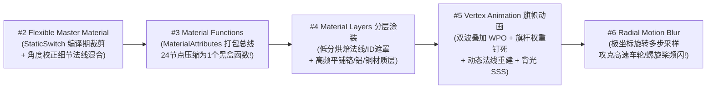
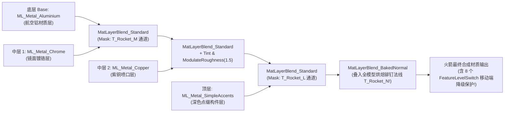

# 04 · 高阶材质函数与分层材质体系（`Material_Advanced`）

> **本篇实测拆解关卡档案**
> - **关卡路径**：`/Game/Maps/Material/Material_Advanced`（关卡总 Actor 数：`52` | 展台数：`6` | 示例 Actor 数：`18`）
> - **关卡脚本类**：`/Game/Maps/Material/Material_Advanced.Material_Advanced_C`
> - **核心资产目录**：`/Game/ExampleContent/Materials/Materials/`、`/Game/ExampleContent/Materials/ExampleAsset/`（火箭分层材质库）、`/Game/ExampleContent/Materials/Flag/`（顶点风场旗帜）、`/Game/ExampleContent/Materials/Blueprints/BP_RadialMotionBlur`

---

## 一、 从“会连小材质”到“搭建 3A 工业级着色管线”的惊险一跃

如果说前三章（`Material_Properties`、`Material_Nodes`、`Material_Instances`）教会了你如何调出一颗物理准确的红砖球或金属球，那么当你真正作为主技术美术（Lead TA）接手一款大型次世代项目时，马上会撞上四座靠基础节点根本翻不过去的大山：

1. **万能母材质的灵活性与开销矛盾**：如果母材质什么功能都塞进去（底色贴图、细节法线、粗糙度遮罩、金属度遮罩），哪怕某个简单木箱根本不用细节法线，GPU 也要白白跑一遍采样吗？如何按需裁剪代码分支？
2. **“意大利面条图（Spaghetti Graph）”灾难**：当一个复杂金属材质包含划痕、污渍、平铺缩放与法线展平等 20 多个节点时，一旦要在 10 个复合材质里复用它，难道要复制粘贴 200 个节点连成蜘蛛网吗？
3. **巨型载具/机甲的贴图精度极限**：一艘十米高的宇宙火箭或巨型机甲，哪怕给它贴一张 4096×4096 的独立贴图，玩家凑近到半米处看外壳时依然糊成马赛克！如何在极省显存的前提下实现 **“凑到鼻尖看都纤毫毕现的毫米级金属拉丝与划痕”**？
4. **物理运动极限特效**：迎风猎猎作响的战旗难道要绑 50 根骨骼跑物理吗？每分钟转 3000 圈的赛车轮毂与直升机螺旋桨，为什么开引擎自带运动模糊反而会碎裂成风扇残影？

欢迎来到基础材质四部曲的收官殿堂——**`/Game/Maps/Material/Material_Advanced`**！这座浓缩了 **6 座精品展台** 的长廊，每一台都是 3A 游戏工业界久经考验的实战标准答案。

下面，让我们逐一走近全部 **6 座展台**，把里面每一个材质函数、每一条数学链路和 MCP 实测参数彻底拆解透彻！

---

## 二、 `Material_Advanced` 逐展台（#1 ~ #6）全量实测拆解

### 展台 #1：`Advanced Materials` — 全方位高反射天光评测场

- **空间元数据**：展牌 Label `BP_DemoDisplay5` | 坐标 `(505, -900, 0)`
- **官方展牌原文**：`Examples of Advanced Material Setup`（高阶材质架构设计示例）

#### 1.1 为什么本关把 `SkyLight` 天光强度从 `1` 大幅提升到了 `3`？
查看 `#1` 展台陈列的 **5 个全局环境 Actor**：
- **`DirectionalLight`**：`Intensity = 10`，纯白 `(1, 1, 1, 1)`，`CastShadows = true`，`Mobility = Movable`；
- **`SkyLight`**：**`Intensity = 3`**（对比前两关均为 `1`！），`CastShadows = true`，`Mobility = Movable`；
- **`SkyAtmosphere`**、**`ExponentialHeightFog`**、**`Actor`**（`ChaosDebugDrawComponent_0`）。

**调光用意**：在本关核心展台 `#3` 与 `#4` 中，登场的主角全都是 **`Metallic = 1` 的全反射纯金属（镀铬 Chrome、航空铝 Aluminium、紫铜 Copper）**！我们在 `Material_Nodes` 学过，纯金属漫反射为 `0`，背对太阳的一面 100% 依赖反射周围环境天光。将 `SkyLight` 提升至 `3`，能让竖立的火箭模型在背光面依然呈现丰富通透的金属光泽层次，避免暗部死黑一片。

---

### 展台 #2：`Flexible Master Material` — 静态开关（Static Switch）与角度校正细节法线

- **空间元数据**：展牌 Label `BP_DemoDisplay1` | 坐标 `(1505, -900, 0)`
- **展台内 3D 悬浮文字标签**：`Master Material` | `Instance` | `Instance`

#### 2.1 深度解剖 35 节点工业级母材质：`M_MasterMaterial`
在展台最左侧 `SM_MatPreviewMesh_9` 上挂载的 `/Game/ExampleContent/Materials/Materials/M_MasterMaterial`，是虚幻官方给出的**“高扩展性通用母材质”标准模板**。MCP 完整导出了它的 **35 个材质表达式节点**，我们可以将其清晰拆解为 **5 大规范分组模块**：

1. **`Options` 编译期功能总闸组（5 个 `StaticSwitchParameter`）**：
   - `UseDiffuseTexture`（默认 `true`）、`UseNormalTexture`（默认 `true`）、`UseDetailNormalTexture`（默认 `true`）、`UseRoughnessMask`（默认 `false`）、`UseMetallicMask`（默认 `false`）。
   - **底层机制**：与运行时动态分支 `If` 节点不同，**`StaticSwitchParameter` 在 Shader 编译期直接剪断未选中分支的所有节点和贴图采样器**！如果某个简单道具关掉了 `UseDetailNormalTexture`，编译出来的着色器连 `DetailNormal` 贴图都不会去读，运行时开销与专门手写的极简材质一模一样！
2. **`Diffuse` 基础色染色模块**：
   - 当 `UseDiffuseTexture = true` 时，将 `"Diffuse"` 贴图（`T_Bricks_D`）与 `"DiffuseColor"` 颜色向量 `(1, 1, 1, 1)` 相乘（`Multiply_1`）做正片叠底调色；若关闭开关，则直接输出纯色 `"DiffuseColor"` 连入 `MP_BaseColor`。
3. **`Normal` + `DetailNormal` 双层法线正确混合模块（核心技术亮点！）**：
   - **主法线强度无损缩放算法**：如何用标量 `"NormalIntensity"`（默认 `1`）平滑调节法线强弱？直接把整张法线贴图乘以 `0` 会导致法线变成 `(0, 0, 0)` 黑块报错！看官方的标准数学写法：
     $$\mathbf{N}_{\text{scaled}} = \mathbf{N}_{\text{tex}} \odot (I, \; I, \; 0) + (0, \; 0, \; 1)$$
     （在节点图中由 `Multiply` 乘以 `(1, 1, 0) * NormalIntensity`，再 `Add` 加上蓝通道基底 `(0, 0, 1)`！当 `Intensity = 0` 时精准退化为绝对平整法线 `(0, 0, 1)`；当 `Intensity > 1` 时强化 XY 斜率陡峭度！）
   - **高频细节法线叠加**：将 `TexCoord[0]` 乘以 `"DetailNormalScale"`（默认 **`5`** 倍高频平铺！），采样金属微纹理法线 `T_ExampleLayers_Metal01_N`，经相同公式缩放强度 `"DetailNormalIntensity"` 后，与主砖块法线一起送入引擎核心函数 **`BlendAngleCorrectedNormals`（角度校正法线混合，即 RNM 算法）**！
   - **为什么不用简单相加？** 直接把两张法线相加再归一化会压扁陡峭曲率上的细节凹凸，而 `BlendAngleCorrectedNormals` 利用四元数旋转思想将细节法线完美贴合旋转到主法线的倾斜切平面上，凹凸锐度丝毫不损！
4. **`Roughness` 与 `Metallic` 遮罩插值模块**：
   - 当开启 `UseRoughnessMask` 时，使用砖块高度遮罩图 `T_Brick_H` 作为 `Lerp` 的 Alpha，在砖面 `"Roughness"`（`0.5`）与砖缝 `"RoughnessMaskedArea"`（`0.8`）之间精细区分光滑砖面与粗糙灰浆缝；`Metallic` 模块同理在 `"Metallic"`（`0`）与 `"MetallicMaskedArea"`（`1`）之间插值。

#### 2.2 右侧两颗派生实例球的激进调参亮点
- **中间实例球 `SM_MatPreviewMesh_10` $\rightarrow$ `M_MasterMaterial_Inst`**：
  - 覆写 `"DetailNormalIntensity" = 5`（放大 5 倍表面微坑纹！）、`"DetailNormalScale" = 1.249515`、`"Roughness" = 0.312295`、`"RoughnessMaskedArea" = 0.851939`，让砖块呈现出湿润粗犷的风化石材感。
- **右侧实例球 `SM_MatPreviewMesh_11` $\rightarrow$ `M_MasterMaterial_Inst_2`**：
  - MCP 抓出了一个极具实战参考价值的艺术家调参手法：覆写 `"Metallic" = 1`、`"NormalIntensity" = 1.603944`，同时将 **`"Roughness"` 拉到了负数 `-0.460169`**，而将 **`"RoughnessMaskedArea"` 拉到了超界值 `1.867014`**！
  - **原理解析**：因为遮罩贴图 `T_Brick_H` 的灰阶往往柔和集中在 `0.3 ~ 0.7` 之间，如果 Lerp 两端规规矩矩填 `[0.0, 1.0]`，插值结果会温吞地卡在 `[0.3, 0.7]`。故意把两端拉开到 `[-0.46, 1.87]`，相当于在 Lerp 内部顺手做了一次**高对比度色阶挤压（Levels Remap）**，最后送进 GBuffer 时由硬件自动 `saturate` 钳制回 `[0, 1]`，零额外指令就造出了“镜面抛光凸起 + 极度哑光凹槽”的强烈金属反差！

> [!WARNING]
> **Static Switch 变体爆炸防线**：5 个静态开关理论上最多可组合出 $2^5 = 32$ 种变体；如果你在一个超级母材质里塞进 20 个 `StaticSwitchParameter`，理论组合数高达 $2^{20} = 1,048,576$ 种！实战中请严守：**同一个母材质的 `StaticSwitch` 尽量控制在 5~8 个以内**；对于简单数值有无（比如要不要染色），直接乘以默认 `(1,1,1)` 的 `VectorParameter` 远比加一个静态开关更省 PSO 内存！

#### 2.3 `M_MasterMaterial` 全量 18 个公开参数词典（MCP 实测提取）
为了方便你在自己的项目中复刻这套万能母材质，下表完整整理了 MCP 从 `M_MasterMaterial` 提取出的 **6 大参数分组、全部 18 个参数节点及默认值**：

| 所属分组 (`Group`) | 参数名称 (`ParameterName`) | 参数类型 | 默认值 / 默认绑定贴图 | 核心职责说明 |
| :--- | :--- | :---: | :--- | :--- |
| **`Options`** | `UseDiffuseTexture` | `StaticSwitch` | `true` | 是否采样基础色贴图（关闭则纯用 `DiffuseColor`） |
| **`Options`** | `UseNormalTexture` | `StaticSwitch` | `true` | 是否启用主法线贴图通道 |
| **`Options`** | `UseDetailNormalTexture` | `StaticSwitch` | `true` | 是否叠加高频细节法线（通过 `BlendAngleCorrectedNormals`） |
| **`Options`** | `UseRoughnessMask` | `StaticSwitch` | `false` | 是否启用灰度遮罩区分双区间粗糙度 |
| **`Options`** | `UseMetallicMask` | `StaticSwitch` | `false` | 是否启用灰度遮罩区分双区间金属度 |
| **`Diffuse`** | `Diffuse` | `Texture2D` | `T_Bricks_D` | 基础反照率贴图（`SAMPLERTYPE_Color`） |
| **`Diffuse`** | `DiffuseColor` | `Vector` | `(1, 1, 1, 1)` | 基础色正片叠底染色向量（或无贴图时的纯色） |
| **`Normal`** | `Normal` | `Texture2D` | `T_Bricks_N` | 模型主法线贴图（`SAMPLERTYPE_Normal`） |
| **`Normal`** | `NormalIntensity` | `Scalar` | `1.0` | 主法线 XY 斜率缩放强度（`Inst_2` 拉高至 `1.604`） |
| **`DetailNormal`** | `DetailNormal` | `Texture2D` | `T_ExampleLayers_Metal01_N` | 微表面高频细节法线贴图 |
| **`DetailNormal`** | `DetailNormalScale` | `Scalar` | `5.0` | 细节法线 UV 平铺倍数（`Inst` 调为 `1.25`） |
| **`DetailNormal`** | `DetailNormalIntensity` | `Scalar` | `1.0` | 细节法线凹凸强度（`Inst` 拉高至 `5.0`） |
| **`Roughness`** | `Roughness` | `Scalar` | `0.5` | 基准粗糙度 / 遮罩黑区粗糙度（`Inst_2` 设为 `-0.46` 强压对比） |
| **`Roughness`** | `RoughnessMaskedArea` | `Scalar` | `0.8` | 遮罩白区粗糙度（`Inst_2` 设为 `1.867`） |
| **`Roughness`** | `RoughnessMask` | `Texture2D` | `T_Brick_H` | 粗糙度分区高度遮罩图（`SAMPLERTYPE_LinearColor`） |
| **`Metallic`** | `Metallic` | `Scalar` | `0.0` | 基准金属度 / 遮罩黑区金属度（`Inst_2` 设为 `1.0`） |
| **`Metallic`** | `MetallicMaskedArea` | `Scalar` | `1.0` | 遮罩白区金属度 |
| **`Metallic`** | `MetallicMask` | `Texture2D` | `T_Brick_H` | 金属度分区遮罩图（`SAMPLERTYPE_LinearColor`） |

---

### 展台 #3：`Material Functions` — 用一条打包总线终结“节点蜘蛛网”

- **空间元数据**：展牌 Label `BP_DemoDisplay2` | 坐标 `(2490, -900, 0)`
- **展台内 3D 悬浮文字标签**：`Material without MaterialFunction` | `The same Material with MaterialFunction`

#### 3.1 24 个散装节点 vs 1 个函数调用节点！
程序员写代码绝不会把一段 50 行的算法到处复制粘贴，而是会封装成 `Function()`。在虚幻材质编辑器里，承担这一模块化重任的正是 **`Material Function`（材质函数）** + **`Material Attributes`（材质属性结构体总线）**！

对比展台上的两颗镀铬金属球，渲染结果像素级 100% 相同，但打开材质编辑器一看，简直是两个世界：
1. **左球 `SM_MatPreviewMesh_12` $\rightarrow$ `M_Metal_NOMF`（未封装材质函数，共 24 个节点）**：
   - 整张图表铺满了 **24 个散装节点**：采样 `T_ExampleLayers_Metal01_D`（RGB 存基础色，Alpha 通道打包粗糙度！）、采样法线 `T_ExampleLayers_Metal01_N` 并连入 `FlattenNormal` 函数、外加划痕颜色 `ScratchColor (0.508)`、划痕粗糙度 `Scratch Roughness (0.2)`、污垢粗糙度 `Grime Roughness (0.9)`、`RoughnessMIN`、`RoughnessMAX (0.4)`、`Tiling (2)`、`Scratches`、`Grime`、`Tint` 等 4 个 `LinearInterpolate` 与多层 `Power` / `Multiply` 交错缠绕，最后分别连向主节点的 4 个独立引脚。如果一个复杂道具要混合三种这样的金属，72 个节点当场变成灾难现场！
2. **右球 `SM_MatPreviewMesh_13` $\rightarrow$ `M_Metal_UsingMF`（使用材质函数封装，仅 1 个节点！）**：
   - 勾选主材质细节面板中的 **`Use Material Attributes = true`**——主材质原本一长排零散引脚瞬间收拢为**唯一一个总入口引脚**！
   - 整张材质图表里**只有孤零零 1 个节点**：`MaterialExpressionMaterialFunctionCall_9`，调用资产 **`/Game/ExampleContent/Materials/ExampleAsset/MaterialLayers/ML_Metal_Chrome`**，一根单线直插主节点！
   - **性能真相**：封装成 `Material Function` 会有函数调用栈性能损耗吗？**零损耗！** 材质编译器在生成 HLSL 时会将所有材质函数 100% 内联展开（Inline），执行效率与手连散装节点完全等价，而团队协作与复用性提升了十倍不止——将来只要优化一次 `ML_Metal_Chrome` 里的划痕算法，全工程所有引用该函数的武器、载具、建筑全部自动升级！

---

### 展台 #4：`Material Layers` — 次世代英雄级载具/机甲的“分层材质涂装工业流水线”

- **空间元数据**：展牌 Label `BP_DemoDisplay3` | 坐标 `(3510, -900, 0)`
- **展台内 3D 悬浮文字标签**：`Chrome Layer` | `Aluminium Layer` | `Copper Layer` | `Layer Blend` / `Copper` / `+` / `Aluminium` / `+` / `Chrome`

#### 4.1 解决大型资产精度悖论的终极方案：“低频烘焙网格贴图 + 高频无限平铺材质层”
看着 `#4` 展台上并排矗立的 **4 枚精致宇宙火箭（`SM_ExampleMesh_Rocket`）**，请思考我们在开篇提出的那个 3A 核心命题：
如果按传统做法给整枚大火箭画一张固定 2K 的 `BaseColor + Normal + Roughness` 贴图，镜头拉近到舱门铆钉处必然模糊起格；但如果采用 **Material Layers（分层材质体系）**：
1. **模型特有的宏观几何特征（低频但全模型唯一）**：只烘焙两张极轻量的全局 0~1 UV 贴图——
   - 一张**模型烘焙法线图 `T_Rocket_ExampleAsset_N`**（记录舱门接缝、铆钉凹凸与倒角）；
   - 一至两张 **RGB 通道打包的材质 ID / 磨损遮罩图 `T_Rocket_ExampleAsset_M` 与 `_L`**（比如 R 通道标出哪里是紫铜喷口、G 通道标出哪里是镀铬装饰环、B 通道标出边缘掉漆磨损权重）！
2. **微观物质表面肌理（高频可 10 倍、20 倍无限平铺复用！）**：直接从团队标准材质库里拖出展台 `#3` 封装好的 **`ML_Metal_Chrome`（镀铬层）**、**`ML_Metal_Aluminium`（哑光航空铝层）**、**`ML_Metal_Copper`（紫铜层）** 与 **`ML_Metal_SimpleAccents`（点缀暗金属层）**！

这样一来，宏观上有烘焙法线保证每一颗铆钉严丝合缝，微观上有 10 倍高频平铺的金属拉丝与细微划痕保证凑到 5 厘米处依然锐利如刀，而且整套金属层可以在全游戏的飞船、坦克、大门上无限零显存增量复用！

#### 4.2 展台 4 枚火箭模型材质节点逐一实测拆解
1. **1 号纯镀铬火箭 `SM_ExampleMesh_Rocket835` $\rightarrow$ `M_RocketMaterial_Example01_Chrome`（4 个节点）**：
   - 调用单层 `ML_Metal_Chrome`，通过引擎分层法线融合函数 **`MatLayerBlend_BakedNormal`** 将火箭专属铆钉法线 `T_Rocket_ExampleAsset_N` 与镀铬层自身的微观金属法线无损融合！整枚火箭如水银镜面般璀璨。
2. **2 号纯航空铝火箭 `SM_ExampleMesh_Rocket834` $\rightarrow$ `M_RocketMaterial_Example01_Aluminium`（4 个节点）**：
   - 仅将材质层函数替换为 `ML_Metal_Aluminium`，配合相同的 `MatLayerBlend_BakedNormal` 叠入烘焙法线，瞬间呈现温润沉稳的银灰拉丝铝机身。
3. **3 号纯紫铜火箭 `SM_ExampleMesh_Rocket832` $\rightarrow$ `M_RocketMaterial_Example01_Copper`（4 个节点）**：
   - 替换为 `ML_Metal_Copper`，整枚火箭化作醇厚的暖橙红黄铜/紫铜工业雕件。
4. **4 号完全体合成火箭 `SM_ExampleMesh_Rocket83` $\rightarrow$ `M_RocketMaterial_Example01`（34 个节点大师级工程图！）**：
   - **多层混合栈**：以 `ML_Metal_Aluminium` 为机身大底，依次调用多个 **`MatLayerBlend_Standard`**，依据遮罩贴图 `T_Rocket_ExampleAsset_M`（经 `Power` 锐化边缘对比度）与 `T_Rocket_ExampleAsset_L`，逐层叠加上 `ML_Metal_Chrome`、`ML_Metal_Copper` 与 `ML_Metal_SimpleAccents`；
   - **层间局部微调算子**：在不改动底层库函数的前提下，穿插使用了 **`MatLayerBlend_ModulateRoughness`**（乘以 `Constant_4 = 1.5` 让局部铜件更沧桑粗糙）、**`MatLayerBlend_Tint`**（乘以偏蓝冷调向量 `(1.181, 1.241, 1.5)` 微调金属色温）以及 **`MatLayerBlend_TintAllChannels`**；最后统一经 **`MatLayerBlend_BakedNormal`** 盖上全机身铆钉法线 `T_Rocket_ExampleAsset_N`；
   - **跨平台工程典范（8 个 `FeatureLevelSwitch` 节点！）**：MCP 实测捕获到图表末端排布了 **8 个 `MaterialExpressionFeatureLevelSwitch`** 配合 `Break/MakeMaterialAttributes`！为什么？因为在桌面端（SM5/SM6）显卡算力充沛，跑满 4 层复杂混合不在话下；而一旦切换到移动端（ES3.1 Mobile Feature Level），这组开关会自动将材质降级切换到精简分支，防止手机发烫掉帧！这才是教科书级的商业引擎多端适配思维！

> [!TIP]
> **技术演进衔接提示**：本展台演示的是最经典、最透明可控的“基于材质函数的分层工作流（Function-Based Material Layers）”。在现代 UE5 中，你还可以结合专门的 **`Material Layer` / `Material Layer Blend` 资产面板** 在材质实例里直接拖拽增删图层，或升级至下一章即将重磅登场的 **`Substrate`（次世代物质板能量守恒混合架构）**！

---

### 展台 #5：`Vertex Animation` — 双波叠加风场旗帜、旗杆权重钉死与动态法线重建

- **空间元数据**：展牌 Label `BP_DemoDisplay4` | 坐标 `(4502, -900, 0)`

#### 5.1 为什么战场上一千面迎风招展的军旗，绝不能用 Chaos 布料模拟或骨骼动画？
如果在大型攻城战里摆 1000 面开启实时物理布料（Cloth Simulation）的旗帜，CPU/GPU 碰撞与约束解算开销会异常昂贵；如果用骨骼动画，所有旗帜动作千篇一律且增加蒙皮带宽。
而 `#5` 展台上的静态网格体 **`SM_Flag`**（`/Game/ExampleContent/Materials/Flag/Meshes/SM_Flag`），赋予材质实例 **`M_Flag_Inst`**（母材质 `M_Flag`）后，**零根骨骼、零物理模拟，哪怕不点 Play 在静态视口里也在猎猎迎风翻卷，连阳光穿透旗面的明暗褶皱都栩栩如生**！

#### 5.2 从 MCP 提取的 20+ 核心参数反推大师级顶点风场四要素
很多新手自己用 `Sine(Time)` 连进 `World Position Offset` 做旗帜时，总会做出“整块铁板上下平移、旗布直接脱开旗杆飞走、且不管怎么飘表面光影死板一片”的塑料片。看看官方 `M_Flag_Inst` 的参数设计是如何逐一攻克这三大痛点的：

1. **双频行波叠加打破机械周期感（Wave 1 + Wave 2）**：
   单一正弦波一眼就能看出假。`M_Flag` 同时叠加了**主大浪 `Wave 1`**（`SpeedWave`, `DirectionWave`, `ScaleWave`, `HeightWave1`, `MobileWave1size = 765.574`）与**次级高频碎浪 `Wave 2`**（`SpeedWave2`, `DirectionWave2`, `ScaleWave2`, `HeightWave2`, `MobileWave2size`），甚至还为风向加入了随时间轻微摆动的扰动项 **`DirectionJiggleWave` / `DirectionJiggleSpeedWave`**，模拟自然界阵风忽左忽右的随机湍流！
2. **旗杆边缘零位移钉死遮罩（`"FallOffVetexMask" = 2.751451`）**：
   通过读取旗帜网格的 UV 横坐标 $U \in [0, 1]$（或顶点色遮罩），旗杆绑扎侧为 `0`，旗尾自由端为 `1`，再经过 `Power(Mask, FallOffVetexMask = 2.75)` 幂函数曲线重塑并乘到 WPO 位移上！这样靠近旗杆的布料死死钉在杆上纹丝不动（$0^{2.75} = 0$），越往旗尾振幅呈指数级甩开，物理悬臂梁质感拉满！
3. **动态波浪法线同步重建（`NormalIntesityWave1` & `NormalIntesityWave2`）**：
   **这是封神的一笔！** 记住：GPU 在 Vertex Shader 里用 WPO 把平面折弯成了波浪，但每个顶点原本自带的法线依然傻傻指着正前方！如果不修正法线，凸起的波峰和凹陷的波谷受光完全一样，看起来就像贴图在平移。官方根据两道波浪的导数斜率，同步扰动生成了随波浪实时滚转的动态法线（由 `NormalIntesityWave1 / 2` 控制褶皱凹凸深度），让每一道鼓起的风浪都拥有真实的迎光亮脊与背光暗谷！
4. **织物逆光透射质感（`"Roughness" = 0.566372`, `"SSSBrightness" = 0.3`, `"SSSDistance" = 0.495497`）**：
   配合微粗糙布面与次表面背光透射参数，当阳光从旗帜背后射来时，薄薄的旗布透出温暖柔和的织物散射光！

#### 5.3 硬核数学补完：WPO 正弦波变形后，如何在着色器里解析重建新法线？
很多同学好奇：在不查法线贴图的情况下，顶点波浪高度场 $h(x, y, t) = A \sin(k_x x + k_y y - \omega t)$ 是怎么算出动态法线的？
根据微积分曲面切平面原理，变形后曲面在 $x$ 和 $y$ 方向的偏导数（切向量斜率）分别为 $\frac{\partial h}{\partial x}$ 与 $\frac{\partial h}{\partial y}$，则扰动后的单位切线空间法线 $\mathbf{n}$ 可直接由叉积解析求得：
$$\mathbf{n}(x, y, t) = \text{normalize}\left( -\alpha \frac{\partial h}{\partial x}, \; -\alpha \frac{\partial h}{\partial y}, \; 1.0 \right)$$
其中正弦函数的导数恰好就是余弦函数 $\cos(\cdot)$（或相位偏移 $\frac{\pi}{2}$ 的同频波），而公式里的缩放系数 $\alpha$ 正对应着 `M_Flag_Inst` 中暴露的 **`NormalIntesityWave1`** 与 **`NormalIntesityWave2`**！这种解析导数法比在像素着色器里用 `ddx` / `ddy` 屏幕偏导数求法线更加平滑细腻，绝无三角面棱角感！

---

### 展台 #6：`Radial Motion Blur` — 攻克万转车轮与螺旋桨频闪的极坐标径向模糊

- **空间元数据**：展牌 Label `BP_DemoDisplay6` | 坐标 `(5512, -900, 0)`（全馆压轴第 6 站）

#### 6.1 为什么引擎自带的运动模糊（Motion Blur）救不了高速旋转的汽车轮毂和飞机螺旋桨？
你一定在不少竞速或飞行游戏里见过这种穿帮画面：赛车飙到 200 码时，轮毂辐条要么因为帧率采样混叠看起来像在“倒着慢悠悠转”（频闪车轮效应 Wagon-Wheel Effect），要么在后处理运动模糊下沿着切线直线飞出去把圆形轮胎拉成了八边形怪胎！
**根本数学原因**：引擎默认的屏幕空间运动模糊是基于“上一帧顶点位置 $\to$ 当前帧顶点位置”的**二维直线速度向量（Linear Velocity Vector）**做线性拉伸的，它根本表达不了圆周旋转弧线！而且当转速快到每帧转过 90 度时，顶点前后帧连线直接横穿圆心切了近道！

#### 6.2 展台“静态真轮毂 vs 动态径向模糊代理壳”双生架构拆解
官方在 `#6` 展台并排放置了一静一动两个汽车轮毂，展示了竞速大作（如《极限竞速》与虚幻载具模板）通用的**双网格平滑交接方案**：

1. **左侧静止高精实体轮 `SM_Wheel`**（网格 `/Game/ExampleContent/Materials/Meshes/SM_Wheel`，材质 **`M_Wheel`**）：
   - **材质深拆 `M_Wheel`（`BLEND_Opaque`，共 22 个节点）**：采样轮毂贴图三件套 `T_WheelMotionBlur_D`（底色）、`T_WheelMotionBlur_M`（线性遮罩，`SAMPLERTYPE_LinearColor`）与 `T_WheelMotionBlur_N`（法线）；通过 `"MetalBrightness" = 3`、`"RoughnessMax" = 0.45`、`"RoughnessMin" = 0.55` 还原金属轮辐细节。*(额外工程看点：该材质内部规范使用了 **9 个 `MaterialExpressionReroute`（路由重定向点）** 把长距离连线整理成横平竖直的电路板风格，非常值得学习！)*
2. **右侧高速飞转总成蓝图 `BP_RadialMotionBlur`**（路径 `/Game/ExampleContent/Materials/Blueprints/BP_RadialMotionBlur`）：
   - **双组件嵌套结构**：内部同时挂载了实体轮 `SM_Wheel` 和包裹在外圈的专用模糊网格壳 **`SM_Wheel_Blur`**（赋予材质实例 **`MI_RadialMotionBlur`**，母材质 `M_RadialMotionBlur`）！
   - **核心着色器原理与 MCP 实测参数**：
     - `MI_RadialMotionBlur` 暴露并覆写了两个核心标量参数：**`"Angle" = 0.01`**（单步旋转采样弧度角，随车速动态拉大！）与 **`"RimRadius" = 28`**（轮辋遮罩有效半径，28 厘米）！
     - 在像素着色器内部，材质以 UV 中心 $\mathbf{c} = (0.5, 0.5)$ 为圆心，利用二维旋转矩阵 $\mathbf{R}(\theta) = \begin{pmatrix} \cos\theta & -\sin\theta \\ \sin\theta & \cos\theta \end{pmatrix}$ 绕圆周弧线连续旋转采样 $N$ 次轮辐贴图并求均值：
       $$C_{\text{blur}}(\mathbf{uv}) = \frac{1}{N} \sum_{i = -k}^{k} \text{Tex}\Big( \mathbf{R}\big(i \cdot \Delta\theta_{\text{Angle}}\big) \cdot (\mathbf{uv} - \mathbf{c}) + \mathbf{c} \Big)$$
     - 当车辆静止或低速行驶时，隐藏 `SM_Wheel_Blur`，显示立体凹凸的 `SM_Wheel`；一旦车速突破阈值，蓝图平滑淡入 `SM_Wheel_Blur` 并随车轮角速度正比增大 `"Angle"` 参数——无需任何高昂的后处理采样，就能呈现出如同真实单反相机慢门追拍般的**丝滑同心圆弧线金属拉丝残影**！

*(注：关卡持久层另含 1 个全局空容器 `InstancedFoliageActor`。)*

---

## 三、 高阶分层材质的性能审计秘籍（Shader Complexity 避坑指南）

当你在项目中引入 `Material Layers`（如 `#4` 展台那枚叠了 4 层金属函数的宇宙火箭）时，最需要警惕的性能杀手就是 **像素着色器指令与贴图采样数超标**！在实际量产前，请务必执行以下三步性能体检：

> [!IMPORTANT]
> **分层材质（Material Layers）上线前必做的三项 GPU 体检**
> 1. **按下 `Alt + 8` 检查着色器复杂度（Shader Complexity）**：
>    在视口切换到 `Shader Complexity` 模式——理想的不透明表面应呈现**翠绿色**；如果整枚火箭变成了刺眼的深红甚至紫白色，说明 4 层材质函数在每个像素上重复采样了太多独立贴图！
> 2. **善用共享采样器（`Sampler Source: Shared: Wrap`）**：
>    在 DirectX 11 / 移动端等受限平台上，单个材质默认最多只能绑定 16 个独立纹理采样器槽位，多层材质叠加极易报 `Error: Exceeded 16 samplers`！只需选中材质层里的所有 `TextureSample` 节点，将 `Sampler Source` 从 `From texture asset` 改为 **`Shared: Wrap`**，哪怕叠 10 层材质、采 30 张贴图也只共用 **1 个硬件采样器槽**！
> 3. **远景 LOD 自动剥离多层混合（LOD Material / FeatureLevelSwitch）**：
>    当那枚宇宙火箭飞到离摄像机 200 米远的高空、在屏幕上只占 30 个像素时，根本没人能看清上面的镀铬微划痕！应当像官方 `M_RocketMaterial_Example01` 布置 8 个 `FeatureLevelSwitch` 那样，为模型的 `LOD 2 / LOD 3` 或是 Nanite 远景回退指定一张**烘焙合流后的单层极简材质（Baked Flattened Material）**，把昂贵的 4 层实时混合严格限制在近景特写镜头内！

---

## 四、 基础材质四部曲总结与进阶路线图

恭喜你！到这里，我们已经一步一个脚印、零遗漏地踏平了虚幻材质体系最核心的四座基石展厅（共计 **35 座展台、上百个材质与蓝图资产**）：

| 关卡专章 | 你已掌握的核心内功 |
| :--- | :--- |
| **`01_Material_Properties`** | 洞悉 `Opaque / Masked / Translucent / Additive / Modulate` 底层混合方程、Early-Z 剔除、8 大着色模型、半透明三级光照、DOF 分离半透明与折射深度防渗色。 |
| **`02_Material_Nodes`** | 精通 `BaseColor / Metallic / Specular(0.5=4%) / Roughness` 微表面能量守恒、HDR 自发光与 Lumen 照明、次表面光学密度、RGB 通道打包、`BC5` 法线压缩与 WPO 顶点着色。 |
| **`03_Material_Instances`** | 建立工业化母子材质多级树状继承体系、理解 Uniform Buffer 零编译换装 vs `BasePropertyOverrides` 变体边界，掌握 `MIC / MID / CPD / MPC` 四大方案的性能选型。 |
| **`04_Material_Advanced`** | 驾驭 `StaticSwitch` 条件裁剪 + RNM 细节法线混合、用 `Material Function` 与 `Material Attributes` 模块化架构打造“烘焙法线 + 分层材质（Material Layers）”次世代载具涂装，并攻克双波顶点风场旗帜与极坐标径向动态模糊。 |

打下了如此坚实的传统 PBR 与模块化工程底座，你已经完全准备好迎接虚幻引擎 5 最激动人心的次世代材质范式革命了——在接下来的章节中，我们将一头扎进拥有 **232 个资产** 的庞大实验室 **`Material_Substrate`**，以及 **视差遮蔽映射（POM）、DBuffer 延迟贴花、写实人类皮肤与 Pivot Painter 2 零骨骼植被风场**！
