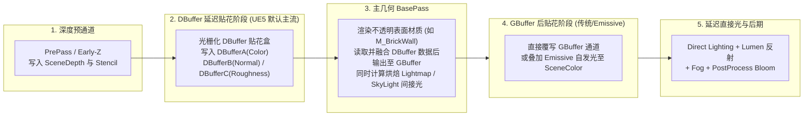
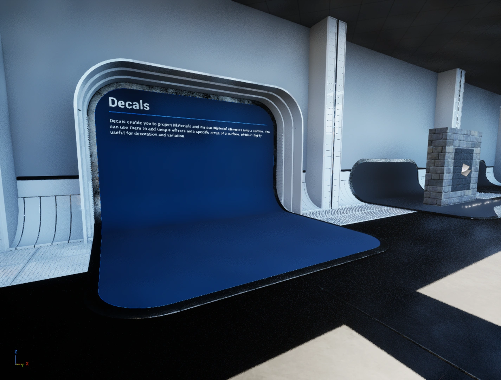
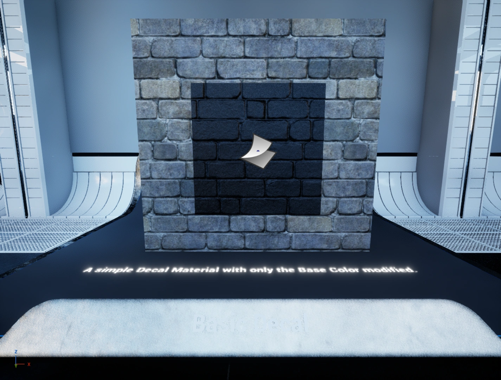
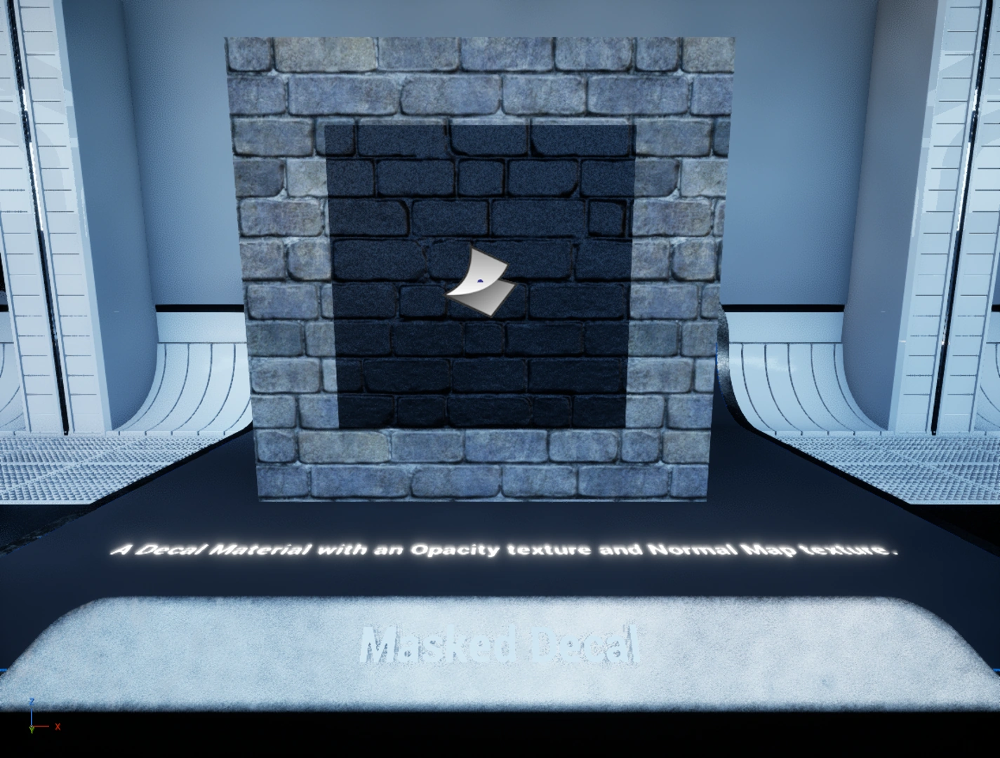
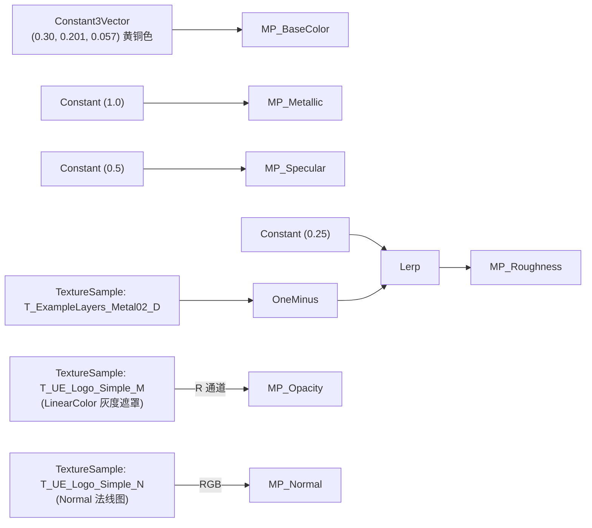
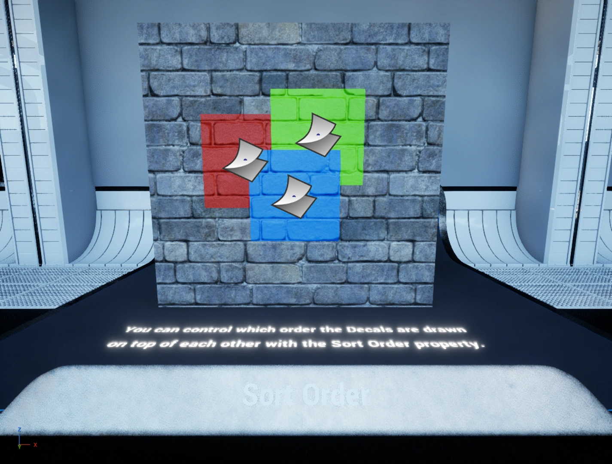

# 第 05 篇 · `Material_Decals`：DBuffer 延迟贴花与多通道表面叠加全解

> **关卡路径**：`/Game/Maps/Material/Material_Decals`  
> **所属领域**：`01_Materials_材质与着色器`  
> **关卡统计**：总 Actor 数 `64` | 官方展台数 `8`（`#1` ～ `#8` 零遗漏全拆解） | 示例 Actor 数 `29` | 核心材质资产 `12` 个

---

## 一、 渲染管线的第一性原理：贴花是如何在“不改一丁点模型”的前提下给世界化妆的？

在大型 3A 游戏场景制作中，关卡美术师每天都在面对一个灵魂矛盾：**既要复用模块化的标准资产以节省显存，又要打破重复感，在墙根加上青苔水渍、在路面印上斑马线与裂缝、在激战后的掩体上留下弹孔与灼烧焦痕。**

如果为了墙角一处涂鸦就复制一份独立墙体模型、重展一套独享 UV 并烘焙专属贴图，整个开放世界的显存预算会在十分钟内彻底崩溃；而在早期前向渲染时代，工程师通常采用在墙面前方额外垫一片“悬浮网格片（Mesh Decal）”的做法——但只要地形有起伏、墙角有折弯，悬浮网格就会立刻穿模悬空，或者在远距离因深度缓冲（Z-Buffer）精度不足产生剧烈闪烁的 **Z-Fighting（深度打架）**。

虚幻引擎的 **`Deferred Decal`（延迟贴花）** 彻底终结了这场噩梦。要真正读懂 `Material_Decals` 展厅里的全部 8 个展台，我们必须先拨开 GPU 渲染管线的迷雾，看清延迟贴花最核心的两大底层机制：**“深度反向重投影（Depth Unprojection）”** 与 **“DBuffer 渲染时机革命”**。

### 1.1 看不见的投射盒：从屏幕深度反向重建贴花局部 UV

当你在关卡中拖入一个 `DecalActor` 时，你在视口里看到的是一个绿色的线框立方体（默认半尺寸 `DecalSize` 在局部空间归一化为 $[-1, 1]^3$，投射方向沿组件的 **局部 $+X$ 轴**）。GPU 在绘制这个贴花时，根本不去碰底层墙面、圆柱或球体的顶点网格，而是执行了一套精妙绝伦的屏幕空间体积逆运算：

1. **光栅化贴花包围盒（Bounding Box Rasterization）**：GPU 将这个不可见的立方体投射盒光栅化到屏幕上，找出屏幕上哪些像素落在了立方体的投影轮廓内；
2. **读取场景深度并还原世界坐标**：对于盒体覆盖的每一个屏幕像素 $(u_s, v_s)$，像素着色器直接从早已由不透明几何体写入的 `SceneDepth`（场景深度缓冲）中读出该像素背后的真实表面深度 $Z_{depth}$，结合当前相机的逆视图投影矩阵（`SVPositionToTranslatedWorld`），瞬间算出底下那块砖墙像素的三维世界坐标 $P_{ws}$；
3. **逆变换至贴花局部盒空间（World-to-Decal Transform）**：将世界坐标 $P_{ws}$ 乘以 `DecalActor` 自身的逆世界变换矩阵 $M_{\text{WorldToDecal}}$，得到局部坐标 $P_{local} = (x, y, z)$：
   $$P_{local} = M_{\text{WorldToDecal}} \cdot \begin{bmatrix} P_{ws} \\ 1 \end{bmatrix}$$
4. **六面体越界裁剪与平面 UV 映射**：检查 $P_{local}$ 的三个分量是否全部落在 $[-1, 1]^3$ 区间内。只要任意一轴超出 $[-1, 1]$（说明该像素对应的墙面在投射盒前方或后方太远处），立即调用 HLSL `clip()` 丢弃该像素！若留在盒内，既然贴花沿 $+X$ 轴投射，那么垂直于 $+X$ 轴的局部 $(y, z)$ 坐标从 $[-1, 1]$ 线性重映射到 $[0, 1]$，就天然成为了贴花材质里的 `TexCoord[0]`！

$$\text{DecalUV} = \left( \frac{P_{local}.y + 1}{2},\; \frac{P_{local}.z + 1}{2} \right)$$

这就是为什么无论底层是平坦的砖墙、弯曲的圆柱还是圆润的球体，哪怕三个完全独立的模型拼在一起，延迟贴花都能在一次绘制中严丝合缝地“包裹”上去，且**永远不会发生 Z-Fighting**！

### 1.2 为什么需要 DBuffer？延迟贴花在渲染管线中的“两次生命”

解决了“贴在哪里”之后，紧接着就是困扰无数技术美术的第二个核心问题：**贴花到底在渲染管线的哪一步写入？为什么有的贴花在阴影或天光下看起来像贴在屏幕玻璃上的假纸片？**

让我们通过管线时序图直观对比虚幻引擎中贴花的两种底层路径：

- **传统 GBuffer 贴花（Post-GBuffer Decals）的历史痛点**：在早期延迟渲染中，不透明物体先跑完 `BasePass`，把自己的颜色、法线、粗糙度写进 `GBuffer`，**甚至在 `BasePass` 里就已经把烘焙光照贴图（Lightmap）和静态天光算完写进 `SceneColor` 了**。此时贴花才姗姗来迟去修改 `GBuffer`——虽然紧随其后的动态直射光（Movable Directional/Spot Light）能正确照亮贴花，但在背光阴影区（只有间接天光或烘焙光的地方），底层墙面算好的间接光与新贴上去的颜色完全脱节，导致贴花在暗部像幽灵一样发灰发亮！
- **DBuffer 延迟贴花（Deferred Decal Buffer，UE5 默认启用）的破局**：引擎将渲染顺序彻底倒置！先由 `PrePass` 产出全场景精确深度 `SceneDepth`，**在 `BasePass` 尚未开始前**，先把所有贴花绘制到三张轻量级专用缓冲纹理中：
  - **`DBufferA`**：存储贴花 `BaseColor`（RGB）与颜色混合不透明度（Alpha）；
  - **`DBufferB`**：存储贴花世界空间法线修改量（RGB）与法线混合权重（Alpha）；
  - **`DBufferC`**：存储 `Metallic`、`Specular`、`Roughness`（RGB）与粗糙度通道权重（Alpha）。
  随后当砖墙材质 `M_BrickWall` 执行 `BasePass` 时，主材质着色器自动采样 `DBufferA/B/C`，将贴花的油漆色、凹痕法线与水渍粗糙度**原原本本地融合进砖墙自己的物质属性里**，再去统一接受烘焙光照、Lumen 全局光照、天空光与反射探针的计算！从此，无论处于烈日直射还是幽暗墙角，贴花都与底层表面融为一体，物理光影无懈可击。

> [!TIP]
> **选择性通道写入（Multi-Channel Selective Override）**：当你只往贴花材质的 `Normal` 引脚连线，而不连 `BaseColor` 和 `Roughness` 时，虚幻材质编译器会自动将混合行为编译为仅更新法线缓冲（如 `DBuffer Translucent Normal`），完整保留底层的砖墙颜色与粗糙度——这正是制作弹孔凹坑、路面裂纹而无需重画底色贴图的核心秘诀！

---

## 二、 `Material_Decals` 展厅全局纵览与空间资产地图

打开 `/Game/Maps/Material/Material_Decals`，整座展厅由 `BP_DemoRoom` 构建出 8 个连续展位（`segment Counter = 8`），沿着世界 $X$ 轴从 `X = 500` 一路延伸至 `X = 7500`（固定位于南侧展列 `Y = -900`）。

在进入逐展台解剖前，我们先通过全局矩阵鸟瞰 8 个展台的排布逻辑与核心资产对应关系：

| 展台编号 | 官方展台标题 (`BP_DemoDisplay`) | 空间坐标 `(X, Y, Z)` | 核心贴花与底板资产路径 | 核心教学命题 |
| :---: | :--- | :---: | :--- | :--- |
| **`#1`** | `Decals` | `(500, -900, 0)` | 全局动态光照环境组（`DirectionalLight` / `SkyLight` 等） | 延迟贴花定义与测试光场搭建 |
| **`#2`** | `Basic Decal` | `(1515, -900, 0)` | `M_Decal_Simple` + `M_BrickWall` | 最简纯色覆盖贴花与局部 $+X$ 投射轴向 |
| **`#3`** | `Decal Blend Modes` | `(2495, -900, 0)` | `M_Decal_Translucent` / `Normal` / `Stain` / `Emissive` | 覆盖、纯法线、正片叠底污渍与 HDR 自发光四模式对比 |
| **`#4`** | `Masked Decal` | `(3500, -900, 0)` | `M_Decal_Logo`（含 `_M` 遮罩与 `_N` 法线） | 遮罩抠图、法线浮雕与粗糙度细节调制 |
| **`#5`** | `Projection on multiple meshes` | `(4500, -900, 0)` | `M_Decal_Logo` 跨投 `M_SimpleColor` / `M_BrickWall` / `MI_SimpleColor_Blue` | 单一贴花盒跨越多网格曲面的无缝包裹 |
| **`#6`** | `Receives Decals off` | `(5500, -900, 0)` | 同 `#5` 四件套（球体/圆柱关闭 `Receives Decals`） | 基于硬件 Stencil 模板缓冲的贴花选择性屏蔽 |
| **`#7`** | `Sort Order` | `(6500, -900, 0)` | `M_Decal_Simple` (`0`) / `MI_Decal_Simple_Green` (`1`) / `MI_Decal_Simple_Blue` (`3`) | 重叠贴花的渲染层级仲裁与项目分层规范 |
| **`#8`** | `Animated Decal Material` | `(7500, -900, 0)` | `M_Decal_Animated`（含 `Rotator` 节点） | 贴花材质内部 UV 动态旋转动画与切线法线陷阱 |

---

## 三、 逐展台（Stand `#1` ～ `#8`）100% 零遗漏深度拆解

### 3.1 展台 `#1`：`Decals`（`BP_DemoDisplay8`，坐标 `(500, -900, 0)`）—— 展厅导言与全局测试光场

作为步入展厅的第一个导览展位，展牌清晰定义了贴花在场景美术工作流中的定位：

> **官方展牌原文**：  
> *Decals enable you to project Materials and various Material elements onto a surface. You can use them to add unique effects onto specific areas of a surface, which is highly useful for decoration and variation.*  
> （贴花使你能够将材质及各种材质属性元素投射到物体表面上。你可以利用它在表面的特定区域叠加独特的效果，这在场景装饰与打破重复变化方面极其有用。）

虽然 `#1` 展台台面上没有摆放测试方块，但在世界原点 `(0, 0, 0)` 处挂载归属了驱动整座展厅光影响应的 **5 个全局环境与基础 Actor**：
1. **`DirectionalLight`（主平行光）**：`Mobility = Movable`（完全动态），`Intensity = 10`，纯白光色 `(1, 1, 1, 1)`，俯仰旋转 `Pitch = -60°, Yaw = -160°, Roll = -85°`，开启投影（`CastShadows = true`）。以斜向下 $60^\circ$ 的入射角掠过后续所有展台的立面砖墙，专门用来凸显砖缝与贴花法线贴图的高光凹凸感！
2. **`SkyLight`（天空光）**：`Mobility = Movable`，`Intensity = 1`，负责照亮砖缝凹陷处与背光面，检验贴花在环境漫反射与镜面反射下的融合度。
3. **`SkyAtmosphere`（天空大气）** 与 **`ExponentialHeightFog`（指数高度雾）**：提供物理正确的天穹散射背景与环境氛围。
4. **`Actor`（含 `ChaosDebugDrawComponent_0`）**：引擎全局物理调试绘制组件容器。

---

### 3.2 展台 `#2`：`Basic Decal`（`BP_DemoDisplay1`，坐标 `(1515, -900, 0)`）—— 最简颜色贴花与底板世界对齐材质

来到 `#2` 展台，一面灰蓝色石砖墙中央浮现出一块方正的深色贴花区域，地面悬浮着一行醒目的 3D 文字标签：

> **展台 3D 悬浮文字（`TextRenderActor1`）**：  
> `A simple Decal Material with only the Base Color modified.`（一个仅修改了基础颜色的简单贴花材质。）

#### （1） 空间 Actor 配对与“局部 $+X$ 轴投射”细节
本展台由两个核心 Actor 构成空间配对：
- **受投射底墙 `Shape_Cube`**：静态网格 `/Engine/EngineMeshes/Cube.Cube`，位于 `(1525, -612.5, 155)`，重载了贯穿全图的标准测试砖墙材质 `/Game/ExampleContent/Decals/Materials/M_BrickWall`。
- **贴花投射器 `DecalActor6`**：位于 `(1525.01, -575.23, 151.30)`（紧贴砖墙前表面 `Y = -575` 附近），挂载 `NewDecalComponent`，绑定材质 `/Game/ExampleContent/Decals/Materials/M_Decal_Simple`，`DecalSize = (1, 1, 1)`，`SortOrder = 0`。
  - **关键旋转细节**：注意实测提取出的 `DecalActor6` 旋转值为 **`Pitch = 0°, Yaw = -90°, Roll = 90°`**！新手新建 `DecalActor` 时最常遇到“贴花竖着贴在墙上怎么变成一条细线拉伸了？”——因为 `DecalActor` 默认是朝地面（$-Z$）投射的（内部组件预设了俯仰偏转），当你要往面朝 $+Y$ 方向的垂直墙面上正面投射时，必须让贴花组件的蓝色箭头（实为贴花投射轴向 $+X$）垂直刺入墙面，否则墙面就成了掠射侧面，整张贴图会被拉成平行条纹！

#### （2） 核心资产节点深拆 ①：底板砖墙 `/Game/ExampleContent/Decals/Materials/M_BrickWall`
这块看似普通的砖墙其实暗藏玄机——无论把 `Shape_Cube` 拉伸成多宽多高，上面的石砖比例永远不会变形！拆解其内部 **7 个材质表达式节点**：
- **核心材质属性**：`materialDomain = MD_Surface`，`blendMode = BLEND_Opaque`，`shadingModel = MSM_DefaultLit`。
- **主输出连接与完整节点链**：
  - `MP_BaseColor` $\leftarrow$ `MaterialExpressionMaterialFunctionCall_9`（调用引擎内置三平面投射函数 `/Engine/Functions/Engine_MaterialFunctions01/Texturing/WorldAlignedTexture` 的 `XYZ Texture` 输出），输入纹理对象 `MaterialExpressionTextureObject_0`（`/Game/ExampleContent/Material_Nodes/Textures/T_Bricks_D`）与纹理世界尺寸 `MaterialExpressionConstant3Vector_2` **`(256, 256, 256)`**（即每 256 厘米平铺一次石砖）；
  - `MP_Normal` $\leftarrow$ `MaterialExpressionMaterialFunctionCall_11`（第二路 `WorldAlignedTexture`），输入法线纹理对象 `MaterialExpressionTextureObject_2`（`/Game/ExampleContent/Material_Nodes/Textures/T_Bricks_N`）与同一组 `256` 世界尺寸；
  - `MP_Metallic` $\leftarrow$ `MaterialExpressionConstant_4`（默认值 `0.0`，纯电介质石材）；
  - `MP_Roughness` $\leftarrow$ `MaterialExpressionConstant_6`（`0.9`，粗糙哑光石砖表面）。

#### （3） 核心资产节点深拆 ②：最简贴花 `/Game/ExampleContent/Decals/Materials/M_Decal_Simple`
打开贴花材质 `M_Decal_Simple`，其结构极度精炼，仅含 **3 个表达式节点**：
- **核心材质属性**：**`materialDomain = MD_DeferredDecal`**（将材质域切换为延迟贴花的决定性开关！）、`blendMode = BLEND_Translucent`、`shadingModel = MSM_DefaultLit`。
- **主输出连接**：
  - `MP_BaseColor` $\leftarrow$ `MaterialExpressionVectorParameter_0`（参数名 `"Base Color"`，默认值 `(0.5, 0.017676, 0.0, 1.0)` 暗赭红色）；
  - `MP_Metallic` $\leftarrow$ `MaterialExpressionConstant_0`（`0.0`）；
  - `MP_Specular` & `MP_Roughness` $\leftarrow$ 共用同一个 `MaterialExpressionConstant_1`（**`0.5`**）。
- **视口现象深度剖析**：仔细观察实拍图 `Material_Decals_01_stand_02.webp`！你会发现两个极其有趣的物理细节：
  1. **底层砖墙的立体凹凸缝隙完好无损地保留了下来！** 因为 `M_Decal_Simple` 的 `MP_Normal` 引脚悬空未连，引擎仅覆写了颜色与粗糙度缓冲，底层 `M_BrickWall` 的 `T_Bricks_N` 法线依然全权主导像素光照起伏；
  2. **粗糙度从 `0.9` 降到了 `0.5`**：贴花覆盖区域不仅改变了底色，还因为 `MP_Roughness = 0.5` 比原砖墙的 `0.9` 更光滑，使得中央方形区域展现出类似刷了一层半哑光清漆的润泽高光响应。

---

### 3.3 展台 `#3`：`Decal Blend Modes`（`BP_DemoDisplay3`，坐标 `(2495, -900, 0)`）—— 四大贴花混合模式同台竞技

走到 `#3` 展台，一整面宽大的石砖墙（`Shape_Cube_4`，搭载 `M_BrickWall`）被划分为 $2 \times 2$ 四宫格，四个 `DecalActor`（`DecalActor9` ～ `12`）分别演示了延迟贴花最核心的四种混合与着色范式。展台下方特意排列了两行关键提示文字：

> **展台 3D 悬浮文字矩阵（6 个 `TextRenderActor`）**：
> - 左上象限标签：`Translucent` | 左下象限标签：`Normal`
> - 右上象限标签：`Stain` | 右下象限标签：`Emissive`
> - 底部批注 1：`Translucent and Stain are using the same Base Color.`（Translucent 与 Stain 使用了完全相同的 Base Color 数值。）
> - 底部批注 2：`Translucent and Normal are the only modes that can use a Normal Map texture.`（Translucent 与 Normal 是仅有的两种可以使用法线贴图的模式。）

让我们逐一解剖这四枚贴花材质的内部节点与底层混合方程：

| 象限位置 | 场景 Actor | 材质资产路径 | `BlendMode` / `ShadingModel` | 已激活主材质引脚 | 核心节点与参数实测值 |
| :---: | :--- | :--- | :--- | :--- | :--- |
| **左上** | `DecalActor9` `(X=2400, Z=251.3)` | `M_Decal_Translucent` | `BLEND_Translucent` / `MSM_DefaultLit` | `BaseColor`, `Metallic`, `Specular`, `Roughness`, `Opacity`, `Normal` | 亮黄绿 `(0.25, 1, 0)`，`Metallic=1`，`Roughness=0.25`，`Opacity=0.5`，`ReferenceNormalMap` |
| **左下** | `DecalActor10` `(X=2400, Z=113.8)` | `M_Decal_Normal` | `BLEND_Translucent` / `MSM_DefaultLit` | **仅 `MP_Normal`** | 仅 1 个节点采样 `/Engine/EngineProduction/ReferenceNormalMap` |
| **右上** | `DecalActor11` `(X=2550, Z=251.3)` | `M_Decal_Stain` | **`BLEND_Modulate`** / `MSM_DefaultLit` | `BaseColor`, `Metallic`, `Specular`, `Roughness` | 同左上亮黄绿 **`(0.25, 1, 0)`**，`Metallic=0`，`Specular=Roughness=0.5` |
| **右下** | `DecalActor12` `(X=2550, Z=113.8)` | `M_Decal_Emissive` | `BLEND_Translucent` / **`MSM_Unlit`** | **仅 `MP_EmissiveColor`** | 超高动态范围橙红光 **`Constant3Vector(40, 0.2748, 0)`** |

#### 深度原理解析：为什么同样的 `(0.25, 1, 0)` 在 `Translucent` 和 `Stain` 下判若两物？
1. **左上 `M_Decal_Translucent`（线性覆盖混合）**：共 6 个节点，输入 `Opacity = 0.5`，底层执行标准 Alpha 线性插值：
   $$C_{\text{out}} = \text{Lerp}(C_{\text{brick}},\; C_{\text{decal}},\; \alpha) = (1 - 0.5) \cdot C_{\text{brick}} + 0.5 \cdot (0.25, 1, 0)$$
   同时它还连入了 `Metallic = 1`、`Roughness = 0.25` 与引擎标准几何测试法线图 `ReferenceNormalMap`（球面凸包与斜坡图案）。效果就像往砖墙上**刷了一层半透明的黄绿色金属漆并压出了凸起浮雕**——哪怕原本是深黑色的砖缝，也会被强行提亮涂成浅黄绿色（即“糊墙感”）。
2. **右上 `M_Decal_Stain`（`BLEND_Modulate` 正片叠底染色污渍）**：共 3 个节点，将混合模式切换为 **`BLEND_Modulate`（调制/正片叠底）**。其底层颜色混合方程变成了**分量相乘**：
   $$C_{\text{out}} = \text{Lerp}(C_{\text{brick}},\; C_{\text{brick}} \times C_{\text{decal}},\; \alpha)$$
   由于砖墙底色 $C_{\text{brick}} \in [0, 1]$，乘上 `(0.25, 1.0, 0.0)` 后，红通道被压暗至四分之一，绿通道 100% 保留砖块原有的明暗纹理，蓝通道直接清零！原本幽暗的砖缝乘完依然幽暗，浅色砖面自然染上浓郁的青苔绿渍——**没有任何“浮在表面的一层白雾感”，就像液体真正渗进了石头毛孔里一样！** 这正是制作血迹、油污、水渍、焦黑烟熏的不二法门。同时注意：因为正片叠底只做颜色乘法调制，不支持法线覆盖，所以 `M_Decal_Stain` 不能挂载法线贴图。
3. **左下 `M_Decal_Normal`（纯法线雕刻模式）**：全图仅 **1 个 `TextureSample` 节点**直连 `MP_Normal`！石砖原本斑驳的灰蓝色纹理与粗糙度丝毫未动，但 `ReferenceNormalMap` 上的圆球与凹槽法线却直接烙印在了石砖上。在实战中，无论是石柱上的刀剑劈砍凹痕、水泥地上的弹坑还是井盖边缘的立体接缝，用纯法线贴花能够实现 **“一套法线弹孔通吃木板、水泥、铁皮、沙地所有材质”** 的超高复用率！
4. **右下 `M_Decal_Emissive`（`MSM_Unlit` 无光照自发光贴花）**：将着色模型改为 `MSM_Unlit`，仅用 1 个 `Constant3Vector(40, 0.2748, 0)` 输出高达 **`40.0`** 的 HDR 辐射亮度直写 `SceneColor`！它完全无视周围是白天还是黑夜，直接在砖墙表面激发出炽热的橙红色能量辉光（配合后期处理 Bloom 产生光晕溢出），专用于激光武器命中熔痕、科幻全息地面投影标识或魔法阵地面发光纹路。

---

### 3.4 展台 `#4`：`Masked Decal`（`BP_DemoDisplay2`，坐标 `(3500, -900, 0)`）—— 遮罩轮廓、法线浮雕与金属粗糙度复合贴花

前三个展台的贴花都是四四方方的矩形块，而实战中的贴花往往需要不规则轮廓。展台 `#4` 展示了如何在砖墙 (`Shape_Cube_2`) 中央投射一枚带有金属质感与立体倒角的虚幻引擎徽标（`DecalActor7`，挂载 `/Game/ExampleContent/Decals/Materials/M_Decal_Logo`）。

> **展台 3D 悬浮文字（`TextRenderActor2`）**：  
> `A Decal Material with an Opacity texture and Normal Map texture.`（一个同时包含不透明度遮罩贴图与法线贴图的贴花材质。）

#### 核心资产节点深拆：`/Game/ExampleContent/Decals/Materials/M_Decal_Logo`
打开 `M_Decal_Logo`，它包含 **9 个材质表达式节点**，完整示范了一枚工业级复合 PBR 贴花的标准连线拓扑：

- **为什么展台名叫 `Masked Decal`，材质属性却是 `BLEND_Translucent` 而非 `BLEND_Masked`？**
  这是一个极易混淆的高频细节！实测档案清楚显示 `M_Decal_Logo` 的 `blendMode` 为 **`BLEND_Translucent`**。在 `MD_DeferredDecal` 材质域中，使用 `BLEND_Translucent` 配合灰度遮罩贴图 `T_UE_Logo_Simple_M` 接入 `MP_Opacity`，不仅能让遮罩为 `0` 的外围区域 100% 透出原砖墙，还能在徽标字母边缘利用 `[0, 1]` 连续灰度实现**丝滑的边缘抗锯齿与羽化过渡**（而硬 `BLEND_Masked` 的二值 `clip()` 会在斜视角下产生明显的像素锯齿阶梯）。
- **微表面细节的点睛之笔**：作者没有给 `MP_Roughness` 填死一个常数，而是采样了一张真实的刮擦金属底纹 `T_ExampleLayers_Metal02_D`，经 `OneMinus` 反转后与 `Constant(0.25)` 进行 `LinearInterpolate` 插值输出到 `Roughness`！配合 `Metallic = 1.0`、古铜色 `(0.30, 0.201, 0.057)` 与专属边缘倒角法线 `T_UE_Logo_Simple_N`，让扁平的贴花瞬间拥有了真实蚀刻铜牌的表面斑驳光泽。

---

### 3.5 展台 `#5`：`Projection on multiple meshes`（`BP_DemoDisplay4`，坐标 `(4500, -900, 0)`）—— 跨越多几何体曲面的无缝投射

> **展台 3D 悬浮文字（`TextRenderActor6`）**：  
> `Decals will project on any static mesh within the volume.`（贴花会投射到其体积范围内的任何静态网格体上。）

为了证明第 1.1 节所述的“屏幕深度反向重投影”完全不依赖单个模型的拓扑与 UV，官方在 `#5` 展台故意摆出了三个材质、形状、法线曲率截然不同的独立静态网格 Actor，让它们在空间中交错穿插：
1. **左侧红色圆柱 `Shape_Cylinder_2`**：坐标 `(4437.5, -562.5, 155)`，网格 `/Engine/EditorMeshes/EditorCylinder`，重载母材质 `/Game/ExampleContent/Decals/Materials/M_SimpleColor`（`MD_Surface`、`BLEND_Opaque`，内含唯一节点 `VectorParameter("Diffuse") = (1, 0, 0, 1)` 纯正红）；
2. **中央石砖方块 `Shape_Cube_3`**：坐标 `(4487.5, -612.5, 155)`，搭载 `M_BrickWall`；
3. **右上蓝色球体 `Shape_Sphere`**：坐标 `(4575, -597.5, 225)`，网格 `/Engine/EditorMeshes/EditorSphere`，搭载材质实例 `/Game/ExampleContent/Decals/Materials/MI_SimpleColor_Blue`（继承自 `M_SimpleColor`，重载向量参数 `Diffuse = (0, 0, 1, 1)` 纯正蓝）；
4. **跨界投射器 `DecalActor8`**：坐标 `(4487.51, -562.73, 163.80)`，搭载刚刚拆解过的 `M_Decal_Logo`。

**实战启示**：同一个 `DecalActor8` 的 $[-1, 1]^3$ 投射盒同时笼罩了红圆柱的柱面、砖墙的平面以及蓝球体的球面。由于 GPU 逐像素从统一的 `SceneDepth` 还原三维世界坐标，这枚金色虚幻徽标跨越三道几何接缝而**没有任何断层或错位**！在关卡制作中，当你想在“泥土地形 + 石头路肩 + 墙根踢脚线”三者交界处铺一层连贯的落叶或积水污渍时，一颗延迟贴花即可完美搞定。

---

### 3.6 展台 `#6`：`Receives Decals off`（`BP_DemoDisplay5`，坐标 `(5500, -900, 0)`）—— 基于硬件 Stencil 模板测试的贴花免疫机制

紧挨着 `#5` 展台，`#6` 展台摆出了**一模一样的四件套阵容**：红色圆柱 `Shape_Cylinder_3`、石砖方块 `Shape_Cube_5`、蓝色球体 `Shape_Sphere_2` 以及完全同位置的徽标贴花 `DecalActor13`（`M_Decal_Logo`）。但站在展台前观察，你会发现原本印在局部几何体（如球体/圆柱）上的徽标消失了，贴花只留在了开启接收的墙面上！

> **展台 3D 悬浮文字（`TextRenderActor9`）**：  
> `Decals will not project on a static mesh with the setting Receives Decals turned off.`（当静态网格体关闭了 `Receives Decals` 选项时，贴花将不会投射到该网格上。）

#### 底层硬件揭秘：`bReceivesDecals = false` 究竟是怎么零开销生效的？
很多开发者以为关闭组件的 `Rendering -> Receives Decals` 会导致每个贴花在渲染时去查询“当前像素属于哪个 Actor”，从而拖慢性能——**恰恰相反，关闭它反而省性能！**
- 在渲染管线的 `BasePass`（或 `PrePass`）阶段，引擎会同步维护一张 8-bit 的 **Stencil Buffer（模板缓冲区）**，其中专门预留了一个硬件 Bit 位（`STENCIL_RECEIVE_DECAL_MASK`）用来标记当前屏幕像素是否允许接收贴花；
- 当 `Shape_Sphere_2` 等组件勾选取消了 `Receives Decals` 时，它在光栅化写入深度与 GBuffer 的同时，在对应的屏幕像素上将该 Stencil 位写为屏蔽状态；
- 等到 `DecalActor13` 光栅化投射盒时，GPU 硬件光栅器直接执行 **Early Stencil Test（早期模板测试）**——发现该像素未开启接收位，**在进入贴花 Pixel Shader 采样贴图之前就直接将像素硬件丢弃**，连一次纹理采样都不会发生！

> [!IMPORTANT]
> **实战必关 `Receives Decals` 的四大对象类型**：
> 1. **第一/三人称主角、NPC 角色与手中武器**：否则玩家走过地上的静态血迹或路标贴花盒时，脚背、裤腿甚至端着的步枪上会诡异地滑过一条斑马线！
> 2. **可交互动态道具（门的旋转把手、可搬运木箱、破碎刚体）**：门打开后，原本贴在门缝上的静态灰尘贴花如果还留在原地凌空印在旋转的门板上就会瞬间穿帮。

---

### 3.7 展台 `#7`：`Sort Order`（`BP_DemoDisplay6`，坐标 `(6500, -900, 0)`）—— 重叠贴花的渲染层级仲裁

当同一面墙上既贴了墙皮剥落底图，又刷了帮派涂鸦，最后玩家还在涂鸦上打了两枪留下弹孔——这三张贴花全部附着在**完全相同的墙面深度 $Z_{depth}$** 上！既然深度值一模一样，GPU 怎么知道谁该画在上面、谁该压在底下？展台 `#7` 给出了标准答案：

> **展台 3D 悬浮文字（`TextRenderActor10` & `TextRenderActor11`）**：  
> `You can control which order the Decals are drawn on top of each other with the Sort Order property.`（你可以通过 `Sort Order` 排序优先级属性，精确控制多张贴花彼此叠压时的绘制先后顺序。）

#### 空间配对与材质实例参数实测核对
对照实拍图 `Material_Decals_03_stand_07.webp` 与实测提取数据，砖墙 `Shape_Cube_6` 表面交错叠放了三枚分别呈品字形错开的纯色方形贴花：

1. **最底层（左中红色方块）`DecalActor14`**：
   - 坐标：`(6437.51, -562.73, 176.30)`
   - 绑定材质：母材质 `/Game/ExampleContent/Decals/Materials/M_Decal_Simple`（默认 `Base Color = (0.5, 0.0177, 0.0, 1.0)` 鲜红色）
   - 排序优先级：**`SortOrder = 0`**（最先绘制，被绿块和蓝块同时压在最底下！）
2. **中间层（右上绿色方块）`DecalActor16`**：
   - 坐标：`(6512.51, -562.73, 201.30)`
   - 绑定材质：实例 `/Game/ExampleContent/Decals/Materials/MI_Decal_Simple_Green`（继承自 `M_Decal_Simple`，重载向量参数 `Base Color = (0.1460, 0.5, 0.0, 1.0)` 翠绿色）
   - 排序优先级：**`SortOrder = 1`**（在红块之后绘制，故盖住红块右上角；但小于 `3`，故被蓝块盖住左下角！）
3. **最顶层（中下蓝色方块）`DecalActor15`**：
   - 坐标：`(6487.51, -562.73, 138.80)`
   - 绑定材质：实例 `/Game/ExampleContent/Decals/Materials/MI_Decal_Simple_Blue`（继承自 `M_Decal_Simple`，重载向量参数 `Base Color = (0.0, 0.1289, 0.5, 1.0)` 宝石蓝）
   - 排序优先级：**`SortOrder = 3`**（最后绘制，傲立于红块与绿块最顶层！）

#### 工业级项目贴花 `SortOrder` 分层规范表
切忌在团队项目中随意填写 `1, 2, 3` 或 `999`！一旦两个重叠贴花拥有相同的 `SortOrder`，引擎按组件内存地址或注册顺序排序，会导致镜头移动或关卡流送重载时两张贴花来回闪烁跳变。建议在项目 TA 规范中强制推行“十进制段位制”：

| 层级段位 (`SortOrder`) | 场景美术职能层 | 物理叠压逻辑解释 |
| :---: | :--- | :--- |
| **`0 ～ 19`** | 结构破损与建材底变层（墙皮脱落、露砖底图） | 属于墙体最底层的结构损伤，后续一切涂料都应盖在它上面 |
| **`20 ～ 39`** | 人工涂装标识层（道路斑马线、墙面海报、喷漆涂鸦） | 刷在墙体结构之上，但会被长年累月的自然污垢弄脏 |
| **`40 ～ 59`** | 自然风化污渍层（墙根青苔、雨水流挂污迹、灰尘） | 使用 `Stain (Modulate)` 叠在斑马线和海报之上，使其融入环境不再崭新突兀 |
| **`60 ～ 79`** | 环境液体覆盖层（路面积水洼、油污降低 `Roughness`） | 水膜覆盖在污渍与标线最表层，统一拉平法线并提供镜面反射 |
| **`100+`** | 运行时动态战斗反馈（实时弹孔、爆炸焦痕、鲜血飞溅） | 玩家刚刚制造的瞬态痕迹，永远位于所有静态环境贴花之上 |

---

### 3.8 展台 `#8`：`Animated Decal Material`（`BP_DemoDisplay7`，坐标 `(7500, -900, 0)`）—— 动态 UV 贴花与切线空间法线旋转陷阱

来到整座展厅的收官展位 `#8`，砖墙 `Shape_Cube_7` 中央的金色虚幻引擎徽标（`DecalActor17`）正在绕着中心点缓缓自转！

> **展台 3D 悬浮文字（`TextRenderActor12`）**：  
> `Decals may be animated within the Material.`（贴花可以在材质内部直接制作动态动画。）

#### 核心资产节点深拆：`/Game/ExampleContent/Decals/Materials/M_Decal_Animated`
拆解 `M_Decal_Animated` 的 **7 个材质表达式节点**，可以看到它脱胎于 `#4` 展台的 `M_Decal_Logo`，参数保持古铜色 `Constant3Vector(0.30, 0.201, 0.057)`、`Metallic = 1.0`、`Specular = 0.5`、`Roughness = 0.25`，但核心改动在于 UV 输入端新增了 **`MaterialExpressionRotator_0`（UV 旋转器节点）**：
- `MaterialExpressionRotator_0` 默认以 `(0.5, 0.5)` 为旋转轴心，随引擎时间 `Time` 持续旋转贴花局部 `[0, 1]` UV 坐标；
- 旋转后的 UV 同时喂给 `MaterialExpressionTextureSample_6`（遮罩图 `T_UE_Logo_Simple_M` $\rightarrow$ `MP_Opacity`）与 `MaterialExpressionTextureSample_7`（法线图 `T_UE_Logo_Simple_N` $\rightarrow$ `MP_Normal`）。

> [!WARNING]
> **Principal TA 深度排雷：旋转贴花中的切线空间法线方向错乱问题！**  
> 细心的技术美术如果凑近观察 `M_Decal_Animated` 旋转满 $180^\circ$ 时的徽标边缘高光，会抓到一个极其经典的图形学 Bug：**当徽标转到倒立（$180^\circ$）时，原本应该凸起的金属徽标看起来居然变成向墙里凹陷了！**  
> **为什么？** 因为 `T_UE_Logo_Simple_N` 是切线空间法线贴图（Tangent-Space Normal Map），其中红通道 $R$ 永远代表“贴图原始水平向右 $+U$”，绿通道 $G$ 永远代表“贴图原始垂直向下 $+V$”。`Rotator` 节点虽然把纹理图案转了 $180^\circ$，却**没有把法线采样出来的 $(R, G)$ 二维向量反向旋转 $-180^\circ$**！导致贴花切线基底还指着墙面原方向，采样到的法线向量却跟着图案颠倒了！  
> **工业级修复方案**：在实战制作旋转魔法阵、旋转弹道预警圈或漩涡水波贴花时，若包含法线贴图，务必使用与 `Rotator` 相同角度（符号相反）的 `CustomRotator` 或二维旋转矩阵 $\begin{bmatrix}\cos\theta & -\sin\theta \\ \sin\theta & \cos\theta\end{bmatrix}$ 同步旋转法线贴图的 `RG` 分量后再 `Append` 回 `B` 通道，才能保证无论转到哪个角度，凹凸高光永远忠于真实世界光源方向！

---

## 四、 关卡全局补充盘点与 AAA 级延迟贴花性能调优圣经

除上述 8 个展台内的 29 个配对示例 Actor 外，关卡中还存在 1 个全局空白植被管理器 `InstancedFoliageActor`（无实例负载）。

将 `Material_Decals` 全馆吃透后，在真实大型生产项目中落地延迟贴花时，请务必牢记以下四条性能与品质铁律：

1. **严控贴花盒 X 轴厚度，杜绝空腔 Overdraw（过度绘制）**：
   牢记第 1.1 节原理——GPU 光栅化的是整个贴花线框立方体在屏幕上的投影面积！如果一面贴花只需要附着在 `2cm` 厚的墙面上，美术师却偷懒把 `DecalSize.X` 拉成了 `500cm` 的巨型长方体，那么当玩家侧身沿着走廊看过去时，这颗硕大的透明盒子会占满大半个屏幕，导致屏幕成千上万个根本不在墙面上的像素白白跑一遍深度还原与矩阵逆运算再被 `clip()` 丢弃！**永远把贴花盒压扁到刚好包住目标表面起伏即可。**
2. **善用 `Fade Screen Size` 远距自动剔除**：
   在每个 `DecalComponent` 上都有 `Fade Screen Size` 属性（默认 `0.01`）。对于弹孔、烟头、小裂缝等微小贴花，将其调高至 `0.05 ～ 0.08`，当相机拉远、贴花在屏幕上不足几个像素大小时，引擎会自动平滑淡出并彻底跳过其 DrawCall。
3. **掠射角拉伸（Grazing Angle Stretching）的材质自救**：
   当立方体形的贴花投射到一个与 $+X$ 投射轴平行的侧面台阶立面上时，UV 会在侧壁拉出难看的细长条纹。可在贴花材质中用 `VertexNormalWS`（在贴花域中代表投射盒朝向向量）与场景 `WorldNormal`（读取自 GBuffer 的底层墙面法线，注意开启 DBuffer 时若自身改写法线需读取几何法线或用 `ddx/ddy(WorldPosition)` 叉乘重建面片法线）做点乘 `Dot`，当夹角超过 $60^\circ$ 时平滑乘零 `Opacity` 自动消隐侧壁拉伸。
4. **Deferred Decal 与 Mesh Decal 的黄金分工**：
   - 需要跨多个模型投射、运行时动态生成（弹孔/脚印/技能预警圈）、快速关卡装饰涂鸦 $\rightarrow$ **首选 `Deferred Decal`**；
   - 高精度硬表面机械模型（如科幻枪械、载具外壳上的固定螺丝钉、警示铭牌、焊缝），且需要随骨骼动画运动 $\rightarrow$ **必须在 DCC 软件中制作紧贴表面的悬浮三角面片（Mesh Decal）配合 `MD_DeferredDecal` 材质**，既能享受 DBuffer 只改法线/粗糙度的多通道混合红利，又彻底省去了全盒体积光栅化与矩阵逆投影开销！
