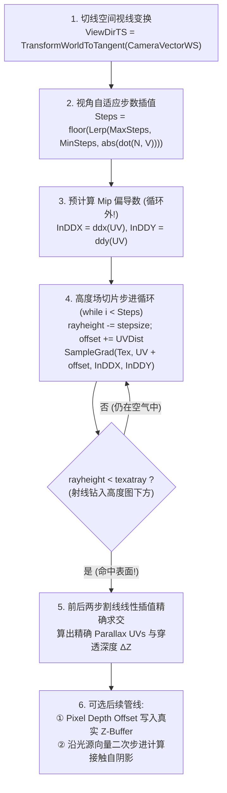
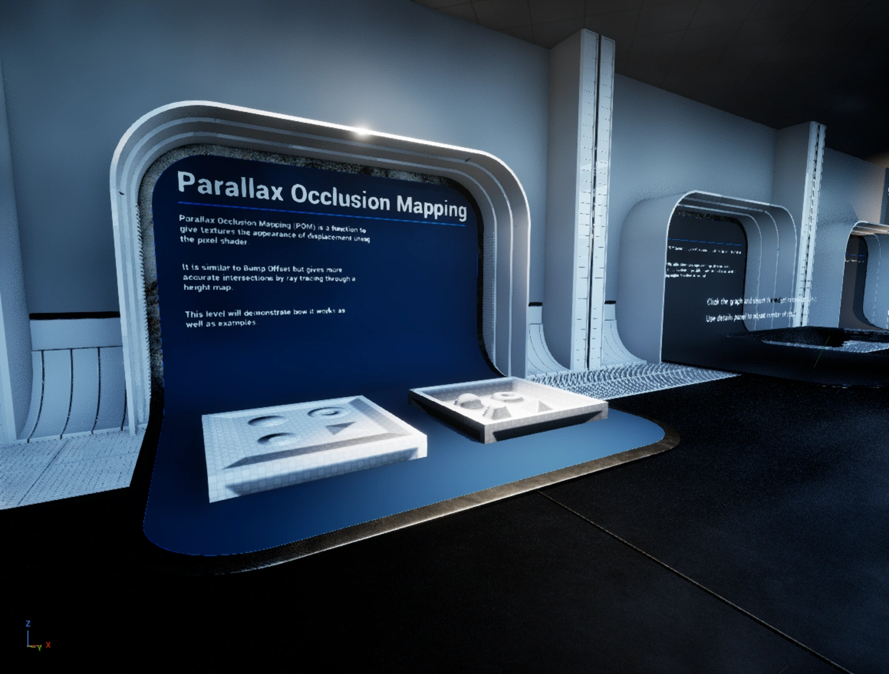
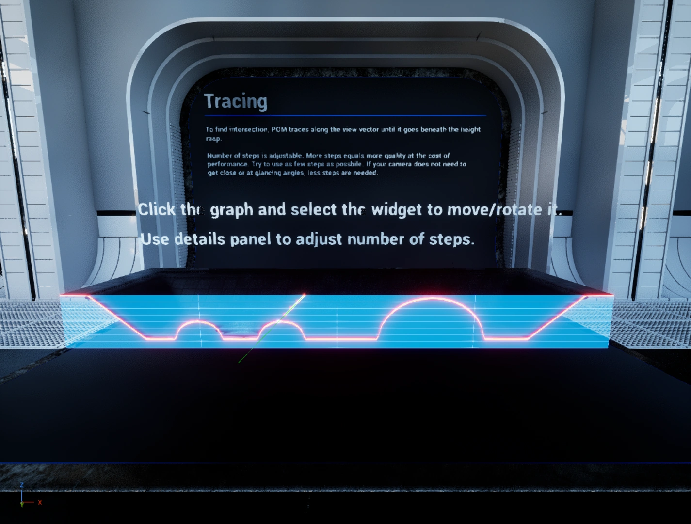
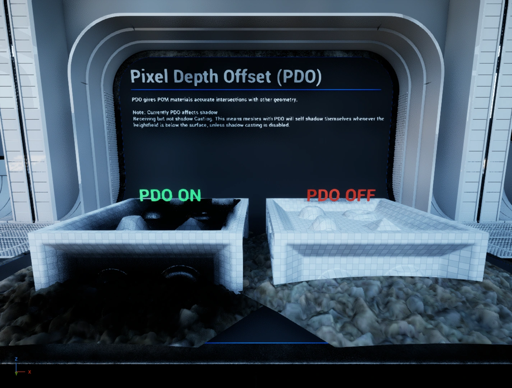
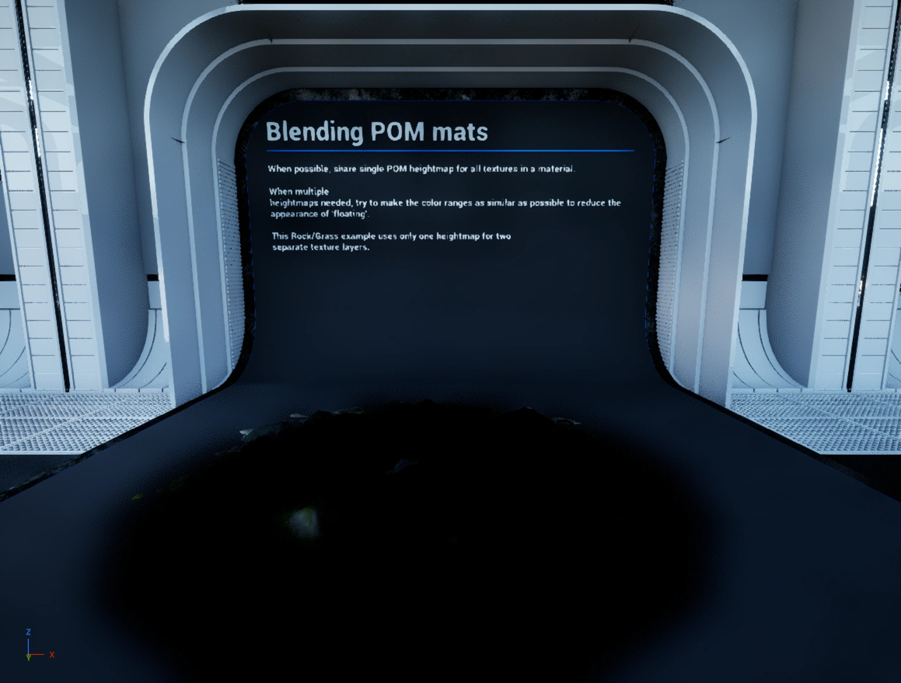

# 第 06 篇 · `Material_ParallaxOcclusionMapping`：视差遮蔽映射、切线空间光线步进与 PDO 深度偏移全解

> **关卡路径**：`/Game/Maps/Material/Material_ParallaxOcclusionMapping`  
> **所属领域**：`01_Materials_材质与着色器`  
> **关卡统计**：总 Actor 数 `61` | 官方展台数 `11`（`#1` ～ `#11` 零遗漏全拆解） | 示例 Actor 数 `30` | 核心剖析资产 `32` 个

---

## 一、 纯像素着色器里的“三维幻术”：为什么 2 个三角形能变出凹凸遮挡的深坑与乱石？

在实时图形学演进史上，如何让一面只有 **2 个三角形的绝对平面地板** 呈现出凹凸不平的鹅卵石、深邃的浮雕凹槽与层叠的砖石立体感，曾诞生过四代技术路线：
1. **法线贴图（Normal Mapping）**：只篡改每像素的受光法线朝向，完全不改变纹理采样位置——正着看光影逼真，一旦低头斜看，石头扁得像一张贴纸，石头与石头之间没有任何前后遮挡关系（Parallax 视差为零）；
2. **凹凸偏移（Bump Offset / Steep Parallax 初代单步近似）**：只采 **1 次** 高度图，按视线斜率线性平移一次 UV——稍微把高度值拉大超过 `0.05`，斜看时纹理就会像融化的奶酪一样发生严重的“泳动（Swimming）”和错位穿帮；
3. **硬件曲面细分置换 / Nanite 实体微多边形**：直接堆真顶点，视觉最真，但对于地面多层混合材质（如地形 Landscape、程序化动态湿度材质）或需要极低显存网格开销的场景，纯几何方案难以随时动态混合高度；
4. **视差遮蔽映射（Parallax Occlusion Mapping，简称 POM）**：在 **不增加哪怕 1 个额外顶点** 的前提下，直接在 **Pixel Shader（像素着色器）** 里沿着视线发射一条穿过高度场贴图（Heightmap）的微型射线，通过 **多步光线步进（Raymarching）+ 割线线性插值求交 + 像素深度偏移（Pixel Depth Offset, PDO）**，硬生生在二维平面内“雕刻”出具备真实前后遮挡、真实几何穿插交界线甚至凹槽接触自阴影的三维表面！

### 1.1 切线空间光线步进（Tangent-Space Raymarching）的数学与 HLSL 灵魂

要彻底看懂本关展厅里的 `ParallaxOcclusionMapping` 材质函数、横截面示波器 `POM_Debug` 与实验性曲面函数 `ParallaxOcclusionMapping_Curvature`，我们先将 GPU 每个像素内部执行的四步几何求交方程推导清楚：



#### 核心数学细节拆解（对照本关提取出的真实 `Custom` 节点 HLSL 源码）
1. **自适应步数分配（Grazing-Angle Step Scaling）**：
   当玩家垂直低头俯视地面（$\vec{N} \cdot \vec{V} \approx 1$）时，视线几乎垂直扎入高度图，只需极少步数（如 `MinSteps = 4` 或 `8`）就能精准命中；而当玩家趴在地上平视远方（掠射角 $\vec{N} \cdot \vec{V} \to 0$）时，视线在高度场里横向滑行很远，必须拉满步数（如 `MaxSteps = 32` 或 `64`）才能防止高度切片断层成“千层饼阶梯”。
2. **为什么循环内部严禁用 `Tex.Sample()`，而必须用 `Tex.SampleGrad(..., InDDX, InDDY)`？**
   打开本关 `/Game/ExampleContent/ParallaxOcclusionMapping/Functions/ParallaxOcclusionMapping_Curvature` 的核心 `MaterialExpressionCustom_20` 节点，你会看到如下原汁原味的官方 HLSL 源码：
   ```hlsl
   float rayheight = 1;
   float oldray = 1;
   float2 offset = 0;
   float oldtex = 1;
   float texatray;
   float yintersect;
   int i = 0;

   while (i < MaxSteps * StepMultiplier + 2)
   {
       texatray = dot(HeightMapChannel, Tex.SampleGrad(TexSampler, UV + offset, InDDX, InDDY));

       if (rayheight < texatray)
       {
           float xintersect = (oldray - oldtex) + (texatray - rayheight);
           xintersect = (texatray - rayheight) / xintersect;
           yintersect = (oldray * xintersect) + (rayheight * (1 - xintersect));
           offset -= (xintersect * UVDist);

           float3 output;
           output.xy = offset;
           output.z = yintersect;
           return output;
       }
       ...
       oldray = rayheight;
       rayheight -= stepsize;
       offset += UVDist;
       oldtex = texatray;
       i++;
   }
   ```
   **技术美术必考题**：GPU 以 $2 \times 2$ 像素块（Quad）为单位锁步执行。在动态 `while` 循环里，相邻像素命中石头的步数不同（线程分支发散 Divergent Branching），硬件无法在动态循环内部计算隐式屏幕偏导数——直接调用 `Sample` 会报 HLSL 编译错误 `gradient instruction used in a loop with varying iteration`！因此必须在进入 `while` 循环**之前**，用 `MaterialExpressionDDX` 和 `MaterialExpressionDDY` 预先算出原始 UV 的屏幕变化率 `InDDX`、`InDDY`，在循环内通过 `SampleGrad` 显式传入 Mipmap 层级依据！
3. **割线线性插值消阶梯（Secant Intersection Refinement）**：
   注意上面源码里的 `xintersect` 公式！当第 $i$ 步射线高度 `rayheight` 首次低于采样高度 `texatray` 时，真实交点其实落在第 $i-1$ 步 $(oldray, oldtex)$ 与第 $i$ 步 $(rayheight, texatray)$ 连线的交点处。利用相似三角形斜率比值：
   $$t = \frac{\text{texatray} - \text{rayheight}}{(\text{oldray} - \text{oldtex}) + (\text{texatray} - \text{rayheight})}$$
   将 UV 往回退 $t \cdot \text{UVDist}$，仅需十几次粗步进就能拟合出媲美上百次步进的平滑曲面轮廓！

---

## 二、 `Material_ParallaxOcclusionMapping` 展厅总览与 11 座展台全景地图

步入 `/Game/Maps/Material/Material_ParallaxOcclusionMapping`，整座展厅沿 $X$ 轴从 `X = 480` 延伸至 `X = 11010`，共设 **11 座专题展台**，从最基础的开关对比、光线步进实时横截面示波器、TAA 时域抖动降噪、动态自阴影、PDO 深度穿插、几何曲率限制、参考平面推拉、陡壁拉伸修复、多图层单高度混合，一路讲到最前沿的圆柱曲面曲率修正实验。



| 展台编号 | 官方展台标题 (`BP_DemoDisplay`) | 空间坐标 `(X, Y, Z)` | 核心陈列资产与调试器蓝图 | 攻克的核心技术痛点 |
| :---: | :--- | :---: | :--- | :--- |
| **`#1`** | `Parallax Occlusion Mapping` | `(480, -900, 0)` | `M_Parallax_Simple_off` vs `M_Parallax_Shadows2` | 纯法线平面 vs 完整 POM + 阴影的震撼第一眼对比 |
| **`#2`** | `Tracing` | `(1520, -900, 0)` | `BP_POM_CrossSectionDebug_02_box2`（横截面示波器） | 实时可视化切线射线步进、红黄蓝交点求解全过程 |
| **`#3`** | `Reducing Artifacts` | `(2500, -900, 0)` | `M_Parallax_TempAA` vs `M_Parallax_TempAA_Disable` | 利用 `DitherTemporalAA` 时域微抖动消除低步数分层断层 |
| **`#4`** | `Shadows` | `(3500, -900, 0)` | `BP_POM_Shadow` + `M_Parallax_Shadows` + `MPC` | 交互式点光源驱动高度场二次步进接触自阴影 |
| **`#5`** | `Pixel Depth Offset (PDO)` | `(4500, -900, 0)` | `M_Parallax_Simple_PDO` / `M_POM_PerfExample_01` | 像素级 Z-Buffer 深度覆写实现几何真实穿插与 VSM 自阴影排雷 |
| **`#6`** | `Geometry Tips` | `(5500, -900, 0)` | `S_PDO_Sheet_03`（微曲） vs `SM_Rock`（尖锐岩石） | 高曲率网格棱角导致切线空间畸变撕裂的边界条件 |
| **`#7`** | `Reference Plane` | `(6980, -900, 0)` | `M_POM_PerfExample_01` (`1.0`) vs `_Ref_0` (`0.0`) | 参考平面从顶向下凹陷 (`1`) 与从底向上凸起 (`0`) 的体积差异 |
| **`#8`** | `Fixing Stretching` | `(7980, -900, 0)` | `M_Parallax_Strech` vs `M_Parallax_Strech_Fix` | 利用 `WorldAlignedTexture` 消除垂直陡壁的 UV 瀑布拉伸 |
| **`#9`** | `Blending POM mats` | `(8990, -900, 0)` | `S_PDO_Sheet_9`（`M_POM_PerfExample_01` 岩石+苔藓） | 单一高度场驱动多层 PBR 纹理 `HeightLerp` 高性能融合 |
| **`#10`** | `POM vs Bump Offset` | `(10000, -900, 0)` | `M_BumpOffset` vs `M_Parallax_Simple` | 传统 1 次采样近似与多步光线求交的精度/开销权衡 |
| **`#11`** | `POM Curvature Experiment` | `(11010, -900, 0)` | `BP_POM_CrossSectionDebug_01` + `ParallaxOcclusionMapping_Curvature` | 圆柱曲面切线弯曲导致射线发散的极坐标曲率补偿实验 |

---

## 三、 逐展台（Stand `#1` ～ `#11`）100% 零遗漏深度拆解

### 3.1 展台 `#1`：`Parallax Occlusion Mapping`（`BP_DemoDisplay1`，坐标 `(480, -900, 0)`）—— 平面与深坑的第一眼震撼对比

> **官方展牌原文**：  
> *Parallax Occlusion Mapping (POM) is a function to give textures the appearance of displacement using the pixel shader. It is similar to Bump Offset but gives more accurate intersections by ray tracing through a height map. This level will demonstrate how it works as well as examples.*  
> （视差遮蔽映射 POM 是一项利用像素着色器赋予纹理置换凹凸外观的功能。它类似于 Bump Offset，但通过对高度图进行光线追踪获得了精确得多的交点。本关卡将演示其工作原理与实战示例。）

在总览实拍图 `Material_ParallaxOcclusionMapping_00_overview.webp` 左下角，你可以清晰看到 `#1` 展台台面上并排摆放着两块完全相同的引擎基础立方体（`/Engine/BasicShapes/Cube.Cube`，顶部仅 2 个三角形），上方悬停着一盏高亮度聚光灯 `SpotLight`（强度 `100000`，暖白光 `(1.0, 0.969, 0.929)`，衰减半径 `800`），同时世界原点挂载着全局 `DirectionalLight`（强度 `3.14`）、`SkyLight`（强度 `3.0`）、`SkyAtmosphere` 与 `ExponentialHeightFog`：

1. **左侧对比块 `Cube`（关闭 POM 的纯法线基准）**：
   - 绑定材质实例 `/Game/ExampleContent/ParallaxOcclusionMapping/Materials/M_Parallax_Simple_off`（继承自母材质 `M_Parallax_Simple`）；
   - **唯一关键重载参数**：将标量参数 **`Height of Texture` 设为 `0.0`**！此时光线步进位移归零，退化为一张纯平的法线贴图（`T_POM_Test_01_N`）叠加白格底图（`DefaultWhiteGrid`）。斜视看去，外框凹槽、圆球、圆环与棱锥全都扁平地贴在同一水平面上。
2. **右侧演示块 `Cube2`（满血 POM + 接触自阴影）**：
   - 绑定母材质 `/Game/ExampleContent/ParallaxOcclusionMapping/Materials/M_Parallax_Shadows2`（`MD_Surface`、`BLEND_Opaque`、`MSM_DefaultLit`，共 **29 个材质表达式节点**）；
   - **核心节点与实测参数**：调用引擎核心材质函数 `/Engine/Functions/Engine_MaterialFunctions01/Texturing/ParallaxOcclusionMapping`，配置 `MinSteps = 4`、`MaxSteps = 40`、`Height of Texture = 0.1`、`ref plane = 1.0`、`Tiling = 1.0`、`Channel = (1, 0, 0, 0)`（提取 `T_POM_Test_01_Disp` 红通道高度）；同时开启静态布尔参数 `Shadows = true`，配置 `Shadow Steps = 16`、`Shadow Blur = 1.0`、固定局部光源方向 `Light Vector = (0, 1, -0.8)` 与阴影压暗色 `Shadow Tint = (0.1, 0.1, 0.1)`，最终将 `Parallax UVs` 同时喂给 `DefaultWhiteGrid`（连入 `BaseColor` 与 `Specular`）和 `T_POM_Test_01_N`（连入 `Normal`），配合 `Roughness = 0.15`。
   - **视觉飞跃**：右侧原本扁平的白格方块瞬间向下“塌陷”成一口深邃的方形石槽，槽底凸起的半球、圆环与四棱锥不仅互相遮挡，还在斜射灯光下投出了锐利逼真的立体阴影！

---

### 3.2 展台 `#2`：`Tracing`（`BP_DemoDisplay2`，坐标 `(1520, -900, 0)`）—— 横截面光线步进实时示波器解剖

> **官方展牌原文**：  
> *To find intersection, POM traces along the view vector until it goes beneath the height map. Number of steps is adjustable. More steps equals more quality at the cost of performance. Try to use as few steps as possbile. If your camera does not need to get close or at glancing angles, less steps are needed.*  
> **展台 3D 悬浮交互指引（2 个 `TextRenderActor`）**：  
> - `Click the graph and select the widget to move/rotate it.`（在编辑器中点击图表并选中三维操纵杆平移/旋转射线。）  
> - `Use details panel to adjust number of steps.`（使用细节面板动态调整光线步进次数。）



> [!NOTE]
> **空间配对勘误说明**：由于交互式横截面调试器 Actor `BP_POM_CrossSectionDebug_02_box2` 的原点坐标位于 `(2012.21, -193.20, 74.52)`（恰好处于 `#2` 展台 `X=1520` 与 `#3` 展台 `X=2500` 正中间偏右 4 厘米处），自动化空间聚类将其归入了 `#3` 展台清单；但正如上方 `#2` 展台专属实拍图 `Material_ParallaxOcclusionMapping_01_stand_02.webp` 所证实的，它的发光蓝红示波器面板 `Debug Plane` 正好横跨在 `#2` 展台正前方，是专供 `#2` 展台演示 `Tracing` 步进原理的核心教学教具！

#### 深度拆解：`BP_POM_CrossSectionDebug_02_box` 蓝图与 227 节点 `POM_Debug` 示波器材质
这台堪称“图形学教科书级神器”的调试器蓝图 `/Game/ExampleContent/ParallaxOcclusionMapping/Blueprint/BP_POM_CrossSectionDebug_02_box`（父类 `Actor`）由两大平面组件与两套动态材质实例（MID）协同运作：
1. **水平剖切 POM 实体面 `POM Plane`（`S_1_Unit_Plane`）**：
   搭载基于 `/Game/ExampleContent/ParallaxOcclusionMapping/Debug-Only-Materials/POM_Debug_Cut`（`BLEND_Masked`，41 个节点）创建的动态材质实例 `MID_POM_Debug_Cut_Flat_01_0`。蓝图在 `ConstructionScript` 中读取可拖拽三维坐标变量 `Cut Location = (529.08, 350.24, 0)` 与 `Yset = 0.7965`，通过 `Cut` 标量参数配合 `OpacityMask` 将 POM 平面像做 CT 扫描一样沿切面一刀切开！
2. **垂直全息示波器面板 `Debug Plane`（`S_1_Unit_Plane`）**：
   搭载基于 `/Game/ExampleContent/ParallaxOcclusionMapping/Debug-Only-Materials/POM_Debug`（`BLEND_Additive`、`MSM_Unlit`、双面渲染，足足 **227 个材质表达式节点**！）创建的 `MID_POM_Debug_Inst_0`，将切面处的高度图轮廓与光线步进全过程实时绘制成发光函数图像：
   - **发光红粉色高度场曲线与蓝色水平切片网格**：调用专属绘图函数 `/Game/ExampleContent/ParallaxOcclusionMapping/Functions/DebugPOM_Heightmap`（35 个节点，通过运行两次 $f(x)$ 与 $f(x + \Delta x)$ 求导修正线宽 `Heightfield Line Thickness = 8`），将 `T_POM_Test_01_Disp` 在 `Yset` 切片位置的高度值画成实拍图中起伏的亮粉色山形轮廓，并按当前设定的 `Steps Min = 8, Steps Max = 8` 画出 8 条等距水平蓝色采样步进线！
   - **红点、黄点与蓝点交点求解可视化（`MaterialExpressionCustom_0` 源码揭秘）**：蓝图将用户旋转的箭头组件 `traceVector`（当前实测俯仰角 `Pitch = -45.91°`）传入 `POM_Debug` 的 `Custom` 节点：
     - **红色未命中采样点（Red Miss Dots）**：每向下迈出一步，若射线仍在高度曲线上方（`DepthDiff = rayheight - texatray >= 0`），在对应 UV 位置叠加发光红点 `float3(10, 0, 0)`；
     - **黄色首次穿透点（First Sub-surface Hit）**：一旦某一步钻到了粉色高度曲线下方（`DepthDiff < 0`），立即在该采样点画出一颗醒目的亮黄点 `float3(5, 5, 0)`；
     - **高亮电光蓝精确交点（Solved Linear Intersection）**：紧接着执行割线插值 `timelerp = 1 - (LastDiff / (LastDiff - DepthDiff))`，回退到上一步红点与当前黄点连线穿过高度曲线的精确位置，点亮一颗亮度高达 `float3(0, 0, 20)` 的蓝色交点！

在编辑器里用鼠标旋转 `traceVector` 小部件或把 `Steps` 从 `8` 调低到 `3`，你能亲眼看到当射线掠过小圆包顶部时，如果步长太粗，射线会直接“跨过”整个山峰漏检（Tunneling Artifact）——这比任何枯燥的文字解释都直击灵魂！

---

### 3.3 展台 `#3`：`Reducing Artifacts`（`BP_DemoDisplay3`，坐标 `(2500, -900, 0)`）—— 用 TAA 时域抖动化解低步数“千层饼”伪影

既然增加 `MaxSteps` 会成倍消耗纹理采样带宽，有没有办法**只花 16～32 步的廉价开销，却渲染出媲美 128 步的无断层丝滑斜面**？展台 `#3` 揭晓了虚幻引擎渲染工程师的得意巧思：

> **官方展牌原文**：  
> *TemporalAA can be use to jitter the number of rays slightly. This causes traces to be out of phase and cancels out artifacts over time.*  
> （可以利用时域抗锯齿 TemporalAA 对射线步数施加微小的随机抖动。这会使相邻像素与相邻帧的步进相位错开，并在时间累积中相互抵消阶梯分层伪影。）

展台陈列了三块对比平面：
1. **左侧未抖动基准面 `S_1_Unit_Plane2`**：搭载实例 `/Game/ExampleContent/ParallaxOcclusionMapping/Materials/M_Parallax_TempAA_Disable`（继承自 `M_Parallax_TempAA`，重载 **`TempAA Step Multiplier = 1.0`**，即彻底关闭步数抖动）。贴图采用棱角分明的金字塔高度图 `T_POM_ExampleTexture_02_Pyramid_Disp`，且故意将高度拉大到极陡的 **`Height of Texture = 0.25`**（`MaxSteps = 32`）。斜看金字塔侧面时，能清晰看到一圈圈像等高线梯田一样的硬阶梯伪影！
2. **右侧开启 TAA 抖动面 `S_1_Unit_Plane`**：搭载母材质 `/Game/ExampleContent/ParallaxOcclusionMapping/Materials/M_Parallax_TempAA`（共 **26 个表达式节点**）：
   - **核心消锯齿连线**：调用 `/Engine/Functions/Engine_MaterialFunctions02/Utility/DitherTemporalAA` 节点（产生每像素、每帧跳变的 `[0, 1]` 蓝噪声抖动值），送入 `LinearInterpolate` 在 `1.0` 与标量参数 **`TempAA Step Multiplier`（默认值 `1.2`）** 之间插值，再与 `MaxSteps (32)` 相乘！
   - **数学本质**：这意味着相邻像素与连续多帧的 `MaxSteps` 会在 `32.0 ～ 38.4` 之间高频微颤，导致每条射线的步长切片位置上下错位（Out of phase）。经过引擎 TAA / TSR 时域历史帧混合滤波后，生硬的等高线阶梯瞬间融合成了柔顺细腻的连续斜面！
3. **后方原理图解板 `EditorPlane`**：搭载半透明材质 `/Game/ExampleContent/ParallaxOcclusionMapping/Materials/M_TempAATrick_01`（采样示意图纹理 `T_POM_TempAA_Trick` 同时输出至 `BaseColor`、`EmissiveColor` 与 `Opacity`），直观图解了多帧错相采样点如何加密覆盖整条斜坡。

---

### 3.4 展台 `#4`：`Shadows`（`BP_DemoDisplay4`，坐标 `(3500, -900, 0)`）—— 动态光源追踪与高度场接触自阴影

标准阴影贴图（Shadow Map）只认模型的原始平面网格，根本不知道 POM 在像素内部挖出了凹槽。要想让凹槽里的凸包在光源移动时投下阴影，POM 必须自己沿着光线方向再做一次**反向高度场步进（Shadow Raymarching）**！

> **官方展牌原文**：  
> *POM has the ability to render a self shadow from a specified light vector. Requires additional raytrace; use sparingly due to performance cost. Shadows need to be manually enabled in the function. The Light Vector needs to be passed to the material. This can be done using either a MID or a Material Parameter Collection. This example creates a MID (Material Instance Dynamic). Move the Yellow ball to move the light.*

本展台由 1 个交互光源蓝图与 2 块对比方块组成：
- **可拖拽动态点光源蓝图 `BP_POM_Shadow`**（坐标 `(3209.12, -396.81, 104.43)`）：包含发光黄球网格组件 `LightSphere`（材质 `/Game/ExampleContent/Audio/Materials/Emissive`，暖橙自发光 `(1.0, 0.606, 0.216)`）与动态 `PointLight`（强度 `5000`，半径 `1000`）。蓝图将该发光黄球的世界位置实时同步写入材质参数集 **`/Game/ExampleContent/ParallaxOcclusionMapping/Materials/MPC_GlobalParam_Test`**（内含向量参数 `LightPos`、`LightVector`、`SpherePos`、`SphereX/Y/Zbasis` 及标量 `Radius`、`ZScale`）。
- **右侧无自阴影对照组 `Cube4`**：搭载基础母材质 `/Game/ExampleContent/ParallaxOcclusionMapping/Materials/M_Parallax_Simple`（24 个节点，静态开关 `Shadows = false`）。无论黄球灯怎么转，凹坑底部都亮堂堂一片，缺乏体积压迫感。
- **左侧开启接触自阴影组 `Cube3`**：搭载 `/Game/ExampleContent/ParallaxOcclusionMapping/Materials/M_Parallax_Shadows`（共 **32 个表达式节点**）：
  - **高精度参数设置**：`MinSteps = 64`、`MaxSteps = 64`、`Height of Texture = 0.1`、开启静态布尔 `Shadows = true`、**`Shadow Steps = 32`**、`Shadow Blur = 1.0`；
  - **逐像素点光源方向向量计算**：注意节点的精妙连线——它没有用固定平行光方向，而是用 `MaterialExpressionCollectionParameter_1("LightPos")` 读取黄球世界坐标，减去当前像素的 `MaterialExpressionWorldPosition_0`（`Subtract` $\rightarrow$ `Normalize`），算出**每个像素指向黄球点光源的精确世界单位向量**传入 `ParallaxOcclusionMapping` 的 `Light Vector` 输入端！
  - **自阴影调制输出**：POM 函数从主视线交点出发，朝着该光源向量斜向上再步进 `32` 步采样高度图——途中一旦撞上更高的凸起，立即输出遮挡衰减系数，与 `Shadow Tint (0.2, 0.2, 0.2)` 混合后同时乘入 `MP_BaseColor` 与 `MP_Specular`（消除阴影区内的直接镜面高光漏光！）。在编辑器里拖动那颗黄色发光球，坑内圆环与棱锥的影子便会如真实雕塑般实时旋转拉长！

---

### 3.5 展台 `#5`：`Pixel Depth Offset (PDO)`（`BP_DemoDisplay`，坐标 `(4500, -900, 0)`）—— 打破平面边界的深度穿插与 UE5 VSM 自阴影大排雷

如果说前四个展台还只是在“单个网格表面内部”玩视觉欺骗——一旦有另一块真实的石板或角色脚掌插进这块 POM 地面，没有深度修正的 POM 就会立刻露馅：交界处会切出一条死板笔直的二维直线！展台 `#5` 请出了终极杀器：**`Pixel Depth Offset`（像素深度偏移，简称 PDO）**。

> **官方展牌原文**：  
> *PDO gives POM materials accurate intersections with other geometry.*  
> *Note: Currently PDO affects shadow Receiving but not shadow Casting. This means meshes with PDO will self shadow themselves whenever the heightfield is below the surface, unless shadow casting is disabled.*  
> **展台 3D 悬浮文字**：左侧绿字 `PDO ON` | 右侧红字 `PDO OFF`



#### （1） 四件套穿插实验拆解
展台左右各摆放了一组“白格凹槽方块 + 地面乱石薄片网格（`S_PDO_Sheet_03`）”相互穿插的组合：
- **右侧 `PDO OFF` 对照组（`Cube6` + `S_PDO_Sheet_11`）**：
  - 方块用 `M_Parallax_Simple`（`Use PDO = false`），地面乱石片用实例 `M_POM_PerfExample_01_Inst_NoPDO`（将标量参数 **`PDO` 设为 `0`**）。
  - **破绽一目了然**：看实拍图右侧，地面明明是一颗颗高低起伏的鹅卵石，但在与白色方块底部相交的地方，却像被一把激光刀齐刷刷削平了一样，露出了一条笔直虚假的多边形交界线！
- **左侧 `PDO ON` 实验组（`Cube5` + `S_PDO_Sheet_10`）**：
  - 方块用 `M_Parallax_Simple_PDO`（开启 `Use PDO`），地面乱石片直接搭载母材质 `/Game/ExampleContent/ParallaxOcclusionMapping/Materials/M_POM_PerfExample_01`（46 个节点，默认标量 **`PDO = 1`**，将 `ParallaxOcclusionMapping` 函数算出的 `Pixel Depth Offset` 引脚乘以 `PDO` 参数输出至主材质的 `Pixel Depth Offset` 通道）。
  - **物理奇迹诞生**：看实拍图左下角白墙与乱石交界处！高耸的鹅卵石立体地漫过并遮挡住了白墙底边，低矮的石缝则退让到白墙后方，呈现出宛如百万面实体雕刻模型般的锯齿状真实三维咬合轮廓！

#### （2） 深度解惑：为什么实拍图左侧 `PDO ON` 的凹坑和乱石在 UE5 下变黑了？！
仔细观察实拍图 `Material_ParallaxOcclusionMapping_02_stand_05.webp` 左侧（以及后面 `#9` 展台的实拍图），很多升级到 UE5 的读者第一眼都会惊呼：**“左边 `PDO ON` 怎么黑成一团了？是不是材质坏了？”**

**不！这恰恰是官方展牌第二段警告在 UE5 虚拟阴影贴图（Virtual Shadow Maps, VSM）下被极致放大的经典铁证！** 让我们把这个价值千金的渲染底层机制彻底讲透：
1. **保守深度偏移铁律**：在硬件光栅化中，`Pixel Depth Offset` 只能接收正数（把像素往远离相机的屏幕深处推远：$Z_{\text{final}} = Z_{\text{mesh}} + \Delta d$），以保证硬件深度裁剪的保守性；
2. **投射阴影与接收阴影的“人格分裂”**：为了极致的阴影渲染性能，引擎在渲染光源视角的 **Shadow Depth Pass（阴影深度图）** 时，默认**不会运行昂贵的 POM Pixel Shader，也不会应用 PDO**！这意味着在太阳光的 VSM 阴影图里，`Cube5` 和乱石片 `S_PDO_Sheet_10` 依然被记录在最顶层的原始平面高度 $Z = 0$ 处；
3. **致命的自我遮挡（Self-Shadowing）**：等到主相机着色计算接收阴影时，开启了 `PDO ON` 的像素已经被高度场往地底下推深了 $5 \sim 15\text{ cm}$！当着色器拿着这个下沉后的三维坐标去查询 VSM 阴影贴图时，VSM 毫不留情地判定：**“你位于 $Z = 0$ 投射面地底下 $10\text{ cm}$ 处，你被你自己顶上的原始网格挡住阳光了！”** 于是除了最高处紧贴 $Z=0$ 顶面的凸起尖端（如左侧槽内露出的白色棱锥尖）还能照到光外，所有低于顶面的凹陷区全部陷入了自己的浓重阴影之中（UE4 传统 CSM 阴影因默认带有较大的 `Shadow Bias` 容差掩盖了一部分，而 UE5 VSM 精度极高、零偏移，立刻原形毕露）！

> [!CAUTION]
> **UE5 生产环境使用 PDO 的三条保命法则**：
> 1. 若将 POM+PDO 用于地面砖石、路面车辙或墙面贴片，且不需要该薄片自身给别的物体投射大体积阴影，**直接取消勾选该 StaticMeshComponent 的 `Cast Shadow`（投射阴影）**——瞬间黑斑全消，且依然能完美接收角色与建筑投下来的高精度阴影！
> 2. 若模型必须保留 `Cast Shadow`，可在材质或网格上配合调低 `Reference Plane`（见展台 `#7`）或适度调节局部光源 `Shadow Bias` / 组件 `Shadow Indirect Only`。
> 3. 注意开启 PDO 会关闭该网格的硬件 Early-Z 提前深度拒绝（因为最终深度要等跑完 Pixel Shader 才知道），在大面积地形上需配合距离淡出（Distance Fade）在远景归零 PDO。

---

### 3.6 展台 `#6`：`Geometry Tips`（`BP_DemoDisplay5`，坐标 `(5500, -900, 0)`）—— 网格曲率与高度比的黄金边界

> **官方展牌原文**：  
> *POM works best on flat or very smooth geometry. When the curvature of an object gets close to the height of the parallax, distortion can result. PDO works as alternative to masked edges.*  
> **展台 3D 悬浮文字**：
> - 左侧：`Slightly Curved Geo works well`（平缓微曲的几何体效果极佳）
> - 右侧：`Sharp peaks and corners show distortion unless height is reduced`（尖锐山峰与硬折角会出现扭曲，除非降低视差高度）

展台并列展示了两个网格：
- **左侧微拱薄片 `S_PDO_Sheet_03`**：搭载 `M_POM_PerfExample_01`（`Height of Texture = 0.1`），表面仅有柔和起伏，切线空间（Tangent / Binormal / Normal）在相邻三角面之间平滑过渡，POM 乱石纹理自然饱满，边缘还靠 PDO 自然消解了原本生硬的外轮廓剪影；
- **右侧嶙峋巨石 `SM_Rock`（`/Game/ExampleContent/Landscapes/Meshes/SM_Rock`）**：搭载实例 `M_POM_PerfExample_01_Inst`（`Height of Texture = 0.1`, `Tiling = 2`）。由于标准 POM 算法假设**切线空间在整个步进距离内是一个无限延伸的平坦笛卡尔坐标系**，而在 `SM_Rock` 剧烈折转的尖锐棱角处，相邻顶点的切线向量夹角极大，插值后的视线射线在跨越三角面接缝时会发生剧烈弯折断裂，导致棱角处的凹凸图案出现撕裂与透视扭曲。对于此类高曲率岩石，必须大幅压低 `Height of Texture`（如降至 `0.02 ～ 0.03`）或改用展台 `#11` 探索的曲率修正方案。

---

### 3.7 展台 `#7`：`Reference Plane`（`BP_DemoDisplay8`，坐标 `(6980, -900, 0)`）—— 向下挖坑还是向上隆起？参考平面的推拉艺术

> **官方展牌原文**：  
> *The reference plane can be adjusted so that the effect is to push up instead of down. The default is 1 meaning the reference is at the top and all offset is downwards. A value of 0 would mean all offset is upwards. A value of 0.5 splits the difference. Be aware when using values under 1, if the camera goes underneath the projected volume, artifacts can occur.*

展台并排对比了两张平面（`S_1_Unit_Plane4` 与 `S_1_Unit_Plane3`）：
1. **左侧默认顶参考面 `S_1_Unit_Plane4`（`M_POM_PerfExample_01`，`ref plane = 1.0`）**：
   高度图数值 `1.0`（最白处）与原始多边形网格平面齐平，所有小于 `1.0` 的凹槽全部向网格**下方凹陷（UV 沿视线正向偏移）**。优点是体积严格收敛在模型边框内部，相机只要不穿进地板底下就绝不会穿帮；缺点是如果开启 PDO，整片表面都在原始网格下方（容易触发 `#5` 展台讲到的自阴影）。
2. **右侧底参考面 `S_1_Unit_Plane3`（实例 `M_POM_PerfExample_01_Ref_0`，重载 `ref plane = 0.0`、`PDO = 0`）**：
   高度图数值 `0.0`（最黑谷底）与原始网格齐平，所有大于 `0.0` 的石头全部朝着网格**上方虚拟隆起（UV 沿视线反向负偏移：$\Delta UV \propto (h_{\text{ref}} - h_{\text{hit}})$）**！当你围绕两块面板水平移动镜头时，能清晰看到左侧石头相对于地板边框“往坑里缩”，而右侧石头相对于边框“往空中鼓出来”！折中值 **`ref plane = 0.5`** 则一半上凸、一半下凹，与传统置换贴图（Displacement Center = 0.5）完全一致。但切记：当 `ref plane < 1` 时，石头虚拟隆起的高度超出了真实三角面的几何边界，若镜头贴地低于虚拟石头顶部高度，视线甚至还没碰到原始平面网格就已经飞出网格边缘，会导致边缘石头被硬生生截断！

---

### 3.8 展台 `#8`：`Fixing Stretching`（`BP_DemoDisplay6`，坐标 `(7980, -900, 0)`）—— 用世界对齐投影终结垂直陡壁的 UV 瀑布拉伸

当高度图里存在接近 $90^\circ$ 垂直落差的断崖或方槽侧壁时，在二维平面 UV 上，整面垂直墙壁其实只占了高度图黑白交界处 **1～2 个像素的宽度**！哪怕 POM 光线步进精确算出了侧壁交点，去采样同一套平面 `BaseColor` 时，这 1 个纹素就会顺着整面垂直侧壁被拉成一道丑陋的“彩色瀑布条纹”。展台 `#8` 展示了极其实用的侧壁重映射技巧：

> **官方展牌原文**：  
> *Very steep heightmaps will have noticeable stretching. In extreme cases, it may be desirable to map a world aligned texture onto the resulting POM surface in order to hide stretching. Note that you could also opt to project a tiling texture only onto the side faces while leaving the top face alone.*

对比展台上的两块平面：
- **左侧拉伸暴露组 `S_1_Unit_Plane7`**：搭载母材质 `/Game/ExampleContent/ParallaxOcclusionMapping/Materials/StretchFix/M_Parallax_Strech`（共 **31 个表达式节点**），故意将测试高度图拉到夸张的 **`Height of Texture = 0.3`**（`MinSteps = 16, MaxSteps = 64`，底色使用污迹纹理 `T_Grime_D`），但其参数 **`Z min = 10`** 使世界对齐修正处于未激活状态，深坑四周垂直内壁布满了直上直下的纵向拉伸条纹；
- **右侧拉伸修复组 `S_1_Unit_Plane6`**：搭载材质实例 `M_Parallax_Strech_Fix`，重载参数 **`XY Tiling = 48`、`Z min = -15`**：
  - **节点级修复原理**：材质内部利用 POM 输出的像素世界坐标偏移重建虚拟凹凸表面的三维空间位置，调用 `/Engine/Functions/Engine_MaterialFunctions01/Texturing/WorldAlignedTexture` 对同一张 `T_Grime_D` 执行三平面世界空间投射（`XY Tiling = 48`, `Z Tiling = 2`），并通过高度/法线坡度遮罩（`Clamp` + `LinearInterpolate_13/14`）**仅在陡峭侧壁处无缝切换为横向侧面投影纹理，而平缓顶面依然保留原始 POM UV**——垂直断崖瞬间恢复了清晰细腻的石壁横纹！

---

### 3.9 展台 `#9`：`Blending POM mats`（`BP_DemoDisplay7`，坐标 `(8990, -900, 0)`）—— 单高度场驱动多层纹理 `HeightLerp` 高性能融合

在制作“乱石缝里长满青苔”或“雪地车辙露出泥浆”的分层材质时，如果傻乎乎地给石头跑一遍 64 步 POM，再给青苔跑一遍 64 步 POM，单个像素就要狂吞上百次纹理采样！展台 `#9` 给出了 3A 地形与地表材质的标准高性能范式：

> **官方展牌原文**：  
> *When possible, share single POM heightmap for all textures in a material. When multiple heightmaps needed, try to make the color ranges as similar as possible to reduce the appearance of 'floating'. This Rock/Grass example uses only one heightmap for two separate texture layers.*



#### 核心资产 46 节点全拆解：`/Game/ExampleContent/ParallaxOcclusionMapping/Materials/M_POM_PerfExample_01`
展台上陈列的 `S_PDO_Sheet_9` 搭载的正是贯穿 `#5`、`#6`、`#7`、`#9` 四大展台的标杆性能材质 `M_POM_PerfExample_01`（共 **46 个表达式节点**，注：实拍图中因默认 `PDO = 1` 且网格开启了阴影投射，在 UE5 VSM 下同样触发了 `#5` 展台所述的未关投影自阴影现象）。拆解其内部精妙的“一次步进、双层复用”拓扑：
1. **唯一一次 POM 光线步进**：仅调用 **1 个** `ParallaxOcclusionMapping` 函数节点（`MinSteps = 16`, `MaxSteps = 64`, `Height of Texture = 0.1`），采样乱石高度图 `T_POM_TilingRocks_01_Disp`；
2. **共享 `Parallax UVs` 采样双层 PBR 贴图**：
   - **底层乱石层**：用步进后的 `Parallax UVs` 采样 `T_POM_TilingRocks_01_D`（岩石漫反射）、`T_POM_TilingRocks_01_N`（岩石法线）与 `T_POM_TilingRocks_01_Disp`（复用作遮挡高度依据）；
   - **顶层青苔层**：同样用这套偏移后的 UV（乘以第二层缩放系数 `T2Tiling = 1`）采样 `T_TilingMoss_01_D`（青苔漫反射）与 `T_TilingMoss_01_N`（青苔法线）；
3. **基于高度与朝向的自然生长混合（`HeightLerp` + `VertexColor` + `PixelNormalWS.B`）**：
   结合像素世界法线朝上分量（`PixelNormalWS` 掩码 `B` 通道，让青苔优先长在朝天的石面）、宏观噪声贴图 `TilingNoise05` 与顶点色 `VertexColor`，送入引擎高度混合函数 **`/Engine/Functions/Engine_MaterialFunctions02/Texturing/HeightLerp`**（配合 `LerpContrast = 1`, `Offset = 0.2`），让青苔精准地从石缝低洼处顺着岩石起伏蔓延包裹，最终通过 `LinearInterpolate_3 / 4 / 25` 统一输出 `BaseColor`、`Specular`、`Roughness`、`Normal` 与 `AmbientOcclusion`！**只花一份 POM 算力，白赚两层立体咬合材质！**

---

### 3.10 展台 `#10`：`POM vs Bump Offset`（`BP_DemoDisplay10`，坐标 `(10000, -900, 0)`）—— 何时用牛刀，何时用轻骑？

> **官方展牌原文**：  
> *POM is similar to Bump Offset but uses more texture lookups to calculate a more accurate intersection point. Because of this POM is more expensive; for subtle effects Bump Offset may be sufficient.*

展台并排对比了左侧 `S_1_Unit_Plane9`（搭载 `/Game/ExampleContent/ParallaxOcclusionMapping/Materials/M_BumpOffset`，15 个节点）与右侧 `S_1_Unit_Plane8`（搭载 `M_Parallax_Simple`，24 个节点）：
- **`M_BumpOffset` 拆解**：核心使用原生单节点 `MaterialExpressionBumpOffset_0` 采样 `T_POM_Test_01_Disp`（注：该材质图背景里虽留有一组未连入主输出的 `ParallaxOcclusionMapping` 对比废节点，但真正连入 `BaseColor` 与 `Normal` 贴图 UV 的是 `BumpOffset_0`！）。`BumpOffset` 本质公式仅为极简的一阶近似：
  $$\text{UV}_{\text{bump}} = \text{UV} + (h - h_{\text{ref}}) \cdot \text{HeightRatio} \cdot \frac{V_{ts}.xy}{V_{ts}.z}$$
  它仅需 **1 次额外高度采样 + 3 条算术指令**，但完全不知道视线途中是不是已经被前面的凸起挡住了！因此在测试图圆球与圆环边缘，斜看时整个圆球像幽灵一样漂移变形，毫无立体剪影遮挡。
- **工程选型金律**：
  - 冰层下的气泡、多层清漆下的碳纤维暗纹、浅浮雕墙纸（高度比 `< 0.02`） $\rightarrow$ **无脑选 `BumpOffset`**，性能几乎白送；
  - 鹅卵石路面、深砖槽、弹坑、机械镂空散热格栅（高度比 `0.04 ～ 0.15`，需要真实前后遮挡甚至 PDO） $\rightarrow$ **果断上 `POM`**！

---

### 3.11 展台 `#11`：`POM Curvature Experiment`（`BP_DemoDisplay9`，坐标 `(11010, -900, 0)`）—— 压轴黑科技：圆柱曲面极坐标光线步进与 `BP_POM_CrossSectionDebug_01` 全解

来到展厅最深处的第 `#11` 号压轴展台，这里展示了虚幻引擎首席技术美术 Ryan Brucks 团队当年探索的前沿实验成果——**如何在弯曲的圆柱体表面修正 POM 的切线空间曲率畸变**！

> **官方展牌原文**：  
> *This slide shows experimental work to account for mesh curvature with POM. This experiment has not yet been integrated into the POM function.*

#### （1） 为什么标准 POM 贴在圆柱上会严重穿帮？
想象一根贴满凹槽纹理的石柱：在三维世界里，一条直线视线射入圆柱表面后，随着射线往柱芯深处走，它相对于圆柱切面的夹角其实在**不断变化**，且越靠近柱芯，同样角度弧长对应的周向半径 $r$ 越短（周长 $2\pi r$ 收缩）！而标准平面 POM 却把切线空间当成平直的铁板，导致射线在圆柱边缘直接钻不进高度图，或者在掠射轮廓处发生夸张的环形拉伸。

#### （2） 压轴调试器蓝图 `BP_POM_CrossSectionDebug_01` 四大组件与极坐标步进拆解
陈列在 `(10976.88, -685.50, 112)` 的核心实验台 **`BP_POM_CrossSectionDebug_01`** 整合了 **14 个蓝图控制变量**（`Cut Location = (0, 180, 0)`, `Curve Amount = 2`, `Height Ratio = 0.05`, `Steps = 16`, `R = 100`, `Angle = 0`, `traceVector` 俯仰角 `-7.15°` 等）与 **4 个协同网格组件**：

1. **剖切曲面柱体 `S_Parallax_Curvetest_Cylinder2`**：
   网格 `/Game/ExampleContent/ParallaxOcclusionMapping/Meshes/S_Parallax_Curvetest_Cylinder`，搭载动态材质实例 `MID_POM_Debug_Cut_Curvetest_0`（母材质 `POM_Debug_Cut`，内部直接调用前文第 1.1 节展示过源码的实验函数 **`/Game/ExampleContent/ParallaxOcclusionMapping/Functions/ParallaxOcclusionMapping_Curvature`**！）。在步进循环中，它通过 `stepsize += zshift * sqrt(rayheight)` 动态修正随曲率半径递减的步进垂直分量，并在 `Cut` 横截面处剖开圆柱，露出内部虚拟高度场与侧面的咬合关系。
2. **环形极坐标全息示波器 `S_Parallax_Curvetest_Profile_01`**：
   网格采用圆环截面 `/Game/ExampleContent/ParallaxOcclusionMapping/Meshes/S_Parallax_Curvetest_Profile_Circular`，搭载 `MID_POM_Debug_ThinRing_0`（母材质 `POM_Debug`）！回看我们在第 3.2 节提取出的 `POM_Debug` 自定义 HLSL 源码后半段——作者专门写下了一段惊艳的极坐标弯曲追踪方程：
   ```hlsl
   // Angle delta is proportional to ray length along curvature axes times the curvature.
   // Curvature for a cylinder with a 0-1 UV wrap is 2pi.
   radialdist = saturate((rayheight - (1 - (1 / (curvature * heightratio)))) * curvature * heightratio);
   angle -= deltaoffset.x * curvature;
   raydir.x = cos(angle) * heightratio;
   raydir.y = sin(angle) * radialdist;
   deltaoffset = raydir * raylen / max(radialdist, distdivisor);
   debugoffset += deltaoffset;
   ```
   这段代码把原本在直线上走的平面射线，实时映射到了圆环极坐标系 $(r, \theta)$ 中！在圆环示波器上，你能亲眼看到：一条在三维空间笔直穿过的绿色视线，展开到展开后的平面 UV 示波器 `S_1_Unit_Plane`（第 3 个组件，同样搭载 `MID_POM_Debug_ThinRing_0`）里时，**竟然变成了一条向上弯曲的抛物线轨迹**！
3. **纯黑遮光背景内芯 `Cylinder`**：
   搭载 `/Engine/MapTemplates/Sky/M_BlackBackground`，衬托在剖切圆柱内部，让全息发光的红黄蓝步进采样点清晰夺目。

---

## 四、 关卡全局资产盘点与工业级 POM 性能压榨指南

除 11 个展台配对 Actor 外，关卡还包含 1 个全局空白 `InstancedFoliageActor`。

作为技术美术，在将 POM 投入商业项目前，请收好这份实战性能调优清单：
1. **警惕 Shader Complexity 视图的“假绿色欺骗”**：
   正如 `ParallaxOcclusionMapping_Curvature` 函数官方描述所警告的——由于 POM 核心写在动态 `while` 循环里，虚幻的静态指令数统计（Instruction Count）无法预知运行时每个像素实际循环了多少次！**务必使用材质内置的 `Max Expensive Steps Debug Color` 或 GPU Profiler（Unreal Insights / RenderDoc）实测毫秒耗时**。
2. **必须加装相机距离衰减（Camera Distance Fade）**：
   距离相机 `15米` 以外的地面，屏幕像素连石头本身都只有 2 个像素大，跑 32 步 POM 纯属浪费算力！务必用 `CameraDepthFade` 按距离将 `MaxSteps` 从近处的 `32` 动态插值压低到远处的 `4`，同时将 `Height of Texture` 与 `PDO` 在 `15～20米` 处平滑归零。
3. **高度图通道打包与 Mipmap 平滑**：
   将高度图塞进漫反射或粗糙度贴图的单通道（或独立 BC4 灰阶压缩纹理，单通道无色度串扰且精度极高！），避免陡峭的 `0` 到 `1` 单像素跳变（适度高斯模糊 1～2 像素高度图边缘，可瞬间减少一半所需 `MaxSteps` 步数且彻底消除锯齿！）。
