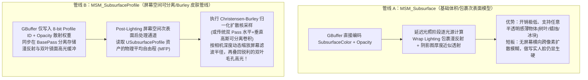
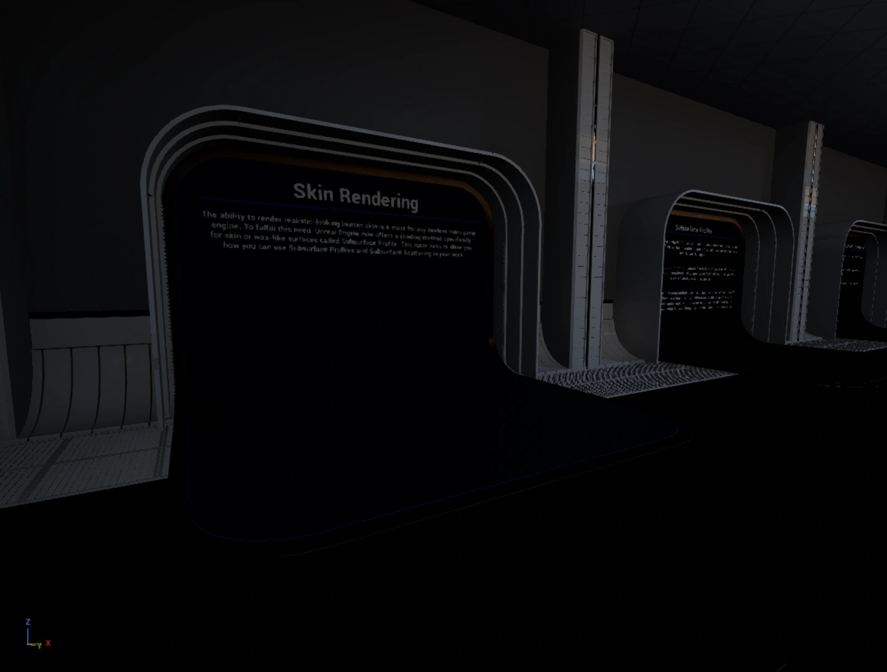
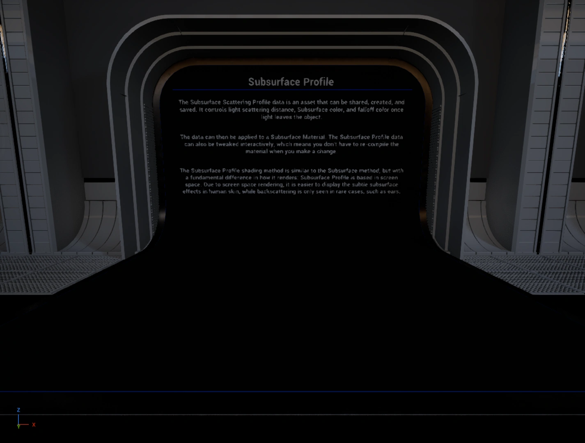
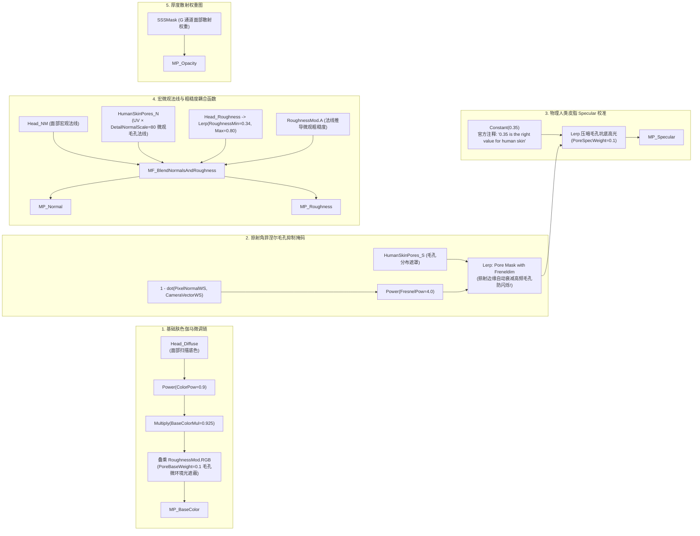
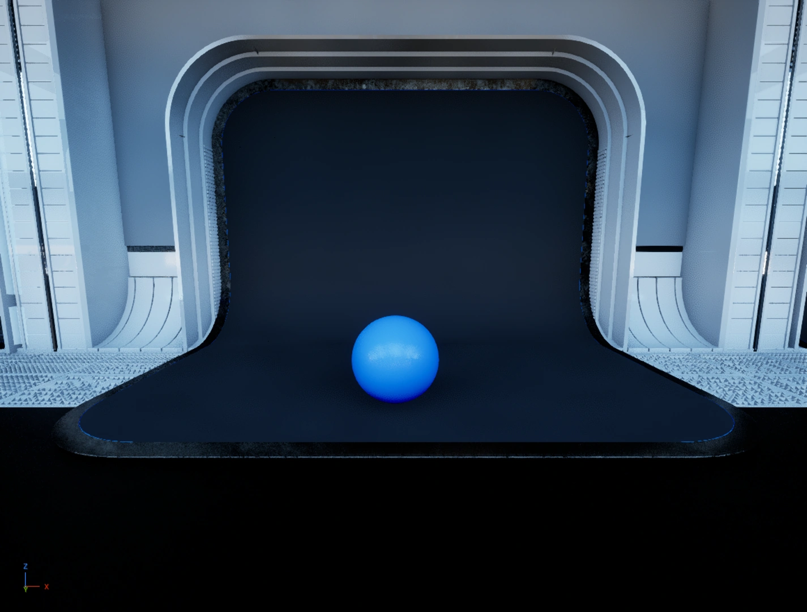

# 第 07 篇 · `Material_Skin_SubsurfaceRendering`：角色皮肤渲染、屏幕空间 Burley 次表面散射与双叶高光全解

> **关卡路径**：`/Game/Maps/Material/Material_Skin_SubsurfaceRendering`  
> **所属领域**：`01_Materials_材质与着色器`  
> **关卡统计**：总 Actor 数 `64` | 官方展台数 `6`（`#1` ～ `#6` 零遗漏全拆解） | 示例 Actor 数 `37` | 核心剖析资产 `21` 个

---

## 一、 跨越“恐怖谷”的光学密码：为什么普通 PBR 永远画不出鲜活的人类皮肤？

在写实数字人（MetaHuman）与角色技术美术领域，有一句经典格言：**“画岩石看粗糙度，画金属看环境反射，而画活人皮肤，看的是光子钻进肉里又钻出来的那几毫米旅程。”**

如果你直接用标准 `Default Lit`（默认光照）着色模型渲染一颗高精度扫描人头（哪怕贴上了 8K 毛孔法线与皮肤照片颜色贴图），打上一盏聚光灯，渲染出来的人脸立刻会呈现出令人毛骨悚然的**“石膏死尸感”或“硬塑料假人感”**——明暗交界线（Terminator）像刀切一样生硬冰冷，鼻翼与眼窝阴影死黑干瘪，每一个毛孔凹坑都像月球陨石坑一样锐利刺眼。

为什么标准 PBR 在人类皮肤面前彻底失灵？因为标准微表面模型（Cook-Torrance BRDF）建立在一个致命假设之上：**“光线从哪个点射入表面，就必须从完全相同的那个点反射出去。”** 

然而在真实的生物解剖光学中，人类皮肤是一套精妙的三层半透明浑浊介质（Turbid Medium）：
1. **最外层油脂膜与角质表皮层（Sebum & Epidermis，厚约 $0.05 \sim 0.15\text{ mm}$）**：未散射的约 $2.8\%$ 入射光在此直接发生菲涅尔镜面反射，呈现出包含细腻汗毛孔与皮脂油光的**纯白色双叶镜面高光（Dual-Lobe Specular）**；
2. **中间真皮层（Dermis，厚约 $1 \sim 4\text{ mm}$）**：其余 $97\%$ 的光线折射钻入皮肤内部，在胶原蛋白纤维与毛细血管血红蛋白（Hemoglobin）之间经历成百上千次各向异性多次散射（Multiple Scattering）——**短波蓝光与绿光走不出 $0.5\text{ mm}$ 就被血红蛋白迅速吸收殆尽，而长波红光却能横穿 $1.5 \sim 5\text{ mm}$ 的距离，从邻近甚至背光阴影区的另一个像素重新钻出皮肤表面！**
3. **宏观视觉表现（BSSRDF 双向次表面散射反射分布函数）**：
   - **明暗交界线赤化羽化（Red Bleeding at Terminator）**：亮部射入的红光横向扩散渗入暗部，在明暗交界处晕染出一道温暖红润的生命光带；
   - **法线频率分色柔化**：高频毛孔凹凸只保留在纯白表皮镜面高光上，而漫反射散射光因为经历了跨像素横向模糊，毛孔噪点被天然抹平，呈现出吹弹可破的胶原质感；
   - **薄处背光透射（Back-scattering Transmission）**：在耳廓、鼻翼、手指缝等极薄部位，背后强光直接穿透组织染出透亮的血红色。

---

## 二、 虚幻引擎两大次表面管线对决：`MSM_Subsurface` vs `MSM_SubsurfaceProfile`（含 Burley 与双叶高光）

在 `Material_Skin_SubsurfaceRendering` 展厅中，官方特意并排对比了虚幻引擎内置的两套次表面着色模型。吃透它们的底层渲染架构与 **`MP_Opacity` 引脚截然相反的物理语义**，是每位角色 TA 的基本功：

### 2.1 极其致命的“反转陷阱”：`MP_Opacity` 在两种模型下意思完全相反！

请务必在笔记上用红笔圈出本关最容易踩坑的引擎设计细节：
- 在 **`MSM_Subsurface`**（展台 `#3`）中，`Opacity` 代表的是字面意义上的 **“不透明度（阻光率）”**：
  - **`Opacity = 0.0`** $\implies$ **最通透！** 允许 100% 的光线散射穿透物体；
  - **`Opacity = 1.0`** $\implies$ **最不透光！** 散射归零，退化为死硬的不透明石头。
- 而在 **`MSM_SubsurfaceProfile`**（展台 `#4`、`#5`、`#6`）中，`Opacity` 代表的却是 **“次表面散射强度掩码（Subsurface Scattering Mask / Weight）”**：
  - **`Opacity = 1.0`** $\implies$ **散射最强！** 100% 应用 `SubsurfaceProfile` 设定的物理散射半径（用于脸颊、鼻头、耳垂等肉厚血足处）；
  - **`Opacity = 0.0`** $\implies$ **关闭散射！** 散射半径缩为 0（用于涂了厚油彩、泥巴、金属贴片或指甲盖硬质角蛋白区域）。

### 2.2 UE5 升级内核：从传统高斯可分离 SSS 到 Burley 归一化扩散与双叶高光

当我们直接拆解本关提取出的三份核心配置文件（`SP_Skin_Human`、`SP_Jade`、`SP_Marble`）时，可以看到它们在 UE5 中已全面启用 **`bEnableBurley = true`** 与 **`bEnableMeanFreePath = true`**：
1. **Christensen-Burley 归一化扩散（Burley Normalized Diffusion）**：取代了早期需要美术师凭感觉瞎凑 `Subsurface Color` 与 `Falloff Color` 两层高斯核的经验模型，改用物理测量的 **`Surface Albedo`（表面反照率）** 与 **`Mean Free Path`（平均自由程颜色与距离）** 拟合蒙特卡洛光子随机游走曲线，近处能量集中锐利、远处长尾红光柔和扩散，彻底消除了传统高斯模糊的“蜡像糊脸感”；
2. **双叶镜面高光（Dual-Lobe Specular）**：在 `SubsurfaceProfile` 中内置了两个粗糙度不同的 GGX 镜面波瓣（本关三份配置实测均为 `roughness0 = 0.75` 主波瓣乘数、`roughness1 = 1.30` 次波瓣宽泛油光乘数、`lobeMix = 0.85` 混合比、`iOR = 1.55`），单次着色即可同时呈现出毛孔边缘的紧致亮点与皮肤表层温润宽广的皮脂光泽！

---

## 三、 `Material_Skin_SubsurfaceRendering` 展厅暗房总览与 6 大展台地图

一踏入 `/Game/Maps/Material/Material_Skin_SubsurfaceRendering`，你会立刻注意到一个与众不同的设计——**整座展厅是一间伸手不见五指的全黑摄影棚暗房！**

为什么官方故意关掉了所有关卡常用的全局 `DirectionalLight` 与 `SkyLight`？因为次表面散射最迷人的光学奇迹就发生在**强点光源/聚光灯掠过脸庞轮廓时的明暗交界线与背光边缘**！如果在明亮均匀的天空光下，四面八方的环境光会把暗部填平，肉眼就很难剥离出纯粹由皮下散射贡献的那一抹绯红。

| 展台编号 | 官方展台标题 (`BP_DemoDisplay`) | 空间坐标 `(X, Y, Z)` | 核心陈列模型与材质/光照资产 | 核心教学命题 |
| :---: | :--- | :---: | :--- | :--- |
| **`#1`** | `Skin Rendering` | `(510, -900, 0)` | 全局 `PostProcessVolume`（暗房曝光与屏幕空间 SSS 环境） | 现代引擎写实皮肤与蜡质渲染导论 |
| **`#2`** | `Subsurface Profile ` | `(1516, -900, 0)` | 纯理论核心宣言展牌（配专属实拍图） | `USubsurfaceProfile` 资产解耦、免重编实时调参原理 |
| **`#3`** | `Subsurface Material` | `(1488, 895, 0)` 北侧展列 | `M_Subsurface_Master` + `MI_Subsurface_SS1 / SS05 / SS0` | 传统 `MSM_Subsurface` 模型与 `Opacity` 透光反比规律 |
| **`#4`** | `Subsurface Profile Material vs Default Lit Material` | `(2500, -900, 0)` | `SM_HeadBust` + 阴阳分割头雕 `SM_Head_Split` + `BP_LightSweep` | 39 节点大师级皮肤母材质、菲涅尔毛孔消隐与扫光实测 |
| **`#5`** | `Alternate Subsurface Profiles` | `(3497, -900, 0)` | `MI_Jade_Simple` (`SP_Jade`) vs `MI_Marble_Simple` (`SP_Marble`) | 超越皮肤：玉石翡翠与汉白玉大理石的物理自由程调校 |
| **`#6`** | `Sub Surface Lighting Conditions` | `(4470, -900, 0)` | 3 尊 `MI_Skin_Human_SP` 头雕 + 8 盏冷暖强弱组合 `SpotLight` | 硬白光、冰蓝冷光与暖烛光三套电影布光下的皮肤响应 |

---

## 三、 逐展台（Stand `#1` ～ `#6`）100% 零遗漏深度拆解

### 3.1 展台 `#1`：`Skin Rendering`（`BP_DemoDisplay3`，坐标 `(510, -900, 0)`）—— 暗房舞台导言与全局后处理配置

> **官方展牌原文**：  
> *The ability to render realistic-looking human skin is a must for any modern video game engine. To fulfill this need, Unreal Engine now offers a shading method specifically for skin or wax-like surfaces called Subsurface Profile. This room aims to show you how you can use Subsurface Profiles and Subsurface Scattering in your work.*

本展位归属了掌控整座暗房色调映射与屏幕空间次表面后处理通道的全局无限体积 **`PostProcessVolume`**（`bUnbound = true`, `bEnabled = true`, `Priority = 0`, `BlendWeight = 1.0`, `BlendRadius = 100`），以及基础容器 `InstancedFoliageActor` 与 `ChaosDebugDrawComponent_0`。请切记：`Subsurface Profile` 的跨像素扩散本质上是一道运行在全屏深度与光照缓冲之上的 **Post-Lighting 屏幕空间滤波通道**（可通过控制台变量 `r.SSS.Scale` 全局开关缩放验证）。

---

### 3.2 展台 `#2`：`Subsurface Profile `（`BP_DemoDisplay7`，坐标 `(1516, -900, 0)`）—— 资产解耦思想与免重编译实时调参架构

> **官方展牌原文**：  
> *The Subsurface Scattering Profile data is an asset that can be shared, created, and saved. It controls light scattering distance, Subsurface color, and falloff color once light leaves the object. The data can then be applied to a Subsurface Material. The Subsurface Profile data can also be tweaked interactively, which means you don't have to re-compile the material when you make a change. The Subsurface Profile shading method is similar to the Subsurface method, but with a fundamental difference in how it renders: Subsurface Profile is based in screen space. Due to screen space rendering, it is easier to display the subtle subsurface effects in human skin, while backscattering is only seen in rare cases, such as ears.*

这段展牌文字揭示了为什么虚幻引擎没有把散射半径、自由程等十几个参数直接做成材质主节点上的输入引脚，而是单独抽成了一个内容浏览器独立资产（`SubsurfaceProfile`）：
1. **GBuffer 极致字节压缩（8-bit 查表机制）**：延迟渲染的 GBuffer 寸土寸金，根本塞不下每个像素十几个 float 的散射颜色、自由程距离与双叶粗糙度！因此引擎将每个 `SubsurfaceProfile` 资产注册进一张全局最多容纳 256 行的 **1D 查找纹理（Subsurface Profile Texture LUT）** 中，GBuffer 每个像素只需花 **1 个字节（8-bit Profile ID）** 记录“我是第几号配置文件”，屏幕空间后处理阶段再去查表读取完整物理参数！
2. **零 Shader 重编译交互调参**：也正因为参数存在全局 LUT 表而非硬编码在材质 HLSL 里，角色美术师双击打开 `SP_Skin_Human` 拖动散射半径滑条时，**连 0.1 秒的 Shader 编译都不需要等待**，场上几十个 NPC 角色的皮肤散射质感瞬间同步刷新！

---

### 3.3 展台 `#3`：`Subsurface Material`（`BP_DemoDisplay6`，坐标 `(1488, 895, 0)`）—— 转身向北：传统 `MSM_Subsurface` 与 `Opacity` 透光梯度实验

站在 `#2` 展台前向后转身 $180^\circ$ 看向北侧墙壁（`Y = 895`），展台 `#3` 在长条灰台座 `SM_DemoCube8` 上一字排开了三座经典雕塑摆件 `Basic_Asset2`、`Basic_Asset3`、`Basic_Asset4`（静态网格 `/Game/ExampleContent/StaticMeshes/Meshes/Basic_Asset2`），每座雕像头顶都配有一盏高达 **`Intensity = 23553.99`**（衰减半径 `363.75`）的强力聚光灯（`SpotLight13 / 14 / 15`）自上而下猛烈灌顶照射！

> **官方展牌原文**：  
> *These assets use the 'Subsurface' shading model instead of a 'Subsurface Profile'. Opacity will control the amount of light we will allow to scatter. A value of 0 will allow all light to scatter. Notice that as the numbers go from 0 to 1, the amount of light passing through the object decreases.*  
> **展台 3D 悬浮文字**：`Opacity = 1.0` | `Opacity = 0.5` | `Opacity = 0.0`

#### 核心母材质与三档实例参数深度拆解
三座雕塑共用母材质 **`/Game/ExampleContent/Skin/Materials/M_Subsurface_Master`**：
- **核心属性**：`blendMode = BLEND_Opaque`，**`shadingModel = MSM_Subsurface`**（无 Profile 配置文件）。
- **全部 4 个表达式节点**：
  - `MP_BaseColor` $\leftarrow$ `VectorParameter("Base Color") = (1, 1, 1, 1)` 纯白底色；
  - `MP_Roughness` $\leftarrow$ `ScalarParameter("Roughness") = 0.2` 光滑表面；
  - `MP_SubsurfaceColor` $\leftarrow$ `VectorParameter("Subsurface Color") = (1, 0, 0, 1)` **高饱和纯正鲜红内散射色**；
  - `MP_Opacity` $\leftarrow$ `ScalarParameter("SS Amount") = 0.3`。
- **三座实例雕像实测对照**：
  1. **`Basic_Asset4`（标签 `Opacity = 1.0`，实例 `MI_Subsurface_SS1`）**：重载 `SS Amount = 1.0`。顶光完全无法穿透雕塑，背光面漆黑冰冷，纯白表皮毫无红光渗透，宛如刷了白漆的实心铁块；
  2. **`Basic_Asset3`（标签 `Opacity = 0.5`，实例 `MI_Subsurface_SS05`）**：注意实测提取出的精确内部参数值为 **`SS Amount = 0.106218`**（美术师为匹配视觉半透感在指数衰减曲线下微调的黄金中间值）！雕像顶部边缘与薄折角处开始泛出温暖的珊瑚红透射光，而厚重的底座仍保持稳重暗部；
  3. **`Basic_Asset2`（标签 `Opacity = 0.0`，实例 `MI_Subsurface_SS0`）**：重载 `SS Amount = 0.0`。阻光率归零，头顶两万三千流明的聚光灯毫无阻碍地灌满整座雕像内部，令其通体呈现出如红宝石果冻与融化红蜡般的强烈发光体积感！

---

### 3.4 展台 `#4`：`Subsurface Profile Material vs Default Lit Material`（`BP_DemoDisplay5`，坐标 `(2500, -900, 0)`）—— 39 节点角色皮肤母材质完全解剖与阴阳半脸对比

回到南侧主展线 `#4` 展台，这里是整座皮肤展厅含金量最高的技术核心区！灰台座 `SM_DemoCube7` 上陈列着三尊写实人头胸像：
- **左尊 `head7`（`SM_HeadBust`）**：完整搭载次表面皮肤实例 **`MI_Skin_Human_SP`**；
- **右尊 `head8`（`SM_HeadBust`）**：完整搭载默认光照对照实例 **`MI_Skin_Human_DL`**；
- **中尊王牌教具 `head9`（阴阳分割头雕 `/Game/ExampleContent/Skin/Meshes/SM_Head_Split`）**：研发团队直接把一颗人头沿鼻梁正中劈成左右两个材质槽（外加一道无光照灰线 `M_Unlit_Grey` 分界），**左半边脸用 `MI_Skin_Human_SP`，右半边脸用 `MI_Skin_Human_DL`**！
- **动态扫光交互系统（`BP_LightSweep` + `BP_Button_ToggleSkinLight`）**：展台前方设有交互按钮 `BP_Button_Parent`（类 `BP_Button_ToggleSkinLight_C`，引用目标光源数组 `lightReference = [SpotLight16]`）。玩家踩上或点击按钮，即可激活摆动聚光灯蓝图 `SpotLight16`（类 `BP_LightSweep_C`，内部通过 Timeline 在 `LerpFrom` 与 `LerpTo` / `MoveAmountLeft` 与 `MoveAmountRight` 之间往复横移强度 `2409.01` 的窄距聚光灯）！当光束缓缓扫过中央 `SM_Head_Split` 鼻梁时，左半边脸温润红润的散射过渡与右半边脸生硬死灰的油腻塑料感形成了令人震撼的同框暴击！

#### 资产深拆：39 节点大师级皮肤母材质 `M_Skin_Master_SP`（及对照版 `M_Skin_Master_DL`）

让我们把 `/Game/ExampleContent/Skin/Materials/M_Skin_Master_SP` 内部全部 **39 个材质表达式节点** 与专属子函数 **`MF_BlendNormalsAndRoughness`（14 节点）** 拆成清清楚楚的五大工程模块——这套架构至今仍是商业写实角色皮肤材质的黄金范本：

请细细品味这 39 个节点里浓缩的四处殿堂级技术美术细节：
1. **为什么节点注释里特意写着 `0.35 is the right value for human skin`？**
   在 `MaterialExpressionConstant_0` 中，Epic 首席材质师亲手留下了这句箴言！让我们用菲涅尔方程验证它：
   人类表皮与皮脂层的真实折射率约为 $\text{IOR} = 1.40$，代入垂直入射反射率公式：
   $$F_0 = \left( \frac{\text{IOR} - 1}{\text{IOR} + 1} \right)^2 = \left( \frac{1.40 - 1}{1.40 + 1} \right)^2 = \left( \frac{0.4}{2.4} \right)^2 \approx \mathbf{0.0278}\;(2.78\%)$$
   而在虚幻引擎 PBR 规范中，`MP_Specular` 引脚将 `[0, 1]` 线性映射为 $F_0 \in [0, 0.08]$（默认值 `0.5` 对应 $0.04$）。因此反推人类皮肤的物理精确 `Specular` 输入值：
   $$\text{Specular}_{\text{skin}} = \frac{0.0278}{0.08} = \mathbf{0.3472} \approx \mathbf{0.35} \text{！}$$
   如果偷懒留着默认 `0.5`（$4\%$ 反射率），人脸立刻多出近一半的虚假塑料反光！同时作者还用毛孔掩码（`PoreSpecWeight = 0.1`）在凹陷的毛孔坑洞内部压低了 `Specular`（微表面腔体自遮蔽 Specular Cavity Occlusion），彻底杜绝了暗部毛孔冒白星的瑕疵！
2. **掠射角菲涅尔毛孔抑制（`Pore Mask with Freneldim`，`FresnelPow = 4`）**：
   微观毛孔法线贴图 `HumanSkinPores_N` 在脸部被放大平铺了整整 **`DetailNormalScale = 80` 倍**！如果不加限制，在脸颊侧面轮廓掠射角（$\vec{N}\cdot\vec{V} \to 0$）处，80 倍高频法线会引发剧烈的 Mip 走样噪点与高光闪烁。作者用 `1 - dot(N, V)` 的 `4` 次方构造菲涅尔边缘遮罩，在轮廓边缘自动淡出微观毛孔权重，令侧脸逆光剪影柔顺干净。
3. **法线能量守恒耦合函数 `MF_BlendNormalsAndRoughness`**：
   不仅用 `BlendAngleCorrectedNormals` 融合宏观面部法线 `Head_NM` 与 80 倍微观毛孔法线 `HumanSkinPores_N`（权重 `PoreNormalWeight = 0.05`），还同步读取预烘焙了毛孔法线方差的 `RoughnessMod.A` 通道融合进粗糙度（法线转粗糙度 Toksvig / Composite Texture 抗高光闪烁思想），并在实例 `MI_Skin_Human_SP` 中将粗糙度收窄在物理皮肤区间 **`[RoughnessMin = 0.34, RoughnessMax = 0.80]`**（对比 `MI_Skin_Human_DL` 刻意放宽到 `[0.0, 1.0]` 且 `PoreSpecWeight = 1.0`）。
4. **面部散射分区遮罩 `SSSMask`**：采样 `SSSMask` 的绿通道输入 `MP_Opacity`，在眉骨、嘴唇边缘、下巴硬骨处适度收敛散射半径，而在鼻翼、耳垂、苹果肌处释放饱满散射。

---

### 3.5 展台 `#5`：`Alternate Subsurface Profiles`（`BP_DemoDisplay4`，坐标 `(3497, -900, 0)`）—— 点石成玉：人类皮肤、翡翠玉雕与汉白玉三大 `SubsurfaceProfile` 参数全表对决

`Subsurface Profile` 绝非人类皮肤的专利！只要是高密度散射固体（翡翠、和田玉、大理石、寿山石、蜜蜡琥珀、肥皂、奶酪），全是它的主场。展台 `#5` 在两座独立灰台座上陈列了同样的人头网格 `SM_HeadBust`，却仅靠切换 `SubsurfaceProfile` 与极简材质，就将其化为了温润通透的古玉与庄重典雅的大理石雕像（配有联动双扫光灯 `SpotLight17`、`SpotLight18` 及双联总控开关 `BP_Button_Parent2`）。

> **官方展牌原文**：  
> *Subsurface profiles allow you to create other looks, not just skin. The profiles control how light bounces across its surface.*  
> **展台 3D 悬浮文字**：左侧 `Simple Jade`（极简翡翠） | 右侧 `Simple Marble`（极简大理石）

- **左侧翡翠雕像 `head2`（`MI_Jade_Simple` $\rightarrow$ 母材质 `M_Jade_Simple` + 配置 `SP_Jade`）**：
  母材质 `M_Jade_Simple` 仅 **5 个节点**！`VectorParameter("Color")`（在实例中设为浓郁翠绿 `(0.306, 0.505, 0.264)`）直连 `MP_BaseColor`，`ScalarParameter("Opacity") = 1.0` 直连 `MP_Opacity`，另采样一张平滑石纹 `T_SmoothStone_01_D` 经 `Lerp` 微调 `MP_Roughness`——**连一张法线贴图和复杂节点都没用，全靠 `SP_Jade` 撑起惊艳的润玉质感！**
- **右侧大理石雕像 `head3`（`MI_Marble_Simple` $\rightarrow$ 母材质 `M_Marble_Master` + 配置 `SP_Marble`）**：
  母材质 `M_Marble_Master` 同样仅 **5 个节点**，仅将底色替换为大理石纹理 `/Game/ExampleContent/Audio/Textures/T_FloorMarble_D`，搭配 `SP_Marble` 呈现出凝脂般的暖白石雕散射感。

#### 三大官方 `SubsurfaceProfile` 底层实测物理参数完全对照表
我们将本关实测提取出的三份 `SubsurfaceProfile` 内部结构参数并列成表，供你在项目中调配任意半透明材质时直接抄作业参考：

| 核心物理属性字段 (`FSubsurfaceProfileStruct`) | `SP_Skin_Human`（写实人类皮肤） | `SP_Marble`（暖白汉白玉大理石） | `SP_Jade`（高透翠玉/翡翠） | 物理光学调参规律解读 |
| :--- | :---: | :---: | :---: | :--- |
| **`bEnableBurley` / `bEnableMeanFreePath`** | `true` / `true` | `true` / `true` | `true` / `true` | 全面启用物理 Burley 归一化扩散与平均自由程 |
| **`surfaceAlbedo`（表面漫反射反照率）** | `(0.906, 0.459, 0.424)` 暖粉肤色 | `(0.906, 0.895, 0.564)` 象牙米白 | `(0.386, 0.513, 0.414)` 沉稳豆青绿 | 决定表面多次散射出射后的宏观固有色相 |
| **`meanFreePathColor` (RGB) & 强度 (A)** | `(0.212, 0.188, 0.187)` \| `A=1.45` | `(0.353, 0.352, 0.318)` \| `A=2.42` | `(0.414, 0.422, 0.416)` \| `A=3.23` | **红通道最高**（皮肤 `0.212 > 0.187`）故皮肤红光走得最远；翡翠自由程整体最长（`0.42`），内部透光最深！ |
| **`meanFreePathDistance` / `worldUnitScale`** | `0.1` / `0.3333` | `0.1` / `0.3333` | `0.1` / `0.3333` | 控制世界厘米单位到自由程的基准换算比例 |
| **`scatterRadius`（传统可分离散射半径 cm）** | **`1.20`** | **`2.00`** | **`4.00`** | **一目了然的梯队**：人类皮肤散射最紧致 (`1.2cm`) $\to$ 大理石中等温润 (`2.0cm`) $\to$ 翡翠玉石通透深邃 (`4.0cm`)！ |
| **`subsurfaceColor`（近端散射色）** | `(0.655, 0.559, 0.382)` | `(0.630, 0.538, 0.368)` | `(0.965, 0.985, 0.712)` 嫩黄绿 | 光刚钻入表层浅处反射出来的核心亮调 |
| **`falloffColor`（远端衰减散射色）** | **`(1.000, 0.507, 0.468)` 鲜血红** | `(1.000, 0.987, 0.623)` 暖奶油黄 | `(0.426, 0.566, 0.457)` 深幽翠绿 | 光走完长距离渗入暗部边缘的颜色——皮肤远端必偏鲜红！ |
| **双叶高光 (`roughness0` / `roughness1` / `lobeMix`)** | `0.75` / `1.30` / `0.85` | `0.75` / `1.30` / `0.85` | `0.75` / `1.30` / `0.85` | 配合 `iOR = 1.55`，兼顾锐利高光核与宽泛温润包浆感 |
| **`transmissionTintColor`（薄处背光透射色）** | `(0.906, 0.459, 0.424)` | `(0.906, 0.895, 0.564)` | `(0.386, 0.513, 0.414)` | 控制耳廓、薄玉片在逆光穿透时的染色基调 |

---

### 3.6 展台 `#6`：`Sub Surface Lighting Conditions`（`BP_DemoDisplay3`，坐标 `(4470, -900, 0)`）—— 电影级角色肖像布光实验室：三组冷暖硬柔光阵实测

材质调得再物理，最终检验真理的永远是复杂的戏剧灯光。在展厅压轴的 `#6` 展台上，官方摆放了三尊完全相同的写实人类皮肤头雕（`head4`、`head5`、`head6`，全部搭载 `MI_Skin_Human_SP`，立于 `SM_DemoCube4 / 5 / 6` 之上），并围绕它们精心架设了 **8 盏完全动态的窄范围聚光灯（衰减半径仅 `100 ～ 150cm`，全部开启阴影投射）**，构建出三套极具代表性的影视人物布光工况：

> **官方展牌原文**：  
> *Here you can see how Subsurface Profiles react under different light conditions.*（在这里你可以观察次表面散射配置文件在不同光照条件下的真实物理反馈。）

1. **第一组：高反差戏剧纯白双灯阵（`head4` + `SpotLight2` & `SpotLight`）**：
   - 主光 `SpotLight2`（纯白 `(1, 1, 1)`，超高强度 **`3000`**，半径 `150`）配合侧逆轮廓光 `SpotLight`（纯白，强度 **`2000`**，半径 `150`）。
   - **视觉检验点**：在毫无色温倾向的极端冷硬白光切割下，纯白光源射入脸颊后，明暗交界线依然完全依靠 `SP_Skin_Human` 自身的红光自由程优势分离出了自然的绯红色过渡带，且高强度侧逆光擦过耳廓与鼻梁边缘时没有产生任何过曝塑料白边。
2. **第二组：极寒月夜冰蓝气氛光阵（`head5` + `SpotLight5` & `SpotLight4`）**：
   - 主光 `SpotLight5` 采用高饱和青蓝色 `(0.588, 0.965, 1.0)`（强度 `1336.36`），辅光 `SpotLight4` 采用深冰蓝色 `(0.588, 0.824, 1.0)`（强度 `500`）。
   - **视觉检验点（色彩对抗测试）**：当冰蓝色的冷光打在暖粉红的人脸上时，皮肤表面的直接双叶镜面高光忠实地反射出清冷的冰蓝色光泽，而钻入真皮层的散射光经过血红蛋白过滤后，在阴影边缘呈现出迷人的冷紫灰向暖暗红的微妙层次——如果是普通 `Default Lit` 材质，整张脸在蓝光下只会变成一块死气沉沉的青灰色阿凡达塑料！
3. **第三组：温暖烛光/夕阳多点柔光阵（`head6` + `SpotLight3`、`SpotLight6`、`SpotLight7`、`SpotLight8`）**：
   - 暖金主光 `SpotLight3`（色温 `(1.0, 0.922, 0.788)`，强度 `2000`）搭配极微弱的暖黄底补光 `SpotLight6`（`(1.0, 0.976, 0.867)`，强度 `100`）以及两盏强度 `400` 的白光轮廓/眼神补光 `SpotLight7`（半径 `100`）与 `SpotLight8`（半径 `150`）。
   - **视觉检验点**：暖色主光富含长波红橙光谱，与人类皮肤的高红光平均自由程产生强烈的光学共鸣，整尊头像散发出如伦勃朗油画般温润饱满、气血充盈的生命光泽。

---

## 四、 角色技术美术进阶锦囊：从 `Subsurface Profile` 迈向 UE5 Substrate 皮肤

掌握了本关全套经典管线后，在实际次世代角色研发中还需注意以下工程要点：
1. **模型世界尺度（World Scale）决定生死**：
   无论是 Burley 的 `Mean Free Path` 还是 `Scatter Radius (1.2cm)`，都是**严格绑定虚幻世界物理单位（1 UU = 1 厘米）**计算的！如果美术师导入的测试人头模型缩小了 10 倍（整颗头只有 `2cm` 大），`1.2cm` 的散射核就会横跨半张脸，把五官彻底糊成一颗半透明软糖；反之若放大了 10 倍，散射效果就会微弱得几乎看不见！发现散射异常时，第一时间检查模型真实厘米尺寸与 `worldUnitScale`！
2. **耳朵与鼻翼的背光透射开启条件**：
   屏幕空间 `Subsurface Profile` 的正面扩散靠深度缓冲邻域采样，而背面穿透（如夕阳下通红的耳朵）依赖光源的 **Shadow Map 厚度估算（Transmission）**。务必确认照射角色的动态光源勾选了 **`Transmission`（透射）** 选项（在光源 Details 面板搜索 `Transmission`），否则背光耳朵将无法透出红光（在 UE5 VSM 虚拟阴影下同样支持次表面透射厚度采样）。
3. **向次世代 `Substrate Slab` 的平滑演进**：
   在本套教程第 01 章提及的 UE5 Substrate 物质板框架中，`SP_Skin_Human` 的物理核心——**`Diffuse Albedo` + `SSS MFP (平均自由程)` + `Second Roughness` 双叶高光**——已被原汁原味地内化为了 `Substrate Slab BSDF` 的原生引脚，甚至还允许你在皮肤物质板正上方再纵向叠一层真实的透明汗水清漆层（`Vertical Layer`），这正是物理渲染一脉相承的演进之美。
