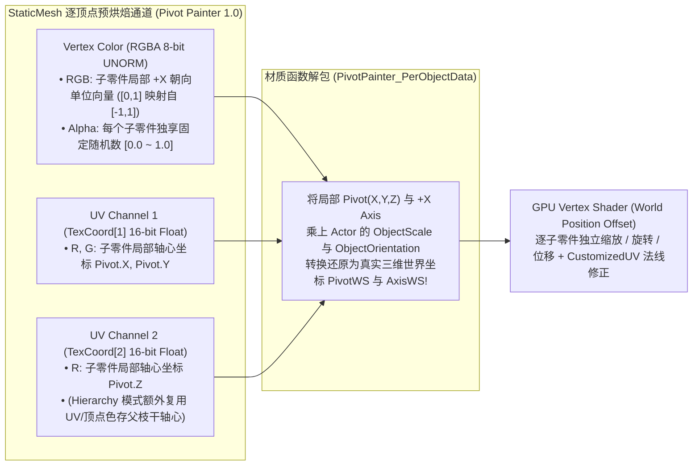
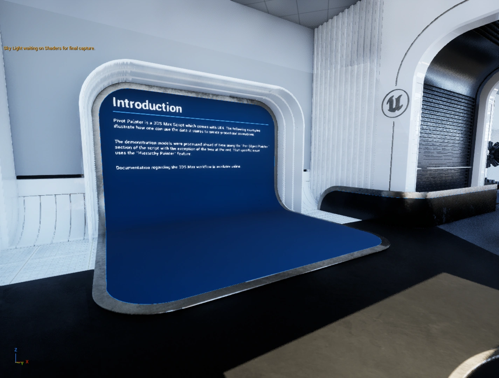
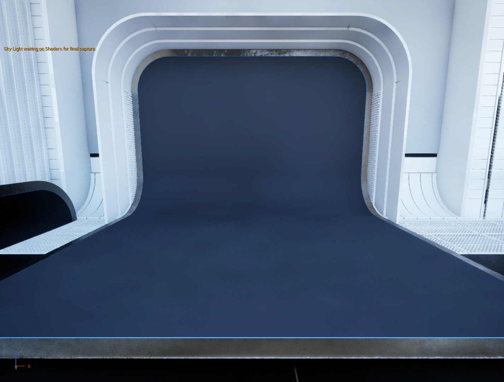
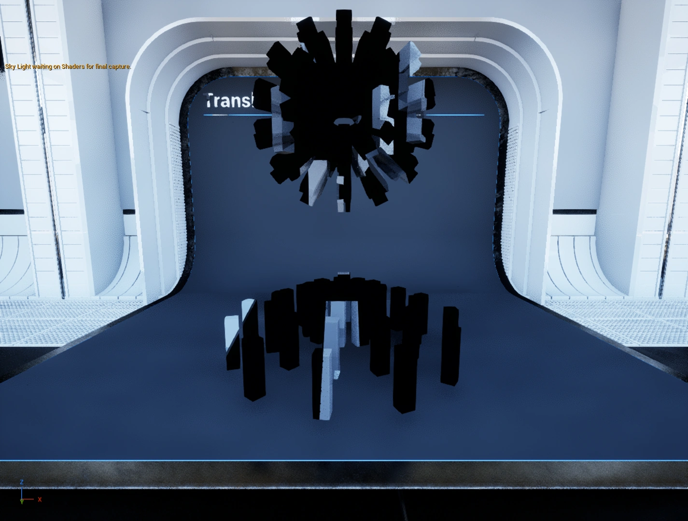
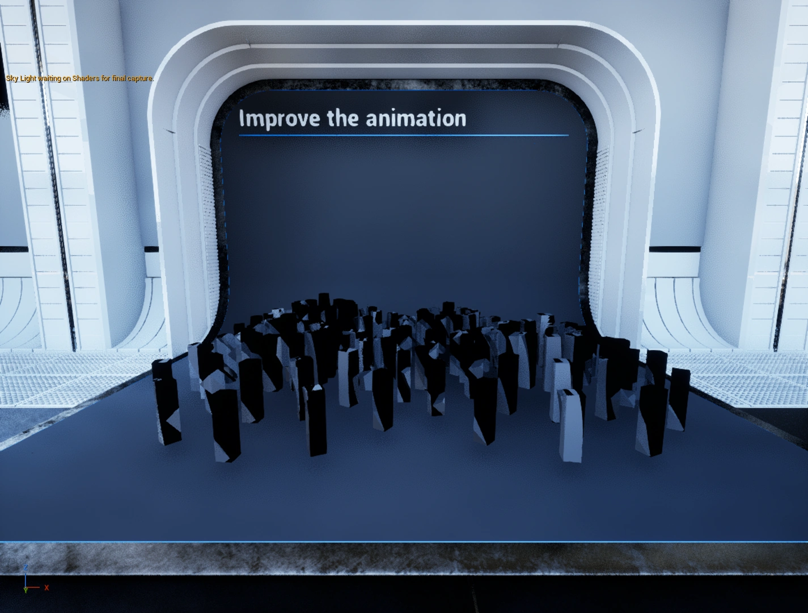

# 第 08 篇 · `Material_PivotPainter`：初代轴心烘焙原理、24 阶顶点着色器演进与程序化风场全解

> **关卡路径**：`/Game/Maps/Material/Material_PivotPainter`  
> **所属领域**：`01_Materials_材质与着色器`  
> **关卡统计**：总 Actor 数 `109` | 官方展台数 **`24`（`#1` ～ `#24` 100% 独立小节零遗漏全拆解）** | 示例 Actor 数 `70` | 核心剖析资产 `39` 个

---

## 一、 零骨骼动画革命：为什么一片十万棵树与草的森林不能用 `SkeletalMesh`？

想象你正在研发一款开放世界游戏：视野里有 **5,000 丛野草、800 棵棕榈树与阔叶树、外加岩壁上几百只蠕动触手的环境小生物**。如果按照角色动画师的习惯，给每丛草绑 30 根骨骼、给每棵树绑 200 根树枝骨骼并存为 `SkeletalMesh`：
1. **CPU 动画评估与矩阵调色板（Matrix Palette）直接爆炸**：每帧主线程要更新数十万根骨骼的层级变换矩阵并上传至 GPU 骨骼缓冲区；
2. **硬件实例化（Hardware Instancing / HISM / Nanite）彻底失效或极度受限**：带独立骨骼动画的网格难以合批为单次 DrawCall，渲染线程瞬间卡死在 DrawCall 提交瓶颈上。

2013 年，Epic Games 高级技术美术 **Jonathan Lindquist** 提出了一个颠覆行业的设想：**既然风吹草动、玩家踩踏、机械板开合都是有规律的数学运动，我们能不能把“每个子零件的旋转轴心坐标（Pivot）”和“生长朝向轴向量（Axis）”预先烘焙进普通静态网格（`StaticMesh`）的顶点色和额外 UV 通道里，然后在 GPU 的 `World Position Offset`（顶点着色器）中用纯数学公式实时驱动成千上万个子零件独立旋转缩放？**

这就是 **`Pivot Painter`（轴心绘制器）** 的诞生！它让一整棵包含几百片树叶的大树依然是一个**纯粹的 `StaticMesh`**——**零骨骼、零 CPU 蒙皮开销、完美支持 Foliage 植被刷百万级硬件实例化合批！**

### 1.1 初代 `Pivot Painter 1.0` 的顶点数据编码协议

在进入全部 24 座展台的实战拆解前，先看清 3ds Max 脚本 `Pivot Painter 1.0`（含 **Per-Object Painter 单层级模式** 与 **Hierarchy Painter 双层树模式**）究竟把什么数据塞进了静态网格的每一个顶点里：

> [!IMPORTANT]
> **理解本关的核心测试教具网格 `Boxes` 与 `Boxes_GroundOnly`**：  
> 在展台 `#2` ～ `#20` 中，你会反复看到一个由几十根黑色长方体柱子组成的单个静态网格 `Boxes`（上半部分是悬浮在空中的球形海胆状放射柱阵，下半部分是围成一圈插在地上的垂直石柱阵；而 `Boxes_GroundOnly` 则只保留地面垂直柱阵以模拟草丛芦苇）。**请注意：整个柱阵只是一个单独的 `StaticMesh`！** 每一根小长方体柱子在导出前都在自己根部中心烘焙了专属轴心 `PivotWS` 与沿柱身向上的 `+X AxisWS`。

---

## 二、 `Material_PivotPainter` 展厅总览与 24 座展台渐进式课程表

打开 `/Game/Maps/Material/Material_PivotPainter`，这是一条长达 **240 米**（从 `X = 510` 一路延伸到 `X = 23970`）、编排得如同教科书般丝丝入扣的 **GPU 顶点着色器大师长廊**！正如 `#1` 号展牌与 `#09` 篇二代展牌所强调的，**如果你想从零学会手写工业级顶点动画着色器（Vertex Shader），全虚幻引擎没有比这 24 座展台更系统的圣地。**

我们将全部 **24 座展台** 按技术演进划分为五大篇章，先建立宏观知识全景：

| 篇章阶段 | 涵盖展台编号 | 演进主线与解决的核心图形学问题 |
| :--- | :---: | :--- |
| **第一篇：轴心解包与独立缩放相位** | **`#1` ～ `#5`** | 从整体同步呼吸缩放 $\to$ 相机距离 LOD 缩放 $\to$ 空间坐标波浪相位 $\to$ 随机种子错相动画 |
| **第二篇：绕轴旋转与顶点法线高速重构** | **`#6` ～ `#10`** | 绕子零件轴旋转 $\to$ 修复死板法线光照 $\to$ **`CustomizedUVs` 顶点着色器法线加速** $\to$ 融合法线贴图 $\to$ 沿轴平移 |
| **第三篇：玩家踩踏交互与风场物理矢量数学** | **`#11` ～ `#17`** | 蓝图 MPC 追踪玩家脚底推开草丛 $\to$ 锁死根部防拔起 $\to$ 风向叉乘旋转轴 $\to$ 点乘风阻角限制 $\to$ 行进风浪相位与梢部弧形弯曲 |
| **第四篇：噪波风阵贴图与多级旋转复合** | **`#18` ～ `#20`** | 世界空间滚动噪声贴图模拟阵风浪涌 $\to$ 宏微观双频风场合成 $\to$ 两次连续绕轴旋转与法线链式叠加 |
| **第五篇：四大商业级实战终极成品** | **`#21` ～ `#24`** | 147 节点蠕动外星触手生物、203 节点全功能风场草丛、132 节点热带棕榈树、128 节点 `Hierarchy Painter` 双层枝叶大树 |

---

## 三、 逐展台（Stand `#1` ～ `#24`）100% 零遗漏彻底拆解

### 第一篇：轴心解包与独立缩放相位（展台 `#1` ～ `#5`）

#### 3.1 展台 `#1`：`Introduction`（`BP_DemoDisplay23`，坐标 `(510, -900, 0)`）—— 展厅导言与全局环境配置
> **官方展牌原文**：  
> *Pivot Painter is a 3DS Max Script which comes with UE4. The following examples illustrate how one can use the data it stores to create procedural animations. The demonstration models were processed ahead of time using the "Per Object Painter" section of the script with the exception of the tree at the end. That specific asset uses the "Hierarchy Painter" feature. Documentation regarding the 3DS Max workflow is available online.*

本展位与关卡全局共同维护着整条 240 米长廊的照明环境：动态平行光 `DirectionalLight1`（强度 `3.1416` 即精确 $\pi$，微暖阳光色 `(1.0, 0.988, 0.949)`）、动态天空光 `SkyLight`（强度 `3.0`）、`SkyAtmosphere`、`AtmosphericFog1` 以及滚云天空球 `BP_Sky_Shere`（搭载 `MID_M_Sky_Panning_Clouds2_0`）。

---

#### 3.2 展台 `#2`：`Scale the elements`（`BP_DemoDisplay4`，坐标 `(1970, -900, 0)`）—— 子零件原地独立缩放的向量恒等式

- **陈列 Actor 与材质**：`Boxes` 网格搭载 `/Game/ExampleContent/ScriptExamples/PivotPainter/Materials/Scale_PerObjectPivot`（`MD_Surface`、`BLEND_Opaque`，`BaseColor = 0.1`、`Roughness = 0.2`，共 **9 个表达式节点**）。
- **节点公式完全还原**：
  1. 调用核心解包函数 **`PivotPainter_PerObjectData`**（`MaterialExpressionMaterialFunctionCall_17`），取出当前顶点所属子长方体的世界轴心坐标 $\vec{P}_{\text{pivot}}$；
  2. 用 `Subtract_0` 计算当前顶点原始世界位置 $\vec{P}_{\text{world}}$（或指向轴心的反向位移向量）：$\vec{V}_{\text{toPivot}} = \vec{P}_{\text{pivot}} - \vec{P}_{\text{world}}$；
  3. 用 `Time` $\rightarrow$ `Sine` $\rightarrow$ `ConstantBiasScale`（将 $[-1, 1]$ 重映射为 $[0, 1]$）生成周期呼吸系数 $s(t) \in [0, 1]$；
  4. 相乘连入 `MP_WorldPositionOffset`：
     $$\Delta \vec{P}_{\text{WPO}} = (\vec{P}_{\text{pivot}} - \vec{P}_{\text{world}}) \cdot s(t)$$
- **数学直觉点拨**：为什么这个极简减法能让几十个长方体**各自缩回自己的中心**，而不是一窝蜂缩向整个大模型原点？因为加上偏移后顶点的最终世界坐标为 $\vec{P}_{\text{final}} = \vec{P}_{\text{world}} + (\vec{P}_{\text{pivot}} - \vec{P}_{\text{world}}) \cdot s(t)$！当 $s(t) = 0$ 时保持原尺寸；当 $s(t) = 1$ 时，$\vec{P}_{\text{final}} \equiv \vec{P}_{\text{pivot}}$——每个长方体的 8 个顶点精准坍缩进它自己的局部轴心点（正因如此，实拍图 `Material_PivotPainter_01_stand_02.webp` 抓拍瞬间刚好撞上 $s(t) \approx 1$，整团柱阵全部隐入各自的轴心奇点中）！

---

#### 3.3 展台 `#3`：`Scale using camera distance`（`BP_DemoDisplay9`，坐标 `(2980, -900, 0)`）—— 基于相机距离的无跳变缩放消隐
- **陈列 Actor 与材质**：`Boxes_3` 搭载 `/Game/ExampleContent/ScriptExamples/PivotPainter/Materials/Scale_PerObjectPivot2`（共 **12 个表达式节点**）。
- **节点公式与关键工程防坑**：
  - 将 `#2` 中的 `Time + Sine` 替换为距离驱动链：`Distance(CameraPositionWS, PivotWS)` $\rightarrow$ `Subtract`（节点注释：`"scale start distance"` 起始缩放距离） $\rightarrow$ `Divide`（节点注释：`"Distance that the scale occurs across"` 缩放过渡带宽） $\rightarrow$ `Clamp[0, 1]`！
  - **为什么必须算相机到 `PivotWS` 的距离，而绝不能算相机到顶点 `WorldPosition` 的距离？**
    试想一根长柱子一头离你近、一头离你远：如果你用每个顶点自己的 `WorldPosition` 算距离，近端缩放少、远端缩放多，整根长方体柱子就会扭曲变形为尖头楔子！而统一用该子零件共享的 `PivotWS` 计算距离，同一根小柱子的 8 个顶点拿到完全一致的缩放比，当你走近或走远时，几十根小方柱会按远近顺序一颗颗保持方正比例优雅地放大弹出或缩小消失（这正是展台 `#22` 远景草丛零跳变消隐 LOD 的底层原型）！

---

#### 3.4 展台 `#4`：`Create unique animations phases`（`BP_DemoDisplay5`，坐标 `(3980, -900, 0)`）—— 空间坐标求和构造行进波相位
- **陈列 Actor 与材质**：`Boxes_4` 搭载 `/Game/ExampleContent/ScriptExamples/PivotPainter/Materials/Scale_PerObjectPivot3`（共 **11 个表达式节点**）。
- **节点公式拆解**：在 `#2` 全体齐步走的基础上，新增第 2 个 `PivotPainter_PerObjectData` 提取 `PivotWS`，送入引擎数学函数 **`AddComponents`**（节点注释：`"add the individual sub object pivot XYZ location components together"`，即计算 $P_x + P_y + P_z$），与 `Time` 相加后再送入 **`Sine_Remapped`**（输出 `[0, 1]` 正弦波）。
- **视觉效果**：空间位置不同的子方柱拥有了随 $(X+Y+Z)$ 线性递增的相位差，原本呆板的整体呼吸瞬间化作了一道沿对角线方向层层推进的三维缩放人浪！

---

#### 3.5 展台 `#5`：`Animate with the random stored value`（`BP_DemoDisplay7`，坐标 `(4970, -900, 0)`）—— 启用顶点色 Alpha 随机种子打破规律感
- **陈列 Actor 与材质**：`Boxes_5` 搭载 `/Game/ExampleContent/ScriptExamples/PivotPainter/Materials/Scale_PerObjectPivot4`（共 **10 个表达式节点**）。
- **节点公式拆解**：去掉了 `#4` 的 `AddComponents`，直接从 `PivotPainter_PerObjectData` 的 **`Random Per Element Value`** 引脚（即烘焙在顶点色 Alpha 通道里的 `[0, 1]` 子零件专属随机数 $R_i$）连出，与 `Time` 相加送入 `Sine_Remapped`：$\text{Phase}_i = t + R_i$。
- **视觉效果**：彻底打碎了 `#4` 中机械整齐的对角线排浪，每一根小长方体都在按自己独一无二的相位此起彼伏地独立呼吸闪烁，宛如星空或萤火虫群。

---

### 第二篇：绕轴旋转与顶点法线高速重构（展台 `#6` ～ `#10`）

#### 3.6 展台 `#6`：`Rotate the sub-objects`（`BP_DemoDisplay8`，坐标 `(5970, -900, 0)`）—— 初试 `RotateAboutAxis` 与致命的“阴阳脸光照穿帮”
- **陈列 Actor 与材质**：`Boxes_2` 搭载 `/Game/ExampleContent/ScriptExamples/PivotPainter/Materials/Rotate_PerObjectPivot`（共 **7 个表达式节点**）。
- **节点连线**：将 `PivotPainter_PerObjectData` 解包出的子零件世界轴向 `Object X Vector`（作为 `NormalizedRotationAxis`）与轴心 `Object Pivot Point`（作为 `PivotPoint`），连同 `WorldPosition` 以及 `TimeWithSpeedVariable`（速度 `Constant = 0.25`）一并接入虚幻核心旋转节点 **`MaterialExpressionRotateAboutAxis_6`**，直接输出到 `MP_WorldPositionOffset`！
- **故意暴露的致命缺陷**：站在展台前观察这些绕自身长轴 $360^\circ$ 匀速自转的小方柱，你会立刻发现严重穿帮——**当方柱原本背光漆黑的底面转到正朝太阳的顶面时，它居然还是漆黑一片！** 因为 `WorldPositionOffset` 只移动了顶点坐标，**完全没有旋转顶点法线（Vertex Normal）**！GPU 还以为那块面片朝向地下！

---

#### 3.7 展台 `#7`：`Update the meshes normals`（`BP_DemoDisplay1`，坐标 `(6970, -900, 0)`）—— 用 `FixRotateAboutAxisNormals` 拯救动态受光
- **陈列 Actor 与材质**：`Boxes_6` 搭载 `/Game/ExampleContent/ScriptExamples/PivotPainter/Materials/Rotate_PerObjectPivot2`（共 **8 个表达式节点**）。
- **节点修复方案**：引入专属配套材质函数 **`/Engine/Functions/Engine_MaterialFunctions02/FixRotateAboutAxisNormals`**！将与 `RotateAboutAxis` 完全相同的旋转轴与旋转角喂给它，它会在内部读取原始世界顶点法线 `VertexNormalWS`，将其绕同一根轴旋转相同角度后，变换回切线空间输出 `New Tangent Space Vertex Normal` 直连主材质 **`MP_Normal`** 引脚！
- **效果与新隐患**：小方柱自转时的明暗高光瞬间恢复了 100% 物理正确！**但是**——由于 `MP_Normal` 默认运行在 **Pixel Shader（像素着色器）** 中，如果这个模型占满全屏 200 万个像素，GPU 就要在每帧执行 200 万次昂贵的罗德里格斯（Rodrigues）三维轴角旋转矩阵运算！能不能把它挪回顶点着色器只算几百次？请看 `#8` 展台！

---

#### 3.8 展台 `#8`：`Update the normals in the vertex shader`（`BP_DemoDisplay2`，坐标 `(7980, -900, 0)`）—— `CustomizedUVs` 顶点着色器法线加速神技！
- **陈列 Actor 与材质**：`Boxes_7` 搭载 `/Game/ExampleContent/ScriptExamples/PivotPainter/Materials/Rotate_PerObjectPivot3`（共 **14 个表达式节点**）。
- **殿堂级性能优化拓扑**：
  1. 开启材质的 **Customized UVs（自定义顶点 UV 插值通道）**（由于 UV0 给基础贴图，UV1、UV2 已被 PivotPainter 烘焙数据占用，这里启用额外的顶点插值槽 `CustomizedUV2 / UV3` 或空闲 `TextureCoordinate` 通道）；
  2. 将 `FixRotateAboutAxisNormals` 算出的三维法线通过 `ComponentMask(RG)` 与 `ComponentMask(B)` 拆成两组二维浮点数，**直接在 Vertex Shader 阶段写入两套 CustomizedUV 引脚**！
  3. 在 Pixel Shader 端，仅用零算力开销的 `TextureCoordinate_13` 与 `TextureCoordinate_14` 读出硬件光栅器自动线性插值好的法线分量，经 `AppendVector_7` 拼回三维向量直连 `MP_Normal`！
- **性能收益**：视觉效果与 `#7` 展台严丝合缝毫无二致，但 Pixel Shader 里的三角函数与旋转矩阵指令**直接降为零**！这是所有大规模植被与顶点动画材质必抄的性能铁律！

---

#### 3.9 展台 `#9`：`Update a normal texture `（`BP_DemoDisplay3`，坐标 `(8970, -900, 0)`）—— 旋转几何法线与表面细节法线贴图的无损融合
- **陈列 Actor 与材质**：`Boxes_8` 搭载 `/Game/ExampleContent/ScriptExamples/PivotPainter/Materials/Rotate_PerObjectPivot4`（共 **14 个表达式节点**）。
- **节点拆解**：如果树干或机械板本身还贴了一张凹凸细节法线贴图怎么办？在 `#8` 顶点插值还原出的旋转法线（`AppendVector_7`）基础上，采样一张测试法线贴图 `/Engine/EngineMaterials/RandomNormal2`（`TextureSample_12`），将两者送入 **`/Engine/Functions/Engine_MaterialFunctions02/Utility/BlendAngleCorrectedNormals`** 融合后连入 `MP_Normal`！既保留了大刀阔斧的绕轴旋转光影，又完美叠加了表面微观凹凸纹理。

---

#### 3.10 展台 `#10`：`Translate the sub-objects`（`BP_DemoDisplay13`，坐标 `(9970, -900, 0)`）—— 沿子零件局部生长轴往复活塞平移

- **陈列 Actor 与材质**：`Boxes_29` 搭载 `/Game/ExampleContent/ScriptExamples/PivotPainter/Materials/Rotate_PerObjectPivot_MoveSubObjects`（共 **8 个表达式节点**）。
- **节点公式拆解**：不只有缩放和旋转！从 `PivotPainter_PerObjectData` 取出子零件局部朝向单位向量 $\hat{X}_{\text{obj}}$（`Object X Vector`）与随机数 $R_i$，用 `TimeWithSpeedVariable` $\rightarrow$ `Sine_Remapped` 配合 `HeightLerp` 构造带停顿节奏的往复包络波形，直接乘上 $\hat{X}_{\text{obj}}$ 与最大行程距离连入 `MP_WorldPositionOffset`！
- **视觉效果**：如实拍图 `Material_PivotPainter_02_stand_10.webp` 所示，上方海胆球阵的每一根方柱顺着放射方向往外弹出缩回，下方地面柱阵则像管风琴活塞一样顺着垂直轴上下升降——做科幻浮空石阶拼合、变形机甲散热片开合简直信手拈来！

---

### 第三篇：玩家踩踏交互与风场物理矢量数学（展台 `#11` ～ `#17`）

#### 3.11 展台 `#11`：`Move objects away from the player`（`BP_DemoDisplay21`，坐标 `(10970, -900, 0)`）—— 蓝图 MPC 追踪角色坐标与叉乘推草矢量数学
从 `#11` 展台开始，地面换上了模拟成片芦苇丛的 5 组 `Boxes_GroundOnly` 网格，并首次引入了一套全局蓝图与材质通信系统：
- **追踪器蓝图 `UpdateGlobalParameters`**（搭载底座网格 `SM_SliderBase`）与 **材质参数集 `/Game/ExampleContent/ScriptExamples/PivotPainter/GlobalMaterialParameters/FoliageMatParam`**：
  - `FoliageMatParam` 内含 1 个标量 `MorphAmount (0.1)` 与 2 个核心全局向量：**`PlayersFootLocation = (0, 0, 0, 0)`**（玩家脚底实时世界坐标）和 **`WindDirection RGB Speed A = (1, 0, 0, 5)`**（RGB 为风向 `(1,0,0)`，A 为风速 `5`）。蓝图 `UpdateGlobalParameters` 在运行时每帧获取玩家 Pawn 脚底世界坐标写入 `PlayersFootLocation`！
- **材质 `Rotate_PerObjectPivot_AwayFromPlayer`（19 个节点）核心矢量几何推导**：
  当玩家走进柱丛，每根柱子该绕着哪条轴往哪个方向倒伏，才能刚好“背离玩家向四周分开”？
  1. **求排斥方向向量**：用 `Subtract_3`（注释：`"vector toward the player from the objects"`）计算玩家脚底与柱子轴心 `PivotWS` 的水平位移差，经 `SafeNormalize` 归一化得到径向排斥向量 $\vec{D}_{\text{push}}$；
  2. **叉乘求正交旋转轴（点睛之笔！）**：用 `CrossProduct_0`（注释：`"Rotation axis"`）将柱子直立轴（或上方向 $(0,0,1)$）与排斥向量 $\vec{D}_{\text{push}}$ 做叉乘：
     $$\vec{A}_{\text{rot}} = \text{Normalize}(\vec{Z}_{\text{up}} \times \vec{D}_{\text{push}})$$
     根据右手定则，两个向量的叉积必然同时垂直于“竖直方向”和“玩家到草的方向”——绕这根水平切向轴旋转，柱子必然 100% 精准地朝背离玩家的外侧倾倒！
  3. **球形距离衰减范围**：用 `SphereMask_1` 测量 `PivotWS` 到 `PlayersFootLocation` 的距离，只有在玩家身旁一定半径内的草柱才会弯曲倒下，玩家走开后自动回弹直立！

---

#### 3.12 展台 `#12`：`Lock the objects pivot points`（`BP_DemoDisplay19`，坐标 `(11970, -900, 0)`）—— 根部球形遮罩防“连根拔起”穿帮
- **陈列 Actor 与材质**：5 组 `Boxes_GroundOnly` 搭载 `/Game/ExampleContent/ScriptExamples/PivotPainter/Materials/Rotate_PerObjectPivot_awayFromPlayer2`（共 **27 个表达式节点**）。
- **解决什么痛点？** 在 `#11` 中，如果建模师导出模型时轴心点稍微偏离了草根插入泥土的截面，整根柱子旋转时底部就会像跷跷板一样翘出地面悬空穿帮！
- **节点修复方案**：新增 `SphereMask_4`（注释：`"creates a 3d sphere mask"`），测量每个顶点 `WorldPosition` 到自身子零件 `PivotWS` 的三维距离，半径设为 `Constant_33 = 32`（注释：`"world space motion mask size around model pivot points"`，并乘上 `ObjectScale` 自适应Actor缩放！），再经 `OneMinus_2` 反转（轴心处为 `0`，远离根部向上渐变为 `1`）乘入最终的 `WPO` 输出！从此所有草根底部顶点像浇了水泥一样死死钉在泥土里，只有上半截顺滑弯折！

---

#### 3.13 展台 `#13`：`Rotate away from the wind direction`（`BP_DemoDisplay11`，坐标 `(12970, -900, 0)`）—— 接入全局风向叉乘驱动顺风摇摆
- **陈列 Actor 与材质**：`Boxes_9`（海胆+地面复合柱阵）搭载 `/Game/ExampleContent/ScriptExamples/PivotPainter/Materials/Rotate_PerObjectPivot_wind`（共 **19 个表达式节点**）。
- **节点拆解**：读取 `FoliageMatParam` 中的全局风向向量 `WindDirection RGB Speed A`（掩码 `RGB`），将其与子零件自身的生长轴向量 $\hat{X}_{\text{obj}}$ 做 **`CrossProduct_0`** 并 `Normalize` 作为 `RotateAboutAxis` 的旋转轴！风摆角度由 `TimeWithSpeedVariable(0.25)` $\rightarrow$ `Sine_Remapped` $\times$ `Constant(0.125)` 驱动。
- **暴露的新物理破绽**：观察上方 360° 放射状海胆球阵！那些原本就已经顺着风向水平生长的横柱子，在狂风中按理说风阻最小、几乎不该乱晃，但在 `#13` 里它们却和迎风竖立的柱子摆动幅度一样大！如何修正？看 `#14`！

---

#### 3.14 展台 `#14`：`Limit the rotation via object orientation`（`BP_DemoDisplay12`，坐标 `(13970, -900, 0)`）—— 点乘风阻系数限制顺风枝条摆幅
- **陈列 Actor 与材质**：`Boxes_10` 搭载 `/Game/ExampleContent/ScriptExamples/PivotPainter/Materials/Rotate_PerObjectPivot_wind2`（共 **22 个表达式节点**）。
- **空气动力学点乘修正**：在 `#13` 基础上新增 **`DotProduct_0`**（计算风向单位向量 $\hat{W}$ 与枝条自身轴向 $\hat{X}_{\text{obj}}$ 的点积 $\hat{W} \cdot \hat{X}_{\text{obj}}$），经 `ConstantBiasScale_1` 转换后乘入旋转角度（`Multiply_30`）！
  - 当枝条垂直迎风竖立时（夹角 $90^\circ$，受风面积最大），赋予 100% 旋转摆幅；
  - 当枝条已经顺着下风向水平伸展时（$\hat{W} \cdot \hat{X}_{\text{obj}} \to 1$），自动压减旋转幅度，防止枝条被风吹得“倒折翻面”穿过树干！

---

#### 3.15 展台 `#15`：`Change the animation phase using wind`（`BP_DemoDisplay17`，坐标 `(14970, -900, 0)`）—— 沿风向投影坐标制造滚滚麦浪
- **陈列 Actor 与材质**：5 组地面柱丛 `Boxes_GroundOnly` 搭载 `/Game/ExampleContent/ScriptExamples/PivotPainter/Materials/Rotate_PerObjectPivot_DirectionalAnimation`（共 **23 个表达式节点**）。
- **麦浪数学公式**：为什么 `#13`、`#14` 里的柱子看起来还是“全场同时往前倒、同时往回弹”的广播体操？因为缺少沿风向传播的空间相位！本展台用 **`DotProduct_2`** 将每根柱子的世界轴心 $\vec{P}_{\text{pivot}}$ 投影到风向单位向量 $\hat{W}$ 上，除以波长系数（`Divide_2`）后与 `Time` 相加送入 `Sine_Remapped`：
  $$\phi(\vec{P}_{\text{pivot}}, t) = \text{Time} + \frac{\vec{P}_{\text{pivot}} \cdot \hat{W}}{\lambda}$$
  瞬间，上风口的柱子先弯腰，波峰顺着风吹的方向一排接一排滚向下风口，吹出了风吹麦浪的灵魂韵律！

---

#### 3.16 展台 `#16`：`Improve the animation `（一：柔韧弯曲弧度）（`BP_DemoDisplay18`，坐标 `(15970, -900, 0)`）—— 从硬木棍倾斜进化为柔韧草叶弯弓
- **陈列 Actor 与材质**：5 组 `Boxes_GroundOnly` 搭载 `/Game/ExampleContent/ScriptExamples/PivotPainter/Materials/DirectionalAni_Offset`（共 **27 个表达式节点**）。
- **节点进化**：在 `#15` 中，每根长方体柱子绕根部旋转时依然是一根笔直僵硬的铁棍。本展台新增 `SphereMask_5` 测量顶点 `WorldPosition` 到子零件根部 `PivotWS` 的距离——**离根部越远的顶端顶点，分配越大的旋转角增量**！当角度随高度递增时，`RotateAboutAxis` 在同一根直柱的不同高度截面上施加渐进转角，硬邦邦的直方柱立刻在风中弯成了一道优美柔韧的弧线！

---

#### 3.17 展台 `#17`：`Improve the animation `（二：个体与跨实例双重打散）（`BP_DemoDisplay16`，坐标 `(16970, -900, 0)`）—— 彻底消灭复制粘贴机械感

- **陈列 Actor 与材质**：4 组 `Boxes_GroundOnly` 搭载 `/Game/ExampleContent/ScriptExamples/PivotPainter/Materials/DirectionalAni_Advanced`（共 **35 个表达式节点**）。
- **双重去同步化公式**：在 `#16` 风浪推进与弧形弯曲的基础上，额外叠入两层随机扰动：
  1. **子零件级错相**：读取 `PivotPainter_PerObjectData` 的顶点色 Alpha 随机数微调单株相位与摆幅；
  2. **跨 Actor 实例级错相**：调用 **`ActorPositionWS_1`** $\rightarrow$ `AddComponents` $\rightarrow$ `Divide_3` $\rightarrow$ `Frac_1`！哪怕关卡设计师在地上复制粘贴了 100 块完全相同的 `Boxes_GroundOnly` 网格，只要它们的世界摆放坐标不同，`ActorPositionWS` 就会自动算出不同的偏移种子，从此再也看不出任何重复网格的分界痕迹！

---

### 第四篇：噪波风阵贴图与多级旋转复合（展台 `#18` ～ `#20`）

#### 3.18 展台 `#18`：`Animate with a texture`（`BP_DemoDisplay15`，坐标 `(17970, -900, 0)`）—— 用世界空间滚动噪声贴图驱动自然阵风
- **陈列 Actor 与材质**：4 组 `Boxes_GroundOnly` 搭载 `/Game/ExampleContent/ScriptExamples/PivotPainter/Materials/DirectionalAnim_UseATexture`（共 **32 个表达式节点**）。
- **为什么正弦波终究不够自然？** 自然界的狂风不是匀速的正弦节拍器，而是一阵紧似一阵的无规则湍流（Gusts）！
- **正交风向 UV 坐标系构建与可视化**：
  1. 用风向向量 $\hat{W}$ 与上方向 $(0,0,1)$ 做 `CrossProduct_5` 构造水平横向侧风轴，通过两次点乘（`DotProduct_3` 注释 `"x"`、`DotProduct_4` 注释 `"y"`）将每根柱子的 `PivotWS` 投影到**严格对齐风向的世界二维平面坐标系**，除以纹理世界尺寸 **`Constant(1024)`**（注释 `"texture tiling"`）；
  2. 加上 `Time` $\times$ `Constant2Vector(0.1, 0.5)`（注释 `"xy animation panning speed"`），去采样线性湍流噪声贴图 **`/Game/ExampleContent/ScriptExamples/PivotPainter/Textures/T_Noise02`**；
  3. **神来之笔**：作者不仅把 `T_Noise02` 采样值喂给 `RotateAboutAxis` 控制倒伏角度，还**同步直接连入了 `MP_BaseColor`**！站在展台前，你能亲眼看到一团团白色的高亮噪波气团顺着风向扫过整片黑色石林——白色气团滚到哪里，哪里的石柱就应声猛烈压弯；黑色无风间隙掠过时，石柱便悠然回弹直立！

---

#### 3.19 展台 `#19`：`Use a texture and the previous `（`BP_DemoDisplay14`，坐标 `(18970, -900, 0)`）—— 宏观阵风贴图 + 微观高频颤动的终极风场合成
- **陈列 Actor 与材质**：4 组 `Boxes_GroundOnly` 搭载 `/Game/ExampleContent/ScriptExamples/PivotPainter/Materials/DirectionalAnim_UseATexture2`（共 **45 个表达式节点**）。
- **节点合成哲学**：把 `#18` 的 1024 厘米大尺度 `T_Noise02` 阵风包络（决定“什么时候刮来一阵大风压低草丛”）与 `#17` 的单株个体高频正弦微颤、根部 `SphereMask` 弧度、`ActorPositionWS` 错相完美相乘叠加！大风压弯草腰的同时，草尖还在高频瑟瑟发抖——这就是 3A 开放世界植被风场的标准双频合成架构！

---

#### 3.20 展台 `#20`：`Combine multiple rotations`（`BP_DemoDisplay22`，坐标 `(19970, -900, 0)`）—— 链式叠加多次绕轴旋转与双级法线修正
- **陈列 Actor 与材质**：`Boxes_11` 搭载 `/Game/ExampleContent/ScriptExamples/PivotPainter/Materials/CombineMultipleRotations`（共 **23 个表达式节点**）。
- **核心数学命题：如何让一个子零件既绕自己的局部轴自转，又同时绕另一根全局轴（如风向轴或父级轴）公转摆动？**
  1. **位移链式递进（绝不能直接拿原始坐标算两次！）**：
     - 第一级旋转 `RotateAboutAxis_17`：输入原始 `WorldPosition_8`，绕子零件自身轴旋转（速度 `0.25`），得到第一级偏移 $\Delta \vec{P}_1$；
     - **关键一步 `Add_22`**：必须先计算第一级旋转后的新世界坐标 $\vec{P}' = \vec{P}_{\text{world}} + \Delta \vec{P}_1$，把 $\vec{P}'$（以及同步旋转后的新轴心，若是父子级）作为输入喂给第二级旋转 `RotateAboutAxis_18`（绕世界任意轴 `Constant3Vector(1, 0, 0)` 正弦摆动，限幅 `0.5`），算出第二级增量 $\Delta \vec{P}_2$；
     - 最后用 `Add_24` 将两级偏移相加：$\Delta \vec{P}_{\text{total}} = \Delta \vec{P}_1 + \Delta \vec{P}_2$ 输出至 `MP_WorldPositionOffset`！
  2. **法线链式递进**：同样串联两个 `FixRotateAboutAxisNormals`（`Call_69` 输出旋转后的新世界法线直接喂给下一个 `Call_4` 的输入端，最后在顶点插值槽中传给 `MP_Normal`）！这套“先算一级新位置/新法线，再喂给二级旋转”的链式法则，正是下一章 `Pivot Painter 2` 四级枝叶骨骼链的数学地基！

---

### 第五篇：四大商业级实战终极成品（展台 `#21` ～ `#24`）

走过前 20 座层层递进的基础数学展台，最后 4 座展台直接亮出了四件可直接投入商业游戏运行的惊艳成品资产！

#### 3.21 展台 `#21`：`Ambient creatures`（`BP_DemoDisplay20`，坐标 `(20971, -887, 0)`）—— 147 节点零骨骼蠕动外星触手生物 + 动态粘液贴花
- **陈列 Actor 组合**：静态网格 `Creature`（`/Game/ExampleContent/ScriptExamples/PivotPainter/StaticMesh/Creature`）搭配底部地面贴花 `DecalMaterial`（`DecalActor`）。
- **核心生物母材质深拆：`CreatureMaterial`（足足 147 个表达式节点！）**：
  - **核心材质属性**：`blendMode = BLEND_Masked`、`shadingModel = MSM_Subsurface`（次表面血肉半透感！）。
  - **多重程序化生命律动**：这只类似异形海葵/多足虫的外星环境生物完全是一个 `StaticMesh`！材质通过 `PivotPainter_PerObjectData` 驱动周围一圈触手/步足各自按不同随机相位独立屈伸抓挠（配合 `FixRotateAboutAxisNormals` 实时更新触手法线）；躯干中心利用气泡噪声贴图 `Bubbles` 与 `HeightLerp` 模拟内脏呼吸鼓胀起伏；顶部眼球甚至用 `EyeHeight` 与 `EyeNormal` 做出了独立的凝视与眨动效果，再叠加上 `HueShift` 生物荧光变色直连 `MP_EmissiveColor`！
- **配套地面粘液贴花 `DecalMaterial`（30 个节点）**：`MD_DeferredDecal`、`BLEND_Modulate`，采样 `TilingNoise06_N2` 与 `T_Noise02` 配合紫红色荧光 `(0.965, 0.309, 0.832)`，在生物脚下地面投射出一滩随呼吸蠕动发光的外星菌毯污渍！在大型关卡岩洞里摆上 500 只这种零骨骼环境生物，CPU 动画开销依然是 **0.00 ms**！

---

#### 3.22 展台 `#22`：`Advanced grass`（`BP_DemoDisplay6`，坐标 `(21970, -900, 0)`）—— 203 节点工业级全功能交互风场草丛
- **陈列 Actor 与材质**：7 丛静态网格 `GrassClump` 搭载实例 `/Game/ExampleContent/ScriptExamples/PivotPainter/Materials/Grass_Inst2`（重载远距缩隐起始距离 **`StartShrinkingDistance = 512`**），母材质为重达 **203 个表达式节点** 的 `/Game/ExampleContent/ScriptExamples/PivotPainter/Materials/Grass`（`BLEND_Masked`、`MSM_Subsurface`、`twoSided = true`）。
- **203 节点全功能特性拆解**：
  1. **专为 Foliage 植被画笔优化（`PivotPainter_PerObjectFoliageData`）**：开启 `Optimized for foliage placement = true`，支持在地形上任意旋转缩放刷涂草丛实例而保持风向世界对齐；
  2. **三层复合风浪 + 玩家踩踏推开**：融合主风浪 `(VS) Main Wave Width`、阵风浪涌 `(VS) Gust Animation Strength`、无风微颤 `Dead Wave` 以及与 `FoliageMatParam` 联动的玩家脚底踩踏推力 `(VS)PlayerPush Bend Multiplier`；
  3. **像素级色彩丰富度**：利用每片草叶烘焙的随机 Alpha 值开启 `RandomizeHue`（色相微偏 `HueVariationAmount`），配合 `BoundingBoxBased_0-1_UVW` 实现草根压暗（AO）与草尖透亮次表面散射（`SSS Amount = 0.5`）；
  4. **零跳变顶点缩隐 LOD（`Scale Over Distance`）**：继承 `#3` 展台技术，距离相机超过 `512cm` 后平滑将草叶向各自根部轴心缩小至消失，彻底告别传统植被生硬的 Alpha 裁剪闪烁！

---

#### 3.23 展台 `#23`：`Advanced palm tree`（`BP_DemoDisplay10`，坐标 `(22970, -760, 0)`）—— 132 节点热带棕榈树冠多级风摆
- **陈列 Actor 与材质**：`JonPalm_2`（静态网格 `/Game/ExampleContent/ScriptExamples/PivotPainter/StaticMesh/Palm`），默认绑定材质实例 `M_PalmTree_Inst`（母材质 `/Game/ExampleContent/ScriptExamples/PivotPainter/Materials/M_PalmTree`，共 **132 个表达式节点**，`BLEND_Masked`、`MSM_Subsurface`、`twoSided = true`）。
- **核心风场细节**：棕榈树长长的羽状枝叶全部从树冠顶端向四周垂落。材质通过 `PivotPainter_PerObjectFoliageData` 获取每片大棕榈叶的叶柄根部轴心，施加大幅度顺风下压与回弹（`Directional Per Pivot Wind Offset Rate = 256`），同时沿着长叶片顶点叠加反向相位行波（`Directional Per Vertex Wind Offset Rate = -8044`）与旗帜波浪法线 `T_Flag_N` 扭曲（`Leaf Distortion = 0.01`），模拟出热带海风吹拂下棕榈大叶整体摇曳、两侧细叶高频翻飞拍打的逼真层次，配合 `Subsurface amount = 0.9` 在逆光下呈现出通透翠绿的叶片透光感。

---

#### 3.24 展台 `#24`：`Advanced tree`（`BP_DemoDisplay`，坐标 `(23970, -760, 0)`）—— 初代压轴：`Hierarchy Painter` 双层枝叶联动大树与二代演进伏笔
- **陈列 Actor 阵容**：1 棵参天阔叶大树 `tree_2`（静态网格 `/Game/ExampleContent/ScriptExamples/PivotPainter/StaticMesh/tree`）搭配树下环绕的 7 丛 `GrassClump`。
- **双材质槽同源继承架构**：大树网格拥有两个材质槽，分别绑定树枝实例 **`Tree_wb_branches`**（重载 `BLEND_Opaque`）与树叶卡片实例 **`Tree_wb_Leaves`**（`BLEND_Masked`、`MSM_Subsurface`），两者共同继承自母材质 **`/Game/ExampleContent/ScriptExamples/PivotPainter/Materials/Tree_With_Branches`（共 128 个表达式节点）**，仅靠静态开关参数 `Leaves Checked Bark Unchecked` 切换树皮纹理（`Bark` / `Bark_n`）与树叶贴图（`branch_D` / `Branch_m` / `branch_N`）！
- **`Hierarchy Painter` 双层级联动原理（`PivotPainter_TreeData` + `TreeAnimationSines`）**：
  - 为什么前 23 个展台的 `Per Object Painter` 做不了这种阔叶大树？因为阔叶树的树叶长在小树枝上，小树枝又长在主树干上！如果树枝在风里上下摆动了 `30cm`，而树叶只绕自己的叶柄原地转，**树叶就会瞬间脱离树枝悬在半空中穿帮！**
  - 因此这棵树使用了初代脚本的 **`Hierarchy Painter`** 模式，并调用专属解包函数 **`PivotPainter_TreeData`** 与四重谐波发生器 **`TreeAnimationSines`（频率组 `(10.75, 3.94, 1.03, 4.95)`）**：
    1. **第一级（父枝干层运动）**：树枝材质与树叶材质**同时运行完全相同的父枝干旋转公式**（所以节点 `Branch Animation Strength` 的官方注释特意警告：*`"Should be the same in both the leaf and branch materials"`*——只要两边参数一致，树叶卡片的根部就永远严丝合缝地焊死在摆动的树枝表面上！）；
    2. **第二级（子叶片层独立扑翼）**：当 `Leaves Checked Bark Unchecked = true` 时，树叶卡片在跟随父树枝完成大幅度摇摆后，再叠加一层绕自身叶柄轴心的快速迎风颤动！

---

## 四、 关卡全局补充与从 `Pivot Painter 1.0` 迈向 `2.0` 的历史必然

除 24 座展台内的 70 个配对 Actor 外，关卡还包含前文提及的全局环境四件套（`DirectionalLight1`、`AtmosphericFog1`、`InstancedFoliageActor1`、`BP_Sky_Shere`）。

站在第 `#24` 号大树下仰望，我们既惊叹于初代 `Pivot Painter 1.0` 把静态网格玩出骨骼级动画的巧夺天工，也清晰看到了它受限于 **“顶点色 + 额外 UV 通道”** 存储介质的三大天花板：
1. **层级深度锁死在最多 2 层**：一套网格的 UV 通道数量极其有限，只能存“树枝 + 树叶”两层，无法表达“主干 $\to$ 大枝 $\to$ 二级分枝 $\to$ 小嫩枝 $\to$ 叶片”的 4～5 级真实植物骨骼树；
2. **8-bit 顶点色精度量化抖动**：将三维单位旋转轴塞进 `0～255` 的 8 位整数顶点色里，角度精度粗糙，细长枝条容易出现轴向偏斜；
3. **顶点体积膨胀**：额外增加 2～3 套 UV 通道加顶点色，会让一个十万顶点的精细树木网格显存直接暴涨。

**如何突破这三座大山，用极小的顶点开销实现高达 4 级甚至无限层级的 16-bit 浮点高精度父子联动？** 请直接翻开下一篇——第 09 篇《`Material_PivotPainter2`：二代层级 UV 轴心烘焙与零骨骼植被动画》！
