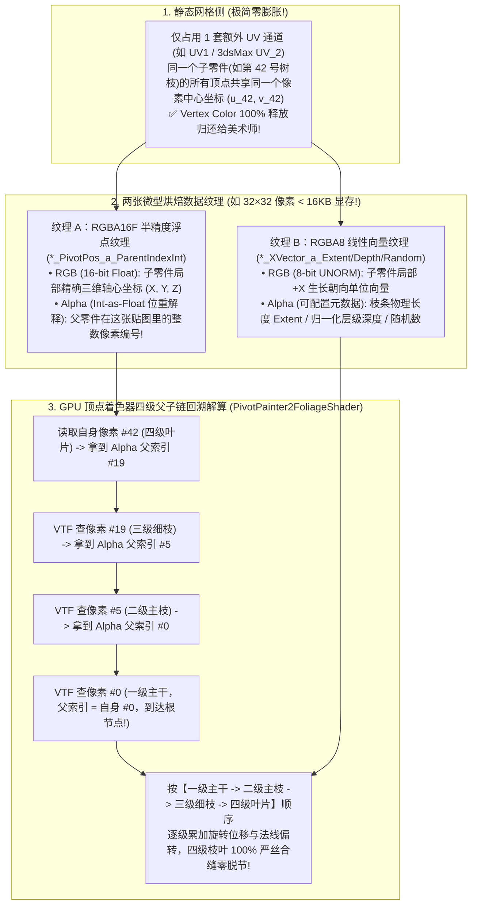
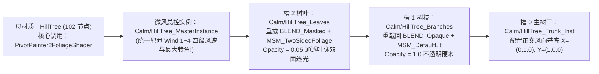

# 第 09 篇 · `Material_PivotPainter2`：二代浮点纹理层级烘焙、指针寻址前向运动学与零骨骼次世代植被动画

> **关卡路径**：`/Game/Maps/Material/Material_PivotPainter2`  
> **所属领域**：`01_Materials_材质与着色器`  
> **关卡统计**：总 Actor 数 `35` | 官方展台数 `6`（`#1` ～ `#6` 零遗漏全拆解） | 示例 Actor 数 `15` | 核心剖析资产 `14` 个（关联引擎底层函数族 `10+` 个）

---

## 一、 从“逐顶点塞数据”到“浮点纹理指针寻址”：`Pivot Painter 2.0` 究竟革了谁的命？

在上一篇（第 08 篇 `Material_PivotPainter`）的收官大树展台 `#24` 中，我们亲眼见证了初代轴心烘焙如何用 `StaticMesh` 模拟风吹树动，但也撞上了三堵令人窒息的物理铁墙：
1. **顶点存储大浪费**：一棵拥有 **80,000 个顶点** 的写实大树，其实只由 **500 根树枝和叶片簇** 组成。初代方案把轴心坐标与轴向向量重复拷贝了 80,000 份塞进每个顶点的多层 UV 与顶点色里——不仅让网格显存暴涨，还白白霸占了美术师原本用来刷青苔脏迹的 `Vertex Color`！
2. **8-bit 精度崩坏与 2 层级上限**：8 位顶点色存方向向量会产生肉眼可见的角度量化误差；而受限于 UV 通道数量，初代最多只能表达“父枝 + 子叶” **2 层结构**，面对真实树木“主树干 $\to$ 一级粗枝 $\to$ 二级分枝 $\to$ 四级末梢嫩叶”的深层嵌套彻底无能为力。

为了制作虚幻引擎里程碑级的开放世界技术演示《A Boy and His Kite（风筝男孩）》中漫山遍野的写实巨树，Jonathan Lindquist 推出了脱胎换骨的 **`Pivot Painter 2.0`**。它的核心架构思想堪称图形学工程美学的典范——**“把骨骼树表烘成两张巴掌大的 16-bit 浮点数据贴图，在顶点着色器里用像素索引指针跑完整的前向运动学（Forward Kinematics）！”**

### 1.1 二代核心数据结构：一张小贴图如何装下一整棵 4～6 级骨骼树？

#### 三大硬核黑科技细节点破
1. **为什么父节点索引要用 `IntAsFloat`（`ms_PivotPainter2_UnpackIntegerAsFloat`）？**
   假设一棵大树有 `1,200` 个独立枝叶部件。在半精度浮点数（IEEE 754 `fp16`）中，如果直接把整数存成普通浮点值，一旦超过 `2048` 就会丢失整数个位精度导致认错爹（树叶飞到别的树枝上）！因此 3ds Max 脚本在烘焙时直接将整数索引的二进制比特位**原样按位写入（Bit-cast）** 浮点通道，在材质中通过 HLSL 位重解释指令配合 `2dArrayLookupByIndex` 还原出分毫不差的二维像素行列号 $(X_{\text{parent}}, Y_{\text{parent}})$！
2. **硬件顶点纹理采样（Vertex Texture Fetch, VTF）零插值红线**：
   由于数据贴图中相邻两个像素分别代表完全无关的两根树枝，材质采样数据贴图时必须关闭双线性滤波（纹理资产设置为 **Nearest 邻近点采样**、关闭 Mipmaps、关闭 sRGB 压缩，存为 `VectorDisplacementmap` 或 `HDR` 未压缩格式），确保每个顶点在 Vertex Shader 中调用 `SampleLevel(..., 0)` 精准命中像素正中心！
3. **灵活多变的第二张贴图 Alpha 通道**：
   在本关短短 6 个展台里，你将亲眼看到第二张贴图 Alpha 通道的三种神仙用法：存 **枝条包络长度 `XExtent`**（自动算风阻力臂）、存 **归一化层级深度 `NormalizedHierPos`**（驱动生命树按辈分逐级生长）、存 **`0-1` 随机数配合建造点选顺序 `SelOrder`**（驱动乐高式逐块飞入盖房子）！

---

## 二、 `Material_PivotPainter2` 展厅总览与 6 座展台空间地图

步入 `/Game/Maps/Material/Material_PivotPainter2`，展厅不再像初代那样排列 24 个基础数学方块，而是开门见山地用 **6 座高浓缩精品展台**（分布在 `X = 1481`、`X = 4180` 横向三联展位、以及 `X = 6220～6270` 压轴双巨树展位）直接演示二代工具链最具爆发力的四大应用场景。

| 展台编号 | 官方展台标题 (`BP_DemoDisplay`) | 空间坐标 `(X, Y, Z)` | 核心静态网格与二代材质/纹理资产 | 核心演示能力 |
| :---: | :--- | :---: | :--- | :--- |
| **`#1`** | `Pivot Painter 2` | `(1481, -896, 0)` | 全局动态日光环境 + `MultiLinedTextFieldEfficient` | 二代工具集定位及与一代展厅的互补学习路线 |
| **`#2`** | `Simple foliage animation demo` | `(4180, -800, 0)` | `SimplePivotPainterExample`（机械分形树架） | 剥离树叶遮挡，裸眼看清 4 级父子刚体旋转链条传递 |
| **`#3`** | `Scale The Elements By Hierarchical Depth` | `(4180, 0, 0)` | `TreeTest` + `HierarchicalGrowth`（24 节点） | 利用 `NormalizedHierPos` 按 0～6 级辈分由主干向末梢逐代生长 |
| **`#4`** | `Build An Object` | `(4180, 800, 0)` | `House` + `BuildHouse`（30 节点，60 块构件） | 利用 `SelOrder_IntAsFloat` 按建模点选顺序逐块旋转飞入盖房 |
| **`#5`** | `Calm Wind Foliage Animation Demo` | `(6270, -800, 0)` | `HillTree_P2` + `Calm/HillTree_*`（微风预设） | 《风筝男孩》写实巨树在春风拂面下的细腻四级枝叶微颤 |
| **`#6`** | `Intense Wind Foliage Animation Demo` | `(6220, 810, 0)` | `HillTree_P4` + `Extreme/HillTree_*`（狂风预设） | 同一棵静态树网格在暴风骤雨下的 20 倍树干弯折与枝叶零脱节奇迹 |

---

## 三、 逐展台（Stand `#1` ～ `#6`）100% 零遗漏深度拆解

### 3.1 展台 `#1`：`Pivot Painter 2`（`BP_DemoDisplay`，坐标 `(1481, -896, 0)`）—— 展厅导言、全局日光场与自动排版文字蓝图

> **官方展牌原文（同时由场景排版器 Actor `MultiLinedTextFieldEfficient` 处理段落缩进）**：  
> *Pivot Painter 2 is a toolset that can be used to generate complex procedural animations. It consists of a 3DS MAXScript and editor material functions. This map demonstrates some of the tools use cases but is rather limited when compared with the Pivot Painter 1 content example map. Please refer to this demo map to learn about referencing Pivot Painter 2 data inside materials and the first map to learn about writing vertex shaders from the ground up. Pivot Painter 2 has improved the workflow in 3DS Max, data accuracy and increased the number of output options. Please follow the documentation link for more information.*

本展位归属了照亮后方开阔中庭巨树的 **5 个基础环境与文档 Actor**：
- **高强度写实户外日光组合**：动态主平行光 `DirectionalLight1`（`Intensity = 10`, 纯白光）+ 动态天空光 `SkyLight`（`Intensity = 3`）+ `ExponentialHeightFog`（另在 `#3` 展位旁配有 `SkyAtmosphere`），提供充沛的树冠逆光次表面透射光源；
- **辅助工具 Actor**：在线文档跳转锚点 `Pivot Painter Content Examples Doc Actor`（`DocumentationActor`）、编辑器分组器 `GroupActor1`，以及关卡全局中的自动换行排版蓝图实例 **`MultiLinedTextFieldEfficient`**（类 `/Game/ExampleContent/ScriptExamples/PivotPainter/Blueprints/MultiLinedTextFieldEditor`，内含 `Char Counter = 70`、`Font Size = 20`、`Word Array` 等 19 个排版变量，用于在三维空间自动按字符宽度折行渲染长篇英文说明）。

---

### 3.2 展台 `#2`：`Simple foliage animation demo`（`BP_DemoDisplay3`，坐标 `(4180, -800, 0)`）—— 裸眼看清四级父子联动链的分形铁树骨架

如果一开始就看一棵长满几万片树叶的大树，肉眼很难分辨到底有几层树枝在联动。于是官方在 `#2` 展台特意摆放了一棵没有任何树叶伪装的深灰色“方形钢条分形树架”——`SimplePivotPainterExample3`！

- **陈列网格与引擎内置示范包**：静态网格直接引用引擎材质函数库自带的示范资产 `/Engine/Functions/Engine_MaterialFunctions02/ExampleContent/PivotPainter2/SimplePivotPainterExample`（配套烘焙纹理 `SimpExPivPos` 与 `PP2_rgb_XVect_a_XExtent`，由核心动画函数 `PivotPainter2FoliageAnimation` 驱动）。
- **视口观察精髓**：驻足凝视这棵由方形长条逐级四叉分枝构成的抽象树架（实拍图前景），你能无比直观地看到**前向运动学在单个静态网格上的完美演绎**：
  1. 最底下的垂直粗主干（Level 1）在风中轻微左右摇晃；
  2. 主干顶端分出的四根斜向一级粗枝（Level 2），它们的根部紧咬着主干顶端一起平移旋转，同时自身还在绕分叉点上下俯仰；
  3. 一级粗枝末端再分出的二级中枝（Level 3）与最外圈的三级细枝（Level 4），各自叠加了越来越快的高频摆动，**但整棵树上下几十处Ｙ字形分叉接缝没有一丁点撕裂、穿插或错位**——如果不打开线框模式查看资产类型，任何动画师都会以为这是一套绑定了 40 根骨骼的 `SkeletalMesh`！

---

### 3.3 展台 `#3`：`Scale The Elements By Hierarchical Depth`（`BP_DemoDisplay4`，坐标 `(4180, 0, 0)`）—— 基于 6 级归一化辈分深度的“生命树逐代抽芽”动画

紧邻 `#2` 展台中轴线，`#3` 展台展示了 `Pivot Painter 2` 在程序化生长特效（如魔法召唤大树破土抽枝、珊瑚礁蔓延、血管神经生长）中的绝活：`TreeTest` 网格从光秃秃的主干开始，按辈分顺序一层接一层向外长出主枝、次枝、细枝，再反向一层层缩回！

#### 核心资产 24 节点深度拆解：`/Game/ExampleContent/ScriptExamples/PivotPainter2/Materials/HierarchicalGrowth`
- **核心材质属性**：`MD_Surface`、`BLEND_Opaque`、`MSM_DefaultLit`，金属感拉满（`Metallic = 1.0`、`Roughness = 0.506`、`Color = (0.185, 0.185, 0.185)` 深枪铁金属色）。
- **两张专属烘焙数据贴图**：
  1. `TextureSample_1`：采样 **`test_rgb_PivotPos_a_ParentIndexInt_UV_2`**（节点注释：`"Pivot Position And Parent Index"`），送入解码函数 **`ms_PivotPainter2_DecodePostion`** 还原出每根分枝自身的世界空间生长根部轴心 $\vec{P}_{\text{pivot}}$；
  2. `TextureSample_0`：采样 **`test_rgb_XVector_a_NormalizedHierPos_UV_2`**（节点注释：`"X Vector Normalized Hierarchy Depth"`），其 **Alpha 通道预烘焙了归一化层级深度 $d_{\text{norm}} \in [0, 1]$**！
- **逐代依次抽芽生长的数学驱动公式**：
  - 材质设有标量参数 **`Greatest Hierarchy Depth = 6`**（表明这棵分形树足足拥有 **6 代父子层级**！在初代 Pivot Painter 中根本不可能实现！）；
  - 时间信号 `Time` 经 **`LinearSine`** 生成三角往复进度波 $T \in [0, 1]$，结合 `Greatest Hierarchy Depth (6)`、`Constant(5)` 与组件中心 `ComponentPivotLocation` 的 `SphereMask`（半径 `r = 869.78`），对每个层级深度 $d_{\text{norm}}$ 计算局部错位缩放遮罩 `Clamp[0, 1]`：
    - 当总进度 $T$ 从 `0` 推向 `1` 时，第 1 代主干先从 `0` 放大到 `1` $\rightarrow$ 紧接着第 2 代大枝从主干分叉点抽出放大 $\rightarrow$ 第 3、4、5、6 代末梢嫩枝依次接力绽放！
  - 最后套用我们在第 08 篇 `#2` 展台学过的原地缩放向量公式 $(\vec{P}_{\text{pivot}} - \vec{P}_{\text{world}}) \cdot \text{ScaleMask}$ 连入 `MP_WorldPositionOffset`！

> [!TIP]
> **进阶思考**：在 `HierarchicalGrowth`（24 节点教学极简版）中，由于分枝在完全长满（Scale=1）后父级已静止不动，因此只需把子枝缩回各自的静态 `PivotPos` 即可严丝合缝衔接；若想边随狂风摇晃边抽芽生长，只需将其与 `#5` 展台的父级链式旋转位移叠加即可！

---

### 3.4 展台 `#4`：`Build An Object`（`BP_DemoDisplay5`，坐标 `(4180, 800, 0)`）—— 60 块墙砖按点选顺序从天而降旋转拼装成屋！

来到中排最右侧的 `#4` 展台，眼前的景象酷似《堡垒之夜（Fortnite）》快速建造或《刺客信条》Animus 虚拟现实重构：一座由 **60 块独立砖石构件** 组成的房屋 `House`，一块接一块从半空中凭空显形、高速翻滚着精准砸落拼接到墙体严丝合缝的位置上！

#### 核心资产 30 节点完全解剖：`/Game/ExampleContent/ScriptExamples/PivotPainter2/Materials/BuildHouse`
这绝对是建筑可视化（ArchViz）、科幻 UI 全息沙盘与建造类游戏最值得收藏的 30 节点宝藏材质！让我们拆解它的每一个齿轮：
- **核心材质属性**：`blendMode = BLEND_Masked`，且特意开启了 **`ditherOpacityMask = true`（抖动不透明度遮罩，配合 TAA 实现零 Overdraw 的丝滑半透明渐显！）**，`Base Color = 0.229`、`Metallic = 1.0`、`Roughness = 0.218`。
- **两张核心数据纹理与三大二代解码器调用**：
  1. 采样 **`B42_PivPos_SelOrder_IntAsFloat_UV_2`**：
     - `RGB` 送入 **`ms_PivotPainter2_DecodePostion`** 解出每块墙砖落位后的自身局部轴心 $\vec{P}_{\text{pivot}}$；
     - **`Alpha` 送入位重解释器 `ms_PivotPainter2_UnpackIntegerAsFloat`**！注意贴图命名里的 **`SelOrder`**——3ds Max 脚本记录了美术师在视口里框选或依次点选这 60 块砖头的整数序号 $k \in \{0, 1, 2, \dots, 59\}$（从地基第一块砖一路排到屋顶最后一块砖）！
  2. 采样 **`Box042_rgb_XVector_a_Random0-1_UV_2`**：
     - `RGB` 送入 **`ms_PivotPainter2_DecodeAxisVector`** 解出每块墙砖的翻滚旋转轴向量 $\hat{A}_k$！
- **逐块飞入 + 空中五周空翻 + 抖动显形的时间轴方程**：
  1. **归一化时间切片**：`Time` $\times$ `Speed (0.034174)` $\rightarrow$ `Frac` 生成总建造循环进度 $u \in [0, 1)$，乘以构件总数标量 **`Total Number of Sub Objects = 60`**，减去当前砖块的点选序号 $k$ 并 `Clamp` 到 $[0, 1]$，再经 `Power`（指数 **`Ease Curve = 2.0`** 二次方缓入缓出曲线）得到第 $k$ 块砖的专属未完成度系数 $m_k \in [0, 1]$（`0` 代表已落位静止，`1` 代表尚未开始下落）；
  2. **抖动渐显（`MP_OpacityMask`）**：将 $1 - m_k$（`OneMinus_3`）连入 `MP_OpacityMask`！尚未轮到出场的砖块 $m_k = 1 \implies \text{Mask} = 0$ 完全隐形；一旦轮到第 $k$ 块砖进场，它立刻在半空中通过 Dither TAA 平滑淡入显形；
  3. **从 6 米高空旋转翻滚砸落（`MP_WorldPositionOffset` + `MP_Normal`）**：
     - **垂直天降位移**：用 $m_k$ 乘上高空偏移常量 **`Constant3Vector(0, 0, 600)`**（即在正上方 $600\text{ cm} = 6\text{ 米}$ 高空待命，随着 $m_k \to 0$ 加速砸落归位！）；
     - **五周半空翻滚**：用 $m_k$ 乘上最大旋转圈数 **`Maximum Number Of Rotations = 5`** 送入 `RotateAboutAxis_0`（同时同步送入 **`FixRotateAboutAxisNormals`** 实时修正翻滚时的金属高光法线！），将旋转偏移与 `600cm` 高度偏移通过 `Add_1` 汇总输出至 `MP_WorldPositionOffset`！
  - **惊人结论**：整栋 60 块砖飞舞拼装的房子，**没有 1 个蓝图 Tick，没有 1 个 Timeline，只有 1 个静态网格 DrawCall 和 30 个材质节点！**

---

### 3.5 展台 `#5`：`Calm Wind Foliage Animation Demo`（`BP_DemoDisplay7`，坐标 `(6270, -800, 0)`）—— 《风筝男孩》级写实巨树：四级风场母材质 `HillTree` 全解析

走进后方挑高阳光大厅，南侧 `#5` 展台矗立着一棵枝繁叶茂的写实阔叶巨树 `HillTree_P2`（静态网格 `/Game/ExampleContent/ScriptExamples/PivotPainter2/StaticMesh/HillTree_P2`，其贴图注释直接印证了它源自虚幻传奇开放世界 Demo `KiteDemo/Environments/Trees/HillTree_02`！）。

#### （1） 三槽四层材质实例继承金字塔
`HillTree_P2` 静态网格分为三个材质槽，采用极具工业美感的**“树种总控实例 $\to$ 叶片/树皮渲染状态派生”**四级继承链（改一次风速即可同步整棵树所有槽位，绝不脱节！）：

#### （2） 102 节点母材质 `HillTree` 与引擎核心函数 `PivotPainter2FoliageShader` 深度拆解
打开母材质 `/Game/ExampleContent/ScriptExamples/PivotPainter2/Materials/HillTree`（共 **102 个表达式节点**），其内部集成了次世代树木渲染的两大支柱：
1. **顶点侧——四级风场前向运动学引擎 `PivotPainter2FoliageShader`**：
   - 自动串联调用底层工具链：`ms_PivotPainter2_CalculateMeshElementIndex` $\to$ `2dArrayLookupByIndex` $\to$ `ms_PivotPainter2_ReturnParentTextureInfo` $\to$ `ms_PivotPainter2_DecodePostion` / `DecodeAxisVector` / `Decode8BitAlphaAxisExtent`；
   - 采样全局三维风场湍流纹理 `/Engine/Functions/Engine_MaterialFunctions02/ExampleContent/Textures/WindTurblenceVectorAndGustMagnitude`，为 **Level 1（主树干）、Level 2（一级粗大主枝）、Level 3（二级分枝）、Level 4（末梢嫩枝与叶片簇）** 独立赋予不同的阵风敏感度、阻尼半径乘数（`Dampening Radius Multiplier 1~4`）、随机旋转变化率以及**父级转角向子级的惯性传递系数（`Angle Contribution`）**；
   - 同时内置 **`PreviousTime` 与 `CurrentTime` 双时态评估通路**——为开启运动模糊（Motion Blur）与 TSR / TAA 时域抗锯齿提供精确的逐顶点帧间速度向量（Previous Frame Switch），确保狂风中剧烈甩动的树叶不会出现时域重影拖尾！
2. **像素侧——双面植被透射与树冠色彩丰富度**：
   - 采样图集 `HillTree_01_Atlas_Tex`、`HillTree_01_Atlas_Normal_Tex` 与高光遮罩 `HillTree_01_Atlas_Specular_Tex`；
   - 树叶实例切换至专精植物叶片的 **`MSM_TwoSidedFoliage`（双面植被着色模型）**，结合正面色 `Front_Color (0.996, 1.0, 0.846)`、次表面透光色 `SS_Color (0.608, 0.650, 0.243)` / 高亮透射 `SS_Color1 (2.0, 1.642, 0.244)`、菲涅尔边缘天光补偿 `Fresnel_Color1 (1.026, 1.414, 1.50)` 以及 `SpeedTreeColorVariation` 跨实例色相微偏，令阳光穿透层叠树冠时洒下晶莹鲜亮的嫩黄绿光斑！

---

### 3.6 展台 `#6`：`Intense Wind Foliage Animation Demo`（`BP_DemoDisplay6`，坐标 `(6220, 810, 0)`）—— 台风级极限压力测试：微风 vs 暴风四级参数全表揭秘

转身望向北侧 `#6` 展台，这里站立着与 `#5` **完全同一个静态网格资产 `HillTree_P2`** 的双胞胎实例 `HillTree_P4`，但它的三个材质槽被替换成了暴风版实例族 **`Extreme/HillTree_Trunk_Inst_2`、`Extreme/HillTree_Branches_2`、`Extreme/HillTree_Leaves_2`**（统归总控实例 `Extreme/HillTree_MasterInstance_2` 管辖）！

站在两棵大树中间左右环顾，视觉冲击力堪称震撼：南侧 `#5` 如春日午后微风轻拂，树干纹丝不动，只有树梢叶片轻轻摇曳；而北侧 `#6` 仿佛正遭遇十级台风过境——**整根粗壮的主树干大幅度弯折摇晃，一级巨枝狂野上下抽打，成千上万片末梢树叶在狂风中翻滚咆哮，却依然连一片脱离树枝的穿帮叶片都找不到！**

#### 官方实测参数对决表：`Calm`（微风） vs `Extreme`（台风）四级骨骼链参数全解
我们将从 `Calm/HillTree_MasterInstance` 与 `Extreme/HillTree_MasterInstance_2` 中实测提取出的全部核心四级风场参数整理如下——这张表就是你在真实项目里制作“动态天气系统（晴天微风平滑过渡到暴风雨）”的标准参数配方表：

| 层级与核心风场参数名 | `#5` 微风预设 (`Calm`) | `#6` 暴风预设 (`Extreme`) | 倍率变化与植物生物力学设计解读 |
| :--- | :---: | :---: | :--- |
| **全局风速 `Wind Speed`** | **`0.050`** | **`0.448`** | **约 $9\times$ 提速！** 全局湍流贴图横扫树冠的速度陡增 |
| **全局水平移速 `Wind Horizontal Speed `** | `0.100` | `0.109` | 保持阵风波包空间推进尺度稳定（`Wind Gust World Scale = 14.14`） |
| **【Level 1 主干】最大转角 `Max Rotation 1`** | **`0.010`** | **`0.200`** | **暴涨 $20\times$！** 微风根本吹不动粗树干(`0.01`)，台风才令主干剧烈弯腰(`0.20`) |
| **【Level 1 主干】随机摆动权重 / 变化率** | `0.25` / `Rate=80` | `1.00` / `Rate=10` | 增强主干阵风无规则晃动感，降低变化频率体现沉重质量惯性 |
| **【Level 2 一级大枝】最大转角 `Max Rotation 2`** | **`0.005`** | **`0.125`** | **暴涨 $25\times$！** 粗壮主枝在微风中极稳，在暴风中大幅度上下挥舞 |
| **【Level 2 一级大枝】随机权重 / 偏置角** | `0.25` / `-0.009` | `0.50` / `0.000` | 释放大枝独立阵风湍流响应 |
| **【Level 3 二级分枝】最大转角 `Max Rotation 3`** | **`0.100`** | **`0.200`** | **$2\times$ 增强**（微风时主要由三级分枝承担轻柔摇曳任务） |
| **【Level 3 二级分枝】随机摆动权重** | `0.25` | `1.00` | 二级枝条在暴风中产生剧烈交错乱舞 |
| **【Level 4 末梢叶片】最大转角 `Max Rotation 4`** | **`0.200`** | **`0.500`** | **$2.5\times$ 增强**，叶片簇在暴风中接近半弧度极限扑翼翻飞 |
| **【Level 4 末梢叶片】局部高频扑翼速度 `Local Wind 4 Speed`** | **`3.000`** | **`5.406`** | 模拟狂风撕扯叶片边缘的高频颤振（Flutter） |
| **父级耦合：`Wind 2 / Wind 3` 对 `Wind 4` 转角贡献** | `-0.50` / `0.20` | **`+0.50` / `+0.50`** | **神级物理细节**：微风时负反馈(`-0.5`)模拟叶片柔顺拖曳滞后；暴风时正叠加(`+0.5`)令枝叶顺着狂风同向甩出极限弧度！ |

> [!IMPORTANT]
> **背风遮蔽点乘调制（`Wind 4 Shelter Dot Product Modulation / Bias`）**：  
> 细看 `HillTree` 参数列表，第四级树叶还专门配备了 `Wind 4 Shelter Dot Product` 参数！它的物理意义是：位于大树迎风面（Upwind）的叶片直接承受狂风冲击，扑翼最猛；而躲在树冠背风面（Leeward）的叶片受到整座树冠阻挡掩护，颤动幅度会自动衰减——这种深入骨髓的自然观察力，正是《风筝男孩》植被至今仍令无数玩家信以为真的秘密所在。

---

## 四、 技术美术选型总纲：现代 UE5 项目中 `Pivot Painter 2`、骨骼动画与 Nanite WPO 的黄金定位

走完初代 24 展台与二代 6 展台的全部征程，在当今 **UE5（Lumen + Nanite + VSM）** 时代，我们该如何科学部署 `Pivot Painter 2`？

1. **`Pivot Painter 2` + `Nanite` 植被简直是天作之合！**
   在 UE5.1+ 中，Nanite 已经全面支持静态网格的 `World Position Offset`（包括全实体建模叶片的 Nanite 森林，无需透明 Masked 卡片即可消灭 Overdraw！）。如果给百万面实体树绑定骨骼（Nanite Skeletal Mesh 虽已支持但骨骼矩阵与动画评估仍有预算成本），远不如 `Pivot Painter 2` 仅靠两张 `16KB` 贴图在 GPU 簇裁剪与顶点阶段直接驱动四级风场轻快高效！
2. **必须注意 UE5 VSM（虚拟阴影贴图）缓存失效开销**：
   凡是开启了实时 `WPO` 风吹动画的树木，都会每帧使覆盖区域的 VSM 静态阴影页缓存（Shadow Page Cache）失效重绘！
   - **实战优化大招**：务必在 `HillTree` 或草丛材质外围包裹一层 **`Max World Position Offset Displacement` 限制属性**（在材质 Details 面板设置最大偏移厘米上限，防止包围盒过度膨胀），并配合距离或屏幕尺寸参数，对远处 `50米` 外的树木平滑关闭第 3、4 级高频树叶微颤甚至冻结远景 WPO，让远山森林回归 100% VSM 静态阴影缓存，帧率瞬间暴涨！
3. **不止于植物——万物皆可 `Pivot Painter 2`**：
   永远不要把名字里的 Foliage 当成枷锁！正如展台 `#3` 的金属分形树与展台 `#4` 的 60 块飞砖盖房所启示的：**破碎石桥的悬浮重组、BOSS 登场时的全身百片浮游装甲开合、钟表店里上百个齿轮同屏咬合转动、地牢里成千上万条锁链随气流摇晃**——只要是不需要物理引擎双向碰撞解算的层级刚体/柔体运动，`Pivot Painter 2` 永远是你手中最锋利的“零 CPU 消耗”杀手锏！
