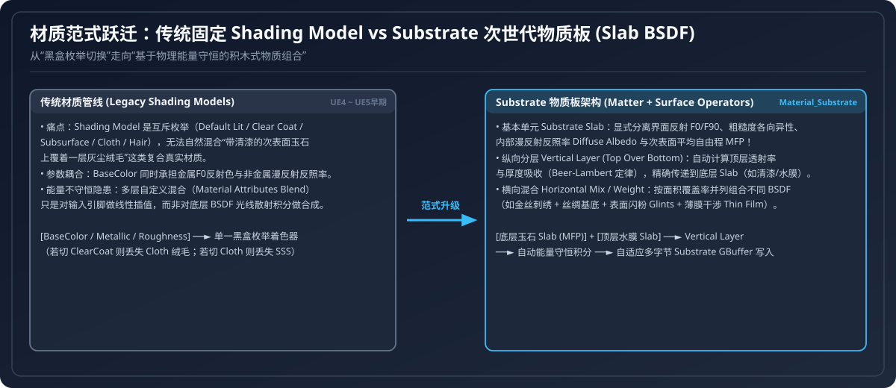
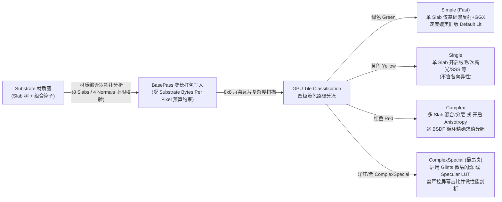
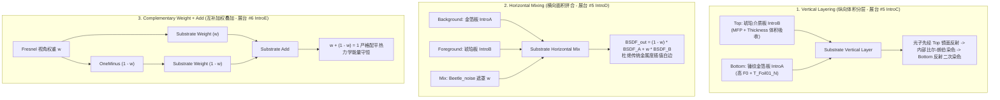
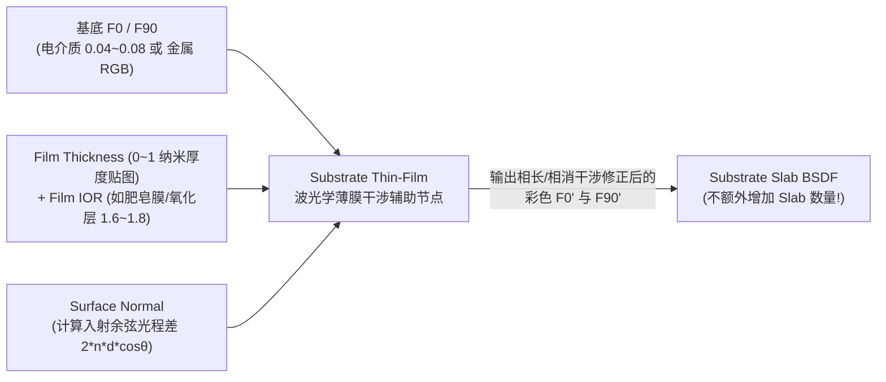
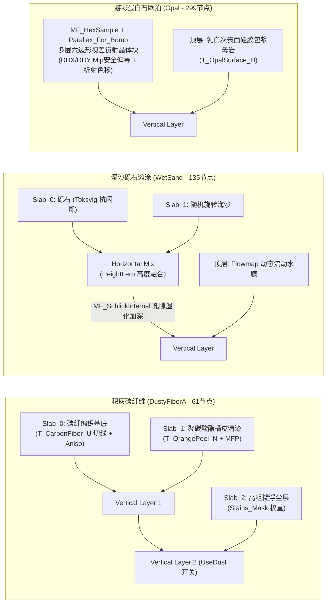

# 第 10 节 · `Material_Substrate`：次世代物质板（BSDF Slab）架构全展厅完全拆解

> **关卡全景档案与资产规模说明**
> - **关卡资产路径**：`/Game/Maps/Material/Material_Substrate`（历史内部代号 `Strata`，因此底层 C++ 表达式节点类名保留为 `MaterialExpressionStrata*`）
> - **空间布局与规模**：全馆沿 X 轴延伸逾 **350 米**（坐标 `X = 500` 至 `X = 35500`），总计部署 **301 个场景 Actor**——由 **四大主题展廊**、**34 座标准 `BP_DemoDisplay` 核心展台（`#1` ~ `#34`）**、**143 件受控实验展品网格与动态测试灯组** 以及数十枚 `TextRenderActor` 3D 悬浮标签共同构成（注：本节文件名沿用总目录索引名，正文完整覆盖全馆全部 **34 座核心展台、143 件展品实例与近百个 `M_Substrate_*` / `MI_*` / `SMF_*` 材质资产** 的 100% 逐号深拆）。
> - **前置项目设置**：需在 `Project Settings -> Engine -> Rendering -> Substrate` 中勾选 **`Substrate Materials`**（重启编辑器生效），并建议同步开启 **`Opaque Material Rough Refraction`**、**`Advanced Visualization Shaders`**，将平台每像素字节预算 **`Substrate Bytes Per Pixel`** 从默认的 `80` 提升至 **`128`**，以确保本馆最极端的多层各向异性材质不会触发自动降级简化。

---

## 一、 渲染范式跃迁：为什么虚幻引擎必须重写材质底座？

在 UE4 至 UE5 早期的十余年间，实时渲染管线一直建立在 **固定着色模型枚举（Fixed Shading Model Enum）** 之上：`Default Lit`、`Clear Coat`、`Subsurface`、`Subsurface Profile`、`Cloth`、`Hair`、`Eye`、`Two Sided Foliage`……这套体系以极高的 GBuffer 紧凑度统治了一个时代，但当影视级虚拟制片与次世代 3A 美术试图表达真实世界的**复合多层物质**时，旧架构撞上了三道不可逾越的物理死墙：

1. **逐像素互斥的“黑盒枚举”困境**：固定 GBuffer 中每个像素只能存储**唯一一个** `ShadingModelID`。美术无法在同一块网格表面让“次表面散射的温润玉石（`Subsurface Profile`）”平滑过渡到“覆着天鹅绒灰尘（`Cloth`）的清漆金丝（`Clear Coat`）”。即便使用 `BlendMaterialAttributes` 强行混合，底层也只能对输入标量做插值，而无法让两种物理散射方程共存。
2. **金属度（Metallic）与电介质（Dielectric）二元割裂伪影**：传统 PBR 将金属的镜面反射率 $F_0$ 与非金属的漫反射反照率 $\rho_d$ 强行塞进同一个三通道引脚 `BaseColor` 中。当 `Metallic` 在贴图边缘从 `0` 过渡到 `1` 时，由于线性插值同时污染了漫反射与 $F_0$，交界处必然浮现一圈臭名昭著的**灰白色/死黑脏边伪影**。
3. **电介质折射率封顶与无色高光枷锁**：在旧管线中，`Metallic = 0` 时高光恒定无色（无法直接表达薄膜干涉或有色电介质反射），且 `Specular` 引脚范围 $[0, 1]$ 被硬编码映射为法向反射率 $F_0 \in [0, 0.08]$。由菲涅耳法向反射公式反推折射率上限：

$$F_0 = \left(\frac{n - 1}{n + 1}\right)^2 \le 0.08 \implies n_{\max} = \frac{1 + \sqrt{0.08}}{1 - \sqrt{0.08}} \approx 1.778$$

这意味着任何折射率超过 `1.78` 的真实高折射率晶体（如蓝宝石 $n \approx 1.77$、钻石 $n = 2.42 \Rightarrow F_0 \approx 0.17$、碳化硅或半导体硅晶圆）在传统非金属模式下根本无法正确表达！

### 1.1 Substrate 的第一性原理：物质板（Slab）+ 能量守恒算子代数

**Substrate（前称 Strata）** 彻底废除了“选一个黑盒枚举再填几个耦合参数”的旧思维，回归光学物理本质，用两大原语重构了整个材质图：

- **基本物质单元——`Substrate Slab BSDF`（物质板）**：每一块 Slab 都代表现实世界中一片具有明确物理边界的物质切片，严格解耦为上下两部分：
  - **光学界面（Interface）**：控制光子撞击表面瞬间的镜面反射与微表面散射——显式暴露三通道有色 **`F0`**（法向反射率）与 **`F90`**（掠射角反射率）、主粗糙度 **`Roughness`**、次高光瓣 **`Second Roughness / Weight`**、各向异性 **`Anisotropy / Tangent`**，以及微晶闪烁 **`Glints`**、微纤维绒毛 **`Fuzz`**、镜面查找表 **`Specular Profile`** 与波光学薄膜干涉辅助节点 **`Thin-Film`**。
  - **内部介质（Medium）**：控制穿透界面进入物质内部的光子命运——显式暴露漫反射反照率 **`Diffuse Albedo`**、各通道平均自由程 **`Mean Free Path (MFP)`**、物理厚度 **`Thickness`** 以及 Henyey-Greenstein 散射相函数 **`Phase`**。当 Slab 位于不透明拓扑最底层时，MFP 表现为**次表面散射（SSS）**；当 Slab 作为上层涂覆层或用于半透明材质时，MFP 遵循 **比尔-朗伯定律（Beer-Lambert Law）** 表现为**体积参与介质（Participating Media）吸收与散射**！
- **四大拓扑组合算子（Operators）**：通过 **`Vertical Layering`（纵向分层）**、**`Horizontal Mixing`（横向面积混合）**、**`Coverage Weight`（覆盖率权重）** 与 **`Add`（能量叠加）**，美术可以像搭乐高积木一样组合任意多块 Slab，渲染器在底层自动完成跨界面的能量守恒透射积分与粗糙折射模糊！

### 1.2 自适应变长 GBuffer 与 GPU 四级瓦片分类着色（Tile Classification）

既然一个像素可能只有 1 块最简单的塑料 Slab，也可能叠了 3 层带各向异性与闪粉的复杂车漆，如果为全屏每个像素都分配最大内存，显存带宽会瞬间爆炸。Substrate 为此引入了**按需打包的自适应字节流缓冲区**与 **Compute Tile 四级分类分流管线**：

### 1.3 全馆 34 座展台四大主题长廊空间分布图

沿着 `Y = -900` 的主轴线从西向东漫步，官方在关卡中每隔 `1500 cm` 留出一道跨区走廊，将 34 座展台划分为逻辑严密的**四大展厅**：

| 展厅分区 | 展台编号范围 | 空间 X 坐标区间 | 核心攻克命题 |
| :--- | :---: | :---: | :--- |
| **第一展厅：导览、旧版局限与算子总览** | `#1` ~ `#9` | `500` ~ `9000` | 项目开关与字节预算、旧版枚举三大死结、自动转换节点、四大算子（分层/混合/加权/叠加）、薄膜干涉、贴花域材质与五大单体特化 BSDF |
| **第二展厅：The Slab 物质板全参深潜** | `#10` ~ `#21` | `10500` ~ `21500` | Slab 底层拓扑规则、不透明粗糙折射、金属度解耦、各向异性、平均自由程 MFP、Henyey-Greenstein SSS、薄表面双面透光、双粗糙度、简化清漆、Disney Fuzz、Specular Profile LUT 与 Glints 微晶闪烁 |
| **第三展厅：Substrate 物理半透明体系** | `#22` ~ `#27` | `23000` ~ `28000` | Coverage 覆盖率 vs Transmittance 透射率解耦、双源混合有色透射、单通道灰度透射回退、纯滤色正片叠底、Alpha Holdout 穿孔与毛玻璃粗糙折射 |
| **第四展厅：高级综合实战与性能调优** | `#28` ~ `#34` | `29500` ~ `35500` | 五大工业级标杆球（含 299 节点蛋白石欧泊）、Parameter Blending 降维优化、硬件编译上限与 DAG 计费陷阱、官方材质函数库、Standard Surface / OpenPBR 跨软件标准与五大 Debug 视图 |

---

## 二、 第一展厅（展台 #1 ~ #9）：架构启蒙、旧版兼容与组合算子代数

### 展台 #1：`Warning`（兼容隔离警告与全局光照基座）
- **空间坐标**：`(500, -900, 0)` | **展牌 Actor**：`BP_DemoDisplay15`
- **陈列对象与全局环境基座**：本展台不仅是全馆入口的警示牌，还挂载了支撑整张地图物理光学验证的标准动态环境光组：
  - `DirectionalLight`（可移动平行主光，强度 `10 lux`，开启阴影）、`SkyLight`（可移动天光，强度 `3`）、`SkyAtmosphere`（物理大气散射）、`ExponentialHeightFog`（指数高度雾）、`PPV_Main`（全境无限范围 `PostProcessVolume`）、调试辅助 `Actor`（含 `ChaosDebugDrawComponent_0`），以及场景外围包裹的全局天空球 `SM_SkySphere`（覆写为 `M_Substrate_Unlit`）。
- **核心工程铁律**：开启 Substrate 后，引擎会在内存中**自动即时转换（Auto-Convert）**旧材质；只要不点击保存，切回非 Substrate 模式后原资产完好无损。但**一旦在开启 Substrate 状态下将材质保存回磁盘，该 `.uasset` 将序列化写入 Substrate 专属节点图，无法再在关闭 Substrate 的工程中打开**！因此官方强烈建议在独立工程副本中探索或严格管控保存操作。

### 展台 #2：`Substrate Materials (Experimental)`（项目配置与每像素字节预算）
- **空间坐标**：`(1500, -900, 0)` | **展牌 Actor**：`BP_DemoDisplay2`（配补光 `SpotLight`，强度 `10`，衰减半径 `1600`）

- **核心机制深拆**：
  1. **三大核心渲染开关**：除主开关 `Substrate Materials` 外，本关依赖 **`Opaque Material Rough Refraction`**（允许不透明分层材质顶层的粗糙透明涂层模糊底层图案）与 **`Advanced Visualization Shaders`**（解锁视口菜单中的 Substrate 调试着色器）。
  2. **`Substrate Bytes Per Pixel`（每像素字节简化阈值）**：Substrate 根据可见像素的材质复杂度动态伸缩材质缓冲区显存。`r.Substrate.BytesPerPixel` 支持**按平台（Per-Platform）独立配置**——低端主机/移动端可设为更低字节阈值强制简化，而本示例关卡将其从默认的 **`80 Bytes` 提高到了 `128 Bytes`**，从而保证馆内最极端的多 Slab 叠加材质（如展台 `#30`）能够零妥协地完整渲染。

### 展台 #3：`Limitations of Legacy Materials`（旧版材质三大物理缺陷实证）
- **空间坐标**：`(3000, -900, 0)` | **展牌 Actor**：`BP_DemoDisplay9`
- **悬浮标签与展品**：3 座半圆柱测试网格 `/Game/ExampleContent/Substrate/Meshes/TestObjects/HalfCyl`：
  1. **`Legacy Material Blend`（`HalfCyl3` -> `M_ShadingBlend_Legacy`）**：
     - **节点拆解（11 节点）**：创建两个 `SetMaterialAttributes` 分别绑定不同的 `MaterialExpressionShadingModel`（如蓝色 `(0.0085, 0.0085, 0.85)` 与中灰 `0.18` 的不同着色模型），经 `BlendMaterialAttributes` 按 `TexCoord.R` 横向插值后送入 `MaterialExpressionStrataLegacyConversion` -> `MP_FrontMaterial`。
     - **缺陷揭示**：旧管线一个像素只能存活一种 Shading Model，强行混合时要么发生生硬的枚举跳变，要么丢失其中一方的特有光学响应。
  2. **`Legacy Metallic -> Dielectric Blend`（`HalfCyl` -> `M_MetallicBlend_Legacy`）**：
     - **节点拆解（11 节点）**：利用 `WorldPosition / 3` 的 `RB` 平面坐标采样斑点遮罩 `T_Spots_M`，通过两组 `Lerp` 同时插值 `BaseColor`（`0.6` 亮银金属至 `0.18` 电介质灰）与 `Metallic`（`1 -> 0`），经 `StrataLegacyConversion` 输出。
     - **缺陷揭示**：在斑点边缘 `Metallic ≈ 0.5` 的半金属过渡带，既损失了纯金属的高 $F_0$ 镜面能量，又损失了漫反射反照率，直观暴露了金属/非金属耦合插值带来的**泛白/发灰伪影圈**。
  3. **`Specular as IOR`（`HalfCyl2` -> `M_F0toIOR_Legacy`）**：
     - **节点拆解（61 节点）**：沿 UV 横向通过 `Floor(U * 7) / 7` 切分为阶梯色带，结合 `MF_F0toIOR` 函数、`T_Labels_Col` 标签贴图与两组 `DebugScalarValues` 实时在模型表面打印出当前 `Specular` 输入值对应的物理折射率 $n$，基底颜色设为橙红 `(0.85, 0.0926, 0.0085)`。
     - **缺陷揭示**：直观验证当 `Specular` 拉满到 `1.0` 时，物理 $F_0$ 仅停留在 `0.08`（对应 $n \approx 1.78$），彻底锁死了宝石、高折射率釉面与有色非金属高光的创作空间。

### 展台 #4：`Legacy Material Conversion`（旧版八大着色模型自动转换对照）
- **空间坐标**：`(4000, -900, 0)` | **展牌 Actor**：`BP_DemoDisplay10`
- **设计定位**：升级存量 UE4/UE5 老项目时，引擎会在底层自动插入 **`MaterialExpressionStrataLegacyConversion`** 节点将旧主节点引脚桥接至 `MP_FrontMaterial`。**注意：自动转换生成的节点是封闭兼容黑盒，不支持接入 Substrate 混合/分层算子！新建材质切勿以此为起点，而应直接使用原生 `Substrate Slab`。**
- **8 件展品资产逐一拆解**（7 座标准材质球 `SM_MatPreviewMesh_01` + 1 个 `DecalActor`，统一采用标志性暖橙基底色 `(0.85, 0.429, 0.0085)` 以便横向对比光学特征）：
  1. **`Subsurface Profile`（`M_SSP_Legacy`）**：`MSM_SubsurfaceProfile`，在 `StrataLegacyConversion` 上挂载 `Demo_SSP` 散射配置资产，配合标量参数 `SubsurfaceDistance = 1.0`。
  2. **`Default Lit`（`M_DefaultLit_Legacy`）**：`MSM_DefaultLit`，仅 2 个节点（橙色常量 -> `StrataLegacyConversion`），性能开销与非 Substrate 版本完全持平。
  3. **`Two Sided Foliage`（`M_TwoSidedFoliage_Legacy`）**：`MSM_TwoSidedFoliage`，暖橙正面反照率配合深蓝透射色 `(0.0085, 0.149, 0.85)` 模拟叶片背光透射。
  4. **`Unlit (Emissive)`（`M_Unlit_Legacy`）**：`MSM_Unlit`，自发光无光照直出。
  5. **`ClearCoat`（`M_Clearcoat_Legacy`）**：`MSM_ClearCoat`，设 `ClearCoat = 1.0`、`ClearCoatRoughness = 0.4`。
  6. **`SubSurface`（`M_SSS_Legacy`）**：`MSM_Subsurface`，暖橙基底 + 深蓝次表面散射色 + `SubsurfaceDistance = 1.0`。
  7. **`Decal`（`M_Decal_Legacy`）**：投射在展台上的 `DecalActor`（尺寸 `32x64x64`），材质域 `MD_DeferredDecal`，混合模式 `BLEND_TranslucentColoredTransmittance`，采样裂纹法线 `T_Crackle_N` 连入 `MP_Normal`，主干由 `StrataLegacyConversion`（粗糙度 `0.1`）串联 **`MaterialExpressionStrataConvertToDecal`** 输出至 `MP_FrontMaterial`。
  8. **`Cloth`（`M_Cloth_Legacy`）**：`MSM_Cloth`，复刻传统布料边缘绒毛逆反射。

### 展台 #5：`Layering and Mixing`（纵向能量守恒分层 vs 横向面积混合）
- **空间坐标**：`(5000, -900, 0)` | **展牌 Actor**：`BP_DemoDisplay11`

> [!NOTE]
> **全馆通用测试球 `SM_MatPreviewMesh_01` 的三材质槽设计（附底座材质深拆）**
> 从第 `#5` 号展台开始，全馆大量使用标准预览球 `SM_MatPreviewMesh_01`。除第 0 号主材质槽展示当前课题外，其余两个辅助材质槽本身也是精良的原生 Substrate 范例：
> - **槽位 1 底座外壳 `M_Substrate_ShaderBall_Shared`（53 节点）**：采用 `StrataVerticalLayering` 纵向叠合 3 个 `StrataSlabBSDF`——底层结合灰蓝金属/介质色 `(0.517, 0.523, 0.575)`、`FlakeRepeat = 256` 细微闪片、`T_Mat_UnrealTech_01_D`（经 `NormalFromHeightmap` 转凹凸法线）与 4K 脏迹贴图 `T_GrungySurface_slnneipc_4K_MR`，顶层通过 `StrataTransmittanceToMFP` 覆上一层清澈保护釉。
> - **槽位 2 引擎徽标 `M_Substrate_ShaderBall_Logo`（13 节点）**：单 `StrataSlabBSDF` 铬金属（`Chromium` F0 = `(0.562, 0.555, 0.550)`，漫反射接近纯黑 `0.02`），接入 **`StrataThinFilm`** 薄膜干涉与擦拭脏迹 `T_Imperfections_Wipe_Mask`，令金属 Logo 折射出微妙的油膜虹彩。

- **4 座材质球展品逐一深拆**：
  1. **`Material A`（`M_Substrate_SlabIntroA`，5 节点）**：**锤纹金箔基底板**。单 `StrataSlabBSDF`，金属有色 `F0 = (1.0, 0.733, 0.404)`，`Roughness = 0.3`，法线接入锡箔褶皱贴图 `T_Foil01_N`（同时封装为材质函数 `SMF_Substrate_IntroA` 供后续算子复用）。
  2. **`Material B`（`M_Substrate_SlabIntroB`，13 节点）**：**琥珀橙半透毛孔介质板**。单 `StrataSlabBSDF`（`MSM_SubsurfaceProfile`），利用 **`MaterialExpressionStrataTransmittanceToMFP`** 将琥珀透射色 `(0.95, 0.386, 0.0095)` 转换为物理平均自由程 MFP，`Roughness = 0.09`，采样皮肤毛孔法线 `HumanSkinPores_N`（经 `FlattenNormal(-0.1)` 增强起伏），并结合 `Fresnel` 混合深蓝边缘色调 `Color = (0.116, 0.144, 0.20)`（同步封装为 `SMF_Substrate_IntroB`）。
  3. **`Layer B on A`（`M_Substrate_SlabIntroC`，3 节点）**：**纵向分层算子 `MaterialExpressionStrataVerticalLayering`**。将 `SMF_Substrate_IntroB` 接至 `Top`，`SMF_Substrate_IntroA` 接至 `Bottom`。入射光线先在 B 的光滑毛孔界面发生首次镜面高光反射，剩余折射光穿过具有特定 `MFP` 与 `Thickness` 的琥珀介质发生比尔-朗伯体积吸收（染上浓郁的琥珀橙色），撞击到底层金箔 `T_Foil01_N` 反射后再二次穿过琥珀层射出——完美呈现“琥珀树脂封存锤纹金箔”的立体深邃感！
  4. **`Mix A and B`（`M_Substrate_SlabIntroD`，7 节点）**：**横向混合算子 `MaterialExpressionStrataHorizontalMixing`**。将 `IntroA` 与 `IntroB` 并列接入 `Background` 与 `Foreground`，采样脏迹遮罩 `Beetle_noise_grunge_Effects`（缩放截断 `Saturate` 后接入 `Mix` 引脚）。与旧版参数插值截然不同，这里是在同一像素内**对两块独立 Slab 的 BSDF 求值结果按面积占比加权混合**，彻底杜绝了金属与非金属交界处的泛白伪影！

### 展台 #6：`Adding and Weighting`（非物理叠加算子与覆盖率权重的能量守恒配平）
- **空间坐标**：`(6000, -900, 0)` | **展牌 Actor**：`BP_DemoDisplay19`
- **物理原理解析**：`Add` 算子直接将两个 Slab 的反射光强相加（$\text{BSDF}_{\text{out}} = \text{BSDF}_A + \text{BSDF}_B$），若直接裸连会导致总反射率 $>100\%$（违背热力学能量守恒，材质异常发光）。因此必须搭配 **`Coverage Weight`（`MaterialExpressionStrataWeight`）** 算子控制各自贡献度！
- **4 座材质球展品拆解**：前两座再次陈列基准 `M_Substrate_SlabIntroA`（`Material A`）与 `M_Substrate_SlabIntroB`（`Material B`），后两座演示核心组合范式：
  1. **`Add A and B`（`M_Substrate_SlabIntroE`，7 节点）**：**互补权重能量守恒相加**。用一个 `Fresnel` 节点同时生成正向菲涅耳权重 $w$ 与 `OneMinus` 互补权重 $1 - w$，分别通过两个 `StrataWeight` 缩放 `SMF_Substrate_IntroA` 与 `SMF_Substrate_IntroB`，最后汇入 `MaterialExpressionStrataAdd`。因为处处满足 $w + (1 - w) = 1$，完美实现了正视角呈现材质 A、掠射边缘平滑切换为材质 B 且严格能量守恒的效果。
  2. **`B * Weight atop A`（`M_Substrate_SlabIntroF`，7 节点）**：**局部剥落的清漆涂层遮罩**。在接入 `StrataVerticalLayering` 的 `Top` 引脚之前，先用棋盘格贴图 `T_GridChecker_A` 驱动 `StrataWeight` 对顶层琥珀胶 `IntroB` 进行覆盖率裁剪：权重为 `1` 的格子呈现琥珀封金，权重为 `0` 的格子顶层物质完全消失，裸露出底层未经吸收的纯金箔 `IntroA`！

### 展台 #7：`Iridescence`（波光学薄膜干涉辅助节点 `Thin-Film`）
- **空间坐标**：`(7000, -900, 0)` | **展牌 Actor**：`BP_DemoDisplay20`
- **架构革新**：在 Substrate 中，薄膜干涉（Iridescence）不再需要专门的着色模型，而是被优雅地抽象为一个**纯光学界面辅助节点 `MaterialExpressionStrataThinFilm`**！它接收基底原本的 `F0`、`F90`、薄膜厚度 `Thickness`（通常映射到纳米级光程差）、薄膜折射率 `IOR` 及可选薄膜法线，在节点内部解析计算上下表面反射电磁波的相长/相消干涉光谱，输出**修正后的有色 `F0` 与 `F90`** 再喂给 `StrataSlabBSDF`。

- **3 座材质球展品逐一深拆**：
  1. **`Iridescence On translucent`（`M_Substrate_IridescentA`，18 节点——流动肥皂泡）**：`BLEND_Translucent` 双面半透明（`TLM_SurfacePerPixelLighting`，折射模式 `RM_IndexOfRefraction`，水膜基底折射率 `MP_Refraction = 1.33`）。内部介质漫反射为 `0`，通过 `TransmittanceToMFP` 赋予 `0.98` 极高透光率；界面层接入 `StrataThinFilm`（油膜 `IOR = 1.8`，采样 `T_TilingNoise06` 动态插值薄膜厚度在 `[0.025, 0.5]` 间起伏），法线则对 `T_Base_Tile_DetailNormal` 施加 `Panner` + `Rotator` 旋转流动动画并 `FlattenNormal(0.975)`，栩栩如生地还原了肥皂泡表面流淌的七彩油膜。
  2. **`Iridescence On Metal`（`M_Substrate_IridescentB`，16 节点——阳极氧化钛/烤蓝钢）**：`BLEND_Opaque` 不透明金属（漫反射设为 `0`）。金属基底 `F0` 由高频噪波 `Good64x64TilingNoiseHighFreq_Low` 在 `0.5` 至 `1.0` 间微调，经 `StrataThinFilm`（氧化膜 `IOR = 1.8`，`T_TilingNoise06` 控制氧化层厚度不均）计算金属表面彩色干涉光斑，并用 `T_Imperfections_Wipe_Mask` 调制擦痕粗糙度。
  3. **`Iridescence On Dielectric`（`M_Substrate_IridescentC`，16 节点——甲虫几丁质结构色外壳）**：`BLEND_Opaque` 不透明电介质。内部漫反射为深黑褐 `(0.03, 0.03, 0.03)`，基底 `F0 = 0.08`，经 `StrataThinFilm`（几丁质角质膜 `IOR = 1.8`，由 `T_EV_DustPanner_01` 调制厚度）产生结构色虹彩；同时启用 `HumanSkinPores_N` 微凹凸法线与 **`StrataHazinessToSecondaryRoughness`**（`Roughness = 0.08`，次高光雾度营造甲壳特有的温润光泽尾迹）。

### 展台 #8：`Domain Materials`（特殊材质域隔离规范与高级贴花系统）
- **空间坐标**：`(8000, -900, 0)` | **展牌 Actor**：`BP_DemoDisplay23`
- **核心规则**：延迟贴花（`Deferred Decal`）、灯光函数（`Light Function`）与后处理（`Post Process`）属于**独立域材质（Domain Materials）**，只能单独使用。在 Substrate 中，**任何复杂的 Slab 材质图只要在连入 `MP_FrontMaterial` 前串入一个 `MaterialExpressionStrataConvertToDecal` 节点，就能直接化身为延迟贴花！**
- **5 个场景展品拆解**：
  1. **`M_Substrate_DecalIntroA`（`DecalActor2`，45 节点——24 步视差遮挡苔藓贴花）**：`MD_DeferredDecal` + `BLEND_Translucent`。内部直接调用 `ParallaxOcclusionMapping`（`POM_MaxSteps = 24`、`POM_Ratio = 0.04`、`POM_RefPlane = 1`），读取 `T_MossMask_M` 高度通道与 `SkyAtmosphereLightDirection` 计算立体凹陷与大气主光自阴影！表面由 `StrataSlabBSDF` 采样 `T_Mossrocks_Moss_02_D2`、`T_MossMask_N` 与 `T_TilingNoise_001`，最后经 `StrataConvertToDecal` 输出并同步写入 `MP_AmbientOcclusion`。
  2. **`M_Substrate_DecalIntroB`（`DecalActor3`，23 节点——指纹油污虹彩黄铜贴花）**：`MD_DeferredDecal` + `BLEND_Translucent`。构建一块黄铜金属 `StrataSlabBSDF`（`Brass` F0 = `(0.906, 0.781, 0.399)`，漫反射 `0.02`），叠加 `StrataThinFilm`（油污 `IOR = 1.6`）与指纹遮罩 `T_Imperfections_FingerPrints_Mask2`、`TilePatine_N` 铜绿法线，再由 `StrataConvertToDecal` 转为贴花投射在墙面上。
  3. **灯光函数与局部后处理展品**：`SpotLight2`（强度 `250` 的固定聚光灯演示 Light Function 投射，配合 `"Look down the hall ->"` 指示牌）以及局部后处理体积 `PPV_PostProcess` + 可视化摆件 `SM_PostProcessVisualizer`（验证后处理域材质在 Substrate 下的无缝兼容）。

### 展台 #9：`Monolithic Material BSDF`（五大单体特化材质 BSDF 全解）
- **空间坐标**：`(9000, -900, 0)` | **展牌 Actor**：`BP_DemoDisplay25`

- **架构边界说明**：并非所有光学现象都适合用通用 Slab 拼装。对于体渲染、毛发纤维多次散射、大水体单层折射、眼球双层角膜虹膜以及无光照表面，将它们与普通 Slab 混合要么在物理上毫无意义，要么会导致寄存器爆炸。因此 Substrate 提供了 **5 个独立的单体（Monolithic）BSDF 节点**——它们各自独占专用渲染通道，**不可接入任何混合/分层算子**：
  1. **`Volumetric`（`Sphere` -> `M_Substrate_Volume`，13 节点）**：材质域 `MD_Volume` + `BLEND_Additive`，主节点接入 **`MaterialExpressionStrataVolumetricFogCloudBSDF`**。利用 `WorldPosition`、`ObjectPivotPoint` 与 `ObjectScale` 构建内外双层三维 `SphereMask`：外层球体输出高反照率 `0.98` 浓密云雾散射（消光系数缩放 `50`），内核球体通过 **`BlackBody`（黑体辐射节点）** 驱动高温自发光火核，在球体内部呈现真实的“炽热岩浆核包裹翻滚浓烟”体积云效果。
  2. **`Hair`（`Hair_S_UpdoBuns` -> `M_Substrate_Hair`）**：直接放置了包含 **43,602 根真实发丝曲线（519,159 个控制顶点、3,112 根引导线）** 的 `GroomActor` 盘发资产 `Hair_S_UpdoBuns`，绑定基于 **`StrataHairBSDF`** 的毛发材质 `M_Substrate_Hair`，在发丝切向上实时解算 Marschner 毛发模型经典的 R（表面主高光）、TT（透射背光金边）与 TRT（内部二次反射染色次高光）三瓣散射。
  3. **`Single Layer Water`（`Plane` -> `M_Substrate_SingleLayerWater`，24 节点）**：`MSM_SingleLayerWater`，同时配置 **`MaterialExpressionStrataSingleLayerWaterBSDF`** 与水体介质输出节点 **`SingleLayerWaterMaterialOutput`**。水面法线由 `Panner` 驱动 `T_WaterNormal01_N`（经 `FlattenNormal(0.5)` 平滑），水面粗糙度极低（`0.02`），水下介质散射/吸收系数基于反比向量 `(10, 150, 350)` 计算（红光最快衰减、蓝绿光深透），并通过 `ShadingPathSwitch` 连接 `DistanceFieldApproxAO` 实现岸边距离场泡沫环境光遮蔽。
  4. **`Eye`（`Eyeball` / `SKM_Eye_00` -> `M_Substrate_Eye`，153 节点工业级写实眼球）**：`MSM_Eye`，核心为绑定了 `SSP_Eye` 次表面配置的 **`MaterialExpressionStrataEyeBSDF`**。这颗 153 节点的眼球材质堪比 MetaHuman 标准：巩膜采样虚拟纹理 `T_ScleraBase_001_D` 与湿润泪膜法线 `T_Eye_Wet_N`；角膜与虹膜区域（`IrisUVRadius = 0.175`）调用专属函数 `MF_ParallaxOcclusionMappingEye` 与 `MF_EyeRefraction`，结合深度平面图 `T_EyeMidPlane_DP`、虹膜四件套贴图 `T_Iris001_01_D/N/H/AO` 及 `T_TilingNoise_001` 扰动参数（`DistortStrength = 0.05`、`DistortScale = 5`），在单网格上同时还原了巩膜次表面渗血、泪膜锐利镜面反射、前房角膜折射下沉视差与虹膜焦散增亮！
  5. **`Unlit`（`Sphere2` 平面 -> `M_Substrate_Unlit`，10 节点）**：`BLEND_TranslucentColoredTransmittance` + `MSM_Unlit` 双面材质，使用 **`MaterialExpressionStrataUnlitBSDF`**。将 `2700K` 暖黄 `BlackBody` 黑体自发光与 `T_GridChecker_A` 棋盘格调制的有色透射率 `(0.09, 0.144, 0.90)` 结合，既能独立发光又能对背景做蓝宝石色滤光（全局天空球 `SM_SkySphere` 亦复用此材质）。

---

## 三、 第二展厅（展台 #10 ~ #21）：`Substrate Slab` 物质板全引脚物理拆解

穿过 `X = 9000` 到 `X = 10500` 的过道，我们正式步入整座展馆的核心腹地——**The Substrate Slab（物质板解剖长廊）**。在这里，官方将一块标准 `StrataSlabBSDF` 的每一个输入引脚拆解成 12 座专题实验台，彻底讲透界面光学与内部介质的数学耦合。

在逐台拆解之前，我们先建立一张 **`Substrate Slab BSDF` 全引脚物理字典总表**，作为查阅后续 12 座展台的光学坐标系：

| 所属层级 | Slab 输入引脚 / 属性名 | 类型与默认值 | 物理量纲与光学职责 | 触发的最低瓦片着色档位 |
| :--- | :--- | :---: | :--- | :---: |
| **内部介质 (Medium)** | `Diffuse Albedo` | `float3 (0.18)` | 内部多次散射后的漫反射反照率 $\rho_d$（**纯金属必须手动置 `0`**） | `Simple` (Green) |
| **内部介质** | `SSS MFP` | `float3 (0)` | 各通道光子平均自由程 $\mathbf{l}_{\text{mfp}}$（单位：`cm`）；底层走 SSS，上层/半透走体积吸收 | `Single` (Yellow) |
| **内部介质** | `SSS MFP Scale` | `float (1.0)` | 对输入 `SSS MFP` 或挂载 `Subsurface Profile` 半径的全局缩放乘数 | `Single` (Yellow) |
| **内部介质** | `SSS Phase Anisotropy` | `float (0.0)` | Henyey-Greenstein 相函数方向因子 $g \in [-1, 1]$（负值后向散射，正值前向透光聚焦） | `Single` (Yellow) |
| **内部介质** | `Thickness` | `float (0.01)` | 物质切片物理厚度（`cm`），决定上层涂层、半透明体及 `IsThinSurface` 薄片的比尔-朗伯衰减 | `Single` (Yellow) |
| **光学界面 (Interface)** | `F0` | `float3 (0.04)` | 法向（$0^\circ$ 正视）菲涅耳镜面反射率；支持任意 RGB 有色电介质、宝石（`>0.08`）与导体金属 | `Simple` (Green) |
| **光学界面** | `F90` | `float3 (1.0)` | 掠射角（$90^\circ$ 边缘）菲涅耳反射率；可用于模拟微表面遮蔽暗边或接收 `Thin-Film` 有色输出 | `Single` (Yellow) |
| **光学界面** | `Roughness` | `float (0.5)` | 主 GGX 镜面粗糙度 + 各向同性漫反射粗糙度；在 Glints 模式下控制微晶倾角方差 | `Simple` (Green) |
| **光学界面** | `Anisotropy` | `float (0.0)` | 双镜面高光瓣拉伸度 $[-1, 1]$（负值沿副切线拉伸，正值沿主切线拉伸） | **`Complex` (Red)** |
| **光学界面** | `Normal` / `Tangent` | `float3` | 表面法线与各向异性切线向量（单像素全拓扑累计不可超过 **4 组独立基底**） | 视各向异性而定 |
| **光学界面** | `Second Roughness` / `Weight` | `float` | 第二 GGX 高光瓣粗糙度与混合权重 $[0, 1]$，可由 `Haziness` 辅助节点自动换算 | `Single` (Yellow) |
| **顶层覆毛** | `Fuzz Amount / Color / Roughness` | `float / float3` | 叠在 Slab 最顶部的体积化 Disney Fuzz 微纤维密度、逆反射颜色与纤维发散度 | `Single` (Yellow) |
| **微晶/曲线** | `Glint Value` & `Glint UVs` | `float + float2` | 随机离散微晶闪烁密度与必填表面锚定 UV 坐标 | **`ComplexSpecial`** |
| **微晶/曲线** | `Specular Profile` (面板资产) | `USpecularProfile` | 按视角/光照角或半角向量采样 1D/2D 镜面颜色查找表 LUT | **`ComplexSpecial`** |
| **自发光** | `Emissive Color` | `float3 (0)` | 表面辐射自发光亮度（可搭配 `BlackBody` 开尔文黑体辐射节点） | `Simple` (Green) |

### 展台 #10：`Substrate Slab`（拓扑位置决定介质命运：次表面散射 vs 体积吸收）
- **空间坐标**：`(10500, -900, 0)` | **展牌 Actor**：`BP_DemoDisplay12`
- **黄金拓扑法则**：同样是一块连接了 `MFP` 的 `StrataSlabBSDF`，它在材质树中所处的**纵向位置**直接决定了引擎如何解算它的内部介质：
  - **位于不透明材质拓扑的最底层（Bottom Slab）** $\implies$ 视为半无限厚度的实体基底，引擎对其启用**屏幕空间扩散次表面散射（Subsurface Scattering）**；
  - **位于不透明材质的上层（Coating Slab），或用于任何半透明材质中** $\implies$ 视为具有有限厚度 `Thickness` 的薄层介质，引擎对其启用**体积参与介质（Volumetric Participating Media）**模型，按比尔-朗伯定律对穿过的光线执行吸收与内散射！
- **5 个陈列 Actor（3 组高表现力美术范例）逐一深拆**：
  1. **`Opalescent Flakes`（`SM_MatPreviewMesh_69` -> `M_Substrate_ShaderBall_FlipFlop`，18 节点）**：注释标注为 `"coat top"` 的双层 `StrataVerticalLayering` 变色珠光漆。底层 `Slab_1` 挂载 `Demo_SPP` 镜面查找表配置并结合 `LowResBlurredNoise`、`T_ShapeNormal`（高频平铺缩放 `6` 倍）模拟微米级珠光金属铝粉片；顶层 `Slab_2` 通过 `TransmittanceToMFP`（透射色微暖白 `(0.997, 1.0, 0.95)`，粗糙度 `0.125`）构成清澈罩光清漆，随观察角变化折射出幻彩珠光。
  2. **`Chromatic Specular`（`SM_MatPreviewMesh_70` -> `M_Substrate_ShaderBall_F0F90`，10 节点）**：单 `StrataSlabBSDF` 打破传统非金属无色高光限制的典范！基底具有深红棕色有色反射参数 `(0.20, 0.0218, 0.002)` 与 `F0 = 0.08`，配合空间渐变函数 `MF_ObjectGrad` 驱动 **`StrataThinFilm`**（薄膜 `IOR = 1.8`）与 `T_GrungySurface_slnneipc_4K_MR` 粗糙度贴图，证明哪怕不开启金属度，单块电介质 Slab 也能自由定制极具艺术张力的彩色高光与掠射角边缘色！
  3. **`Oiled Leather`（汽车真皮座椅三件套 `SM_Seatfrontleftbacka` / `SM_Seatfrontleftbota` / `SM_Seatfrontleftheada` -> `MI_Leather_Brown`）**：母材质为工业级车用织物皮革母球 `/Game/ExampleContent/Substrate/Materials/Materials/Car/M_Textile_Master`。实例重载参数 `Roughness Min = 0.25`、`Roughness Max = 0.65`、`Normal Intensity = 1.0`、`UV Tile U/V = 12`，同时暴露了打孔皮革深度（`Perforation Depth / Scale / Darken`）、边缘磨损（`Wear Scale / Intensity`）、三平面投影（`TriPlanar`）与次表面油脂散射色（`Subsurface Color`），精准呈现了高档上油棕色真皮座椅温润饱满的漫反射与油脂双层光泽。

### 展台 #11：`Opaque Blend Modes`（不透明混合模式与不透明粗糙折射黑科技）
- **空间坐标**：`(11500, -900, 0)` | **展牌 Actor**：`BP_DemoDisplay21`
- **3 座平面展品拆解**：
  1. **`Opaque`（`Sphere8` 平面 -> `M_Substrate_BlendA`，3 节点）**：`BLEND_Opaque` 最简基准材质——单 `StrataSlabBSDF`，翠绿漫反射 `(0.0646, 0.85, 0.0085)`，`Roughness = 0.333`。
  2. **`Masked`（`Sphere3` 平面 -> `M_Substrate_BlendB`，7 节点）**：`BLEND_Masked` 镂空材质——保持完全一致的翠绿 `StrataSlabBSDF`，额外取 `WorldPosition.XZ * 0.1` 传入 `CheckerPattern` 函数驱动主节点 `MP_OpacityMask`（裁剪阈值 `0.3333`），实现二值硬边镂空。
  3. **`Opaque Rough Refraction`（`Plane2` -> `M_Substrate_TransI`，16 节点——不透明层间粗糙折射）**：虽然材质整体混合模式仍是 **`BLEND_Opaque`**（无需进入昂贵且排序敏感的半透明通道！），但只要在项目设置中开启了 `Opaque Material Rough Refraction`，`StrataVerticalLayering` 就会根据顶层涂层的粗糙度与厚度自动对底层图案执行高斯/微表面卷积模糊！在 `M_Substrate_TransI` 中：
     - **底层 `Slab_1`**：采样锐利的棋盘格贴图 `T_GridChecker_A`；
     - **顶层 `Slab_0`**：漫反射为 `0`，通过 `TransmittanceToMFP` 设极高透光率 `(0.999, 0.999, 0.999)`，并用 `TexCoord.G` 纵向渐变控制顶层粗糙度从 `0.0` 过渡到 `0.8`——肉眼可见清晰的底层棋盘格在磨砂顶层覆盖下由下至上逐渐柔化失焦，仿佛压了一块磨砂亚克力板！

### 展台 #12：`Slab Parameterization`（漫反射/F0 显式解耦 vs 传统金属度辅助节点）
- **空间坐标**：`(12500, -900, 0)` | **展牌 Actor**：`BP_DemoDisplay22`
- **核心设计权衡**：`StrataSlabBSDF` 默认将内部漫反射 `Diffuse Albedo` 与界面法向反射率 `F0` **完全解耦**。这赋予了资深技术美术极高的自由度，但也带来一个新手易踩的坑：**真实纯金属内部自由电子会瞬间屏蔽透射电磁波，因此纯金属的 `Diffuse Albedo` 必须手动归零为 `(0, 0, 0)`**！为了兼顾传统 PBR 美术直觉，引擎内置了转换辅助节点 **`Substrate Metalness-To-DiffuseAlbedo-F0`**。
- **2 座同观感异构材质球对比**：
  1. **`Slab Albedo + F0`（`M_Substrate_Slab_ParamA`，3 节点）**：直接参数化——手动将黑色常量 `(0, 0, 0)` 连入 `Diffuse Albedo`，将青绿色金属反射色 `(0.0085, 0.85, 0.6536)` 连入 `F0`。
  2. **`Slab + Metallic Helper Node`（`M_Substrate_Slab_ParamB`，4 节点）**：传统金属度工作流——将同样的青绿色连入 **`MaterialExpressionStrataMetalnessToDiffuseAlbedoF0`** 的 `BaseColor`，设 `Metallic = 1.0`（默认 `Specular = 0.5`），由辅助节点按 $\rho_d = \text{BaseColor} \cdot (1 - m)$、$F_0 = \text{ lerp}(0.08 \cdot s, \text{BaseColor}, m)$ 自动算出 `DiffuseAlbedo = 0` 与 `F0 = BaseColor` 送入 Slab，两者最终编译出的像素着色完全等价！

### 展台 #13：`Anisotropy`（各向异性拉丝高光、切线贴图与多材质复合）
- **空间坐标**：`(13500, -900, 0)` | **展牌 Actor**：`BP_DemoDisplay26`
- **底层物理细节**：
  - Substrate 所有材质（含旧版转换材质）默认全程开启**粗糙漫反射（Diffuse Roughness）**，且漫反射始终保持**各向同性（Isotropic）**，仅有主/次两个 GGX 镜面高光瓣受 `Anisotropy`（范围 $[-1, 1]$）拉伸影响；
  - 同一块 Slab 的主高光瓣与次高光瓣（Second Roughness）**共享同一个 `Anisotropy` 值与 `Tangent` 切线基底**。若要在同一表面呈现正交交织的双向拉丝（如碳纤维编织），必须使用切线方向贴图或混合两块独立 Slab！
- **5 座铬金属与复合材质球逐一拆解**（前 4 座均基于 `Chromium` 铬金属 $F_0 = (0.562, 0.555, 0.550)$、极暗基底 `0.02`、`T_Imperfections_Wipe_Mask` 擦痕粗糙度及 `StrataHazinessToSecondaryRoughness` 次级高光雾度）：
  1. **`Isotropic`（`M_Substrate_Slab_AnisoA`，10 节点）**：`Anisotropy = 0`，标准圆形各向同性高光斑。
  2. **`- Anisotropy (Bitangent)`（`M_Substrate_Slab_AnisoB`，10 节点）**：`Anisotropy = -0.8`，微表面沟槽沿切线分布，高光沿**副切线（Bitangent）**方向强烈拉长。
  3. **`+ Anisotropy (Tangent)`（`M_Substrate_Slab_AnisoC`，10 节点）**：`Anisotropy = +0.8`，高光旋转 $90^\circ$ 沿**主切线（Tangent）**方向拉长。
  4. **`Anisotropy Texture`（`M_Substrate_Slab_AnisoD`，13 节点）**：保持 `Anisotropy = +0.8`，同时采样旋涡拉丝切线贴图 `T_BrushedTangent_V` 连入 Slab 的 `Tangent` 引脚，令高光随表面打磨纹理盘旋流动。
  5. **`Compositing with Anisotropy`（`M_Substrate_Slab_AnisoE`，47 节点——多算子各向异性清漆复合球）**：全流程展示如何在复杂拓扑中使用各向异性！底层通过 `StrataHorizontalMixing`（注释 `"plastic/metal blend"`，由 `MF_ObjectGrad` + `RemapValueRange` 分段过渡）横向混合各向异性拉丝金属 `Slab_0`（`Anisotropy = 0.8`）与暖橙次表面塑料 `Slab_1`（`TransmittanceToMFP` `(0.75, 0.329, 0.0075)`）；顶层再用 `StrataWeight`（注释 `"weight coat before layering"`）裁切一块带细节法线 `T_Base_Tile_DetailNormal` 的蔚蓝色透明清漆 `Slab_2`（透射色 `(0.02, 0.28, 0.80)`），经 `StrataVerticalLayering`（注释 `"clearcoat"`）覆于其上——同一像素内同时存在各向异性拉丝、SSS 塑料与有色各向同性清漆反射！

### 展台 #14：`Mean Free Path`（平均自由程 MFP、曲线图集空间映射与透射率换算）
- **空间坐标**：`(14500, -900, 0)` | **展牌 Actor**：`BP_DemoDisplay29`
- **核心光学方程**：**平均自由程（Mean Free Path, $\mathbf{l}_{\text{mfp}}$）** 是光子在介质内部两次散射/吸收碰撞之间平均行进的**物理距离（单位：厘米 cm）**，等于消光系数 $\boldsymbol{\sigma}_t$ 的倒数（$\mathbf{l}_{\text{mfp}} = 1 / \boldsymbol{\sigma}_t$）。
  - 某通道 `MFP = 0` 代表光子刚进入表面即被彻底阻挡（无该色光散射，退化为纯表面漫反射）；`MFP` 越大介质越通透。
  - 对于清漆或有色玻璃等高透介质，真实 MFP 往往高达数千厘米，手填数值极反直觉。因此 **`MaterialExpressionStrataTransmittanceToMFP`** 辅助节点利用比尔-朗伯定律反解：给定目标参考厚度 $d_{\text{ref}}$（默认 `0.01 cm` 等标准薄层厚度）下期望透过的颜色比例 $\mathbf{T} \in (0, 1)$，自动换算出精确物理 MFP：

$$\mathbf{T} = e^{-d_{\text{ref}} / \mathbf{l}_{\text{mfp}}} \implies \mathbf{l}_{\text{mfp}} = \frac{-d_{\text{ref}}}{\ln(\mathbf{T})}$$

- **3 座材质球展品逐一深拆**：
  1. **`Subsurface Profile for SSS`（`M_Substrate_Slab_MFP_A`，4 节点）**：传统兼容流派——不在引脚输入动态 MFP，而是直接在 `StrataSlabBSDF` 细节面板指定 `Demo_SSP` 次表面配置资产（`DiffuseAlbedo = 1.0`，`F0 = 0.028`，`Roughness = 0.05`）。优点是支持高精度 Burley 屏幕空间扩散核，缺点是整块 Slab 共享单一 Profile 常量，无法用贴图逐像素平滑改变散射半径。
  2. **`Mapped MFP for SSS`（`M_Substrate_Slab_MFP_B`，8 节点）**：**Substrate 杀手级特性——逐像素贴图化彩色 MFP！** 通过 `MF_ObjectGrad` 获取模型空间梯度，采样曲线图集参数 `CurveAtlasRowParameter`（引用 `CA_AlbedoCurves` / `CRV_Chromatic` 彩虹光谱曲线）直接连入 `MFP` 引脚！无需任何 Profile 资产，次表面散射的穿透深度与散射色温在单个球面上实现了丝滑连续的彩虹渐变。
  3. **`Transmittance Helper for Material Layering`（`M_Substrate_Slab_MFP_C`，20 节点）**：在 `StrataVerticalLayering` 中，底层 `Slab_0` 贴有 `DefaultAlphaTexture` 灰白图案，顶层涂层 `Slab_1` 将 `CA_AlbedoCurves` 光谱颜色送入 **`StrataTransmittanceToMFP`**（厚度 `0.1`），直观呈现彩色透明清漆如何按光谱厚度给底层图案染上晶莹剔透的渐变滤色，同时通过 `FeatureLevelSwitch` 接入 `DistanceFieldApproxAO`。

### 展台 #15：`Subsurface Scattering`（Henyey-Greenstein 散射相函数 vs Wrap 裹挟散射）
- **空间坐标**：`(15500, -900, 0)` | **展牌 Actor**：`BP_DemoDisplay32`

- **实验装置设计**：展台陈列了 4 块薄板平面（`Plane11` ~ `Plane14`），并在每块薄板**背后**各架设了一盏挂载了 **`InterpToMovement` 往复运动组件**的可移动聚光灯（`SpotLight4/6` 强度 `5`，`SpotLight7/8` 强度 `1`，衰减半径 `125`），利用实时移动的背光点光源直观检验光束穿透薄板时的前向聚焦光晕！
- **物理机制与两组对照材质深拆**：
  1. **`Subsurface Phase Function`（`Plane11/12` -> `M_Substrate_Slab_MFP_D`，17 节点）**：保持 Slab 默认勾选 **`Use Subsurface Diffusion = true`**（物理扩散模式）。此时 `Phase` 引脚遵循经典的 **Henyey-Greenstein (HG) 各向异性体积散射相函数**：

$$p_{\text{HG}}(\cos\theta, g) = \frac{1 - g^2}{4\pi \left(1 + g^2 - 2g\cos\theta\right)^{3/2}}, \quad g \in [-0.95, 0.95]$$

     材质内部通过 `Floor(UV * Steps)`（`Steps = 3`）将平面切分为离散网格色块，令各项异性因子 $g$ 从 **`-0.95`（强后向散射，背光几乎不聚焦）** 阶梯递增至 **`+0.95`（极强前向散射，移动背光透过蓝绿色 `MFP = (0.002, 0.0152, 0.20)` 介质时形成极其锐利明亮的透射灯芯光斑）**！注意：场景光源必须开启 `Transmission`（透射阴影）才能看到此相函数透光效果。
  2. **`Non-Diffusion Wrap Phase`（`Plane13/14` -> `M_Substrate_Slab_MFP_E`，19 节点）**：在 Slab 面板**取消勾选 `Use Subsurface Diffusion`**，切换至专为匹配旧版 `MSM_Subsurface` 与 `Two-Sided Foliage` 设计的 **Wrap（非扩散裹挟）SSS 模式**。在此模式下，基底反照率设为 `0.18`、散射 MFP 为蓝色 `(0.008, 0.0608, 0.80)`，同样的 `[-0.95 -> 0.95]` 阶梯输入不再代表前/后向角度分布，而是退化为线性控制背光透射的不透明度/散射强度（Scatter Opacity）。

### 展台 #16：`Thin/Two-Sided Lighting`（`bIsThinSurface` 薄表面双面透光模型）
- **空间坐标**：`(16500, -900, 0)` | **展牌 Actor**：`BP_DemoDisplay43`
- **启用条件与禁区**：对于树叶、纸张、灯罩布幔等几何上只有单层多边形的薄片物体，在材质属性面板勾选 **`Two Sided = true`** 与 **`Is Thin Surface = true`**，并为最底层 Slab 连接 `MFP` 引脚，即可激活 **Substrate 薄表面照明模型（Thin Lighting Model）**，使原本只对上层涂层生效的 `Thickness` 引脚直接作用于底层薄片！（**硬性限制：当 Slab 挂载了 `Subsurface Profile` 资产时，薄表面模型不生效，必须使用引脚直接输入 MFP！**）
- **8 个实验 Actor（4 块薄板 + 4 盏对照背光聚光灯）拆解**：分别测试光源开启/关闭 `Transmission` 时，扩散型与 Wrap 型薄表面的厚度响应：
  1. **`Thin Diffusion (Light Transmission Off/On)`（`Plane7/8` + `SpotLight3/9` -> `M_Substrate_ThinB`，9 节点）**：开启 `Use Subsurface Diffusion = true`，白色漫反射基底 `1.0`，蓝色透射色 `(0.0085, 0.0646, 0.85)` 经 `TransmittanceToMFP` 输入，并用 `TexCoord.R` 横向驱动 `Thickness` 由薄变厚——左侧极薄处背光强烈穿透呈亮蓝色，右侧变厚处光线被指数衰减阻挡。
  2. **`Thin Wrap (Light Transmission Off/On)`（`Plane10/20` + `SpotLight10/5` -> `M_Substrate_ThinA`，10 节点）**：取消勾选 `Use Subsurface Diffusion`（Wrap 薄叶模式，背光灯强仅需 `0.5` 即十分醒目），中灰漫反射 `0.18` 配合同样的横向厚度梯度，复刻传统双面植被的高性价比透光质感。

### 展台 #17：`Second Roughness`（单板双 GGX 高光瓣、雾度辅助与独立漫反射粗糙度技巧）
- **空间坐标**：`(17500, -900, 0)` | **展牌 Actor**：`BP_DemoDisplay36`
- **物理洞察**：真实打磨金属、清漆木器或皮肤的高光往往比单一微表面 GGX 分布拥有更宽广柔和的“光晕拖尾（Specular Tail / Bloom）”。`StrataSlabBSDF` 原生内置了**第二镜面高光瓣（Secondary Specular Lobe）**——注意它与主高光瓣是**按权重并列混合（Mixed）**而非上下涂覆关系，零额外 Slab 开销即可实现双瓣高光！
- **3 件受控展品与一项高阶黑科技拆解**（统一采用鲜橙红基底 `(0.80, 0.0872, 0.008)`）：
  1. **`Haziness Helper`（`SM_MatPreviewMesh_28` -> `M_Substrate_Slab_Rough2A`，10 节点）**：主粗糙度锁定为锐利的 `0.111`，利用 `MF_ObjectGrad` 阶梯递增雾影参数并送入 **`MaterialExpressionStrataHazinessToSecondaryRoughness`** 辅助节点——自动换算出物理合理的 `Second Roughness` 与 `Second Roughness Weight`，在锐利核心高光外围晕染出渐进增强的朦胧光环（Haze）。
  2. **`Second Weight` & `Second Roughness`（`Plane9` -> `M_Substrate_Slab_Rough2B`，9 节点）**：调用 `MF_MaterialGrid` 材质函数生成二维参数矩阵镂空圆盘阵列（`BLEND_Masked`），X 轴扫描 `Second Roughness`、Y 轴扫描 `Second Roughness Weight`，一图看清双高光瓣混合比例与展宽的连续变化规律。
  3. **`Diffuse Roughness`（`SM_MatPreviewMesh_30` -> `M_Substrate_Slab_Rough2C`，9 节点——独立控制漫反射粗糙度的神级技巧！）**：在默认 Slab 中，`Roughness` 引脚同时控制主高光瓣与漫反射粗糙度（Chan Diffuse 模型）。如果美术想要**“高光像镜子一样锐利（`0.1`），但底层漫反射像粉笔/陶土一样极度粗糙（边缘平坦发白）”**该怎么办？`Rough2C` 给出了标准答案：**将 `Second Roughness Weight` 设为 `1.0`（100% 接管镜面高光！），将 `Second Roughness` 固定为 `0.1`，然后用 `MF_ObjectGrad` 自由阶梯调节主 `Roughness` 从 `0` 到 `1`**——此时主 `Roughness` 完全退出了镜面计算，化身为纯粹的**独立漫反射粗糙度控制器**！

### 展台 #18：`Simple Clear Coat`（单板简化清漆 BSDF 及其二次覆水/覆尘复合）
- **空间坐标**：`(18500, -900, 0)` | **展牌 Actor**：`BP_DemoDisplay37`
- **性能定位**：如果用两块完整 `StrataSlabBSDF` 做 `Vertical Layering` 来表达普通车漆，就已经消耗了 2 个 BSDF 槽位。为此 Substrate 提供了 **`MaterialExpressionStrataSimpleClearCoatBSDF`**——它是通用 Slab 的特化轻量级子集：硬编码将次高光瓣锁死为标准聚氨酯清漆的电介质反射率（$F_0 = 0.04$）与固定吸收简化模型，同时保留底层自由度（主粗糙度 `0.375`、橙红车漆色 `(0.80, 0.0872, 0.008)`、`TilePatine_N` 底漆法线）与清漆层粗糙度（`0.0333`）/ 权重控制。**这样仅用 1 个 BSDF 就能完成基础双层车漆，省下的算子预算可以用来在车漆表面再叠水珠或灰尘！**
- **3 座车漆进化材质球拆解**：
  1. **`Simple Clearcoat`（`M_Substrate_SCC_LayerA`，11 节点）**：单节点 `StrataSimpleClearCoatBSDF` 直出高光泽红车漆，跑在高速单 BSDF 着色路径上。
  2. **`Layer On Clearcoat`（`M_Substrate_SCC_LayerB`，50 节点——雨滴淋湿的清漆车壳）**：仅需**一次** `StrataVerticalLayering` 即可实现等效“底漆 + 清漆 + 雨滴”的三层光学结构！底层为 `SCC_LayerA`，顶层新建一块水滴 `StrataSlabBSDF`——采样水珠法线 `T_WaterDrops_N`，提取法线 XY 长度结合朝上顶点法线 `VertexNormalWS.B` 生成水滴分布遮罩驱动 `StrataWeight`，并用 `TransmittanceToMFP` 赋予淡蓝水体透射色 `(0.0456, 0.364, 0.82)`，晶莹的水珠立体浮现在红车漆清漆层之上。
  3. **`Mix with Clearcoat`（`M_Substrate_SCC_LayerC`，30 节点——积满干涸泥渍灰尘的车壳）**：利用 `StrataHorizontalMixing`，根据网格顶部朝向 `VertexNormalWS.B` 与污渍遮罩 `T_Imperfections_Stains_Mask`，将粗糙灰暗的泥尘 `StrataSlabBSDF`（漫反射 `0.72`，粗糙度 `0.64`）横向覆盖混合在红车漆 `StrataSimpleClearCoatBSDF` 表面。

### 展台 #19：`Fuzzy Shading`（体积化 Disney Fuzz 微纤维绒毛逆反射）
- **空间坐标**：`(19500, -900, 0)` | **展牌 Actor**：`BP_DemoDisplay38`
- **模型升级**：不同于旧版需要单独切到 `MSM_Cloth`，在 Substrate 中 **Fuzz（绒毛层）直接内置于每一块 `StrataSlabBSDF` 的最顶层**！在算力充沛的平台上，引擎采用先进的**体积化 Disney Fuzz 微纤维模型**（近似模拟垂直竖立于表面法线方向的亚像素微纤维丛），并根据 `Fuzz Amount` 线性衰减下方的高光与漫反射能量，意味着你可以在金属、次表面皮肤甚至清漆上自由长出天鹅绒或桃皮绒毛！
- **3 座布料垂幔网格（`SM_ClothGeo`）受控梯度实验拆解**（基底采样 `T_GridChecker_A` 棋盘格与 `T_Noise01_N` 织物微凹凸法线，绒毛标志色为荧光翠绿 `(0.009, 0.90, 0.0684)`）：
  1. **`Fuzz Amount Gradient`（`ClothGeo` -> `M_Substrate_Slab_FuzzA`，13 节点）**：`MF_ObjectGrad.R` 从左至右扫描 **`Fuzz Amount`（纤维密度 $[0 \to 1]$）**——左侧为裸露的棋盘格普通织物，越往右翠绿色边缘逆反射（Retroreflection）越浓密，并逐步遮蔽底层棋盘格。
  2. **`Fuzz Color Gradient`（`ClothGeo2` -> `M_Substrate_Slab_FuzzB`，15 节点）**：固定 `Fuzz Amount = 1.0`，沿模型扫描 **`Fuzz Color`** 强度，展示有色微纤维如何独立于基底色给布料褶皱轮廓染上天鹅绒高光。
  3. **`Fuzz Roughness Gradient`（`ClothGeo3` -> `M_Substrate_Slab_FuzzC`，13 节点）**：固定 `Fuzz Amount = 1.0` 与翠绿绒毛色，扫描 **`Fuzz Roughness`（微纤维朝向发散度 $[0 \to 1]$）**——低粗糙度时绒毛整齐直立，逆反射集中在极窄的掠射轮廓边；高粗糙度时微纤维杂乱倾倒，柔和的丝绒散射铺满整个受光面。

### 展台 #20：`Specular Lookup Texture`（镜面反射查找表资产 `Specular Profile`）
- **空间坐标**：`(20500, -900, 0)` | **展牌 Actor**：`BP_DemoDisplay51`
- **高阶原理与性能警示**：常规 Schlick 菲涅耳近似只能从 $F_0$ 单调平滑插值到 $F_{90}$，无法表达某些贵金属在特定中段角度出现的“菲涅耳反射率凹陷（Fresnel Dip）”或风格化彩虹渐变高光。Substrate 允许创建 **`Specular Profile`（`USpecularProfile`）** 外部曲线/贴图 LUT 资产挂载到 Slab 上，独立控制**视线方向（View）**与**光照方向（Light）**（按视角/入射角或半角向量 Half-Angle 参数化）的彩色反射乘数。
  > [!WARNING]
  > **着色路径升级警告**：一旦启用 `Specular Profile`，该像素将进入全引擎最昂贵的 **`ComplexSpecial`** 瓦片着色路径，且 LUT 本身在单块 Slab 内是全局常量（不支持用贴图逐像素改换另一张 LUT，但可通过混合两个挂载不同 LUT 的 Slab 实现空间过渡）。生产环境中请务必配合 `Debug View` 严控屏幕面积！
- **3 座材质球 + 4 盏多角度测试聚光灯（`SpotLight14~17`）逐一拆解**（三球均设纯黑漫反射 `0` 与纯白基准 `F0 = 1.0`，完全交由 LUT 决定高光色彩）：
  1. **`Spec LUT View`（`M_Substrate_Slab_SpecProfileA`，3 节点，挂载 `SPP_SpecLUTA`）**：按 **View（视线与法线夹角 $N \cdot V$）** 采样渐变色带——转动摄像机时球体同心圆环颜色随之流转，而移动光源位置不会改变色相分布。
  2. **`Spec LUT Light`（`M_Substrate_Slab_SpecProfileB`，3 节点，挂载 `SPP_SpecLUTB`）**：按 **Light（光线与法线夹角 $N \cdot L$）** 采样同一条渐变色带——配合展台侧方架设的 `SpotLight16`（强度 `12`），可以清晰看到色彩环带紧紧围绕聚光灯高光中心展开，转动视角时色相锁定在受光角度上！
  3. **`Spec LUT Half-Angle`（`M_Substrate_Slab_SpecProfileC`，6 节点，挂载 `SPP_SpecLUTC`）**：导入真实光学测量的**物理铬金属（Chromium）复折射率菲涅耳外部曲线**（按微表面半角 $V \cdot H$ 参数化），辅以 `Roughness = 0.08` 与 `Haziness = 0.2` 双高光尾迹，在双聚光灯（`SpotLight14` 强度 `15`、`SpotLight15` 强度 `26.15`）照射下呈现出教科书级的物理级铬合金冷冽金属感。

### 展台 #21：`Glints`（时间稳定连续滤波的微晶闪烁 BSDF）
- **空间坐标**：`(21500, -900, 0)` | **展牌 Actor**：`BP_DemoDisplay52`
- **图形学突破**：雪地冰晶、金属闪粉车漆、砂金石或高定星钻眼影在微观尺度下由无数离散朝向的镜面微晶面（Microfacets）组成。传统法线贴图做法在镜头拉远时要么因 Mipmap 平均化彻底糊成一片死灰，要么在镜头微动时发生剧烈的像素级闪烁噪点（Aliasing）。Substrate 内置了基于随机微表面分布的解析连续滤波 **Glints BSDF**（同样归属 **`ComplexSpecial`** 路径）——近看颗颗星芒璀璨分明，拉远自动平滑收敛为连续 GGX 高光，且在 TAA/TSR 时域超分下**绝对时间稳定（Temporally Stable）**！
  > [!IMPORTANT]
  > **必填引脚铁律**：使用 Glints 时，**必须给 Slab 的 `Glint UVs` 引脚连接有效的纹理坐标输入**，用于将微晶粒子锚定在物体表面切线空间；若悬空不连，闪烁微晶将无法正确定位渲染！
- **2 座阶梯对照材质球拆解**（均设纯黑漫反射 `0`、纯白金属反射 `F0 = 1.0`，并将缩放后的 `TexCoord_0` 接入 `Glint UVs`）：
  1. **`Glint Density Stepped`（`M_Substrate_Slab_GlintsA`，12 节点）**：固定主粗糙度 `Roughness = 0.667`，用 `MF_ObjectGrad.R` 经 `Floor` 阶梯化控制 **`Glint Density`（微晶稀疏度，允许远大于 `1.0`）**——从稀疏独立的硕大星芒颗粒，逐级过渡到密集细腻的丝绸星砂，最终收敛为连续磨砂金属。
  2. **`Glint Roughness Stepped`（`M_Substrate_Slab_GlintsB`，12 节点）**：固定微晶密度，用 `MF_ObjectGrad.R` 经 `Power(7)` 幂曲线阶梯控制 Slab 的 **主粗糙度 `Primary Roughness`**——在 Glints 模式下，主粗糙度控制**微晶法线倾角的方差（Variance）**：方差越小各晶面朝向越一致；方差越大，晶面与晶面之间的明暗闪烁反差（Glint-to-Glint Contrast）越强烈耀眼！

---

## 四、 第三展厅（展台 #22 ~ #27）：`Substrate Translucency` 物理半透明与体积介质体系

迈过 `X = 21500` 到 `X = 23000` 的长廊，我们进入第三大主题展厅——**Substrate 半透明光学实验室**。

在旧版虚幻管线中，一个单一的 `Opacity` 引脚被含糊地混用于两种截然不同的物理概念：有时美术想表达“铁丝网/蕾丝窗纱的镂空遮罩（物质存不存在）”，有时又想表达“彩色玻璃杯/红酒的厚度滤光（物质 100% 存在，但内部透光）”，导致玻璃越透明连表面的镜面高光也跟着一起消失！

Substrate 彻底终结了这一混乱，将半透明严格拆分为两个正交物理量：
1. **`Coverage`（物质覆盖率，由 `StrataWeight` 控制）**：代表当前像素有多大面积真正被该物质覆盖。当 `Coverage -> 0` 时，物质连同它的镜面高光、漫反射一起彻底消失（如纱窗孔洞、贴纸边缘）；
2. **`Transmittance`（内部透射率，由 Slab 的 `MFP` + `Thickness` 控制）**：代表物质 **100% 存在**（`Coverage = 1.0`，表面菲涅耳镜面高光完整保留！），但穿过物质内部的背景光线按比尔-朗伯定律发生各通道颜色吸收与衰减！

围绕这一核心物理模型，Substrate 重构出了四大专属半透明混合模式：**`TranslucentColoredTransmittance`（硬件双源混合彩色透射）**、**`TranslucentGreyTransmittance`（单通道灰度透射）**、**`ColoredTransmittanceOnly`（纯彩色滤光/正片叠底）** 与 **`AlphaHoldout`（视口遮罩穿孔）**。（注：半透明 Slab 目前不支持屏幕空间 SSS，而是统一作为体积参与介质求值。）

下表精确列出了设物质覆盖率为 $c \in [0, 1]$、表面反射辐射亮度为 $\mathbf{L}_{\text{surf}}$、内部介质三通道比尔-朗伯透射率为 $\mathbf{T}_{\text{RGB}} = e^{-d / \mathbf{l}_{\text{mfp}}}$ 时，这四种模式对背景帧缓冲颜色 $\mathbf{C}_{\text{bg}}$ 的精确 GPU 合成方程：

| Substrate 半透明混合模式 | 底层引擎 `BlendMode` 枚举 | 帧缓冲像素合成数学方程 $\mathbf{C}_{\text{out}}$ | 硬件依赖与典型适用场景 |
| :--- | :--- | :--- | :--- |
| **`TranslucentColoredTransmittance`** | `BLEND_TranslucentColoredTransmittance` | $\mathbf{C}_{\text{out}} = c \cdot \mathbf{L}_{\text{surf}} + \big[(1 - c)\mathbf{1} + c \cdot \mathbf{T}_{\text{RGB}}\big] \odot \mathbf{C}_{\text{bg}}$ | 需 GPU 支持 **Dual-Source Blending**；适用于教堂花窗、红酒杯、琥珀、有色车灯罩（展台 `#23`） |
| **`TranslucentGreyTransmittance`** | `BLEND_Translucent` | $\mathbf{C}_{\text{out}} = c \cdot \mathbf{L}_{\text{surf}} + \big[(1 - c) + c \cdot T_{\text{grey}}\big] \cdot \mathbf{C}_{\text{bg}}$ | 全平台通用标准单源混合；表面高光仍为全彩，背景遮挡降为标量灰度（展台 `#22`、`#24`） |
| **`ColoredTransmittanceOnly`** | `BLEND_Modulate` | $\mathbf{C}_{\text{out}} = \big[(1 - c)\mathbf{1} + c \cdot \mathbf{T}_{\text{RGB}}\big] \odot \mathbf{C}_{\text{bg}}$ | 零表面光照计算开销；纯正片叠底彩色滤光片、染色投影贴片（展台 `#25`） |
| **`AlphaHoldout`** | `BLEND_AlphaHoldout` (`MSM_Unlit`) | $\mathbf{C}_{\text{out}} = (1 - c) \cdot \mathbf{C}_{\text{bg}}, \quad \alpha_{\text{out}} = (1 - c) \cdot \alpha_{\text{bg}}$ | 虚拟制片 XR / 影视合成前景遮罩挖孔，直接穿透不透明几何体写入透明黑洞（展台 `#26`） |

### 展台 #22：`Substrate Translucency`（半透明四大核心机制全景对照）
- **空间坐标**：`(23000, -900, 0)` | **展牌 Actor**：`BP_DemoDisplay13`

- **4 座对比材质球（统一开启 `BLEND_Translucent`、`TLM_SurfacePerPixelLighting` 逐像素表面光照、`RM_IndexOfRefraction` 且 `MP_Refraction = 1.0`）逐一深拆**：
  1. **`Translucent Opaque`（`M_Substrate_Trans_OverviewA`，4 节点）**：半透明通道内的 100% 不透明实体基准。单 `StrataSlabBSDF`（深紫蓝漫反射 `(0.0487, 0.03, 0.10)`，`Roughness = 0.36`），不接 `MFP` 且不加 `Weight`——虽然走半透明渲染队列，但因内部零透射且覆盖率为 `1`，外观与延迟不透明球体完全一致，印证了前向半透明与延迟管线的高度特性对齐。
  2. **`Translucent Coverage`（`M_Substrate_Trans_OverviewB`，8 节点）**：在 `OverviewA` 基础上，采样柔边棋盘格遮罩 `T_SoftChecker_M` 连入 **`MaterialExpressionStrataWeight`** 控制覆盖率——遮罩为 `0` 的方格区域**连同表面高光与材质球壳体一并镂空隐形**，精准表达“局部缺失的薄壳”。
  3. **`Translucent Transmittance`（`M_Substrate_Trans_OverviewC`，14 节点）**：保持 `Coverage = 1.0` 完整外壳，改用 `T_GridChecker_A` 棋盘格插值驱动 **`StrataTransmittanceToMFP`**（蓝紫色透射基调 `(0.525, 0.54, 0.75)` 与 `0.18` 中灰漫反射交替）——仔细观察透明方格处：**背后场景清晰透出并染上蓝紫色，同时玻璃外表面的高光反射依然连续完整地横跨整个球面！**
  4. **`Translucent Layered`（`M_Substrate_Trans_OverviewD`，34 节点——半透玻璃混合不透明积尘）**：通过 **`StrataHorizontalMixing`** 将 `OverviewC` 的蓝紫透光玻璃 `Slab_0` 与一块不透明粗糙积尘 `Slab_1`（漫反射 `0.72`、粗糙度 `0.64`，受顶部法线 `VertexNormalWS.B` 与污渍贴图 `T_Imperfections_Stains_Mask` 驱动混合权重）无缝合成在同一模型上——球体上半部落满不透光的厚灰尘，下半部依然是晶莹透光的彩色玻璃！

### 展台 #23：`Chromatic Transmittance`（双源颜色混合：三通道彩色玻璃滤光与局部覆盖）
- **空间坐标**：`(24000, -900, 0)` | **展牌 Actor**：`BP_DemoDisplay39`
- **硬件机制**：采用 **`BLEND_TranslucentColoredTransmittance`** 混合模式（底层调用现代 GPU 的 **Dual-Source Color Blending 双源颜色混合**硬件特性，在单次 DrawCall 内同时对帧缓冲执行加法表面高光/漫反射合成与 RGB 三通道独立乘法背景衰减）。
- **2 座高脚玻璃杯网格（`SM_Cup`）逐一深拆**：
  1. **`Chromatic Transmittance`（`Cup1` -> `M_Substrate_Trans_ChromaA`，21 节点）**：双面光滑玻璃（`Roughness = 0.01`，`MP_Refraction = 1.0`）。表面漫反射带一抹翠绿 `(0.0646, 0.85, 0.0085)`，内部透射色沿 UV 横向在琥珀红 `(0.85, 0.0926, 0.0085)` 与宝蓝 `(0.0085, 0.0926, 0.85)` 之间平滑插值，结合 `ObjectScale` 动态补偿网格缩放厚度后送入 `StrataTransmittanceToMFP`——透过玻璃杯看到的背景被染上了饱和度极高的红蓝双色滤光，且杯壁高光清脆明亮。
  2. **`Chromatic Transmittance & Coverage`（`Cup2` -> `M_Substrate_Trans_ChromaB`，25 节点）**：在 `ChromaA` 的彩色透射基础上，调用柱面投影函数 `MF_CylindricalUV` 采样棋盘格 `T_GridChecker_A` 送入顶层 **`StrataWeight`**——同时在一个玻璃杯上实现了“镂空雕花网格（Coverage 裁剪）+ 留存花纹本身的红蓝彩色玻璃透光（Chromatic Transmittance）”双重光学叠加！

### 展台 #24：`Greyscale Transmittance`（单通道灰度透射：高性能与跨平台回退方案）
- **空间坐标**：`(25000, -900, 0)` | **展牌 Actor**：`BP_DemoDisplay40`
- **性能与兼容性定位**：当目标平台不支持硬件双源颜色混合（Dual-Source Blending），或项目希望节省帧缓冲带宽开销时，可使用标准 **`BLEND_Translucent`（对应 `TranslucentGreyTransmittance`）**。在此模式下，**物体表面的漫反射与镜面高光依然保留全彩 RGB**，仅将穿透物体对背景的遮挡简化为**单通道标量灰度（Scalar Transmittance）**。
- **4 座对照玻璃杯（`Cup7`、`Cup3`、`Cup4`、`Cup8`）矩阵拆解**（统一 `Roughness = 0.2`，`RM_None`）：
  1. **`Greyscale Albedo`（`Cup7` -> `M_Substrate_Trans_GreyA`，23 节点）**：受控对照组 A——在标准灰度透射模式下，用红蓝渐变控制表面有色漫反射反照率，验证表面自身色彩的丰富表现。
  2. **`Greyscale Transmittance`（`Cup3` -> `M_Substrate_Trans_GreyB`，23 节点）**：受控对照组 B——表面保持彩色光泽响应，内部接入 `StrataTransmittanceToMFP`（经 `ObjectScale` 缩放），但因混合模式限制为单通道 Alpha 混合，透过杯身看到的背景仅发生明暗烟熏衰减而不再染上彩色（直观对比 `#23` 号展台的双源混合优势）。
  3. **`Greyscale Albedo & Coverage`（`Cup4` -> `M_Substrate_Trans_GreyC`，27 节点）**：在 `GreyA` 基础上叠加 `MF_CylindricalUV` + `T_GridChecker_A` 驱动 `StrataWeight` 柱面棋盘格镂空。
  4. **`Greyscale Transmittance & Coverage`（`Cup8` -> `M_Substrate_Trans_GreyD`，27 节点）**：在 `GreyB` 基础上叠加柱面棋盘格 `StrataWeight` 覆盖率裁剪，完整展示移动端/低开销回退路径下的覆盖率与灰度透射组合。

### 展台 #25：`Chroma Only Transmittance`（纯彩色滤光片：等效正片叠底混合）
- **空间坐标**：`(26000, -900, 0)` | **展牌 Actor**：`BP_DemoDisplay41`
- **光学定位**：对应引擎底层的 **`BLEND_Modulate`（Substrate 语义化命名为 `ColoredTransmittanceOnly`）**。该模式**完全忽略表面的镜面反射与漫反射光照交互**，仅提取材质计算出的三通道透射率 $\mathbf{T}_{\text{RGB}}$ 与帧缓冲背景色直接相乘（正片叠底），非常适合制作纯滤色光束贴片、彩色阴影贴纸或无高光染色玻璃。
- **2 座玻璃杯展品拆解**：
  1. **`Chromatic Transmittance Only`（`Cup5` -> `M_Substrate_Trans_ChromOnlyA`，20 节点）**：同样输入红 `(0.85, 0.0926, 0.0085)` 至蓝 `(0.0085, 0.0926, 0.85)` 的 `StrataTransmittanceToMFP`，即便连入了绿色漫反射与粗糙度 `0.2`，杯壁表面也完全不产生任何白色高光点，纯粹化作一团悬浮在空中的红蓝彩色滤光场。
  2. **`Chromatic Transmittance Only & Coverage`（`Cup6` -> `M_Substrate_Trans_ChromOnlyB`，19 节点）**：结合 `MF_CylindricalUV` + `T_GridChecker_A` 驱动 `StrataWeight`——在覆盖率降为 `0` 的方格处透射乘数平滑退回单位白 `(1, 1, 1)`，背景保持原色不受滤光影响。

### 展台 #26：`Alpha Holdout`（视口空间黑洞穿孔遮罩与渲染顺序铁律）
- **空间坐标**：`(27000, -900, 0)` | **展牌 Actor**：`BP_DemoDisplay42`
- **影视合成与 XR 用途**：`Alpha Holdout` 用于在虚拟制片（VP/XR）或分层合成中，让前景遮挡物直接在视口空间把后方像素“挖穿成一个纯黑且 Alpha=0 的透明黑洞”。在 Substrate 中，遮挡体（Caster）必须设为 **`BLEND_AlphaHoldout` + `MSM_Unlit`**。
- **4 块前后叠放平面（含动态平移机关）实测拆解**：
  - **前景遮挡片 `M_Substrate_Trans_AlphaHoldout`（6 节点，挂载于静态 `Plane3` 与带 `InterpToMovement` 往复滑动的 `Plane6`）**：通过 `Distance(TexCoord, 0.5)` -> `Step` -> `OneMinus` 生成一枚锐利的程序化圆形遮罩连入 `MP_Opacity`。
  - **左组 `Alpha Holdout over Opaque (Punch a black hole)`（背景 `Plane5` -> `M_Substrate_Trans_AlphaA`）**：背景为 **`BLEND_Opaque`** 绿色不透明板（先于半透明阶段写入场景颜色缓冲）。当 Holdout 平面挡在前面时，圆形区域直接将已画好的绿色不透明背景清零，成功挖出一颗深邃的纯黑孔洞！
  - **右组 `Alpha Holdout over Translucent (No effect)`（背景 `Plane4` -> `M_Substrate_Trans_AlphaB`）**：背景改为 **`BLEND_Translucent`** 半透明绿板。当滑动的 Holdout 平面与半透明背景发生渲染排序交错（如半透明物体在 Holdout 之后绘制覆盖，或未开启针对性的排序分离）时，穿孔效果会被后绘制的半透明层覆盖或失效——展台借此直观提醒开发者在 XR 合成中务必把控 Holdout 与半透明层的 `Translucency Sort Priority`！

### 展台 #27：`Rough Refraction`（半透明粗糙折射：折射率、物距与未连引脚三组对照）
- **空间坐标**：`(28000, -900, 0)` | **展牌 Actor**：`BP_DemoDisplay44`
- **核心机制**：当半透明材质启用了折射（Distortion / Refraction）时，Substrate 会根据 Slab 的**主粗糙度 `Primary Roughness`** 以及**玻璃表面到后方被折射背景物体的空间距离（Distance）**，实时对场景背景采样多级降采样模糊缓冲——粗糙度越高、离背景棋盘格越远，毛玻璃模糊半径越大！
- **5 个场景 Actor（2 面背景棋盘格墙 + 3 件半透明测试体）精准拆解**：
  - **背景参照墙 `Plane15` & `Plane16`（`M_Substrate_Trans_Checkerboard`，6 节点）**：`BLEND_Opaque` 高对比度 `T_GridChecker_A` 棋盘格标尺墙，专门用来检验前景玻璃的几何光线偏折与失焦模糊度。
  - **实验体 1：`Rough Refraction`（立体方块 `Cube` -> `M_Substrate_Trans_RoughA`，8 节点）**：`RM_IndexOfRefraction` 且设置真实玻璃折射率 **`MP_Refraction = 1.5`**，透射率 `0.98`，主粗糙度由 `1 - TexCoord.R` 从左（`1.0` 重度磨砂）向右（`0.0` 清澈水晶）连续渐变——既能看到 `IOR = 1.5` 带来的强烈棋盘格错位折射扭曲，又能看到左侧磨砂端随着与背景墙距离拉开而产生的真实景深状毛玻璃模糊！
  - **实验体 2：`Rough Refraction, IOR = 1`（薄片 `Plane18` -> `M_Substrate_Trans_RoughB`，8 节点）**：保持 `RM_IndexOfRefraction` 开启，但将 **`MP_Refraction` 显式设为 `1.0`（与空气等折射率）**——光线穿过薄片时**不发生任何几何位置偏移**，但粗糙折射管线依然激活，呈现出极其干净纯粹的“零畸变磨砂毛玻璃”横向模糊渐变！
  - **实验体 3：`Pin Unhooked`（薄片 `Plane19` -> `M_Substrate_Trans_RoughC`，7 节点）**：折射方法设为 **`RM_None`（主节点 `MP_Refraction` 引脚悬空未连）**——即便 Slab 主粗糙度设为 `1.0`，表面自身的高光变粗糙了，但**背后的棋盘格依然 100% 锐利清晰毫不模糊**！这组对照一针见血地指明了开启半透明毛玻璃模糊的必要开关：**必须开启折射模式并向 `Refraction` 引脚输入有效值（哪怕输入 `1.0`）！**

---

## 五、 第四展厅（展台 #28 ~ #34）：殿堂级综合实战、参数混合优化、行业标准与性能调优

走过 `X = 28000` 至 `X = 29500` 的最后一道跨廊，我们来到了全馆技术含金量最高、最贴近 3A 工业化量产落地的压轴展区——在这里，我们将亲眼见证高达 **299 个节点** 的多层视差蛋白石材质图，并掌握将昂贵多 Slab 材质一键压缩回单 Slab 开销的优化利器。

### 展台 #28：`Advanced Substrate Use`（五大殿堂级生产标杆材质球全拓扑解构）
- **空间坐标**：`(29500, -900, 0)` | **展牌 Actor**：`BP_DemoDisplay14`

这 5 座材质球集中展示了旧版固定枚举管线根本不可能单Pass完成的复合光学奇观，每一颗都值得在材质编辑器中放大逐帧研读：

1. **`Dusty Carbon Fiber`（`SM_MatPreviewMesh_68` -> `M_Substrate_ShaderBall_DustyFiberA`，61 节点——三层积灰橘皮清漆碳纤维）**：
   - **底层 `Slab_0`（正交编织各向异性碳纤维）**：漫反射极暗 `0.04`，主粗糙度 `0.125` 搭配 `StrataHazinessToSecondaryRoughness(0.36)`，同时采样碳纤维凹凸法线 `T_CarbonFiber_N` 与**专属编织切线方向图 `T_CarbonFiber_U`**，令相邻碳丝束呈现出棋盘交替的正交拉丝高光流转！
   - **中层 `Slab_1`（聚碳酸酯橘皮罩光清漆）**：经第一级 `StrataVerticalLayering_0` 涂覆于碳纤维之上，使用 `TransmittanceToMFP`（微暖透射色 `(0.865, 0.864, 0.836)`），采样车用塑料粗糙度图 `T_Plastic_Polyvinyl_Carbonate_R` 与经典车漆橘皮微起伏法线 `T_OrangePeel_N`（`FlattenNormal(0.925)`）。
   - **顶层 `Slab_2`（静态开关控制的落尘层）**：通过静态布尔参数 `UseDust`（`StaticSwitchParameter`）控制第二级叠层——采样污渍遮罩 `T_Imperfections_Stains_Mask` 叠加灰白色（`0.72`）高粗糙（`0.64`）浮尘层，真实再现超跑引擎盖碳纤维积灰后的层次感。
2. **`Anisotropic coat over SSS`（`SM_MatPreviewMesh_71` -> `M_Substrate_ShaderBall_AnisoOverSSS`，54 节点——次表面玉石嵌金覆各向异性蓝清漆）**：
   - **底层混合（SSS 皮肤/蜜蜡 + 金属镶嵌花纹）**：`Slab_0` 为具有温暖肉粉漫反射 `(0.667, 0.447, 0.333)` 与鲜红深层散射 `(0.80, 0.128, 0.08)` 的次表面散射介质（利用 `BlendAngleCorrectedNormals` 融合 `HumanSkinPores_N` 毛孔与 `T_SwirlPattern_N` 涡纹）；`Slab_1` 为金属花纹层（采样 `T_MetalPattern_M` 与 `T_MetalPattern_N`），两者经 `StrataHorizontalMixing` 横向镶嵌拼合。
   - **顶层颠覆性突破（各向异性有色清漆 `Slab_2`）**：在底层 SSS + 金属复合体之上，用 `StrataVerticalLayering` 覆上一层**`Anisotropy = -0.9` 的强各向异性蔚蓝清漆**（`TransmittanceToMFP` `(0.169, 0.633, 0.965)`，`Roughness = 0.1`）！在旧版 UE 中，`ClearCoat`、`Subsurface` 与 `Anisotropy` 互相水火不容，而在 Substrate 中仅用 54 个节点便浑然天成。
3. **`Wet Sand & Water`（`SM_MatPreviewMesh_67` -> `M_Substrate_ShaderBall_WetSand`，135 节点——孔隙湿化滩涂砾石与流动水膜）**：
   - **底层地形高度混合**：`Slab_0` 采样《古代山谷（AncientGame）》高精度砾石套图 `T_FlatgroundGravel1_A/N/R/D` 及预计算法线方差粗糙度图 `T_FlatgroundGravel1_U`（节点注释明确标注 **`"Toksvig"` 抗高光闪烁滤波**！）；`Slab_1` 采样海滩细沙 `T_Sand_A/N/R` 并结合 `RandomAngles` 去平铺重复感；两者通过 `HeightLerp` 高度插值送入 `StrataHorizontalMixing`。
   - **孔隙度变暗与动态水流层**：调用物理内反射函数 `MF_SchlickInternal` 模拟沙石被水浸湿后因内部多次全反射导致的**孔隙湿化加深（Porosity Darkening）**，最顶层再经 `StrataVerticalLayering` 覆盖一层由 `Flowmaps` 驱动 `water_n` 实时流淌的清澈水膜！
4. **`Ice and Rocks (POM)`（`SM_MatPreviewMesh_72` -> `M_Substrate_ShaderBall_IceRocks`，45 节点——32 步深层视差冰封页岩）**：
   - 调用 `ParallaxOcclusionMapping`（`MaxSteps = 32`、深度比 `0.15`）读取页岩高度图 `Slate_M`，将底层页岩 `Slab_0`（`Slate_D` / `Slate_N`）在视觉空间向球体深处大幅下沉；
   - 顶层冰壳 `Slab_1` 通过 `StrataVerticalLayering` 封盖在表面，利用视差深度输出动态驱动冰层厚度与冰蓝 `TransmittanceToMFP` `(0.576, 0.792, 0.90)` 吸收（搭配 `water_n` 冰面起伏与 `Haziness` 雾化次高光）——越深的岩石裂缝上覆冰层越厚、吸收越蓝、折射越朦胧，单网格做出了惊人的半米厚寒冰封石体积感！
5. **`Opal`（`SM_MatPreviewMesh_73` -> `M_Substrate_ShaderBall_Opal`，299 节点——全馆最复杂的六边形视差游彩蛋白石/欧泊）**：
   - 这是整座 `Material_Substrate` 展馆节点数最多（**299 个材质表达式、超过 50 处 `NamedReroute` 具名路由变量**）的炫技之作！为了还原天然黑欧泊/白欧泊内部多层硅胶微球衍射产生的立体“游彩（Play-of-Color）”斑块，材质综合运用了六边形随机去接缝采样函数簇（`MF_HexMask`、`MF_UVRandom`、`MF_HexSample_RGB`，参数 `Tile = 4`、`TileSize = 0.575`、`MaskContrast = 16`）与炸裂视差函数 `Parallax_For_Bomb`（手动计算 `DDX` / `DDY` 屏幕偏导数保证 Mipmap 无缝过滤），在不同视差深度层采样欧泊内含晶体贴图 `T_OpalInterior_M` 与法线 `T_OpalInterior_N`，并根据自定义折射向量实时偏移衍射色相，最后经 `StrataVerticalLayering` 封入带有 `T_OpalSurface_H` 表面高度起伏的乳白次表面蛋白石胶体母岩之中！

### 展台 #29：`Substrate Operator Optimization`（全材质多 BSDF 求值 vs `Parameter Blending` 单板降维优化）
- **空间坐标**：`(30500, -900, 0)` | **展牌 Actor**：`BP_DemoDisplay45`
- **性能瓶颈与救星机制**：在默认情况下，将两块 Slab 混合或分层意味着延迟光照阶段需要对每个像素循环执行 **2 次完整的 BSDF 光照积分**（耗时近似翻倍，且落入红色的 `Complex` 瓦片路径）。为了在远景 LOD、大面积地形或中低端主机上兼顾复合材质观感与单 Slab 极速性能，Substrate 在 `Horizontal Mixing` 与 `Vertical Layering` 算子节点上均提供了 **`Use Parameter Blending`（使用参数混合，默认 `false`）** 布尔开关：
  - **`Use Parameter Blending = false`（全材质求值）**：将两块 Slab 独立打包进变长 GBuffer，在光照 Pass 中分别求值再合成，物理精度最高；
  - **`Use Parameter Blending = true`（参数级合并优化）**：在 BasePass 写入 GBuffer **之前**，编译器运用光学启发式算法（考虑顶层厚度、透射吸收与菲涅耳反射修正）将上下/左右两块 Slab 的输入参数预合并折叠成**唯一一块等效的单 Slab**！光照阶段只需执行 1 次 BSDF 求值，瓦片分类瞬间从红色 `Complex` 降回黄色 `Single` 甚至绿色 `Simple`！
  > [!IMPORTANT]
  > **向上传染折叠规则**：一旦在拓扑树某一个算子节点上勾选了 `Use Parameter Blending = true`，**位于该节点上游（输入侧）的所有混合/分层算子都会被强制连带转换为参数混合**（因为既然最终要坍缩为单块 Slab，上游保留多 BSDF 已无意义）。
- **6 座对照材质球（基于通用函数 `SMF_Substrate_OperatorA` 水波光泽板与 `SMF_Substrate_OperatorB` 次表面基底板）逐一拆解**：
  1. **`Material B`（`M_Substrate_OperatorB`，4 节点）** & **`Material A`（`M_Substrate_OperatorA`，4 节点）**：单独展示两块源材质函数（均通过 `FeatureLevelSwitch` 挂载 `DistanceFieldApproxAO`）。
  2. **`Material Mix`（`M_Substrate_OperatorC`，7 节点）** vs **`Parameter Mix`（`M_Substrate_OperatorD`，7 节点）**：均使用 `StrataHorizontalMixing` 按 `0.5` 等权混合 A 与 B——`OperatorC` 关闭参数混合（双 BSDF 独立求值），`OperatorD` 勾选 `Use Parameter Blending = true`（单 Slab 参数合并），肉眼正视几乎难以分辨差异，但 GPU 开销立减近半！
  3. **`Vertical Layer`（`M_Substrate_OperatorE`，6 节点）** vs **`Parameter Layer`（`M_Substrate_OperatorF`，6 节点）**：均使用 `StrataVerticalLayering` 将 A 涂覆于 B 之上——对比全物理双层求值（`OperatorE`）与折叠单板求值（`OperatorF`），除极掠射角双法线分离细节略有简化外，整体吸收色温与光泽度高度吻合。

### 展台 #30：`Graph Topology & Limitations`（四大硬性编译上限与有向无环图复用计费陷阱）
- **空间坐标**：`(31500, -900, 0)` | **展牌 Actor**：`BP_DemoDisplay46`
- **架构红线总览**：自由组合并不代表无限堆砌，Substrate 编译器与运行时缓冲区设下了四条必须烂熟于心的边界红线，并通过 4 座压测材质球逐一实证：
  1. **`High Bytes Per Pixel`（每像素字节上限自动降级——`M_Substrate_LimitationsA`，60 节点）**：连续通过多级 `StrataHorizontalMixing` 叠加多块同时开启了各向异性（`-0.5`）、次级粗糙度雾度（`Haziness`）、有色 `F0/F90` 与独立法线 `T_Foil01_N` 的重型 Slab。当打包总字节数突破当前平台的 `.ini` 设定值（如默认的 `80 Bytes`）时，**材质不会报错崩溃，而是由编译器自动插入 `Parameter Blending` 强制压缩拓扑结构以塞进字节预算**（这也是本关为何将预算提升至 `128 Bytes` 的原因）。
  2. **`High Unique Normals`（单像素最多 4 组独立法线/切线基底——`M_Substrate_LimitationsB`，55 节点）**：在同一材质树中混入了 `water_n`、`TilePatine_N`、`T_FractalNoise_N` 与默认顶点法线共 **4 组互不相同的切线空间法线基底**。Substrate 当前硬件打包格式规定**单个可见像素最多容纳 4 个独立法线（Unique Normals）**，一旦接入第 5 张独立法线贴图且未启用参数混合合并，材质编译器将直接抛出明确编译错误！
  3. **`High Visible Slabs`（单像素最多 8 块可见 Slab 硬上限——`M_Substrate_LimitationsC`，25 节点）**：材质内部用 7 个 `StrataHorizontalMixing_0..6` 配合调和级数权重（$\frac{1}{2}, \frac{1}{3}, \frac{1}{4}, \frac{1}{5}, \frac{1}{6}, \frac{1}{7}, \frac{1}{8}$）严丝合缝地串联了 **`StrataSlabBSDF_0` 至 `StrataSlabBSDF_7` 共 8 块可见物质板**（恰好踩在编译通过的极限边缘！）。打开该材质图，你会发现旁边还静静躺着一块未连入主节点的第 9 号板 `StrataSlabBSDF_8` 与 `StrataHorizontalMixing_7`，官方在节点注释上醒目写道：**`"attach this and material will fail to compile"`（一旦连上第 9 块 Slab，材质将立即编译失败）**！
  4. **`Acyclic Graph`（有向无环图节点复用展开计费陷阱——`M_Substrate_LimitationsD`，4 节点）**：在两级 `StrataVerticalLayering` 中，将**同一个**材质函数输出 `SMF_Substrate_IntroA` 既连给内层涂覆，又拉出一根线复用于最外层涂覆（即 `IntroA` over (`IntroA` over `IntroB`)）。虽然图表里只摆了 2 个材质函数节点，但正如顶层节点注释所警示：**`"Note that the graph has a BSDF count of 3 in the compilation info below"`**——Substrate 编译器会将多处引用的共享 Slab 按拓扑叶节点展开为独立实例，**每一次引用都会独立计入 8 块 Slab 的配额上限与字节开销！**

### 展台 #31：`Substrate in Material Functions`（引擎内置三大起步材质函数模板）
- **空间坐标**：`(32500, -900, 0)` | **展牌 Actor**：`BP_DemoDisplay47`
- **工程化封装**：为了免去每次从零手搭辅助节点的繁琐，引擎在 `/Engine/Functions/Substrate/` 目录下预置了一批可直接参与算子混排的标准函数模块：
  1. **`SMF_UE4Default`（`M_Substrate_MatFuncD`，6 节点）**：调用 `/Engine/Functions/Substrate/SMF_UE4Legacy`，暴露最熟悉的传统 `BaseColor`（`0.18` 中灰）、`Metallic`、`Specular`、`Roughness`（`0.42`）引脚，外接 `DistanceFieldApproxAO`，底层输出纯正的可组合 Substrate Slab（优于不可组合的自动转换节点！）。
  2. **`SMF_Coated`（`M_Substrate_MatFuncA`，21 节点）**：调用 `/Engine/Functions/Substrate/SMF_Coated` 双层涂覆模板——底层暖橙 `(0.75, 0.305, 0.0075)`，顶层结合扁平化细节法线 `T_Base_Tile_DetailNormal`（`FlattenNormal(0.975)`），并巧妙利用屏幕空间偏导数 `DDX` + `DDY` 的向量长度估算表面曲率，动态调制涂层厚度参数 `ModulateThickness = 0.333`（另含 `StrataUnlitBSDF` 辅助分支演示）。
  3. **`SMF_UE4Unlit`（`M_Substrate_MatFuncF`，7 节点）**：调用 `/Engine/Functions/Substrate/SMF_UE4Unlit`，通过 `Fresnel` 在正视角 `2700K` 暖红炽光与掠射边缘 `4300K` 白炽光之间插值驱动 `BlackBody` 黑体辐射色温，快速构建物理色温自发光体。

### 展台 #32：`Substrate Compatibility`（跨软件生态对齐：Autodesk Standard Surface 与 OpenPBR 原生实现）
- **空间坐标**：`(33500, -900, 0)` | **展牌 Actor**：`BP_DemoDisplay48`
- **影视与 DCC 资产无缝互通**：由于离线光线追踪渲染器（Arnold、V-Ray、RenderMan、Cycles、MaterialX）普遍采用 **Autodesk Standard Surface** 或影视软件基金会新一代统一标准 **OpenPBR**，传统 UE4 枚举材质在导入 USD / MaterialX 复杂多层资产时往往严重走样。借助 Substrate 的解耦物质板与折射率换算函数（`Substrate-IOR-To-F0`、`MF_SchlickInternal`、`MF_TransmittanceToMeanFreePath`），虚幻引擎得以在 `/Engine/Functions/Substrate/` 中原生提供 **1:1 参数语义对齐的 Standard Surface 与 OpenPBR 超级材质函数**！
- **4 座跨生态标准验证球逐一拆解**：
  1. **`Standard Surface Translucent`（`M_Substrate_MFTranslucentA`，10 节点）**：`BLEND_TranslucentColoredTransmittance` 双面材质，调用 `Substrate-StandardSurface-Translucent`。设置折射率 `1.6`、`Transmission_Weight = 1.0`、`Transmission_Depth = 2.5`，同时输入蓝紫透射色 `Transmission_Color = (0.396, 0.436, 0.99)` 与朱红内散射色 `Transmission_Scatter = (1.0, 0.211, 0.123)`，精准复刻离线渲染器中“迎光泛蓝紫、背光散射泛橙红”的二向色浑浊琉璃（Dichroic Turbid Glass）！
  2. **`Standard Surface Opaque`（`M_Substrate_MFOpaqueA`，5 节点）**：`BLEND_Opaque`，调用 `Substrate-StandardSurface-Opaque`。传入极高镜面折射率 `Spec_IOR = 100`（离线标准中常用超高 IOR 模拟近乎全反射导体镜面）、极低粗糙度 `Spec_Rough = 0.01`、各向异性 `Spec_Aniso = -0.2` 及各向异性旋转角 `Spec_AnisoRot = 0.375`，并将 `Geometry Opacity` 接入 `MP_OpacityMask`。
  3. **`OpenPBR Translucent`（`M_Substrate_MFTranslucentB`，9 节点）** & **`OpenPBR Opaque`（`M_Substrate_MFOpaqueB`，5 节点）**：分别调用新一代开放标准函数 `MF_Substrate_OpenPBR_Translucent` 与 `MF_Substrate_OpenPBR_Opaque`，传入完全相同的传输深度（`2.5`）、红蓝散射透射对偶色与旋转各向异性参数（`Spec_IOR = 100`、`Spec_AnisoRot = 0.375`），直观验证 Standard Surface 与 OpenPBR 两大工业标准在 Substrate 底座上惊人的一致性与物理保真度。

### 展台 #33：`Debug View`（像素级字节探针、瓦片分类热力图与四大压测标杆球）
- **空间坐标**：`(34500, -900, 0)` | **展牌 Actor**：`BP_DemoDisplay49`
- **展台设计意图**：放置了 4 座涵盖各向异性、微晶闪烁、外部菲涅耳 LUT 与多层三色 SSS 的重度压测材质球（`SM_MatPreviewMesh_58` ~ `SM_MatPreviewMesh_61`），专门用于演示编辑器视口 **`View Mode -> Substrate`** 菜单下的前两大核心诊断模式：
  - **`Material Properties`（逐像素内存布局探针）**：将鼠标十字准星悬停在任意材质球像素上，HUD 即时解包打印该像素的活跃 BSDF 列表、开启的硬件特性标志位、法线基底数以及**精确消耗的字节数（Used Bytes）**。
  - **`Material Classification`（8x8 屏幕瓦片复杂度热力图）**：以颜色直观标示每个屏幕 Tile 被分流至哪一级 Compute 光照着色器——**绿色（Green）** 代表极速单板类 Disney 材质（`Simple`）；**黄色（Yellow）** 代表开启了 SSS / Fuzz / 次高光等高级特性但**未开启各向异性**的单 Slab 材质（`Single`）；**红色（Red）** 代表存在多 Slab 混合/分层**或启用了 `Anisotropy` 各向异性**（`Complex`）；而 `Glints` 与 `Specular Profile` 则触发最高开销的 **`ComplexSpecial`** 路径！
- **本展台 4 座压测标杆材质球内部节点全拆解**：
  1. **`Carbon Fiber`（`SM_MatPreviewMesh_58` -> `MI_Substrate_ShaderBall_CarbonFiber`）**：母材质为 `#28` 号展台的 `M_Substrate_ShaderBall_DustyFiberA`（重载 `RefractionDepthBias = 0`，暴露静态开关 `UseDust`）。因包含碳纤维编织切线各向异性与多层清漆叠加，在 `Material Classification` 下稳定呈现为**红色 `Complex` 瓦片**。
  2. **`Multi-Layer Car Paint`（`SM_MatPreviewMesh_60` -> `M_Substrate_ShaderBall_CarPaint`，32 节点——三层微晶闪粉变色龙金属车漆）**：
     - **底层 `Slab_0`（三平面微晶金属闪粉层）**：纯黑漫反射 `0`，玫瑰金金属片反射色 `(0.90, 0.535, 0.522)`，启用 **Glints 微晶闪烁**（`Flake Density = 16`），并通过车用三平面投影函数 `MF_Triplanar_UVs`（缩放 `96` 倍）无缝驱动 `Glint UVs`！
     - **中层 `Slab_1`（散射着色色漆层）**：兼具内散射色 `(0.0167, 0.0148, 0.0146)` 与鲜红透射色 `(0.925, 0.405, 0.347)`，同时挂载双层变色龙清漆函数 `Substrate-FlipFlop`（蓝紫偏色 `(0.24, 0.296, 0.80)`）。
     - **顶层 `Slab_2`（高透橘皮罩光清漆）**：粗糙度仅 `0.02`，采样 `T_OrangePeel_N`（`FlattenNormal(0.98)`），经两级 `StrataVerticalLayering` 叠合——集齐了 **3 层 Slab + Glints 微晶闪烁**，直击 `ComplexSpecial` 最高复杂度档位！
  3. **`Corroded Metal`（`SM_MatPreviewMesh_59` -> `M_Substrate_ShaderBall_CorrodedMetal`，17 节点——视角相关覆盖率锈蚀铬金属）**：
     - **底层 `Slab_0`**：挂载 `SPP_SpecLUTC` 物理铬金属外部曲线 LUT（`ComplexSpecial` 路径）+ `Haziness(0.42)`；
     - **顶层 `Slab_1`**：采样污垢锈迹贴图 `T_Grime_D` 与 `T_Grime_N`，并调用专属高级函数 **`Substrate-View-Dependent-Coverage`（视角相关覆盖率）** 结合像素世界法线 `PixelNormalWS` 驱动 `StrataWeight`——当视线掠过球面边缘时，凹凸突起的氧化锈蚀层在几何遮挡效应下自动提高覆盖权重，遮蔽底层铬金属高光！
  4. **`Tricolor SSS`（`SM_MatPreviewMesh_61` -> `M_Substrate_ShaderBall_TricolorSSS`，97 节点——三色次表面散射混合皮肤球）**：构建 `Slab_0`、`Slab_1`、`Slab_2` 三块具有不同毛孔法线缩放（`HumanSkinPores_N` 缩放 `1x`、`2x`、`3x`）与独立 RGB 次表面散射属性的物质板，通过两级 `StrataHorizontalMixing` 与 `StrataVerticalLayering` + `StrataWeight` 交织成多区域三色次表面散射复合体。

### 展台 #34：`Debug View Ctd.`（粗糙折射分类、全局显存仪表盘与逐像素 BSDF 计数）
- **空间坐标**：`(35500, -900, 0)` | **展牌 Actor**：`BP_DemoDisplay50`
- **陈列对象**：继续摆放同一组四大压测标杆材质球副本（`SM_MatPreviewMesh_62` -> `MI_Substrate_ShaderBall_CarbonFiber`、`SM_MatPreviewMesh_64` -> `M_Substrate_ShaderBall_CarPaint`、`SM_MatPreviewMesh_63` -> `M_Substrate_ShaderBall_CorrodedMetal`、`SM_MatPreviewMesh_65` -> `M_Substrate_ShaderBall_TricolorSSS`），重点演练后三大全局与专项剖析视图：
  1. **`Rough Refraction Classification`（不透明粗糙折射分类视图）**：专门高亮屏幕上所有激活了 `Opaque Material Rough Refraction` 的分层像素，并以不同色相明确区分底层是否同时开启了 **SSS 次表面散射**，帮助渲染工程师揪出无谓消耗模糊卷积 Pass 的薄涂层材质。
  2. **`Substrate Info`（全局显存与管线特性仪表盘）**：在屏幕左上角汇总当前帧 Substrate 变长缓冲区占用的总显存容量（MB）、当前画面实际峰值 `Max Bytes Per Pixel` 以及全局启用的子系统状态——这是发布前为 PC / PS5 / Xbox / Switch 2 等不同平台裁剪 `Substrate Bytes Per Pixel` 简化阈值的最权威依据！
  3. **`Material Count`（逐像素可见 BSDF 数量热力图）**：以阶梯色阶直接标出屏幕每个像素实际求值的 BSDF 数量（`1` ~ `8`），一眼识别远景小物体是否仍挂着 `BSDF >= 3` 的未简化多层材质。

#### 五大 Substrate Debug Visualization 性能诊断视图速查对比表

| 调试视图名称 | 所在展台重点讲解 | 色彩编码与核心诊断信息解读 | 性能优化行动指南 |
| :--- | :---: | :--- | :--- |
| **1. `Material Properties`** | `#33 Debug View` | **鼠标悬停像素级探针**：屏幕实时打印悬停像素最终打包后的活跃 BSDF 列表、硬件特性标志位、法线数量以及**精确消耗的字节数（Used Bytes）**。 | 定位单个超标材质究竟是哪一项特性（如多余的法线基底或未合并的次层 Slab）吃掉了字节预算。 |
| **2. `Material Classification`** | `#33 Debug View` | **8x8 屏幕瓦片着色路径热力图**： • **绿色（Green）**：最简类 Disney 单板材质（`Simple` 极速路径）； • **黄色（Yellow）**：开启了 SSS/Fuzz/SecondRoughness 等高级特性的单 Slab 材质（`Single` 路径，不含各向异性）； • **红色（Red）**：多 Slab 混合/分层，**或开启了 `Anisotropy` 各向异性**（`Complex` 多循环路径）； • **洋红/特化色**：启用了 `Glints` 或 `Specular Profile`（`ComplexSpecial` 最昂贵路径，如车漆球与锈蚀铬金属球）。 | 大面积场景地面、建筑墙体应保证 **80% 以上屏幕面积处于绿/黄色**；红色与特化路径仅留给主角特写、跑车与核心道具。 |
| **3. `Rough Refraction Classification`** | `#34 Debug View Ctd.` | 高亮标记屏幕上所有激活了 **`Opaque Material Rough Refraction`（不透明层间粗糙折射）** 的像素，并用不同色相区分底层是否同时开启了 **SSS 次表面散射**。 | 排查是否有看不出模糊差异的薄清漆意外触发了昂贵的粗糙折射卷积Pass。 |
| **4. `Substrate Info`** | `#34 Debug View Ctd.` | **全局显存与管线仪表盘**：汇总当前帧 Substrate 缓冲区总显存占用（MB）、画面内实际峰值 `Max Bytes Per Pixel` 以及当前项目全局激活的 Substrate 子特性清单。 | 据此科学收紧各平台的 `r.Substrate.BytesPerPixel`（例如发现全项目峰值仅 96B，即可从 128B 下调至 96B 立省 25% 缓冲区显存！）。 |
| **5. `Material Count` (BSDF Count)** | `#34 Debug View Ctd.` | 可视化每个屏幕像素实际求值的 **BSDF（可见 Slab）数量（`1` ~ `8`）**。 | 对距离摄像机较远却仍显示 `BSDF >= 2` 的资产，在材质 LOD 中开启 **`Use Parameter Blending`** 一键压回 `BSDF = 1`。 |

---

## 六、 全馆 34 座展台与核心资产速查词典及量产落地 Checklist

### 6.1 `Material_Substrate` 全部 34 座展台索引总表

| 展台号 | 官方展牌标题 (`BP_DemoDisplay`) | X 坐标 | 代表性核心材质 / 资产 (`M_Substrate_*` / `M_*`) | 核心技术要点一句话总结 |
| :---: | :--- | :---: | :--- | :--- |
| **#1** | `Warning` | `500` | 全局环境光组 + `SM_SkySphere` (`M_Substrate_Unlit`) | 开启 Substrate 保存后的 `.uasset` 不可逆向退回旧管线 |
| **#2** | `Substrate Materials (Experimental)` | `1500` | 项目渲染设置 (`BytesPerPixel: 80 -> 128`) | 按可见像素复杂度动态伸缩显存，支持分平台字节简化阈值 |
| **#3** | `Limitations of Legacy Materials` | `3000` | `M_ShadingBlend_Legacy`、`M_MetallicBlend_Legacy`、`M_F0toIOR_Legacy` | 揭示旧枚举不可混合、金属过渡白边与非金属 `IOR <= 1.78` 三大死结 |
| **#4** | `Legacy Material Conversion` | `4000` | `M_SSP/DefaultLit/TwoSidedFoliage/Unlit/Clearcoat/SSS/Decal/Cloth_Legacy` | `StrataLegacyConversion` 保证老项目平滑兼容，但不可参与算子复合 |
| **#5** | `Layering and Mixing` | `5000` | `M_Substrate_SlabIntroA~D`、`M_Substrate_ShaderBall_Shared/Logo` | `Vertical Layering` 算比尔-朗伯体积透射，`Horizontal Mixing` 按面积混 BSDF |
| **#6** | `Adding and Weighting` | `6000` | `M_Substrate_SlabIntroE`、`M_Substrate_SlabIntroF` | `Add` 必须搭配互补 `StrataWeight` 保证能量守恒；`Weight` 可裁切局部清漆 |
| **#7** | `Iridescence` | `7000` | `M_Substrate_IridescentA/B/C` (`StrataThinFilm`) | 波光学薄膜干涉重塑为界面辅助节点，通杀肥皂泡、烤蓝钛与甲虫外壳 |
| **#8** | `Domain Materials` | `8000` | `M_Substrate_DecalIntroA` (POM)、`M_Substrate_DecalIntroB` | 任意复杂 Slab 图串入 `StrataConvertToDecal` 即可化身为延迟贴花 |
| **#9** | `Monolithic Material BSDF` | `9000` | `M_Substrate_Volume / Hair / SingleLayerWater / Eye / Unlit` | 体云雾、4.3万根毛发、单层水、153节点写实眼球与自发光五大独立单体 BSDF |
| **#10** | `Substrate Slab` | `10500` | `M_Substrate_ShaderBall_FlipFlop / F0F90`、`MI_Leather_Brown` | 底层不透明 Slab 走 SSS 扩散，上层涂层或半透明 Slab 走体积介质吸收 |
| **#11** | `Opaque Blend Modes` | `11500` | `M_Substrate_BlendA/B`、`M_Substrate_TransI` | `Opaque` 下开启粗糙折射可令磨砂顶层按粗糙度与厚度实时模糊底层纹理 |
| **#12** | `Slab Parameterization` | `12500` | `M_Substrate_Slab_ParamA/B` (`MetalnessToDiffuseAlbedoF0`) | 原生解耦 `DiffuseAlbedo + F0`（纯金属需手动归零漫反射）与金属度辅助转换 |
| **#13** | `Anisotropy` | `13500` | `M_Substrate_Slab_AnisoA~E` (`T_BrushedTangent_V`) | 漫反射恒各向同性，双镜面瓣共享切线；支持各向异性金属与清漆多层复合 |
| **#14** | `Mean Free Path` | `14500` | `M_Substrate_Slab_MFP_A/B/C` (`TransmittanceToMFP`) | 支持逐像素贴图化彩色 MFP 打破 Profile 限制，辅助节点反解高透清漆超大 MFP |
| **#15** | `Subsurface Scattering` | `15500` | `M_Substrate_Slab_MFP_D/E` + 4 盏动态往复背光灯 | Henyey-Greenstein 相函数 $g \in [-0.95, 0.95]$ 前后向透射聚焦 vs Wrap 散射 |
| **#16** | `Thin/Two-Sided Lighting` | `16500` | `M_Substrate_ThinA`、`M_Substrate_ThinB` | `bIsThinSurface` 解锁底层薄片厚度透光（禁用于挂载了 SSSProfile 的 Slab） |
| **#17** | `Second Roughness` | `17500` | `M_Substrate_Slab_Rough2A/B/C` (`HazinessToSecondaryRoughness`) | 免费次级 GGX 高光拖尾；设次权重为 `1` 可令主粗糙度单独控制漫反射粗糙度 |
| **#18** | `Simple Clear Coat` | `18500` | `M_Substrate_SCC_LayerA/B/C` (`SimpleClearCoatBSDF`) | 硬编码清漆 $F_0=0.04$ 的单板子集，仅用 1 次叠层即可做出淋雨/落尘车漆 |
| **#19** | `Fuzzy Shading` | `19500` | `M_Substrate_Slab_FuzzA/B/C` (`SM_ClothGeo`) | 体积化 Disney Fuzz 微纤维层内置于每块 Slab 顶部，按密度线性衰减底层 |
| **#20** | `Specular Lookup Texture` | `20500` | `M_Substrate_Slab_SpecProfileA/B/C` (`SPP_SpecLUTA~C`) | 支持按视角/光照角/半角采样外部物理金属菲涅耳 LUT（触发 `ComplexSpecial`） |
| **#21** | `Glints` | `21500` | `M_Substrate_Slab_GlintsA/B` | 时间稳定连续滤波微晶闪烁（必填 `Glint UVs`，主粗糙度控制晶面亮度反差） |
| **#22** | `Substrate Translucency` | `23000` | `M_Substrate_Trans_OverviewA~D` | 严格分离物质存在率 `Coverage` 与保留表面高光的内部介质透射 `Transmittance` |
| **#23** | `Chromatic Transmittance` | `24000` | `M_Substrate_Trans_ChromaA/B` (`SM_Cup`) | 硬件双源颜色混合实现单 Pass 表面全彩高光 + RGB 三通道独立玻璃滤光 |
| **#24** | `Greyscale Transmittance` | `25000` | `M_Substrate_Trans_GreyA~D` (`SM_Cup`) | 保留表面彩色光泽但将背景衰减降为单通道标量，适配无双源混合硬件 |
| **#25** | `Chroma Only Transmittance` | `26000` | `M_Substrate_Trans_ChromOnlyA/B` (`BLEND_Modulate`) | 忽略一切表面反射光照，纯粹将三通道透射率与背景相乘做彩色滤镜 |
| **#26** | `Alpha Holdout` | `27000` | `M_Substrate_Trans_AlphaHoldout`、`AlphaA/B` | `Unlit` 遮罩挖穿不透明背景呈纯黑透明孔，需注意与半透明物体的绘制顺序 |
| **#27** | `Rough Refraction` | `28000` | `M_Substrate_Trans_Checkerboard`、`RoughA/B/C` | 开启折射引脚后（哪怕 `IOR = 1`），主粗糙度与物距共同驱动毛玻璃背景模糊 |
| **#28** | `Advanced Substrate Use` | `29500` | `DustyFiberA`、`AnisoOverSSS`、`WetSand`、`IceRocks`、`Opal` (299节点) | 五大工业级复合材质巅峰示范（编织碳纤、SSS各向异性漆、湿沙、冰封POM、欧泊） |
| **#29** | `Substrate Operator Optimization` | `30500` | `M_Substrate_OperatorA~F` (`Use Parameter Blending`) | 勾选参数混合可在写入 GBuffer 前将多 Slab 折叠为单 Slab，减半光照开销 |
| **#30** | `Graph Topology & Limitations` | `31500` | `M_Substrate_LimitationsA~D` | 字节超限自动降级、4 法线上限、8 Slab 硬上限及有向无环图复用展开计费规则 |
| **#31** | `Substrate in Material Functions` | `32500` | `M_Substrate_MatFuncD/A/F` (`SMF_UE4Legacy / Coated / Unlit`) | 官方内置可组合 Substrate 材质函数起步包，支持偏导曲率调制厚度与黑体色温 |
| **#32** | `Substrate Compatibility` | `33500` | `M_Substrate_MFTranslucentA/B`、`MFOpaqueA/B` | 原生对齐 Autodesk Standard Surface 与 OpenPBR 离线渲染器材质规范 |
| **#33** | `Debug View` | `34500` | `CarbonFiber`、`CarPaint`、`CorrodedMetal`、`TricolorSSS` | 用 `Material Properties` 查单像素字节，用 `Classification` 查绿/黄/红瓦片档位 |
| **#34** | `Debug View Ctd.` | `35500` | 同 `#33` 四大压测标杆材质球 | 用 `Rough Refraction`、`Substrate Info` 与 `Material Count` 全局把控显存与 BSDF 数 |

### 6.2 次世代项目引入 Substrate 的首席技术美术核查清单（Checklist）

1. **严守单像素法线共享原则**：多层材质（如底漆 + 清漆 + 灰尘）如果几何微观凹凸一致，**尽量复用同一个法线计算结果节点连入各个 Slab**！只有共享法线指针，编译器才能省去额外切线基底存储，避免触碰 4 法线硬上限与高额字节膨胀。
2. **用单 Slab 内置特性替代盲目叠层**：
   - 普通双层车漆或刷漆木板，优先用 **`Simple Clear Coat`** 或单 Slab 的 **`Second Roughness / Haziness`**（1 个 BSDF），不要一上来就拉两个 Slab 做 `Vertical Layering`（2 个 BSDF）；
   - 布料落灰或丝绒光泽，优先开启单 Slab 顶部的 **`Fuzz`**；油膜虹彩直接串入 **`Thin-Film`** 辅助节点——这两者都不增加 Slab 数量！
3. **建立基于距离/平台的质量分级（Quality Switch + Parameter Blending）**：在母材质的 `Vertical Layering` / `Horizontal Mixing` 节点旁配合质量等级或远景材质实例开启 **`Use Parameter Blending`**，让近景特写享受多 BSDF 物理光学，中远景自动坍缩为绿色/黄色单 Slab 快速路径。
4. **紧盯 `ComplexSpecial` 特化红区**：`Glints` 微晶闪烁与 `Specular Profile` 查找表效果惊艳但寄存器与指令开销最高，务必在 `Material Classification` 视图下确认它们仅出现在必要的英雄资产上。

---

## 七、 从零手搓实战工坊：三套生产级 Substrate 材质蓝本与控制台调优词典

读懂了全部 34 座展台的物理拆解后，最后我们将馆内最精华的设计模式提炼为**三套可直接复用于次世代项目的节点连线配方（Recipes）**，并附赠引擎渲染程序员日常性能调优必备的 `r.Substrate.*` 控制台变量速查表。

### 7.1 蓝本一：次世代双模式自适应三层微晶变色车漆（近景全物理 / 远景单板折叠）

这套配方融合了展台 `#21`（Glints）、`#29`（Parameter Blending）与 `#33`（`M_Substrate_ShaderBall_CarPaint`）的精髓，完美兼顾展厅级特写与开放世界远景车流性能：

1. **第一层 · 金属铝粉微晶基底（`Slab_Flakes`）**：
   - `Diffuse Albedo` 接常量 `(0, 0, 0)`；
   - `F0` 接车漆金属闪粉反射色（如香槟金 `(0.90, 0.72, 0.50)`）；
   - `Roughness` 接 `0.45`（控制微晶倾角方差，产生强烈星芒明暗反差）；
   - `Glint Value` 接标量参数 `FlakeDensity = 18.0`，`Glint UVs` 接 `MF_Triplanar_UVs * 96.0`（彻底消除车身接缝处的闪粉拉伸）。
2. **第二层 · 纳米颜料吸收/散射色漆层（`Slab_BaseCoat`）**：
   - `Diffuse Albedo` 接极微弱内散射色 `(0.015, 0.005, 0.005)`；
   - 创建 **`Substrate Transmittance-To-MFP`**，传入灵魂红透射色 `(0.92, 0.12, 0.08)`，连入 `SSS MFP`；
   - 使用第一枚 `Substrate Vertical Layer` 将 `Slab_BaseCoat` 覆于 `Slab_Flakes` 之上。
3. **第三层 · 橘皮罩光清漆与 LOD 降维合并（`Slab_ClearCoat`）**：
   - `Diffuse Albedo = 0`，`F0 = 0.04`（折射率 `1.5` 聚氨酯清漆），`Roughness = 0.02`；
   - `Normal` 采样高频 `T_OrangePeel_N` 并经 `FlattenNormal(0.97)` 柔化；
   - `SSS MFP` 接入 `TransmittanceToMFP(0.98, 0.98, 0.98)`；
   - 使用第二枚顶层 `Substrate Vertical Layer` 合并输出至 `Front Material`。**关键优化**：复制一份远景材质母球或使用质量分支，在顶层算子上勾选 **`Use Parameter Blending = true`** 并关闭远景 `Glints`——百米外的车辆瞬间从 `ComplexSpecial`（3 BSDF）降级为绿色 `Simple`（1 BSDF）！

### 7.2 蓝本二：物理孔隙湿化岩石与积水洼地（零半透明开销实现逼真水洼）

受展台 `#18`（`SCC_LayerB`）与 `#28`（`M_Substrate_ShaderBall_WetSand`）启发，无需动用昂贵的半透明水面网格，在纯 `BLEND_Opaque` 延迟材质中即可做出物理级积水：

1. **基底岩石板（`Slab_Rock`）**：
   - 根据高度图与世界空间顶点色生成湿度遮罩 `WetMask ∈ [0, 1]`；
   - **孔隙湿化加深（Porosity Darkening）**：干燥岩石漫反射乘以 `Lerp(1.0, 0.35, WetMask)`（模拟水渗入微孔后内全反射导致的物理变暗），同时将基底粗糙度插值收窄 `Lerp(RockRoughness, 0.15, WetMask)`。
2. **顶层积水水膜板（`Slab_Water`）**：
   - `Diffuse Albedo = 0`，`F0 = 0.02`（纯水法向反射率，$n = 1.33$），`Roughness = 0.02`；
   - `Normal` 在浅湿区保留部分岩石起伏，在深积水洼区（`PuddleMask`）直接强制过渡为世界空间绝对水平朝上法线 `(0, 0, 1)` 并叠加微风涟漪 `water_n`；
   - `SSS MFP` 由 `TransmittanceToMFP` 输入浑浊水体吸收色 `(0.45, 0.72, 0.68)`，`Thickness` 随积水深度动态增大！
3. **局部覆盖率裁剪**：将 `Slab_Water` 先串入 **`Substrate Weight`**（由 `WetMask` 驱动覆盖权重），再经 `Substrate Vertical Layer` 叠在 `Slab_Rock` 之上——干燥区 `WetMask = 0` 时水膜完全剔除，积水区不仅表面如镜面般平整反光，水下岩石还随着水深自然泛出幽深的青绿色体积吸收！

### 7.3 蓝本三：单像素共享法线的丝绒刺绣金丝华服

融合展台 `#13`（Anisotropy）与 `#19`（Disney Fuzz），以最低字节成本构建次世代角色服装：

1. **法线共享前置计算**：先在图表最左侧统一混合布料编织微法线与服装大褶皱法线得到 `SharedClothNormal`，用 `NamedReroute` 广播给后续所有 Slab（**仅占 1 个法线槽位**！）。
2. **丝绒底布板（`Slab_Velvet`）**：`Diffuse Albedo` 接深酒红底色，`F0 = 0.04`，开启顶部内置微纤维绒毛：**`Fuzz Amount = 0.85`**、**`Fuzz Color = (0.65, 0.12, 0.18)`**、**`Fuzz Roughness = 0.35`**，无需额外叠层即获得饱满丝绒逆反射。
3. **各向异性刺绣金线板（`Slab_GoldThread`）**：`Diffuse Albedo = 0`，`F0 = (1.0, 0.76, 0.33)`，`Anisotropy = 0.85`，`Tangent` 接入刺绣走向切线图；最后用刺绣花纹遮罩 `EmbroideryMask` 驱动 **`Substrate Horizontal Mix`** 与丝绒底布横向拼合。

### 7.4 引擎渲染工程师必备：`r.Substrate.*` 核心控制台变量（CVars）速查词典

在编辑器控制台（`~` 键）或各平台 `DefaultEngine.ini` / `*Engine.ini` 中，可通过以下核心指令实时验证与调优 Substrate 渲染管线：

| 控制台变量 / 项目配置项 | 默认参考值 | 底层作用机制与性能剖析用途 |
| :--- | :---: | :--- |
| `r.Substrate` | `0` / `1` | 项目级总开关（需写入 `.ini` 并重启编辑器编译着色器变体库） |
| `r.Substrate.BytesPerPixel` | `80` (本关 `128`) | 每像素材质缓冲区最大字节预算；支持按平台配置，超限材质编译器自动启用参数混合降维 |
| `r.Substrate.OpaqueMaterialRoughRefraction` | `0` (本关 `1`) | 开启不透明纵向分层材质的粗糙顶层对底层纹理的模糊折射卷积 Pass（对应展台 `#11`、`#34`） |
| `r.Substrate.TileSize` | `8` | 屏幕空间 Compute 光照瓦片分类尺寸（默认 `8x8` 像素为一个分类 Tile） |
| `r.Substrate.Classification.Async` | `1` | 控制瓦片材质复杂度分类计算着色器是否在异步计算队列（Async Compute）并发执行 |
| `r.Substrate.RoughDiffuse` | `1` | 全局控制 Substrate 漫反射是否启用基于微表面粗糙度的 Chan 粗糙漫反射模型（默认常开） |
| `r.Substrate.Glints` | `1` | 全局启用或禁用微晶闪烁 Glints 求值（用于在低端机型快速屏蔽 `ComplexSpecial` 闪烁开销） |
| `ShowFlag.VisualizeSubstrate` | `0` / `1` | 配合视口菜单快速激活 Substrate 五大可视化调试着色器面板（需开启 `Advanced Visualization Shaders`） |

---

> **本章结语**
> 从第 `#1` 号展台的一纸实验性警告，到第 `#28` 号展台 299 个节点编织出的璀璨游彩欧泊，再到第 `#34` 号展台精确到单像素字节数的热力图透视——`Material_Substrate` 展馆不仅是一间材质陈列室，更是虚幻引擎迈向**物理统一渲染（Unified Physically-Based Appearance）**时代的宣言书。当你不再追问“这个物体该选哪一个 Shading Model”，而是自然地思考“它的表面界面如何反射光子、它的内部介质平均自由程几何、它由哪几层物质切片如何叠合”时，你就已经真正掌握了次世代材质艺术的终极钥匙。
