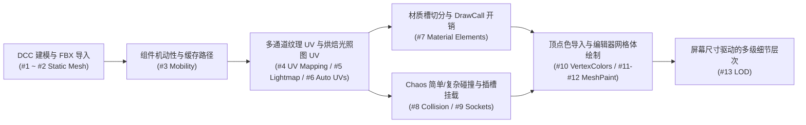

# 第 01 章 · 静态网格体基石：碰撞体、多通道 UV、光照图与 LOD 渲染管线全解

> **对应官方示例关卡**：`/Game/Maps/Geometry/StaticMeshes`（关卡脚本类：`StaticMeshes_C`）  
> **所属模块目录**：`02_Geometry_几何建模与Nanite`  
> **关卡体量实测**：总 Actor 数 `157` | 官方展台数 `13`（`#1` ~ `#13` 零遗漏全覆盖） | 示例交互与陈列 Actor 数 `38`（另含全局植被管理器 `InstancedFoliageActor`）  
> **核心资产路径**：`/Game/ExampleContent/StaticMeshes/`（网格体 `Meshes/`、材质 `Materials/`、纹理 `Textures/`）

---

## 一、 关卡总览：为什么 `UStaticMesh` 是实时三维世界的脊梁？

在虚幻引擎（Unreal Engine）的几何渲染体系中，**静态网格体（`Static Mesh` / `UStaticMesh`）** 是构成游戏世界最基础、最高效的几何载体。从一块路边鹅卵石、一盏模块化街灯，到宏伟的哥特式大教堂立面，只要物体的顶点不需要在运行时做骨骼蒙皮（Skinning）形变，它就应当被封装为静态网格体。

为什么它被称为“静态”？这里的“静态”并非指物体不能在关卡里移动（事实上设置 `Mobility = Movable` 后它可以自由平移、旋转、缩放甚至参与刚体物理碰撞），而是指**其局部空间（Local Space）的顶点拓扑缓冲（Vertex Buffer）与索引缓冲（Index Buffer）在加载进 GPU 显存后保持固定不变**。得益于这种“一次上传、千次复用”的硬件亲和特性，渲染线程（Render Thread）可以通过网格绘制指令缓存（Mesh Draw Commands Caching）、硬件实例化（Hardware Instancing / ISM / HISM）甚至次世代 Nanite 微多边形流送，以极低的 CPU 开销在一帧之内绘制成千上万个静态网格体。

走进 `/Game/Maps/Geometry/StaticMeshes` 展厅，13 座展台沿着 X 轴从 `X = 515` 一路延伸至 `X = 12501`，由浅入深地串联起了静态网格体从导入引擎到最终上屏的完整技术生命周期：

下面我们按展厅空间坐标与官方编号，逐一对全部 **13 个展台** 的场景配置、材质节点图与引擎管线内核进行抽丝剥茧的深度拆解。

---

## 二、 逐展台（#1 ~ #13）零遗漏深度拆解

### 展台 #1：`Static Meshes` — 展厅光影环境与全局物理调试基座

- **展牌标识与空间坐标**：`BP_DemoDisplay13` | `(515, -900, 0)`
- **展台内陈列与环境核心 Actor（共 7 个）**：
  - `DirectionalLight`（`/Script/Engine.DirectionalLight`）：组件 `LightComponent0`，配置 `Intensity = 10`、`LightColor = (1, 1, 1, 1)`、`CastShadows = true`、`Mobility = Movable`。
  - `SkyLight`（`/Script/Engine.SkyLight`）：组件 `SkyLightComponent0`，配置 `Intensity = 3`、`LightColor = (1, 1, 1, 1)`、`CastShadows = true`、`Mobility = Movable`。
  - `SkyAtmosphere`（`/Script/Engine.SkyAtmosphere`）：大气瑞利/米氏散射组件 `SkyAtmosphereComponent`。
  - `ExponentialHeightFog`（`/Script/Engine.ExponentialHeightFog`）：指数高度雾组件 `HeightFogComponent0`。
  - `SpotLight`（`/Script/Engine.SpotLight`）：入口重点照明聚光灯，`Intensity = 8`、`AttenuationRadius = 2000`、`CastShadows = true`、`Mobility = Movable`。
  - `Actor`（`/Script/Engine.Actor`）：挂载 `ChaosDebugDrawComponent_0`，用于在编辑器与运行态提供 Chaos 物理碰撞线框的可视化调试绘制能力。
  - `Static Meshes Content Examples Doc Actor`（`/Script/Engine.DocumentationActor`）：官方文档锚点 Actor。
  - *注：关卡全局还驻留有 1 个 `InstancedFoliageActor`（`/Script/Foliage.InstancedFoliageActor`）作为实例化植被容器。*

#### 管线内核解析：从 `UStaticMesh` 资产到关卡 `AStaticMeshActor` 实例
踏入 1 号展台，我们首先需要建立虚幻引擎中最核心的**“资产（Asset）与实例组件（Component Instance）分离”**心智模型：
1. **磁盘与显存侧的唯一数据源（`UStaticMesh`）**：保存在内容浏览器（Content Browser）中的静态网格体资产（如后续展台反复引用的 `/Game/ExampleContent/StaticMeshes/Meshes/SM_Mesh_GoodUVs`），在底层持有 `FStaticMeshRenderData`（包含各级 LOD 的位置缓冲 `FPositionVertexBuffer`、切线与 UV 缓冲 `FStaticMeshVertexBuffer`、顶点色缓冲 `FColorVertexBuffer` 以及索引缓冲 `FRawStaticIndexBuffer`）和物理碰撞描述 `UBodySetup`。无论你在关卡中摆放 1 个还是 10,000 个该模型，这份几何顶点数据在 GPU 显存中**只驻留唯一一份**。
2. **世界空间中的轻量级句柄（`AStaticMeshActor` + `UStaticMeshComponent`）**：关卡中摆放的每一个 Actor 只是持有一个指向 `UStaticMesh` 的引用指针，外加自身的变换矩阵（Location / Rotation / Scale）、材质覆盖表（`OverrideMaterials`）与实例级烘焙/顶点色数据。
3. **全场照明环境**：本关由 `Movable` 机动性的 `DirectionalLight`（强度 `10`）与 `SkyLight`（强度 `3`）配合 `SkyAtmosphere` 构建标准中性白光测试场，确保后续材质 UV、顶点色与法线高光的对比不受色温偏色干扰。

---

### 展台 #2：`Static mesh` — 第三方 DCC 资产导入与 BSP 画刷的世代更替

- **展牌标识与空间坐标**：`BP_DemoDisplay1` | `(1515, -900, 0)`
- **官方展牌原文**：`StaticMesh Modeled in a 3rd Party Tool and imported as .fbx file`
- **3D 悬浮文字标签（`TextRenderActor`）**：
  - `"This is a StaticMesh is the most common object to build geometry"`
  - `"Unlike BSP Brushes it vertcis can't be edited inside the editor"`
  - `"only location, rotation and scale can be changed"`
- **陈列示例 Actor（1 个）**：
  - `Basic_Asset`（`StaticMeshActor`）：引用网格体 `/Game/ExampleContent/StaticMeshes/Meshes/SM_Mesh_GoodUVs`，重载材质槽 `[0]` 为 `/Game/ExampleContent/StaticMeshes/Materials/M_SolidColor`。

#### 资产深拆与渲染管线剖析
- **测试材质 `/Game/ExampleContent/StaticMeshes/Materials/M_SolidColor`**：
  - **基础属性**：`MaterialDomain = MD_Surface`，`BlendMode = BLEND_Opaque`，`ShadingModel = MSM_DefaultLit`，关闭双面渲染（`twoSided = false`）。
  - **节点拓扑**：仅由 2 个简洁的参数节点直连主材质输出——`MaterialExpressionVectorParameter_0`（参数名 `"Color"`，默认值 `(0.819, 0.819, 0.819, 1.0)` 浅中性灰）连接 `MP_BaseColor`；`MaterialExpressionScalarParameter_0`（参数名 `"Roughness"`，默认值 `0.3`）连接 `MP_Roughness`。`0.3` 的微光滑粗糙度能够在曲面上形成清晰的高光过渡带，是检验模型表面法线平滑度与几何轮廓的黄金材质设定。
- **为什么静态网格体全面取代了传统 BSP 画刷（Geometry Brushes）？**
  早期虚幻引擎（UE1 ~ UE3 初期）使用基于构造实体几何（CSG）布尔运算的 BSP 画刷搭建关卡。每当设计师移动一个 BSP 顶点，CPU 都必须重新计算全场景多边形切割与 BSP 树，顶点数稍多便会引发严重的性能崩塌与浮点裂缝（BSP Holes）。
  相比之下，在 3ds Max、Maya 或 Blender 中制作并以 `.fbx` 导入的 `SM_Mesh_GoodUVs`，在导入阶段就已经完成了三角化、顶点缓存命中率优化（Vertex Cache Optimization，使相邻三角形共享顶点寄存器）与压缩打包。关卡视口中对其只能进行 **仿射变换（Translation / Rotation / Scale）**，从而保证了渲染线程极致的批处理吞吐率。
  > [!TIP]
  > **UE5 时代的重要演进补充**：展台上的悬浮文字撰写于 UE4 时期，指出“不能在编辑器内直接编辑顶点”。而在如今的 **Unreal Engine 5** 中，引擎内置了完整的 **Modeling Mode（建模模式，快捷键 `Shift + 5` 或 `Alt + F5`）**，支持在编辑器内直接编辑静态网格体的多边形拓扑、挤出、倒角与重展 UV（详见本卷第 04 篇 `Geometry_ModelingTools` 专章）——编辑完成后写回 `UStaticMesh` 静态缓冲，兼顾了创作自由度与运行时零开销！

---

### 展台 #3：`Mobility` — 组件机动性三态与静动态渲染路径分流

- **展牌标识与空间坐标**：`BP_DemoDisplay12` | `(2490, -900, 0)`
- **3D 悬浮文字标签（`TextRenderActor`）**：
  - 左侧组：`"Static"` / `"Baked Lighting and Shadows"` / `"can not be moved when playing"`
  - 右侧组：`"Movable"` / `"Dynamic Lighting and Shadows"` / `"can move when playing"`
- **陈列示例 Actor（2 个）**：
  - `Basic_Asset_2`（`StaticMeshActor`）：网格体 `SM_Mesh_GoodUVs`，重载材质 `M_SolidColor`（演示 `Static` 机动性）。
  - `Basic_Asset_3`（`StaticMeshActor`）：网格体 `SM_Mesh_GoodUVs`，重载材质 `M_SolidColor`（演示 `Movable` 机动性）。

#### 管线内核解析：`EComponentMobility` 背后的底层渲染与物理契约
在细节面板（Details）的 Transform 下方，`Mobility`（机动性）绝对不仅仅是一个“允许或禁止蓝图调用 `SetActorLocation`”的开关，它直接决定了该 `FPrimitiveSceneProxy` 在渲染器与物理引擎中的生命周期：

| 机动性枚举 | 运行时能否变换 | 传统烘焙管线（Lightmass）行为 | UE5 Lumen + VSM 管线行为 | 渲染线程（Render Thread）与物理开销 |
| :--- | :---: | :--- | :--- | :--- |
| **`Static`（静态）** | 否 | 参与离线光线追踪，既投射静态烘焙阴影，也将间接光写入专属 **Lightmap 2D 贴图** | 自动生成 Mesh SDF 与 Lumen Mesh Cards；VSM 将其光栅化至 **静态阴影缓存页（Static Page Cache）**，只要光源不动则跨帧零重绘！ | 走 **Static Draw List** 预缓存路径，CPU 剔除与提交开销最低；物理侧构建静态空间加速树 |
| **`Stationary`（固定）** | 否（仅材质/属性可变） | 几何体极少使用（主要用于光源）；若在网格体上设置，其阴影按动态或缓存处理 | 与 `Static` 类似，但在发生状态切换时更为灵活 | 介于两者之间 |
| **`Movable`（可移动）** | **是** | 不占用 Lightmap 贴图，运行时采样空间 3D 探针网格（**Volumetric Lightmap / ILC**）获取间接光，投射动态级联/逐物体阴影 | 每帧动态更新世界空间变换并重绘其覆盖的 **VSM 动态阴影页（Dynamic Pages）**，实时更新 Lumen 场景实例位置 | 每帧更新 `LocalToWorld` 统一缓冲区（Uniform Buffer）与包围盒剔除，VSM 阴影重绘成本高于 `Static` |

> [!IMPORTANT]
> **次世代性能优化铁律**：即便在开启全动态 Lumen 与 Virtual Shadow Maps（VSM）的 UE5 项目中，**也绝不要把满地图不会动的墙壁、岩石、地板懒省事地全设成 `Movable`！** 将不移动的场景建筑保持为默认的 **`Static`**，能让 VSM 将静态场景阴影与动态角色阴影分离在两层物理页表中——当只有玩家走动时，周围百万面的静态建筑阴影页 100% 命中上一帧缓存，立省数毫秒 GPU 光栅化时间！

---

### 展台 #4：`UV Mapping` — 顶点多通道纹理坐标与跨通道采样路由

- **展牌标识与空间坐标**：`BP_DemoDisplay2` | `(3488, -900, 0)`
- **3D 悬浮文字标签（`TextRenderActor`）**：
  - 展品 1：`"No or broken UV Mapping"` / `"UV mapping defines how each triangle is mapped to a texture"`
  - 顶部总纲：`"StaticMeshes can have more then one UV Mapping"` / `"each is stored in a UV Channel"`
  - 展品 2：`"Proper UV Mapping"` / `"Texture uses Channel 0"` / `"(default Texture Coordinate Index 0)"`
  - 展品 3：`"Proper UV Mapping"` / `"Channel 1"` / `"(texture is setup in the Material"` / `"to use Texture Coorinate Index 1"`
- **陈列示例 Actor（3 个）**：
  - `SM_Mesh_NoUVs`：引用缺失有效 UV 的网格体 `/Game/ExampleContent/StaticMeshes/Meshes/SM_Mesh_NoUVs`，展示严重拉伸或纯单色坍缩的贴图错误。
  - `SM_Mesh_NoUVs_2`：引用 `/Game/ExampleContent/StaticMeshes/Meshes/SM_Mesh_GoodUVs`，使用默认材质，采样 `UV Channel 0`（棋盘格数字贴图端正清晰）。
  - `SM_Mesh_NoUVs_3`：引用同一个 `SM_Mesh_GoodUVs`，但重载材质为 `/Game/ExampleContent/StaticMeshes/Materials/M_UVMaterial_Channel1`。

#### 资产深拆与多通道 UV 硬件结构
1. **材质 `/Game/ExampleContent/StaticMeshes/Materials/M_UVMaterial_Channel1` 内部拓扑**：
   - `MaterialExpressionTextureCoordinate_1`：显式将 `CoordinateIndex` 指定为 `1`（即读取顶点缓冲区的第 2 套 UV——`TEXCOORD1`）。
   - `MaterialExpressionTextureSample_0`：接收 `TexCoord[1]` 作为 UV 输入，采样棋盘格可视化贴图 `/Game/ExampleContent/StaticMeshes/Textures/T_UVvistexture`（`SAMPLERTYPE_Color`），RGB 输出直连 `MP_BaseColor`。
   - `MaterialExpressionConstant_0`：常量值 `0.5` 直连 `MP_Roughness`。
2. **引擎最多支持多少套 UV 通道？实战中如何分工？**
   在 `FStaticMeshVertexBuffer` 中，虚幻引擎单个静态网格体最高支持 **`MAX_MESH_TEXTURE_COORDS = 8` 套独立 UV 通道（`Channel 0` ~ `Channel 7`）**，默认使用半精度浮点数 `FFloat16`（勾选 `Use Full Precision UVs` 时升级为 32 位 `float`，适用于超大地形/建筑贴图超过 `[-16, 16]` 平铺范围以防止纹素抖动）。工业级项目中的经典多通道分工如下：
   - **`UV Channel 0`**：主漫反射/法线贴图通道。允许**超出 `[0, 1]` 边界无限平铺（Tiling）**，也允许左右对称结构**镜像重叠（Overlapping）**以最大化纹素密度（Texel Density）。
   - **`UV Channel 1`**：专属光照贴图通道（Lightmap UV）或独有脏迹遮罩通道（AO / Dirt Mask / Trim Sheet 第二层）。严格限制在 `[0, 1]` 单位正方形内且严禁任何重叠。
   - **`UV Channel 2 ~ 3`**：在 **Pivot Painter 2.0** 植被风吹技术或建筑破损数据编码中，常被借用来存储每个部件的枢轴坐标与旋转轴向量！

---

### 展台 #5：`Lightmap UVs` — 静态烘焙光照图的双射唯一性与漏光成因

- **展牌标识与空间坐标**：`BP_DemoDisplay3` | `(4508, -900, 0)`
- **3D 悬浮文字标签（`TextRenderActor`）**：
  - 顶部核心提示：`"All Non-Movable Lights need to bake their lighting to a texture. Therefore StaticMeshes need to have a UV Channel that has a unique layout without overlaps"` / `"Switch the Viewport from 'Lit' to 'Lighting Only' to get a clear look at the baked lighting"`
  - 左侧最坏情况（`SM_Mesh_NoUVs_5`）：`"No or broken UV Mapping"` / `"Worst case"` / `"this actor will generate a warning in the map check after the build is done"`
  - 中间隐蔽陷阱（`SM_Mesh_NoUVs_6`）：`"Bad UV Mapping"` / `"taking a quick look the Mesh looks fine"` / `"It uses the 2nd UVChannel for the Lightmap"` / `"but the UV Mapping is not unique and has a lot of overlaps"` / `"the lighting will look wrong"` / `"this actor will generate a warning in the map check after the build is done"`
  - 右侧正确范式（`SM_Mesh_NoUVs_4`）：`"Good UV Mapping"` / `"Lightmap uses the 2nd UV Channel without any overlaps"` / `"Lighting is correct"` / `"Any channel can be used for Lightmaps if it has a unique layout"`
- **陈列示例 Actor（3 个）**：
  - `SM_Mesh_NoUVs_5` -> `/Game/ExampleContent/StaticMeshes/Meshes/SM_Mesh_NoUVs`
  - `SM_Mesh_NoUVs_6` -> `/Game/ExampleContent/StaticMeshes/Meshes/SM_Mesh_BadUVs`
  - `SM_Mesh_NoUVs_4` -> `/Game/ExampleContent/StaticMeshes/Meshes/SM_Mesh_GoodUVs`

#### 管线内核解析：为什么 Lightmap UV 重叠与间距不足会毁掉画面？
在运行移动端渲染器、VR 前向渲染器或传统离线 GPU Lightmass 烘焙时，引擎需要为每一个静态实例分配一块二维光照纹理区域，将三维表面上每一点接收到的间接辐射度（Irradiance）与静态阴影写入对应的二维像素（纹素 Texel）。在数学上，这要求从三维网格表面 $S \subset \mathbb{R}^3$ 到二维参数域 $D \subset [0, 1]^2$ 的映射函数 $\Phi: S \to D$ 必须是**单射（Injective / 一对一无碰撞）**：
1. **UV 重叠灾难（`SM_Mesh_BadUVs`）**：如果模型向阳面的三角形 $T_{\text{sun}}$ 与背阴面的三角形 $T_{\text{shadow}}$ 在 `UV Channel 1` 中叠在了同一块坐标上，烘焙器写入的明暗光子数据就会相互覆盖，导致向阳面凭空出现诡异的黑斑，且每次 `Build Lighting` 后触发鲜红的 `Map Check Warning: Object has wrapping UVs / Lightmap UV are overlapping by XX%`。
2. **双线性滤波渗色（Shadow Bleeding）与 Gutter Padding 铁律**：即便 UV 壳（UV Islands/Charts）没有直接重叠，如果亮面 UV 壳与暗面 UV 壳挨得太近（小于 **2~4 个 Lightmap 纹素间距**），GPU 在渲染采样光照贴图执行 `Bilinear Filtering`（双线性插值）时，就会把隔壁暗面壳的黑边像素“吸”过来，在模型硬边接缝处形成洗不掉的黑线！
3. **关键资产设置**：打开静态网格体编辑器右侧 `General Settings -> Light Map Coordinate Index`（指定使用哪套 UV 通道作为光照图，通常填 `1`）与 `Light Map Resolution`（默认 `64`，须为 2 的幂次如 `32 / 64 / 128 / 256`）。切至视口 **`Alt + 6`（Lighting Only 纯光照模式）** 或 **`Alt + 0`（Lightmap Density 光照图密度棋盘格）** 即可一眼排查全关精度隐患。

---

### 展台 #6：`Generate Unique UVs` — 引擎内自动展平重排算法与手工 UV 的博弈

- **展牌标识与空间坐标**：`BP_DemoDisplay4` | `(5488, -900, 0)`
- **3D 悬浮文字标签（`TextRenderActor`）**：
  - 展品 1（左）：`"Custom UVs created with 3rd Party Program"` / `"Best Result"`
  - 展品 2（中）：`"Auto Generated Channel 1 from Channel 0 in the editor"` / `"Only good result if Channel 0 UVs are good"`
  - 展品 3（右）：`"Auto Generated New Channel 1"` / `"Not as good as the custom UVs"` / `"But a very quick result than can look just as good"`
  - 顶部说明：`"Unique UVs can be generated automaticly in the editor"` / `"In the StaticMeshEditor is a Window called 'Generate Unique Uvs'"`
- **陈列示例 Actor（3 个，全部覆盖 `M_SolidColor` 纯色材质以便纯粹观察阴影接缝品质）**：
  - `SM_Mesh_NoUVs_7` -> `SM_Mesh_GoodUVs`（DCC 手工精展的光照图 UV）。
  - `SM_Mesh_NoUVs_8` -> `/Game/ExampleContent/StaticMeshes/Meshes/SM_Mesh_AutoUVs1`（在引擎内基于 `Channel 0` 自动重排打包至 `Channel 1`）。
  - `SM_Mesh_NoUVs_9` -> `/Game/ExampleContent/StaticMeshes/Meshes/SM_Mesh_AutoUVs2`（完全抛弃旧拓扑、由引擎从零按角度阈值重新切分展开的新 `Channel 1`）。

#### 管线内核解析：虚幻引擎自动光照图 UV 生成的两种底层机制
当美术交付了上千个只展了 `Channel 0` 贴图 UV 的白模资产时，我们无需退回 Maya/Blender 逐个手拆 `Channel 1`：
1. **机制 A：基于现有 UV 岛的重排打包（`Build Settings -> Generate Lightmap UVs`，对应 `SM_Mesh_AutoUVs1`）**
   - **算法原理**：默认 FBX 导入时勾选的 `Generate Lightmap UVs` 走的就是这条极速通道！它**不会重新切开网格缝合边**，而是直接读取 `Source Lightmap Index = 0` 中已有的 UV 岛轮廓，自动把镜像翻转的岛摆正、把重叠的岛拆开，并严格按照 **`Min Lightmap Resolution`（如 `64`）预留至少 2 个纹素的安全边距（Padding）**，紧密装箱（Bin-Packing）进 `[0, 1]` 空间写入 `Destination Lightmap Index = 1`。
   - **适用边界**：只要 `Channel 0` 的每个独立壳内部没有自我折叠缠绕（Self-Overlap），这种方法生成的连续性极佳且速度飞快；但如果 `Channel 0` 是圆柱体没切纵缝的投影，它也爱莫能助。
2. **机制 B：基于曲率与拉伸容差的全自动切分展平（对应 `SM_Mesh_AutoUVs2` 及 Modeling Mode `AutoUV`）**
   - **算法原理**：从三维三角形法线夹角与最大面积拉伸率（`Max Charts` / `Max Stretch`）出发，利用类似 UVAtlas / XAtlas 的谱聚类与保角参数化算法，从零切分出全新的独立 UV 岛。
   - **优劣权衡**：能挽救连 `Channel 0` 都彻底损坏的扫描模型或 CAD 导入件，但往往会产生较多细碎小岛，浪费部分 Padding 空间，因此高规格主角资产仍以 DCC 连续手工切缝（`SM_Mesh_GoodUVs`）为最高金科玉律。

---

### 展台 #7：`Material Elements` — 多材质槽（Mesh Sections）背后的 Draw Call 性能账本

- **展牌标识与空间坐标**：`BP_DemoDisplay7` | `(6491, -900, 0)`
- **3D 悬浮文字标签（`TextRenderActor`）**：
  - `"Every StaticMesh has a Material Element"` / `"It is possible to have more than one Material Element within one StaticMesh"` / `"Each Element can have a unique Material assigned to it"`
  - **性能核心红线警告**：`"MaterialElements should be as few as possible to maintain rendering performance"` / `"Each element is like a seperate Staticmesh."` / `"Having 10 StaticMeshes with 1 MaterialElement is the same as having 1 StaticMesh with 10 MaterialElements"`
  - 两侧对比标签：`"1 MaterialElement"` vs `"3 MaterialElements"`
- **陈列示例 Actor（2 个）**：
  - `SM_Mesh_GoodUVs`：引用 `SM_Mesh_GoodUVs`（仅 `1` 个材质槽），重载材质实例 `/Game/Global/Materials/M_LightSculpture_Red`（母材质 `M_LightSculpture`，重载 `Color = (1, 0, 0, 1)` 鲜红、`Roughness = 0.1` 高反光瓷釉质感）。
  - `SM_Mesh_GoodUVs_2`：引用 `/Game/ExampleContent/StaticMeshes/Meshes/SM_Mesh_3Elements`（在 DCC 中按多边形材质 ID 切分出了 **`3` 个独立材质元素槽**）。

#### 管线内核解析：为什么 1 个模型带 10 个材质槽 = 10 次 Draw Call？
许多刚接触 3D 资产制作的美术同学会产生一个致命误区：*“我把桌腿、桌面、抽屉拉手、螺丝钉合并成一个 FBX 静态网格体，但保留了 10 个不同的材质球，这样只有一个 Actor，性能一定最好吧？”*

7 号展台一针见血地戳破了这个假象：
- **底层数据结构 `FStaticMeshSection`**：在 `FStaticMeshLODResources` 内部，三角形索引缓冲按材质槽被切分成若干个互不交叉的连续区间 `Sections[i]`（记录 `MaterialIndex`、`FirstIndex`、`NumTriangles`）。
- **传统光栅化管线中的 Draw Call 乘法**：GPU 在一次传统的 `DrawIndexedPrimitive` 调用中只能绑定一套着色器管线状态（PSO）与材质参数表（Uniform Buffer / SRV）。因此，`SM_Mesh_3Elements` 虽然只有一个 Actor 包围盒参与视锥剔除，但在 BasePass 与动态阴影/自定义深度渲染阶段，渲染线程必须为它的 3 个 `Section` 提交 **3 条独立的 Mesh Draw Commands**！
- **哪怕在 UE5 Nanite 管线中依然代价高昂**：虽然 Nanite 的微多边形光栅化阶段（VisBuffer64）与材质解耦，只写 64 位可见性缓冲，但在随后的 **Material Shading Pass（材质着色阶段）**，屏幕像素必须按 `Shading Bin`（材质桶）分类执行全屏 Quad 或 Compute Tile 着色——一个模型身上挂载过多细碎材质槽，会导致大量半空的 `2x2` Pixel Quad 线程空转与 Shading Bin 切换开销！
- **工业化最佳实践**：将金属、木头、漆面烘焙整合进同一套 **ORM 通道打包贴图（或 ID Mask 遮罩贴图）**，用 1 个材质槽搞定整件道具（这正是在第 04 篇 `Geometry_ModelingTools` 展台 #22 `Merge` 与展台 #28 `Finished Mesh` 中演示的标准工业做法）。

---

### 展台 #8：`Collision` — 从解析球体、K-DOP、自动凸包到 `UCX_` 与复杂逐面碰撞

- **展牌标识与空间坐标**：`BP_DemoDisplay5` | `(7488, -900, 0)`
- **3D 悬浮文字标签（`TextRenderActor`）**：
  - 全局导览：`"Collision for StaticMesh can be done in many ways"` / `"by Default a StaticMesh has no Collision"` / `"Press (ALT+C) to show Collision in Viewport"`
  - 7 组并列展品标签：`"No Collision (Default)"` → `"DOP Simplified Collision: 6 DOP"` → `"24 DOP (Auto generated in the Static Mesh Editor)"` → `"Auto Convex"` → `"Auto Sphere"` → `"Imported from 3rd Party Program: Custom Collision"` → `"Complex as Simple: Uses the actual geometry, it is the most acurate but it also has the biggest performance impact"`
- **陈列示例 Actor（整整 7 个对照样本，均覆盖 `M_SolidColor`）**：
  1. `SM_Mesh_GoodUVs_3` -> `/Game/ExampleContent/StaticMeshes/Meshes/SM_Mesh_NoCollision`
  2. `SM_Mesh_GoodUVs_4` -> `/Game/ExampleContent/StaticMeshes/Meshes/SM_Mesh_GoodUVs`（6-DOP 轴对齐盒体简化碰撞）
  3. `SM_Mesh_GoodUVs_5` -> `/Game/ExampleContent/StaticMeshes/Meshes/SM_Mesh_24DOP`（24-DOP 多向切面离散多面体）
  4. `SM_Mesh_GoodUVs_6` -> `/Game/ExampleContent/StaticMeshes/Meshes/SM_Mesh_AutoConvex`（V-HACD 自动凸包分解）
  5. `SM_Mesh_Sphere` -> `/Game/ExampleContent/StaticMeshes/Meshes/SM_Mesh_Sphere`（解析球体碰撞）
  6. `SM_Mesh_UCX` -> `/Game/ExampleContent/StaticMeshes/Meshes/SM_Mesh_UCX`（FBX 自定义 `UCX_` 前缀凸包导入）
  7. `SM_Mesh_UCX_2` -> `/Game/ExampleContent/StaticMeshes/Meshes/SM_Mesh_Complex`（启用 `Use Complex Collision As Simple`）

#### 管线内核解析：Chaos 物理引擎中的“双重碰撞世界”与 7 级开销阶梯
在编辑器视口中按下快捷键 **`Alt + C`**（或菜单 `Show -> Collision`），你会看到这 7 尊模型身上浮现出不同颜色与密度的线框。在虚幻引擎的 `UBodySetup` 内部，物理碰撞被严格划分为两套并行几何体：
- **简单碰撞（Simple Collision，保存在 `FKAggregateGeom` 中）**：由解析几何基元（球体 `Sphere`、盒体 `Box`、胶囊体 `Sphyl`）与凸多面体（`Convex`）组合而成。专门服务于**角色胶囊体移动推挤（Character Movement Sweep）、物理刚体动力学模拟（Simulate Physics）与高速投射物检测**。
- **复杂碰撞（Complex Collision，即 Chaos `FTriangleMeshImplicitObject`）**：直接构建在网格体成千上万个三角面（或 Nanite Fallback Mesh）上的 BVH 空间树。专门服务于**精准武器弹道射线检测（Visibility / Weapon Line Trace，指哪打哪穿过多边形镂空孔洞）与脚部 IK 落点贴合**。

让我们将 8 号展台陈列的 **7 种碰撞方案** 按物理数学计算复杂度从低到高排成一张实战选型表：

| 展台样本资产 | 碰撞生成机制 | Chaos 底层图元 | 物理数学检测复杂度与工程选型指南 |
| :--- | :--- | :--- | :--- |
| `SM_Mesh_NoCollision` | 无碰撞 | 空 | **零开销**。天花板吊饰、远景背景山脉、玩家永远碰不到的小草碎石必须设为无碰撞以缩减 Chaos 空间树体积。 |
| `SM_Mesh_Sphere` | Auto Sphere | `FKSphereElem` | **全场最快（$O(1)$）**！只需比较球心距离平方 $\|C_1 - C_2\|^2 \le (r_1 + r_2)^2$，无任何旋转轴测试开销。圆润滚石、球形道具首选。 |
| `SM_Mesh_GoodUVs` | 6-DOP（Box） | `FKBoxElem` | **极快（分离轴定理 SAT）**。6 个轴向平面围成的长方体包围盒，适合箱子、墙板、柱体。 |
| `SM_Mesh_24DOP` | 10/18/26(24)-DOP | `FKConvexElem` | **单凸包 GJK/EPA 算法**。用预设方向的平面沿法线向内“削切”紧贴模型轮廓生成的单个凸多面体（注：单凸包无法凹陷进孔洞内部）。 |
| `SM_Mesh_AutoConvex` | Auto Convex Collision | 多个 `FKConvexElem` | 调用内置 **V-HACD（体素化分层近似凸分解）** 算法，根据 `Hull Count` 与 `Max Hull Verts` 自动把凹形拱门、座椅拆解成若干个互拼凸包。 |
| `SM_Mesh_UCX` | DCC 命名导入 | 自定义基元 / 凸包 | **大型项目硬核规范**！在 Maya/Max/Blender 的同一个 FBX 中制作极简封闭辅助网格并按前缀命名导入时会被引擎自动剥离转为物理体： • `UBX_<模型名>_00` → 解析盒体（最快） • `USP_<模型名>_00` → 解析球体 • `UCP_<模型名>_00` → 解析胶囊体 • `UCX_<模型名>_00` → 自定义凸包（严禁自交或凹陷） |
| `SM_Mesh_Complex` | `CTF_UseComplexAsSimple` | `FTriangleMesh` | **开销最高且不支持常规刚体自由模拟**！强行让角色移动胶囊体去逐面摩擦原始三角网格，极易卡住楼梯锐角并消耗大量 CPU Sweep 时间，仅限大型异形静态洞穴地形应急使用。 |

---

### 展台 #9：`Sockets` — 静态网格体插槽变换矩阵与父子层级动力学传递

- **展牌标识与空间坐标**：`BP_DemoDisplay8` | `(8486, -900, 0)`
- **3D 悬浮文字标签（`TextRenderActor`）**：
  - `"Select and rotate the red bracket"`
  - `"Any Transformation on the parent will inherited by the attached objects"`
- **陈列示例 Actor（3 个层级挂载的聚光灯组件）**：
  - `S_Spotlight_Base`：底座 `/Game/ExampleContent/Blueprints/Meshes/SM_Spotlight_Base`（材质 `M_SolidColor`）。
  - `S_Spotlight_Hinge`：中间红色旋转U型支架 `/Game/ExampleContent/Blueprints/Meshes/SM_Spotlight_Hinge`（材质 `/Engine/MapTemplates/Materials/BasicAsset01` 醒目红色），挂载于底座插槽。
  - `S_Spotlight`：灯头 `/Game/ExampleContent/Blueprints/Meshes/SM_Spotlight`（材质 `M_SolidColor`），挂载于红色支架插槽。

#### 管线内核解析：不用骨骼蒙皮也能做精密机械联动！
并非只有骨骼网格体（Skeletal Mesh）才能拥有挂点！打开任意静态网格体编辑器右下角的 **Socket Manager（插槽管理器）**，美术人员可以在底座螺孔或支架转轴中心创建命名插槽 `UStaticMeshSocket`（记录相对于父网格局部原点的 `RelativeLocation`、`RelativeRotation`、`RelativeScale`）。

当我们在大纲视图（Outliner）或蓝图中调用 `AttachToComponent(Parent, AttachmentRules, SocketName)` 将灯头挂载到支架的插槽上时，引擎的场景图（Scene Graph）会按齐次坐标矩阵链自动级联求值：
$$M_{\text{ChildWorld}} = M_{\text{ChildRelative}} \times M_{\text{SocketLocal}} \times M_{\text{ParentWorld}}$$
当你在视口中选中红色的 `S_Spotlight_Hinge` 支架并拖动旋转轴（`E` 键）时，子级灯头 `S_Spotlight` 会严丝合缝地绕支架螺孔中心联动俯仰——**全程零骨骼蒙皮计算、零动画蓝图开销**，是制作监控摄像头云台、炮塔底座俯仰机构、门锁把手以及武器配件（瞄准镜导轨挂点、枪口火焰粒子挂点）的最高效范式。

---

### 展台 #10：`VertexColors` — 逐顶点 RGBA 通道数据流与零纹理开销着色

- **展牌标识与空间坐标**：`BP_DemoDisplay6` | `(9488, -900, 0)`
- **3D 悬浮文字标签（`TextRenderActor`）**：
  - 左侧：`"No VertexColor"`
  - 右侧：`"VertexColor Imported"`
- **陈列示例 Actor（2 个，共用同一套读取顶点色的材质）**：
  - `SM_Mesh_GoodUVs_7`：引用无顶点色（默认全白 `(1,1,1,1)`）的 `SM_Mesh_GoodUVs`，重载材质 `/Game/ExampleContent/StaticMeshes/Materials/M_VertexColor`。
  - `SM_Mesh_GoodUVs_8`：引用在 DCC 软件中预刷好彩色顶点色并导入的 `/Game/ExampleContent/StaticMeshes/Meshes/SM_Mesh_VertexColor`，同样重载材质 `M_VertexColor`。

#### 资产深拆与工业级多通道妙用
1. **材质 `/Game/ExampleContent/StaticMeshes/Materials/M_VertexColor` 内部节点**：
   - `MaterialExpressionVertexColor_0`：直接从硬件光栅化插值器（Interpolator）中读取当前像素重心插值后的 `RGBA` 顶点色，直连 `MP_BaseColor`。
   - `MaterialExpressionConstant_1`：常量 `0.2` 直连 `MP_Roughness`，呈现光滑亮泽的烤漆质感。
2. **`FColorVertexBuffer` 的显存成本与 FBX 导入大坑**：
   - 每个顶点的颜色在显存中以 `FColor`（`B8G8R8A8`，仅占 **4 字节/顶点**）存储，且无需额外的纹理采样器（Texture Sampler）指令开销！
   - **高频踩坑提醒**：早期引擎 FBX 导入面板中，`Vertex Color Import Option` 默认可能是 **`Ignore`（忽略）**！若发现 Maya/Blender 里辛辛苦苦刷好的顶点色进引擎后变成纯白（如同左侧 `SM_Mesh_GoodUVs_7`），只需在网格体详情的 `Import Settings -> Vertex Color Import Option` 中改为 **`Replace`（采用 FBX 源顶点色）** 并点击 `Reimport Base Mesh` 即可。
3. **TA 管线中的“四通道数据瑞士军刀”**：在现代写实场景中，我们极少真的拿顶点色直接当彩虹颜色画在脸上，而是把 `R / G / B / A` 四个 `[0, 1]` 标量通道拆开当**逐顶点控制权重**：
   - **`R` 通道**：墙根青苔生长混合权重（配合 HeightLerp 高度图做砖缝立体过渡）；
   - **`G` 通道**：屋顶/地面雨水积水坑（Puddle，降粗糙度为 `0.02` 并压平法线）；
   - **`B` 通道**：墙皮剥落露出底层红砖；
   - **`A` 通道**：植被树梢/旗帜边缘的 `World Position Offset` 风吹摆动幅度权重（树干根部填 `0` 钉死在地上，叶尖填 `1` 随风摇曳）。

---

### 展台 #11：`MeshPaint Tool (Vertices)` — 关卡实例级顶点色覆盖（OverrideVertexColors）

- **展牌标识与空间坐标**：`BP_DemoDisplay9` | `(10498, -900, 0)`
- **陈列示例 Actor（1 个）**：
  - `SM_Mesh_GoodUVs_9`：引用基础白模资产 `/Game/ExampleContent/StaticMeshes/Meshes/SM_Mesh_GoodUVs`（注意：它引用的**不是** 10 号展台的 `SM_Mesh_VertexColor`，而是原本纯白无色的 `SM_Mesh_GoodUVs`！），重载材质 `M_VertexColor`，却依然在关卡中呈现出手工涂抹的斑斓色彩。

#### 管线内核解析：为什么改了这尊雕像的顶点色，隔壁同款雕像不会跟着变色？
11 号展台揭示了虚幻关卡美术打破重复感（Tiling Breakup）的核心秘密——**组件实例级顶点色覆盖（`FStaticMeshComponentLODInfo::OverrideVertexColors`）**！
- 当你在编辑器顶部模式栏切换到 **Mesh Paint Mode（网格体绘制模式，快捷键 `Shift + 4`） -> Vertex Color**，直接在场景中的 `SM_Mesh_GoodUVs_9` 身上挥动画笔时，引擎**绝不会去污染磁盘上的母资产 `SM_Mesh_GoodUVs`**；
- 相反，引擎会在当前关卡文件（`.umap` 或 World Partition 的 External Actor 文件）中，单独为 `SM_Mesh_GoodUVs_9` 的 `StaticMeshComponent0` 分配一块独立的小型 `FColorVertexBuffer` 并绑定到它的渲染代理上。这意味着你可以用同一个砖墙母资产摆满整条街道，然后在 A 墙角刷满青苔、在 B 墙面刷上焦黑弹痕，每堵墙都独一无二！
- **注意事项与 Nanite 时代的革新**：顶点色绘制的边缘精细度受限于网格体的**顶点密度**——如果一面大白墙只有 4 个顶点（2 个三角形），画笔只能拉出模糊的对角渐变；而在开启 Nanite 的百万面高模上（UE 5.3+ 已原生支持关卡实例级 Nanite 顶点色绘制与流送），你可以直接在岩石裂隙间画出毫米级锐利度的苔藓过渡！

---

### 展台 #12：`MeshPaint Tool (Texture)` — 脱离顶点拓扑束缚的网格体纹理绘制管线

- **展牌标识与空间坐标**：`BP_DemoDisplay10` | `(11504, -900, 0)`
- **陈列示例 Actor（1 个）**：
  - `SM_Mesh_GoodUVs_10`：依然引用 `SM_Mesh_GoodUVs`，但重载材质切换为 `/Game/ExampleContent/StaticMeshes/Materials/T_TexturPaintDemo`（注意该资产虽以 `T_` 开头命名，实际类型为 `Material` 材质球）。

#### 资产深拆与“顶点绘制 vs 纹理绘制”架构选型
1. **材质 `/Game/ExampleContent/StaticMeshes/Materials/T_TexturPaintDemo` 内部节点**：
   - `MaterialExpressionTextureCoordinate_0`：输出默认 `UV Channel 0`。
   - `MaterialExpressionTextureSample_0`：采样由画笔绘制落盘的专属贴图 `/Game/ExampleContent/StaticMeshes/Textures/T_TexturePaint`（采样类型 `SAMPLERTYPE_LinearColor`），RGB 输出直连 `MP_BaseColor`。
   - `MaterialExpressionConstant_2`：常量 `0.2` 直连 `MP_Roughness`。
2. **什么时候该用 11 号展台的 Vertex Paint，什么时候该用 12 号展台的 Texture Paint？**

| 对比维度 | 展台 #11：顶点绘制（Vertex Paint） | 展台 #12：纹理绘制（Texture / Mesh Texture Paint） |
| :--- | :--- | :--- |
| **笔触分辨率上限** | 受限于模型多边形顶点密度（低模只有大块线性插值） | 受限于贴图纹素分辨率（哪怕只有 2 个三角形的平板也能画出清晰涂鸦文字！） |
| **对 UV 布局的要求** | **零要求**（哪怕 UV 重叠或缺失也能在每个顶点独立存色） | **严苛要求**：目标 UV 通道必须像 Lightmap UV 一样 `[0, 1]` 唯一无重叠，否则画前脸后脑勺也会同步出墨！ |
| **显存与磁盘存储** | 极轻量（每顶点 4 Bytes 存入关卡 Actor 实例数据） | 若为每个实例单独保存新贴图则显存暴涨（现代 UE5.5 引入了基于虚拟纹理的 **Mesh Paint Virtual Texture** 大幅缓解了单实例贴图内存压力） |

---

### 展台 #13：`LOD (Level of Detail)` — 屏幕占比驱动的离散多级减面与平滑过渡

- **展牌标识与空间坐标**：`BP_DemoDisplay11` | `(12501, -900, 0)`
- **陈列示例 Actor（2 个同步展示着色态与线框态的模型）**：
  - `Basic_Asset2`：引用内置多级 LOD 的网格体 `/Game/ExampleContent/StaticMeshes/Meshes/Basic_Asset2`，保持默认实体着色材质。
  - `Basic_Asset3`：引用同一个 `/Game/ExampleContent/StaticMeshes/Meshes/Basic_Asset2`，但重载线框可视化材质 `/Game/ExampleContent/Materials/Materials/M_Opaque_WireFrame`。

#### 资产深拆与 LOD 屏幕空间切换数学模型
1. **线框观测材质 `/Game/ExampleContent/Materials/Materials/M_Opaque_WireFrame`**：
   - 在底层勾选了硬件线框光栅化开关（`Wireframe = true`），且启用了 `bUsedWithSkeletalMesh = true`，仅用 1 个 `MaterialExpressionConstant3Vector_3`（明亮橙色 `(1.0, 0.4936, 0.0, 0.0)`）直连 `MP_BaseColor`。
   - 当你在视口中按住鼠标右键滚动滚轮或按 `S` 键向后拉远镜头时，右侧橙色线框球体 `Basic_Asset3` 的三角面网格会清晰地经历 `LOD0（高密） → LOD1（中密） → LOD2（稀疏）` 的阶梯式减面跳变，而左侧实体着色的 `Basic_Asset2` 在法线贴图与平滑组配合下几乎看不出轮廓破绽！
2. **核心机制一：为什么虚幻引擎不用“摄像机米数距离”而用 `Screen Size`（屏幕尺寸占比）切换 LOD？**
   假设一个杯子设死在“距离 10 米切 LOD1”：当玩家拿着 `FOV = 90°` 的广角镜头在 1080p 显示器上看，10 米外的杯子只有十几个像素大，切 LOD1 刚好；可一旦玩家按下右键开启 **8 倍狙击镜（`FOV = 12°`）**，10 米外的杯子瞬间占满半个屏幕，如果还按距离切低模，满屏都是棱角穿帮！
   因此，虚幻引擎采用投影包围球在屏幕上的归一化直径占比 **`Screen Size`**（取值范围 `1.0` 满屏 ~ `0.0` 无穷远），同时自动把摄像机透视投影矩阵的焦距 $\cot(\text{FOV}/2)$ 纳入公式：镜头推近或开瞄准镜放大时，`Screen Size` 同步增大，自动切回高精度 `LOD0`！
3. **核心机制二：引擎内置自动减面器（Quadric Error Metrics）与防跳变抖动（Dithered LOD Transition）**
   - 在静态网格体编辑器的 `LOD Settings` 中选择预设 `LOD Group`（如 `SmallProp`、`LargeProp`、`Foliage`），引擎无需依赖外部插件即可通过二次误差度量（QEM）自动坍缩对轮廓和 UV 接缝影响最小的边，一键生成 3~4 级 LOD 链。
   - 若低模切换瞬间有轻微视觉“啵（Pop）”跳变感，只需在母材质中勾选 **`Dithered LOD Transition`**，引擎便会在切换临界区利用屏幕空间蓝噪声点阵配合 TSR/TAA 时域超分抗锯齿实现丝滑的半透明交叉淡入淡出。

---

## 三、 本关核心技术速查与次世代演进总结

走完 `StaticMeshes` 全部 13 座展台，我们不仅掌握了传统光栅化时代（以及移动端、半透明网格、程序化切面等非 Nanite 领域至今仍在重度依赖）的静态网格体全栈规范，更能清晰看懂第三章 **Nanite** 究竟革了谁的命：

1. **UV 铁律**：`Channel 0` 管表面纹理平铺，需要烘焙静态光或做网格纹理绘制时必须准备 `[0, 1]` 无重叠且留足 2~4 纹素边距的 `Channel 1`；
2. **性能红线**：严控单个网格体的 **Material Elements（材质槽数量）**，警惕“单 Actor 多材质槽”引发的隐形 Draw Call 倍增；不会动的布景一律保持 **`Mobility = Static`**；
3. **物理规范**：用 `Alt + C` 审视每一个资产的碰撞体，优先选用解析球/盒/胶囊体或 `UCX_` 定制凸包，绝不滥用 `Complex as Simple`；
4. **从离散 LOD 到连续微多边形**：13 号展台为了消除手工制作多级 LOD 的繁琐与切换跳变已经竭尽全力，而虚幻引擎 5 的 **Nanite** 将进一步把这套“整块网格切换”彻底升级为“128 三角形簇级的连续屏幕像素误差裁剪”。在进入 Nanite 之前，让我们先前往隔壁第 02 章 `FBX_Import_Options` 展厅，把 3D 资产跨软件导入时的法线、切线空间（MikkTSpace）、骨骼分离与变形目标（Morph Target）彻底吃透！
