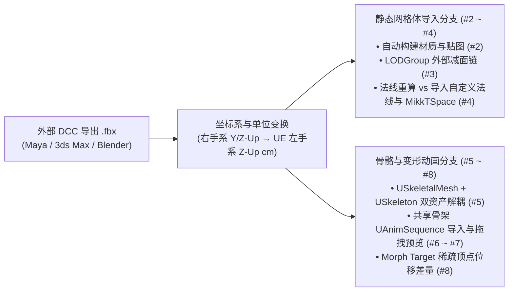

# 第 02 章 · FBX 资产导入管线：法线光滑组、MikkTSpace 切线空间、骨骼分离与变形目标全解

> **对应官方示例关卡**：`/Game/Maps/Geometry/FBX_Import_Options`（关卡脚本类：`FBX_Import_Options_C`）  
> **所属模块目录**：`02_Geometry_几何建模与Nanite`  
> **关卡体量实测**：总 Actor 数 `38` | 官方展台数 `8`（`#1` ~ `#8` 零遗漏全覆盖） | 示例交互与陈列 Actor 数 `16`（另含全局 `InstancedFoliageActor`）  
> **核心资产路径**：`/Game/ExampleContent/FBX_Import_Options/`（静态网格体 `Meshes/`、骨骼网格体与变形动画 `SkeletalMesh/`）

---

## 一、 关卡总览：跨越 DCC 与实时引擎鸿沟的“海关检疫站”

在大型 3A 游戏研发管线中，超过 90% 的画面瑕疵——比如枪械硬表面烘焙法线贴图后出现刺眼的“X 形对角黑印”、倒角高光莫名断裂、角色换装后关节扭曲错位、或是面部表情融合（BlendShapes）法线发黑——**往往并不是材质着色器写错了，而是在 `.fbx` 跨软件导入引擎的那一秒钟，配置错了导入管线参数！**

Autodesk **FBX（Filmbox）** 格式之所以长期担任 Maya、3ds Max、Blender、Houdini、Substance Painter 与 Unreal Engine 之间的工业标准交换枢纽，是因为它不仅能携带多边形顶点与多通道 UV，还能在同一套二进制容器内打包**光滑组（Smoothing Groups）、自定义编辑顶点法线与双切线（Normals & Binormals/Tangents）、LOD 层级组（LODGroup）、材质关联属性、骨骼层级树与蒙皮权重（Skinning Clusters）、骨骼关键帧曲线以及顶点变形目标（Morph Targets / BlendShapes）**。而在 UE 5.5 中，无论你是走经典的 `UFbxFactory` 导入器，还是走全新的异步模块化 **Interchange Framework（通用交换框架）**，其底层所遵循的几何与蒙皮数学契约是完全一致的。

走进 `/Game/Maps/Geometry/FBX_Import_Options` 展厅，8 座展台沿着走廊依次排开（`X = 515` ~ `X = 7500`），上半场（`#1` ~ `#4`）聚焦静态网格体的材质自动构建、外部 LOD 链封装与法线/切线空间计算；下半场（`#5` ~ `#8`）则贯通了骨骼网格体的“网格-骨架二元解耦”、动画序列绑定热替换与 Morph Target 顶点差量混合管线。

---

## 二、 逐展台（#1 ~ #8）零遗漏深度拆解

### 展台 #1：`FBX Import Options` — 导入总纲、坐标系变换与三角化契约

- **展牌标识与空间坐标**：`BP_DemoDisplay8` | `(515, -900, 0)`
- **官方展牌原文**：`This map shows the results of some of the key settings for importing FBX files. FBX is our primary 3D content importing path, used for both static and skeletal meshes.`
- **展台内环境与基础 Actor（5 个）**：
  - `DirectionalLight`（`Intensity = 10`，`LightColor = (1, 1, 1, 1)`，`CastShadows = true`，`Mobility = Movable`）
  - `SkyLight`（`Intensity = 3`，`LightColor = (1, 1, 1, 1)`，`CastShadows = true`，`Mobility = Movable`）
  - `SkyAtmosphere`（`SkyAtmosphereComponent`）
  - `ExponentialHeightFog`（`HeightFogComponent0`）
  - `Actor`（挂载 `ChaosDebugDrawComponent_0`）

#### 管线内核解析：FBX 进门前的三道隐形底层工序
在你在内容浏览器里拖入一个 `.fbx` 文件弹出导入对话框的那一刻，引擎在解析网格之前会率先执行三项决定生死的基础转换：
1. **手性与轴向空间转换（Handedness & Up-Axis Conversion）**：
   - **Unreal Engine** 采用 **左手坐标系（Left-Handed）、Z 轴朝上（+Z Up）、+X 为正前方（Forward）、+Y 为正右方（Right）**，基础长度单位为 **1 Unreal Unit (UU) = 1 厘米（cm）**。
   - 而 Maya 默认是右手系 `+Y Up`，3ds Max 与 Blender 默认是右手系 `+Z Up`（且 Blender 默认单位为米 `m`）。勾选导入面板的 `Convert Scene` 与 `Convert Scene Unit` 后，导入器会自动左乘/右乘基变换矩阵，翻转副切线符号与三角形环绕顺序（Winding Order），确保法线不内翻、尺寸不缩小 100 倍。
2. **多边形剖分一致性（Triangulation Consistency）**：
   - GPU 硬件光栅化器只认识**三角形（Triangles）**，不认识四边面（Quads）或 N-Gon 多边面。一个凹陷或非共面的四边面 `ABCD`，究竟是沿着对角线 `AC` 切分还是沿着 `BD` 切分，会直接改变表面法线插值方向与法线贴图的切线基！
   - **管线黄金准则**：凡是需要进 Substance Painter / Marmoset 烘焙高精度切线空间法线贴图的硬表面资产，必须在进烘焙器与进 UE **之前**，在 DCC 软件中预先固定三角化（或在 FBX 导出器勾选 `Triangulate`），杜绝烘焙器按 `AC` 切而引擎按 `BD` 切造成的对角线扭曲阴影！

---

### 展台 #2：`Static Mesh` — 默认白模导入与 DCC 材质贴图全自动装配对比

- **展牌标识与空间坐标**：`BP_DemoDisplay1` | `(1515, -900, 0)`
- **官方展牌原文**：`On the left, a simple 200 x 200 box imported with default settings. On the right, a box imported with its material/textures from the modeling application automatically applied.`
- **陈列示例 Actor（2 个）**：
  - `SM_FBX_Box_2`：引用 `/Game/ExampleContent/FBX_Import_Options/Meshes/SM_FBX_Box`（尺寸 `200 × 200 cm` 的基础立方体，未导入外部材质，自动回退引擎默认棋盘格材质 `WorldGridMaterial`）。
  - `SM_FBX_Box_Metal_2`：引用 `/Game/ExampleContent/FBX_Import_Options/Meshes/SM_FBX_Box_Metal`（在 DCC 中赋予了金属材质与贴图关联，导入时自动提取贴图、生成材质球并绑定到 `Material Slot 0`）。

#### 管线内核解析：导入面板中材质、枢轴与合并策略的工业级规范
观察 2 号展台左右两个 `200 × 200 cm` 方盒，背后对应着导入面板最常用的两组工程决策：
1. **材质创建策略（`Material Import Method`）—— 为什么大型项目严禁随意勾选 `Create New Materials`？**
   - 当独立开发者快速导入外部资产包时，像右侧 `SM_FBX_Box_Metal` 那样开启 `Create New Materials` + `Import Textures = true` 确实省心：引擎会解析 FBX 内的 Phong / Lambert / Standard Surface 属性节点，自动把同目录下的贴图导入并连成一张独立母材质（Master Material）。
   - 但在拥有上万件资产的商业项目中，如果导入 500 个木箱就自动生成 500 个独立的母材质，会导致项目**着色器变体编译爆炸（Shader Permutation Bloat）**且无法统一批量调整 PBR 光照响应！因此，规范团队通常选择 **`Create New Instanced Materials`（自动以项目标准母材质 `M_Prop_Master` 为父级生成轻量级材质实例 `MI_` 并填入贴图参数）**，或者直接选 **`Do Not Create Material`** 后在引擎内手动指定标准材质实例。
2. **世界原点与局部枢轴点（`Transform Vertex to Absolute` vs 局部坐标保留）**：
   - 在 DCC 中制作模块化墙板与道具时，务必将模型的枢轴点（Pivot）放在贴地角点或几何中心，并**归零移动到 DCC 世界坐标原点 `(0, 0, 0)`** 再导出 FBX。若模型在 Maya 里摆在 `(5000, 3000, 0)` 未归零就直接导入且开启了 `Transform Vertex to Absolute`，进引擎后你会发现模型的旋转坐标轴离模型本体十万八千里！（此时只能在导入设置中关闭 `Transform Vertex to Absolute` 或勾选 `Bake Pivot in Vertex` 补救）。

---

### 展台 #3：`Import Mesh LODs` — 外部定制多级 LOD 组（`LODGroup`）一体化封装

- **展牌标识与空间坐标**：`BP_DemoDisplay3` | `(2495, -900, 0)`
- **官方展牌原文**：`This asset has a cube as the base LOD0 and a sphere as LOD1. Move close, then farther away to see mesh LOD.`
- **陈列示例 Actor（1 个）**：
  - `SM_FBX_Box_LOD_0`：引用 `/Game/ExampleContent/FBX_Import_Options/Meshes/SM_FBX_Box_LOD_0`。

#### 管线内核解析：什么时候需要从外部 FBX 手工导入 LOD 链？
在上一章第 13 号展台中我们看到引擎自带极强的自动减面器；既然如此，为什么还需要 3 号展台演示的 **`Import Mesh LODs`（从 FBX 导入手工 LOD）**？
1. **故意夸张化的教学实验**：为了让你不借助线框模式也能一眼看清 FBX LOD 组生效，`SM_FBX_Box_LOD_0` 做了一个非常幽默而直观的设计——它的近景 **`LOD0` 是一个方方正正的立方体（Cube）**，而远景 **`LOD1` 则是一个圆润的球体（Sphere）**！当你在视口里走近它时看到的是方盒，往后退几步跨过 `Screen Size` 阈值时，它会瞬间“变魔术”般切换成一颗圆球！
2. **DCC 侧的 FBX `LODGroup` 封装语法**：
   - **Maya**：按高精度到低精度顺序选中 `Mesh_LOD0`、`Mesh_LOD1`、`Mesh_LOD2`，执行菜单 `Edit -> Level of Detail -> Group` 创建原生 `lodGroup1` 节点后导出单个 FBX；
   - **3ds Max**：将各级别模型编组（Group）并打开 `Utilities -> Level of Detail` 面板点击 `Create New Set`；
   - **Blender**：创建一个空物体（Empty）作为父级，为其添加自定义属性 `fbx_type = "LodGroup"`，将按名称排序的各级网格设为其子级导出。
   - 导入虚幻时只需勾选 **`Mesh -> Advanced -> Import Mesh LODs`**，整个多级网格链与各自的材质槽映射便一次性自动装填完毕！
3. **实战不可替代场景**：对于极度讲究剪影轮廓的低面数英雄武器、带有精细镂空栏杆的古建筑（自动减面容易把栏杆坍缩成破碎三角刺），或者需要将远景 `LOD3` 手工替换成十字交叉面片（Billboard / Impostor Cards）的森林树木，美术师手工拓扑的外部 FBX LOD 依然拥有无可比拟的品质控制力。

---

### 展台 #4：`Import Normals` — 光滑组、自定义加权顶点法线与 MikkTSpace 切线空间内核

- **展牌标识与空间坐标**：`BP_DemoDisplay2` | `(3500, -900, 0)`
- **官方展牌原文**：`This is one FBX imported twice with different settings. It has one smoothing group and custom vertex normals created in 3dsMax. The one on the left was imported using Calculate Normals. The one on the right was imported using the Import Normals option.`
- **陈列示例 Actor（2 个源自同一个 FBX 文件但采用不同法线导入策略的对照网格）**：
  - `SM_FBX_Normals_A`（左）：引用 `/Game/ExampleContent/FBX_Import_Options/Meshes/SM_FBX_Custom_Normal_A` —— 导入时选用 **`Compute Normals`（由引擎重新计算法线）**。
  - `SM_FBX_Normals_A_2`（右）：引用 `/Game/ExampleContent/FBX_Import_Options/Meshes/SM_FBX_Custom_Normal` —— 导入时选用 **`Import Normals`（保留 DCC 自定义顶点法线）**。

#### 管线内核深潜：彻底攻克实时渲染中最易踩坑的“顶点法线与切线空间（Tangent Basis）”！
站在 4 号展台前仔细观察实拍图：明明是**完全一模一样的顶点坐标、完全一模一样的单一光滑组（One Smoothing Group）倒角方块**，为什么左边的 `SM_FBX_Custom_Normal_A` 大平面看起来像一个鼓包充气的软垫子（四个角落发黑、高光扭曲成圆弧），而右边的 `SM_FBX_Custom_Normal` 大平面却像镜面钢板一样平整锐利，只有边缘倒角泛出精致的金属高光？

这背后藏着现代次世代硬表面美术的两大核心支柱——**面面积加权自定义法线（Face-Weighted Normals, FWN）** 与 **MikkTSpace 切线空间同步协议**：

##### 1. 为什么 `Compute Normals` 会毁掉中模倒角（Mid-Poly Chamfer Workflow）？
- 在传统无加权平均法线算法（左侧 `Compute Normals`）中，共享顶点 $v$ 的法线是周围所有相邻面法线的简单平均。当一个大平面与一个极窄的 $45^\circ$ 倒角斜面共享边缘顶点时，顶点法线会被强行掰弯 $22.5^\circ$！结果就是光栅化器在整个大平面内部对被掰弯的四个角法线进行线性插值，平直的钢板硬生生渲染出了弧形渐变黑影！
- 而在 3ds Max / Maya / Blender 中，美术师使用 **Face-Weighted Normals（按面面积加权法线）** 或手动锁死编辑法线，让倒角两侧顶点的法线 **100% 垂直于大平面**，把所有角度过渡全部浓缩在极窄的倒角面内部。
- 如果导入引擎时误选了 `Compute Normals`，引擎会无情丢弃 FBX 里的 `FbxLayerElementNormal` 数据，按顶点邻接面重新跑一遍平均算法，美术的心血瞬间归零！唯有选择 **`Import Normals`**（或 **`Import Normals and Tangents`**），才能如右侧 `SM_FBX_Custom_Normal` 那样原汁原味保留平整如镜的硬表面光影！

##### 2. 三档 `Normal Import Method` 与 **MikkTSpace** 烘焙同步铁律
当模型不仅有顶点法线，还要贴上一张在 Substance Painter 中从千万面高模烘焙下来的 **切线空间法线贴图（Tangent-Space Normal Map）** 时，片元着色器还原世界空间法线依赖正交切线基矩阵 $\mathbf{TBN} = [\mathbf{T}, \mathbf{B}, \mathbf{N}]$：
$$\mathbf{N}_{\text{world}} = \text{normalize}\!\left( n_x \cdot \mathbf{T} + n_y \cdot \mathbf{B} + n_z \cdot \mathbf{N} \right)$$
这里有一个决定烘焙成败的绝对公式：**烘焙器烘焙时用来编码 $(n_x, n_y, n_z)$ 的 $\mathbf{TBN}$ 矩阵，必须与虚幻引擎渲染时用来解码的 $\mathbf{TBN}$ 矩阵逐顶点严丝合缝！**
为此，Morten Mikkelsen 提出了工业界统一的切线生成标准 **MikkTSpace**（虚幻默认 `Normal Generation Method = MikkTSpace`）：

| 导入枚举（`Normal Import Method`） | 法线 $\mathbf{N}$ 来源 | 切线 $\mathbf{T}$ 与副切线 $\mathbf{B}$ 来源 | 适用美术工作流 |
| :--- | :--- | :--- | :--- |
| **`Compute Normals`** | 引擎按光滑组/硬边自动重算 | 引擎用 MikkTSpace 根据 UV0 自动重算 | 未做自定义法线编辑的白模原型、扫描件自动平滑 |
| **`Import Normals`（最推荐标准流）** | **从 FBX 原样读取**（保留硬边拆分与 FWN 自定义法线） | **引擎在导入法线基础上运行标准 MikkTSpace 生成切线** | **Substance Painter 默认标准管线**！（SP 导出时不勾选 Tangents，只导法线，让 SP 与 UE 各自在相同三角化与法线上跑同款 MikkTSpace，100% 零接缝同步） |
| **`Import Normals and Tangents`** | 从 FBX 原样读取 | **连 $\mathbf{T}$ 和 $\mathbf{B}$ 也从 FBX 原样读取** | 在 DCC / 烘焙器中显式勾选了 `Export Tangents and Binormals` 时的严格锁定管线 |

> [!TIP]
> **高反光汽车漆面与镀铬枪械的隐藏大招**：默认情况下，静态网格体顶点的切线基压缩在 **8-bit 整型（`FPackedNormal`）** 中以节省显存，在极低粗糙度（`Roughness < 0.08`）的平滑曲面上反射笔直灯管时可能出现细微阶梯波纹。打开静态网格体详情 `Build Settings -> Use High Precision Tangent Basis`（升级为 **16-bit 浮点切线基**），反射波纹立竿见影消失无踪！
> 此外还要谨记：每一条**硬边（Hard Edge / 不同光滑组分界线）**或 **UV 接缝**，都必须在硬件顶点缓冲区把 1 个三维顶点分裂复制成 2~3 个独立渲染顶点（因为同一索引槽无法同时装下两个不同方向的法线向量）——这与下一章 Nanite 第 18~21 号展台探讨的“硬边切面导致顶点膨胀 6 倍”一脉相承！

---

### 展台 #5：`Skeletal Mesh` — 骨骼网格体（`USkeletalMesh`）与骨架（`USkeleton`）二元解耦架构

- **展牌标识与空间坐标**：`BP_DemoDisplay4` | `(4500, -900, 0)`
- **官方展牌原文**：`This is a simple skeletal mesh with 3 bones. Upon import, it creates two assets; the mesh asset and the skeleton asset.`
- **陈列示例 Actor（1 个）**：
  - `SK_FBX_Tube`（`SkeletalMeshActor`）：组件 `SkeletalMeshComponent0` 引用蒙皮资产 `/Game/ExampleContent/FBX_Import_Options/SkeletalMesh/SK_FBX_Tube`（`AnimClass = None`，`PhysicsAssetOverride = None`，`MeshDeformer = None`）。

#### 管线内核解析：为什么导入 1 个带 3 根骨头的圆管 FBX，内容浏览器里会蹦出 2（甚至 3）个独立资产？
从 5 号展台开始，展厅正式迈入可变形蒙皮几何管线。当你导入一个包含关节树（Joints/Armature）与蒙皮簇（Skin Cluster）的 FBX 时，虚幻引擎绝不会把它们糊成一个黑盒文件，而是精心拆分为职责分明的三大核心资产：
1. **`USkeletalMesh`（骨骼网格体资产，如 `SK_FBX_Tube`）**：
   - 存储模型在参考绑定姿态（**Reference Pose / Bind Pose**，导入时若 DCC 第 0 帧为标准 T-Pose 可勾选 `Use T0 As Ref Pose`）下的顶点位置、法线、UV，以及至关重要的 **顶点蒙皮权重表（Skin Weight Buffer）**——记录每个顶点受哪几根骨骼（默认最多 4 或 8 根，开启 `Unlimited Bone Influences` 可达 12 根）影响且权重之和 $\sum w_i = 1.0$。
2. **`USkeleton`（骨架资产，如 `SK_FBX_Tube_Skeleton`）**：
   - **纯拓扑与元数据中枢，不含任何多边形网格！** 它记录了这 3 根骨骼的名称字符串、父子层级关系树、虚拟骨骼（Virtual Bones）、插槽（Sockets）、动画曲线名录与动画通知槽（Anim Notify Tracks）。
   - **架构解耦的巨大威力**：在一个 RPG 游戏里，你的主角有 50 套不同体型的盔甲、披风与怪物换皮角色，只要导入这些 `USkeletalMesh` 时在导入面板的 `Skeleton` 下拉框中**指定共用同一个 `USkeleton` 资产**（哪怕某套铠甲多了两根飘带附加骨骼，引擎也会自动将其增量合并进骨架树且不破坏原有骨骼索引），那么成百上千条跑步、挥剑、受击动画（`UAnimSequence`）与整套状态机动画蓝图，就能在 50 个角色身上 **100% 零成本无缝复用**！
3. **`UPhysicsAsset`（可选自动生成的物理资产 `PhAT`）**：
   - 勾选导入面板 `Create Physics Asset` 时一并生成，为每根主要骨骼自动套上胶囊体与关节角度约束（Constraints），供布娃娃死亡物理（Ragdoll）与布料碰撞检测使用。

---

### 展台 #6：`Animation` — 基于共享骨架的纯动画序列（`UAnimSequence`）导入与采样重映射

- **展牌标识与空间坐标**：`BP_DemoDisplay5` | `(5500, -900, 0)`
- **官方展牌原文**：`When importing an animation, you need to select the skeleton asset that matches the animation. You can then drag the animation asset into a level to watch the animation play.`
- **陈列示例 Actor（1 个）**：
  - `SK_FBX_Tube_2`（`SkeletalMeshActor`）：挂载蒙皮网格 `/Game/ExampleContent/FBX_Import_Options/SkeletalMesh/SK_FBX_Tube`，播放与 `SK_FBX_Tube_Skeleton` 绑定的首段弯曲摆动骨骼动画。

#### 管线内核解析：只导骨骼运动、不导多边形的轻量化动画流水线
在动画师日常量产动作资产时，导出的动作 FBX 文件里根本不需要（也不应该）包含几万面的角色模型网格，只需导出骨骼层级与关键帧变换曲线（Baked Animation Keys）：
1. **导入流程要点**：拖入纯骨骼 FBX 后，导入器自动识别其无几何网格并切换至 **Animation Import** 模式；此时**必须且只需在 `Skeleton` 栏选中 5 号展台生成的 `SK_FBX_Tube_Skeleton`**。
2. **底层轨迹存储与 ACL 无损级压缩**：
   - 生成的 `UAnimSequence` 按帧率（默认读取 FBX 帧率如 `30fps` / `60fps`，可通过 `Use Default Sample Rate` 统一规范化）采样每根骨骼相对于父骨骼的局部变换三元组 $(T_i(t), R_i(t), S_i(t))$（平移向量、单位四元数旋转、缩放向量）。
   - 在 UE5 中，所有导入的骨骼动画默认由业界顶尖的 **ACL（Animation Compression Library）** 编解码器自动执行误差自适应位宽压缩，剔除恒定不变的轨道，在肉眼零精度损失的前提下将内存占用压缩 70%~85%！
3. **直接拖入关卡成 Actor**：正如展牌所述，你甚至不需要先摆一个 `SkeletalMeshActor` 再去配动画——直接从内容浏览器把绿色的 `UAnimSequence` 动画资产拖进三维视口，引擎会自动根据其关联的 `USkeleton` 查出默认预览网格 `SK_FBX_Tube`，生成配置好自动循环播放的 `SkeletalMeshActor`！

---

### 展台 #7：`Drag and drop animation` — 视口交互式动画热替换与 Simulate 实时模拟预览

- **展牌标识与空间坐标**：`BP_DemoDisplay6` | `(6500, -900, 0)`
- **官方展牌原文**：`You can also drag a different matching animation from the content browser onto the asset in the level to preview the animation. Find the asset named "SK_FBX_Tube_Animation_B" and drag it onto this asset. You can then watch it in simulate or play mode.`
- **陈列示例 Actor（2 个）**：
  - `Dummy_placeholder_for_1.6`（`SkeletalMeshActor`）：引用 `SK_FBX_Tube`。
  - `SK_FBX_Tube_3`（`SkeletalMeshActor`）：引用 `SK_FBX_Tube`，供读者亲手实践拖拽热替换的交互靶标。

#### 动手实操与组件动画驱动双模式剖析
按照 7 号展牌的指引，你可以在内容浏览器中定位到 `/Game/ExampleContent/FBX_Import_Options/SkeletalMesh/SK_FBX_Tube_Animation_B`，按住鼠标左键直接将其拖放到视口中的 `SK_FBX_Tube_3` 软管模型身上，然后按下 **`Alt + S`（Simulate In Editor 编辑器内模拟）** 或 **`Alt + P`（Play In Editor）**，软管立即切换为全新的扭动姿态！

这一便捷操作修改的正是 `USkeletalMeshComponent` 的 **Animation Mode（动画驱动模式）**：
- **`Use Animation Asset`（直接播放单一资产模式，本展台使用）**：组件绕过复杂的状态机虚拟机，直接由底层 `UAnimSingleNodeInstance` 驱动指定的 `AnimToPlay`（即刚拖入的 `SK_FBX_Tube_Animation_B`），支持勾选 `Looping`、`Playing` 与调节 `PlayRate` 倍速。非常适合关卡过场摆拍、背景循环摆动的机械臂/章鱼触手以及快速验收 FBX 动作导出效果。
- **`Use Animation Blueprint`（动画蓝图驱动模式）**：指定 `AnimClass`（`UAnimInstance` 子类），融合状态机、混合空间（Blend Space）、Control Rig 与物理惯性程序化修正，服务于玩家可控主角与 AI 角色。

---

### 展台 #8：`Morph Target` — 顶点差量变形目标（BlendShapes）与 GPU 计算着色器混合

- **展牌标识与空间坐标**：`BP_DemoDisplay7` | `(7500, -900, 0)`
- **官方展牌原文**：`This mesh was imported with morph targets and a simple animation.`
- **陈列示例 Actor（1 个）**：
  - `SK_Box_Morph_2`（`SkeletalMeshActor`）：引用携带有变形目标与驱动曲线动画的蒙皮资产 `/Game/ExampleContent/FBX_Import_Options/SkeletalMesh/SK_Box_Morph`。

#### 管线内核解析：为什么写实人脸微表情与肌肉隆起离不开 `UMorphTarget`？
用骨骼关节旋转驱动肘部弯曲轻而易举，但如果你要表现**角色冷笑时嘴角法令纹的微妙挤压、呼吸时胸腔肋骨皮肉的起伏、或是水滴状史莱姆软体方块（如本展台的 `SK_Box_Morph`）将四个角向内凹陷拉伸成星形**，纯刚体骨骼矩阵混合（Linear Blend Skinning）就会捉襟见肘。此时就轮到 **Morph Target（Maya 称 BlendShape，3ds Max 称 Morpher，Blender 称 Shape Keys）** 登场了！

1. **FBX 导入双开关**：
   - 导入网格体时必须展开 `Mesh -> Advanced` 勾选 **`Import Morph Targets = true`**；
   - 导入配套动画（或同文件动画）时，FBX 中控制 BlendShape 权重的浮点属性曲线会被自动提取为与 Morph Target 同名的 **Animation Float Curves（动画浮点曲线）**，运行时每帧自动按名字匹配驱动变形权重 $w_k(t) \in [0, 1]$（甚至支持超出 $[0,1]$ 做反向或夸张过冲变形！）。
2. **稀疏差量存储（Sparse Delta Compression）与叠加数学原理**：
   - 假设一个 5 万顶点的角色头部制作了 100 个面部 FACS 微表情 BlendShapes，如果每个表情都存一份完整的 5 万顶点网格，内存瞬间就会撑爆！
   - 实际上，虚幻引擎的 `FMorphTargetDelta` 采用**稀疏差量压缩**：对于“左眼眨眼”这个 Morph Target，引擎在导入时只记录左眼皮周围那几百个真正发生了位移（$\|\Delta \mathbf{P}\| > \text{MorphThresholdPosition}$，默认阈值 `0.015 cm`）的顶点索引 `SourceIdx` 及其位移差向量 $\Delta \mathbf{P}_k$、法线差向量 $\Delta \mathbf{N}_k$，其余 49,500 个静止面部顶点占用 **0 字节**！
   - 在 GPU 渲染管线的 **Compute Shader Morph Pass（`r.MorphTarget.Mode = 1`）** 中，着色器先在局部绑定空间完成所有激活 Morph Target 的线性向量累加，随后再送入骨骼蒙皮矩阵变换（Skinning Pass）：
     $$\mathbf{P}_{\text{morphed}}(v) = \mathbf{P}_{\text{ref}}(v) + \sum_{k=1}^{M} w_k(t) \cdot \Delta \mathbf{P}_k(v)$$
     $$\mathbf{N}_{\text{morphed}}(v) = \text{normalize}\!\left( \mathbf{N}_{\text{ref}}(v) + \sum_{k=1}^{M} w_k(t) \cdot \Delta \mathbf{N}_k(v) \right)$$
3. **法线精度细节**：若变形幅度巨大（例如方块变成圆球），记得在项目设置或骨骼网格体详情中检查 **`Recompute Tangent` / `Morph Target Normal`** 设置，确保变形后的高光与法线贴图随表面凹凸同步偏转，绝不出现“形状鼓起来了、高光还停留在平地上”的穿帮现象！

---

## 三、 本关 FBX 导入排错黄金检查表（Checklist）

在结束 `FBX_Import_Options` 8 座展台的深度巡礼前，我们将日常生产中最核心的导入参数浓缩成一张案头排错速查表：

| 常见导入症状与画面事故 | 对应的展台根因 | 正确的导入管线参数处方 |
| :--- | :--- | :--- |
| 硬表面中模大平面像充气枕头一样四周发黑 | **展台 #4**（`Compute Normals` 覆盖了自定义加权法线） | 将 `Normal Import Method` 改为 **`Import Normals`** |
| Substance Painter 烘焙的法线贴图进引擎后有对角线黑印 | **展台 #1 & #4**（三角化不一致或切线基不同步） | 烘焙前在 DCC 固定 `Triangulate`；SP 不导切线，UE 选用 `Import Normals` + `MikkTSpace` |
| 导入资产包自动生成了几百个重复母材质球 | **展台 #2**（默认 `Create New Materials`） | 改选 `Create New Instanced Materials` 并指定项目统一母材质，或 `Do Not Create Material` |
| DCC 里挂好的多级减面组进引擎只剩 LOD0 | **展台 #3**（未开启外部 LOD 组解析） | 在 `Mesh -> Advanced` 中勾选 **`Import Mesh LODs`** |
| 角色换装无法共用同一套跑步/攻击动画 | **展台 #5 & #6**（各自新建了孤立的 `USkeleton`） | 导入新服装骨骼网格体时，在 `Skeleton` 栏显式指定已有的主角色 `USkeleton` 资产 |
| Maya BlendShape 表情导进引擎后脸部毫无反应 | **展台 #8**（漏勾变形目标或动画曲线未匹配） | 网格导入勾选 **`Import Morph Targets`**，动画导入勾选 `Import Bone Tracks` 与属性曲线 |

至此，传统多边形与骨骼资产从 DCC 进入虚幻引擎的桥梁已彻底打通。接下来，请翻开本卷最具革命性的第 03 章 **`Geometry_Nanite`**——看看虚幻引擎 5 是如何打破延续三十年的低模烘焙枷锁，把百万面影视雕塑与 70 余名高模骨骼角色同时搬进 60 帧实时视口的！
