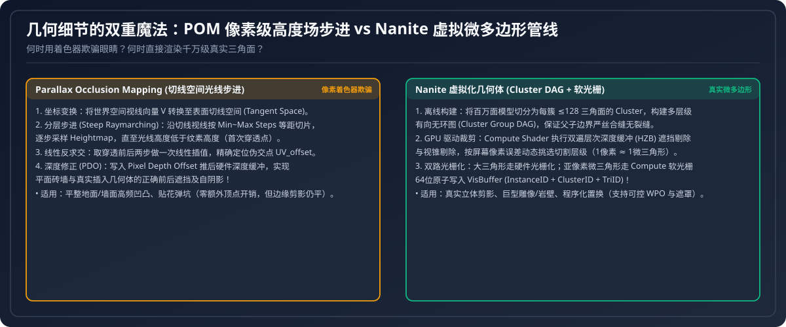
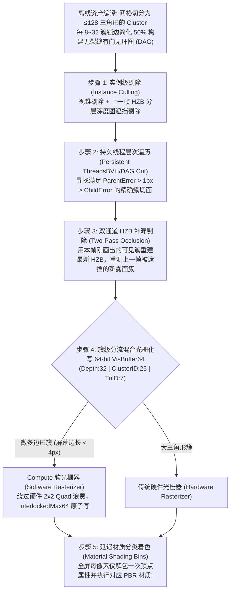

# 第 03 章 · Nanite 虚拟微多边形几何体：BVH 簇裁剪、软硬混合光栅化、置换边界与蒙皮骨骼网格全解

> **对应官方示例关卡**：`/Game/Maps/Geometry/Geometry_Nanite`（关卡脚本类：`Geometry_Nanite_C`）  
> **所属模块目录**：`02_Geometry_几何建模与Nanite`  
> **关卡体量实测**：总 Actor 数 `175` | 官方展台数 `23`（`#1` ~ `#23` 零遗漏全覆盖） | 示例与军团陈列 Actor 数 `130`  
> **核心资产路径**：`/Game/ExampleContent/Nanite/`（百万面高模 `Meshes/Nanite/`、植被 `Meshes/Foliage/`、切面对比 `Meshes/DoorFacetedSmooth/`、UE 5.5 蒙皮 Nanite 角色 `SkeletalMesh/SKM_Manny_Nanite`）

---

## 一、 关卡总览：终结三十年“低模烘焙枷锁”的渲染范式革命

回望前两章展示的传统多边形管线，实时三维图形学在过去三十年里一直戴着沉重的镣铐跳舞：美术师在 ZBrush 里雕刻出精妙绝伦的 1,000 万面石雕，却不得不耗费数天时间手工拓扑成 5,000 面的低模、拆分严丝合缝的 UV、烘焙法线贴图来“假装凹凸”，最后还要制作 `LOD0 ~ LOD4` 四五级减面模型，小心翼翼地控制整帧的 Draw Call 预算与多边形总数。更残酷的是，只要传统硬件光栅化器遇到比 `2×2` 像素块（Pixel Quad）更微小的密集三角形，辅助线程（Helper Lanes）空转就会令显卡性能断崖式暴跌！

**Nanite（虚拟化微多边形几何体系统）** 的诞生，从底层彻底改写了这一物理定律：**帧率预算不再与场景总资产面数或实例数量成正比，而仅仅与屏幕分辨率（可见像素数）成正比！**

走进 `/Game/Maps/Geometry/Geometry_Nanite` 展厅，23 座展台（连同展厅尽头双扇大门背后由 **70 余名高模 `SKM_Manny_Nanite` 组成的角色方阵**）构成了虚幻引擎 5.5 最完整的 Nanite 实验室：

全关按空间动线分为四大核心乐章：
1. **基础理念与开启路径（展台 `#1` ~ `#5`）**：虚拟几何体架构定义、六大核心收益、导入期与内容浏览器批量启用；
2. **百万面实战、摄影测量与回退网格（展台 `#6` ~ `#13`）**：101 万面罗马柱、212 万面扫描门楼、Nanite vs 传统静态网格体同台较量、`Fallback Mesh` 物理/光追代理以及 **Nanite Clusters（128 三角形簇与 DAG 图）**；
3. **四大性能暗礁与置换/材质边界（展台 `#14` ~ `#21`）**：聚合离散几何体（Aggregate Geometry）、近表面过度绘制（Overdraw）、硬边切面与平滑顶点共享比（`3:1` vs `1:2`）以及磁盘流送体积控制；
4. **UE 5.5 里程碑——骨骼网格体蒙皮 Nanite（展台 `#22` ~ `#23`）**：开启 `r.Nanite.AllowSkinnedMeshes=1`，推开自动门直击数十具 Nanite 骨骼角色的实时同屏奇迹！

---

## 二、 渲染管线深潜：在逛展台前，先读懂一帧 Nanite 的 GPU 奇幻漂流

为了让接下来 23 座展台中的每一个现象（如簇变色、过度绘制发光、硬边面数暴增）都纤毫毕现，我们先用一张流程图串起 Nanite 在 GPU Compute Shader 中全自动驱动（GPU-Driven）的五步流水线：

记住其中最颠覆传统认知的两点：
1. **光栅化阶段根本不跑材质（Zero Pixel Shader Overdraw during Raster）**：不管场景里有 100 层石头叠在一起，几何阶段只竞争写入一个 64 位整数缓冲 `VisBuffer64`；直到全屏每一个像素最终“谁在最前面”尘埃落定后，才对**真正露在屏幕上的那唯一一层像素**执行一次 PBR 材质计算！
2. **软光栅拯救亚像素三角形**：当远处的百万面雕花缩成只有 1 个像素大小时，传统硬件光栅器每个三角形都要强制拉起 `2×2 = 4` 个像素线程（浪费 75% 算力）；而 Nanite 直接切换至 **Compute Shader 扫描线软光栅器**，吞吐效率比硬件光栅高出数倍！

带着这把管线钥匙，我们立即步入 1 号展台开启逐站探秘。

---

## 三、 逐展台（#1 ~ #23）零遗漏深度拆解

### 展台 #1：`Nanite Virtualized Geometry` — 虚拟化几何体导览与高密植被阵列

- **展牌标识与空间坐标**：`BP_DemoDisplay13` | `(529, -900, 0)`
- **官方展牌原文**：`Nanite is Unreal Engine 5's virtualized geometry system which uses a new internal mesh format and rendering technology to render pixel scale detail and high object counts. Nanite's data format is also highly compressed, and supports streaming with automatic level of detail.`
- **展台内陈列与环境核心 Actor（6 个）**：
  - `InstancedFoliageActor0`（`/Script/Foliage.InstancedFoliageActor`）：搭载 **9 个独立的 `FoliageInstancedStaticMeshComponent`**（编号 `_37, _38, _40, _41, _42, _44, _45, _46, _48`），引用 9 种高模鹤望兰（天堂鸟）实景扫描植被变体 `/Game/ExampleContent/Nanite/Meshes/Foliage/S_Bird_Of_Paradise_wfypeifha_Var1_lod0`（及 `Var4 / Var5 / Var6 / Var7 / Var8 / Var9 / Var10 / Var12_lod0`）。
  - 全局光影环境组：`DirectionalLight`（`Intensity = 6`，`Mobility = Movable`）、`SkyLight`（`Intensity = 3`，`Mobility = Movable`）、`SkyAtmosphere`、`ExponentialHeightFog` 以及物理调试 `Actor`（`ChaosDebugDrawComponent_0`）。

#### 管线内核解析：为什么称其为“虚拟化（Virtualized）”几何体？
就像 **Virtual Texturing（虚拟纹理）** 不会把一张 `128K × 128K` 巨型贴图全部塞进显存，而是只按屏幕视野流送当前看得见的 `128×128` 纹素瓦片（Tiles）一样，**Nanite 把网格多边形也做成了按需流送的分页缓存（Streaming Pages）**！
- 每个 Nanite 资产只有最粗糙的顶层簇（**Root Pages**，通常仅几 KB）常驻显存，保证无论何时镜头突然甩过去绝不会出现模型消失闪烁；
- 更精细的子级簇按空间局部性打包成 `64KB ~ 128KB` 的磁盘压缩页。每帧 GPU 在遍历 DAG 树时，一旦发现某个簇离镜头变近需要更高精度，便直接在一个 GPU 反馈缓冲区记录页请求，由引擎后台通过 IOStore / DirectStorage 从 SSD 极速异步解压流送进固定大小的 **`r.Nanite.Streaming.StreamingPoolSize`**（默认 `512 MB`）显存池中！

---

### 展台 #2：`Benifits of Nanite` — 改写游戏工业生产力模型的六大核心红利

- **展牌标识与空间坐标**：`BP_DemoDisplay14` | `(1506, -900, 0)`
- **官方展牌原文**：
  - `Multiple orders of magnitude increase in geometry complexity, higher triangle and objects counts than has been possible before in real-time.`
  - `Frame budgets are no longer constrained by polycounts, draw calls, and mesh memory usage.`
  - `Able to directly import film-quality source arts, such as ZBrush sculpts and photogrammetry scans.`
  - `Can use high-poly detailing rather than normal map textures.`
  - `Level of Detail is automatically handled and no longer requires manual setup.`
  - `Loss of quality is rare, especially with LOD transitions.`

#### 管线内核解析：不只是“面数变多”，更是 Draw Call 的彻底解放
许多开发者只注意到 Nanite 能跑千万面，却忽略了展牌第二条指出的超级红利——**Draw Call 解耦**！
在传统渲染器里，10,000 个不同形状的石块、陶罐和雕像意味着渲染线程每帧要在 CPU 上拼装并提交 10,000 次 `DrawIndexedPrimitive`。而在 Nanite 管线中，**全场景所有不透明 Nanite 网格体共享同一个全局几何缓冲区与同一条 GPU-Driven 间接绘制流水线（`ExecuteIndirect` / `DispatchIndirect`）**！不管关卡里摆了 10 种不同的石头还是 10,000 种完全不同的雕像，CPU 侧的几何提交开销几乎恒定为 **1 次全局派发**！

---

### 展台 #3：`Enabling Nanite` — 启用虚拟几何体的总控门户

- **展牌标识与空间坐标**：`BP_DemoDisplay19` | `(2497, -900, 0)`

#### 展台定位说明
3 号展台位于 `X = 2497` 中央，作为紧邻其左右两侧子展台（`#4 On Import` 与 `#5 Content Browser`）的总标题母展牌，向开发者揭示：将普通静态网格体转化为 Nanite 网格体是**完全无损、可随时双向可逆（随时可取消勾选恢复原始三角形）**的操作。除了接下来 `#4`、`#5` 展示的两种最常用入口外，你还可以在静态网格体编辑器右侧勾选 `Nanite Settings -> Enable Nanite Support` 并点击 `Apply Changes`，或在主菜单打开 **`Tools -> Nanite Tools`（Nanite 审计面板）** 按面数排序一键筛查转换全工程漏网资产。

---

### 展台 #4：`On Import` — 资产导入期一键编译 Nanite 数据流

- **展牌标识与空间坐标**：`BP_DemoDisplay20` | `(2305, -891, 6)`
- **陈列示例 Actor（1 个）**：
  - `Plane2`（`StaticMeshActor`）：基础平面 `/Engine/BasicShapes/Plane`，挂载展示面板材质 `/Game/ExampleContent/Nanite/Materials/M_Import_Nanite`。

#### 资产深拆与导入期构建流
- **材质 `/Game/ExampleContent/Nanite/Materials/M_Import_Nanite`**：`MD_Surface`、`BLEND_Opaque`、`MSM_DefaultLit`，仅通过 `MaterialExpressionTextureSample_0` 采样 UI 演示截图 `/Game/ExampleContent/Nanite/Textures/T_Import_Nanite` 输出至 `MP_BaseColor`。
- **底层构建动作**：在 FBX / Interchange 导入对话框中勾选 **`Build Nanite`**，引擎会在后台多线程执行网格图分割（METIS 库图划分算法）、条带化（Mesh Stripification）、层级锁边 QEM 简化、可变位宽定点量化编码以及 LZ 页压缩，直接产出即插即用的 Nanite 资产，同时无需再耗费时间去跑耗时的 `Generate Lightmap UVs`（若使用纯 Lumen 动态光照）。

---

### 展台 #5：`Content Browser` — 内容浏览器右键批处理极速转换

- **展牌标识与空间坐标**：`BP_DemoDisplay21` | `(2694, -891, 6)`
- **陈列示例 Actor（1 个）**：
  - `Plane`（`StaticMeshActor`）：基础平面 `/Engine/BasicShapes/Plane`，挂载展示面板材质 `/Game/ExampleContent/Nanite/Materials/M_CB_Nanite`（通过 `MaterialExpressionTextureSample_0` 采样 `/Game/ExampleContent/Nanite/Textures/T_CB_Nanite`）。

#### 工程实践贴士：哪些存量资产不适合在内容浏览器里无脑全选转 Nanite？
在内容浏览器中框选上百个旧项目网格体，右键点击 **`Nanite -> Enable Nanite for Selected`** 只需几秒钟即可完成升级。但作为管线架构师，在按下批量转换前请排除以下三类资产：
1. 使用 **`Blend Mode = Translucent / Additive / Modulate`（半透明材质）** 的玻璃窗或水面网格（Nanite 核心光栅器依赖不透明深度互斥 `VisBuffer64`，半透明材质会自动回退或不支持 Nanite 光栅）；
2. 面数极低（例如只有 12 个三角形的简单正方体白模）且不需要参与复杂场景合并剔除的极简辅助盒（转成 Nanite 的包头开销反而大于收益）；
3. 需要运行时 CPU 逐帧随意增删拓扑顶点的程序化网格（如 `ProceduralMeshComponent`）。

---

### 展台 #6：`Nanite Mesh` — 1,016,084 三角形科林斯式罗马石柱微距检视

- **展牌标识与空间坐标**：`BP_DemoDisplay15` | `(4098, -900, 0)`
- **官方展牌原文**：`A Nanite mesh is a Static Mesh with Nanite enabled on it. A Nanite mesh is fundamentally a triangle mesh, optimized with extensive level of detail and data compression. It also employs a novel rendering system for highly efficient processing of this data format. This mesh consists of 1,016,084 Nanite triangles. Use RMB to zoom in and explore the mesh's details.`
- **陈列示例 Actor（1 个）**：
  - `S_Roman_Column_wj3kdjtqx_high_Var1`：引用 Quixel Megascans 影视原片级扫描罗马柱 `/Game/ExampleContent/Nanite/Meshes/Nanite/Column_Nanite/S_Roman_Column_wj3kdjtqx_high_Var1`（整整 **`1,016,084` 个真实微多边形三角形**！）。

#### 管线内核解析：可变位宽顶点压缩是如何把 101 万面塞进十几 MB 的？
按住鼠标右键（或滚轮加速贴脸观察柱头雕花与风化凹坑），每一处毫米级的石材崩口都是**如假包换的三维几何剪影**，绝无传统法线贴图或视差遮蔽贴图（POM）在掠射角下的拉伸破绽！
你可能会好奇：传统未压缩网格中，100 万三角形约 50 万顶点，每个顶点存 3 个 32-bit 浮点坐标 + 切线 + UV 就要好几十 MB，Nanite 是如何做极致瘦身的？
- **簇局部包围盒定点量化（Cluster-Local Fixed-Point Quantization）**：因为一个 Cluster 只有 128 个紧挨在一起的小三角形，其局部包围盒可能只有 `2cm × 2cm × 2cm`。Nanite 不存冗余的 32 位全局世界浮点数，而是以簇最小角为原点，按设定的精度步长（`Position Precision`，如 `1/16 mm`）将每个顶点的相对偏移编码为**极短的可变位宽无符号整数（如每个轴仅需 `7~11 bits`）**！
- **三角形条带与增量索引编码**：相邻三角形高度共享边，每个三角形索引平均仅消耗约 **`4~5 bits`**，综合压缩率比传统 `StaticMesh` 缓冲区高出数倍！

---

### 展台 #7：`Use Case : Photogrammetry` — 2,128,315 面实景摄影测量扫描门楼与实时可视化踏板

- **展牌标识与空间坐标**：`BP_DemoDisplay16` | `(3991, 900, 0)`
- **官方展牌原文**：`Nanite is ideal for photogrammetry, where highly detailed 3D models are created from photographic data. It efficiently handles the large triangle counts typical in photogrammetry, maintaining detail and performance by dynamically adjusting levels of detail based on camera view. This scan consists of 2,128,315 Nanite triangles.`
- **陈列示例 Actor（2 个）**：
  - `S_Modular_Building_Door_ukjsdaidw_high_Var1`：高达 **`2,128,315` 个 Nanite 三角形**的实景扫描古建石雕门洞 `/Game/ExampleContent/Nanite/Meshes/Nanite/Door_Nanite/S_Modular_Building_Door_ukjsdaidw_high_Var1`。
  - `BP_Visulizer_PressureButton4`（交互式可视化压力踏板蓝图 `/Game/Global/Blueprints/Interactive/BP_Visulizer_PressureButton`）。

#### 交互蓝图深拆与摄影测量管线直通车
- **交互踏板蓝图 `BP_Visulizer_PressureButton` 内部机制**：
  - 继承自 `/Script/Engine.Actor`，内置网格组件 `Button base`（`/Game/Global/DemoRoom/Meshes/SM_VizButton` 配合发光材质实例 `MID_M_VisulizerEmissive_Inst`）、碰撞触发器 `Trigger` 与控制台文本显示器 `ConsoleText`。
  - 核心暴露变量包含 `EnterCommand`、`ExitCommand`、`UseExitCommand?`、`LED Should Toggle`。运行游戏（PIE）踩上踏板时，自动向引擎执行控制台可视化指令（如 `r.Nanite.Visualize Triangles`），离开踏板时恢复正常 `Lit` 光照模式！
- **摄影测量（Photogrammetry / RealityCapture）工作流颠覆**：过去从无人机或单反阵列扫描解算出的 212 万面原始网格拓扑杂乱无章，必须人工重拓扑（Retopology）才能进游戏；如今直接从 RealityCapture 导出高模与 8K Albedo 色彩贴图拖进 UE5，连法线烘焙环节都可以视情况省去，三维实景重建周期从“按周计”缩短到“按分钟计”！

---

### 展台 #8：`Nanite Mesh vs Static Mesh` — 真几何微多边形与传统低模的正面擂台总纲

- **展牌标识与空间坐标**：`BP_DemoDisplay44` | `(5392, -900, 0)`

#### 展台定位说明
8 号展台立于 `X = 5392` 中枢，统领紧随其后的 `#9`（视图说明展牌）、`#11`（Nanite 高模柱实物）与 `#12`（传统 `LOD5` 静态低模柱实物），搭建了一座直观的 **A/B 盲测对比实验台**。

---

### 展台 #9：`Nanite Mesh`（可视化黑化规则与动态自适应说明台）

- **展牌标识与空间坐标**：`BP_DemoDisplay22` | `(5003, -889, 6)`
- **官方展牌原文**：`The static mesh has Nanite disabled and is a lower-quality version that doesn't utilize the full topology of the original mesh. Try activating the visualization and use RMB to zoom in on the mesh details. The triangles will dynamically change as you zoom. Static meshes will appear black when any Nanite visualizers are active.`

#### 视口调试必知现象：为什么开启 Nanite 可视化后，某些物体变成了“纯黑剪影”？
正如 9 号展牌特意强调的实战技巧：当你在视口左上角点击 `Lit -> Nanite Visualization -> Triangles（或 Clusters / Mask）`，或者踩下展台前的压力踏板时，**全场所有未启用 Nanite 的普通静态网格体（如右侧 `#12` 的 `lod5` 柱子）、半透明物体以及天空盒都会显示为纯黑色**，只有真正走了 `VisBuffer64` 管线的 Nanite 像素才会绽放出五彩斑斓的三角形/簇色块！因此，**`Nanite Visualization -> Mask`** 模式正是技术美术巡检全地图“哪些石头忘了开 Nanite”的最强照妖镜（绿色=Nanite，红色/黑色=传统管线）。

---

### 展台 #10：`Nanite Fallback Mesh` — 碰撞、烘焙与传统光线追踪背后的隐形替身

- **展牌标识与空间坐标**：`BP_DemoDisplay17` | `(5053, 900, 0)`
- **官方展牌原文**：`The Nanite Fallback Mesh is useful in scenarios where full Nanite rendering is not supported or practical. It provides a simplified version of the detailed mesh for tasks like collision detection, baked lighting with lightmaps, or hardware ray-traced reflections. Here you can see the Nanite Mesh. Press the button to enable a preview of the Fallback Mesh.`
- **陈列示例 Actor（4 个）**：
  - `BP_Button_Parent_Toggle_Fallback_Nanite`（`/Game/ExampleContent/Nanite/Blueprints/BP_Button_Parent_Toggle_Fallback_Nanite`，父类 `BP_Button_Parent_Toggle_C`，持有引用变量 `NaniteMesh`、`FallbackMesh`、`FallbackWireframe`，按键切换三者显隐）。
  - `NaniteMesh`：212.8 万面原版扫描门洞 `S_Modular_Building_Door_ukjsdaidw_high_Var1`。
  - `Nanite_FallbackMesh`：大幅减面后的回退网格模型 `/Game/ExampleContent/Nanite/Meshes/Nanite/Door_Low/S_Modular_Building_Door_ukjsdaidw_lod5_Var1`。
  - `Nanite_Wireframe_Fallback`：同一份 `S_Modular_Building_Door_ukjsdaidw_lod5_Var1`，覆盖蓝色自发光线框材质实例 `/Game/ExampleContent/Nanite/Meshes/Nanite/Column_Fallback/MI_Roman_Column_Wireframe_Inst`（父材质 `M_Wireframe_Master`，重载参数 `Color = (0.0837, 0.3832, 1.0, 1.0)` 亮科技蓝、`EmissivePower = 0.5`、`VNStrength = 0.369`）。

#### 管线内核解析：既然有了百万面 Nanite，为什么引擎还要在后台悄悄生成一份 `Fallback Mesh`（回退网格）？
按下 10 号展台的交互按钮，原本细腻入微的 212 万面门楼瞬间切换成了包裹着蓝色稀疏三角网的简模。这份由引擎在编译 Nanite 时自动顺手生成的 **Fallback Mesh** 肩负着四大幕后重任：
1. **Chaos 复杂逐面碰撞代理（Complex Collision Proxy）**：你绝不会希望一颗子弹做射线检测（Line Trace）时去遍历 212 万个微米级三角形！Chaos 物理引擎默认直接使用这层几千面的 `Fallback Mesh` 构建物理 BVH 加速树，内存小百倍而弹道精度依然绰绰有余。
2. **默认硬件光线追踪加速结构（Ray Tracing BLAS）**：在开启硬件光追反射/Lumen 硬件追踪时，默认配置（`r.RayTracing.Nanite.Mode = 0`）使用 `Fallback Mesh` 构建底层光追 BVH（BLAS）以节省巨额显存。
   - **重要排错经验**：如果 `Fallback Mesh` 减面太狠（跟高模本体位置差了好几厘米），开启硬件光追阴影时就会在石头表面产生“自己遮挡自己”的斑驳黑块（Self-Intersection Artifacts）！此时要么在网格体 `Nanite Settings` 中把 `Fallback Target` 设为 **`Relative Error = 1.0`（或调高 `Fallback Relative Error` 精度）**，要么开启 `r.RayTracing.Nanite.Mode = 1` 直接对流送出的动态 Nanite 簇构建光追 BVH！
3. **不支持 SM6 / 64位原子操作的低端平台降级**：当同一份工程打包到老旧 DX11 显卡或移动端时，引擎自动无缝降级渲染这份 `Fallback Mesh`，无需维护两套工程资产。

---

### 展台 #11：`Nanite Mesh`（101.6 万面罗马石柱真几何对照实体）

- **展牌标识与空间坐标**：`BP_DemoDisplay23` | `(5529, -889, 6)`
- **陈列示例 Actor（1 个）**：
  - `S_Roman_Column_wj3kdjtqx_high_Var2`：引用 1,016,084 面 Nanite 罗马柱 `/Game/ExampleContent/Nanite/Meshes/Nanite/Column_Nanite/S_Roman_Column_wj3kdjtqx_high_Var1`，作为左侧满分基准组与隔壁 `#12` 紧贴并排陈列。

---

### 展台 #12：`Static Mesh`（传统 `LOD5` 低模配 8K 法线贴图对照实体）

- **展牌标识与空间坐标**：`BP_DemoDisplay24` | `(5928, -889, 6)`
- **陈列示例 Actor（3 个）**：
  - `BP_Visulizer_PressureButton2`：压力踏板，踩下后对比 `#11` 密集微多边形与 `#12` 被染黑剔除的传统网格。
  - `S_Roman_Column_wj3kdjtqx_lod5_Var1`：引用未开启 Nanite 的传统减面静态网格体 `/Game/ExampleContent/Nanite/Meshes/Nanite/Column_Fallback/S_Roman_Column_wj3kdjtqx_lod5_Var1`，重载材质实例 `/Game/ExampleContent/Nanite/Meshes/Nanite/Column_Nanite/MI_Roman_Column_wj3kdjtqx_8K`。
  - `Wireframe`：同款 `lod5` 罗马柱叠加蓝色线框材质 `MI_Roman_Column_Wireframe_Inst`。

#### 资产深拆与视觉破绽剖析
- **8K 材质实例 `MI_Roman_Column_wj3kdjtqx_8K`**：继承自 `/Game/ExampleContent/Nanite/Materials/M_Nanite_Master`，绑定了高达 **8192 × 8192 分辨率** 的漫反射贴图 `T_Roman_Column_wj3kdjtqx_8K_D` 与法线贴图 `T_Roman_Column_wj3kdjtqx_8K_N`（以及 `ORM` 通道参数）。
- **正面还行、侧面立刻露馅**：当你站在正前方 3 米远平视时，8K 法线贴图欺骗了你的眼睛，让 `#12` 的凹槽明暗看起来颇有几分立体感；可一旦你侧移脚步盯着柱子的**外边缘剪影（Silhouette）**与柱头卷草纹凸起，蓝色线框勾勒出的生硬折线棱角和完全不存在的自遮挡视差瞬间暴露无遗！而隔壁 `#11` 的 `S_Roman_Column_wj3kdjtqx_high_Var2` 哪怕贴上中等分辨率贴图，其真实的凹凸轮廓与 Lumen 缝隙接触阴影也呈现出碾压级的物理真实感。

---

### 展台 #13：`Nanite Clusters` — 128 三角形微簇、无裂缝 DAG 切割与曲面细分置换边界

- **展牌标识与空间坐标**：`BP_DemoDisplay18` | `(6756, -900, 0)`
- **官方展牌原文**：`Nanite clusters optimize rendering by grouping triangles into manageable sets that can be dynamically adjusted based on the camera's distance and view. This ensures efficient use of memory and processing power, allowing only the necessary detail to be rendered while maintaining seamless transitions between levels of detail. Stand on the platform to view the clusters. Move around and zoom in to observe how they dynamically change based on the camera's position.`
- **陈列示例 Actor（2 个）**：
  - `BP_Visulizer_PressureButton3`：触发 `Clusters` 簇色块可视化模式的压力踏板。
  - `S_Roman_Column_wj3kdjtqx_high_Var3`：供近距离缩放观测簇分裂合并的 101.6 万面罗马柱实例。

#### 管线内核深潜：揭秘 Nanite 最伟大的算法发明——锁边重分组 DAG 与运行时置换边界！
踩上 13 号展台的 `BP_Visulizer_PressureButton3`，整根罗马柱瞬间化作一块块如同拼图般的彩色斑块，每一个纯色斑块就是一个 **Nanite Cluster（最多包含 128 个三角形）**。当你前后推拉镜头时，你会震惊地发现：**一根柱子的上半截可以是稀疏的大色块，而离镜头近的下半截同时是密集的小色块，但深浅不同层级色块的交界处居然连 1 个像素的裂缝（Crack / T-Junction）都没有！** 它是怎么做到的？

1. **为什么普通四叉树/八叉树会裂开，而 Nanite 的 DAG 绝不裂开？**
   - 如果把网格切成孤立的小块各自单独减面，块 A 减成了 5 个边界点，隔壁块 B 没减面保留了 10 个边界点，交界处必然裂开露出身后的天空！
   - Nanite 的天才解法是 **“成组锁边简化 + 跨级错位重分组”**：
     1. 底层把网格切成许多 128 三角形的子簇（Level 0）；
     2. 把相邻的 **8~32 个子簇合并成一个 `Cluster Group`**，**死死锁住这个大组的外圈边界顶点不准动**，只对大组内部做 50% 三角形坍缩简化；
     3. 把简化后的大组重新劈开成减半数量的新父簇（Level 1）；
     4. **神来之笔**：在往 Level 2 合并时，故意**打乱重划分组边界**，把上一轮锁死没能简化的旧边界包进新大组的肚子中央去简化！
   - 如此层层迭代直到整个模型只剩最后 1 个 128 三角形的根节点簇，由此构成了一张父子共享决策的 **有向无环图（DAG，而非简单树）**：同一组兄弟簇同进同退，且确保父级几何误差严格大于子级误差（单调性）。运行时 GPU 只需对每个簇并行判断 **`ParentProjError > Threshold && SelfProjError <= Threshold`**，即可在任意视角切出一条**零裂缝、每三角形约 1 像素大小**的完美自适应网格切面！

2. **进阶扩展：Nanite Tessellation（实时微多边形置换）与 WPO / Masked 材质边界法则**
   除了直接导入百万面静态雕塑外，UE 5.3 ~ 5.5 还在 Nanite 管线之上引入了**运行时自适应曲面细分与高度图置换（Nanite Displacement / Tessellation）**（我们在材质属性表看到的 `bEnableTessellation`、`DisplacementScaling`、`DisplacementFadeRange` 正是其核心开关）：
   - **Nanite 置换 vs 百万面实模**：对于绵延数公里的鹅卵石泥地或砖墙，不必真的把每块地砖存成几百万面撑爆硬盘，只需给中低面数地板开启 Nanite 并在材质中连接 `Displacement` 高度贴图，GPU 会在近景实时将簇细分成像素级微多边形隆起，远景按 `DisplacementFadeRange` 平滑退化！
   - **必须敬畏的两条着色器性能边界（Programmable Rasterizer）**：
     - **纯不透明无偏移材质（Fast Path 最快黄金通道）**：不挂 `World Position Offset (WPO)`、不用 `Masked` 镂空时，Nanite 光栅器以极限速度飞奔，无需调用任何材质顶点/片元代码；
     - **`World Position Offset` 与 `Masked` 镂空（Programmable Rasterizer 慢速通道）**：一旦材质给树叶加了风吹 `WPO` 或 `Opacity Mask` 透明裁剪，软/硬光栅器在写 `VisBuffer64` 时就不得不逐顶点求值 WPO 偏移（并且**必须设置 `Max World Position Offset Displacement` 限制最大膨胀包围盒**，否则树叶飘出原始簇包围盒会被提前错误裁剪消失！）并逐像素执行 `clip()` 测试，光栅开销显著上升——这也直接引出了接下来 `#14 ~ #17` 展台的植被过度绘制课题！

---

### 展台 #14：`Nanite Considerations` — 四大性能暗礁与工程避坑总纲

- **展牌标识与空间坐标**：`BP_DemoDisplay25` | `(8502, -900, 0)`
- **官方展牌原文**：
  - `Avoid Aggregate Geometry: Using simpler geometry instead of aggregating multiple objects will help optimize rendering.`
  - `Overdraw: Be mindful of overdraw, as excessive overlapping geometry can impact performance.`
  - `Faceted vs. Smooth Geometry: Nanite performs better with smooth geometry, though it can handle faceted surfaces effectively.`
  - `Project/HDD Size: High-resolution assets increase project and disk size, so manage resources accordingly.`

#### 展台定位说明
Nanite 强大但绝非“免死金牌”。从 14 号展台开始，展厅进入全关含金量最高的**性能压测与反模式诊断区（`#14` ~ `#21`）**，手把手教你识别那些能让 Nanite 掉帧的罪魁祸首。

---

### 展台 #15：`[交互可视化踏板组：聚合植被与过度绘制实时诊断台]`

- **展牌标识与空间坐标**：`BP_DemoDisplay30` | `(9245, 812, 4)`（地面交互子展台，主标题留空以配合前后展区）
- **陈列示例 Actor（2 个并排交互可视化踏板）**：
  - `BP_Visulizer_PressureButton6`（`BP_Visulizer_PressureButton_C`）：切换簇/三角形网格密度视图。
  - `BP_Visulizer_PressureButton7`（`BP_Visulizer_PressureButton_C`）：切换 Nanite 光栅化性能诊断视图，供玩家站在对面的茂密鹤望兰灌木丛前实时对比。

---

### 展台 #16：`Aggregate Geometry` — 离散聚合几何体（树叶/草丛/毛发）的层级简化困境

- **展牌标识与空间坐标**：`BP_DemoDisplay29` | `(9509, -900, 0)`
- **官方展牌原文**：`Aggregate geometry refers to geometry made up of many disjointed parts that, from a distance, form a cohesive volume, such as hair, tree leaves, or grass. This type of geometry challenges Nanite's level of detail and occlusion culling techniques, similar to what happens with overdraw and faceted surface examples. The complexity of these small, separate elements can lead to inefficiencies, as Nanite struggles to optimize and cull them properly, increasing rendering costs.`

#### 管线内核解析：为什么实心石雕能丝滑减面 1000 倍，而满树互不相连的碎树叶却让 Nanite 犯难？
对比 6 号展台的罗马柱与 16 号展台对面的鹤望兰植物丛：
1. **拓扑不连通导致的减面面积坍缩**：罗马柱是一个连续封闭的流形表面（Manifold Surface），把 100 个相邻小三角形合并成 1 个大三角形后，表面依然严丝合缝堵住后面的视线；而一棵树由 50,000 片**互不相连、悬在半空中的独立小叶片**组成。当 QEM 减面器试图把树冠减掉一半三角形时，只能把单片叶子缩窄或删掉，结果树冠瞬间变得光秃秃漏风，且计算出的几何屏幕误差 `ParentError` 居高不下——导致 GPU 即便在几百米外也不敢切换到粗层级簇，被迫渲染海量亚像素碎面！
2. **遮挡体失效（Poor Occluder）**：布满缝隙的树叶簇无法在 HZB 深度缓冲上形成一整块坚实的遮挡墙，树冠前排叶片挡不住中排和后排叶片，几十层叶片簇全部涌入光栅器。
3. **UE 5.3 ~ 5.5 官方应对处方**：
   - 建模植被时，**坚决用真几何多边形切出叶片轮廓（全 Opaque 不透明叶片）来替代大片透明边缘的 `Masked` 十字插片**！
   - 在植被静态网格体的 `Nanite Settings` 中勾选 **`Preserve Area`（面积保持）**：当远景减面删掉部分细碎叶片三角形时，算法会自动按比例放大剩余叶片顶点的面积，防止远景森林树冠变秃变稀薄！

---

### 展台 #17：`Overdraw` — 近表面堆叠过度绘制与 HZB 粗粒度深度桶瓶颈

- **展牌标识与空间坐标**：`BP_DemoDisplay27` | `(9591, 900, 0)`
- **官方展牌原文**：`Overdraw can occur when hidden surfaces are positioned very close to visible surfaces above them. While Nanite efficiently detects and culls deeply buried geometry at little cost, it struggles with stacked geometry that is close to the visible surface. In such cases, Nanite cannot easily distinguish between the top and bottom layers, resulting in both being drawn simultaneously, which increases rendering costs... Foliage can be the biggest culprit. The Nanite Overdraw visualization highlights where stacked surfaces are being rendered. Brighter areas indicate higher levels of overdraw...`
- **陈列示例 Actor（1 个）**：
  - `BP_Visulizer_PressureButton8`：一键开启 **`Nanite Visualization -> Overdraw`** 热力图视图的压力踏板。

#### 管线内核解析：“深埋地下零开销，贴皮叠放要老命”的底层数学真相！
看一眼 17 号展台震撼的橙白高亮热力图，再回味展牌里那句耐人寻味的对比：*“Nanite 剔除深埋在后面的几何体几乎零成本，却对紧贴在可见表面下方的堆叠几何体束手无策”*——为什么？
- **情况 A：一尊百万面佛像摆在一堵实心砖墙后面 2 米处（零开销）**：
  在实例/簇剔除阶段，GPU 将佛像簇的三维包围盒（AABB）投影到屏幕并查询分层深度金字塔（**HZB**）对应尺寸的 Mip 层（存着该矩形块内最远可见深度 $Z_{\text{farthest}}$）。因为砖墙严严实实挡在前面 2 米（$Z_{\text{statue\_nearest}} > Z_{\text{wall\_farthest}}$），佛像在根簇阶段就被 **1 条深度比较指令整颗剪枝丢弃**，0 个三角形进入光栅器！
- **情况 B：美术在地板上紧贴着叠了 6 层碎石贴片模型，彼此高度差只有 `1 cm`（高危 Overdraw！）**：
  当斜着看地面时，上下两层碎石簇的三维包围盒在视空间深度区间 $[Z_{\min}, Z_{\max}]$ 上**高度互相穿插重叠**！HZB 包围盒测试根本无法判定下层簇被 100% 遮死（因为上层包围盒的最远端比下层包围盒的最近端还要远），于是 6 层碎石全部通过剔除，一窝蜂冲进软/硬光栅器对同一个像素发起 6 次 `VisBuffer64` 64位原子锁竞争（Atomic Contention）！
- **关卡搭建军规**：允许两个大岩石模型交叉穿插做拼景（埋进石头肚子深处的簇会被内部表面轻松 HZB 剔除），但**严禁像千层饼一样紧贴表面平铺多层薄片网格或密集重叠灌木叶片**！常用 `Overdraw` 热力图巡检，把发白发亮的异常叠片合并或清理。

---

### 展台 #18：`Faceted vs Smooth` — 顶点共享率（`3:1` vs `1:2`）的几何欧拉铁律

- **展牌标识与空间坐标**：`BP_DemoDisplay28` | `(10912, -900, 0)`
- **官方展牌原文**：`The mesh on the left has faceted normals, while the one on the right features smoothed normals. When viewed with the Nanite Triangles visualization, you can see a clear difference in triangle usage. The faceted mesh on the left requires significantly more triangles for rendering, while the smoothed mesh on the right uses fewer, making it more efficient in terms of performance and data size... Ideally, a mesh should have fewer vertices than triangles. If the vertex-to-triangle ratio reaches 2:1 or higher, this indicates a potential problem, especially when it results in a high triangle count.`
- **3D 悬浮文字标签（`TextRenderActor`，对应左侧切面硬边高模）**：
  - `Nanite Triangles : 1,000,000`
  - `Nanite Vertices : 2,998,345`
  - `Vert-to-Tri Ratio : Nearly 3:1`

#### 管线内核解析：为什么全硬边（Faceted）导出会让同一个 100 万面模型变慢数倍、变肥数倍？
18 号展台（配合紧邻的 `#19 Faceted` 与 `#21 Smooth` 实物）揭示了 ZBrush / Blender 高模导出时最容易犯的灾难级失误！
根据三维流形多面体的 **欧拉示性数公式（Euler Characteristic，$V - E + F = 2$）**，由于每个三角形有 3 条边且每条内部边被 2 个三角形共享（$2E = 3F \Rightarrow E = 1.5F$），代入可得：
$$V \approx 0.5 F \quad \Longrightarrow \quad \text{理想平滑共享顶点数} : \text{三角形数} = 1 : 2$$
- **右侧平滑法线网格（`#21 Smooth`）**：1,000,000 个三角形只用了 **`526,712` 个顶点**（多出的 2.6 万个来自 UV 接缝拆分），几乎完美贴合 `1 : 2` 理论极限！每个顶点被周围 6 个三角形高效复用。
- **左侧未平滑切面网格（`#19 Faceted`，比如 ZBrush 未开光滑导出或全设成了硬边）**：每一条边都是法线突变硬边，逼迫顶点缓冲区把每一个三角形的 3 个角全部拆成互不共享的独立顶点，顶点数瞬间暴涨近 **6 倍** 达到惊人的 **`2,998,345` 个（`3 : 1`）**！
  这不仅直接把显存与磁盘流送页撑大数倍，更致命的是：**硬边法线不连续性会严重阻碍 QEM 边坍缩减面器跨边合并三角形**，导致左侧模型在中远景被迫保留密密麻麻降不下去的碎三角形！
- **黄金导出铁律**：导出百万面 Nanite 高模前，**务必在 DCC 中赋予统一平滑组（Smooth Shading / Soft Edges）**——在像素级微多边形密度下，真实几何曲率本身就会自然呈现锐利棱角，根本不需要靠拆散硬边来硬化法线！

---

### 展台 #19：`Faceted` — 全硬边 299.8 万顶点反面教材实物与可视化验证

- **展牌标识与空间坐标**：`BP_DemoDisplay32` | `(11104, -887, 5)`
- **陈列示例 Actor（2 个）**：
  - `SM_Faceted_Nanite`：全硬边切面法线导入的门楼高模 `/Game/ExampleContent/Nanite/Meshes/DoorFacetedSmooth/SM_Faceted_Nanite`（`1,000,000` 面 / `2,998,345` 顶点）。
  - `BP_Visulizer_PressureButton5`：压力踏板，踩下激活 `Nanite Triangles` 视图，亲眼见证左侧 `SM_Faceted_Nanite` 比右侧 `#21` 密集得多的噪点级三角形消耗。

---

### 展台 #20：`Disk Size` — 磁盘包体膨胀对比与流送量化精度调优

- **展牌标识与空间坐标**：`BP_DemoDisplay26` | `(11388, 900, 0)`
- **官方展牌原文**：`You can see the impact on disk size in the image below. Both the Nanite and Static meshes vary in size, both in the editor and when compressed and cooked. While the Static mesh contains more LOD data, it remains significantly smaller, with its size measured in KiB compared to the larger MiB sizes of the Nanite mesh.`
- **陈列示例 Actor（1 个）**：
  - `Plane3`（`StaticMeshActor`）：挂载数据对比图表材质 `/Game/ExampleContent/Nanite/Materials/M_DiskSize_Nanite`（采样贴图 `/Game/ExampleContent/Nanite/Textures/T_DiskSize_Nanite`）。

#### 管线内核解析：在游戏打包体积（Cooked Pak/IoStore Size）与极致画质间精准平衡
虽然 Nanite 拥有黑科技级的位流压缩（平均每源三角形在 Cooked 包体中仅约 **`12 ~ 16 Bytes`**），但架不住基数从 5,000 面暴涨了 200 倍到 100 万面（几百 KiB 的传统低模变成了十几 MiB 的 Nanite 高模）。当你的游戏有 3,000 个扫描岩石且玩家不希望下载 150 GB 安装包时，请在静态网格体 `Nanite Settings` 中善用两大无损级瘦身旋钮：
1. **`Keep Triangle Percent` / `Trim Relative Error`（源头裁剪率）**：ZBrush 或扫描仪导出的 500 万面石头里，往往有 60% 的三角形比 0.1 毫米还小，玩家就算把鼻子贴在显示器上也永远用不到。将 `Keep Triangle Percent` 设为 `25% ~ 50%`（或设定微小的 `Trim Relative Error`），构建期直接裁掉多余微观噪点，**包体立减一半而肉眼画质 0% 损失**！
2. **`Position Precision`（顶点量化步长）**：对于几十米高的远景悬崖峭壁，将坐标精度步长从 `Auto` 手动放宽至 `1/4 cm` 或 `1/2 cm`，每个顶点的位宽立减数个 bit，进一步大幅压缩 `.utoc` 流送文件体积。

---

### 展台 #21：`Smooth` — 平滑共享法线 52.6 万顶点最佳实践实物

- **展牌标识与空间坐标**：`BP_DemoDisplay31` | `(11449, -887, 5)`
- **3D 悬浮文字标签（`TextRenderActor`）**：
  - `Nanite Triangles : 1,000,000`
  - `Nanite Vertices : 526,712`
  - `Vert-to-Tri Ratio : Nearly 1:2`
- **陈列示例 Actor（1 个）**：
  - `SM_Smooth_Nanite`：平滑共享法线导入的同款门楼高模 `/Game/ExampleContent/Nanite/Meshes/DoorFacetedSmooth/SM_Smooth_Nanite`。与 `#19` 的 `SM_Faceted_Nanite` 同处一个踏板视野下，清晰印证了 `1:2` 黄金顶面比在动态减面效率与包体体积上的双重完胜。

---

### 展台 #22：`UE 5.5 Brings Nanite to Skeletal Meshes` — 次世代角色与动态生物渲染里程碑

- **展牌标识与空间坐标**：`BP_DemoDisplay33` | `(13066, -900, 0)`
- **官方展牌原文**：`Unreal Engine 5.5 introduces Nanite support for skeletal meshes. With this update, Nanite can now be applied to characters and other assets requiring skeletal animation, such as creatures, robots, or any animated object, unlocking new levels of detail and performance for dynamic content. Enabling Nanite for skeletal meshes leads to smoother animation playback and overall performance and scalability in complex scenes.`
- **陈列示例 Actor（1 个）**：
  - `MD_WarningBase`（`DecalActor`）：投射在实验区入口地面的醒目警示贴花组件 `NewDecalComponent`（贴花材质 `/Game/Global/DemoRoom/Materials/MD_WarningBase`，尺寸 `DecalSize = (128, 256, 256)`）。

#### 管线演进里程碑：打破“Nanite 只能用于死物静态网格”的最后一道次元壁！
在 UE 5.0 ~ 5.4 时代，Nanite 仅支持 `UStaticMesh`（或者挂载在骨骼插槽上的刚性装甲部件），凡是带蒙皮权重变形的角色、怪物、机械软管都只能乖乖退回传统硬件光栅管线，手工制作 `LOD0 ~ LOD3`。而从 **Unreal Engine 5.5** 起，**Skinned Nanite（骨骼网格体蒙皮 Nanite）** 正式登场！从此，高模机甲战士、满身鳞片的巨龙以及同屏上百人的主城 NPC 军团，全面接入微多边形簇流送、VisBuffer64 光栅与 VSM 虚拟阴影缓存体系！

---

### 展台 #23：`Enabling` — 蒙皮 Nanite 引擎配置解锁与 70+ `SKM_Manny_Nanite` 军团大厅实测

- **展牌标识与空间坐标**：`BP_DemoDisplay34` | `(13960, -900, 0)`
- **官方展牌原文**：`Nanite for Skeletal Meshes may need to be enabled in the DefaultEngine.ini file. To do this, add or modify the relevant configuration setting in the file by including: Alternativley, you can use the console command: Your Output log should show a value of 1`
- **3D 悬浮文字标签（`TextRenderActor`）**：
  - `DefaultEngine.ini` 配置段提示：`[r.Nanite]` / `r.Nanite.AllowSkinnedMeshes=1`（及属性标识 `bNaniteSkeletalMesh=1`）
  - 控制台核验回显：`Cmd: r.Nanite.AllowSkinnedMeshes` → `r.Nanite.AllowSkinnedMeshes = "1" LastSetBy: Constructor`
- **交互机关与骨骼军团陈列 Actor 清单（展台半径内 23 个 + 门后大厅全局延伸 78 个 = 共计 101 个关联 Actor！）**：
  1. **电动双扇大门交互链路**：
     - `BP_PressureButton_Parent_BPIInteract`（开门压力踏板，通过接口触发目标蓝图）→ `BP_DoorManager`（`/Game/ExampleContent/Nanite/Blueprints/BP_DoorManager_Nani`）→ `BP_Double_Doors`（`/Game/ExampleContent/Nanite/Blueprints/BP_Double_Doors_Nanite`，左右门扇采用 `SM_Door` 配低粗糙金属材质实例 `M_DemoMinRoughnesS_Inst`，中央门锁 `SM_DoorLock` 挂载菲涅尔蓝光徽标材质 `M_UE_Logo_Doors`：`FresnelExponent = 3`、超亮自发光 `Color = (0.637, 4.19, 25.0, 1.0)`）。
     - `BP_Visulizer_PressureButton9`：门厅内的 Nanite 骨骼簇可视化压力踏板。
     - 展台结构辅助块：`Cube7` 及大厅内 `Cube` ~ `Cube5`（`/Engine/BasicShapes/Cube`）。
  2. **70 余尊高模骨骼机器人方阵（`SKM_Manny_Nanite` 军团）**：
     - 囊括展台近区 18 尊（`SKM_Manny_Nanite`, `2, 3, 4, 8, 9, 10, 16, 24, 32, 40, 48, 55~60`）以及门后纵深大厅阵列 73 尊（`SKM_Manny_Nanite5 ~ 73`），全部直接引用启用了蒙皮 Nanite 的高细节角色资产 `/Game/ExampleContent/Nanite/SkeletalMesh/SKM_Manny_Nanite`！

#### 管线内核深潜：骨骼每帧都在动，Nanite 怎么能在不预跑全网格蒙皮的前提下做簇裁剪？
站在打开的双扇科幻大门前，踩下 `BP_Visulizer_PressureButton9` 踏板，门后整整齐齐排列的 **70 多名高模 Manny 角色** 全身绽放出与静态罗马柱如出一辙的动态自适应微多边形簇色块！这在底层攻克了一个极难的图形学悖论：*静态网格体的簇包围盒是固定死的；而骨骼角色手臂一抬，簇在世界空间里的位置和大小全变了，如果不先把百万个顶点全部算一遍蒙皮，GPU 怎么知道这个簇在哪、该选哪一级 DAG 精度？*

UE 5.5 **Skinned Nanite** 的核心工程巧思在于 **基于骨骼包络的动态簇包围球重构与按需即时蒙皮（On-Demand Cluster Skinning）**：
1. **离线按骨骼影响力聚类划分簇**：编译 `SKM_Manny_Nanite` 时，图划分算法不仅考虑三角形空间相邻性，还优先把受相同骨骼子集控制的三角形聚进同一个 Cluster，并记录该簇关联的局部骨骼索引列表与最大骨骼偏移半径。
2. **剔除与 DAG 遍历阶段免顶点蒙皮**：运行时每帧，GPU 只需读取每个簇关联的那几根骨骼的当前帧变换矩阵（Bone Matrix Palette），用极低算力保守变换出簇的动态世界空间包围盒，直接接入与静态网格体**完全统一的 HZB 两阶段遮挡剔除与 DAG 屏幕误差选择管线**！那些被前排角色挡住的后排角色簇、或者远景缩小的细节簇，连 1 个顶点的蒙皮计算都不用做就被直接剔除了！
3. **仅对存活可见簇执行即时蒙皮光栅化**：只有最终通过了重重裁剪、真正要在屏幕上画出来的那几千个存活微簇，才会在微多边形光栅化阶段动态乘以骨骼矩阵写入 `VisBuffer64`（并同步极速渲染 VSM 动态虚拟阴影页）——彻底终结了大规模同屏角色场景中“蒙皮顶点着色器（GPUSkinCache）爆显存”与“手工制作四五套破面角色 LOD”的历史难题！

---

## 四、 本章小结：Nanite 时代资产管线黄金十诫

走完 `Geometry_Nanite` 全部 23 座展台，请将以下实战准则刻入你的次世代项目美术规范：

1. **大胆拥抱真几何凹凸**：建筑雕花、岩石裂隙、铆钉凹槽直接用平滑法线高模开 Nanite，淘汰耗时且侧面穿帮的低模烘焙流；
2. **死守顶面比红线（`< 1:1`，理想 `1:2`）**：导出前务必软化光滑组，严防 `#18/#19` 演示的全硬边 `3:1` 顶点爆炸；
3. **像防瘟疫一样防近表面叠片（`#17 Overdraw`）**：允许深埋穿插，严禁贴皮叠放多层碎模型；定期踩下 `Overdraw` 视图巡检；
4. **植被去透明化（`#16 Aggregate Geometry`）**：用全不透明实切叶片网格 + `Preserve Area` 取代大面积半透明/镂空插片；
5. **管好 `Fallback Mesh` 与磁盘体积（`#10 & #20`）**：关注复杂碰撞与硬件光追下的回退网格误差，善用 `Keep Triangle Percent` 裁剪无效亚毫米噪点；
6. **解锁角色蒙皮 Nanite（`#22 & #23`）**：在 UE 5.5+ 大规模高模角色项目中启用 `r.Nanite.AllowSkinnedMeshes=1`，统一全场景动静态微多边形渲染管线。

看完了如何高效渲染百万面几何体，你一定会问：**如果我手头没有外部 Maya/Blender 资产，能不能在虚幻编辑器里从零现场捏出一个带铆钉、带分层材质、展好 UV 甚至做过动态有机雕刻的精致道具？** 翻开下一章 `04_Geometry_ModelingTools`，36 座展台将手把手带你走完引擎内置建模工坊的全套工序！
