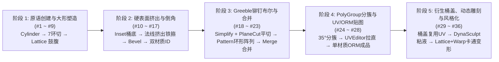

# 第 04 章 · 内置几何体建模工具箱（Modeling Mode）：从零多边形拓扑、布尔切割、UV 展开到动态雕刻全流程实战

> **对应官方示例关卡**：`/Game/Maps/Geometry/Geometry_ModelingTools`（关卡脚本类：`Geometry_ModelingTools_C`）  
> **所属模块目录**：`02_Geometry_几何建模与Nanite`  
> **关卡体量实测**：总 Actor 数 `97` | 官方展台数 `36`（`#1` ~ `#36` 墙面概念牌 + 地面参数实操牌零遗漏全覆盖） | 示例陈列 Actor 数 `47`  
> **核心资产路径**：`/Game/ExampleContent/Geometry_ModelingTools/`（全工序演进网格 `Meshes/ModelingTools/SM_MT_One ~ Fifteen`、PBR 与风格化材质 `Materials/`、ORM 贴图 `Textures/`）

---

## 一、 关卡总览：告别“改个倒角还要切回 Maya 导 FBX”的跨软件折返跑

在第一章第 2 号展台中我们曾看到虚幻引擎 4 时代的经典限制：*“静态网格体一旦导入编辑器，便无法直接修改其顶点拓扑”*。在过去的研发日常里，哪怕关卡设计师只是想把一个木桶压扁一点、给铁箍切个 `1cm` 倒角、用布尔运算在墙上挖一扇窗洞，或者给石头缝补一团有机粘液，都不得不经历 **“通知美术 → 打开 Maya/Blender → 修改拓扑与重拆 UV → 导出 FBX → 回 UE 重新导入覆盖”** 的漫长循环。

**Unreal Engine 5 内置建模模式（Modeling Mode，底层由 `GeometryProcessing` / `DynamicMesh` C++ 几何内核驱动）** 彻底终结了这种割裂！它直接把一整座现代 DCC 多边形建模工坊、三维布尔切割机、全功能二维 UV 编辑器（`UVEditor`）、烘焙工坊（`Bake`）与类似 ZBrush Sculptris Pro 的自适应动态拓扑雕刻机（`Dynamic Sculpting`）搬进了关卡视口！

`/Game/Maps/Geometry/Geometry_ModelingTools` 是一座设计极其精巧的**“工业道具全流程流水线博物馆”**。它采用了独特的 **“墙面主概念展牌（`Y = -900`） + 地面工具参数处方地牌（`Y = -795`）”** 双轨配对布局，用整整 **36 座展台**、15 代演进网格资产（`SM_MT_One` 直至 `SM_MT_Fifteen_StylisedDeform`），手把手演示了如何**不离开虚幻编辑器一步，从一颗最原始的基础圆柱体出发，完整打造出一只带金属箍、环形铆钉、单材质 ORM 烘焙贴图、配套木盖、有机绿色粘液雕刻乃至夸张卡通风格化的游戏级木桶资产**！

---

## 二、 几何管线深潜：为什么 Modeling Mode 能做到既灵活编辑又不伤运行时性能？

在逐一拆解 36 座展台之前，作为几何管线专家，我们需要看清 Modeling Mode 背后精妙的**“编辑态动态网格（`FDynamicMesh3`） ↔ 运行态静态缓冲区（`UStaticMesh`）双态转换架构”**：

1. **编辑态计算内核 —— `UE::Geometry::FDynamicMesh3`**：
   传统的 `FStaticMeshLODResources` 是为 GPU 连续读取优化的扁平数组，删掉一个三角形就要整块重排内存，根本无法做实时拓扑手术。当你点击建模工具面板的任意工具（如 `PolyGroup Edit`、`Mesh Boolean` 或 `Dynamic Sculpting`）时，引擎在后台瞬间将选中的 `UStaticMesh` 反序列化为携带完整**边-面邻接双向拓扑索引（Edge-Triangle Adjacency）、多边形组属性层（`FDynamicMeshPolygroupAttribute`）与法线/UV 覆盖层（Overlays）**的 `FDynamicMesh3` 对象，所有实时切割、布尔求交、局部边分裂（Edge Split）与边坍缩（Edge Collapse）都在毫秒级完成预览。
2. **提交固化（Accept）写回标准资产**：
   当你调整满意并点击视口下方的 **`Accept`（确认）** 按钮时，引擎自动将 `FDynamicMesh3` 写回标准的 `FMeshDescription` 并编译更新为纯粹的 `UStaticMesh`（甚至如果你在工程中构建程序化工具，还可以直接通过 **Geometry Script 蓝图/Python 函数库** 调用与本展厅一模一样的 C++ 算子自动批量处理成千上万个网格！）。

---

## 三、 逐展台（#1 ~ #36）零遗漏深度拆解

### 展台 #1：`Modeling Tools` — 内置建模工坊总纲与从零造桶命题

- **展牌标识与空间坐标**：`BP_DemoDisplay1` | `(480, -900, 0)`
- **官方展牌原文**：`UE's Modeling editor offers tools for creating and sculpting static meshes. It allows you to quickly create, prototype, and edit meshes with ease. In the text below, the parameters for each tool are explained to help you understand and adjust settings efficiently during the mesh creation process. Use Alt+C in the viewport to see the meshes topology. This map will demonstrate modeling a barrel from scratch using UE Modeling Tools`

#### 展台解析
1 号墙面展牌确立了全关的主线任务：在引擎内从零完整构建一只高精度铁箍木桶。在浏览后续所有展台时，除了观察每个展台上专门并排摆放的蓝色自发光线框副本外，你也可以随时切换视口线框模式（`Alt + 2` Wireframe / `Alt + 4` Lit）或碰撞拓扑视图（`Alt + C`）检视每一步手术后的多边形布线质量。

---

### 展台 #2：`Parameters` — 地面参数处方地牌导览与全局光照基座

- **展牌标识与空间坐标**：`BP_DemoDisplay5` | `(480, -794, 3)`
- **官方展牌原文**：`These floor stands will demonstrate the parameters used in the Modeling Tools`
- **展台内环境与基础 Actor（5 个）**：
  - `DirectionalLight`（`Intensity = 6`，`LightColor = (1, 1, 1, 1)`，`CastShadows = true`，`Mobility = Movable`）
  - `SkyLight`（`Intensity = 3`，`LightColor = (1, 1, 1, 1)`，`CastShadows = true`，`Mobility = Movable`）
  - `SkyAtmosphere`（`SkyAtmosphereComponent`）
  - `ExponentialHeightFog`（`HeightFogComponent0`）
  - `Actor`（挂载 `ChaosDebugDrawComponent_0`）

#### 展厅双排阅读约定说明
正如 2 号实拍图所示，本展厅从第 4 站开始，几乎每一组工序都由**一高一低两座展牌**协同呈现：后方墙面大牌（如 `#4, #6, #8...`）阐述造型设计思想与拓扑原理；前方脚下斜置的地面小牌（如 `#5, #7, #9...`）则精确列出在 Modeling Mode 面板中点击的子菜单路径与每一项数值参数，方便你随时在旁边空地上 1:1 动手复刻！

---

### 展台 #3：`Using Modeling Tools` — 启动建模模式与九大工具分类面板解析

- **展牌标识与空间坐标**：`BP_DemoDisplay2` | `(1494, -900, 0)`
- **官方展牌原文**：`You can access the modeling tools panel by using the selection dropdown above the viewport. Alternatively, you can press Alt+F5 to open it quickly.`
- **陈列示例 Actor（2 个界面导览展示板）**：
  - `Plane`：挂载材质 `/Game/ExampleContent/Geometry_ModelingTools/Materials/M_ModelingTools_Selection`（采样顶部模式切换下拉菜单截图 `T_ModelingTools_Selection`）。
  - `Plane2`：挂载材质 `/Game/ExampleContent/Geometry_ModelingTools/Materials/M_ModelingTools_Panel`（采样左侧纵向工具栏截图 `T_ModelingTools_Panel`）。

#### 工具箱全景速览
在编辑器左上角点击 `Selection Mode` 下拉框切换至 **`Modeling`（快捷键 `Shift + 5` 或展牌提示的自定义快捷呼出）**，左侧将展开九大核心模块：
- **`Create`（原语与扫掠生成）**：盒体、圆柱、球体、楼梯、路径挤出 `Path Extrude`、旋转车削 `Revolve`；
- **`XForm`（变换、枢轴、阵列与合并分裂）**：`Transform`、`Edit Pivot`、`Pattern`、`Merge`、`Split`；
- **`Deform`（空间变形与有机雕刻）**：`Vertex Sculpt`、`Dynamic Sculpt`、`Lattice` 晶格变形、`Warp` 扭曲膨胀、`Displace` 噪波/贴图置换；
- **`Model`（多边形拓扑与布尔切割）**：`PolyGroup Edit`（推拉、内插、倒角、环切）、**`Mesh Boolean`（三维集合并/差/交布尔运算）**、**`Plane Cut`（平面裁切）**、`PolyCut`；
- **`Mesh`（三角网重拓扑与修复）**：**`Simplify`（QEM 减面）**、`Remesh`（各向同性均匀重布线）、`Weld Edges`、`Fill Holes`、`VoxWrap`（体素包裹水密化）；
- **`Attributes` & `UVs` & `Bake` & `Volumes`**：材质槽管理、多边形组生成、专业 `UVEditor`、高模向低模烘焙法线/AO/曲率贴图以及碰撞体生成（`Mesh To Collision`）。

---

### 展台 #4：`Create (A Barrel)` — 参数化几何原语起始建模思想

- **展牌标识与空间坐标**：`BP_DemoDisplay3` | `(2997, -900, 0)`
- **官方展牌原文**：`The Create tool is used to generate simple shapes, which typically serve as the starting point for meshes. These shapes can then be manipulated and refined to fit your desired design.`

#### 设计要点
任何复杂的工业道具都始于最契合其主轮廓的基本几何体（Blocking Out）。对于旋转对称的木桶而言，直接以正确物理尺寸（高度 `1.5 米`、直径 `1 米`）生成分段规整的参数化圆柱体（`Cylinder`），不仅能自带端正的初始柱面 UV 与上下底面 PolyGroup 分组，还能将新生成的 `UStaticMesh` 直接落盘保存在工程指定目录（通过 `Create` 面板顶部的 `Output Type = Static Mesh` 控制）。

---

### 展台 #5：`[参数实操地牌：Create -> Cylinder 初始圆柱体生成]`

- **展牌标识与空间坐标**：`BP_DemoDisplay4` | `(2991, -795, 3)`
- **官方展牌参数处方**：
  - `Create -> Cylinder`
  - `Radius = 50`（半径 50 cm，即桶径 100 cm）
  - `Height = 150`（桶高 150 cm）
  - `Show Wireframe = True`
  - `Accept`
- **陈列示例 Actor（2 个：实体着色 + 拓扑线框双生对照）**：
  - `SM_MT_One`：引用第一代基础圆柱网格 `/Game/ExampleContent/Geometry_ModelingTools/Meshes/ModelingTools/SM_MT_One`，覆盖哑光灰底材质 `/Game/ExampleContent/Geometry_ModelingTools/Materials/M_BasicMaster`（含三维向量参数 `Base Color = (0.1615, 0.1615, 0.1615)`、标量 `Roughness = 0.8` 与 `Metallic`）。
  - `SM_MT_One2`：引用同一个 `SM_MT_One`，覆盖科技蓝线框材质实例 `/Game/ExampleContent/Geometry_ModelingTools/Materials/MI_Modeling_Wireframe`（父材质 `M_Wireframe_Master`，`Color = (0.0837, 0.3832, 1.0, 1.0)`，`EmissivePower = 0.5`）。
  - **拓扑观察**：此时侧面竖向条带仅由上下两端顶点拉通，侧壁尚无横向分段，无法弯曲出木桶弧度——这正是下一站 `#6/#7` 要解决的问题。

---

### 展台 #6：`Edge Loops` — 循环边插入与外轮廓剪影支撑线原理

- **展牌标识与空间坐标**：`BP_DemoDisplay6` | `(3985, -900, 0)`
- **官方展牌原文**：`By adding edge loops, you can further manipulate the mesh into a more refined and suitable shape. Focusing on defining a strong silhouette is an excellent starting point for shaping the mesh effectively.`

#### 拓扑原理
多边形建模的第一黄金法则是 **“轮廓优先（Silhouette First）”**。笔直的长条三角面无法表现弧线，必须在圆柱侧壁沿高度方向均匀切入多道水平 **循环边（Edge Loops）**，为后续中部向外鼓胀变形提供充足的纬度关节点。

---

### 展台 #7：`[参数实操地牌：Insert Edge Loop 等距七环线切分]`

- **展牌标识与空间坐标**：`BP_DemoDisplay7` | `(3979, -795, 3)`
- **官方展牌参数处方**：
  - `Model Mode -> Insert Edge Loop`
  - `Position = Even`（等间距均匀分布模式）
  - `Loops = 7`（一次性等距插入 7 道水平环线，将桶身高度均分为 8 段）
- **陈列示例 Actor（2 个）**：
  - `SM_MT_Two`（`M_BasicMaster` 着色）与 `SM_MT_Two2`（`MI_Modeling_Wireframe` 线框），引用第二代网格 `/Game/ExampleContent/Geometry_ModelingTools/Meshes/ModelingTools/SM_MT_Two`。
- **底层细节**：为什么 GPU 网格明明是由三角形组成的，`Insert Edge Loop` 却能像在 Maya 四边面（Quad）模型上一样精准绕圆柱一圈切出水平环线，而不会被斜向对角线卡住？因为 `Create -> Cylinder` 在生成 `SM_MT_One` 时，自动把每两个拼成矩形的三角形标记为了同一个 **Quad PolyGroup（多边形组）**，`Insert Edge Loop` 正是在 PolyGroup 逻辑四边面拓扑层上寻路切分的！

---

### 展台 #8：`Shaping` — 逐环缩放与自由晶格变形（FFD）塑形对比

- **展牌标识与空间坐标**：`BP_DemoDisplay8` | `(4993, -900, 0)`
- **官方展牌原文**：`Once the topology is improved, you can start manipulating the mesh. Several methods can be used to create the barrel silhouette: scaling each loop individually or using deform tools to achieve the desired shape more efficiently.`

#### 效率对比
如果手动一圈一圈选中 7 道循环边分别按 `1.05, 1.12, 1.18, 1.20...` 缩放，稍有不慎弧线就会变得凹凸不平；而采用 **`Deform -> Lattice`（自由晶格变形器，Free-Form Deformation）**，只需拉动包围盒腰部的一圈晶格控制点，内部 7 道环线就会按光滑的三次伯恩斯坦多项式（Bernstein Polynomial）或三线性插值自动形成天衣无缝的饱满桶腹曲线！

---

### 展台 #9：`[参数实操地牌：Deform -> Lattice 晶格中腹膨胀塑形]`

- **展牌标识与空间坐标**：`BP_DemoDisplay9` | `(4987, -795, 3)`
- **官方展牌参数处方**：
  - `Deform -> Lattice`
  - `Scale from the middle`（框选中间一层晶格控制点向外水平等比放大）
  - `ZAxis Resolution = 3`（Z 轴高度方向设为上、中、下 3 层控制点，锁死顶底两层不动，仅撑大中间层！）
- **陈列示例 Actor（2 个）**：
  - `SM_MT_Three`（着色）与 `SM_MT_Three2`（线框），引用第三代鼓腹网格 `/Game/ExampleContent/Geometry_ModelingTools/Meshes/ModelingTools/SM_MT_Three`。

---

### 展台 #10：`Extrude` — 内插面（Inset）与挤出（Extrude）构建顶底内凹木盖槽

- **展牌标识与空间坐标**：`BP_DemoDisplay10` | `(6001, -900, 0)`
- **官方展牌原文**：`The Extrude tool allows you to either inset or extend geometry, enabling the creation of new faces, edges, or depth in the mesh for more complex shapes and details.`

#### 结构造型分析
真实木桶的上下桶盖绝不是与桶帮外沿齐平的实心铁疙瘩，而是桶帮木板略高出一截形成护沿（Chime），桶底木板向内凹陷嵌在槽里。这需要两步连招：先用 **`Inset`（内插）** 在顶底圆面上向内收缩出一圈环形桶壁厚度，再用 **`Extrude`（向内负向挤出）** 把中心圆面往桶肚子里推下去。

---

### 展台 #11：`[参数实操地牌：PolyGroup Edit 顶底内插与内凹挤出]`

- **展牌标识与空间坐标**：`BP_DemoDisplay11` | `(5995, -795, 3)`
- **官方展牌参数处方**：
  - `Model -> Polygroup Edit`
  - `Select both faces holding shift`（按住 `Shift` 同时选中顶面和底面两个圆盘 PolyGroup）
  - `Inset`（向内收缩出桶帮边缘厚度）
  - `Extrude`（向内推入形成凹槽深度）
- **陈列示例 Actor（2 个）**：
  - `SM_MT_Four`（着色）与 `SM_MT_Four2`（线框），引用第四代网格 `/Game/ExampleContent/Geometry_ModelingTools/Meshes/ModelingTools/SM_MT_Four`。

---

### 展台 #12：`Extrude and Loop` — 桶身金属箍圈（Metal Bands）结构雕刻

- **展牌标识与空间坐标**：`BP_DemoDisplay12` | `(6991, -900, 0)`
- **官方展牌原文**：`Using the same tools as before, metal bands have been added around the barrel, further refining and enhancing its silhouette for a more detailed and realistic appearance.`

---

### 展台 #13：`[参数实操地牌：桶箍环切与沿三角面法线定距挤出]`

- **展牌标识与空间坐标**：`BP_DemoDisplay13` | `(6985, -795, 3)`
- **官方展牌参数处方**：
  - `Model -> Polygroup Edit`
  - `Insert Edge Loops at the desired location`（在桶身上中下位置切出铁箍的上下边界环线）
  - `Select the faces`（选中整圈铁箍环带面）
  - `Extrude (Distance = Fixed = 3)`（固定向外凸出 `3 cm` 厚实铁箍）
  - `(Direction Mode = Selected Tri Normals)`
- **陈列示例 Actor（2 个）**：
  - `SM_MT_Five`（着色）与 `SM_MT_Five2`（线框），引用第五代带箍木桶 `/Game/ExampleContent/Geometry_ModelingTools/Meshes/ModelingTools/SM_MT_Five`。

#### 关键参数点睛：为什么 `Direction Mode` 必须选 `Selected Tri Normals`？
在挤出环绕圆柱一整圈的铁箍面时，如果保持默认的单轴方向（`Single Direction`），整圈铁箍只会朝某一个侧面偏心鼓出去！只有将方向模式切换为 **`Selected Tri Normals`（沿各自选中面的局部法线方向放射状法向挤出）**，整圈 `360°` 铁箍才会均匀一致地向外加厚 `3 cm`！

---

### 展台 #14：`Bevel` — 倒角软化与实时渲染 `0.5 cm` 最小高光宽度黄金定律

- **展牌标识与空间坐标**：`BP_DemoDisplay14` | `(8012, -900, 0)`
- **官方展牌原文**：`An edge can be chamfered or softened using a bevel. To maintain visual clarity, the bevel should not be smaller than 0.5 cm, ensuring the edge remains noticeable and clean in the final model. Left Model: Shows the barrel with a bevel applied to its edges, smoothing and softening the shape of the barrel itself. Right Model: Displays the metal bands with a bevel applied, refining the edges of the bands for a more polished and realistic look.`

#### 美术总监级渲染经验：为什么游戏模型的倒角不能像工业 CAD 那样切 `0.5 mm`，而要求 `>= 0.5 cm`？
现实世界里刀锋般锐利的铁皮折边虽然只有不到 `1 mm` 宽，但在 1080p / 4K 游戏屏幕距离 3 米观看时，`1 mm` 窄的倒角投影到屏幕上不到 **0.2 个像素宽**！光栅化器采样要么漏掉它变成死黑硬折角，要么在镜头轻微晃动时触发刺眼的 **镜面高光闪烁锯齿（Specular Aliasing / Fireflies）**！
因此，实时游戏美术有一条铁律：**适度夸大硬表面倒角宽度（至少 `0.5 cm ~ 1.5 cm`）**，让光线在转折边缘稳定覆盖 2~3 个像素宽的柔顺高光带，这才是模型摆脱“廉价纸盒感”的灵魂所在！

---

### 展台 #15：`[参数实操地牌：Edge Loop Bevel 桶身 1.5cm 与铁箍 0.75cm 分步倒角]`

- **展牌标识与空间坐标**：`BP_DemoDisplay15` | `(8006, -795, 3)`
- **官方展牌参数处方**：
  - `Model -> Polygroup Edit`
  - `Edge Selection` + `Edge Loop Selection = True`（开启循环边连选，点一下即选中整圈棱边）
  - `Bevel`：`Barrel Bevel Amount = 1.5`（桶口木沿倒角 `1.5 cm`） / `Band Bevel Amount = 0.75`（铁箍边缘倒角 `0.75 cm`）
- **陈列示例 Actor（4 个，分两阶段并列展示）**：
  - 左组（完成桶口 `1.5 cm` 倒角）：`SM_MT_Six`（着色）与 `SM_MT_Six2`（线框），引用 `/Game/ExampleContent/Geometry_ModelingTools/Meshes/ModelingTools/SM_MT_Six`。
  - 右组（追加完成铁箍 `0.75 cm` 倒角）：`SM_MT_Seven`（着色）与 `SM_MT_Seven2`（线框），引用 `/Game/ExampleContent/Geometry_ModelingTools/Meshes/ModelingTools/SM_MT_Seven`。

---

### 展台 #16：`Material ID` — 阶段性多材质 ID 分离与视觉材质区分

- **展牌标识与空间坐标**：`BP_DemoDisplay16` | `(9524, -900, 0)`
- **官方展牌原文**：`To improve the clarity of the model, it is divided into two Material IDs rather than just one. This allows for different materials to be applied to distinct parts of the mesh, such as the barrel and the metal bands, enhancing the visual distinction between these elements.`

---

### 展台 #17：`[参数实操地牌：Attributes -> Edit Materials 木桶与铁箍材质槽绑定]`

- **展牌标识与空间坐标**：`BP_DemoDisplay17` | `(9518, -795, 3)`
- **官方展牌参数处方**：
  - `Attributes -> Edit Materials`
  - `Add a new material to the array`（在材质槽数组新增第 2 个槽位 `[1]`）
  - `Select faces -> Choose the newly added material as Active Material`（框选四道铁箍面赋予新材质槽）
- **陈列示例 Actor（1 个）**：
  - `SM_MT_Eight`：引用第八代网格 `/Game/ExampleContent/Geometry_ModelingTools/Meshes/ModelingTools/SM_MT_Eight`，挂载两套对比鲜明的材质实例：
    - 槽 `[0]` 木质桶身：`/Game/ExampleContent/Geometry_ModelingTools/Materials/MI_BasicWood`（父材质 `M_BasicMaster`，重载深胡桃木色 `Base Color = (0.1608, 0.0941, 0.0314, 1.0)`，继承高粗糙度 `0.8`）；
    - 槽 `[1]` 金属铁箍：`/Game/ExampleContent/Geometry_ModelingTools/Materials/MI_BasicMetal`（父材质 `M_BasicMaster`，重载金属度 `Metallic = 0.9`、光滑度 `Roughness = 0.35`、深铁灰 `Base Color = (0.1615, 0.1615, 0.1615)`）。
  - *注：在原型阶段拆出多个 Material ID 不仅方便预览配色，还能在后续导出至 Substance Painter 或引擎内置 `Bake` 工具时自动生成干净的 **Material ID Color Mask**！而在最终成品（展台 `#28`）时，它们会被重新整合回单材质槽以省去多余 Draw Call。*

---

### 展台 #18：`"Greebles"` — 工业光魔微细节缀件（铆钉）减面与布尔平切优化

- **展牌标识与空间坐标**：`BP_DemoDisplay22` | `(10499, -900, 0)`
- **官方展牌原文**：`Models with added details tend to be more appealing and sell better. For example, on a metal band, a rivet can be created using a sphere. To optimize the model, the Simplify tool is used to reduce the polygon count, and then the mesh is cut in half, reducing complexity while maintaining detail.`

#### 什么是“Greebles（微结构点缀件）”？以及布尔切割（Plane Cut / Mesh Boolean）的威力
**"Greeble"** 一词源自乔治·卢卡斯创立的工业光魔（ILM）在制作《星球大战》歼星舰模型时的行话——指附着在大块单调表面上用于瞬间拉满精密工业感与视觉比例尺的小铆钉、螺栓、管线与散热片。
这里演示了一套极其老练的游戏资产优化连招：
1. 生成一颗小球做铆钉，先用 **`Mesh -> Simplify`（基于二次误差度量 QEM 的三角网减面器）** 把默认几百面的高密球压低到几十面；
2. 既然铆钉有一半永远埋在铁箍里面看不见，留着纯属浪费面数甚至引发第 03 章讲过的近表面 Overdraw，于是直接调用 **`Model -> Plane Cut`（平面布尔裁切，不勾选 Fill Cut Hole 封口）** 一刀切掉看不见的下半球，面数再砍一半！
   *(顺带一提：若你要在木桶上生生凿出一个破损弹孔或酒龙头插孔，只需调用隔壁同源的 **`Model -> Mesh Boolean`（网格布尔差集 Difference）**，底层基于精确浮点谓词的 `Fast Winding Number` 布尔引擎能干净利落地完成无破面掏洞！)*

---

### 展台 #19：`[参数实操地牌：Simplify 减面、Plane Cut 平切与 Pivot 底部居中对齐]`

- **展牌标识与空间坐标**：`BP_DemoDisplay23` | `(10492, -795, 3)`
- **官方展牌参数处方**：
  - `Mesh -> Simplify`（降低初始球体面数）
  - `Model -> Plane (in half)`（调用 `Plane Cut` 沿赤道切去后半球）
  - `XForm -> Pivot -> Bottom Center`（将半球铆钉的枢轴点精准吸附到底部切面圆心，极其关键！方便贴合铁箍表面与后续绕心旋转！）
  - `XForm -> Transform, Rotate (90), and scale`（翻转 `90°` 使半球朝外并缩放到合适尺寸贴在铁箍上）
- **陈列示例 Actor（2 个）**：
  - `SM_MT_Nine2`：第九代木桶本体 `/Game/ExampleContent/Geometry_ModelingTools/Meshes/ModelingTools/SM_MT_Nine`（带 `MI_BasicWood` + `MI_BasicMetal`）。
  - `SM_Rivet_Two_Pattern`：单组定位好的铆钉网格 `/Game/ExampleContent/Geometry_ModelingTools/Meshes/ModelingTools/SM_Rivet_Two_Pattern`，特意赋予醒目的宝蓝色高亮材质实例 `/Game/ExampleContent/Geometry_ModelingTools/Materials/MI_Blue`（`Base Color = (0.0, 0.029, 0.620, 1.0)`）以便你在展台上秒看清小小的铆钉位置！

---

### 展台 #20：`Pattern` — 结构化几何阵列复制器

- **展牌标识与空间坐标**：`BP_DemoDisplay18` | `(11496, -900, 0)`
- **官方展牌原文**：`The Pattern tool allows you to duplicate meshes in a structured pattern. In this case, the rivet is duplicated at equal intervals around the metal band, ensuring consistent spacing and alignment for added detail.`

---

### 展台 #21：`[参数实操地牌：XForm -> Pattern 环形阵列排布整圈铁箍铆钉]`

- **展牌标识与空间坐标**：`BP_DemoDisplay19` | `(11490, -795, 3)`
- **官方展牌参数处方**：
  - `XForm -> Pattern`（支持线性 `Line`、二维网格 `Grid` 与圆形放射 `Circle` 三种模式）
  - `Shape = Circle`（以木桶中轴线为圆心，一键将蓝色铆钉等角度环绕铁箍复制成整圈阵列！）
- **陈列示例 Actor（2 个）**：
  - `SM_MT_Nine`：木桶主体。
  - `SM_Rivets_Combined`：由 Pattern 工具一次性输出的全圈合并铆钉环网格 `/Game/ExampleContent/Geometry_ModelingTools/Meshes/ModelingTools/SM_Rivets_Combined`（覆盖醒目蓝 `MI_Blue`）。

---

### 展台 #22：`Merge` — 多网格拓扑合并与材质贴图烘焙归一理念

- **展牌标识与空间坐标**：`BP_DemoDisplay24` | `(12485, -900, 0)`
- **官方展牌原文**：`The Merge tool combines multiple static meshes into a single new actor. It also allows materials to be baked together into a single material, which can share a unified UV sheet, optimizing the model for better performance and simplifying texture management.`

#### 管线内核解析：从零散拼件到单一高性能游戏资产的关键一跃
在 `#21` 结束时，木桶与铆钉环还是关卡中两个分离的 `StaticMeshActor`。通过 **`XForm -> Merge`** 将它们焊接为单一网格资产，不仅彻底消除了多 Actor 场景管理碎片，而且配合建模工具箱中的 **`Bake`（`Bake Mesh Attribute Maps` / `Bake Materials`）**，可以把原本拆成木头、铁箍、铆钉的多个材质球直接光栅化烘焙到同一张统一的新 UV 贴图集中！

---

### 展台 #23：`[参数实操地牌：XForm -> Merge 多网格合并固化]`

- **展牌标识与空间坐标**：`BP_DemoDisplay25` | `(12479, -794, 3)`
- **官方展牌参数处方**：
  - `Select all Meshes`（同时框选木桶 `SM_MT_Nine` 与整圈铆钉 `SM_Rivets_Combined`）
  - `XForm -> Merge`
- **陈列示例 Actor（1 个）**：
  - `SM_MT_Nine3`：合并后的完整单一体网格 `/Game/ExampleContent/Geometry_ModelingTools/Meshes/ModelingTools/SM_MT_Eleven_Combined`（此时暂保留 `[0] MI_Blue`、`[1] MI_BasicWood`、`[2] MI_BasicMetal` 三槽过渡，准备进入下一步统一拆 UV）。

---

### 展台 #24：`Polygroups` — 多边形分组拓扑抽象与 UV 岛预切分策略

- **展牌标识与空间坐标**：`BP_DemoDisplay20` | `(13507, -900, 0)`
- **官方展牌原文**：`In Polygroups, mesh triangles are grouped into sections to streamline modeling and unwrapping processes. Polygroups can be selected individually for easier manipulation or, as in this case, used to define UV islands, which helps organize and simplify the UV mapping process. This technique ensures cleaner and more efficient texture placement across different sections of the model.`

#### 管线内核解析：为什么 UE5 拆 UV 前要先算一遍 `Polygroups`？
传统在 Maya 里拆 UV 最头疼的就是沿着几百条细碎倒角边一条条手选切缝（Cut Seams）。而在 UE5 Modeling Mode 中，**PolyGroups 就是天然的 UV 岛蓝图**！只要把法线转折小于一定角度的连续平滑面自动归入同一个色块组（PolyGroup），下一秒把整个模型丢给 UV 展开器说一句*“请按 PolyGroup 边界切开成岛”*，整只复杂木桶连同几十颗小铆钉的 UV 壳就瞬间干净利落地分家完毕了！

---

### 展台 #25：`[参数实操地牌：Generate Polygroups 35° 法线夹角自动分簇]`

- **展牌标识与空间坐标**：`BP_DemoDisplay21` | `(13501, -794, 3)`
- **官方展牌参数处方**：
  - `Attributes -> Generate Polygroups`
  - `Angle Tolerance = 35`（相邻三角面法线夹角在 `35°` 以内的自动归为同一多边形组；超过 `35°` 的桶底折角、铁箍台阶则自动断开分簇！）
  - `Each color represents a polygroup.`
- **陈列示例 Actor（1 个）**：
  - `SM_MT_Nine4`：引用分簇后的网格 `/Game/ExampleContent/Geometry_ModelingTools/Meshes/ModelingTools/SM_MT_Twelve_Polygroups`，覆盖色彩斑斓的多边形组可视化材质 `/Game/ExampleContent/Geometry_ModelingTools/Materials/M_Polygroups_Modeling`（采样贴图 `T_ModelingTools_Polygroups`）。

---

### 展台 #26：`UV's` — 三维流形二维参数化展开与木纹拉直排布精修

- **展牌标识与空间坐标**：`BP_DemoDisplay26` | `(14492, -900, 0)`
- **官方展牌原文**：`The unwrapping process involves projecting the 3D mesh's faces into 2D space, creating a texture net for efficient texturing. Left Mesh: Shows the default UVs, where the projection is automatic and may result in less optimal texture mapping. Right Mesh: Displays custom UVs that have been rotated and straightened, making them more organized to assist in precise texturing. This improves control and quality during the texturing process.`

#### 为什么桶身和铁箍的 UV 必须“拉直摆正（Straighten & Orient）”？
观察 26/27 号展台左右两个贴着棋盘格的木桶：如果任由保角展开器（Conformal Unwrap）把鼓腹木桶展成一把弯弯曲曲的扇子（左侧默认 UV），首先木板竖向纹理贴上去会歪斜走样，其次斜着的梯形边在像素网格上会产生严重的贴图锯齿且浪费大量矩形空白区！而在内置独立窗口 **`UVs -> UVEditor`** 中将桶帮与铁箍 UV 岛旋转摆正、拉成横平竖直的矩形条带（右侧定制 UV），哪怕直接套用一张竖直平铺的木纹 Trim Sheet 也能严丝合缝！

---

### 展台 #27：`[参数实操地牌：UVEditor 基于 Polygroups 一键生成与规整 UV 岛]`

- **展牌标识与空间坐标**：`BP_DemoDisplay27` | `(14486, -794, 3)`
- **官方展牌参数处方**：
  - `UVs -> UVEditor`（打开虚幻引擎内置双视口专业 UV 编辑器）
  - `Unwrap -> Island Generation = Polygroups`（直接读取 `#25` 生成的 `35°` PolyGroups 作为 UV 切缝岛！）
- **陈列示例 Actor（2 个棋盘格纹理密度与方向对照桶）**：
  - `SM_MT_Nine5`（左）：未规整 UV 的 `SM_MT_Twelve_Polygroups`，挂载棋盘格测试材质 `/Game/ExampleContent/Geometry_ModelingTools/Materials/M_UV_Modeling`（由 `TexCoord[0]` 经 `Multiply` 缩放后采样 `/Game/ExampleContent/Geometry_ModelingTools/Textures/T_UVvistexture`）。
  - `SM_MT_Nine6`（右）：经 `UVEditor` 完成展开、拉直与紧密装箱后的第十三代网格 `/Game/ExampleContent/Geometry_ModelingTools/Meshes/ModelingTools/SM_MT_Thirteen_Unwrap`，挂载同款 `M_UV_Modeling`，棋盘格方格横平竖直、大小高度均等！

---

### 展台 #28：`Finished Mesh` — 单材质槽 PBR ORM 通道打包写实成品检阅大厅

- **展牌标识与空间坐标**：`BP_DemoDisplay28` | `(16772, 0, 0)`（位于展厅中轴线黄金C位的成品圆台！）
- **陈列示例 Actor（6 个成品木桶组合陈列）**：
  - `SM_MT_Fourteen_Textured`（及副本 `2, 3, 4, 5` 共 5 只不同角度堆叠摆放的写实成品桶）：全部引用第十四代最终网格 `/Game/ExampleContent/Geometry_ModelingTools/Meshes/ModelingTools/SM_MT_Fourteen_Textured`，且**仅使用唯一 1 个材质槽**挂载 `/Game/ExampleContent/Geometry_ModelingTools/Materials/M_Barrel_Modeling`！
  - `SM_MT_Fourteen_Textured6`（1 只纯线框展示桶）：引用同一份 `SM_MT_Fourteen_Textured`，挂载 `MI_Modeling_Wireframe` 展示干净利落的最终三角网拓扑。

#### 资产深拆：工业级标准 PBR `ORM` 通道打包材质 `M_Barrel_Modeling`
还记得第 01 章第 7 号展台强调的“尽量把材质槽压缩到 1 个”吗？看看 28 号展台的 `M_Barrel_Modeling` 是如何用 **3 张贴图、1 个材质槽（1 次 Draw Call）** 同时细腻呈现出粗糙风化橡木板、磨砂锻打黑铁箍与亮银色磨损铆钉头的：
- `MaterialExpressionTextureSample_0`：采样色彩贴图 `T_Barrel_Modeling_A`（`SAMPLERTYPE_Color`，sRGB 开启）→ RGB 直连 **`MP_BaseColor`**；
- `MaterialExpressionTextureSample_1`：采样工业标准三合一线性打包贴图 **`T_Barrel_Modeling_ORM`**：
  - **`R`（红通道 = Occlusion）** → 直连 **`MP_AmbientOcclusion`**（压暗铁箍根部与铆钉四周环境遮蔽缝隙）；
  - **`G`（绿通道 = Roughness）** → 直连 **`MP_Roughness`**（木板区约 `0.75` 粗糙哑光，铆钉磨损尖端约 `0.25` 泛出油润光泽；之所以把最重要的粗糙度放在绿通道，是因为 DXT1/BC1 纹理压缩格式为绿通道分配了最高的 6-bit 精度！）；
  - **`B`（蓝通道 = Metallic）** → 直连 **`MP_Metallic`**（木板像素为 `0.0` 非金属，铁箍与铆钉像素为 `1.0` 纯金属）；
- `MaterialExpressionTextureSample_2`：采样切线空间法线贴图 `T_Barrel_Modeling_N`（`SAMPLERTYPE_Normal`，BC5 压缩）→ RGB 直连 **`MP_Normal`**，注入木纹年轮凹凸与铁皮锤纹细节。

---

### 展台 #29：`Extras` — 衍生模块化配件（独立可拆卸木桶盖）扩展设计

- **展牌标识与空间坐标**：`BP_DemoDisplay29` | `(18501, -900, 0)`
- **官方展牌原文**：`Similar tools and processes were used to expand the mesh, resulting in the creation of a separate mesh to function as a lid. This approach ensures the lid matches the barrel's style and is ready for further detailing and texturing.`

---

### 展台 #30：`[参数实操地牌：零新增贴图开销！桶盖复用既有纹理 UV 空间]`

- **展牌标识与空间坐标**：`BP_DemoDisplay30` | `(18506, -796, 3)`
- **官方展牌原文**：`The new lid mesh uses the same material as the barrel. It's unwrapped to the previous texture.`
- **陈列示例 Actor（2 个）**：
  - `SM_MT_Fourteen_Textured7`：敞口桶身，切换挂载手绘风格化材质 `/Game/ExampleContent/Geometry_ModelingTools/Materials/M_Barrel_Modeling_Stylized`。
  - `SM_MT_Lid_Barrel`：新建的独立圆形带把手木桶盖 `/Game/ExampleContent/Geometry_ModelingTools/Meshes/ModelingTools/SM_MT_Lid_Barrel`，挂载**完全同一份材质** `M_Barrel_Modeling_Stylized`！

#### 关卡美术省显存绝技：逆向贴图对齐（Unwrapping to Existing Texture / Trim Workflow）
30 号展台展示了一个极其聪明的省资源技巧：做完木桶后临时决定加一个独立的可掀开木盖子 `SM_MT_Lid_Barrel`，难道要为这一个小盖子再单独画一套新的 2K BaseColor + ORM + Normal 三张贴图吗？**完全不需要！** 直接在 `UVEditor` 中把新木盖的背景图设为已有的木桶贴图 `T_Barrel_Modeling_Stylized_A`，把盖板 UV 岛挪到桶底木板纹理区、把盖沿铁圈 UV 挪到铁箍纹理区——**显存增量 0 MB、新增材质球 0 个**，风格还 100% 浑然一体！
（`M_Barrel_Modeling_Stylized` 内部采样 `T_Barrel_Modeling_Stylized_A`、`T_Barrel_Modeling_Stylized_ORM` 与 `T_Barrel_Modeling_Stylized_N`，并在 Metallic 通道串联了一个 `MaterialExpressionMultiply_0` 用于风格化金属质感微调。）

---

### 展台 #31：`Sculpting` — 引擎内置实时动态拓扑雕刻（Dynamic Sculpting）总论

- **展牌标识与空间坐标**：`BP_DemoDisplay31` | `(19485, -900, 0)`
- **官方展牌原文**：`The Sculpting tool is a powerful tool for modifying mesh shapes. With Dynamic Sculpting, you can directly edit the mesh's geometry, adding or removing detail in real-time, which allows for more organic and fluid adjustments to the model's shape and structure.`

#### 为什么说 `Dynamic Sculpting` 比普通顶点雕刻（Vertex Sculpt）强一个维度？
普通顶点推拉工具（`Vertex Sculpt`）受死原有顶点数量：如果你把一颗低面数球体拉出一根细长的章鱼触手或流淌的毒液挂丝，三角形会被拉成狭长的破面面条！而 **`Deform -> Dynamic Sculpting`** 内置了实时局部网格细分算子（类似 Blender Dyntopo / ZBrush Sculptris Pro）：**画笔刷到哪里，那里的三角形若大于笔刷设定的目标尺寸就会实时自动分裂增殖出密集的新小三角形**，让你随心所欲拉出圆润饱满的气泡与流体触须！

---

### 展台 #32：`[参数实操地牌：桶口放置初始球体胚料准备有机雕刻]`

- **展牌标识与空间坐标**：`BP_DemoDisplay32` | `(19478, -794, 3)`
- **官方展牌原文**：`A sphere has been placed inside the lid, and it has been scaled down ready to be sculpted.`
- **陈列示例 Actor（5 个：木桶、斜靠桶盖与待雕球体坯料及线框对照）**：
  - `SM_MT_Fourteen_Textured9`（桶身）与 `SM_MT_Lid_Barrel3`（桶盖）：材质 `M_Barrel_Modeling_Stylized`。
  - `SM_Goo_1`、`SM_Goo_3`（着色坯料）与 `SM_Goo_4`（线框坯料）：引用塞在桶口的基础压扁球体 `/Game/ExampleContent/Geometry_ModelingTools/Meshes/ModelingTools/SM_Goo_1`，等待画笔赋予生命。

---

### 展台 #33：`Sculpting (Deform)` — “雕刻期动态增面 + 定型后减面优化”有机建模闭环

- **展牌标识与空间坐标**：`BP_DemoDisplay33` | `(20500, -900, 0)`
- **官方展牌原文**：`The Deform -> Dynamic Sculpting tool was used to model a form of goo by pushing, pulling, and adding geometry to achieve an organic shape. To ensure smoother and more detailed sculpting, the mesh's geometry was increased during the sculpting process. After the desired shape was achieved, the geometry count was reduced to optimize the mesh while retaining its key details. This technique balances detail with performance efficiency.`

---

### 展台 #34：`[参数实操地牌：Dynamic Sculpting 负值三角尺寸雕刻溢出毒液泡泡]`

- **展牌标识与空间坐标**：`BP_DemoDisplay34` | `(20494, -794, 3)`
- **官方展牌参数处方**：
  - `Deform -> Dynamic Sculpting`
  - `Brush type = Sculpt / Smooth`（交替使用膨胀雕刻笔刷与平滑笔刷）
  - `Relative Tri Size = -5 (adds geo when brushing)`（将相对三角形尺寸调至负值 `-5`，笔刷划过之处自动加密细分网格！）
  - `Add some bulges and bubbles`（沿着桶沿向外拉出垂滴流淌的粘液鼓包与气泡，定型后再用 `Simplify` 回收平坦区多余面数）
- **陈列示例 Actor（3 个）**：
  - `SM_MT_Fourteen_Textured8`（木桶）与 `SM_MT_Lid_Barrel2`（被顶开的木桶盖）。
  - `SM_Goo_2`：完成动态雕刻的有机粘液网格 `/Game/ExampleContent/Geometry_ModelingTools/Meshes/ModelingTools/SM_Goo_2`，挂载晶莹剔透的荧光绿毒液材质实例 `/Game/ExampleContent/Geometry_ModelingTools/Materials/MI_Goo_Stylized`（父材质 `M_Goo`，半透明 `Opacity = 0.7`、湿滑低粗糙度 `Roughness = 0.2`、菲涅尔边缘发光指数 `ExponentIn = 5.505`、毒液绿主色 `Color = (0.013, 0.371, 0.028, 1.0)`）。

---

### 展台 #35：`Stylize` — 写实向手绘卡通美术风格的零重做变形转换

- **展牌标识与空间坐标**：`BP_DemoDisplay35` | `(21521, -900, 0)`
- **官方展牌原文**：`The barrel has been modified to incorporate a stylistic aesthetic suitable for certain games. The Lattice tool is used to create an angled look. A new texture is also applied. The Warp tool inflates the overall shape, adding character and a unique visual style to the model. These adjustments enhance the model's appeal and make it more fitting for specific game art styles.`

#### 美术风格跃迁解析
横竖笔直对称的木桶适合写实军事游戏，但放进《盗贼之海》或《堡垒之夜》这类欧美卡通风格化（Stylized）项目里就会显得呆板无趣。因为前面第 27 号展台已经把 UV 完美绑定在了网格顶点上，此时我们直接对成品木桶施加全局空间变形器（`Lattice` + `Warp`），**完全不需要重拆 UV 或重画贴图**，就能在 30 秒内赋予它“上宽下窄、微歪斜、充满弹性质感”的卡通性格特征！

---

### 展台 #36：`[参数实操地牌：3×3×3 晶格倾斜与 Warp Flare/Squish 夸张卡通变形]`

- **展牌标识与空间坐标**：`BP_DemoDisplay36` | `(21515, -794, 3)`
- **官方展牌参数处方**：
  - `Deform -> Lattice`：`X Y Z resolution = 3`（构建 `3×3×3` 共 27 控制点晶格，轻微拉拽顶部角点打破死板的左右对称感，营造生动的不对称手工艺倾斜角）
  - `Deform -> Warp`：`Operation Type -> Flare / Squish`（执行喇叭口张开与挤压变形，令桶口夸张外扩、桶腰紧致内收）
- **陈列示例 Actor（1 个压轴收官之作）**：
  - `SM_MT_Fifteen_StylisedDeform`：引用第十五代终极风格化变形网格 `/Game/ExampleContent/Geometry_ModelingTools/Meshes/ModelingTools/SM_MT_Fifteen_StylisedDeform`，搭配手绘风贴图材质 `M_Barrel_Modeling_Stylized`，为整场 36 展台的内置建模大师课画上惊艳句号！

---

## 四、 本章小结：UE5 内置 Modeling Mode 全工序速查路线图

回顾这趟从 `SM_MT_One` 到 `SM_MT_Fifteen` 的 36 站完整工业旅程，无论你是独立游戏全栈开发者、需要快速在白盒关卡（Greyboxing）阶段深化建筑细节的关卡设计师，还是需要现场修复外包模型破面与碰撞体的技术美术，都可以随时召唤 `Shift + 5` 工具箱：

1. **硬表面造型四板斧**：`Create` 原语定比例 → `Insert Edge Loop` 加支撑线 → `PolyGroup Edit` 做 `Inset / Extrude / Bevel (≥0.5cm)` → `Lattice / Warp` 调大剪影；
2. **微细节与减面优化**：善用 `Simplify` QEM 减面 + `Plane Cut / Mesh Boolean` 裁除不可见冗余面 + `Edit Pivot` 吸底 + `Pattern` 环形/网格阵列生成铆钉缀件，最后用 `Merge` 合并为单 Actor；
3. **无痛 UV 与单材质 ORM 闭环**：先跑 `Generate Polygroups (35°)` 自动切分逻辑面簇，再进 `UVEditor` 一键按 PolyGroup 成岛拉直，最终收敛到 `R=AO, G=Roughness, B=Metallic` 的单材质槽 PBR 高效渲染！

至此，**几何建模与 Nanite 模块（共四篇专章：StaticMeshes、FBX 导入、Nanite 微多边形、ModelingTools 内置建模）** 已圆满贯通！我们已经拥有了纤毫毕现的百万面石雕与精致的游戏道具，接下来，是时候点亮太阳与灯火，翻开第三大领域首篇专章 **`01_Lighting_Realtime`**——步入 **Lumen 实时全局光照、Virtual Shadow Maps 虚拟阴影与四大物理光源体系** 的璀璨光影殿堂！
