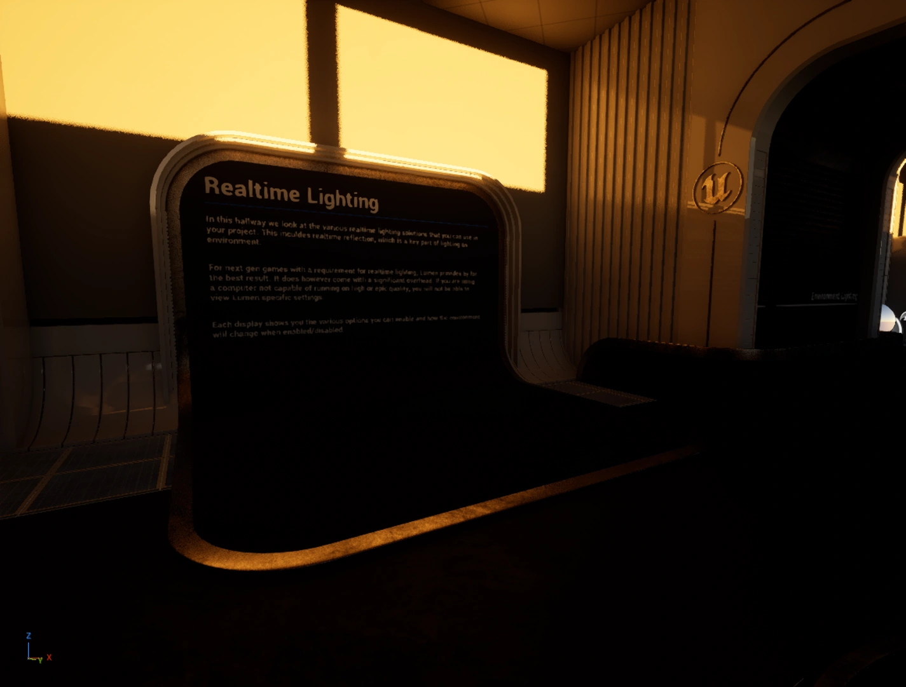
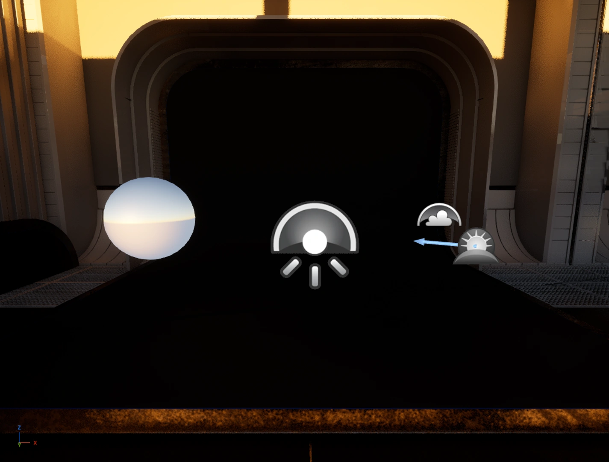
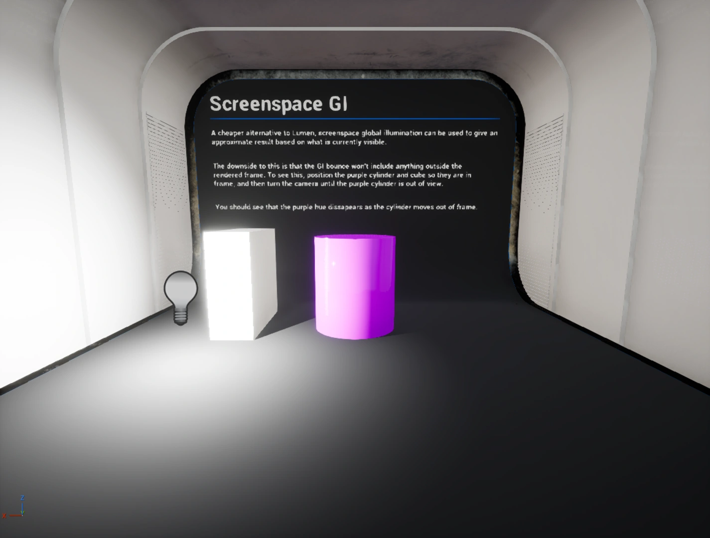
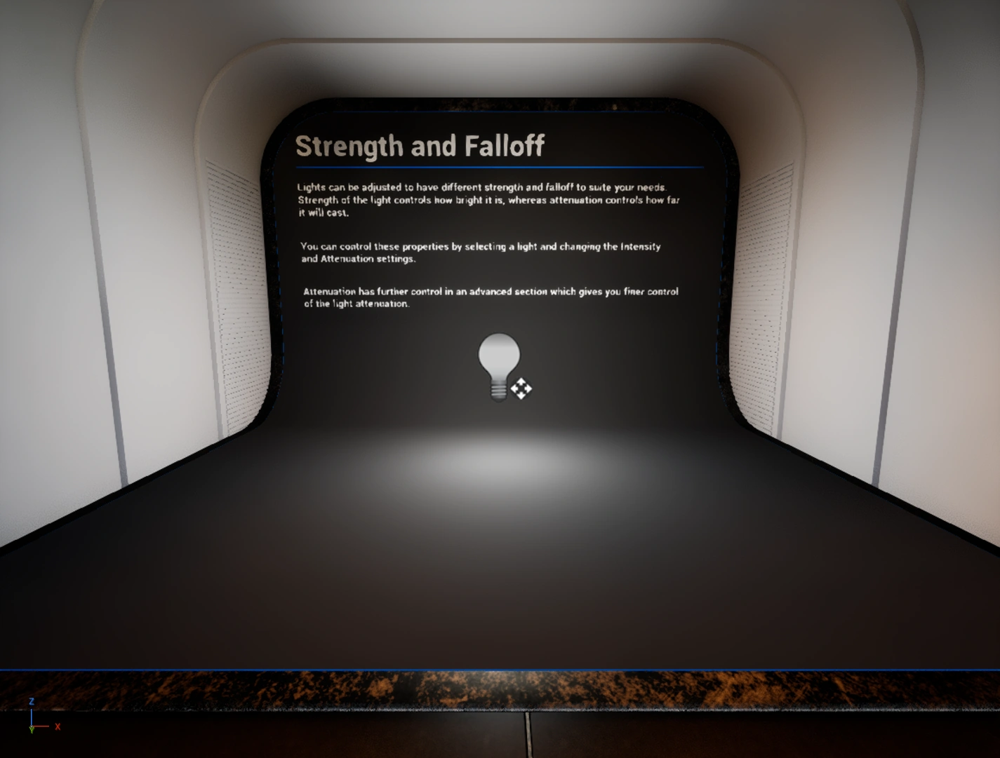

# 第 01 章 · 实时光源体系与 Lumen 全局光照：四大解析光源、混合光线追踪、VSM 虚拟阴影与光域网全解

> **对应官方示例关卡**：`/Game/Maps/Lighting/Lighting_Realtime`  
> **所属模块目录**：`03_Lighting_实时光照与Lumen`  
> **关卡体量实测**：总 Actor 数 `54` | 官方展台数 `14`（`#1` ~ `#14` 零遗漏全覆盖） | 示例光源与交互陈列 Actor 数 `27`  
> **核心资产路径**：`/Game/ExampleContent/Lighting/`（实时衰减与阴影蓝图 `Blueprint/BP_LightFalloffMod`、`BP_LightShadowMod`，测试材质 `Materials/M_AmbientPreview`、`M_BrightSurface`、`M_MetalReflection`）

---

## 一、 关卡总览：从“离线烘焙等待”迈向全动态实时光子交响

在实时图形学领域，如果说几何模型是世界的骨肉，那么**光照（Lighting）与阴影（Shadows）**就是赋予世界呼吸感与戏剧张力的灵魂。求解真实感画面的终极物理法则，正是詹姆斯·卡吉亚（James Kajiya）于 1986 年提出的**渲染方程（The Rendering Equation）**：

$$L_o(\mathbf{x}, \omega_o) = L_e(\mathbf{x}, \omega_o) + \int_{\Omega} f_r(\mathbf{x}, \omega_i, \omega_o) \, L_i(\mathbf{x}, \omega_i) \, (\mathbf{n} \cdot \omega_i) \, \mathrm{d}\omega_i$$

在实时渲染管线中，这个半球积分被拆解为两大战场：
1. **直接光照与直接阴影（Direct Lighting & Shadows）**：光线从太阳、灯泡、灯管或电视屏幕直接射向物体表面，途中被遮挡则投下锐利或柔和的本影与半影；
2. **间接光照与反射（Global Illumination & Reflections）**：光线打在紫色的柱子上弹射开来，把旁边的白墙染上一层温柔的紫晕（**漫反射间接反弹光 Color Bleeding**），同时在光滑的镀铬金属球上映出清晰的紫色柱身（**镜面间接反射 Specular Reflection**）。

在过去二十年里，受限于显卡算力，游戏工业被迫把间接光交给离线烘焙（Lightmass + Lightmap UV），不仅每次挪动一盏灯都要苦等数十分钟重烘，而且一旦墙壁倒塌或太阳落山，静态光影立刻穿帮。而在 **Unreal Engine 5** 中，**Lumen（全动态全局光照与反射系统）** 与 **Virtual Shadow Maps（VSM 虚拟阴影贴图）** 组成了实时光影双子星，配合 **Nanite** 微多边形几何体，让“所见即所得”的影视级全动态照明成为次世代标配！

走进 `/Game/Maps/Lighting/Lighting_Realtime` 展厅，14 座展台沿着走廊从 `X = 510` 铺展至 `X = 14480`：

全关结构脉络极为清晰，层层递进地构建起现代灯光师与渲染工程师的完整知识大厦：
- **第一乐章：宏观大气天光与无穷远平行日光（展台 `#1` ~ `#3`）**：`SkyLight` 实时天光捕获 + `SkyAtmosphere` + `VolumetricCloud` + `DirectionalLight` 正交太阳光；
- **第二乐章：全局光照与反射的三代技术演进大比拼（展台 `#4` ~ `#7`）**：无 GI/反射基线 → 屏幕空间反射 `SSR` 与屏幕空间全局光照 `SSGI` 的越界消失缺陷 → **Lumen** 跨视锥持久反弹与镜面反射；
- **第三乐章：三大局部空间解析光源与物理衰减定律（展台 `#8` ~ `#11`）**：`PointLight` 球面/胶囊点光、`SpotLight` 双锥聚光、`RectLight` 遮光板矩形面光（LTC 积分）以及带窗口平方反比衰减曲线；
- **第四乐章：阴影开销、虚拟阴影偏移与戏剧化光学调味料（展台 `#12` ~ `#14`）**：`Shadows` 软硬光源半径与 VSM 深度偏移、`Light Functions` 动态焦散/遮罩材质以及 `IES Light Profiles` 真实灯具配光曲线。

---

## 二、 逐展台（#1 ~ #14）零遗漏深度拆解

### 展台 #1：`Realtime Lighting` — 实时照明总纲与画质可伸缩性（Scalability）档位契约

- **展牌标识与空间坐标**：`BP_DemoDisplay4` | `(510, -900, 0)`
- **官方展牌原文**：`In this hallway we look at the various realtime lighting solutions that you can use in your project. This inculdes realtime reflection, which is a key part of lighting an environment. For next gen games with a requirement for realtime lighting, Lumen provides by far the best result. It does however come with a significant overhead. If you are using a computer not capable of running on high or epic quality, you will not be able to view Lumen specific settings. Each display shows you the various options you can enable and how the environment will change when enabled/disabled.`
- **陈列示例 Actor（1 个）**：
  - `Actor`（挂载 `ChaosDebugDrawComponent_0` 物理与空间辅助绘制组件）。

#### 管线内核解析：为什么展牌特别提醒“必须在 `High` 或 `Epic` 画质档位下观看本展厅”？
Lumen 是一套高度精密的时空复用光线追踪系统（在 1080p 内部分辨率下通常消耗 `2.5ms ~ 4.5ms` GPU 时间）。虚幻引擎的 **`Engine Scalability Settings`（引擎可伸缩性设置）** 对全局光照与反射制定了严格的分档自动降级策略：
- **`Epic` / `Cinematic` 档**：满血运行 **Lumen GI + Lumen Reflections**（全分辨率屏幕探测与高频反射追踪）；
- **`High` 档**：启用轻量化参数的 Lumen（降低光线采样密度与远景更新频率，专为 60fps 主机模式调优）；
- **`Medium` / `Low` 档**：**自动彻底关闭 Lumen**（`r.Lumen.DiffuseIndirect.Allow = 0`），无缝回退到第 5 号展台展示的廉价 **SSR（屏幕空间反射）+ 天空光球谐环境光**！
因此，在开始学习本关前，请务必点击视口右上角 `Settings -> Engine Scalability Settings`，确认 `Global Illumination` 与 `Reflections` 均处于 **`Epic`** 或 **`Cinematic`** 档位！

---

### 展台 #2：`Skylight` — 实时天光球谐捕获、大气云雾耦合与 `SkyLightEnvMapSample` 节点

- **展牌标识与空间坐标**：`BP_DemoDisplay6` | `(1997, -900, 0)`
- **官方展牌原文**：`The Skylight represents the background ambient lighting of the scene. Setting the light to stationary or movable and enabling realtime update will mean that the ambient light will be recalculated every time the environment lights change. The skylight is intended to be paired with Sky Atmosphere to create a realistic ambient light capture. As well as sky atomsphere; Volumetric Clouds , Height fog actors and materials tagged with the "Is Sky" property will also contribute to the skylight capture. You can retrieve the capture in materials by getting the "Sky Light Env Map Sample".`
- **陈列与耦合环境示例 Actor（5 个完整的室外大气生态链）**：
  - `SkyLight`（`/Script/Engine.SkyLight`）：组件 `SkyLightComponent0`，配置 `Intensity = 1`、`LightColor = (1, 1, 1, 1)`、`CastShadows = true`、`Mobility = Movable`（并启用实时捕获）。
  - `SkyAtmosphere`（`/Script/Engine.SkyAtmosphere`）：物理大气散射组件 `SkyAtmosphereComponent`。
  - `VolumetricCloud`（`/Script/Engine.VolumetricCloud`）：实时光线步进三维体积云 `VolumetricCloudComponent`。
  - `ExponentialHeightFog`（`/Script/Engine.ExponentialHeightFog`）：地平线指数高度雾 `HeightFogComponent0`。
  - `Sphere`（`StaticMeshActor`）：展台中央悬浮预览球 `/Engine/BasicShapes/Sphere`，重载自定义无光照采样材质 `/Game/ExampleContent/Lighting/Materials/M_AmbientPreview`。

#### 资产深拆与时间分片实时天光管线剖析
1. **探针预览材质 `/Game/ExampleContent/Lighting/Materials/M_AmbientPreview` 内部节点**：
   - **核心材质属性**：注意它的着色模型设为了 **`ShadingModel = MSM_Unlit`（无光照自发光模式）**！它自己根本不接受场景光源直接照射，那为什么球体上半部呈现蔚蓝天空色、下半部呈现暖灰地平线散射色？
   - **节点密码**：材质内部由 `MaterialExpressionVertexNormalWS_0`（世界空间顶点法线方向）与 `MaterialExpressionConstant_0`（粗糙度 Mip 层级控制）输入给专用着色器节点 **`MaterialExpressionSkyLightEnvMapSample_0`**，将其输出直连 `MP_EmissiveColor`！这个节点允许任何自定义材质（如风格化水体、无光照卡通角色环境染色或自定义玻璃）零成本直接读取 `SkyLight` 已经预积分好的三阶球谐函数（3rd-Order Spherical Harmonics）与预滤波环境立方体贴图（Prefiltered Cubemap）！
2. **哪些元素会被 `SkyLight` 收入囊中？以及 `Real Time Capture` 为什么不再卡顿？**
   - `SkyLight` 捕获半径（`Sky Distance Threshold`，默认 `150,000 cm = 1.5 km`）之外的三维背景：`SkyAtmosphere` 大气散射天穹、`VolumetricCloud` 云层厚薄明暗、`ExponentialHeightFog` 地平线雾色，以及任何勾选了材质属性 **`Is Sky = true`** 的自定义星云/极光天球模型，都会被合成进天光贴图。
   - **时间分片黑科技（Time-Sliced Real-Time Capture）**：在早期 UE4 中每帧重拍立方体贴图并卷积粗糙度 Mip 链极其昂贵；而在 UE5 中勾选 **`Real Time Capture`** 后，渲染器会自动将“渲染 6 个立方体面 → 卷积各层镜面 Mip → 投影漫反射球谐系数”的任务**均匀切分平摊到连续 9 帧中渐进完成**，每帧耗时不足 **0.1 毫秒**，即可实现昼夜交替（Time of Day）与乌云压境时全城阴影色调的丝滑同步变幻！

---

### 展台 #3：`Directional Light` — 无穷远正交平行太阳光、勒克斯物理单位与 `Ctrl+L` 交互调光

- **展牌标识与空间坐标**：`BP_DemoDisplay7` | `(2997, -900, 0)`
- **官方展牌原文**：`The directional light represents the sun light direction. Due to it being a represenatation of a light source that is extremely far away (i.e. the sun), the light and shadows are cast as an orthographic projection. It doesn't matter where in the world you place the directional light; Only it's rotation is used to define light direction. You can use Ctrl L while moving the mouse to adjust the main directional light in your scene. It can also be used in conjuction with the Sky Atmosphere actor to create a correctly positioned sun disk in the scene.`
- **陈列示例 Actor（1 个）**：
  - `DirectionalLight`（`/Script/Engine.DirectionalLight`）：组件 `LightComponent0`，`Intensity = 10`（单位：Lux 勒克斯）、`LightColor = (1, 1, 1, 1)`、`CastShadows = true`、`Mobility = Movable`。

#### 管线内核解析：平行光的三大物理与工程特性
1. **平移无关性与正交阴影投影（Orthographic Projection）**：因为地球与太阳相距 1.5 亿公里，抵达地表的太阳光线严格互相平行。所以无论你把 `DirectionalLight` 图标摆在 `(0, 0, 0)` 还是 `(99999, 99999, -5000)`，光照结果**分毫不差**，唯有它的 **旋转欧拉角（Rotation / Forward Vector）** 决定阳光入射方向！其阴影映射采用正交视锥（VSM 下为以摄像机为中心的多级 **Clipmap 虚拟环带页表**），近处与远处的本影宽度严格保持 1:1 平行不发散。
2. **大气耦合快捷键与双太阳/日月同辉**：当勾选光源详情中的 `Atmosphere Sun Light = true`（`Atmosphere Sun Light Index = 0`）后，在视口中按住 **`Ctrl + L`** 并移动鼠标，即可实时拖动太阳升落——太阳高悬天顶时大气路径短呈耀眼白光，压低至地平线（Pitch 接近 `0°`）时瑞利散射滤除蓝紫光，自动将整座展厅染成浓郁的晚霞金红！（若场景还有一轮月亮平行光，将其设为 `Atmosphere Sun Light Index = 1`，即可用 **`Ctrl + Shift + L`** 独立操控月光方向！）
3. **关键参数——`Source Angle`（太阳视直径张角）**：默认值为 **`0.5357°`**（真实太阳在地球天空中的物理角直径）。配合 VSM 阴影光线追踪（SMRT），正是这 `0.5357°` 的微小张角让树梢投在地上的影子边缘自然模糊散开，而树干根部紧贴泥土的影子锋利如刀！

---

### 展台 #4：`No Reflection or GI` — 局部后处理体积剥离间接光与天光残余反射探秘

- **展牌标识与空间坐标**：`BP_DemoDisplay` | `(4500, -900, 0)`
- **官方展牌原文**：`Controls for realtime GI and reflection are in the project settings and post process. For this post process, Global Ilummination and Reflection have been set to NONE. This means we aren't using any realtime solution for reflections or global illumination and as a result there is no bounced lighting in the scene. Dispite being disabled , there is still a reflection. This is from the skylight which captures the background enviornment like the Sky Atmostphere. You can disable this by removing the skylight or it's light contribution.`
- **陈列示例 Actor（1 个）**：
  - `PostProcessVolume2`（`/Script/Engine.PostProcessVolume`）：配置 `bUnbound = false`（局部有界盒体体积，仅对踏入 4 号展台隔间的摄像机生效！）、`Priority = 0`、`BlendRadius = 100`、`BlendWeight = 1`、`bEnabled = true`，内部将 `Global Illumination -> Method` 与 `Reflections -> Method` 双双强行覆写为 **`None`**。

#### 渲染管线实验剖析：关掉了 GI 和反射，为什么地板和金属上还是有点反光？
当你走进 4 号展台的 `PostProcessVolume2` 包围盒（跨过 `100 cm` 的平滑过渡带 `BlendRadius`）时，天花板背光面瞬间陷入一片死气沉沉的灰暗——所有墙壁之间的光线二次反弹彻底归零。
但展牌敏锐地引导你观察一个极易混淆的底层细节：**即便 `Reflection Method = None`，光滑表面依然泛着淡淡的天蓝色反光！** 因为在虚幻的延迟着色器 BasePass / Lighting Pass 中，`SkyLight` 的预滤波环境立方体贴图（Cubemap）作为兜底环境镜面项（Fallback Specular IBL）默认始终参与着色，除非你将 `SkyLight` 强度归零或在可视性面板关闭 `Show -> Lighting Components -> Sky Lighting`。

---

### 展台 #5：`Screenspace Reflection` — 屏幕空间反射（SSR）的帧缓冲步进原理与越界消失死穴

- **展牌标识与空间坐标**：`BP_DemoDisplay2` | `(5500, -900, 0)`
- **官方展牌原文**：`A cheaper alternative to Lumen, screenspace reflections can be used to give an approximate result based on what is currently visible. The downside to this is that the reflections won't include anything outside the rendered frame. To see this, position the two cylinders so they are in frame, and then turn the camera until the purple cylinder is out of view. You should see that the purple cylinder dissapears from the reflection of the metal cylinder.`
- **陈列示例 Actor（2 个专门用于反射穿帮实验的圆柱体）**：
  - `Cylinder2`：高饱和度亮紫色发射源圆柱，重载材质 `/Game/ExampleContent/Lighting/Materials/M_BrightSurface`（由唯一 1 个四维向量参数 `Param = (0.4813, 0.0, 1.0, 0.0)` 驱动：`RGB` 艳紫直连 `MP_BaseColor`，`Alpha = 0.0` 镜面光滑直连 `MP_Roughness`）。
  - `Cylinder`：纯镜面镀铬接收圆柱，重载材质 `/Game/ExampleContent/Lighting/Materials/M_MetalReflection`（`Constant_0 = 1.0` 同时连接 `MP_BaseColor` 与 `MP_Metallic` 构成 100% 全反射铬金属，`Constant_1 = 0.0` 连接 `MP_Roughness`）。

#### 动手重现“SSR 消失魔术”与底层死穴剖析
按照展牌说明站在 5 号展台前：
1. 当紫色圆柱 `Cylinder2` 与银色镀铬圆柱 `Cylinder` **同时出现在你的屏幕画面内**时，银色圆柱表面清晰映出了亮紫色的倒影——因为 **SSR（Screen Space Reflections）** 从银色像素沿反射向量 $\mathbf{R} = \text{reflect}(-\mathbf{V}, \mathbf{N})$ 在当前帧已渲染好的 **分层深度缓冲（HZB）** 上做三维屏幕光线步进（Raymarching），一旦命中深度表面，就直接抓取上一帧 `SceneColor` 对应屏幕 UV 的紫色像素贴过来！
2. 现在，**缓缓向右转动鼠标镜头，直到左侧的紫色圆柱刚刚移出显示器左边框**——就在它离开屏幕的瞬间，银色圆柱身上的紫色倒影**像被橡皮擦生生抹掉一样凭空消失了**！
3. **SSR 的三大先天残疾**：只能反射**当前屏幕内看得见的正面像素**（屏幕外物体、低头看水面时被截断的远山、以及前景物体背对着镜头的后背统统是一片空白黑洞，只能狼狈地渐隐回退到模糊的 `SkyLight` 远景球！）。

---

### 展台 #6：`Screenspace GI` — 屏幕空间全局光照（SSGI）的色溢反弹与同源视锥局限

- **展牌标识与空间坐标**：`BP_DemoDisplay5` | `(5500, 900, 0)`（位于 5 号展台正对面的南侧隔间）
- **官方展牌原文**：`A cheaper alternative to Lumen, screenspace global illumination can be used to give an approximate result based on what is currently visible. The downside to this is that the GI bounce won't include anything outside the rendered frame. To see this, position the purple cylinder and cube so they are in frame, and then turn the camera until the purple cylinder is out of view. You should see that the purple hue dissapears as the cylinder moves out of frame.`
- **陈列示例 Actor（4 个）**：
  - `PostProcessVolume`：局部有界后处理体积（`bUnbound = false`，`BlendRadius = 100`），将当前隔间的全局光照切换为 **Screen Space（SSGI）**。
  - `PointLight2`：照亮隔间的局部点光源（`Intensity = 5000`，`AttenuationRadius = 278.83`，`CastShadows = true`，`Mobility = Stationary`）。
  - `Cylinder3`：挂载艳紫材质 `M_BrightSurface` 的反弹色源圆柱。
  - `Cube6`：挂载纯白 `BasicShapeMaterial` 的漫反射接收方块。

#### 管线内核解析：SSGI 的适用生态位
观察 6 号展台实拍图：`PointLight2` 的白光打在紫色圆柱 `Cylinder3` 上，弹射出的漫反射光子确实把旁边纯白的 `Cube6` 侧面染上了一层柔和的淡紫色（且填补了墙角的环境遮蔽）。但只要你一转头把紫色圆柱甩出视野，白方块上的紫光便会随着镜头摆动忽明忽暗地褪色消失——在走廊转角处手电筒照亮屏幕外红墙等常见玩法中会产生极其出戏的画面呼吸闪烁。因此，SSGI 仅适合作为不支持距离场的旧世代中低端硬件的补充近似方案。

---

### 展台 #7：`Lumen Reflection and GI` — 脱离屏幕视锥束缚的混合光线追踪与 Surface Cache 终极解法

- **展牌标识与空间坐标**：`BP_DemoDisplay3` | `(6500, -900, 0)`
- **官方展牌原文**：`Lumen will give the best results for realtime reflections and global illumination. The advantages of Lumen over previously shown methods are that they are not limited by the rendered frame. Lumen will also include assets that aren't currently in the render view, but would still affect it. Lumen requires distance fields to be enabled in order to work and will replace screenspace reflections, screenspace GI and Distance Field Ambient Occlusion. You can adjust Lumen quality and cost in the Post Process settings.`
- **陈列示例 Actor（3 个集齐漫反射色溢与完美球面镜反射的试金石）**：
  - `Cylinder4`：艳紫色高饱和反弹源圆柱（`M_BrightSurface`）。
  - `Cube5`：纯白漫反射色溢接收方块（`BasicShapeMaterial`）。
  - `Sphere2`：100% 纯镜面镀铬金属球（`M_MetalReflection`）。

#### 管线内核深潜：Lumen 凭什么在把紫色圆柱转出屏幕后，白方块色溢与金属球倒影依然稳如泰山？
站在 7 号展台前再做一次转头实验：哪怕你背过身去让 `Cylinder4` 彻底移出屏幕左边界，你眼前的白色方块 `Cube5` 侧面依然稳定流淌着温暖的紫光，镀铬金属球 `Sphere2` 上依然清晰映照着屏幕背后的紫色圆柱与走廊顶灯！

要真正吃透 Lumen 的性能与画质调优，你必须掌握它赖以运转的两大镇山法宝：

##### 1. 屏幕外场景的替身世界 —— **`Lumen Scene` 与 `Surface Cache`（Mesh Cards 表面缓存）**
为什么传统光线追踪一开多弹射就卡成幻灯片？因为光线撞到屏幕外一堵复杂的 200 节点材质砖墙时，去动态拉起材质着色器采样 10 张 4K 贴图会引发灾难性的显存随机读取与线程发散！
- Lumen 在模型导入/加载时，自动从正交 6 个方向为每个静态网格体生成若干张紧贴表面的投影卡片（**Mesh Cards**），把模型的 `Albedo（底色）`、`Normal`、`Roughness`、`Emissive` 烘焙缓存进一张全局图集（**Surface Cache**）。
- 每帧渲染器增量将直接光（太阳、点光、聚光灯）加上**上一帧的间接光**渲染进这张低分辨率 `Surface Cache` 图集中（**天然实现零额外成本的无限次漫反射反弹 Infinite Diffuse Bounces！**）。当任何一根追踪光线在屏幕外命中 `Cylinder4` 时，只需在 `Surface Cache` 图集上做一次极速纹理采样，瞬间拿到那抹鲜艳的紫色辐射度！
- *(排错必杀技：如果发现某个复杂室内中空的房间模型在 Lumen 下变成死黑不反光，打开 `Lit -> Lumen -> Overview / Surface Cache` 视图！如果显示粉紫色警告，说明该模型把整栋房子合并成了一个大网格导致 12 张 Mesh Cards 根本拍不到屋子内壁——拆分成独立的墙面、地板、天花板模块化网格即可瞬间治愈！)*

##### 2. 远近通吃的三级混合光线追踪接力（Hybrid Ray Tracing）
为了兼顾没有光追硬件的 GTX 显卡与追求极致的 RTX 旗舰显卡，Lumen 让每一根光线依次跑完三棒接力：
1. **第一棒：Screen Traces（屏幕空间追踪，0 ~ 几十厘米微距）**：优先查当前屏幕深度，零成本搞定桌缝、衣褶间的毫米级接触遮蔽，弥补距离场精度不足；
2. **第二棒：Software Ray Tracing（软件距离场光追，无需 RTX 硬件！）**：一旦光线在屏幕上被挡住或飞出屏幕外（如 7 号展台转头瞬间），立刻无缝接力进入 **Per-Mesh Signed Distance Fields（逐网格有向距离场，0~2米精细追踪）** 与 **Global SDF（全局合并体素距离场，2~200米远景飞跃步进）**！（这就是为什么展牌强调必须在项目设置勾选 `Generate Mesh Distance Fields`！）
3. **第三棒：Hardware Ray Tracing（硬件 RT Core 光追，可选开启）**：在项目设置勾选 `Use Hardware Ray Tracing when available`，并将后处理体积中 `Lumen Reflections -> Ray Lighting Mode` 从默认的 `Surface Cache` 切为 **`Hit Lighting for Reflections`**，像 `Sphere2` 这样的完美镜面球甚至连骨骼角色动态挥舞的手臂和精细自发光纹理都能毫发毕现地实时反射出来！

---

### 展台 #8：`Point Light` — 全向球面点光源、物理流明/坎德拉单位与胶囊光源半径

- **展牌标识与空间坐标**：`BP_DemoDisplay8` | `(8000, -900, 0)`
- **官方展牌原文**：`The lights in this hallway are different from previous examples. Point, Spot and Rect lights are dependent on their positon in the world. Unlike the skylight and directional light, these lights emit from a specific points in space defiend by their transform. Point lights Emit light radially from a point in space. Point lights can be scaled to represent a larger or longer space by changing the source radius and length. You can add point lights to your scene by holding down L and clicking in the world.`
- **陈列示例 Actor（1 个）**：
  - `PointLight`（`/Script/Engine.PointLight`）：组件 `LightComponent0`，配置 `Intensity = 5000`、`LightColor = (1, 1, 1, 1)`、`AttenuationRadius = 322.28`、`CastShadows = false`、`Mobility = Stationary`。

#### 管线内核解析：从点奇点到真实霓虹灯管（`Source Radius` + `Source Length`）
1. **视口闪电布光快捷键**：按住键盘 **`L` 键 + 鼠标左键点击任意墙面或地面**，即可在点击法线偏移处一秒生成一盏 `PointLight`！
2. **光度学物理单位换算**：在虚幻引擎中，局部光源支持切换三种 `Intensity Units`：
   - **`Unitless`（传统无量纲单位，本展台 `5000` 所用）**：为兼容早期工程保留的艺术直观标度；
   - **`Lumens (lm)`（总光通量，物理工作流推荐默认）**：一盏家用 60W 白炽灯约为 `800 lm`，办公室明亮吊灯约为 `2,500 ~ 4,000 lm`；
   - **`Candelas (cd)`（发光强度，每球面度立体角流明数）**：对于向 $4\pi$ 球面度全向均匀发光的点光源，严格满足 $1\text{ cd} = 4\pi\text{ lm} \approx 12.566\text{ lm}$；
   - **`EV`（曝光值单位）**：直接对齐相机自动曝光档位。
3. **告别“廉价塑料小白点高光”**：默认 `Source Radius = 0` 的点光源是一个体积为零的数学奇点，在光滑地板上只会映出一颗针尖大小的高光。只要拉大 **`Source Radius`（如 `10 cm` 球泡灯）** 再拉长 **`Source Length`（如 `120 cm` 走廊日光灯管）**，引擎的球谐代表光源近似（Sphere/Tube Representative Light）与 Lumen 镜面追踪就会在湿润地面上拉出一道无比真实的修长灯管高光！

---

### 展台 #9：`Spot Light` — 内外双锥角平滑半影聚光灯与单视锥阴影优势

- **展牌标识与空间坐标**：`BP_DemoDisplay9` | `(8970, -900, 0)`
- **官方展牌原文**：`Spot lights emit light in a specific direction at a point in space. You can change the inner and outer cone angle to control falloff and length to control how far the light is cast. You can rotate the light using it's transform to adjust the direction the light is cast in.`
- **陈列示例 Actor（1 个）**：
  - `SpotLight`（`/Script/Engine.SpotLight`）：组件 `LightComponent0`，配置 `Intensity = 8`、`LightColor = (1, 1, 1, 1)`、`AttenuationRadius = 1000`、`CastShadows = false`、`Mobility = Stationary`。

#### 管线内核解析：内外双锥角（Cone Angles）衰减数学与**为什么灯光师最爱用聚光灯替代点光源？**
1. **双锥角平滑过渡公式**：聚光灯沿自身 `+X` 轴发射圆锥光束，由两个角度控制边缘软硬：
   - **`Inner Cone Angle`（内锥角 $\theta_{\text{inner}}$）**：在此角度内的中心核区保持 100% 满强度无角度衰减；
   - **`Outer Cone Angle`（外锥角 $\theta_{\text{outer}}$，上限 `< 90°`）**：从 $\theta_{\text{inner}}$ 到 $\theta_{\text{outer}}$ 之间，光照强度按余弦平方平滑衰减至零：
     $$f_{\text{cone}}(\theta) = \text{saturate}\!\left( \frac{\cos\theta - \cos\theta_{\text{outer}}}{\cos\theta_{\text{inner}} - \cos\theta_{\text{outer}}} \right)^2$$
   当 `Inner Cone Angle = 0` 时整块光斑从中心向外柔和虚化；当 `Inner Cone Angle` 逼近 `Outer Cone Angle` 时则切出舞台追光灯般刀割似的锐利光圈！
2. **性能大秘密——1 张阴影图 vs 6 张阴影图！**
   在开启投射阴影（`Cast Shadows = true`）时，一盏全向 **`PointLight`** 因为向四面八方 `360°` 发光，底层必须在 VSM 中分配 **6 张立方体贴图面（Omnidirectional Cubemap Virtual Shadow Maps）** 做 6 次视锥剔除与簇投影；而一盏朝向明确的天花板筒灯 **`SpotLight`** 只需要 **1 个单向透视视锥（1 张虚拟阴影贴图）**，且包围锥体（Bounding Cone）远比球体紧凑，延迟光照网格剔除效率与阴影光栅开销最多可降低 **80%**！因此，**凡是装在天花板或墙壁上不会照亮背后墙皮的灯具，一律用 `SpotLight` 替代 `PointLight`！**

---

### 展台 #10：`Rectangular Light` — 影视柔光箱矩形面光源、遮光挡板（Barn Doors）与 LTC 解析积分

- **展牌标识与空间坐标**：`BP_DemoDisplay10` | `(10000, -900, 0)`
- **官方展牌原文**：`Projects from a rectangular plane, with "barn doors" to control angle and length. These are useful for replicating TV displays or soft lights often used in film and television. The downside to these lights are that they are not consistant across all platforms. On mobile, the rect light will act more like a spot light, with light emitting from the center, rather than the entire rctangle.`
- **陈列示例 Actor（1 个）**：
  - `RectLight`（`/Script/Engine.RectLight`）：组件 `LightComponent0`，配置 `Intensity = 8`、`LightColor = (1, 1, 1, 1)`、`AttenuationRadius = 1000`、`CastShadows = false`、`Mobility = Stationary`。

#### 管线内核解析：实时渲染是如何在一瞬间算清一整块发光平面积分的？
摄影师与电影灯光师都知道，想把人物皮肤和汽车曲面拍出高级质感，绝不能用生硬的点灯泡，而要用硕大的**摄影棚柔光箱（Softbox）**或**落地窗天光**。`RectLight` 正是虚幻引擎内置的原生区域面光源（Area Light）：
1. **核心造型参数**：
   - **`Source Width` & `Source Height`**：矩形发光面的真实物理宽高；
   - **`Source Texture`**：甚至可以直接塞入一张彩色电视画面贴图或彩色玻璃花窗贴图，让整块面光源按贴图色彩分区照亮客厅并映在茶几倒影里！
   - **`Barn Door Angle`（遮光板张角，`0° ~ 90°`） & `Barn Door Length`（遮光板长度）**：1:1 复刻真实影视聚光灯四周的四片黑色金属折页挡板，收拢 `Barn Door Angle` 即可在不损失柔光箱柔和漫反射的前提下，精准防止杂散光溢到旁边的背景黑幕上！
2. **底层数学黑科技 —— 线性变换余弦（Linearly Transformed Cosines, LTC）**：
   在没有光追采样噪点的直接光照 Pass 中，虚幻采用 Heitz 等人提出的 **LTC 算法**：利用两张极小的 `64×64` 预计算逆矩阵查找表，把任意粗糙度（Roughness）与入射角下的复杂各向异性 GGX 镜面反射波瓣（BRDF Lobe），在数学上等价线性变换回一个简单的**截断余弦分布**，然后对着被四扇 Barn Doors 裁剪后的三维发光多边形顶点做精确闭合立体角解析积分——**零噪点、单 Pass 完成物理级柔光箱面高光**！（注：如展牌提醒，移动端渲染器为省算力会将 `RectLight` 退化近似为中心点聚光灯，跨端项目需留意高光形态差异）。

---

### 展台 #11：`Strength and Falloff` — 光照强度、截断半径与加窗平方反比衰减定律

- **展牌标识与空间坐标**：`BP_DemoDisplay14` | `(11490, -900, 0)`
- **官方展牌原文**：`Lights can be adjusted to have different strength and falloff to suite your needs. Strength of the light controls how bright it is, whereas attenuation controls how far it will cast. You can control these properties by selecting a light and changing the Intensity and Attenuation settings. Attenuation has further control in an advanced section which gives you finer control of the light attenuation.`
- **陈列示例 Actor（1 个动态呼吸动画演示蓝图）**：
  - `BP_LightFalloffMod`（`/Game/ExampleContent/Lighting/Blueprint/BP_LightFalloffMod`）：内部由 `Timeline` 时间轴曲线组件实时周期性调制点光源组件 `LightComponent0`（初始基准 `Intensity = 400`、`AttenuationRadius = 450.50`、`CastShadows = false`、`Mobility = Movable`）的衰减范围与强度变化。

#### 管线内核深潜：虚幻引擎着色器里的精确衰减公式与 `Light Complexity` 优化命门！
在高中物理课本里，点光源照度严格遵循平方反比定律 $E \propto \frac{1}{d^2}$。但如果在游戏引擎里直接写 `1.0 / (d * d)` 会发生两件灾难：第一，当像素刚好贴在光源中心（$d \to 0$）时分母归零，亮度飙向 $+\infty$ 烧爆泛光（Bloom）；第二，$\frac{1}{d^2}$ 哪怕传到 100 公里外也永远大于 `0`，意味着地图里每一盏小蜡烛都必须对全屏 800 万个像素算一遍光照！

为此，虚幻引擎在延迟着色器（`DeferredLightPixelShaders.usf`）中采用了经典的 **带平滑窗口截断的物理平方反比公式（Windowed Inverse-Square Falloff）**：

$$E(d) = I \cdot \frac{\left[ \operatorname{saturate}\!\left( 1 - \left(\frac{d}{R_{\text{atten}}}\right)^4 \right) \right]^2}{d^2 + 1\text{ cm}^2}$$

- **分母 `+ 1`**：消除 $d=0$ 除零奇点；
- **分子平滑四次方窗口**：在近中距离（$d \ll R_{\text{atten}}$）几乎恒等于 $1$，忠实还原真实物理平方反比高动态层次；而在逼近 `Attenuation Radius`（$d \to R_{\text{atten}}$）边界时，不仅函数值平滑降为 `0`，连一阶导数斜率也平滑归零，绝不在地面上留下一圈生硬的光圈截断边！
- *(进阶艺术微调：若展开光源详情 `Light -> Advanced`，取消勾选 `Use Inverse Squared Falloff`，则可手动调节指数衰减参数 `Light Falloff Exponent` 如 `2.0 ~ 8.0`，用于制作无过曝核心的纯氛围补光灯。)*
- **延迟渲染器分簇裁剪铁律（Clustered / Tiled Light Grid）**：虚幻引擎把屏幕视锥按屏幕块与深度切分成三维 **Light Grid 体素网格**，每个格子只遍历 `Attenuation Radius` 球体真正碰到了该格子的光源。**切忌养成“把灯调暗 `Intensity = 10`、却把 `Attenuation Radius` 拉到 `10,000`”的恶习！** 随时打开 `Lit -> Optimization Viewmodes -> Light Complexity` 视图，收紧每一盏灯的 `Attenuation Radius` 使其刚好包住有效受光区，就能立省大把延迟着色算力！

---

### 展台 #12：`Shadows` — 阴影性能主账本、软硬光源半径与 VSM 虚拟阴影深度偏移内核

- **展牌标识与空间坐标**：`BP_DemoDisplay11` | `(12450, -900, 0)`
- **官方展牌原文**：`Shadows are the most expensive component of light casting. You should consider wether the light you place in the scene needs to cast shadows or not and disable it if it isn't needed. You can control the sharpness of the shadow by increasing or decreasing the source radius and soft source radius. Source radius controls the size of the light, while soft source will only change the reflection.` *(注：此处结合引擎 VSM/烘焙演进详见下方精确辨析)*
- **陈列示例 Actor（2 个）**：
  - `Cylinder6`：矗立在展台中央的受光投影圆柱体（`/Engine/BasicShapes/Cylinder`，`BasicShapeMaterial`）。
  - `BP_LightShadowMod`（`/Game/ExampleContent/Lighting/Blueprint/BP_LightShadowMod`）：由 `Timeline` 时间轴动态缩放点光源 `LightComponent0`（`Intensity = 400.01`，`AttenuationRadius = 584.86`，**`CastShadows = true`**，`Mobility = Movable`）的光源半径参数，让 `Cylinder6` 投在后墙与地面上的影子在“刀割硬阴影 ↔ 奶油渐变软半影”之间实时呼吸切换！

#### 管线内核深潜：彻底讲透动态阴影开销、半影物理机制与阴影偏移（Shadow Depth Bias）
12 号展台浓缩了实时光照性能调优中最核心的三大命题：

1. **为什么说“一盏带阴影的灯比十盏无阴影的灯还要贵”？**
   不投射阴影的光源（如 `#8 ~ #11` 的 `CastShadows = false`）只是一段纯像素代数计算，根本不需要碰场景里的几何三角形！而一旦勾选 **`Cast Shadows = true`**，GPU 就必须站在光源的视角把受光范围内的几何体簇重新投影光栅化写入阴影深度图，并在着色阶段对每个屏幕像素发射多条阴影采样射线！因此，**一切用于提亮暗部死黑的辅助补光灯（Fill Lights）与微弱按钮指示灯，必须坚决关闭 `Cast Shadows`！**
2. **精确辨析 `Source Radius` 与 `Soft Source Radius`**：
   - **`Source Radius`（物理光源半径）**：在 **Virtual Shadow Maps（VSM）** 下直接决定光源的真实发散角大小！VSM 内置的 **SMRT（Shadow Map Ray Tracing，阴影贴图光线追踪）** 会向半径为 `Source Radius` 的圆盘光源随机发射多条微锥射线：遮挡物紧贴地面处（接触距离 $d_{\text{occluder}} \to 0$）所有射线同遮同亮，形成锐利接触硬影；遮挡物离墙面越远（如 `Cylinder6` 投到后墙），半影（Penumbra）按真实几何光学比例自然散开变软，同时金属表面的镜面高光球同步变大！
   - **`Soft Source Radius`（软光源半径）**：主要服务于烘焙光（Lightmass）以及在不希望把镜面反射高光球撑得过大时单独柔化半影过渡的艺术解耦参数。
3. **Virtual Shadow Maps（VSM）架构与阴影深度偏移（Shadow Bias）排错**：
   - **VSM `16K × 16K` 按需分页缓存**：VSM 为每盏灯虚拟出高达 `16,384 × 16,384` 分辨率的超清阴影图，切分为 `128 × 128` 纹素物理页，**只在当前摄像机屏幕像素真正用得到的位置分配并光栅化对应页面**。更绝的是：静态物体页跨帧缓存，只有像 `BP_LightShadowMod` 这样参数/位置每帧在变的 `Movable` 光源或移动角色，才会触发动态页重绘！
   - **经典阴影伪影——暗纹摩尔条纹（Shadow Acne）vs 浮空脱节（Peter Panning）**：
     由于阴影深度贴图的纹素网格与摄像机屏幕像素网格存在离散采样夹角，倾斜表面在比对深度 $Z_{\text{pixel}} > Z_{\text{shadowmap}}$ 时会有一半像素误判“自己挡住了自己”，在墙面上浮现出难看的斑马线黑纹（**Shadow Acne**）。引擎通过注入法线/斜率自适应 **阴影深度偏移（`Shadow Bias` & `Shadow Slope Bias` / VSM `Normal Offset`）** 将比对点沿表面法线微推一小段距离来消除摩尔纹；但若偏移值调得过大，角色脚底接触地面的薄阴影就会被推没，看起来像人物悬空飘在地上（**Peter Panning 彼得潘浮空伪影**）——此时配合微距屏幕空间 **`Contact Shadows`（接触阴影长度设为 `0.02 ~ 0.05`）** 即可完美封死鞋底最后一毫米缝隙！

---

### 展台 #13：`Light Functions` — 光照函数动态遮罩材质（水底焦散、流云投影与百叶窗剪影）

- **展牌标识与空间坐标**：`BP_DemoDisplay12` | `(13450, -900, 0)`
- **官方展牌原文**：`Light functions let you use a material to mask out areas of a light. This can be useful for faking light variation like caustics, clouds or stencils. The material needs to have the domain of Light Function is added to the Light function section of the light component.`
- **陈列示例 Actor（2 个）**：
  - `Cylinder5`：受光投影目标圆柱体（`/Engine/BasicShapes/Cylinder`）。
  - `SpotLight2`（`/Script/Engine.SpotLight`）：配置 `Intensity = 8`、`AttenuationRadius = 1000`、`CastShadows = true`、`Mobility = Stationary`，在其 `Light Function -> Light Function Material` 槽中挂载动态遮罩材质，将旋转/流动的黑白图案实时投射在地面与 `Cylinder5` 上！

#### 管线内核解析：不用真建一个电风扇挡在灯前，如何低成本做出转动的扇叶光影与水波焦散？
1. **制作流程**：新建材质，在细节面板将 **`Material Domain` 从 `Surface` 切换为 `Light Function`**（此时主节点只剩下唯一的 `Emissive Color` 引脚生效）。在材质里用 `Panner`（平移流动）或 `Rotator`（旋转）驱动焦散波纹贴图输出至 `Emissive Color`，再赋给任意平行光、聚光灯或点光源即可！
   - **户外开放世界神技**：给太阳 `DirectionalLight` 挂上一张缓慢平移（`Panner` 极低速）的巨型世界坐标二方连续云层噪波 `Light Function`，整片广袤山脉原野上立刻浮现出乌云飘过大地、明暗缓缓流淌的史诗级空间层次感，而成本不到真实体积云阴影的十分之一！
2. **UE 5.4 / 5.5 重大性能优化 —— `Light Function Atlas`（光照函数图集）**：
   在早期版本中，传统 `Light Function` 只能输出单色灰度遮罩（不能做彩色投影仪），且每盏挂了 Light Function 的灯必须单独走全屏通道而无法合批；而在 UE 5.5 中启用 **`r.LightFunctionAtlas = 1`** 后，引擎会将兼容的二维动态光照函数实时预渲染进一张共享图集——**不仅原生解锁了 RGB 全彩投影花窗色光，还能让百盏带焦散的灯一并跑进超高速 Clustered Deferred 着色与 Lumen 间接反弹中！**

---

### 展台 #14：`Light Profiles` — IES 真实工业灯具光域网测量曲线与建筑洗墙布光艺术

- **展牌标识与空间坐标**：`BP_DemoDisplay13` | `(14480, -900, 0)`
- **官方展牌原文**：`Light Profiles use an IES asset to simulate light change (often a repreesntation of light passing through different types of light bulbs). There are numerous light profiles available in engine or you can make your own. To add a light profile, select an IES texture and set it in the Light Function section of the light.`
- **陈列示例 Actor（2 盏挂载不同真实灯具 IES 配光文件的聚光灯对比）**：
  - `SpotLight3`（`/Script/Engine.SpotLight`）：配置 `Intensity = 0.14755`、`LightColor = (1, 1, 1, 1)`、`AttenuationRadius = 1000`、`CastShadows = true`、`Mobility = Stationary`。
  - `SpotLight4`（`/Script/Engine.SpotLight`）：配置 `Intensity = 0.14755`、`LightColor = (1, 1, 1, 1)`、`AttenuationRadius = 1000`、`CastShadows = true`、`Mobility = Stationary`。

#### 管线内核解析：一秒钟把“游戏假白圆光斑”升级为“五星级酒店美术馆洗墙射灯”的终极秘诀！
为什么普通的 `SpotLight` 照在白墙上只是一个单调乏味的圆弧，而现实中美术馆、地铁站和豪宅走廊的筒灯照在墙上，却有着层层叠叠、带有副光环与微妙明暗花瓣阶梯的迷人光束（Scallops）？因为真实灯泡外面套着铝合金反光杯、菲涅尔透镜与防眩格栅！

如果真的拿 Nanite 建出反光杯去算几十次镜面折射焦散，显卡当场就会罢工。而照明工业界（北美照明工程学会 **IES**）早就为我们准备了完美捷径——**`.ies` 光域网测量文件（IES Light Profile）**：
1. **什么是 `.ies` 资产？** 飞利浦、欧司朗、爱克莱特等全球现实灯具制造商，把每一款真实筒灯放进暗室分布光度计（Goniophotometer）中，每隔 `1° ~ 5°` 实测记录下灯具在各个俯仰角 $\theta$ 与方位角 $\phi$ 上的真实物理发光强度（单位：坎德拉 `cd`），保存为几 KB 大小的纯文本 `.ies` 文件（官网免费公开下载，直接拖进虚幻内容浏览器即可编译为 **`UTextureLightProfile` 一维/二维极坐标查找纹理**！）。
2. **解开档案中神秘数值 `Intensity = 0.14755` 的谜团**：
   细心的读者一定注意到了：为什么前面展台的聚光灯强度都是 `8`，唯独 14 号展台的 `SpotLight3` 与 `SpotLight4` 设成了精确到小数点后五位的 `0.147552`？因为 `.ies` 文件内部本身携带着实测物理峰值流明/坎德拉乘数（`IES Brightness Scale`）！当挂载高通量商照灯具 IES 曲线或切换光度学倍率时，组件会自动换算或由灯光师微调基准倍率以匹配室内曝光度。
3. **极致的性价比**：在像素着色器中，渲染 `IES Profile` **仅仅增加 1 次极轻量的 1D/2D 纹理采样**（按光线方向与光源轴夹角查表乘上亮度系数），开销几乎为零，却能让整条走廊的墙壁光斑瞬间拥有影视布光大师级的呼吸感，并且其非均匀光强分布还会被 **Lumen Surface Cache** 忠实捕捉，衍生出层次极其丰富的间接漫反射环境光！

---

## 三、 本章小结：次世代实时布光与性能优化速查矩阵

走完 `Lighting_Realtime` 全部 14 座展台，我们将四大光源选型、全局光照架构与性能避坑要点汇总为以下工程决策表：

| 光照模块 / 光源组件 | 物理光度学单位 | 核心造型与画质旋钮 | 性能命门与首席专家实战建议 |
| :--- | :--- | :--- | :--- |
| **`DirectionalLight` + `SkyLight` + `SkyAtmosphere`** | `Lux`（平行光） | `Ctrl+L` 太阳角度、`Source Angle (0.5357°)`、`Real Time Capture` | 天光开启时间分片实时捕获（近乎零开销）；静态建筑网格保持 `Mobility = Static` 以 100% 命中 VSM 静态阴影页缓存！ |
| **`Lumen GI & Reflections`** | 辐射度物理能量守恒 | 后处理体积 `Final Gather Quality`、`Hit Lighting for Reflections` | 模块化拆分室内墙板确保 **Mesh Cards（Surface Cache）** 完整覆盖；无需 RTX 显卡时依靠 Mesh SDF + Global SDF 混合追踪即可跑满 60fps。 |
| **`PointLight`（点光）** | `lm` / `cd` | `Source Radius` + `Source Length`（胶囊高光）、`Attenuation Radius` | **慎开 `Cast Shadows`（需绘 6 个立方体阴影面）**！靠墙/吸顶灯优先换成 `SpotLight`；严控 `Attenuation Radius` 缩小重叠包围球。 |
| **`SpotLight`（聚光灯）** | `lm` / `cd` | `Inner / Outer Cone Angle`、挂载 **`IES Profile`** 或 **`Light Function`** | 局部投影性价比之王（单视锥阴影）；配合免费厂商 `.ies` 光域网零成本营造真实洗墙灯斑。 |
| **`RectLight`（矩形面光）** | `lm` / `cd` / `nit` | `Source Width/Height`、`Barn Door Angle/Length`、`Source Texture` | 依靠 LTC 查找表解析积分，影视过场角色眼神光、窗户补光与电视屏幕照明首选（留意移动端退化行为）。 |

光影洒满大地之后，如何通过自动曝光（EV100）、物理相机光圈景深、镜头散射泛光（Bloom）与好莱坞 ACES 色调映射曲线将这份线性 HDR 光子能量雕琢成银幕大片？欢迎在后续关卡解析中继续探索后期处理（`Level_PostProcessing`）与烘焙光影的奥秘！
