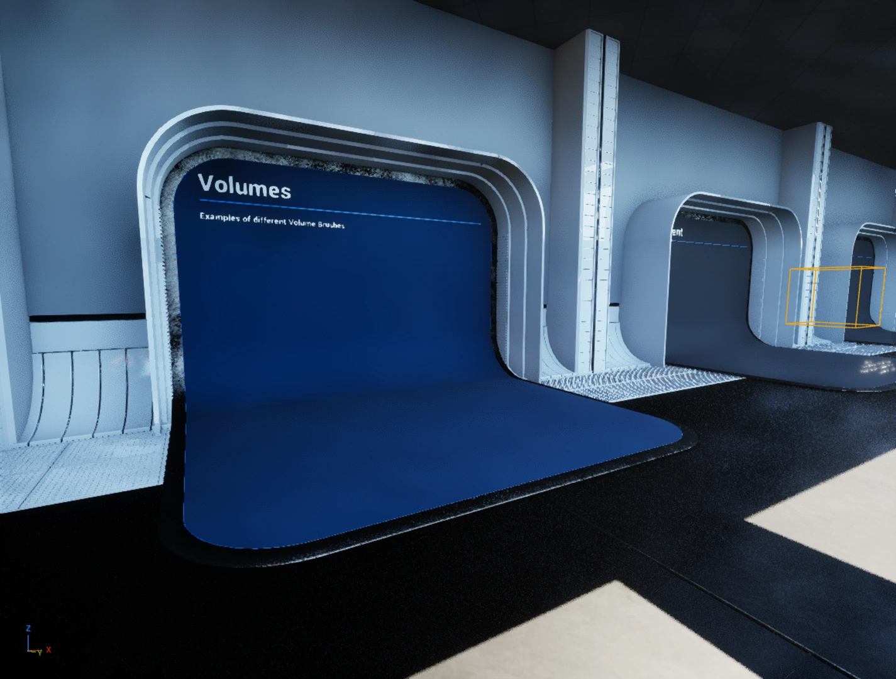
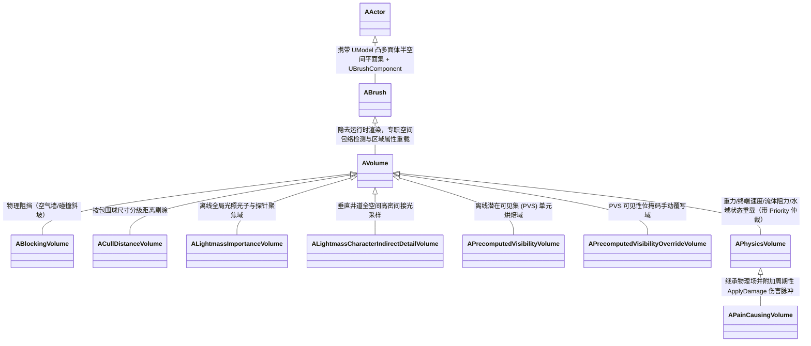
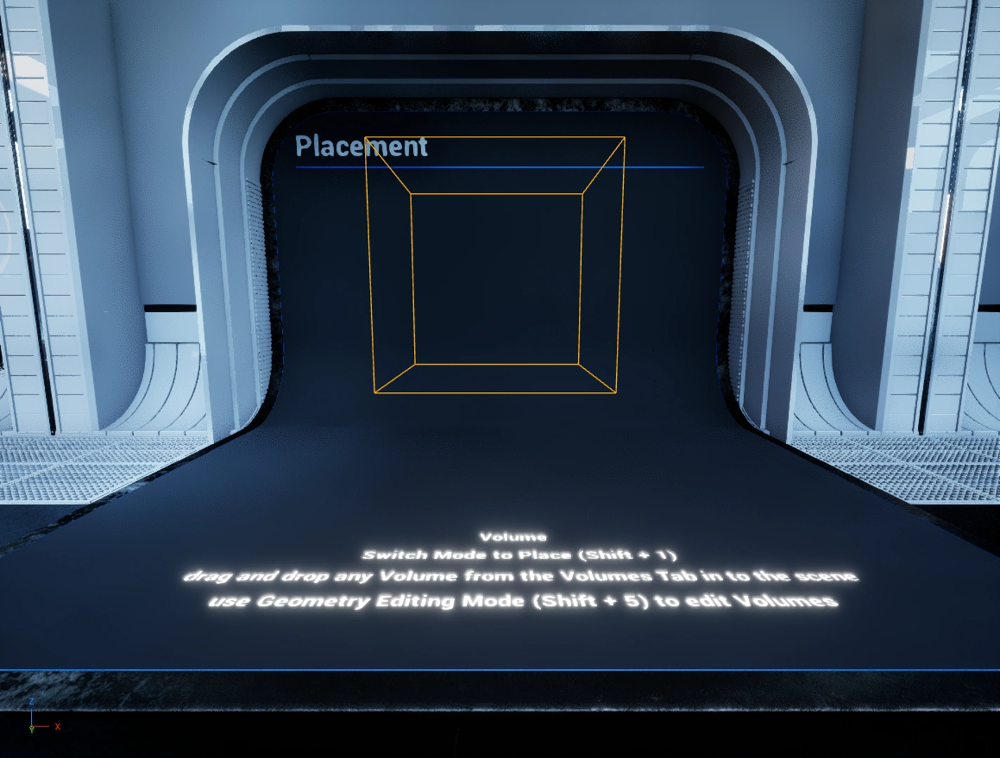
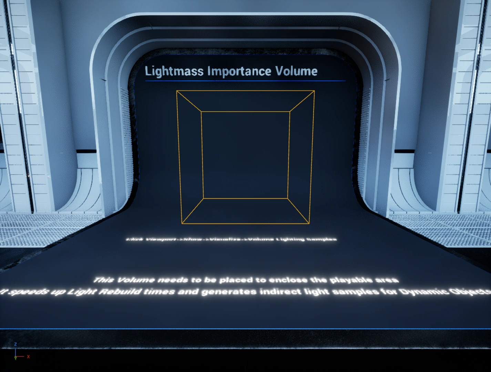
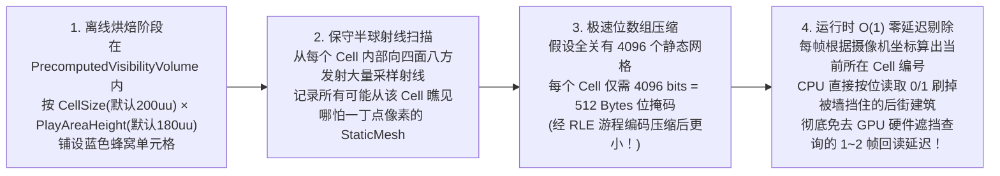
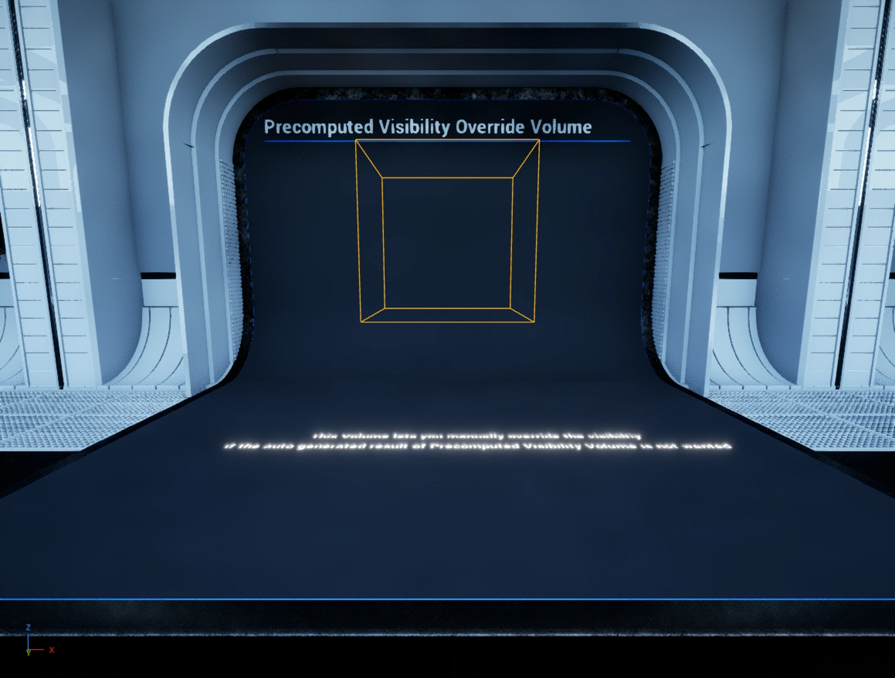

# 01 · `Level_Volumes`：关卡体积盒机制与空间触发器全解

> **对应工程地图**：`/Game/Maps/Level/Level_Volumes`  
> **所属领域目录**：`04_Level_世界构建与PCG`  
> **关卡实测规模**：总 Actor 数 `69` | 展台数 `10`（`#1` ~ `#10` 零遗漏全拆解） | 示例交互与环境 Actor 数 `22`

---

## 一、 导言：看不见的“空间法则编织网”——为什么虚幻引擎需要 Volume？

在任何一款商业级 3D 游戏中，玩家眼睛看到的是静态网格（`StaticMesh`）、骨骼角色（`SkeletalMesh`）、地形（`Landscape`）与视效粒子；但真正让这片三维几何空间具备**物理边界、性能裁剪规则、光照采样密度与玩法区域逻辑**的，却是潜伏在视口线框背后的一群“隐形多面体”——**关卡体积盒（`AVolume`）**。

打开 `/Game/Maps/Level/Level_Volumes`，整座长廊沿着 X 轴从 `505` 延伸至 `9510`，依次陈列了 **10 座展台**，用半透明的笔刷包络线将引擎最核心的空间规则体直观地呈现在开发者眼前：



### 1.1 底层血统揭秘：为什么 `AVolume` 继承自 `ABrush` 而不是 `StaticMeshActor`？

如果我们在本关实测提取的数据中观察任意一个体积实例（例如 `BlockingVolume_0` 或 `CullDistanceVolume_1`），会发现它们全都携带着一组高度一致的底层属性：

```json
{
  "brushType": "Brush_Add",
  "brushComponent": "BrushComponent0",
  "brushBuilder": "None",
  "shadedVolumeOpacityValue": 0.25
}
```

这揭示了虚幻引擎自 UE1/UE2 BSP 时代一脉相承的经典架构设计：


为什么引擎不用普通的 `UStaticMeshComponent` 来充当体积盒，而偏偏让 `AVolume` 继承自 `ABrush`？原因有三点硬核工程考量：
1. **极速的“点在多面体内（Point-in-Polyhedron）”数学判定**：凸笔刷（Convex Brush）在 `UModel` 内部存储为一组朝外的半空间平面方程 $n_i \cdot p - d_i \le 0$。判断玩家胶囊体或摄像机坐标是否落入某个 `PostProcessVolume` 或 `PhysicsVolume` 时，CPU 只需做几次点乘符号判断（$O(F)$，$F$ 为平面数），无需对成百上千个三角形做复杂的网格射线求交！
2. **关卡白盒随手塑形**：每个走廊拐角、异形电梯井、蜿蜒河道的尺寸都独一无二。如果用 StaticMesh，每改一次走廊宽度都要回 DCC 软件导出资产；而 `ABrush` 数据直接内联保存在关卡（或 OFPA 外部 Actor 文件）中，可在编辑器里直接拖拽顶点、挤压面片贴合地形。
3. **运行时零渲染开销**：所有 `AVolume` 默认 `bHidden = true`（仅编辑器视口在未按下 `G` 键时通过 `shadedVolumeOpacityValue = 0.25` 绘制线框与半透明着色面），打包进 Shipping 客户端后不产生任何 GPU Draw Call。

### 1.2 本关 10 大展台全景分类矩阵

为了在逐展台深拆前建立全局架构认知，我们将本关全部 10 座展台按引擎子系统归纳如下：

| 展台编号 | 展台标题 (Label) | 核心 C++ 类 | 所属引擎子系统 | 作用阶段（离线烘焙 vs 运行时） |
| :--- | :--- | :--- | :--- | :--- |
| **#1** | `Volumes` (`BP_DemoDisplay10`) | 环境光照基座与展厅导览 | 全局关卡环境 | 运行时常驻 |
| **#2** | `Placement` (`BP_DemoDisplay1`) | `ABlockingVolume` (工作流演示) | 编辑器放置与笔刷几何编辑 | 编辑器工作流 |
| **#3** | `Blocking Volume` (`BP_DemoDisplay2`) | `ABlockingVolume` | Chaos 物理碰撞隔离 | 运行时每帧物理查询 |
| **#4** | `Cull Distance Volume` (`BP_DemoDisplay3`) | `ACullDistanceVolume` | 渲染管线视距剔除 | 关卡加载/构建时写入 `CachedMaxDrawDistance`，运行时渲染线程零逻辑分支极速剔除 |
| **#5** | `Lightmass Importance Volume` (`BP_DemoDisplay4`) | `ALightmassImportanceVolume` | Lightmass 离线全局光照 / VLM | **离线烘焙阶段**（光子聚焦 + 体积光照贴图高密砖块分配） |
| **#6** | `Lightmass Character Indirect Detail Volume` (`BP_DemoDisplay7`) | `ALightmassCharacterIndirectDetailVolume` | 动态物体三维间接光探针 | **离线烘焙阶段**（强制全高程三维空间生成间接光采样） |
| **#7** | `Precomputed Visibilty Volume` (`BP_DemoDisplay5`) | `APrecomputedVisibilityVolume` | 离线遮挡剔除 (PVS) | **离线烘焙**生成可见性位数组 + **运行时** CPU 查表剔除 |
| **#8** | `Precomputed Visibility Override Volume` (`BP_DemoDisplay8`) | `APrecomputedVisibilityOverrideVolume` | PVS 手动修正覆写 | **离线烘焙阶段**强制置位 `1` 或清零 `0` |
| **#9** | `Physics Volume` (`BP_DemoDisplay6`) | `APhysicsVolume` | 角色移动与刚体流体动力学 | 运行时重叠触发 + `Priority` 优先级仲裁 |
| **#10** | `Pain Causing Volume` (`BP_DemoDisplay9`) | `APainCausingVolume` | Gameplay 周期区域伤害 | 运行时 `PainTimer` 定时器驱动伤害事件 |

---

## 二、 逐展台（Stand #1 ~ #10）零遗漏深度拆解

本关关卡脚本 `/Game/Maps/Level/Level_Volumes.Level_Volumes_C` 属性为空（`props: {}`），说明大多数原生 `AVolume` 根本不需要编写一行蓝图代码——它们直接与引擎底层的 C++ 物理、渲染与光照子系统硬连线协同工作。下面我们沿 X 轴坐标由近及远逐一拆解全部 10 个展台。

---

### 展台 #1：`Volumes` — 展厅导览与全局环境基座

- **展牌标识与空间坐标**：`BP_DemoDisplay10`，位于 `(505, -900, 0)`
- **官方展牌原文**：
  > *"Examples of different Volume Brushes"*（不同体积笔刷的示例）
- **展台区域关联环境与调试 Actor 清单（共 5 个）**：
  1. `DirectionalLight`（`/Script/Engine.DirectionalLight`）：组件 `LightComponent0`，`Intensity = 10`（单位 lux/unitless 取决于工程曝光配置），纯白光源 `(1, 1, 1, 1)`，`CastShadows = true`，移动性 `Mobility = Movable`。
  2. `SkyLight`（`/Script/Engine.SkyLight`）：组件 `SkyLightComponent0`，`Intensity = 1`，`Mobility = Movable`，实时捕获天空环境漫反射。
  3. `SkyAtmosphere`（`/Script/Engine.SkyAtmosphere`）：基于物理的大气瑞利与米氏散射组件。
  4. `ExponentialHeightFog`（`/Script/Engine.ExponentialHeightFog`）：全局指数高度雾组件 `HeightFogComponent0`。
  5. `Actor`（携带 `ChaosDebugDrawComponent_0`）：用于 Chaos 物理系统调试线框绘制的辅助宿主。

#### 深度解析：为什么展厅使用 `Movable` 动态主光，却依然保留了 Lightmass 展台？
细心的读者会发现，`Level_Volumes` 在升级至 UE5 后，主平行光与天光均已被设为 `Movable`（配合动态全局光照），但展台 #5 ~ #8 依然完整保留了 `LightmassImportanceVolume` 与 `PrecomputedVisibilityVolume`。这是因为虚幻引擎是一套**跨世代、全平台通吃**的工业引擎：在次世代 PC/PS5/Xbox 项目中我们常用 Lumen + 硬件遮挡查询（HZB）；但在**移动端（iOS/Android）、VR 一体机（Meta Quest 3，极度严苛的 CPU/GPU 帧预算）以及固定视角箱庭游戏**中，离线烘焙 Lightmass 与预计算可见性（PVS）至今仍是稳跑 90Hz/120Hz 的性能定海神针！

---

### 展台 #2：`Placement` — 体积盒的放置与几何笔刷塑形工作流



- **展牌标识与空间坐标**：`BP_DemoDisplay1`，位于 `(1515, -900, 0)`
- **展台内 3D 悬浮文字标签（`TextRenderActor`）**：
  - `Volume`
  - `Switch Mode to Place (Shift + 1)`（切换至放置模式 `Shift + 1`）
  - `drag and drop any Volume from the Volumes Tab in to the scene`（从 Volumes 标签页拖拽任意体积到场景中）
  - `use Geometry Editing Mode (Shift + 5) to edit Volumes`（使用几何体编辑模式 `Shift + 5` 编辑体积形状）
- **展台内陈列的示例 Actor（1 个）**：
  - `BlockingVolume`（内部实例 `BlockingVolume_0`，坐标 `(1512.5, -565, 167.5)`）：`brushType = Brush_Add`，`shadedVolumeOpacityValue = 0.25`，挂载 `BrushComponent0`。

#### 深度解析：UE5 时代如何优雅地塑形 Volume？（避坑指南）
在 UE4 到 UE5 的编辑器界面演进中，快捷键与工具栏有了细微更新，实战中请牢记以下三条黄金准则：
1. **放置入口**：在 UE5 顶部工具栏点击 **Quickly Add to the Project（快速添加到项目，立方体加号图标） -> Volumes**，或者打开 `Window -> Place Actors` 面板切到 `Volumes` 分类，即可看到引擎内置的二十余种体积盒。
2. **缩放 Transform 还是笔刷编辑（Brush Editing，`Shift + 4` / 旧版 `Shift + 5`）？**
   - 如果你只需要一个**标准长方体**，直接用 `R` 键缩放 Actor 的 `Scale`（或修改 Details 面板下 `Brush Settings` 的 `X / Y / Z` 尺寸）是最快且最安全的做法。
   - 如果你需要贴合 L 型转角或斜坡走廊，切入 **Brush Editing Mode（笔刷编辑模式）** 选中某个面（Face）或边（Edge）平移拉伸。
3. **绝对红线——严禁把 Volume 捏成“凹多面体（Concave Polyhedron）”！**
   > [!WARNING]
   > 无论你在笔刷编辑模式里如何推拉顶点，**请永远保证每个 Volume 都是严格凸多面体（任意两点连线完全在体积内部）**！如果把一个体积捏成 U 型、L 型凹陷或法线翻转的自交网格，`UBrushComponent` 底层的 K-DOP / 凸包碰撞分解与点包含判定会出现未定义行为（例如人站在 U 型缺口外面的空地上，却依然触发了毒气扣血或混响效果）。遇到 L 型走廊，正确做法是**摆放两个相互微弱重叠的矩形凸体积盒**！

---

### 展台 #3：`Blocking Volume` — 隐形空气墙与角色移动防卡死利器

- **展牌标识与空间坐标**：`BP_DemoDisplay2`，位于 `(2500, -900, 0)`
- **展台内 3D 悬浮文字标签（`TextRenderActor`）**：
  - `Invisible Collision`（隐形碰撞体）
- **展台内陈列的示例 Actor（1 个）**：
  - `BlockingVolume5`（内部实例 `BlockingVolume_5`，坐标 `(2495, -542.5, 132.5)`）：`brushType = Brush_Add`，`shadedVolumeOpacityValue = 0.25`，组件 `BrushComponent0`。

#### 深度解析：不止是“地图边缘空气墙”——3A 关卡设计师的高阶碰撞替代术
初学者往往以为 `Blocking Volume` 只是用来挡住地图边界不让玩家跳崖的“空气墙”。实际上，在《战神》或《黑神话》这类写实高模场景中，`Blocking Volume` 承担着更关键的职责——**“视觉与物理碰撞解耦（Visual-Collision Decoupling）”**：

1. **碎石台阶与树根斜坡平顺化**：
   Nanite 让我们可以摆放几百万面的嶙峋乱石楼梯，但如果直接用复杂模型自身的碰撞包裹，玩家角色的胶囊体（`UCapsuleComponent`）在跑动时会因为微小的法线突变频繁触发 `StepUp` 抖动甚至卡进石缝。标准工业做法是：**将装饰乱石的碰撞设为 `NoCollision`（或仅保留 `Visibility` 射线通道供弹孔/IK 脚部贴合使用），然后铺上一层平滑斜坡状的 `Blocking Volume` 承载角色胶囊体移动**！这样角色跑起来丝滑顺畅，Chaos 物理引擎也只需计算极简平面碰撞。
2. **四大内置碰撞预设（Collision Presets）的精细选型**：
   选中 `BlockingVolume` 的 `BrushComponent0`，在 Details 面板重点关注 `Collision Presets`：
   - **`InvisibleWall`（默认）**：阻挡所有 Pawn、物理刚体与摄像机，但**忽略 `Visibility` 射线通道**（即子弹射线检测、准星瞄准线可以穿透空气墙打中墙外的远景靶子，而人走不过去！）。
   - **`InvisibleWallDynamic`**：连动态移动查询也一并阻挡。
   - **`BlockAll`**：连子弹和视线射线（`Visibility` 通道）都彻底挡死。
   - **延伸对比 `CameraBlockingVolume`**：专门只对 `ECC_Camera` 通道返回 `ECR_Block`，玩家角色穿行无阻，专门贴在狭窄巷道顶部或铁丝网内侧，防止第三人称弹簧臂镜头穿模看到关卡外的虚空。

---

### 展台 #4：`Cull Distance Volume` — 按尺寸分级视距剔除的性能倍增器

- **展牌标识与空间坐标**：`BP_DemoDisplay3`，位于 `(3520, -900, 0)`
- **展台内 3D 悬浮文字标签（`TextRenderActor`）**：
  - `Press G to see Distance Culling`（按下 `G` 键切入游戏视图以观察距离剔除效果）
  - `The Volumes lets you make a rule set for Cull Distances depending on the size of the Objects`（该体积允许你根据物体尺寸制定一套剔除距离规则集）
- **展台内陈列的示例 Actor（共 7 个：1 个剔除体积 + 6 个不同尺寸/颜色的测试球）**：
  - **`CullDistanceVolume1`**（坐标 `(3620, -527.5, 192.5)`）：`bEnabled = true`，核心规则表参数实测如下：
    ```json
    "cullDistances": [
      { "size": 25,  "cullDistance": 300 },
      { "size": 60,  "cullDistance": 500 },
      { "size": 150, "cullDistance": 700 }
    ]
    ```
  - **6 颗对比测试静态网格球**（网格均为 `/Engine/EditorMeshes/EditorSphere`，通过不同缩放尺寸匹配上述三档阈值）：
    - 绿色高光球：`EditorSphere_3` `(3697.5, -600, 220)`、`EditorSphere_6` `(3345, -600, 220)` —— 覆盖材质实例 `/Game/Global/Materials/M_LightSculpture_Green`（母材质链 `M_LightSculpture` -> `M_LightSculpture_Red` -> `M_LightSculpture_Green`，`Roughness = 0.1`，`Color = (0, 1, 0, 1)`）。
    - 红色高光球：`EditorSphere_2` `(3632.5, -600, 115)`、`EditorSphere_5` `(3410, -600, 115)` —— 覆盖材质实例 `M_LightSculpture_Red`（`Roughness = 0.1`，`Color = (1, 0, 0, 1)`）。
    - 蓝色高光球：`EditorSphere_4` `(3585, -600, 220)`、`EditorSphere_7` `(3457.5, -600, 220)` —— 覆盖材质实例 `M_LightSculpture_Blue`（`Roughness = 0.1`，`Color = (0, 0, 1, 1)`）。

#### 深度解析：`CullDistanceVolume` 底层匹配算法与常见失效原因排查
当你在视口按下 `G` 键（切换 Game View）并前后拉动镜头时，会看到小球在距离 3 米（`300 uu`）处率先消失，中等球在 5 米（`500 uu`）处消失，大球退到 7 米（`700 uu`）才消失！它的 C++ 内部机制（`UCullDistanceVolume::UpdateVolume`）非常精妙：

1. **直径匹配算法（Bounding Sphere Diameter Matching）**：
   引擎测量体积内每个 `UPrimitiveComponent` 的**包围球直径** $D = 2 \times \text{Bounds.SphereRadius}$（单位：厘米 `uu`），然后在 `CullDistances` 数组中寻找与 $D$ **最接近（绝对差 $|D - \text{Size}|$ 最小）** 的那一档条目，将该条目的 `CullDistance` 直接烘焙进组件的 `CachedMaxDrawDistance` 字段中！
   > [!TIP]
   > 实战配置标准模板：通常我们在大场景最后一条规则放一个 `{ Size: 10000, CullDistance: 0 }`（在虚幻中 **`CullDistance = 0` 代表永不按距离剔除，无限远可见**）！如果不加这个兜底大尺寸档位，一栋直径 5000 厘米的大楼也会因为“最接近 `Size: 150`”而在 7 米外突然整栋凭空消失！
2. **为什么我放了 `CullDistanceVolume`，有些模型却死活不剔除？**
   检查目标组件必须同时满足三个硬性前置条件：
   - 组件的移动性必须是 **`Static`（静态）**（或者勾选了允许被 Cull Distance Volume 影响，默认 `Movable` 动态物体不会在离线阶段被刷入静态 `CachedMaxDrawDistance`）；
   - 组件的 `Rendering -> Allow Cull Distance Volume`（`bAllowCullDistanceVolume`）必须为 `true`（默认开启）；
   - 组件的**包围盒中心点（`Bounds.Origin`）**必须严格落在 `CullDistanceVolume` 多面体内部；且若组件自身手动填写了更小的 `Desired Max Draw Distance`（非 0），引擎会取两者中更严格（更短）的距离。

---

### 展台 #5：`Lightmass Importance Volume` — 离线全局光照能量聚焦与体积光照贴图核心域



- **展牌标识与空间坐标**：`BP_DemoDisplay4`，位于 `(4500, -900, 0)`
- **展台内 3D 悬浮文字标签（`TextRenderActor`）**：
  - `Click Viewport->Show->Visualize->Volume Lighting Samples`（点击视口 `Show -> Visualize -> Volume Lighting Samples` / UE5 中亦包括 `Volumetric Lightmap` 可视化）
  - `This Volume needs to be placed to enclose the playable area`（需要将此体积放置为包裹整个玩家可活动区域）
  - `It speeds up Light Rebuild times and generates indirect light samples for Dynamic Objects`（它能大幅加速光照重建时间，并为动态物体生成间接光照采样探针）
- **展台内陈列的示例 Actor（1 个）**：
  - `LightmassImportanceVolume1`（内部实例 `LightmassImportanceVolume_1`，坐标 `(4500, -542.5, 140)`）：黄色线框体积（编辑器内置专属配色）。

#### 深度解析：光子映射聚焦与八叉树体积光照贴图（Volumetric Lightmap）
假如你的关卡背景有一圈绵延 20 公里的远景雪山贴片，而玩家真正能走路战斗的城镇只有中间 $200\text{ m} \times 200\text{ m}$。如果不放 `Lightmass Importance Volume`，离线烘焙器（CPU/GPU Lightmass）会把宝贵的反弹光子均匀撒向 20 公里的无人荒山，不仅烘焙耗时暴涨十倍，城镇内部的间接光精度反而惨不忍睹（还会弹出经典的 *"No importance volume found"* 警告）！

放上 `Lightmass Importance Volume` 包裹城镇后，引擎在烘焙时执行两件大事：
1. **光子发射器聚焦（Photon Emission Focusing）**：平行光仅向该体积盒的包围球投射高密度间接反弹光子（支持多次漫反射弹射 `Num Indirect Lighting Bounces`），体积外的远景仅做单次粗略直接照明。
2. **动态物体的间接光照探针分配（ILC -> VLM 演进）**：
   静态墙壁可以贴 2D Lightmap 纹理，但跑来跑去的玩家角色、飞溅的木箱怎么吃间接光？展牌文字提到的 `Volume Lighting Samples` 是早期 **Indirect Lighting Cache（间接光照缓存）** 的可视化入口，而在现代 UE4.18+ 与 UE5 中已全面升级为 **Volumetric Lightmap（VLM，三维体积光照贴图，`Show -> Visualize -> Volumetric Lightmap`）**：
   - 在 `Lightmass Importance Volume` 内部，引擎按八叉树自适应细分出高精度的 $4 \times 4 \times 4$ 三阶球谐（SH3）探针砖块（默认最高精度 `DetailCellSize = 200 uu`），尤其在靠近静态几何体表面处加密；
   - 在体积外部，探针密度呈指数级稀疏退化，从而将全图三维光照探针显存控制在几 MB 以内。

---

### 展台 #6：`Lightmass Character Indirect Detail Volume` — 攻克电梯井与高空滑索的探针盲区

- **展牌标识与空间坐标**：`BP_DemoDisplay7`，位于 `(5502, -900, 0)`
- **展台内 3D 悬浮文字标签（`TextRenderActor`）**：
  - `Click Viewport->Show->Visualize->Volume Lighting Samples`
  - `This volume generates indirect light samples like the Lightmass Importance Volume`
  - `but not just at player height above ground, it generates them inside the entire volume`（不仅限于地面上方玩家身高处，而是在整个体积内部全空间生成采样点）
  - `A common use case for it would be an elevator shaft`（典型应用场景是电梯井道）
  - `to ensure the indirect lighting is correct when it moves`（确保电梯与角色在垂直升降过程中间接光照始终准确平滑）
- **展台内陈列的示例 Actor（1 个）**：
  - `LightmassCharacterIndirectDetailVolume1`（坐标 `(5505, -622.5, 377.5)` —— 注意其 Z 轴中心点高达 `377.5`，特意被拉成一座竖直高耸的井道形态！）。

#### 深度解析：为什么普通 `Lightmass Importance Volume` 在电梯井里会“断光”？
出于内存省俭原则，在传统间接光采样及 VLM 稀疏化策略中，引擎默认假设**“玩家绝大多数时间脚踩在朝上的静态地板（Upward-facing Static Surface）上”**。因此，探针只会在静态地面上方约 `0 ~ 250 uu`（一层人高）的薄层内密集铺设；一旦离地超过 3 米的半空中没有静态平台（因为电梯轿厢本身是 `Movable` 动态网格，烘焙时被视作空气！），整个 30 米高的电梯井道中段就会变成**探针真空区**！当玩家乘电梯升到半空时，角色身上的环境光会突然在顶层亮光和底层暗光之间生硬跳变。

在电梯井道、钩爪飞跃峡谷、飞行载具低空航道套上一个 `Lightmass Character Indirect Detail Volume`，就相当于告诉 Lightmass：**“别管脚下有没有静态地板，把这个盒子的每一立方米三维空间全部填满高精度球谐光照探针！”**

---

### 展台 #7：`Precomputed Visibilty Volume` — 移动端与 VR 零运行时开销遮挡剔除（PVS）

- **展牌标识与空间坐标**：`BP_DemoDisplay5`，位于 `(6500, -900, 0)`（注：官方展牌资产命名原文拼写为 `Precomputed Visibilty Volume`）
- **展台内 3D 悬浮文字标签（`TextRenderActor`）**：
  - `World Settings->Precompute Visibility needs to be set to true.`（必须在世界设置中将 `Precompute Visibility` 设为 `true`）
  - `This is a performance optimization`（这是一项性能优化机制）
  - `It stores the visibility of Actors for this loction in the world`（它离线存储从世界该位置所能看到的 Actor 可见性列表）
  - `These should be placed only in areas the Player can access`（仅应放置在玩家摄像机实际能够到达的区域）
- **展台内陈列的示例 Actor（共 2 个：体积本体 + 控制台可视化交互踏板）**：
  1. `PrecomputedVisibilityVolume1`（坐标 `(6487.5, -560, 167.5)`）
  2. `BP_Visulizer_PressureButton`（`/Game/Global/Blueprints/Interactive/BP_Visulizer_PressureButton`，坐标 `(6486.7, -269.3, 0)`）：
     - 组件结构：`Button base`（`SM_VizButton` + `MID_M_VisulizerEmissive_Inst_0`）、`Trigger`、`Cube`（`M_Display` 屏幕面板）、`Title`、`ConsoleText`、`Press`。
     - **实测提取的控制台指令参数**：
       - `enterCommand`: **`"r.ShowPrecomputedVisibilityCells 1"`**
       - `exitCommand`: **`"r.ShowPrecomputedVisibilityCells 0"`**
       - `useExitCommand?`: `true`，`showCommandText`: `true`

#### 深度解析：蓝色蜂窝单元（Visibility Cells）与 1-Bit 位掩码查表术
当你踩上展台前方的 `BP_Visulizer_PressureButton` 按钮，引擎立即执行 `r.ShowPrecomputedVisibilityCells 1`，你会在体积内部看到一排排半透明的**蓝色三维网格盒（Visibility Cells）**！

它的底层工程原理堪称空间换时间的教科书典范：


- **为什么在 PC 上少见，在 Quest VR / Switch / 手游上却是救命稻草？**
  现代桌面 GPU 依赖硬件遮挡查询（Hardware Occlusion Queries）或 HZB，但移动 Tile-Based Deferred Renderer（TBDR 架构，如骁龙 Adreno、Apple GPU）做 GPU->CPU 遮挡结果回读会产生严重的管线气泡（Pipeline Stall），甚至导致快速转头时墙后物体晚一帧才蹦出来的“Pop-in 闪烁”。而 **PVS 在 CPU 端视锥剔除（Frustum Culling）之后立刻查表完成遮挡剔除，不仅零 GPU 开销，而且保守过采样绝不产生晚一帧蹦出的闪烁**！
- **严格放置铁律**：正如 3D 标签所写，**只把 `PrecomputedVisibilityVolume` 铺在玩家摄像机能走到的地面和楼梯上**！千万别像 `LightmassImportanceVolume` 那样用一个大盒子把整栋大楼连同天空一起罩住——否则半空中几万个玩家永远到不了的格子会把 `.umap` 体积撑爆几十 MB！

---

### 展台 #8：`Precomputed Visibility Override Volume` — PVS 可见性位掩码的手术刀覆写



- **展牌标识与空间坐标**：`BP_DemoDisplay8`，位于 `(7498, -900, 0)`
- **展台内 3D 悬浮文字标签（`TextRenderActor`）**：
  - `This Volume lets you manually override the visibiltiy`
  - `if the auto generated result of Precomputed Visibility Volume is not wanted`（当自动生成的预计算可见性结果不符合预期时，此体积允许你手动覆写可见性列表）
- **展台内陈列的示例 Actor（1 个）**：
  - `PrecomputedVisibilityOverrideVolume1`（坐标 `(7497.5, -632.5, 177.5)`），暴露三大核心数组参数：
    - `overrideVisibleActors: []`（当摄像机位于此体积内时，**强制标记为可见 `1`** 的 Actor 列表）
    - `overrideInvisibleActors: []`（当摄像机位于此体积内时，**强制标记为不可见 `0`** 的 Actor 列表）
    - `overrideInvisibleLevels: []`（当摄像机位于此体积内时，**整张子关卡全部强制剔除**的关卡列表）

#### 深度解析：哪两种真实工况必须出动 Override Volume？
离线自动射线烘焙虽然聪明，但在以下两种典型关卡机关面前会“失算”：
1. **防误剔除（填入 `OverrideVisibleActors`）**：假如有两间密室中间隔着一扇**可被炸开的动态石门（或百叶窗细缝）**，由于射线采样的离散性，远处的巨型地标雕像在某个刁钻角度漏过了采样射线，导致玩家歪头看细缝时雕像闪没了——把雕像吸管拾取进 `OverrideVisibleActors`，强制锁死可见！
2. **激进手动剔除（填入 `OverrideInvisibleActors` / `OverrideInvisibleLevels`）**：玩家走进一间窗户装着毛玻璃（半透明但不挡离线可见性射线）的室内安全屋，自动烘焙认为窗外整座繁华集市的 2000 个摊位“在几何视线上可见”，白白吃掉一半帧率。此时在安全屋内放一个 `PrecomputedVisibilityOverrideVolume`，把窗外集市子关卡拖进 `OverrideInvisibleLevels`，进屋瞬间集市 Draw Call 清零！

---

### 展台 #9：`Physics Volume` — 局部流体阻力、终端速度与游泳状态切换场

- **展牌标识与空间坐标**：`BP_DemoDisplay6`，位于 `(8500, -900, 0)`
- **展台内 3D 悬浮文字标签（`TextRenderActor`）**：
  - `Actors that simulate physics are reacting inside the Volume according to its settings`（开启物理模拟的 Actor 与移动角色进入该体积后，将按照其物理场参数做出响应）
- **展台内陈列的示例 Actor（1 个）**：
  - `PhysicsVolume1`（坐标 `(8497.5, -587.5, 137.5)`），实测核心物理参数：
    ```json
    {
      "terminalVelocity": 4000.0,
      "priority": 0,
      "fluidFriction": 0.3,
      "brushType": "Brush_Add",
      "shadedVolumeOpacityValue": 0.25
    }
    ```

#### 深度解析：`Priority` 优先级仲裁机制与 `UCharacterMovementComponent` 联动方程
在虚幻引擎中，其实**整张地图无时无刻不处在一个默认的无限大物理体积（`AWorldSettings::DefaultPhysicsVolume`）之中**！当你放置局部 `APhysicsVolume` 时，引擎按如下规则实时接管物理环境：

1. **重叠体积的 `Priority` 仲裁机制**：
   假如你在大湖泊（`PhysicsVolume_Lake`，`Priority = 1`，`FluidFriction = 0.3`）水底放了一股湍急暗流或泥沼区（`PhysicsVolume_Mud`，`Priority = 5`，`FluidFriction = 3.5`），当玩家潜入泥沼同时重叠两个体积时，`UPrimitiveComponent::UpdatePhysicsVolume` 会严格遍历所有重叠的 `APhysicsVolume`，**选出 `Priority` 数值最高的那一个**作为组件当前的 `GetPhysicsVolume()`！
2. **三大灵魂参数的物理意义**：
   - **`TerminalVelocity = 4000.0`（终端下落速度，`40 m/s`）**：角色自由落体时的速度上限。若要制作“风洞缓降井”或“月球微重力跳台”，把 `TerminalVelocity` 压低至 `400.0`（`4 m/s`），玩家从百米高塔跳下也会像羽毛一样轻盈飘落，落地绝不摔死！
   - **`FluidFriction = 0.3`（流体阻尼系数）**：空气默认阻尼极小，而本展台设为 `0.3` 后，穿过体积的角色移动与抛射物会根据速度平方或线性粘滞减速公式持续损失动能，立刻产生涉水或穿越浓稠蛛网的粘滞手感。
   - **`bWaterVolume`（水域开关）**：一旦勾选 `Water Volume = true`，只要角色的 `CharacterMovementComponent` 能力配置中勾选了 `Can Swim`，角色跳入体积的瞬间状态机将自动从 `MOVE_Falling` 切换至 **`MOVE_Swimming`（游泳模式）**，配合 `Buoyancy`（浮力系数）实现完整的三维水下潜泳！

---

### 展台 #10：`Pain Causing Volume` — 继承自物理场的周期性伤害触发器

- **展牌标识与空间坐标**：`BP_DemoDisplay9`，位于 `(9510, -900, 0)`
- **展台内 3D 悬浮文字标签（`TextRenderActor`）**：
  - `Characters inside this Volume will receive a Pain Causing Event`（处于此体积内的角色将周期性接收到伤害事件）
- **展台内陈列的示例 Actor（1 个）**：
  - `PainCausingVolume1`（坐标 `(9520, -572.5, 120)`），实测完整参数结构：
    ```json
    {
      "damagePerSec": 1.0,
      "damageType": { "refPath": "/Script/Engine.DamageType" },
      "painInterval": 1.0,
      "terminalVelocity": 4000.0,
      "priority": 0,
      "fluidFriction": 0.3,
      "brushType": "Brush_Add",
      "shadedVolumeOpacityValue": 0.25
    }
    ```

#### 深度解析：一鱼两吃的继承巧思与 C++ `PainTimer` 伤害脉冲管线
为什么你看 `PainCausingVolume1` 的实测 JSON 里，竟然也带着 `"terminalVelocity": 4000` 和 `"fluidFriction": 0.3`？
因为 **`APainCausingVolume` 在 C++ 中直接继承自 `APhysicsVolume`**！这是一个极其老辣的工业设计——试想你在关卡里做一片**熔岩池、强酸沼泽或深海窒息毒水**，你既需要它具备流体粘滞减速和游泳浮力（`APhysicsVolume` 的职责），又需要它每秒烫掉玩家生命值（`APainCausingVolume` 的职责），一个体积直接搞定，根本不需要叠两个盒子！

其底层伤害派发生命周期如下：
1. **踏入瞬间（`ActorEnteredVolume`）**：若 `bPainCausing = true` 且 `bEntryPain = true`（默认开启），角色踏入边界的第一帧立刻调用一次 `CausePainTo(OtherActor)`，防止玩家利用高频跳跃卡进卡出“白嫖无伤趟岩浆”；同时启动间隔为 `PainInterval`（本例为 `1.0` 秒）的循环定时器 `PainTimer`。
2. **持续浸泡（`PainTimer` 每秒回调）**：遍历当前所有重叠的 Actor，对满足 `CanBeDamaged()` 的目标调用虚幻标准伤害管线：
   $$\text{AppliedDamage} = \text{DamagePerSec} \times \text{PainInterval} = 1.0 \times 1.0 = 1.0$$
3. **业务层解耦响应（`UDamageType`）**：通过替换 `damageType` 子类（如自定义 `BP_DamageType_Lava`、`BP_DamageType_Frostbite`、`BP_DamageType_Radiation`），玩家角色蓝图只需在 `Event AnyDamage` 节点上判断传入的 `DamageType` 类，即可分别播放火焰灼烧材质闪烁、屏幕结霜后处理或盖革计数器音效，而关卡策划只管在地图上摆盒子填数值！

---

## 三、 关卡全局辅助 Actor 与实战避坑总结

除上述 10 个展台外，本关全局还驻留了 1 个基础世界设施 Actor：
- `InstancedFoliageActor`（`/Script/Foliage.InstancedFoliageActor`，坐标 `(700, 1000, -100)`）：关卡植被实例化容器，所有开启了植被绘制或相关世界构建工具的关卡默认自动生成单例。

### 生产环境 Volume 工程检查清单（Checklist）

> [!IMPORTANT]
> 1. **凸包铁律**：永远保持所有 `AVolume` 为**凸多面体（Convex）**；复杂转角拆分为多个简单长方体组合，切忌掏空（Hollow）或拉出内凹角。
> 2. **重叠区域必设 `Priority`**：无论是本关的 `PhysicsVolume` / `PainCausingVolume`，还是我们将在第 05 篇详述的 `PostProcessVolume` 与音频系统的 `AudioVolume`，只要存在“大区域套小区域”（如毒雾森林中心有一座净化安全篝火圈——安全圈用一个 `bPainCausing = false` 且 `Priority = 10` 的 `PainCausingVolume` 即可局部免疫外圈 `Priority = 0` 的全场毒雾！），务必显式规划 `Priority` 层级。
> 3. **次世代特性对号入座**：
>    - 若项目采用 **UE5 World Partition + Lumen + Nanite** 纯动态管线：重点使用 `BlockingVolume`、`CameraBlockingVolume`、`PhysicsVolume`、`PainCausingVolume`、`AudioVolume` 与 `PostProcessVolume`；对于非 Nanite 的传统半透明草叶/粒子特效，仍可配合 `CullDistanceVolume` 控制视距开销。
>    - 若项目面向 **移动端 / VR 一体机离线烘焙管线**：务必用 `LightmassImportanceVolume` 严密包裹可玩区，电梯井补齐 `LightmassCharacterIndirectDetailVolume`，并在地面行走路径铺设 `PrecomputedVisibilityVolume` + 局部 `OverrideVolume`。
