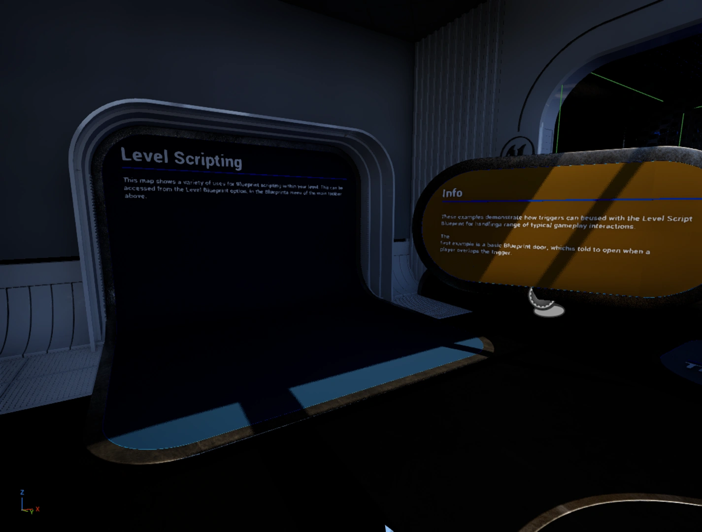
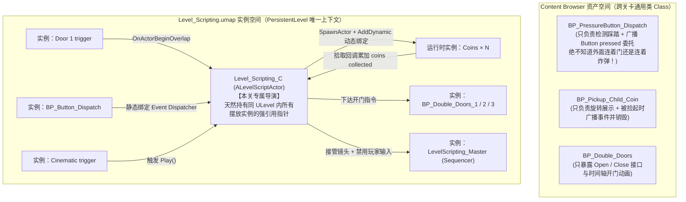
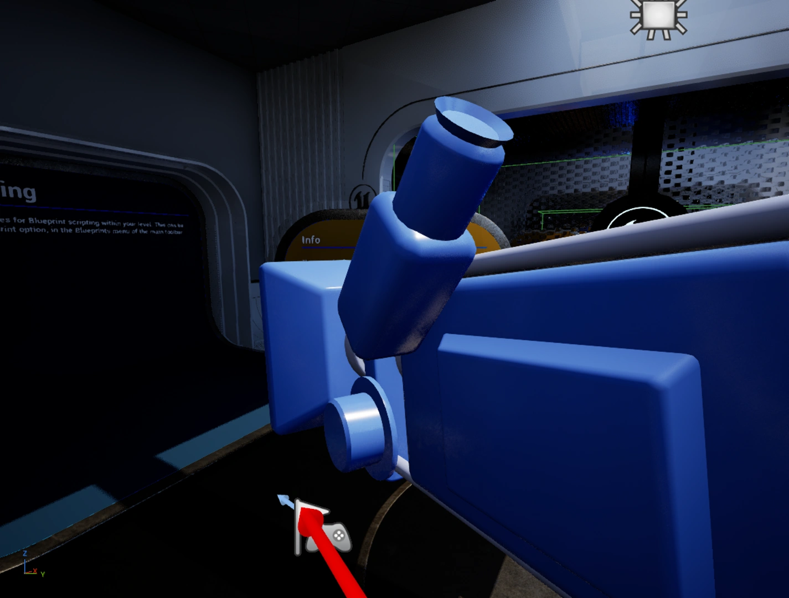
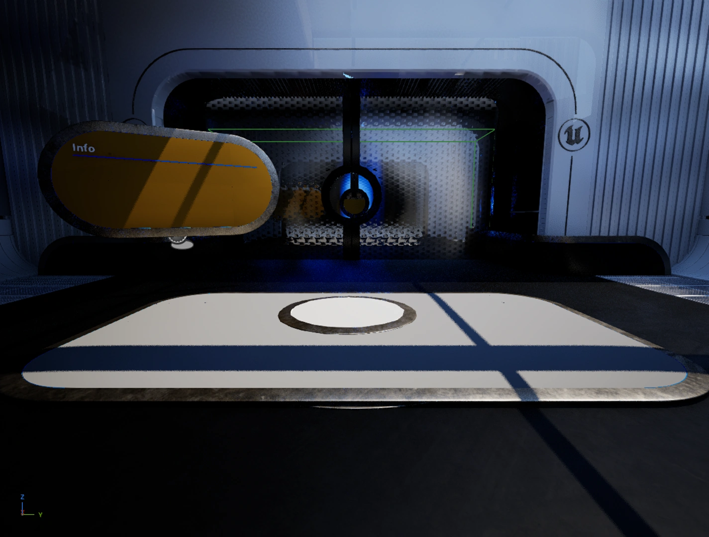
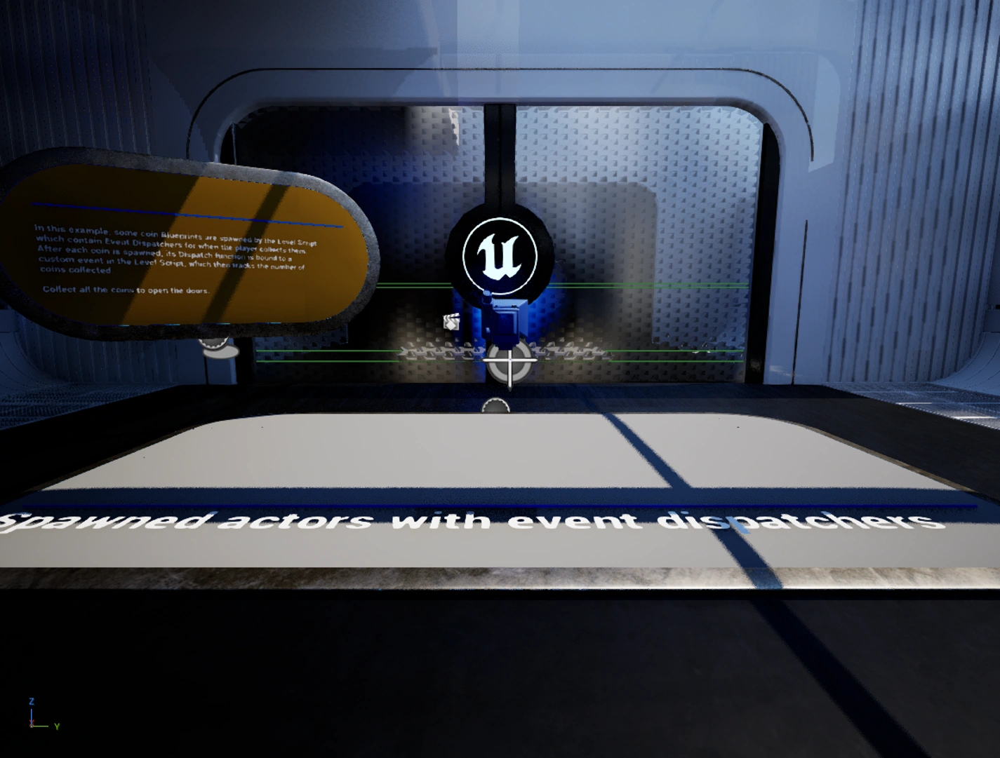

# 02 · `Level_Scripting`：关卡脚本蓝图与跨 Actor 导演逻辑全解

> **对应工程地图**：`/Game/Maps/Level/Level_Scripting`  
> **所属领域目录**：`04_Level_世界构建与PCG`  
> **关卡实测规模**：总 Actor 数 `43` | 展台数 `9`（`#1` ~ `#9` 独立逐台拆解） | 示例交互 Actor 数 `19`（另含全局环境 Actor `2` 个）

---

## 一、 导言：关卡蓝图（`ALevelScriptActor`）在虚幻架构中的真实定位

刚接触虚幻引擎的开发者，最容易陷入两个极端误区：
- **误区 A（“万物皆塞关卡蓝图”）**：把角色扣血、武器换弹、通用电梯逻辑统统写进关卡蓝图（Level Blueprint），结果做第二关时发现代码一行都搬不过去，全盘推倒重写；
- **误区 B（“谈关卡蓝图色变”）**：听老手说关卡蓝图难以复用，于是连本关独有的一次性开门过场演出，都非要在两个毫不相干的 Actor 之间写满 `GetAllActorsOfClass` 暴力遍历或硬塞十几个 Tag 查找。

打开 `/Game/Maps/Level/Level_Scripting`，Epic Games 用一条精心编排的闯关长廊（共 **9 座展台**，串联 3 道双扇上锁大门与 1 段压轴 Sequencer 过场动画），教科书般地演绎了**“关卡蓝图作为本关专属导演（Level-Specific Director）”**的四大标准设计模式：



### 1.1 底层拆解：本关 `ALevelScriptActor` 实例藏着什么？

在虚幻底层，每一张关卡（`ULevel`，无论是主持久关卡 `PersistentLevel` 还是流送子关卡）内部都自动寄生着唯一一个继承自 `ALevelScriptActor` 的隐形实例。通过实测提取 `/Game/Maps/Level/Level_Scripting.Level_Scripting_C` 的内部序列化属性，我们直接看到了这位“幕后导演”手中的两件法宝：

```json
{
  "class": "/Game/Maps/Level/Level_Scripting.Level_Scripting_C",
  "props": {
    "rotate actor": {
      "refPath": "/Game/Maps/Level/Level_Scripting.Level_Scripting:PersistentLevel.Level_Scripting_C_1.Rotate actor"
    },
    "coins collected": 0
  }
}
```

1. **`coins collected: 0`（整型关卡级状态变量）**：记录玩家在第 3 道门前收集了多少枚动态生成的金币，用于判定何时放行第 3 道大门；
2. **`rotate actor`（`UTimelineComponent` 时间轴组件）**：挂载在关卡脚本实例 `Level_Scripting_C_1` 上的时间轴，用于平滑驱动场景特定演出的插值旋转。

### 1.2 架构师铁律：关卡蓝图 vs 普通 Actor 蓝图的职责楚河汉界

为什么只有关卡蓝图能直接把场景里的 `Door 1 trigger` 和 `BP_Double_Doors_1` 拖进图表连线，而普通蓝图资产不行？



> [!IMPORTANT]
> **架构解耦核心铁律（单向依赖原则）**：
> - **下层可复用积木（Actor Blueprints）严禁依赖具体关卡**：`BP_Double_Doors` 与 `BP_PressureButton_Dispatch` 对外只暴露**输入函数（Function/Event）**与**输出事件分发器（Event Dispatcher）**，它们可以在 100 张不同的地图里零修改复用。
> - **上层一次性胶水（Level Blueprint）单向编排积木**：因为 `Level_Scripting_C` 与 `PersistentLevel` 保存在同一个 `.umap` 包内，它可以零成本持有本关静态 Actor 的直接内存引用；同时**引擎在语法层面禁止任何外部蓝图 `Cast To Level_Scripting_C`**，从根源上杜绝了通用资产反向耦合特定地图的架构腐化！

---

## 二、 核心共用交互资产深度解剖（先识积木，再看编排）

在走入 9 座展台前，我们先将走廊中反复登场的两个核心蓝图/材质资产彻底拆透。

### 2.1 双扇科幻感应门：`BP_Double_Doors` 与菲涅尔发光锁材质 `M_UE_Logo_Doors`

走廊中的 `BP_Double_Doors_1`、`BP_Double_Doors_2`、`BP_Double_Doors_3` 均实例化自 `/Game/ExampleContent/Level_Scripting/BP_Double_Doors`：
- **组件层级**：
  - `Base`（根组件）
  - `Left door` & `Right door`：均引用静态网格 `/Game/Global/DemoRoom/Meshes/SM_Door`（金属门扇 `/Game/Global/DemoRoom/Materials/M_Metal`）
  - `Lock`：门缝中央的圆形虚幻 Logo 门锁网格 `/Game/Global/Meshes/SM_DoorLock`，覆盖发光材质 `/Game/Global/Materials/M_UE_Logo_Doors`
  - `Open/close`：内置 `UTimelineComponent`，驱动左右门扇沿局部坐标平缓滑开/闭合，并附带 `doorCloseEvent` 事件分发器。
- **门锁材质 `/Game/Global/Materials/M_UE_Logo_Doors` 全部 9 个表达式节点还原**：
  - 核心材质域：`MD_Surface` | `BLEND_Opaque` | `MSM_DefaultLit`
  - 主节点连线：
    - **`BaseColor`** $\leftarrow$ `VectorParameter("ColorBase")` = `(0.0043, 0.0148, 0.1017, 1.0)`（深邃暗午夜蓝基底）
    - **`Roughness`** $\leftarrow$ `Constant(0.1)`（镜面级光滑烤漆质感）
    - **`EmissiveColor`** $\leftarrow$ 反向菲涅尔中心聚光算式（由 `Fresnel_0`、`ScalarParameter("FresnelExponent" = 3.0)`、`OneMinus_1`、`VectorParameter("Color" = (0.637, 4.190, 25.0))` 高动态范围电光蓝与 `ScalarParameter("EmissivePower" = 1.0)` 经两级 `Multiply` 合成）：
      $$E_{\text{lock}} = \left(1 - \text{Fresnel}(\text{Exp}=3.0)\right) \times (0.637, 4.190, 25.0) \times \text{EmissivePower}$$
    - 当蓝色通道高达 `25.0` 的 HDR 自发光送入后期处理管线时，门锁中央会自然激发出柔和的科幻电光蓝辉光（Bloom），开门时亦可通过动态材质实例（MID）切换门锁颜色状态！

### 2.2 事件广播踏板：`BP_PressureButton_Dispatch`

位于第 5 展台的 `/Game/ExampleContent/Level_Scripting/BP_PressureButton_Dispatch` 继承自全局交互基类 `/Game/Global/Blueprints/Interactive/BP_PressureButton_Parent`：
- **核心组件**：`Button base`（网格 `Button` + 动态发光材质实例 `MID_M_Button_Emissive_0`，默认暖金发光色 `defaultEmissiveValue = (0.905, 0.822, 0.433, 0.957)`）、碰撞盒 `Trigger`、下压时间轴 `Press`。
- **关键架构设计**：当玩家踩入 `Trigger` 时，踏板除了播放自身的下陷动画与按钮亮灯外，只做一件事——**调用 `Call Button pressed`（广播 Event Dispatcher）**！至于谁在听这个广播，踏板本身一无所知。

---

## 三、 逐展台（Stand #1 ~ #9）零遗漏深度拆解

本关的 9 座展台采用了**“说明展牌（Info） + 实操机关展台”成对递进**的空间布局。下面严格按照展台编号 `#1` 至 `#9` 逐一拆解每个展台的坐标、原文、陈列 Actor 及背后的关卡蓝图连线逻辑。

---

### 展台 #1：`Level Scripting` — 入口总览与全局环境配置

- **展牌标识与空间坐标**：`BP_DemoDisplay1`，位于 `(720, 210, 140)`
- **官方展牌原文**：
  > *"This map shows a variety of uses for Blueprint scripting within your level. This can be accessed from the Level Blueprint option, in the Blueprints menu of the main toolbar above."*  
  > （本地图展示了在关卡内使用蓝图脚本的多种方式。你可以通过顶部主工具栏 **Blueprints（蓝图）** 菜单下的 **Open Level Blueprint（打开关卡蓝图）** 访问它。）
- **展台区域关联全局环境 Actor（共 6 个）**：
  1. `Global PostProcess`（`PostProcessVolume`）：`bUnbound = true`（无限范围全局生效），`Priority = 0`，`BlendRadius = 100`，`BlendWeight = 1`。
  2. `SkyLight`：`Mobility = Movable`，`Intensity = 5`，纯白环境补光。
  3. `SkyAtmosphere`：天空大气散射组件。
  4. `AtmosphericFog1`（坐标 `(0, 0, -100000)`）：旧版大气雾兼容节点。
  5. `InstancedFoliageActor`：植被实例管理器。
  6. `Actor`（挂载 `ChaosDebugDrawComponent_0`）：物理调试绘制辅助器。
  *(注：关卡外部远景另配有一盏 `DirectionalLight` `(4675, -727, 725)` `Intensity=10, Movable` 以及天空球 `BP_Sky_Shere` `(4600, -850, 5000)` 覆盖云层材质 `MID_M_Sky_Panning_Clouds2_0`)*。

---

### 展台 #2：`Info` — 第一关导读：触发器直驱关卡蓝图



- **展牌标识与空间坐标**：`BP_DemoDisplay6`，位于 `(975, 772, 250)`
- **官方展牌原文**：
  > *"These examples demonstrate how triggers can be used with the Level Script Blueprint for handling a range of typical gameplay interactions. The first example is a basic Blueprint door, which is told to open when a player overlaps the trigger."*  
  > （这些示例展示了如何将触发器与关卡脚本蓝图结合，以处理一系列典型的游戏交互。第一个示例是一扇基础蓝图大门，当玩家重叠进入触发器时，关卡脚本会通知大门开启。）

#### 深度解析：什么时候用原生 `TriggerBox` 最合适？
如果某次触发**没有任何视觉实体**（例如玩家走过走廊中线时头顶吊灯突然坠落、跨过城门线时触发一段旁白语音），完全没必要专门新建一个带碰撞盒的蓝图类资产——直接在关卡里拖入一个轻量的 `ATriggerBox`，在关卡蓝图中右键绑定它的 `OnActorBeginOverlap`，30 秒即可完成配置！

---

### 展台 #3：`Trigger box used to open a door` — 模式一：关卡内静态引用直连

- **展牌标识与空间坐标**：`BP_DemoDisplay2`，位于 `(1385, 1130, 140)`
- **展台内陈列的示例 Actor（共 2 个）**：
  1. **`Door 1 trigger`**（`TriggerBox`，`/Script/Engine.TriggerBox`，坐标 `(1507.5, 1110, 245)`）：
     - 组件：`CollisionComp`（盒体触发碰撞组件） + `Sprite`（编辑器广告牌图标，运行时隐藏）。
  2. **`BP_Double_Doors_1`**（`BP_Double_Doors_C`，坐标 `(1520, 1130, 65)`）：
     - 组件：`Left door`、`Right door`、`Lock`、`Open/close` 时间轴。

#### 关卡蓝图（Level Blueprint）节点逻辑还原（DSL）
在关卡蓝图中，这段逻辑简洁得如同电路直连：
```text
[OnActorBeginOverlap (Door 1 trigger)]
    ├── Other Actor ──> [Cast To Character / Check Player Pawn]
    └── Exec ─────────> [BP_Double_Doors_1 -> Open Door] (驱动 Open/close Timeline 正向播放，左右门扇滑开)

[OnActorEndOverlap (Door 1 trigger)]
    └── Exec ─────────> [BP_Double_Doors_1 -> Close Door] (驱动 Open/close Timeline 反向播放，左右门扇闭合)
```
- **底层序列化原理**：`OnActorBeginOverlap (Door 1 trigger)` 在蓝图字节码中被编译为一个 `UK2Node_ActorBoundEvent`，在关卡加载初始化（`ALevelScriptActor::BeginPlay` 前的委托绑定阶段）自动向 `PersistentLevel.Door1trigger` 的 `OnActorBeginOverlap` 多播委托注册回调，**零运行时查找开销**！

---

### 展台 #4：`Info` — 第二关导读：利用 Event Dispatcher 实现交互积木自由混搭

- **展牌标识与空间坐标**：`BP_DemoDisplay7`，位于 `(2455, 772, 250)`
- **官方展牌原文**：
  > *"This example shows how a Blueprint containing an Event Dispatcher can be used for more complex interactions. When a player overlaps the button Blueprint, it calls a Dispatch function, which has been linked to an event in the Level Script Blueprint. This system makes it easy to mix and match different interaction Blueprints (buttons, switches, etc) with different target Blueprints."*  
  > （本示例展示了如何使用包含**事件分发器（Event Dispatcher）**的蓝图来处理更复杂的交互。当玩家踩上按钮蓝图时，它会调用一次分发广播，而该广播已链接至关卡脚本中的事件。这套机制让我们可以极其轻松地将各种交互输入蓝图（按钮、拉杆开关、压力板等）与任意目标响应蓝图（大门、陷阱、灯光）自由混搭组合！）

#### 深度解析：观察者模式（Observer Pattern）如何拯救关卡策划？
设想在模式一中，如果把“开门代码”写死在按钮蓝图内部（在按钮里加一个类型为 `BP_Double_Doors` 的公开变量），那么哪天策划想让同一个按钮**既打开大门、又点亮三盏火把、同时刷出两只怪物**，程序员就得被迫去改按钮蓝图，往里面塞火把数组和刷怪器引用！
而引入 **Event Dispatcher（C++ 对应 `DECLARE_DYNAMIC_MULTICAST_DELEGATE` 动态多播委托）** 后，按钮彻底进化为纯正的**发布者（Publisher）**，关卡蓝图担任**中介订阅者（Mediator / Subscriber）**——1 个按钮对 1 扇门、1 个按钮对 10 种不同机关、或者 3 个按钮同时踩下才开 1 扇门，全在关卡蓝图里连线搞定，按钮资产一行不改！

---

### 展台 #5：`Event dispatcher used to open a door` — 模式二：静态 Actor 多播委托绑定与刷币触发



- **展牌标识与空间坐标**：`BP_DemoDisplay3`，位于 `(2426, 1110, 140)`
- **展台内陈列的示例 Actor（共 3 个）**：
  1. **`BP_Button_Dispatch`**（`BP_PressureButton_Dispatch_C`，坐标 `(2270, 1100, 145)`）：
     - **实测提取的底层委托绑定签名（铁证级还原！）**：
       ```json
       "button pressed": "(/Game/Maps/Level/Level_Scripting.Level_Scripting:PersistentLevel.Level_Scripting_C_1.BndEvt__BP_Pressure_Plate_Broadcast_C_0_K2Node_ActorBoundEvent_67_Button pressed__DelegateSignature)"
       ```
       看这串由引擎编译器生成的真实绑定路径：`BP_Button_Dispatch` 实例的多播委托槽位 `button pressed` 里，静态序列化写入了指向 `Level_Scripting_C_1` 内部 `K2Node_ActorBoundEvent_67` 函数的委托指针！
  2. **`BP_Double_Doors_2`**（`BP_Double_Doors_C`，坐标 `(2980, 1100, 35)`）：第二道双扇感应门。
  3. **`Coin spawn trigger`**（`TriggerBox`，坐标 `(3105, 1100, 245)`）：紧贴在第二道门门后走廊上的触发盒——当玩家打开 `BP_Double_Doors_2` 跨过门槛时，立刻踩中此触发器，为下一展台（#7）动态刷出金币阵列！

#### 关卡蓝图（Level Blueprint）节点逻辑还原（DSL）
```text
// 1. 静态委托响应：玩家踩下 BP_Button_Dispatch
[BndEvt__BP_Button_Dispatch_Button pressed]
    └── Exec ──> [BP_Double_Doors_2 -> Open Door]

// 2. 跨过第二道门门槛，衔接下一关动态刷币演出
[OnActorBeginOverlap (Coin spawn trigger)]
    └── Exec ──> [DoOnce] ──> 切镜头至 CameraActor 并于 TargetPoint1 附近动态生成金币（详见展台 #6 & #7）
```

---

### 展台 #6：`Info` — 第三关导读：运行时动态生成 Actor 的委托绑定难题

- **展牌标识与空间坐标**：`BP_DemoDisplay8`，位于 `(3865, 772, 250)`
- **官方展牌原文**：
  > *"In this example, some coin Blueprints are spawned by the Level Script which contain Event Dispatchers for when the player collects them. After each coin is spawned, its Dispatch function is bound to a custom event in the Level Script, which then tracks the number of coins collected. Collect all the coins to open the doors."*  
  > （在此示例中，关卡脚本会动态生成若干枚金币蓝图实例，每枚金币内部都带有一个“当玩家拾取时触发”的事件分发器。每生成一枚金币后，关卡脚本都会立即将该金币的分发器**动态绑定（Bind Event）**到关卡脚本内的一个自定义事件上，从而统计已收集的金币数量。收集全部金币即可开启第三道大门！）

#### 深度解析：静态绑定（`ActorBoundEvent`）vs 动态绑定（`Bind Event to ...`）
这是所有虚幻程序员进阶时必考的一道分水岭：
- 在**展台 #5** 中，`BP_Button_Dispatch` 在编辑期就已经摆在场景里了，所以我们可以在关卡蓝图右键直接生成绿色的静态事件节点（编译期直接把绑定写死在委托属性里）；
- 但在**展台 #7** 中，金币 `BP_Pickup_Child_Coin` 在游戏刚开始时**根本不存在于场景中**！它们是玩家走过 `Coin spawn trigger` 时才由 `SpawnActorFromClass` 在堆内存里动态 new 出来的。对于这种运行时诞生的对象，必须拖出 `SpawnActor` 的蓝色返回值引脚 **`Return Value`**，紧接着调用 **`Bind Event to <DispatcherName>`**（底层对应 `Delegate.AddDynamic(this, &ULevelScript::OnCoinCollected)`），并用红色方形委托连线（Red Delegate Wire）连向一个 `Custom Event`！

---

### 展台 #7：`Spawned actors with event dispatchers` — 模式三：动态生成 + 运行时委托收集计数开门



- **展牌标识与空间坐标**：`BP_DemoDisplay4`，位于 `(3926, 1110, 140)`
- **展台内陈列的示例 Actor（共 3 个）**：
  1. **`TargetPoint1`**（`/Script/Engine.TargetPoint`，坐标 `(3740, 1120, 237.5)`）：标记第一枚金币生成基准坐标的空间锚点 Actor（利用循环偏移在走廊中央一字排开生成多枚金币）。
  2. **`CameraActor`**（`/Script/Engine.CameraActor`，坐标 `(3785, 1115, 275)`）：过场提示摄像机（当玩家踩中 #5 门后的 `Coin spawn trigger` 时，通过 `SetViewTargetWithBlend` 短暂平滑切到该机位，向玩家直观展示走廊前方刷出了金币阵列，随后切回玩家自身镜头）。
  3. **`BP_Double_Doors_3`**（`BP_Double_Doors_C`，坐标 `(4220, 1110, 55)`）：第三道双扇感应门，集齐全部金币后自动滑开。
- **动态生成的金币资产拆解（`/Game/ExampleContent/Blueprints/Blueprints/BP_Pickup_Child_Coin`）**：
  - 继承自 `/Game/ExampleContent/Blueprints/Blueprints/BP_Pickup_Parent`，使用静态网格 `SM_Pickup_Coin` 与金属金币材质 `M_Pickup_Coin`（`Metallic = 0.8`，利用 `/Game/Global/Textures/T_UnrealEngineDecal` 遮罩在亮金 `(1.0, 0.544, 0.104)` 与深铜金 `(0.847, 0.319, 0.0)` 之间线性插值出精致的虚幻徽章浮雕光泽）。

#### 关卡蓝图（Level Blueprint）完整动态绑定闭环还原（DSL）
结合我们在第 1.1 节实测提取到的关卡脚本成员变量 `coins collected`，整套动态生成与回收闭环如下：

```text
// 阶段 A：循环生成金币并逐一挂载监听器
[OnActorBeginOverlap (Coin spawn trigger)] ──> [DoOnce]
    └──> [ForLoop (Index = 0 .. N-1)]
            ├── Loop Body ──> 计算偏移坐标 = TargetPoint1.GetActorLocation() +Offset(Index)
            │                 ──> [SpawnActor BP_Pickup_Child_Coin (Transform)]
            │                        └── Return Value ──> [Bind Event to OnCoinPickedUp]
            │                                                └── Event (红线) ──> [CustomEvent: CoinCollected]
            └── Completed ──> 短暂调用 [SetViewTargetWithBlend (NewViewTarget = CameraActor)] 展示刷币效果后切回 PlayerPawn

// 阶段 B：任意一枚金币被玩家触碰拾取时的聚合回调
[CustomEvent: CoinCollected]
    └──> [Set coins collected = coins collected + 1]
            └──> [Branch: coins collected >= TotalCoinsSpawned ?]
                    └── True ──> [BP_Double_Doors_3 -> Open Door]
```
> [!TIP]
> **内存生命周期安全提示**：为什么金币被拾取执行 `DestroyActor()` 后，关卡蓝图不需要手动 `Unbind Event` 也不会崩溃？因为虚幻动态多播委托（`FScriptDelegate`）内部存储的是 **`TWeakObjectPtr`（弱对象指针）**，且委托对象本身属于被销毁的金币实例成员变量——金币销毁时其委托列表随之析构，绝不会引发悬空指针（Dangling Pointer）访问！反之，如果是一个**短命的临时对象**去绑定了一个**长命全局单例**的分发器，则在临时对象销毁前应当养成 `Unbind` 的好习惯。

---

### 展台 #8：`Cinematic used to animate actors` — 模式四：Level Sequence 电影级过场轨道深拆

- **展牌标识与空间坐标**：`BP_DemoDisplay5`，位于 `(4926, 1120, 140)`
- **展台内陈列的示例 Actor（共 2 个）**：
  1. **`Cinematic trigger`**（`TriggerBox`，坐标 `(4715, 1110, 242.5)`）：压轴过场触发盒。
  2. **`LevelScripting_Master`**（`LevelSequenceActor`，`/Script/LevelSequence.LevelSequenceActor`，坐标 `(4710, 970, 240)`）：
     - 播放配置（`playbackSettings`）：`bAutoPlay = false`（等待触发器脚本手动启动）、`playRate = 1.0`、`startTime = 0`、`loopCount = 0`（单次播放），摄像机宽高比约束 `AspectRatio_MaintainXFOV`。
- **核心关联资产深拆：`/Game/ExampleContent/Level_Scripting/LevelScripting_Master`（`LevelSequence`）**：
  通过实测解析该定序器资产的底层 MovieScene 轨道树，其内部编排纤毫毕现：
  - **时间基准与总时长**：帧率 `30 fps`（`numerator: 30, denominator: 1`），播放帧区间 **`0` ~ `360` 帧（总计整整 `12.0` 秒演出）**。
  - **3 条全局主控轨道（Master Tracks）**：
    1. `MovieSceneFadeTrack_0`（**黑场淡入淡出轨**）：在切入过场与归还玩家控制权首尾两端执行丝滑的屏幕黑场渐变（Screen Fade），消除硬切突兀感；
    2. `MovieSceneCameraCutTrack_1`（**机位切换轨**）：在演出过程中调度双机位（`CameraActor` 与 `CameraActor_2`）分镜切换；
    3. `MovieSceneEventTrack_1`（**序列事件回调轨**）：在特定关键帧向关卡脚本或接口 `BP_CinematicInterface` 发送帧同步事件触发。
  - **5 组场景对象绑定与动画子轨道（Object Bindings）**：
    1. `CameraActor_2` $\rightarrow$ `MovieScene3DTransformTrack_1`（主过场推拉摇移空间运镜轨）；
    2. `CameraActor` $\rightarrow$ `MovieScene3DTransformTrack_0`（副机位空间运镜轨）；
    3. `CameraComponent` $\rightarrow$ `MovieSceneFloatTrack_8` & `MovieSceneFloatTrack_9`（摄像机组件浮点属性动画轨，实时推拉焦距 **Focal Length / FOV** 与对焦距离）；
    4. **`BP_DemoRoom3` $\rightarrow$ `MovieScene3DTransformTrack_4`**（直接驱动整个第三展厅房间结构或场景大型构件做震撼的 3D 位移/旋转变形演出！）。

---

### 展台 #9：`Info` — 第四关导读：过场期间的玩家输入剥夺与安全归还

- **展牌标识与空间坐标**：`BP_DemoDisplay9`，位于 `(4945, 1132, 250)`
- **官方展牌原文**：
  > *"This example demonstrates how a Sequencer cinematic can be set up in the Level Script Blueprint, including disabling and re-enabling player controls and animating actors in the level. When the player touches the trigger, the Sequence will start."*  
  > （本示例展示了如何在关卡脚本蓝图中配置并调度 Sequencer 过场动画，涵盖禁用与重新启用玩家操控输入、以及直接驱动关卡内的 Actor 执行动画。当玩家触碰触发器时，序列演出即刻启动。）
- **展台内陈列的示例 Actor（1 个）**：
  - **`CameraActor_2`**（`/Script/Engine.CameraActor`，坐标 `(5296.8, 1650.9, 259.8)`）：架设在展厅侧后方高角度的二号电影机位，由 `LevelScripting_Master` 的 `MovieScene3DTransformTrack_1` 实时驱动运镜。

#### 深度解析：商业级过场动画“控权交接”的标准双方案
当玩家踩入 `Cinematic trigger` 时，如果不锁死玩家输入，玩家在看 12 秒过场动画的同时瞎按 `WASD` 和空格，镜头切回来时可能人已经掉进悬崖或者走回上一间屋子了！在 UE5 中实现控权安全交接有两种标准范式：

1. **关卡蓝图显式节点流（本展台演示方案）**：
   ```text
   [OnActorBeginOverlap (Cinematic trigger)] ──> [DoOnce]
       ├── 1. 获取 PlayerController & PlayerCharacter
       ├── 2. 调用 [Disable Input (Target = PlayerPawn, PlayerController)] + [SetIgnoreLookInput(true)]
       ├── 3. 调用 [LevelScripting_Master -> SequencePlayer -> Play]
       └── 4. 绑定 [SequencePlayer -> OnFinished] 事件分发器：
                └── 演出第 360 帧结束回调 ──> [Enable Input] + [ResetIgnoreLookInput] 归还操控权！
   ```
2. **LevelSequenceActor 属性零代码勾选（现代快捷方案）**：
   我们在展台 #8 提取出的 `LevelScripting_Master.playbackSettings` 中看到了四个内建布尔开关：`bDisableMovementInput`、`bDisableLookAtInput`、`bHidePlayer`、`bHideHud`。在不需要复杂自定义逻辑的纯观赏过场中，直接在 Details 面板把这四项勾为 `true`，`ULevelSequencePlayer` 会在 `Play()` 时自动压入输入屏蔽栈，并在 `Stop()/OnFinished` 时自动弹出恢复，甚至连中途按跳过键（Skip Cinematic）都不会出现“输入永久锁死”的恶性 Bug！

---

## 四、 全章实战总结：跨 Actor 通信四大范式选型决策表

走完 `Level_Scripting` 全部 9 座展台，我们可以将虚幻引擎关卡开发中的通信机制浓缩为一张清晰的架构选型表：

| 通信场景 | 推荐技术方案 | 本关对应展台 | 耦合度与复用性评价 |
| :--- | :--- | :--- | :--- |
| 无实体的隐形区域一次性触发本关特定机关 | `TriggerBox` + 关卡蓝图直接引用目标 Actor | **展台 #2 ~ #3** | 搭建最快，严格限定在本 `.umap` 内部一次性剧情使用 |
| 通用交互输入件（按钮/拉杆/压力板）混搭驱动不同机关 | 交互件暴露 **Event Dispatcher** $\rightarrow$ 关卡蓝图静态订阅转发 | **展台 #4 ~ #5** | **解耦极佳**：按钮与大门零互相引用，百张地图随拿随用 |
| 运行时动态刷出的波次怪物全灭 / 收集品全满后触发过关 | 关卡蓝图 `SpawnActor` 后紧接 **`Bind Event` (`AddDynamic`)** 动态聚合计数 | **展台 #6 ~ #7** | 完美解决非静态摆放对象的事件回传，无需轮询 `Tick` |
| 多机位切换、黑场过渡、跨多个场景实例的同步演出 | `LevelSequenceActor` + `SequencePlayer.Play` + `OnFinished` 控权归还 | **展台 #8 ~ #9** | 视觉时间轴直观可控，避免在蓝图里硬堆几十个 `Delay` 节点 |
| 玩家子弹打中任意未知物体（木箱/油桶/敌人/开关） | **Blueprint Interface（蓝图接口，如 `BP_CinematicInterface`）** | 全局通用 | 跨关卡、跨类族多态调用的终极标准，彻底告别硬 `Cast` 引用链膨胀 |
