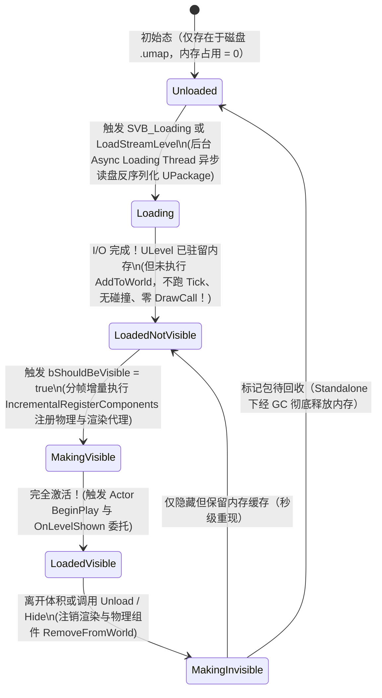
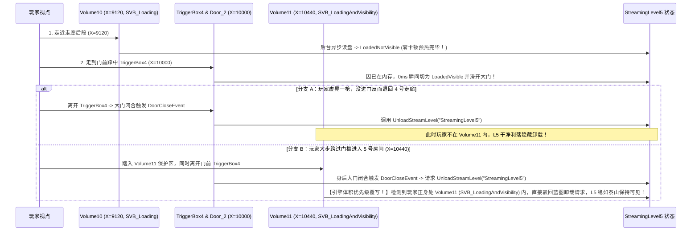

# 03 · `Level_Streaming`：传统子关卡流送与无缝加载机制全解（含 `StreamingLevel1~5` 子关卡深拆）

> **对应工程主地图**：`/Game/Maps/Level/Level_Streaming`（全图聚合总 Actor 数 `92` | 展台数 `11` | 示例交互与体积 Actor 数 `30`）  
> **挂载流送子关卡（共 5+1 张）**：  
> - `/Game/Maps/Level/StreamingLevels/StreamingLevel1`（总 Actor `23` | 展台 `2` | 示例 Actor `5`）  
> - `/Game/Maps/Level/StreamingLevels/StreamingLevel2`（总 Actor `18` | 展台 `2` | 示例 Actor `2`）  
> - `/Game/Maps/Level/StreamingLevels/StreamingLevel3`（总 Actor `18` | 展台 `1` | 示例 Actor `3`）  
> - `/Game/Maps/Level/StreamingLevels/StreamingLevel4`（总 Actor `21` | 展台 `2` | 示例 Actor `5`）  
> - `/Game/Maps/Level/StreamingLevels/StreamingLevel5`（总 Actor `17` | 展台 `1` | 示例 Actor `2`）  
> - `StreamingLevel_Sky`（常驻天空与环境光照层 `Always Loaded`）  
> **所属领域目录**：`04_Level_世界构建与PCG`

---

## 一、 导言：为什么在 World Partition 时代，你依然必须精通传统子关卡流送？

提到关卡流送（Level Streaming），很多刚学 UE5 的开发者会问：“既然有了 World Partition（世界分区）自动按网格加载，传统的 **Sublevel Streaming（手动子关卡流送）** 是不是淘汰了？”

**答案是否定的——不仅没淘汰，在大量 3A 品类中它依然是不可替代的首选架构！**
- **World Partition** 擅长的是**无边界二维旷野**（如《巫师》《荒野大镖客》式的广袤地表，按欧氏距离半径自动加载）；
- **传统 Sublevel Streaming** 擅长的则是**高密度箱庭室内关卡、多层立体地下城、气闸门走廊（Airlock Hallway）与跨维度空间切换**（如《生化危机》《死亡空间》《战神》的界域传送室）：一墙之隔的隔壁房间欧氏距离只有 2 米，如果用半径网格流送会全部常驻内存爆掉显存；而利用传统子关卡 + 气闸门（Airlock Door）+ 预加载体积（`SVB_Loading`），我们可以做到**门不开绝不渲染隔壁房间、握住门把手的 1 秒钟内异步预热内存、推门瞬间 120fps 零卡顿显现，关门反锁后立刻卸载身后旧区域**！

打开 `/Game/Maps/Level/Level_Streaming`，整座由多段彩色模块化房间（`BP_DemoRoom2` ~ `BP_DemoRoom7`）无缝拼接而成的百米长廊，正是这套工业级流送状态机的活体解剖标本：


---

## 二、 底层架构深潜：`ULevelStreaming` 异步 I/O 状态机与五大流送枚举

在深入 11 座展台与 5 张子关卡之前，我们必须先看透虚幻引擎在 C++ 底层是如何把一张磁盘上的 `.umap` 包无缝挂载进当前 `UWorld::Levels` 数组的。

### 2.1 “磁盘加载（Loading）”与“注册进场景可见（Visibility）”的两阶段解耦

初学者最常踩的性能大坑，是以为“加载关卡 = 画面显示出来”。事实上，引擎在 `ULevelStreaming` 内部将一次流送严格切分为**异步 I/O 反序列化**与**游戏线程注册激活**两个完全独立的阶段（6 态有限状态机）：



> [!WARNING]
> **为什么在编辑器 PIE 里测试流送时，内存看起来从来不往下降？（展台 #1 官方红线警告）**  
> 当你在 Unreal Editor 中点击普通 Play In Editor（PIE）时，为了让你按下 `Esc` 退出游戏后能瞬间回到全关卡编辑状态，**编辑器已经把所有子关卡 `UPackage` 强引用锁在内存里了**——PIE 里的“卸载”其实只是把子关卡切回 `RemoveFromWorld`（隐藏并注销碰撞），绝不会真正把 `.umap` 从 RAM 里释放，导致 `LoadStreamLevel` 看起来“0 毫秒瞬间完成”，掩盖了真实磁盘 I/O 卡顿！  
> **正确压测姿势**：测试流送卡顿（Hitch）与峰值内存时，**必须使用 `Standalone Game`（独立进程模式）或打包版本**，并可通过控制台 `stat levels`（实时查看各子关卡红/黄/绿/紫状态色标）与 `s.ForceGCAfterLevelStreamedOut 1` 验证真实卸载回收！

### 2.2 `ALevelStreamingVolume` 五大 `EStreamingVolumeUsage` 模式精确对照表

在主持久关卡中放置 `LevelStreamingVolume` 时，其 `Streaming Usage` 属性决定了玩家踏入该体积后如何驱动上述状态机（本关展台 #5、#10、#11 实测全覆盖）：

| C++ 枚举名 (`streamingUsage`) | 编辑器显示名 | 是否加载进内存 (`bShouldBeLoaded`) | 是否激活可见 (`bShouldBeVisible`) | 是否阻塞主线程等待 (`bShouldBlockOnLoad`) | 典型工业级应用场景 |
| :--- | :--- | :---: | :---: | :---: | :--- |
| **`SVB_Loading`** | `Loading` | ✅ 是 | ❌ 保持当前态（不主动改可见性） | ❌ 异步不卡帧 | **走廊前哨预热区**（展台 #10）：提前把前方 Boss 房静默读进内存，等蓝图脚本开门时再点亮可见性 |
| **`SVB_LoadingNotVisible`** | `Loading Not Visible` | ✅ 是 | ❌ **强制隐藏** (`false`) | ❌ 异步不卡帧 | 隔墙预热且严防隔壁房间灯光/巨大模型穿墙露馅（展台 #5 左踏板） |
| **`SVB_LoadingAndVisibility`** | `Loading And Visibility` | ✅ 是 | ✅ 是 | ❌ 异步不卡帧 | **最常用默认模式**（展台 #3/#5 中踏板/#11）：走进去异步加载并平滑显现 |
| **`SVB_VisibilityBlockingOnLoad`** | `Visibility Blocking On Load` | ✅ 是 | ✅ 是 | ⚠️ **强制同步阻塞主线程！** | **防掉入虚空保底体积**（展台 #5 右踏板/#6）：当玩家冲刺速度极快已经跑进目标房间地板位置但异步 I/O 还没读完时，宁可画面顿一下等待地板刷出来，也绝不能让玩家脚下一空掉出世界底线！ |
| **`SVB_BlockingOnLoad`** | `Blocking On Load` | ✅ 是 | ❌ 不主动改可见性 | ⚠️ **强制同步阻塞** | 过场切换黑屏期间强制同步刷入关键关卡资产 |

---

## 三、 主持久关卡（`PersistentLevel`）11 座展台零遗漏逐台深拆

沿着 X 轴坐标从 `500` 一直走到 `10510`，主持久关卡与 5 段子关卡交替接力。我们先按空间顺序将全部 **11 座展台**的展牌原文、陈列机关与触发链路逐一拆透。

---

### 展台 #1：`Level Streaming` — 入口导览与编辑器测试铁律

- **展牌标识与空间坐标**：`BP_DemoDisplay`，位于 `(500, -850, 0)`（隶属 `PersistentLevel` 白色起始大厅 `BP_DemoRoom2`）
- **官方展牌原文**：
  > *"This map shows the process of level streaming and different ways to bring content into your levels at runtime. Keep in mind that when playing in the editor, levels are never streamed out of memory. Be sure to use standalone if testing performance."*  
  > （本地图展示了关卡流送的全流程以及在运行时动态载入关卡内容的不同手段。请牢记：在编辑器内运行游戏时，子关卡永远不会真正从内存中卸载。若要测试真实流送性能，请务必使用 Standalone 独立游戏模式。）
- **展台关联示例 Actor（1 个）**：
  - `Actor`（挂载 `ChaosDebugDrawComponent_0`）

---

### 展台 #2：`Persistent Level` — 永驻内存的根基与“共享天空光照子关卡”模式


- **展牌标识与空间坐标**：`BP_DemoDisplay1`，位于 `(1500, -900, 0)`（隶属 `PersistentLevel`）
- **展台内 3D 悬浮文字标签（`TextRenderActor`）**：`Persistent Level`
- **官方展牌原文**：
  > *"This is the Persistent Level. It is always loaded and can't be streamed out. It contains everything in the white section of the level. To your right you see the StreamingLevel_Sky. It is set to 'Always Loaded'."*  
  > （这里是**持久关卡 Persistent Level**。它永远处于已加载状态，绝对无法被流送卸载。本关所有白色墙体走廊部分都存放在持久关卡中。在你右手边窗外看到的是 **`StreamingLevel_Sky`** 子关卡，它的流送方式被设为了 **"Always Loaded"（始终加载）**。）

#### 深度解析：既然 `StreamingLevel_Sky` 也是“始终加载”，干嘛不直接塞进 `PersistentLevel`？
这是大型团队多人协作中最经典的 **“职责拆层（Sublevel Layering）”** 技巧！
如果把平行光、天光、高度雾和天空球直接放在 `PersistentLevel` 里，灯光师每次微调太阳角度都要签出锁定主地图文件，阻塞关卡设计师修改流送体积和全局机关。把大气光照独立拆成一张设为 `ULevelStreamingAlwaysLoaded`（在 Levels 面板右键 `Change Streaming Method -> Always Loaded`）的 `StreamingLevel_Sky.umap`：
1. 灯光师全天独占编辑 `StreamingLevel_Sky.umap`，与主关卡策划零文件冲突；
2. 同一套 `StreamingLevel_Sky.umap` 甚至可以被多张不同的章节主地图共同引用，改一次天光，十张地图同步生效；
3. 若进一步配合 **Lighting Scenarios（光照情景层）**，还能在同一座几何城镇上切换“正午晴空烘焙层”与“午夜暴雨烘焙层”！

---

### 展台 #3：`LevelStreamingVolume`（入口段）— 踏入体积自动唤醒红色走廊 `StreamingLevel1`

- **展牌标识与空间坐标**：`BP_DemoDisplay2`，位于 `(2500, -900, 0)`（隶属 `PersistentLevel` 白色走廊末端）
- **官方展牌原文**：
  > *"If you are in this section of the hallway you entered a LevelStreamingVolume 'LevelStreamingVolume1'. This Volume is associated with StreamingLevel1 (red section of the hallway). StreamingVolumes need to be in the Persistent Level."*  
  > （当你走到走廊这一段时，你已经踏入了名为 `LevelStreamingVolume1` 的关卡流送体积。该体积关联了 `StreamingLevel1`（前方红色墙体走廊段）。**所有关卡流送体积都必须存放在持久主关卡 Persistent Level 中！**）
- **展台关联环境与全局示例 Actor（共 9 个，含共享天空光照与各层植被管理器）**：
  - 光照大气四件套：`DirectionalLight`（`Intensity = 10`, `Movable`）、`SkyLight`（`Intensity = 1`, `Movable`）、`SkyAtmosphere`、`ExponentialHeightFog`；
  - 5 个跨子关卡的 `InstancedFoliageActor` 单例。

#### 深度解析：为什么 `LevelStreamingVolume` 严禁放进流送子关卡内部？
试想一下“先有鸡还是先有蛋”的悖论：如果你把负责加载 `StreamingLevel1` 的 `LevelStreamingVolume1` 放进了 `StreamingLevel1` 自己肚子里——游戏刚启动时 `StreamingLevel1` 根本没加载，连同它肚子里的 `LevelStreamingVolume1` 也不存在于内存中，引擎拿什么去检测玩家走进了体积？因此引擎硬性规定：**所有 `ALevelStreamingVolume` 必须驻留在永不卸载的 `PersistentLevel` 中**（如若违背，Map Check 会直接抛出严重警告并忽略该体积）！

---

### 展台 #4：`LevelStreamingVolume`（多对多映射法则）— 步入红色子关卡 `StreamingLevel1`

- **展牌标识与空间坐标**：`BP_DemoDisplay3`，位于 `(3507, -900, 0)`（**注意：从这一步开始，你脚踩的红色房间 `BP_DemoRoom3` 与展牌本身，已经全部来自动态加载出来的 `StreamingLevel1.umap`！**）
- **官方展牌原文**：
  > *"As long as you are in the LevelStreamingVolume this Level will be loaded and visible. Every Level can have multiple LevelStreamingVolumes. Every LevelStreamingVolume can be associated with multiple Levels."*  
  > （只要你仍处于 `LevelStreamingVolume` 内部，这张子关卡就会保持加载并可见。**每一张子关卡都可以绑定多个不同的流送体积；每一个流送体积也可以同时关联多张子关卡！**）

#### 深度解析：$M \times N$ 多对多体积拓扑是如何计算的？
引擎在每帧 `UWorld::ProcessLevelStreamingVolumes` 中遍历玩家视点（`PlayerController::GetPlayerViewPoint`，注意**判定依据是摄像机视点坐标而非 Pawn 脚底坐标**！防止无人机镜头或远距离狙击镜飞出玩家身体看到未加载虚空）：
- 对于某张子关卡 $L$，引擎检查它关联的所有体积集合 $\{V_1, V_2, \dots, V_k\}$；
- 这是一套标准的**逻辑或（OR）聚合**：只要摄像机视点落在其中**任意一个**体积 $V_i$ 内，$L$ 就保持激活；只有当视点离开全部 $k$ 个体积、且过了 `MinTimeBetweenVolumeUnloadRequests`（默认 `2.0` 秒防抖冷却时间，防止玩家站在体积边界线上反复横跳引发疯狂加载卸载抖动！）后，引擎才会发起卸载请求。

---

### 展台 #5：`Streaming Usage` — 三块并排踏板实时对比三大流送可见性与阻塞策略


- **展牌标识与空间坐标**：`BP_DemoDisplay4`，位于 `(4500, -900, 0)`（展牌与雕塑位于 `StreamingLevel1`，而四个流送体积位于 `PersistentLevel`）
- **展台内 3D 悬浮文字标签（`TextRenderActor`）**：
  - `Streaming Level 1`
  - `LoadingNotVisible` | `LoadingAndVisible` | `VisibiltyBlockingOnLoad`
- **官方展牌原文**：
  > *"Streaming Usage is an option for every LevelStreamingVolume. Streaming Levels can take a long time depending on its content. Usage lets you set how loading and visibility is handled."*  
  > （`Streaming Usage` 是每个关卡流送体积的核心配置项。根据子关卡资产体量不同，流送可能耗时较长。通过 Usage 选项，你可以精确掌控内存加载与画面可见性的衔接策略。）
- **展台内陈列的全部 7 个核心 Actor 空间配对实测**：
  1. **`LevelStreamingVolume1`**（`(4432.5, -75, 332.5)`，位于 `PersistentLevel`）：包裹整个红色走廊前段，`streamingLevelNames = ["/Game/Maps/Level/StreamingLevels/StreamingLevel1"]`，`streamingUsage = "SVB_LoadingAndVisibility"`。
  2. **左侧测试位（预载但强制隐藏前方 2 号走廊）**：
     - 视觉标记物：`SM_PostProcessVisualizer`（坐标 `(4250, 77, 12.5)`，隶属 `StreamingLevel1`）
     - 触发体积：`LevelStreamingVolume6`（坐标 `(4252.5, 101.5, 190)`，隶属 `PersistentLevel`）$\rightarrow$ 目标 `StreamingLevel2`，模式 **`SVB_LoadingNotVisible`**！当你站在这座雕塑前看向走廊深处，虽然 `StreamingLevel2` 已被偷偷读进内存，但前方依然空空如也！
  3. **中间测试位（异步加载并显现前方 2 号走廊）**：
     - 视觉标记物：`SM_PostProcessVisualizer_2`（坐标 `(4507.5, 77, 12.5)`，隶属 `StreamingLevel1`）
     - 触发体积：`LevelStreamingVolume7`（坐标 `(4457.5, 108, 190)`，隶属 `PersistentLevel`）$\rightarrow$ 目标 `StreamingLevel2`，模式 **`SVB_LoadingAndVisibility`**！横移一步站到这里，前方 `StreamingLevel2` 走廊立刻刷出显现（若尚未完成异步读盘，则后台读完后平滑显现）。
  4. **右侧测试位（强制阻塞主线程确保立等可见）**：
     - 视觉标记物：`SM_PostProcessVisualizer_3`（坐标 `(4755, 77, 12.5)`，隶属 `StreamingLevel1`）
     - 触发体积：`LevelStreamingVolume8`（坐标 `(4645, 94, 190)`，隶属 `PersistentLevel`）$\rightarrow$ 目标 `StreamingLevel2`，模式 **`SVB_VisibilityBlockingOnLoad`**！一旦踏入，若 `StreamingLevel2` 尚未加载完，游戏主线程会强制调用 `FlushAsyncLoading()` 同步阻塞直到当前帧一定把 `StreamingLevel2` 渲染出来为止！

---

### 展台 #6：`End Streaming using Volumes` — 跨出 1 号体积自动回收旧走廊

- **展牌标识与空间坐标**：`BP_DemoDisplay5`，位于 `(5502, -900, 0)`（隶属 `StreamingLevel2` 房间 `BP_DemoRoom4`）
- **展台内 3D 悬浮文字标签（`TextRenderActor`）**：`Streaming Level 2`
- **官方展牌原文**：
  > *"This covers a streaming setup using Volumes. If you continue moving down the hallway you will leave 'LevelStreamingVolume1' and 'StreamingLevel1' will be unloaded."*  
  > （以上完整演示了基于体积的流送配置。如果你继续沿着走廊往前走，你将彻底跨出 `LevelStreamingVolume1` 的边界，身后的红色走廊 `StreamingLevel1` 将随之自动卸载！）
- **展台关联示例 Actor（1 个）**：
  - **`LevelStreamingVolume9`**（坐标 `(5252.5, -170, 190)`，隶属 `PersistentLevel`）：包裹 `StreamingLevel2` 整段走廊区域，`streamingLevelNames = ["/Game/Maps/Level/StreamingLevels/StreamingLevel2"]`，模式设为 **`SVB_VisibilityBlockingOnLoad`**（确保玩家已经踩在 2 号子关卡地板上时，2 号子关卡绝对处于 100% 实体碰撞就绪状态，绝不会掉下去！）。当你继续向前走并回头张望，会亲眼目睹刚才走过的红色走廊在身后凭空消失回收！

---

### 展台 #7：`Load Levels Blueprints` — 从“空间体积驱动”迈向“蓝图事件驱动”

- **展牌标识与空间坐标**：`BP_DemoDisplay6`，位于 `(6502, -900, 0)`（展牌隶属 `StreamingLevel2` 走廊末端）
- **官方展牌原文**：
  > *"You can also use Blueprints to stream Levels. Here we use a Trigger and the LevelBlueprint (Persistent Level) to stream a level when you touch the Trigger. The Blueprint node 'Load Stream Level' has checkboxes for Visibility and Block just like the Usage properties of Volumes."*  
  > （你同样可以使用蓝图精确控制子关卡流送。在这里，我们在持久主关卡中使用一个 `Trigger` 触发器配合关卡蓝图，当你触碰触发器时动态加载前方子关卡。蓝图节点 **`Load Stream Level`** 同样提供了 `Make Visible After Load`（加载后立即可见）与 `Should Block on Load`（加载时阻塞）两个复选框，与流送体积的 Usage 属性一一对应！）
- **展台内陈列的示例 Actor（1 个）**：
  - **`TriggerBox1`**（`/Script/Engine.TriggerBox`，坐标 `(6652.5, 20, 57.5)`，隶属 `PersistentLevel`）：当玩家触碰 `TriggerBox1` 时，`PersistentLevel` 的关卡蓝图立即执行潜在异步节点（Latent Action）：
    ```text
    [OnActorBeginOverlap (TriggerBox1)]
        └──> [Load Stream Level (Level Name = "StreamingLevel3", Make Visible After Load = true, Should Block on Load = false)]
    ```

---

### 展台 #8：`Load Levels using Blueprints` — 经典“气闸门（Airlock Door）”遮蔽流送延迟设计模式

- **展牌标识与空间坐标**：`BP_DemoDisplay10`，位于 `(7505, -900, 0)`（隶属刚刚被蓝图唤醒的 `StreamingLevel3` 房间 `BP_DemoRoom5`）
- **展台内 3D 悬浮文字标签（`TextRenderActor`）**：`Streaming Level 3`
- **官方展牌原文**：
  > *"Streaming Levels can be done from any Blueprint and in any fashion you can imagine. Here we are streaming the level; as soon as the Level is visible it will call a CustomEvent to open the door. If the door would be solid you wouldn't have noticed the level was streamed."*  
  > （流送关卡可以从**任何蓝图**中以任何你能想象的逻辑发起！在这里，当你靠近大门发起下一关加载时，**一旦下一张子关卡完成异步加载并变为可见（Completed 引脚触发），立刻回调自定义事件滑开大门**！如果这扇门是不透明的实心门（而非演示用的透明玻璃框门），玩家根本察觉不到门后那整个世界是刚刚才从硬盘里变出来的！）
- **展台关联核心 Actor（位于 `StreamingLevel3` 末端门槛处）**：
  - **`BP_Double_Doors`**（坐标 `(8002.5, -2.5, -142.5)`，隶属 `StreamingLevel3`）：横亘在 `StreamingLevel3` 与 `StreamingLevel4` 交界处的科幻气闸双扇门（配 `M_UE_Logo_Doors` 菲涅尔电光蓝门锁）。
  - **`TriggerBox2`**（坐标 `(8010, 0, 227.5)`，隶属 `StreamingLevel3`）：紧贴在大门前方的感应区。

#### 深度解析：3A 大作无缝过图神器——“Latent `Completed` 引脚联动气闸门”
为什么《银河战士 Prime》《死亡空间》《星际战甲》里有些门你走过去门锁会转圈亮黄灯 0.5 秒才换成绿灯滑开？秘密全在 `Load Stream Level` 节点的右侧 **`Completed`** 执行引脚上！
```text
// 位于 StreamingLevel3_C 关卡蓝图（或门控蓝图）中：
[OnActorBeginOverlap (TriggerBox2)]
    └──> [Load Stream Level (Level Name = "StreamingLevel4", Make Visible After Load = true, Should Block on Load = false)]
             │  (此时后台线程疯狂异步读盘，游戏主线程维持 120fps 丝滑运转，玩家站在门前看着门锁发光动画)
             └── Completed (确认 StreamingLevel4 已 100% 加载并完成组件注册显现！)
                    └──> [BP_Double_Doors -> Open Door] (门扇滑开，门后房间早已严阵以待，零穿帮、零顿卡！)
```

---

### 展台 #9：`Unload Level using Blueprints` — 蓝图手动流送的对称卸载铁律


- **展牌标识与空间坐标**：`BP_DemoDisplay8`，位于 `(8505, -900, 0)`（隶属 `StreamingLevel4` 房间 `BP_DemoRoom6`）
- **展台内 3D 悬浮文字标签（`TextRenderActor`）**：`Streaming Level 4`
- **官方展牌原文**：
  > *"A level loaded with 'Load Stream Level' function will stay loaded until it gets unloaded with the 'Unload Stream Level' function."*  
  > （凡是通过蓝图函数 **`Load Stream Level`** 加载进来的子关卡，将**一直常驻内存**，直到你显式调用 **`Unload Stream Level`** 函数将其卸载为止！）
- **展台周边交错部署的 3 个双向防呆触发器实测**：
  1. `TriggerBox2`（坐标 `(8010, 0, 227.5)`，隶属 `StreamingLevel3`）：正向加载 4 号走廊并开门；
  2. `TriggerBox5`（坐标 `(8346.5, -170, 57.5)`，隶属 `PersistentLevel`）：架设在 3 号与 4 号交界靠 4 号一侧的回退保护触发器（若 3 号已被卸载，玩家突然掉头往回走，由永驻的 `PersistentLevel` 捕获触发重新把 `StreamingLevel3` 刷回来！）；
  3. **`TriggerBox3`**（坐标 `(8687.5, -170, 57.5)`，隶属 `StreamingLevel4`）：当玩家彻底走入 `StreamingLevel4` 深处踩中 `TriggerBox3` 时，`StreamingLevel4_C` 立即调用 `Unload Stream Level ("StreamingLevel3")`，干脆利落地销毁身后的 3 号走廊！

---

### 展台 #10：`Combining Methods` — 终极混合架构（上）：流送体积静默预热 + 蓝图秒开可见性

- **展牌标识与空间坐标**：`BP_DemoDisplay9`，位于 `(9500, -900, 0)`（隶属 `StreamingLevel4` 后半段）
- **官方展牌原文**：
  > *"It is also possible to combine LevelStreamingVolumes with Blueprint scripted events. In this section we use a LevelStreamingVolume SVB_Loading to just load 'StreamingLevel5'. But the visibility is controlled using the Level Blueprint."*  
  > （我们还可以将 `LevelStreamingVolume` 与蓝图脚本事件强强联手！在这一段走廊中，我们先用一个设为 **`SVB_Loading`**（注：展牌笔误写作 `SVG_Loading`）的流送体积**仅仅把 `StreamingLevel5` 静默预加载进内存**；而它何时显现（Visibility），则完全交由关卡蓝图精准掌控！）
- **展台内陈列的示例 Actor（共 3 个）**：
  1. **`LevelStreamingVolume10`**（坐标 `(9120, -80, 190)`，隶属 `PersistentLevel`）：`streamingLevelNames = ["/Game/Maps/Level/StreamingLevels/StreamingLevel5"]`，**`streamingUsage = "SVB_Loading"`**！玩家还在 `X = 9120` 散步看展牌时，`StreamingLevel5` 已经在后台静默读进内存了（处于 `LoadedNotVisible` 待命态）。
  2. **`TriggerBox4`**（坐标 `(10000, -10, 217.5)`，隶属 `StreamingLevel4`）：位于第二扇气闸门前的开门触发盒。
  3. **`BP_Double_Doors_2`**（坐标 `(10002.5, -2.5, -142.5)`，隶属 `StreamingLevel4`）：通往最终房间 `StreamingLevel5` 的气闸大门。**注意实测提取到的关键关门委托绑定**：
     ```json
     "doorCloseEvent": "(/Game/Maps/Level/StreamingLevels/StreamingLevel4.StreamingLevel4:PersistentLevel.StreamingLevel4_C_1.BndEvt__BP_Double_Doors_C_1_K2Node_ActorBoundEvent_153_DoorCloseEvent__DelegateSignature)"
     ```

---

### 展台 #11：`Combining Methods Continued` — 终极混合架构（下）：关门卸载回调与流送体积的仲裁覆写！

- **展牌标识与空间坐标**：`BP_DemoDisplay11`，位于 `(10510, -900, 0)`（隶属压轴子关卡 `StreamingLevel5` 房间 `BP_DemoRoom7`）
- **展台内 3D 悬浮文字标签（`TextRenderActor`）**：`Streaming Level 5`
- **官方展牌原文**：
  > *"Once inside, the closing door will still trigger the unload. But the LevelStreamingVolume SVB_LoadingAndVisibility will override the unload by the Blueprint and keeps the map loaded."*  
  > （一旦你跨入 5 号房间内部，身后自动合拢的大门依然会触发卸载指令；但是，铺设在 5 号房间内部的 `LevelStreamingVolume`（设为 **`SVB_LoadingAndVisibility`**）会**自动覆写（Override）蓝图的卸载请求**，稳稳地让 5 号房间保持加载与可见！）
- **展台内陈列的示例 Actor（1 个）**：
  - **`LevelStreamingVolume11`**（坐标 `(10440, 20, 190)`，隶属 `PersistentLevel`）：完整笼罩 `StreamingLevel5` 房间内部，`streamingLevelNames = ["/Game/Maps/Level/StreamingLevels/StreamingLevel5"]`，**`streamingUsage = "SVB_LoadingAndVisibility"`**。

#### 深度解析：拍案叫绝的“双向自适应气闸门状态机”是怎么运作的？
把展台 #10 和 #11 的四个机关（`LevelStreamingVolume10`、`TriggerBox4`、`BP_Double_Doors_2.DoorCloseEvent`、`LevelStreamingVolume11`）拼在一起，你会看到一套连“玩家在门口假动作骗开门又缩回去”都能完美处理的工业级状态机：



这就是为什么引擎在 `UWorld::ProcessLevelStreamingVolumes` 中将激活态 `LevelStreamingVolume` 设计为每帧持续刷新的“保活锁（Keep-Alive Lock）”——它省去了关卡策划手动写一堆“判断玩家到底是从门左边出去还是从门右边进去”的繁琐向量点乘数学题！

---

## 四、 5 张流送子关卡（`StreamingLevel1` ~ `StreamingLevel5`）内部资产全拆解档案

除了主持久关卡（额外包含全局 `Global PostProcess`、包裹全走廊的 `LightmassImportanceVolume1` 以及名为 `LightmassImportanceVolume2` 实为 `/Script/Engine.PrecomputedVisibilityVolume` 的预计算可见性体积）之外，我们对 `/Game/Maps/Level/StreamingLevels/` 下的 **5 张独立 `.umap` 子关卡文件**进行了逐包独立实测解剖，内部家底汇总如下：

### 4.1 子关卡 #1：`StreamingLevel1`（红色体积演示段）
- **资产路径**：`/Game/Maps/Level/StreamingLevels/StreamingLevel1`
- **规模统计**：总 Actor 数 `23` | 承载展台 `2` 座 | 核心示例 Actor `5` 个
- **房间壳体**：`BP_DemoRoom3`（红色主题走廊模块）
- **内部承载展台与完整 Actor 清单**：
  - 承载主走廊 **展台 #4（子关内编号 #1）`BP_DemoDisplay3` `(3507, -900, 0)`** 与 **展台 #5（子关内编号 #2）`BP_DemoDisplay4` `(4500, -900, 0)`** 及 4 组 3D 悬浮文字标签（`Streaming Level 1`, `LoadingNotVisible`, `LoadingAndVisible`, `VisibiltyBlockingOnLoad`）；
  - 3 座流送模式指示雕塑：`SM_PostProcessVisualizer` `(4250, 77, 12.5)`、`SM_PostProcessVisualizer_2` `(4507.5, 77, 12.5)`、`SM_PostProcessVisualizer_3` `(4755, 77, 12.5)`（网格引用 `/Game/ExampleContent/PostProcessing/Meshes/SM_PostProcessVisualizer`）；
  - 子关卡专属 `InstancedFoliageActor` 与 `ChaosDebugDrawComponent_0` 宿主 Actor。
- **控制权归属**：完全由 `PersistentLevel` 中的 `LevelStreamingVolume1`（`SVB_LoadingAndVisibility`）接管生命周期。

### 4.2 子关卡 #2：`StreamingLevel2`（多模式测试与蓝图过渡段）
- **资产路径**：`/Game/Maps/Level/StreamingLevels/StreamingLevel2`（子关卡脚本类 `StreamingLevel2_C`，`props: {}`）
- **规模统计**：总 Actor 数 `18` | 承载展台 `2` 座 | 辅助 Actor `2` 个
- **房间壳体**：`BP_DemoRoom4`
- **内部承载展台与完整 Actor 清单**：
  - 承载主走廊 **展台 #6（子关内编号 #1）`BP_DemoDisplay5` `(5502, -900, 0)`**（含 3D 标签 `Streaming Level 2`）与 **展台 #7（子关内编号 #2）`BP_DemoDisplay6` `(6502, -900, 0)`**；
  - 子关卡专属 `InstancedFoliageActor` 与物理调试宿主 Actor（注意：放在 `(6652.5, 20, 57.5)` 的触发盒 `TriggerBox1` 故意没有放进 `StreamingLevel2`，而是放在了 `PersistentLevel` 中，确保流送调度器高内聚）。
- **控制权归属**：同时受 `PersistentLevel` 中的 **4 个流送体积**（`LevelStreamingVolume6`、`7`、`8` 远程实验踏板 + `LevelStreamingVolume9` 本段走廊阻塞保底体积）多对一联合驱动！

### 4.3 子关卡 #3：`StreamingLevel3`（纯蓝图加载与首道气闸门段）
- **资产路径**：`/Game/Maps/Level/StreamingLevels/StreamingLevel3`（子关卡脚本类 `StreamingLevel3_C`）
- **规模统计**：总 Actor 数 `18` | 承载展台 `1` 座 | 核心示例 Actor `3` 个
- **房间壳体**：`BP_DemoRoom5`
- **内部承载展台与完整 Actor 清单**：
  - 承载主走廊 **展台 #8（子关内编号 #1）`BP_DemoDisplay10` `(7505, -900, 0)`**（含 3D 标签 `Streaming Level 3`）；
  - **`TriggerBox2`** `(8010, 0, 227.5)`：负责感知玩家抵近门前，异步请求加载 `StreamingLevel4`；
  - **`BP_Double_Doors`** `(8002.5, -2.5, -142.5)`：首道气闸双扇感应门，待 `StreamingLevel4` 可见后由 `StreamingLevel3_C` 驱动滑开；
  - 物理调试宿主 Actor。
- **控制权归属**：纯蓝图驱动——由 `PersistentLevel.TriggerBox1`（正向）或 `PersistentLevel.TriggerBox5`（逆向回退）调用 `Load Stream Level` 唤醒，由 `StreamingLevel4.TriggerBox3` 调用 `Unload Stream Level` 销毁。

### 4.4 子关卡 #4：`StreamingLevel4`（蓝图卸载 + 气闸门关门回调枢纽段）
- **资产路径**：`/Game/Maps/Level/StreamingLevels/StreamingLevel4`（子关卡脚本类 `StreamingLevel4_C`）
- **规模统计**：总 Actor 数 `21` | 承载展台 `2` 座 | 核心示例 Actor `5` 个
- **房间壳体**：`BP_DemoRoom6`
- **内部承载展台与完整 Actor 清单**：
  - 承载主走廊 **展台 #9（子关内编号 #1）`BP_DemoDisplay8` `(8505, -900, 0)`**（含 3D 标签 `Streaming Level 4`）与 **展台 #10（子关内编号 #2）`BP_DemoDisplay9` `(9500, -900, 0)`**；
  - **`TriggerBox3`** `(8687.5, -170, 57.5)`：跨入本关后回头卸载 `StreamingLevel3`；
  - **`TriggerBox4`** `(10000, -10, 217.5)`：点亮已被 `Volume10` 预热进内存的 `StreamingLevel5` 可见性并打开二号大门；
  - **`BP_Double_Doors_2`** `(10002.5, -2.5, -142.5)`：二号气闸双扇门，其 `doorCloseEvent` 直接静态绑定至子关卡自身蓝图 `StreamingLevel4_C_1.BndEvt__BP_Double_Doors_C_1_K2Node_ActorBoundEvent_153_DoorCloseEvent__DelegateSignature`，在门扇彻底合拢的一刹那发起对 `StreamingLevel5` 的卸载请求！
  - 子关卡专属 `InstancedFoliageActor` 与物理调试宿主 Actor。

### 4.5 子关卡 #5：`StreamingLevel5`（体积保活覆写终点大厅）
- **资产路径**：`/Game/Maps/Level/StreamingLevels/StreamingLevel5`（子关卡脚本类 `StreamingLevel5_C`）
- **规模统计**：总 Actor 数 `17` | 承载展台 `1` 座 | 辅助 Actor `2` 个
- **房间壳体**：`BP_DemoRoom7`
- **内部承载展台与完整 Actor 清单**：
  - 承载主走廊压轴 **展台 #11（子关内编号 #1）`BP_DemoDisplay11` `(10510, -900, 0)`**（含 3D 标签 `Streaming Level 5`）；
  - 子关卡专属 `InstancedFoliageActor` 与物理调试宿主 Actor。
- **控制权归属**：混合双保险驱动——由 `LevelStreamingVolume10` (`SVB_Loading`) 预热内存，由 `StreamingLevel4` 蓝图控制门前显隐，进入内部后由 `LevelStreamingVolume11` (`SVB_LoadingAndVisibility`) 强制接管保活，免疫关门卸载事件！

---

## 五、 现代 UE5 关卡流送技术选型总纲（何时用哪套流送？）

将本章解剖的传统子关卡流送与后续章节的 World Partition / Data Layers / Level Instance 放在同一张工程架构图上对比，选型逻辑一目了然：

| 关卡形态与业务诉求 | 最佳流送技术选型 | 核心技术支撑 |
| :--- | :--- | :--- |
| **线性/箱庭室内关卡、多层地下迷宫、电梯/气闸门副本** | **传统 Sublevel Streaming（本章主角）** 或 **Level Instance 动态流送 (`LoadLevelInstance`)** | `SVB_Loading` 走廊预热 + 蓝图 `LoadStreamLevel` `Completed` 回调开气闸门 + `SVB_LoadingAndVisibility` 室内保活锁 |
| **无缝百平方公里地表大世界、多人并行编辑同一块大陆** | **World Partition（世界分区 + OFPA）** | 2D 空间哈希网格 + `StreamingSource` 半径自动滑窗 + 远景自动降级 HLOD |
| **同一片区域在“白天/黑夜”、“和平/战火废墟”间瞬间切换** | **World Partition Data Layers（数据图层）**（传统地图则用 `SVB_LoadingNotVisible` 预载后切换 `bShouldBeVisible`） | `Unloaded` $\rightarrow$ `Loaded`（过场提前预热） $\rightarrow$ `Activated`（切镜帧 0ms 秒切） |
| **帧率红线防卡顿调优（消除 `AddToWorld` 尖峰 Hitch）** | 项目设置 / `.ini` 增量组件注册帧预算调优 | 调小 `s.LevelStreamingActorsUpdateTimeLimit`（默认 `5.0 ms`）与 `s.PriorityLevelStreamingActorsUpdateExtraTime`，让重型子关卡的数千个静态网格分摊在连续 3~5 帧平滑注册进渲染场景，守死 60/120fps 帧时间底线！ |
