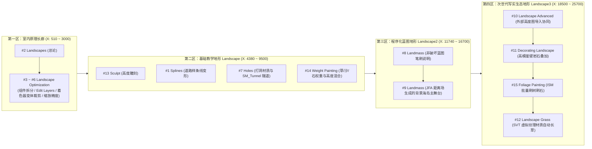

# 04 · `Level_Landscape`：大型地形雕刻、材质图层混合与地形样条线全解

> **对应工程地图**：`/Game/Maps/Level/Level_Landscape`  
> **所属领域目录**：`04_Level_世界构建与PCG`  
> **关卡实测规模**：总 Actor 数 `46` | 展台数 `15`（`#1` ~ `#15` 逐台独立全拆解） | 核心地形/笔刷/环境 Actor 数 `18`

---

## 一、 导言：为什么百平方公里山川绝不用 `StaticMesh` 硬拼？

在构建开放世界或户外自然关卡时，初学者常会提出一个直觉问题：“我在 Blender 或 Houdini 里直接把山脉导出成一个几百万面的 `StaticMesh` 放进场景（甚至开上 Nanite），难道不行吗？为什么虚幻引擎非要专门维护一套庞大的 **`ALandscape`（地形系统）**？”

走进 `/Game/Maps/Level/Level_Landscape`——这是一张先穿过室内理论长廊、随后豁然开朗步入三片真实户外山谷的宏大关卡——你将亲眼见证专门定制的高度场地形架构在**显存压缩、连续细节级别（CDLOD）、每组件着色器裁剪、非破坏性蓝图笔刷（Landmass）以及 GPU 材质驱动草海**上的降维打击优势：

### 1.1 高度图与组件网格的底层数学：每个顶点仅需 2 Bytes！

让我们算一笔硬核显存账：
- **普通静态网格（`UStaticMesh`）**：存储一个顶点至少需要位置 `float3`（12 Bytes）+ 切线帧（4~8 Bytes）+ UV 坐标（4~8 Bytes）+ 顶点索引缓冲区，平均每个顶点消耗 **24 ~ 32 Bytes**；
- **虚幻地形（`ALandscape`）**：由于地形顶点在水平面 $(X, Y)$ 上严格按照等间距规则网格排列，$(X, Y)$ 坐标可以直接由渲染器通过顶点序号 `SV_VertexID` 在顶点着色器（Vertex Shader）中实时算出！磁盘与显存里唯一需要存的，是一张 **16-bit 无符号整型高度图纹理（`uint16`，取值范围 `0 ~ 65535`，中位海平面 `32768`）**——也就是说，**每个地形顶点仅仅消耗 2 Bytes 存储高度 $Z$**（法线压缩存储在同纹理的另两个 RG/BA 通道中）！

#### 高度量化精度公式（展台 #2 & #6 核心底层算式）
在默认垂直缩放 `Scale.Z = 100` 下，虚幻地形将 16 位整数映射到约 $\pm 256\text{ m}$（总落差 $512\text{ m}$）的物理高度区间，其底层精确换算公式为：
$$Z_{\text{world}}\ (\text{cm}) = (\text{Height}_{16\text{bit}} - 32768) \times \frac{\text{Scale}_Z}{128}$$
- 当 $\text{Scale}_Z = 100$ 时，最大高度为 $(65535 - 32768) \times \frac{100}{128} \approx +25599.2\text{ cm} \approx +256\text{ m}$，最低深度为 $-32768 \times \frac{100}{128} = -25600\text{ cm} = -256\text{ m}$，**垂直最小步进精度高达 $0.78\text{ cm}$**！
- 如果你要做珠穆朗玛峰（落差 $4096\text{ m}$），把 $\text{Scale}_Z$ 放大 8 倍至 `800`，代价则是单步垂直量化精度退化到 $6.25\text{ cm}$——这就是为什么展台 #6 叮嘱你“在拉高 Z 轴缩放前，尽量吃满 16 位高度图的动态范围”！

### 1.2 本关“三段式户外山谷 + 15 座展台”空间漫游路线图

由于本关在户外山谷两侧交错布置了展牌（档案按内部实例扫描编号为 `#1` ~ `#15`），阅读前先看懂这 **3 块独立 `ALandscape` 实例**与 **15 座展台**的空间拓扑关系：

---

## 二、 逐展台（Stand #1 ~ #15）零遗漏深度拆解

以下严格按照实测档案展台序号 **`#1` 至 `#15` 逐台独立精讲**，绝不跳号合并，并嵌入实测提取的地形材质表达式与草地品种参数。

---

### 展台 #1：`Splines` — 地形道路样条线与动态编辑层自动削坡填谷

- **展牌标识与空间坐标**：`BP_DemoDisplay6`，位于户外第一段山谷左侧山坡 `(5196, -1640, 411)`
- **官方展牌原文**：
  > *"You can create landscape splines that deform the landscape. This is useful for creating roads or paths for the player to navigate. In order to edit the spline you must be in landscape mode. You can find the Splines tab in the 'Manage' Section. You can create and modify points, set width, falloff, and assign a mesh to layer on top. You can also assign a landscape layer to be dedicated to splines which means the landscape will deform dynamically."*  
  > （你可以创建能够自动使地形发生贴合形变的**地形样条线（Landscape Splines）**，非常适合铺设供玩家寻路行进的公路、山间步道或铁轨。切入地形模式（`Shift + 2`），在 **Manage（管理） -> Splines** 下即可按住 `Ctrl + 左键` 放置控制点、调节路基宽度 `Width`、两侧斜坡羽化过渡宽度 `Side Falloff`，并在样条上方铺设连续变形的路面静态网格。你还可以将一条专用地形编辑层（Edit Layer）分配给样条线，从而实现**实时非破坏性的动态地形削山填谷**！）
- **底层关联实例验证**：
  在第一块地形 `Landscape` `(4380, -9440, -10)` 的组件列表中，实测捕获到了 `SplineMeshComponent_0`、`SplineMeshComponent_1`、`SplineMeshComponent_4` 等样条网格段（编辑器预览使用 `/Engine/EditorLandscapeResources/SplineEditorMesh`），且地形材质 `M_LandsacapeWeightDemo` 显式开启了 **`bUsedWithSplineMeshes = true`**！

#### 深度解析：“Reserve for Splines（样条专属编辑层）”如何彻底告别破坏性改路？
在旧版引擎中，点击“Apply Splines to Landscape”会直接把路基高度永久烙印进唯一一张底图里——一旦策划把公路往左挪 5 米，原来被削平的山坡就留下一道丑陋的疤痕，美术只能苦命重雕。
而在现代工作流中，新建一个名为 `RoadSplines` 的 **Edit Layer**，右键勾选 **`Reserve for Splines`**：从此你用鼠标拖拽样条控制点的每一帧，引擎自动在独立编辑层上实时重算切土（Raise Terrain）与填方（Lower Terrain），甚至能顺带把路肩两侧自动刷上 `Sand/Dirt` 碎石材质权重层！移走样条线，原始山坡毫发无损瞬间复原！

---

### 展台 #2：`Landscapes` — 地形系统总论：16 位高度图与 8 位权重图层

- **展牌标识与空间坐标**：`BP_DemoDisplay4`，位于室内大厅起点 `(510, -900, 0)`
- **官方展牌原文**：
  > *"Landscapes in Unreal are a specialized type of asset, optimised for use as a large seamless expanse of land. There are many features that make up the landscape toolset which you can explore in this level. At its core, a landscape consists of a height map, which uses a 16bit range to define size and height; and a series of 8bit weight map layers that let you paint material properties like sand, dirt, grass etc..."*  
  > （虚幻中的地形是专为广袤无缝大陆优化的特殊资产。从本质上看，一块地形由两部分核心贴图构成：一张定义尺寸与海拔高程的 **16-bit 高度图（Heightmap）**，以及一系列让你自由绘制沙地、泥土、草地等材质属性的 **8-bit 权重贴图图层（Weightmaps）**。）
- **展台区域关联全局环境与植被容器 Actor（共 7 个）**：
  1. `InstancedFoliageActor0`：挂载了两个硬件实例化网格批次（`FoliageInstancedStaticMeshComponent_1` 承载森林岩架 `/Game/ExampleContent/Landscapes/Meshes/S_Forest_Rock_Shelf_wjsqdii_lod0_Var1`；`FoliageInstancedStaticMeshComponent_2` 承载随风摆动的 PivotPainter2 树木 `/Game/ExampleContent/ScriptExamples/PivotPainter2/StaticMesh/HillTree_P2`）；
  2. `DirectionalLight`（`Intensity = 7`, `Mobility = Movable`）、`SkyLight`（`Intensity = 1`, `Movable`）、`SkyAtmosphere`、`ExponentialHeightFog`；
  3. `PostProcessVolume`（`bUnbound = true`, `Priority = 0`）与物理调试辅助 Actor。

---

### 展台 #3：`Landscape Optimization`（其一）— 组件层级拆分、CDLOD 与实验性 Nanite 地形

- **展牌标识与空间坐标**：`BP_DemoDisplay`，位于 `(2001, -900, 0)`
- **官方展牌原文**：
  > *"Landscapes in Unreal use a specialized mesh to render a large open space efficiently and quickly. While the landscape looks like a single asset, it's actually broken up into a series of assets called 'sections'. This means that we don't have to render the entire landscape every frame, just the components that are visible. The bigger the section size, the easier the CPU load, but less optimized LODs. By default, landscapes render at 1 pixel per meter. So if you imported a heightmap texture that was 1009x1009, you would get an environment of 1009 m². In addition to this, landscapes also tessellate based on distance from the camera or can be converted to Nanite. (Warning, Nanite conversion is experimental.)"*

#### 深度解析：读懂 `Quads`、`Sections` 与 `LandscapeComponent` 三级金字塔！
创建地形时那几个奇怪的数字（为什么推荐尺寸偏偏是 `505×505`、`1009×1009`、`2017×2017`、`4033×4033` 而不是 `1024`？）背后是严格的四叉树顶点共享拓扑：
1. **Quad（1 个方格 = 2 个三角形）**：默认 `Scale = (100, 100, 100)` 下，1 个 Quad 边长为 `1 米`；
2. **Section（小节，GPU 单次 Draw Call 与 LOD 计算最小单元）**：可选 $63 \times 63$、$127 \times 127$ 或 $255 \times 255$ Quads（由于相邻组件边界必须共享一排缝合顶点防裂缝，边长顶点数为 $2^n$，故方格数为 $2^n - 1$！例如 8 个 $127$ 方格组件拼成一排，总顶点数 = $8 \times 127 + 1 = 1017$；或 16 个 $63$ 方格组件 = $16 \times 63 + 1 = 1009$！）；
3. **Component（`ULandscapeComponent`，视锥/遮挡剔除与流送最小单元）**：每个组件可包含 $1 \times 1$ 或 $2 \times 2$ 个 Sections。
   - **选型黄金平衡**：组件切得太碎（如 $7 \times 7$ Quads），全图几千个组件会把 CPU 视锥剔除和 Draw Call 压垮；组件切得太大（$2 \times 2$ 个 $255$ Quads），单个组件横跨半公里，近处一角在屏幕内就导致整块高模 LOD0 无法降级。**大世界工业黄金规格通常选 `1×1` 或 `2×2` Sections，配 `63×63` 或 `127×127` Quads**！
   - **CDLOD 连续变形与 Nanite Landscape**：传统地形在顶点着色器里根据距离将粗糙 LOD 顶点平滑插值（Morph）向高一级 LOD，彻底杜绝山脊跳变（Popping）；而在 UE5.3+ 中开启 **Nanite Landscape** 后，地形在构建时生成静态微多边形簇，能够无缝接入虚拟阴影贴图（VSM）毫秒级渲染，消除几十个级联阴影 Pass 对地形重复提交顶点的开销！

---

### 展台 #4：`Landscape Optimization`（其二）— 非破坏性编辑层（Edit Layers）的编辑器内存账

- **展牌标识与空间坐标**：`BP_DemoDisplay7`，位于走廊右侧 `(2003, 900, 0)`
- **官方展牌原文**：
  > *"You can also use landscape layers to work non-destructively. These don't have any additional cost in the packaged game as they are collapsed down on build. However they will increase your memory footprint while in the editor. Each layer is a brand new height and set of weight layers. This cost can increase dramatically as you increase the size of your landscape. To use layers, the landscape must have 'enable edit layers' ticked. You can find this option by clicking on the landscape actor in the world outliner."*

#### 深度解析：“开发期 Photoshop 图层堆栈，打包期零开销拍平”
开启 `Enable Edit Layers` 后，你的地形就像 Photoshop 画布一样拥有了多层叠加能力：
- `Layer 0 (Base)`：Houdini / Gaea 导入的基础山脉走势；
- `Layer 1 (Landmass Islands)`：蓝图程序化笔刷叠加的海岛与河床（支持加减与 Alpha 混合）；
- `Layer 2 (Road Splines)`：公路样条线自动削坡层；
- `Layer 3 (Hand Sculpt)`：关卡美术最后手雕微调的小土坑。
- **关键工程认知**：**在打包客户端（Cooked Build）中，GPU 已在烘焙期将所有 Edit Layers 拍平（Collapse）成唯一一张最终高度图和权重图，运行时零额外损耗！** 但在编辑器内，每多建一层 Edit Layer，显存里就要多存一整套 16-bit 高度图 + 全套权重贴图——若在 $8\text{ km} \times 8\text{ km}$ 巨型地图上建 15 个编辑层，编辑器显存轻松飙升十几个 GB，因此切忌滥建空层，定稿阶段可适时合并历史图层。

---

### 展台 #5：`Landscape Optimization`（其三）— 每组件着色器变体裁剪（Per-Component Shader Stripping）与编译风暴防治

- **展牌标识与空间坐标**：`BP_DemoDisplay2`，位于走廊左侧 `(3000, -900, 0)`
- **官方展牌原文**：
  > *"Landscapes also optimize on the shader. The landscape layer blend node in the material will create multiple versions of the same shader (this is known as shader permutations) that strip out layers that aren't used per component. That means that if you create 10 layers but only use three on one component, it will create a version of that shader that only uses those three layers. While this is much better for reducing shader complexity, it can mean that shader compilation time can skyrocket. While working on a large and complex landscape material, it can be beneficial to make a test landscape that only uses the layers you want to test."*

#### 深度解析：揭秘“地形涂了第 5 层材质突然变成黑白棋盘格狂编几千个 Shader”的真相！
当你用 `LandscapeLayerBlend` 节点创建了 10 种地表材质（草、沙、雪、泥、鹅卵石、熔岩……），如果每个像素都把 10 层贴图（$10 \times 3 = 30$ 张采样器！）全算一遍，再强的显卡也会当场阵亡，且早已突破老旧 API 单材质 16 个 Sampler 的上限。
虚幻地形的绝活是 **Per-Component Static Weightmap Permutation（按组件静态裁剪变体）**：
- 引擎扫描每个 `ULandscapeComponent`：发现山顶这块组件只涂了 `Snow + Rock`（其余 8 层权重全为 `0`），就专门为这块组件编译一个**只采样雪和岩石 2 套贴图的精简 Pixel Shader**；海滩那块组件只涂了 `Sand + WetSand`，就编译另一个只采样沙子的 Shader！
- **双刃剑代价与实战铁律**：
  1. **组合爆炸导致编译风暴**：每出现一种新的图层组合（如 `Grass+Sand+Mud` vs `Grass+Rock+Snow`），引擎就要现编一套全新的 Shader 变体。因此在调试复杂地形母材质时，务必像展牌建议的那样**建一块只涂了 2~3 层的小测试地形调材质**，调好后再同步回大世界！
  2. **单组件最多不超 4 层金线**：4 个 8-bit 权重通道恰好严丝合缝打包进 **1 张 RGBA 权重贴图（Weightmap Texture）**！一旦你在**同一个组件方格**里手欠点上第 5 种材质哪怕一像素，该组件不仅要额外再分配第 2 张权重贴图，Pixel Shader 指令数与寄存器占用也会陡增（可在 `Optimization Viewmodes -> Shader Complexity` 下实时监控每个地形方格绿不绿）！
  3. **现代终极解法——Runtime Virtual Texture (RVT，运行时虚拟纹理)**：将多层地形混合结果实时烘焙写入一张 RVT 缓存页表，屏幕上无论叠了 12 层还是 16 层材质，每帧地形渲染只需采样 1 次 RVT 缓存，顺便还能让插在土里的岩石根部采样 RVT 实现天衣无缝的苔藓接缝融合！

---

### 展台 #6：`Landscape Optimization`（其四）— 水平分辨率缩放与垂直 16-bit 量化预算

- **展牌标识与空间坐标**：`BP_DemoDisplay10`，位于走廊右侧 `(3000, 900, 0)`
- **官方展牌原文**：
  > *"While the default landscape is 1 pixel to 1 meter, this can be changed by scaling the landscape up or down. For example, scaling the landscape down from 100 to 50 will give you 1 pixel for every 0.5 meters. Similarly with height. The landscape has a default max height of around 512 meters, with the default position starting at the middle value. If you have a landscape that needs more height, then you can scale it vertically to fit. However, you should try to use the full bit range of the height map before scaling."*

#### 深度解析：为什么别把地形水平缩放缩到 `Scale.XY = 10` 去硬雕小石子？
正如第 1.1 节推导，默认 `Scale = (100, 100, 100)` 意味着 **每米 1 个高度图纹素（1 Vertex / Meter）**。有些新手嫌地形表面不够精细，把 `Scale.XY` 改成 `25`（每米 4×4=16 个顶点），结果一块 2 公里地图顶点数暴涨 16 倍！正确的次世代分工正是后续 **展台 #11** 所揭示的：地形只用 `0.5m ~ 1m` 的低频网格承载宏观山势，中高频的嶙峋峭壁、碎石与草丛全部交给静态网格装饰件与置换贴图叠加！

---

### 展台 #7：`Holes` — 地形可见性遮罩打洞、穿山隧道与双材质性能优化巧思

- **展牌标识与空间坐标**：`BP_DemoDisplay9`，位于户外第一段山谷隧道口 `(6556, 462, 6)`
- **官方展牌原文**：
  > *"If you add the landscape visibility mask to the opacity mask channel, you can paint out areas of a landscape (including its collision). This is particularly useful for creating tunnels or indentations. For this landscape, the Landscape Visibility mask has been added to the material, then an instance is created that sets the blend mode to masked. That material is then set as the 'landscape hole material' in the details section of the landscape actor. We use two separate materials so that only the components of the landscape being masked pay the cost of using the more expensive mask material."*
- **展台内陈列的示例 Actor 与关联资产深拆**：
  - **`SM_Tunnel`**（`StaticMeshActor`，坐标 `(7723, -21, 97)`）：嵌入被挖空山体缺口内的拱形穿山隧道网格 `/Game/ExampleContent/Landscapes/Meshes/SM_Tunnel`（覆盖瓷砖材质 `/Game/Global/DemoRoom/Materials/M_Tile`）。
  - **母材质 `/Game/ExampleContent/Landscapes/Materials/M_LandsacapeWeightDemo`** vs **打洞子材质实例 `/Game/ExampleContent/Landscapes/Materials/MI_LandscapeWeightDemoMasked`**：
    通过实测提取两个材质资产的底层 JSON，我们完美验证了展牌所述的双材质分工：
    - 母材质 `M_LandsacapeWeightDemo` 保持 **`blendMode: "BLEND_Opaque"`**（不透明，完美享受硬件 Early-Z 深度预剔除，零 Overdraw 惩罚），但内部提前连好了 `MaterialExpressionLandscapeVisibilityMask_0` 节点；
    - 子材质实例 `MI_LandscapeWeightDemoMasked` 继承自母材质，**唯一重载的基础属性就是 `bOverride_BlendMode: true` $\rightarrow$ `"blendMode": "BLEND_Masked"`**（`opacityMaskClipValue = 0.3333`），并赋给 `ALandscape` 的 **`Landscape Hole Material`** 槽位！

#### 深度解析：为什么高度图自己做不出山洞，且打洞为什么要分两套材质？
1. **单值函数限制**：高度图本质是单值映射 $Z = f(X, Y)$，同一个 $(X, Y)$ 水平坐标只能有一个高度值，绝不可能直接雕出“头顶有山体、脚下有隧道地板”的悬空洞穴！标准解法就是用 `Sculpt -> Visibility` 笔刷把隧道口那几个方格的地形**连同物理高度场碰撞（`LandscapeHeightfieldCollisionComponent`）一起挖穿抹除**，再塞入 `SM_Tunnel` 或岩石模型封住洞壁接缝。
2. **GPU Early-Z 守护**：一旦材质切为 `BLEND_Masked`（在 Pixel Shader 里调用 `clip()` 丢弃像素），现代 GPU（尤其是移动端 TBDR）就无法在该绘制批次上执行无损的 Pre-Z 深度硬件早剔！如果整片百平方公里大陆全用 `Masked` 材质，GPU 光栅化吞吐会白白掉一层皮；拆分成 `Landscape Material (Opaque)` + `Landscape Hole Material (Masked)` 后，**全图 99% 没有挖洞的地形组件照样跑极速 `Opaque`，只有隧道口那 1~2 块被打洞的组件自动切换为 `MI_LandscapeWeightDemoMasked`**！

---

### 展台 #8：`Landmass`（原理说明台）— 将地形雕刻开放给蓝图的程序化非破坏笔刷

- **展牌标识与空间坐标**：`BP_DemoDisplay11`，位于第二段山谷观景台 `(13384, 1102, 68)`
- **官方展牌原文**：
  > *"Landmass is a plugin that exposes the landscape editing functionality to Blueprint. This allows you to create your own Blueprints that modify the landscape, as well as use pre-made Blueprints found in the editor. The island in the background is made using the default Landmass brush. It has a wide range of features that lets you easily make different shapes and apply modifiers. It's also non-destructive! Select the Landmass Brush Example in the world outliner and try moving/modifying its parameters to see what happens."*
- **底层协同实例实测还原（挂载于第二块地形 `Landscape2` `(11740, -3100, -30)`）**：
  1. **`Landmass Brush Example`**（类 `/Landmass/Landscape/BlueprintBrushes/CustomBrush_Landmass.CustomBrush_Landmass_C`，坐标 `(12971.7, -608.5, 30)`）：挂载闭合 `Spline` 样条组件定义海岛轮廓线；
  2. **`LandmassBrushManager1`**（类 `/Landmass/Landscape/BlueprintBrushes/LandmassBrushManager.LandmassBrushManager_C`，坐标 `(11740, -3100, -30)`）：内部包含 **`JumpFlood_Component2D`**（GPU 跳跃洪泛二维有向距离场生成组件）与 `SceneCaptureComponent2D`！

---

### 展台 #9：`Landmass`（背景海岛实景主舞台）— GPU Jump Flooding 算法实时生成自然山脊与侵蚀坡面

- **展牌标识与空间坐标**：`BP_DemoDisplay8`，位于第二段地形中央巨型展示区 `(16698, 50, 0)`（展台包围区域宽达 `55.09`、深达 `45.53` 单位，正是展台 #8 所指的背景程序化海岛实景本体！）

#### 深度解析：`CustomBrush_Landmass` 是如何仅凭一根 2D 样条线算出逼真火山海岛的？
选中大纲视图里的 `Landmass Brush Example` 拖动它的任意一个样条顶点，你会震惊地看到整座海岛的山脊线、斜坡曲率、梯田断层和Perlin噪波侵蚀沟壑在几毫秒内实时跟着变形！它的 GPU 渲染管线在后台执行了三步 Render Target 绘制写入 Edit Layer：
1. **Spline 光栅化 + GPU Jump Flooding Algorithm (JFA)**：`JumpFlood_Component2D` 仅需 $\log_2(N)$ 轮 Render Target 乒乓迭代，就在毫秒内算出地形上每个纹素到多边形样条边界的**精确有向欧氏距离场（Signed Distance Field）**；
2. **斜坡剖面曲线映射（Falloff Angle & Curl Noise）**：距离越往海岛内部走海拔越高，叠加 Curl Noise 扭曲距离场等高线，打破人工几何僵硬感，自动挤出凌厉的主山脊线（Ridge）；
3. **平滑融合（Smooth Blending / Terracing）**：将计算出的高度与材质权重层无损合入 `Landscape2` 的专属 Edit Layer，随时可改坡角、平顶高度与梯田阶数！

---

### 展台 #10：`Landscape Advanced` — Gaea / World Machine / Houdini 外部高度图与引擎混合往返管线

- **展牌标识与空间坐标**：`BP_DemoDisplay12`，位于进入第三段写实山谷的入口处 `(19397, -719, 69)`
- **官方展牌原文**：
  > *"As well as sculpting landscapes in engine, you can also import them. There are many tools designed specifically for landscape creation that make creating realistic terrain much easier. You can also use a hybrid approach, design your base landscape in Unreal, modify it in an external tool, and then reimport it back in!"*  
  > （除了在引擎内直接雕刻地形，你还可以从外部专业地形生成工具导入高度图。你更可以采用**混合往返工作流（Hybrid Round-Trip Workflow）**：先在虚幻引擎中用白盒或 Landmass 捏出符合关卡玩法尺度的基础地形轮廓，右键导出高度图 `.png / .r16`，送入 Gaea / World Machine / Houdini 解算百万年雨水热力侵蚀（Hydraulic & Thermal Erosion）与沉积物遮罩（Flow/Wear/Deposit Masks），再一键重新导回虚幻高度图与对应材质权重层！）

---

### 展台 #11：`Decorating Landscape` — 低频地形基底 + 高频岩石峭壁网格的次世代叠加哲学

- **展牌标识与空间坐标**：`BP_DemoDisplay15`，位于第三段写实北欧山谷 `(21328, -650, -266)`
- **官方展牌原文**：
  > *"While Landscapes are a great base, they generally aren't high enough density for modern graphics. You can decorate a landscape to give you the visual fidelity you need but keep in mind that this will almost always be an additive process. The benefit to landscapes being lower density is that they serve as a great base across a range of platforms. You can then use density and quality scaling to manage the decorator assets."*

#### 深度解析：为什么超过 $60^\circ$ 的悬崖峭壁必须贴岩石网格（Cliff Meshes）？
哪怕高度图分辨率再高，在接近 $80^\circ \sim 90^\circ$ 的垂直悬崖上，由于水平 $(X, Y)$ 网格间距固定为 1 米，垂直落差 20 米的两排顶点之间会被剧烈拉长成细长条三角形，平面投影 UV 也会产生严重的“瀑布拉丝（UV Stretching）”！
因此所有 3A 写实游戏的标准美术规范都是**“加法式造景（Additive Cliff & Rock Dressing）”**：
- 地形 `Landscape3` 提供连绵起伏的泥土草坡基底，全平台（从低配掌机到顶配 PC）共享同一套极省内存的碰撞与基础地貌；
- 陡坡与断崖处嵌入扫描高模岩壁（如本关使用的 `S_Forest_Rock_Shelf_wjsqdii_lod0_Var1` 与 `SM_Rock`），中远景碎石与灌木则通过引擎可扩展性质量等级（Scalability Quality Settings）按平台算力弹性增减密度！

---

### 展台 #12：`Landscape Grass` — 着色器驱动的零碰撞海量地表植被自动铺设系统

- **展牌标识与空间坐标**：`BP_DemoDisplay13`，位于第三段山谷深处草甸 `(25671, 655, -516)`
- **官方展牌原文**：
  > *"For low level ground coverage that doesn't require collision, landscape grass can be an excellent way of rapidly populating an environment. As landscape grass logic is held on the shader, you can easily sample the landscape layers to control where it spawns. You can create a landscape grass type from the content browser. From there, you can assign the meshes, density, and cull distance. Landscape grass does come with a performance cost, which is why you can scale it, both by platform and as a quality setting. Open the material of this landscape to see how we set up grass for this environment."*

#### 资产级深拆：`M_LandsacapeWeightDemo1`（SVT 虚拟纹理材质）+ `LGT_Grass` 三品种草海配置
我们直接打开第三块地形 `Landscape3` 所挂载的写实母材质 `/Game/ExampleContent/Landscapes/Materials/M_LandsacapeWeightDemo1`（共 18 个材质表达式）与草地资产 `/Game/ExampleContent/Landscapes/Misc/LGT_Grass`，其内部生产线一目了然：

1. **材质端采样与输出节点**：
   - 使用 **Streaming Virtual Textures（流送虚拟纹理，`SAMPLERTYPE_VirtualColor / VirtualNormal / VirtualMasks`）** 加载 4K 超清扫描草地贴图 `T_Wild_Grass_xbreagf_4K` 与花岗岩贴图 `T_Granite_Rock_visscjf_4K`；
   - 使用 **`MaterialExpressionLandscapeLayerSample_0`（参数名 `"Grass"`）** 实时读取当前像素上草地图层的 0~1 绘制权重，直连送入 **`MaterialExpressionLandscapeGrassOutput_0`** 节点！这意味着：**美术笔刷在哪里涂上草地材质，哪里就自动长满草；笔刷换成石头往草地中间画一条石板路，路上的草瞬间自动退散消失！**
2. **`/Game/ExampleContent/Landscapes/Misc/LGT_Grass`（`LandscapeGrassType`）实测三品种配比表**：
   引擎围绕摄像机在后台异步烘出草地密度图并构建分层实例化静态网格（HISM），本关 `LGT_Grass` 精确混合了三种北欧海岸地被植物（开启 `bEnableDensityScaling = true` 响应 `grass.densityScale` 全局画质缩放）：

   | 品种序号 | 引用静态网格 (`grassMesh`) | 基础密度 (`grassDensity`, 棵/$10\text{m}^2$) | 随机缩放 (`scaleX` Uniform) | 剔除距离 (`EndCullDistance`) | 贴花与阴影细节 |
   | :---: | :--- | :---: | :---: | :---: | :--- |
   | **#1 主力草毯** | `S_Nordic_Coastal_Groundcover_vlqkdeaja_Var52_lod0` | **`300`**（高画质档 `400`） | `0.7 ~ 1.0` | `10000 uu` (100m) | 贴合三角面法线、开启接触阴影 `bCastContactShadow` 与距离场光照 |
   | **#2 点缀大株** | `S_Nordic_Coastal_Groundcover_vlqkdeaja_Var24_lod0` | **`10`** | `1.0 ~ 1.5` | `10000 uu` (100m) | 开启接收贴花 `bReceivesDecals = true` |
   | **#3 中型杂草** | `S_Nordic_Coastal_Groundcover_vlqkdeaja_Var6_lod0` | **`15`** | `0.7 ~ 1.2` | `10000 uu` (100m) | 开启接收贴花 `bReceivesDecals = true` |

   *(三套网格共用双面植物次表面透光母材质 `M_FoliageBase` $\rightarrow$ `MI_FoliageCoastalGround`，`MSM_TwoSidedFoliage` + `BLEND_Masked`，背对阳光时草叶呈现通透鲜嫩的次表面散射绿光！)*

---

### 展台 #13：`Sculpt` — 地形高度雕刻笔刷矩阵与非破坏性图层雕刻

- **展牌标识与空间坐标**：`BP_DemoDisplay3`，位于第一段户外山谷右侧坡道 `(4782, 1812, 150)`
- **官方展牌原文**：
  > *"The landscape tools feature a range of sculpting tools that let you modify the height of the landscape. Enter into landscape mode (shift+2) and choose sculpt. You can then raise, lower, smooth, erode, flatten, and use stencils to sculpt more intricate detail. You can also use layers to do non-destructive sculpting. In sculpt mode, right-click on one of the layers in the layers tab and add a layer."*

#### 深度解析：核心雕刻笔刷工程速查
按下 `Shift + 2` 切入 **Landscape -> Sculpt** 模式后，熟练组合以下高频工具能让手雕地形事半功倍：
- **Sculpt（基础抬升/按住 `Shift` 压低）** & **Smooth（平滑去锯齿）**；
- **Flatten（推平地基）**：建房子或摆展台前，吸取目标高程一键推平地基（支持仅削高 `Lower`、仅填低 `Raise` 或双向推平 `Both`，配合斜坡模式 `Ramp` 秒拉登山坡道）；
- **Erosion & Hydro Erosion（热力风化与水力冲刷笔刷）**：模拟山坡碎石滑落堆积山脚与雨水冲出沟壑；
- **Alpha Brush / Pattern Stencil（灰度印章笔刷）**：载入一张真实的火山口或陨石坑高度图纹理作为笔刷蒙版，一锤子在地面盖出写实微地貌！

---

### 展台 #14：`Weight Painting` — 归一化权重混合（Weight-Blend）、Alpha 保底与高度渗入混合（Height-Blend）

- **展牌标识与空间坐标**：`BP_DemoDisplay5`，位于第一段户外山谷中后段 `(9423, 1677, 200)`
- **官方展牌原文**：
  > *"Weight layers are used to blend different material properties together, such as Grass, Sand, or Stone. Layers are set up in the landscape material using the landscape layer blend node. You can blend based on weight, height, or alpha. We use the term weighted because as you paint a specific layer, it increases the amount of the desired layer while decreasing the others. It's a good idea to have one layer be set to Alpha to avoid blending errors. In this example, the grass layer has been set to Height blend. This provides a secondary input where we can modify the transition between layers."*

#### 资产级深拆：`M_LandsacapeWeightDemo` 与三大 `LandscapeLayerInfoObject` 的混合数学
本展台脚下的第一块地形 `Landscape` 使用 `/Game/ExampleContent/Landscapes/Materials/M_LandsacapeWeightDemo`（15 个材质表达式）配合 `/Game/ExampleContent/Landscapes/Misc/` 下的三个图层信息资产：
- `LI_Grass`（`Grass Col = (0.113, 0.177, 0.023)` 翠绿）
- `LI_Sand`（`Sand Col = (0.510, 0.319, 0.114)` 暖沙黄）
- `LI_Stone`（`Stone Col = (0.115, 0.115, 0.115)` 深岩灰，全图叠加棋盘格 `T_GridChecker_A` 以便清晰观察纹素边界）

深入理解 `LandscapeLayerBlend` 节点的 **三种混合模式（`ELandscapeLayerBlendType`）** 是写出高水准地表材质的基本功：
1. **`LB_WeightBlend`（归一化权重混合）**：所有参与权重混合的图层满足硬性守恒定律 $\sum w_i = 1.0$。当你把 `Sand` 权重涂高到 `0.8` 时，原本 `1.0` 的 `Stone` 会被自动按比例压低到 `0.2`。
2. **`LB_AlphaBlend`（为什么展牌强烈建议底层放一个 Alpha 层？）**：如果全部图层都用 `WeightBlend` + `HeightBlend`，当所有高度遮罩在某个交界像素同时接近 `0` 时，归一化分母趋近于零会导致**纯黑死斑（Black Spots）**！将最底层的基底岩石或泥土层设为 **`LB_AlphaBlend`**，它就像不透明画布底色一样永远兜底，彻底消灭黑斑 Bug！
3. **`LB_HeightBlend`（高度调制混合——告别“喷枪雾化假边缘”的灵魂！）**：
   普通线性混合在鹅卵石和沙子交界处只是做半透明淡入淡出，看起来像糊了一层塑料雾；而本例中 `Grass` 层开启了 `LB_HeightBlend`，并将引擎噪声贴图 `/Engine/Functions/Engine_MaterialFunctions02/ExampleContent/Textures/OffsetNoiseDistanceFields_ForNormals` 接入 `Height Grass` 引脚！
   - 当草地权重为 `0.4` 时，不是整片半透明变绿，而是**只有噪声高度值突出的缝隙高点率先钻出一簇簇鲜明的青草，低洼处依然保留完整的沙石纹理**，边缘咬合锐利自然！

---

### 展台 #15：`Foliage Painting` — 手绘植被工具（`Shift + 3`）与硬件实例化合批（HISM）

- **展牌标识与空间坐标**：`BP_DemoDisplay14`，位于第三段写实山谷右侧林地 `(22699, 1420, -326)`
- **官方展牌原文**：
  > *"The foliage mode (shift+3) lets you paint meshes directly on surfaces like landscape. While it's called foliage, any type of asset can be painted with this system! You can add any mesh to the foliage system and start painting it onto any surface with collision. Meshes placed using this system are automatically batched together as instances which is more efficient than if you place them manually."*

#### 深度解析：`Landscape Grass`（展台 #12）vs `Foliage Tool`（展台 #15）vs `PCG` 该怎么分工？
观察本关全局 `InstancedFoliageActor0`，美术用 `Shift + 3` 植被笔刷在山坡上刷出了带碰撞的大树 `HillTree_P2` 与巨型森林岩架 `S_Forest_Rock_Shelf_wjsqdii_lod0_Var1`（全部自动收拢进 `UFoliageInstancedStaticMeshComponent`，成百上千棵同种大树合并为寥寥数次硬件实例化 Draw Call，并支持八叉树簇级 LOD 降级与独立风吹枢轴动画）。

在商业开放世界项目中，这三套散布工具各司其职、黄金互补：
- **底层毫米级地毯（无碰撞小草、碎花、落叶，百万级数量）** $\rightarrow$ **`Landscape Grass`（展台 #12）**：纯 GPU 材质权重实时驱动，不占 `.umap` 存档体积，随地形材质笔刷自动增删；
- **中上层生态骨干（带胶囊体碰撞的乔木森林、乱石滩、灌木丛，万级数量）** $\rightarrow$ **`PCG 程序化生成框架`**（大规模规则铺设） + **`Foliage Mode (Shift + 3)`**（关键叙事景点、Boss 战场边缘由美术亲手挥毫构图点睛）！

*(注：本关外围四周另设有 `BlockingVolume` ~ `BlockingVolume5` 共 5 面隐形空气墙围栏，确保玩家在漫游这片长达 260 米的三段山谷时不致翻出测试边界。)*
