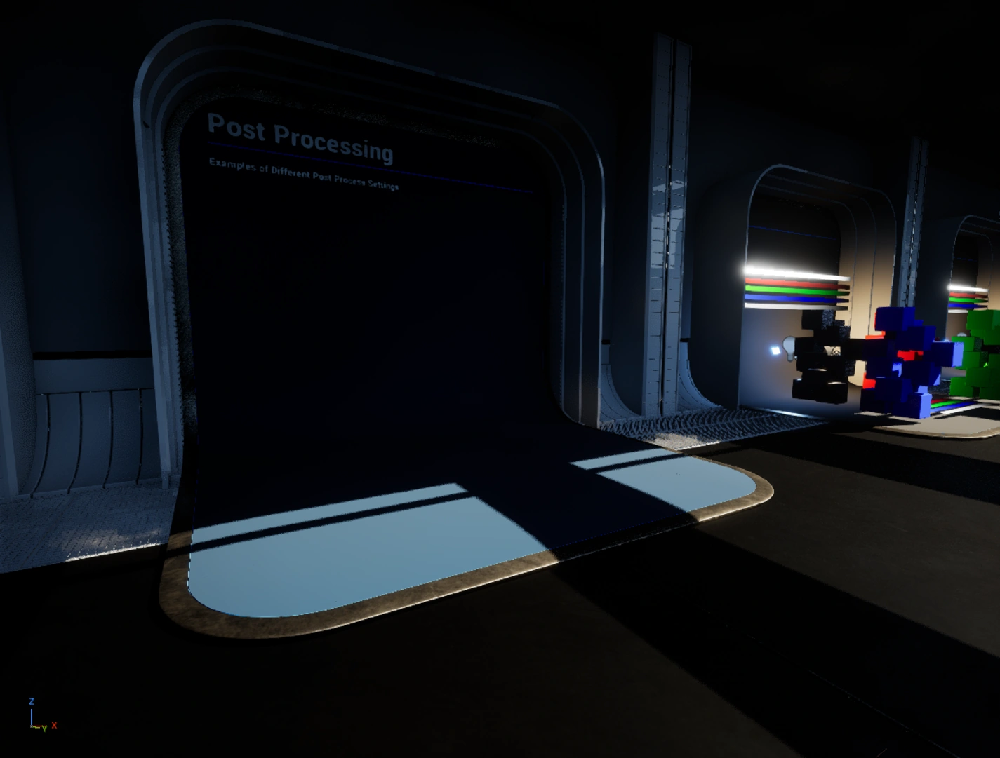
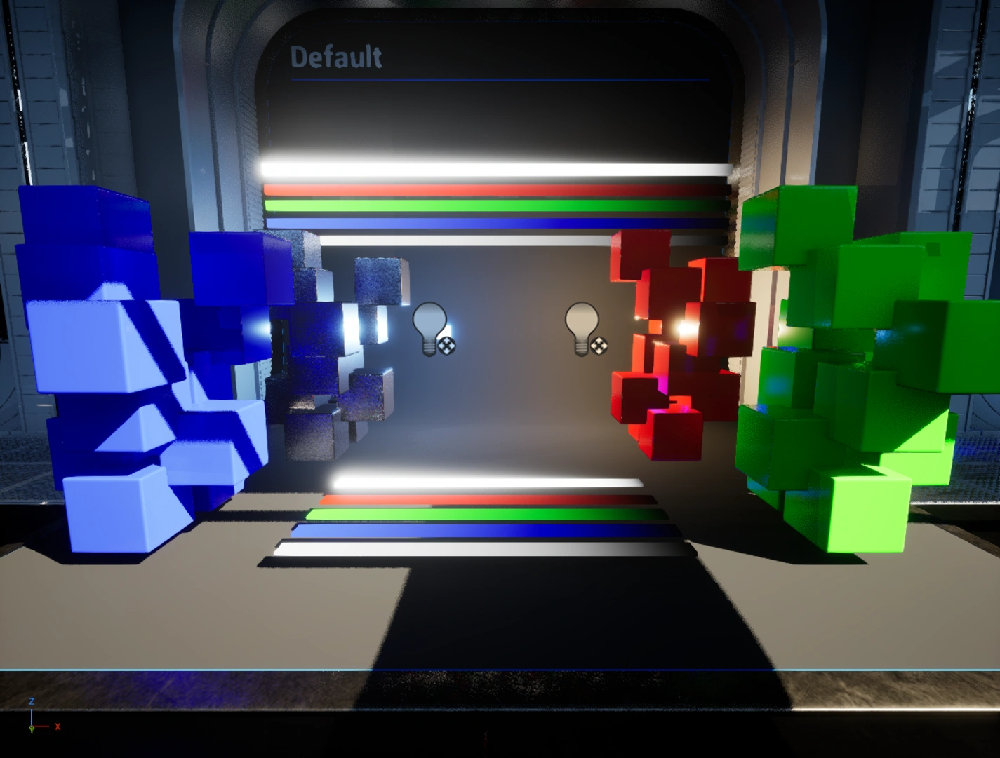
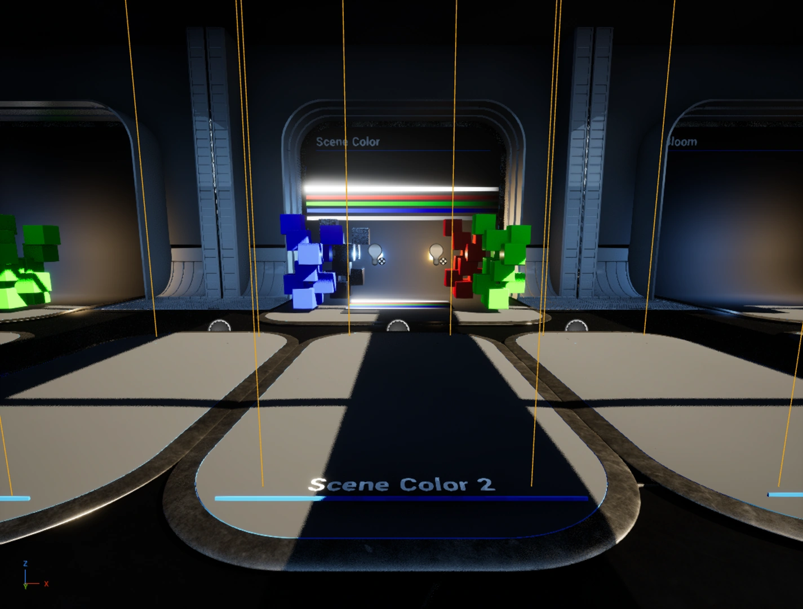
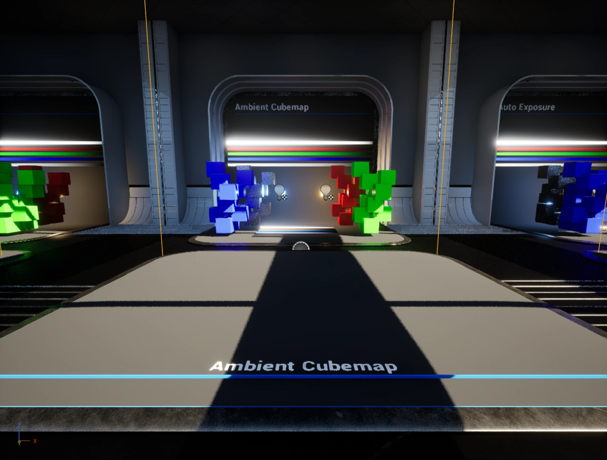
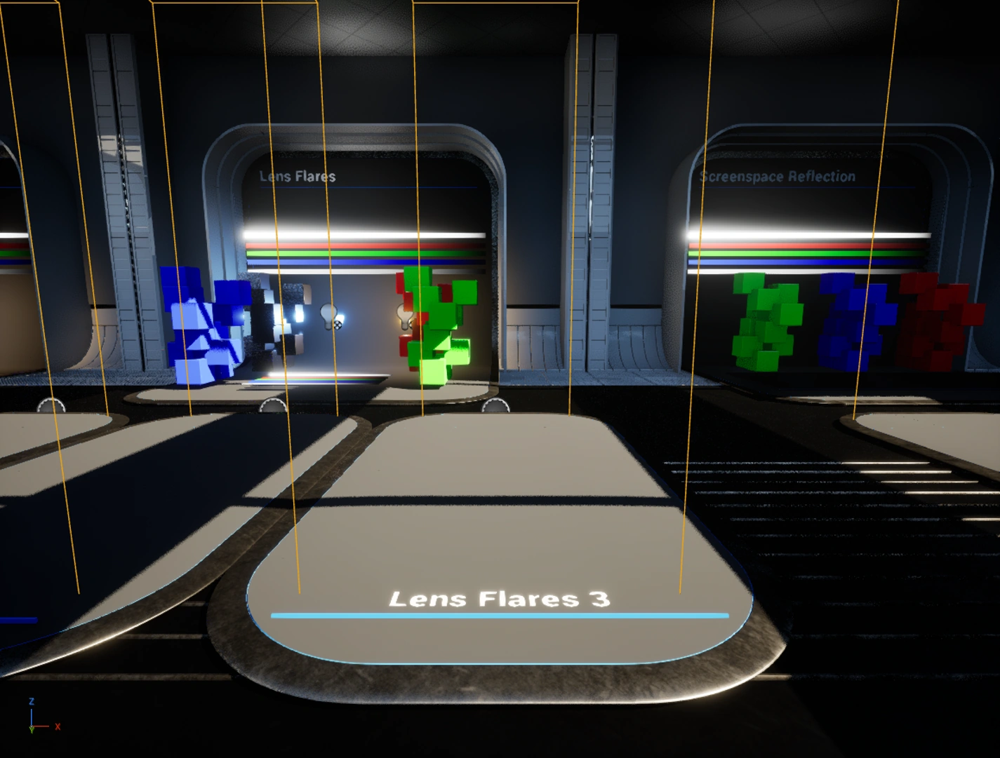
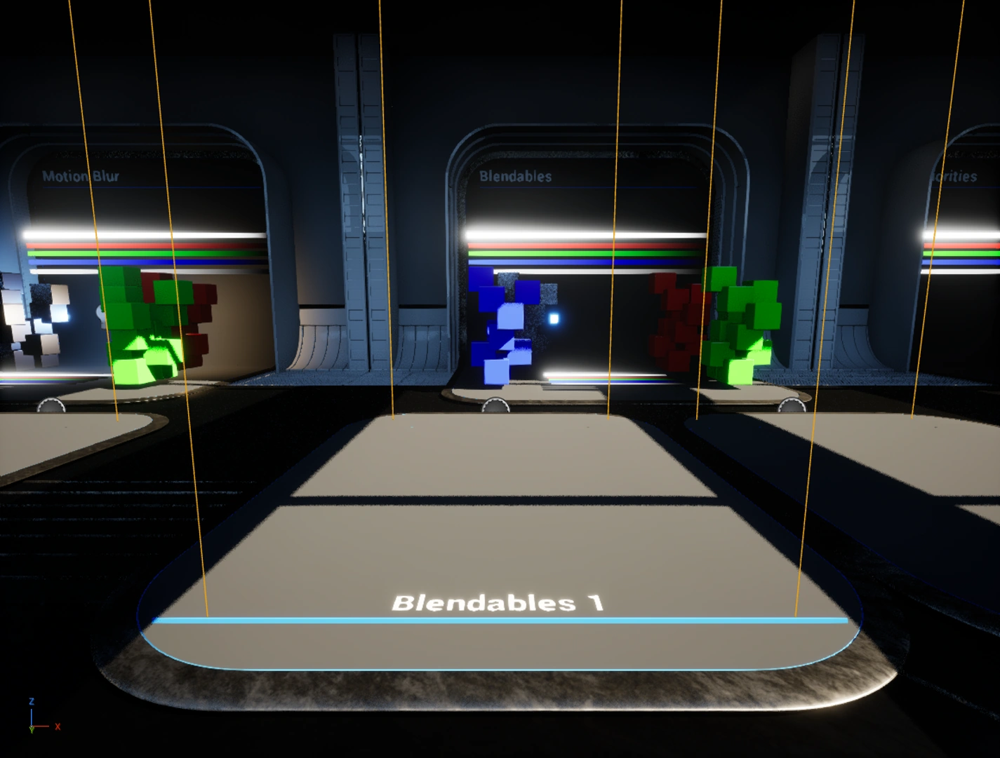

# 05 · `Level_PostProcessing`：后期处理体积与电影级调色镜头特效全解（39 展台全拆解）

> **对应工程地图**：`/Game/Maps/Level/Level_PostProcessing`  
> **所属领域目录**：`04_Level_世界构建与PCG`  
> **关卡实测规模**：总 Actor 数 `291` | 展台数 **`39`（`#1` ~ `#39` 100% 独立逐台零跳号深拆！）** | 示例交互、灯箱与后期体积 Actor 数 `238`

---

## 一、 导言：从“线性物理辐射度”到“银幕电影感”的最后一公里

在虚幻引擎的延迟渲染管线（Deferred Shading Pipeline）完成 G-Buffer 解算、Lumen 全局光照与直接阴影合成之后，GPU 显存里的 `SceneColor` 缓冲区其实还只是一团取值范围在 $[0, +\infty)$ 的**线性高动态范围物理辐射度数据（Linear HDR Radiance，`FP16` / `R11G11B10F`）**——此时强光高达 `50.0`，暗部低至 `0.001`，如果直接硬截断塞进 $[0, 1]$ 的普通显示器，高光会瞬间死白一片，色彩更是干瘪寡淡如同工业监控录像。

把这团冰冷的物理光子转化为具有呼吸感、光学镜头瑕疵美感与好莱坞胶片影调画面的全套 GPU 屏幕空间通道，就是 **Post Processing（后期处理管线）**！

打开 `/Game/Maps/Level/Level_PostProcessing`，你将步入整部 `ContentExamples` 工程中展台数量最庞大的一座光学实验室——全长 135 米的黑暗展厅内密布了 **39 座展台**与 **238 个校准灯箱、反射雕塑及后期体积盒**：



---

## 二、 读懂这座 39 展台光学暗房的三大底层工程设计

很多初学者第一次走进 `Level_PostProcessing` 会疑惑：“为什么每个主题（比如 `Film`、`Scene Color`、`Bloom`）后面有一面大灯箱墙，前面地板上还并排铺着 1 到 3 块发光踏板？”在逐一拆解 39 个展台前，请先掌握贯通全图的三大底层机制：

### 2.1 “后排标准比色灯箱（`Y = -900`） + 前排窄盒试镜踏板（`Y = -340`）”双排实验台架构

因为虚幻引擎的 **`APostProcessVolume`（后期处理体积）是基于“观察者摄像机坐标是否进入体积包络”生效的全屏效果**，你不可能站在体积外面同时看到三种不同的全屏调色！为此，Epic 美术与渲染工程师设计了极其科学的**双排对照实验台**：

1. **后排背景墙（`Y = -900`）：标准化光度学与色度学检定靶（Standardized HDR Calibration Target）**  
   在每个大类主题正后方的壁龛里，都摆放着完全相同的一套 **11 ~ 19 件标准光学测试器皿**，让你像专业电影调色师看示波器一样精准诊断每一项参数的微妙变化：
   - **5 条色度与过曝阶梯灯带（网格 `SM_DemoPlate`，墙面 5 条 + 地面 5 条）**：
     - 顶栏过曝白条 `/Game/ExampleContent/PostProcessing/Materials/M_Gradient_EmissiveOverbright`：继承自渐变母材质，强制覆写 **`EmissiveOverbrightning = 50.0`**！这条亮度从 `0` 飙升至 **`50.0` HDR 单位**的强光带，专门用来轰击测试 **辉光溢出（Bloom）、镜头眩光（Lens Flares）、自动曝光压缩（Auto Exposure）与 ACES 高光肩部滚降（Highlight Shoulder）**！
     - 红/绿/蓝三原色二次幂渐变条 `M_Gradient_Red` / `M_Gradient_Green` / `M_Gradient_Blue`：母材质 `/Game/ExampleContent/PostProcessing/Materials/M_Gradient`（10 个表达式节点：`LinearGradient` 经 `Power(2)` 二次曲线映射后插值 `Color1` 黑至 `Color2` 纯色），专门检验单通道饱和度偏移、色相旋转与高光去饱和（Desaturation）；
     - 底栏中性灰阶条 `M_Gradient`（`0.0 -> 1.0` 标准白）：专门检验暗部趾部（Toe）压黑、对比度 S 曲线、色温偏色与色调分离断层（Posterization）！
   - **2 盏冷暖高动态自发光灯牌 + 点光源**：
     - 左冷蓝灯牌 `M_Emissive_1`（母材质 `M_Emissive`：`Color * Brightness`，`Brightness = 20.0`，`Color = (0.071, 0.291, 1.0)`）配冷蓝点光源 `PointLight`（`Intensity = 5`）；
     - 右暖橙灯牌 `M_Emissive_2`（`Brightness = 20.0`，`Color = (1.0, 0.498, 0.061)`）配暖金点光源（`Intensity = 5`）。
   - **4 座几何体簇反射雕塑（`SM_LightSculpture`）**：
     - 左前蓝釉 `M_LightSculpture_Blue`、右前绿釉 `M_LightSculpture_Green`、右后红釉 `M_LightSculpture_Red`（均为 `Roughness = 0.1` 镜面高光非金属）；
     - 左后拉丝冷钢金属雕塑 `M_ReflectionDemo_Metallic_2`（母材质链 `M_ReflectionDemo_MAT` $\rightarrow$ `M_ReflectionDemo_1` $\rightarrow$ `M_ReflectionDemo_Metallic_1` `Metallic=1.0, Roughness=0.0` $\rightarrow$ `M_ReflectionDemo_Metallic_2` **`Metallic = 1.0, Roughness = 0.3`**，钢蓝色 `(0.668, 0.757, 1.0)`），专门检验环境立方体贴图（Ambient Cubemap）与屏幕空间反射（SSR）在粗糙金属上的高光响应！
2. **前排地面试镜踏板（`Y = -340`）：窄体“电话亭式” `PostProcessVolume` 阵列**  
   在每块印有发光标题（如 `Film 1`, `Scene Color 2`, `Lens Flares 3`）的地面踏板正上方，竖立着一个刚好容纳单人站立的 `PostProcessVolume`（大多设为 **`Priority = 1, BlendRadius = 0, bUnbound = false`**）。为什么 `BlendRadius` 故意设为 `0`？因为这样当你左右横移半步在不同踏板间切换时，画面会**零过渡瞬间硬切（Instant A/B Cut）**，让你一眼看穿两档参数之间的帧级差异！

### 2.2 虚幻引擎后期处理渲染管线（RenderGraph）精确执行时序

为什么有的后期材质（Blendable）边缘会有抗锯齿闪烁，改个 `Blendable Location` 就突然变丝滑了？因为后期管线是一条严格按物理因果律串联的单向流水线：

```mermaid
flowchart LR
    HDR["1. 线性 HDR SceneColor\n(Lumen GI + 阴影 + SSR\n展台 #16~17, #26~27)"] --> DOF["2. 物理景深 DOF\n(弥散圆 CoC 前后景虚化)"]
    DOF --> MB["3. 运动模糊 Motion Blur\n(速度缓冲 Velocity 矢量涂抹\n展台 #28~30)"]
    MB --> BL_Pre["4. 调色前 Blendables\n(Before Tonemapping\n线性 HDR 空间数学运算)"]
    BL_Pre --> Exp["5. 自动曝光 Eye Adaptation\n(Log2 亮度直方图测光补偿\n展台 #18~21)"]
    Exp --> Bloom["6. 辉光与镜头眩光\n(高斯金字塔/FFT卷积 Bloom\n+ Lens Flares 展台 #12~15, #22~25)"]
    Bloom --> Fringe["7. 光学色差与暗角\n(Chromatic Aberration\n+ Vignette 展台 #8~11)"]
    Fringe --> ACES["8. 终极合成：3D Grading LUT\n+ ACES Filmic Tone Mapper\n(HDR -> SDR [0,1] 展台 #4~7)"]
    ACES --> BL_Post["9. 调色后 Blendables & TSR/TAA\n(After Tonemapping LDR 滤镜\n展台 #31~33)"]
```



### 2.3 核心数学精髓速览（光学、光度学与色度学四大基石公式）

为了让你不仅知其然更知其所以然，我们将贯穿本关及商业电影调色的五大核心算法浓缩如下：

1. **ACES Filmic 色调映射曲线（展台 #4 ~ #7 `Film`）**：
   虚幻采用学院色彩编码系统（Academy Color Encoding System，含 RRT 参考渲染变换与 ODT 输出设备变换）取代了早期的简单 Reinhard 映射。其分段对数 S 形特征曲线由五大胶片感参数精确塑形：
   - **`Film Slope`（默认 `0.88`）**：中灰线性段斜率（控制整体反差软硬）；
   - **`Film Toe`（默认 `0.55`）**：暗部趾部收紧度（值越大暗部越扎实深邃，洗去灰雾感）；
   - **`Film Shoulder`（默认 `0.26`）**：高光肩部滚降（模拟真实卤化银胶片在高光过曝区平滑饱和并自然向白点退色，杜绝数码硬截断造成的刺眼色块）；
   - **`Film Black Clip` (`0.0`) & `White Clip` (`0.04`)**：黑白场裁切极值。
2. **基于对数直方图的自动曝光（展台 #18 ~ #21 `Auto Exposure`）**：
   Compute Shader 统计全屏像素亮度 $L = 0.2126 R + 0.7152 G + 0.0722 B$ 在 $\log_2(L)$ 空间上的 **64-bin 直方图**，剔除暗部黑死噪点与极小面积太阳强光（默认仅取 `LowPercent = 10%` ~ `HighPercent = 90%` 区间求加权平均场景亮度 $L_{\text{avg}}$），将之钳制在 `[MinBrightness, MaxBrightness]`（或现代物理相机 `EV100` 档位）内，再按非对称指数阻尼模仿人眼瞳孔括约肌：
   - 从暗室走出烈日（瞳孔收缩快）：`Speed Up = 3.0`；
   - 从烈日走入黑屋（视紫红质暗适应慢）：`Speed Down = 1.0`；
   - 叠加美术曝光补偿偏置 $2^{\text{ExposureCompensation}}$。
3. **多级高斯金字塔与卷积辉光（展台 #12 ~ #15 `Bloom`）**：
   人眼晶状体与相机镜片微尘会导致极亮光线向四周发生夫琅禾费衍射散射。引擎默认（`BM_SOG` 标准高斯法）将超过阈值 `Threshold` 的高亮像素连续执行 **6 级半分辨率下采样模糊（`Bloom1` 最锐利紧贴灯管 $\rightarrow$ `Bloom6` 铺满半个屏幕的柔和大气光晕）**，再按各级权重与染色相加回原图；若切换为电影级 **`BM_FFT`（快速傅里叶变换卷积辉光）**，更可在频域直接与真实变形宽银幕镜头（Anamorphic Lens）星芒核相乘，获得拉丝水平蓝紫光斑与八角星芒！
4. **物理薄透镜弥散圆与镜头瑕疵（景深 DOF、色差 Fringe、暗角 Vignette，展台 #8 ~ #11）**：
   - **景深弥散圆直径（Circle of Confusion, CoC）**：由光圈 F 值 $N = f / A$、焦距 $f$、对焦物距 $S$ 与像素真实深度 $P$ 严格按几何光学决定：
     $$\text{CoC}(P) = \left| \frac{f^2}{N \cdot (S - f)} \cdot \frac{P - S}{P} \right|$$
     光圈越大（`f-stop` 越小如 `f/1.4`）、焦距越长（如 `85mm` 人像镜），散景光斑（Bokeh）越梦幻；
   - **光学色差（Chromatic Aberration / Scene Fringe）**：模拟廉价透镜对红/绿/蓝不同波长折射率差异（色散），在屏幕四角沿径向将 R/G/B 通道采样 UV 微量错开，边缘泛出赛博朋克感的青紫镶边；
   - **自然光学暗角（Vignette）**：遵循经典光学 $\cos^4 \theta$ 边缘照度衰减定律，压暗画面四角，将观众视觉中心牢牢聚拢在画面焦点。
5. **多体积边界距离权重插值公式（展台 #34 ~ #39 `Priorities & Blend Radius`）**：
   引擎每帧将所有启用的 `PostProcessVolume` 按 **`Priority` 从低到高排序**依次叠算：
   - 若 `bUnbound == true`，基础几何权重 $w_{\text{geom}} = 1.0$；
   - 若为有界体积（`bUnbound == false`），设摄像机到体积凸包表面的最短有向外部欧氏距离为 $d$（在体积内部时 $d = 0$），混合半径为 $R = \text{BlendRadius}$：
     $$w_{\text{final}} = \text{Clamp}\left(1.0 - \frac{d}{R},\ 0.0,\ 1.0\right) \times \text{BlendWeight}$$
     每项勾选了 `bOverride_*` 的后期参数均按 $P_{\text{out}} = \text{Lerp}(P_{\text{current}}, P_{\text{volume}}, w_{\text{final}})$ 逐层向上覆写！

---

## 三、 逐展台（Stand #1 ~ #39）100% 零遗漏独立全拆解

下面严格按照实测档案编号 **`#1` 至 `#39` 逐台独立精讲**，精准标注每一座展台的坐标、陈列 Actor、关联体积参数及其演示的视觉调色原理。

---

### 展台 #1：`Post Processing` — 暗房总入口与全局基础光源配置

- **展牌标识与空间坐标**：`PostProcessEntry`，位于入口起点 `(495, -900, 0)`
- **官方展牌原文**：*"Examples of Different Post Process Settings"*（不同后期处理设置的对比示例）
- **展台关联环境基座 Actor（共 5 个）**：
  - `DirectionalLight`（`Intensity = 10, Mobility = Movable`）、`SkyLight`（`Intensity = 1, Movable`）、`SkyAtmosphere`、`ExponentialHeightFog` 以及物理调试宿主 `Actor`（`ChaosDebugDrawComponent_0`）。整个室内长廊刻意采用深灰哑光吸光墙面，杜绝环境杂散光干扰后期测光靶标。

---

### 展台 #2：`Default`（后排标准检定灯箱）— 未加局部滤镜的原始基准靶标



- **展牌标识与空间坐标**：`BP_DemoDisplay`，位于 `(1505, -900, 0)`
- **展台内陈列的示例 Actor（共 11 个标准壁龛靶标件）**：
  - 墙面 5 条比色渐变板：`SM_DemoPlate_12` (`M_Gradient_EmissiveOverbright` 50倍过曝白)、`SM_DemoPlate_4` (`M_Gradient_Red`)、`SM_DemoPlate_5` (`M_Gradient_Green`)、`SM_DemoPlate_6` (`M_Gradient_Blue`)、`SM_DemoPlate_7` (`M_Gradient` 灰阶)；
  - 冷暖自发光源对：左冷蓝 `SM_DemoPlate_14` (`M_Emissive_1` 亮度20) + `PointLight`，右暖橙 `SM_DemoPlate_15` (`M_Emissive_2` 亮度20) + `PointLight_2`；
  - 后排反射雕塑对：左金属 `SM_LightSculpture_4` (`M_ReflectionDemo_Metallic_2` 粗糙度0.3金属) 与右红釉 `SM_LightSculpture_3` (`M_LightSculpture_Red`)。
- **核心作用**：作为全厅 39 个展台的**零点对照组（Control Group）**——当你站在走廊过道回看此灯箱时，看到的是虚幻引擎默认 ACES 色调映射与默认辉光下的纯净原始画面。

---

### 展台 #3：`Default`（前排基准试镜踏板）— 默认参数 `PostProcessVolume` 容器演示

- **展牌标识与空间坐标**：`BP_DemoDisplay7`，位于前排试镜区 `(1505, -340, 0)`
- **展台内陈列的示例 Actor（共 8 个）**：
  - **`PostProcessVolume1_Default`**：`priority = 1, blendRadius = 100, blendWeight = 1, bEnabled = true, bUnbound = false`；
  - 地面 5 条渐变比色板：`SM_DemoPlate_13`（过曝白）、`SM_DemoPlate_8`（红）、`SM_DemoPlate_9`（绿）、`SM_DemoPlate_10`（蓝）、`SM_DemoPlate_11`（灰阶）；
  - 前排雕塑对：左蓝釉 `SM_LightSculpture` (`M_LightSculpture_Blue`) 与右绿釉 `SM_LightSculpture_2` (`M_LightSculpture_Green`)。
- **核心解析**：踏入 `PostProcessVolume1_Default` 时画面与走廊几乎一致（仅保留 `BlendRadius = 100` 平滑边缘），旨在向开发者直观展示“每一个前排踏板头顶都罩着一个 `Priority = 1` 的独立后期体积盒”这一交互规则。

---

### 展台 #4：`Film 1` — 胶片色调映射实验一（低反差/柔和对比或暖调胶片特性）

- **展牌标识与空间坐标**：`BP_DemoDisplay11`，位于第二组试镜区左侧踏板 `(2195, -340, 0)`
- **展台内陈列的示例 Actor（2 个）**：
  - **`PostProcessVolume9_Film1`**：`priority = 1, blendRadius = 0, blendWeight = 1, bUnbound = false`；
  - 左侧蓝釉参照雕塑 `SM_LightSculpture_5` (`M_LightSculpture_Blue`)。
- **核心解析**：站上 `Film 1` 踏板注视前方 #5 灯箱，`blendRadius = 0` 使体积在踏入瞬间立即接管 `Film`（胶片色调映射器）分类参数。通过调整胶片曲线斜率（`Slope`）与色调染色（Film Tint / Channel Mixer），观察五色渐变条的中灰阶过渡如何变得平缓柔和，模拟复古宽容度胶片底片（Log-like Flat Profile）质感。

---

### 展台 #5：`Film`（后排胶片测光主灯箱）— 检验高光滚降与暗部压黑的靶标舞台

- **展牌标识与空间坐标**：`BP_DemoDisplay1`，位于 `(2495, -900, 0)`
- **展台内陈列的示例 Actor（共 11 个标准壁龛靶标件）**：
  - 墙面 5 条渐变板 `SM_DemoPlate_16 ~ 19` 及顶栏 50 倍过曝条 `SM_DemoPlate_24`；
  - 冷暖灯牌 `SM_DemoPlate_26 / 27` + 点光源 `PointLight_3 / 4`；
  - 后排雕塑 `SM_LightSculpture_8`（金属）与 `SM_LightSculpture_7`（红釉）。
- **核心解析**：专门服务于前排 `#4 Film 1`、`#6 Film 2`、`#7 Film 3` 三块踏板的观察主靶。请重点盯着顶栏 `50.0` 过曝条右端以及红绿蓝渐变条最亮端：在优秀胶片曲线（ACES Shoulder）下，高纯度红绿蓝强光不会死板停留在 `(1,0,0)`，而是自然向白色高光发生**胶片感去饱和（Highlight Desaturation）**！

---

### 展台 #6：`Film 2` — 胶片色调映射实验二（高反差 S 曲线：陡峭 `Slope` 与深沉 `Toe`）

- **展牌标识与空间坐标**：`BP_DemoDisplay9`，位于第二组试镜区中央踏板 `(2495, -340, 0)`
- **展台内陈列的示例 Actor（共 6 个）**：
  - **`PostProcessVolume2_Film2`**：`priority = 1, blendRadius = 0, blendWeight = 1, bUnbound = false`；
  - 地面 5 条比色渐变板 `SM_DemoPlate_20 ~ 23` 及过曝条 `SM_DemoPlate_25`。
- **核心解析**：从左边的 `Film 1` 一步跨到中央 `Film 2`，对比观察地面与墙面的中性灰阶条（`M_Gradient`）：拉高 `Slope` 与 `Toe`（趾部）后，暗部阴影瞬间收紧变黑，金属雕塑上的高光反差凌厉突出，一键营造商业动作大片的高反差银幕质感（Punchy Cinema Look）。

---

### 展台 #7：`Film 3` — 胶片色调映射实验三（极端高光肩部压缩 / 风格化胶片阴影染印）

- **展牌标识与空间坐标**：`BP_DemoDisplay16`，位于第二组试镜区右侧踏板 `(2795, -340, 0)`
- **展台内陈列的示例 Actor（2 个）**：
  - **`PostProcessVolume10_Film3`**：`priority = 1, blendRadius = 0, blendWeight = 1, bUnbound = false`；
  - 右侧绿釉参照雕塑 `SM_LightSculpture_6` (`M_LightSculpture_Green`)。
- **核心解析**：演示极端胶片曲线参数组合（如调整 `Shoulder`、`Black Clip / White Clip` 或阴影偏色），展示在不改动场景一盏灯光的前提下，单靠 Tone Mapper 曲线重塑整幅画面的戏剧张力。

---

### 展台 #8：`Scene Color 1` — 场景色彩与镜头瑕疵一：光学色差（Scene Fringe / Chromatic Aberration）

- **展牌标识与空间坐标**：`BP_DemoDisplay18`，位于第三组试镜区左侧踏板 `(3205, -340, 0)`
- **展台内陈列的示例 Actor（2 个）**：
  - **`PostProcessVolume12`**：`priority = 1, blendRadius = 0, blendWeight = 1, bUnbound = false`；
  - 左侧蓝釉雕塑 `SM_LightSculpture_9`。
- **核心解析**：踏入 `Scene Color 1` 后轻微转动视角，把高反差白光条放到屏幕左右边缘观察——`Scene Fringe (Chromatic Aberration Intensity)` 模拟光学镜片边缘色散，使高对比轮廓分离出红青色边。实战建议控制在 `0.2 ~ 0.8` 之间微添真实摄影机质感，受击眩晕或赛博故障瞬间可通过时间轴飙升至 `5.0`！

---

### 展台 #9：`Scene Color`（后排场景色彩主灯箱）— 色彩分级、暗角与 LUT 检定靶

- **展牌标识与空间坐标**：`BP_DemoDisplay2`，位于 `(3510, -900, 0)`
- **展台内陈列的示例 Actor（共 11 个标准壁龛靶标件）**：
  - 墙面 5 条渐变板 `SM_DemoPlate_28 ~ 31` + 过曝条 `SM_DemoPlate_36`；
  - 冷暖灯牌 `SM_DemoPlate_38 / 39` + 点光源 `PointLight_5 / 6`；
  - 后排雕塑 `SM_LightSculpture_12`（金属）与 `SM_LightSculpture_11`（红釉）。
- **核心解析**：为前排 `#8 Scene Color 1`、`#10 Scene Color 2`、`#11 Scene Color 3` 提供丰富的全色域色块靶标，重点测试 `Scene Color Tint`、**`Vignette Intensity`（暗角）**、**`Grain`（胶片颗粒）** 以及 **Color Grading LUT（色彩查找表）**。

---

### 展台 #10：`Scene Color 2` — 场景色彩与镜头瑕疵二：重度光学暗角（Vignette）与场景色调染色



- **展牌标识与空间坐标**：`BP_DemoDisplay17`，位于第三组试镜区中央踏板 `(3505, -340, 0)`
- **展台内陈列的示例 Actor（共 6 个）**：
  - **`PostProcessVolume3`**：`priority = 1, blendRadius = 0, blendWeight = 1, bUnbound = false`；
  - 地面 5 条比色板 `SM_DemoPlate_32 ~ 35` 及过曝条 `SM_DemoPlate_37`。
- **核心解析**：如上方实拍图黄色垂直笔刷线框所示，当你跨入中央 `Scene Color 2` 的 `PostProcessVolume3` 时，较高的 **`Vignette Intensity`（暗角强度，`0.0 ~ 1.0`）** 配合色调控制立刻压暗视野四周四角，模拟大光圈广角电影镜头边缘进光量衰减，常用于潜行蹲伏状态提示或恐怖压迫感营造。

---

### 展台 #11：`Scene Color 3` — 场景色彩与镜头瑕疵三：3D Color Grading LUT（色彩查找表）与全局调色轮

- **展牌标识与空间坐标**：`BP_DemoDisplay19`，位于第三组试镜区右侧踏板 `(3805, -340, 0)`
- **展台内陈列的示例 Actor（2 个）**：
  - **`PostProcessVolume11`**：`priority = 1, blendRadius = 0, blendWeight = 1, bUnbound = false`；
  - 右侧绿釉雕塑 `SM_LightSculpture_10`。
- **核心解析**：演示利用 `Color Grading`（Global / Shadows / Midtones / Highlights 四段式 `Saturation / Contrast / Gamma / Gain / Offset` 调色轮）或 `256×16` 展开的 $16^3$ **3D LUT 纹理**一键完成风格化色调映射（如青橙色调 Teal & Orange、黑白复古、毒气绿滤镜）。
  > [!TIP]
  > **UE5 现代 HDR 显示器避坑提示**：早期 UE4 常用 2D 展开的 PNG LUT，但 **LUT 是在 SDR $[0, 1]$ 空间采样的，会彻底锁死 HDR 电视/显示器的 1000 nits 高动态峰值输出**！在现代 UE5 项目中，强烈优先使用 `Color Grading` 面板下的原生 `Shadows / Midtones / Highlights` 浮点调色轮——它们直接在 ACES 工作色域的线性浮点空间运算，同时完美兼容 SDR 与杜比视界 HDR10 输出！

---

### 展台 #12：`Bloom`（后排辉光测光主灯箱）— 50 倍过曝灯条与 20 倍点光源散射靶

- **展牌标识与空间坐标**：`BP_DemoDisplay3`，位于 `(4505, -900, 0)`
- **展台内陈列的示例 Actor（共 11 个标准壁龛靶标件）**：
  - 墙面渐变板 `SM_DemoPlate_40 ~ 43` + 50倍过曝白条 `SM_DemoPlate_48`；
  - 20倍亮度冷暖灯牌 `SM_DemoPlate_50 / 51` + `PointLight_7 / 8`；
  - 后排雕塑 `SM_LightSculpture_16`（金属）与 `SM_LightSculpture_15`（红釉）。
- **核心解析**：专门用来激发辉光（Bloom）的高动态靶场。注意观察金属雕塑 `SM_LightSculpture_16` 边缘反射出的冷蓝/暖橙高光点——在物理正确的渲染中，**不仅自发光灯牌会产生辉光，粗糙金属反射太阳或强点光源形成的次级镜面高光（Specular Highlight $> 1.0$）同样会激发出真实的星芒辉光！**

---

### 展台 #13：`Bloom 2` — 辉光实验二（中央踏板：大尺寸扩散半径 / 染色辉光）

- **展牌标识与空间坐标**：`BP_DemoDisplay20`，位于第四组试镜区中央踏板 `(4525, -340, 0)`（注意空间上 `#14 Bloom 1` 在左 `X=4225`，`#13 Bloom 2` 居中 `X=4525`，`#15 Bloom 3` 在右 `X=4825`）
- **展台内陈列的示例 Actor（共 6 个）**：
  - **`PostProcessVolume4_Bloom2`**：`priority = 1, blendRadius = 0, blendWeight = 1, bUnbound = false`；
  - 地面 5 条比色板 `SM_DemoPlate_44 ~ 47` 及过曝条 `SM_DemoPlate_49`。
- **核心解析**：站上中央 `Bloom 2` 踏板，通过调高 `Bloom Intensity` 与各级高斯核尺寸（`Size Scale` / `#1 ~ #6 Tint`），观察顶栏过曝白条四周晕染出宽广迷离的梦幻柔光罩效果。

---

### 展台 #14：`Bloom 1` — 辉光实验一（左侧踏板：高阈值紧凑辉光 / 抑制泛光）

- **展牌标识与空间坐标**：`BP_DemoDisplay21`，位于第四组试镜区左侧踏板 `(4225, -340, 0)`
- **展台内陈列的示例 Actor（2 个）**：
  - **`PostProcessVolume13_Bloom1`**：`priority = 1, blendRadius = 0, blendWeight = 1, bUnbound = false`；
  - 左侧蓝釉雕塑 `SM_LightSculpture_13`。
- **核心解析**：演示调整 **`Bloom Threshold`（辉光起效阈值，默认 `-1.0` 代表全能量守恒参与微小散射；调高为正数如 `1.0 ~ 5.0` 则只有极亮光源才溢出光晕）** 与小半径核尺寸，获得干净锐利、绝不“糊屏发雾”的硬朗写实画面。

---

### 展台 #15：`Bloom 3` — 辉光实验三（右侧踏板：镜头脏迹遮罩 Bloom Dirt Mask / 强光炫目感）

- **展牌标识与空间坐标**：`BP_DemoDisplay22`，位于第四组试镜区右侧踏板 `(4825, -340, 0)`
- **展台内陈列的示例 Actor（2 个）**：
  - **`PostProcessVolume14_Bloom3`**：`priority = 1, blendRadius = 0, blendWeight = 1, bUnbound = false`；
  - 右侧绿釉雕塑 `SM_LightSculpture_14`。
- **核心解析**：演示强辉光叠加 **`Bloom Dirt Mask`（镜头灰尘指纹遮罩贴图）**：平时在暗处镜头指纹完全隐形；一旦镜头扫过 `50.0` 强光灯带，溢出辉光点亮屏幕局部的微尘与水渍纹理，瞬间拉满第一人称战术射击或赛车游戏的护目镜临场感！

---

### 展台 #16：`Ambient Cubemap`（后排环境贴图主灯箱）— 全向环境补光与金属反射靶

- **展牌标识与空间坐标**：`BP_DemoDisplay4`，位于 `(5505, -900, 0)`
- **展台内陈列的示例 Actor（共 11 个标准壁龛靶标件）**：
  - 墙面渐变板 `SM_DemoPlate_52 ~ 55` + 过曝条 `SM_DemoPlate_60`；
  - 冷暖灯牌 `SM_DemoPlate_62 / 63` + `PointLight_9 / 10`；
  - 后排雕塑 `SM_LightSculpture_20`（`Metallic=1.0, Roughness=0.3` 金属）与 `SM_LightSculpture_19`（红釉）。
- **核心解析**：重点观察背光阴影面与左后方的金属雕塑 `SM_LightSculpture_20`——在未进入前排体积前，背光暗部仅受微弱全局天光照明。

---

### 展台 #17：`Ambient Cubemap`（前排环境立方体贴图试镜踏板）— 局部 HDR 环境光染色与镜面反射注入



- **展牌标识与空间坐标**：`BP_DemoDisplay23`，位于第五组试镜区宽幅单踏板 `(5515, -340, 0)`
- **展台内陈列的示例 Actor（共 8 个）**：
  - **`PostProcessVolume5_AmbientCubeMap`**：`priority = 1, blendRadius = 100, blendWeight = 1, bUnbound = false`（注意此处 `blendRadius = 100`，进出踏板时环境补光有 1 米柔和淡入淡出！）；
  - 地面 5 条比色板 `SM_DemoPlate_56 ~ 59` + `SM_DemoPlate_61`，前排蓝绿雕塑 `SM_LightSculpture_17 / 18`。
- **核心解析**：`Ambient Cubemap` 将一张预滤波 HDR 全景立方体贴图（按表面粗糙度采样不同 Mip 层级）直接叠加到延迟光照缓冲区中！它既照亮漫反射暗部，又在金属雕塑上映射出丰富的环境高光纹理。
  - **架构师适用边界**：由于它是基于后期体积无视场景几何遮挡叠加的（不会投射阴影），在现代 UE5 大场景中漫反射环境光已被 `SkyLight + Lumen GI` 完美接管；但在**角色换装检视厅（Character Showcase UI）、武器工坊特写台、或移动端低开销洞穴局部补色**中，`Ambient Cubemap` 依然是零烘焙成本点亮金属质感的神兵利器！

---

### 展台 #18：`Auto Exposure`（后排自动曝光测光主灯箱）— 人眼明暗适应模拟舞台

- **展牌标识与空间坐标**：`BP_DemoDisplay5`，位于 `(6500, -900, 0)`
- **展台内陈列的示例 Actor（共 11 个标准壁龛靶标件）**：
  - 墙面渐变板 `SM_DemoPlate_64 ~ 67` + 过曝条 `SM_DemoPlate_72`，冷暖灯牌 `SM_DemoPlate_74 / 75` + `PointLight_11 / 12`，金属/红釉雕塑 `SM_LightSculpture_24 / 23`。
- **核心解析**：在明暗反差极大的此壁龛前，配合前排三块自动曝光踏板（`#20 Auto Exposure 1`、`#19 Auto Exposure 2`、`#21 Auto Exposure 3`），直观演示直方图测光如何动态拉亮暗部或压暗强光。

---

### 展台 #19：`Auto Exposure 2` — 自动曝光实验二（中央踏板：高曝光偏置 / 提亮暗部细节）

- **展牌标识与空间坐标**：`BP_DemoDisplay24`，位于第六组试镜区中央踏板 `(6525, -340, 0)`
- **展台内陈列的示例 Actor（共 6 个）**：
  - **`PostProcessVolume6_AutoExposure2`**：`priority = 1, blendRadius = 0, blendWeight = 1, bUnbound = false`；
  - 地面 5 条比色板 `SM_DemoPlate_68 ~ 71` 及过曝条 `SM_DemoPlate_73`。
- **核心解析**：调整 `Exposure Compensation`（曝光补偿偏置 EV）与 `Min/Max Brightness` 夹逼区间，模拟相机开大两档光圈或人眼在幽暗地下室完成暗适应后看清阴影角落纹理的过程。

---

### 展台 #20：`Auto Exposure 1` — 自动曝光实验一（左侧踏板：压低曝光 / 强光滤镜保护高光）

- **展牌标识与空间坐标**：`BP_DemoDisplay25`，位于第六组试镜区左侧踏板 `(6225, -340, 0)`
- **展台内陈列的示例 Actor（2 个）**：
  - **`PostProcessVolume15_AutoExposure1`**：`priority = 1, blendRadius = 0, blendWeight = 1, bUnbound = false`；
  - 左侧蓝釉雕塑 `SM_LightSculpture_21`。
- **核心解析**：压低目标曝光值（负向 `Exposure Compensation` 或提高 `Min Brightness` 下限），你会发现原本白花花一片的 `50.0` 过曝灯条瞬间显现出清晰的内部明暗渐变层次，四周昏暗墙壁则隐入深邃黑暗。

---

### 展台 #21：`Auto Exposure 3` — 自动曝光实验三（右侧踏板：瞳孔适应速率 `Speed Up / Down` 与锁死手动曝光）

- **展牌标识与空间坐标**：`BP_DemoDisplay26`，位于第六组试镜区右侧踏板 `(6825, -340, 0)`
- **展台内陈列的示例 Actor（2 个）**：
  - **`PostProcessVolume16_AutoExposure3`**：`priority = 1, blendRadius = 0, blendWeight = 1, bUnbound = false`；
  - 右侧绿釉雕塑 `SM_LightSculpture_22`。
- **核心解析**：体验不同适应速度（`Speed Up` / `Speed Down`）或锁定 `Min EV100 == Max EV100`（或切换 `Manual` 模式）：
  > [!IMPORTANT]
  > **灯光师打光铁律**：在搭建关卡基础光照阶段，**千万不要顶着乱跳的默认大范围自动曝光去调灯光亮度**（否则你把太阳调亮 10 倍，自动曝光反手给你压暗 10 倍，永远调不准物理光比）！标准工业流程是：先在全局 `PostProcessVolume` 里切为 `Manual`（或将 `Min EV100` 与 `Max EV100` 锁死为同一数值），校准物理光比后，最后一步再放开 `±1.5 EV` 的微幅自动曝光增加进出洞穴的呼吸感！

---

### 展台 #22：`Lens Flares 1` — 镜头眩光实验一（左侧踏板：轻量级光学重影光斑）

- **展牌标识与空间坐标**：`BP_DemoDisplay28`，位于第七组试镜区左侧踏板 `(7205, -340, 0)`
- **展台内陈列的示例 Actor（2 个）**：
  - **`PostProcessVolume17_LensFlares1`**：`priority = 1, blendRadius = 0, blendWeight = 1, bUnbound = false`；
  - 左侧蓝釉雕塑 `SM_LightSculpture_25`。
- **核心解析**：启用图像空间镜头眩光（Image-Based Lens Flares），当强光源（#23 壁龛内的 `20x` 点光牌与 `50x` 灯条）偏离屏幕正中心时，光线在多片复合相机透镜表面发生二次内反射，沿“光源 $\leftrightarrow$ 屏幕中心”对称连线上投射出一串半透明光斑（Ghosts）。

---

### 展台 #23：`Lens Flares`（后排镜头眩光测光主灯箱）— 多点强光内反射激发源

- **展牌标识与空间坐标**：`BP_DemoDisplay6`，位于 `(7502, -900, 0)`
- **展台内陈列的示例 Actor（共 11 个标准壁龛靶标件）**：
  - 墙面渐变板 `SM_DemoPlate_76 ~ 79` + 过曝条 `SM_DemoPlate_84`，冷暖高光灯牌 `SM_DemoPlate_86 / 87` + `PointLight_13 / 14`，金属/红釉雕塑 `SM_LightSculpture_28 / 27`。
- **核心解析**：在虚幻引擎中，Lens Flares 直接复用半分辨率下采样的场景高亮缓冲，无需像传统引擎那样手动在每盏灯上挂 2D Sprite 广告牌——**场景里任何亮度突破 `Threshold` 的真实高光（哪怕是水面波光或角色盔甲反射的太阳高光点）都会全自动生成物理对称的炫彩镜头重影！**

---

### 展台 #24：`Lens Flares 2` — 镜头眩光实验二（中央踏板：散景光圈形状 `Bokeh Shape` 与光斑尺寸）

- **展牌标识与空间坐标**：`BP_DemoDisplay27`，位于第七组试镜区中央踏板 `(7505, -340, 0)`
- **展台内陈列的示例 Actor（共 6 个）**：
  - **`PostProcessVolume7_LensFlares2`**：`priority = 1, blendRadius = 0, blendWeight = 1, bUnbound = false`；
  - 地面 5 条比色板 `SM_DemoPlate_80 ~ 83` 及过曝条 `SM_DemoPlate_85`。
- **核心解析**：演示自定义 `BokehSize`（散景尺寸）、`Threshold`（触发亮度阈值）与 **`BokehShape`（光圈叶片形状贴图，如五边形、六边形或圆环状折返镜头光斑）**，左右晃动摄像机即可观察成串多边形光圈叶片在画面中心优雅滑过。

---

### 展台 #25：`Lens Flares 3` — 镜头眩光实验三（右侧踏板：8 级光斑色彩梯度 `Tints[8]` 定制）



- **展牌标识与空间坐标**：`BP_DemoDisplay29`，位于第七组试镜区右侧踏板 `(7805, -340, 0)`
- **展台内陈列的示例 Actor（2 个）**：
  - **`PostProcessVolume18_LensFlares3`**：`priority = 1, blendRadius = 0, blendWeight = 1, bUnbound = false`；
  - 右侧绿釉雕塑 `SM_LightSculpture_26`。
- **核心解析**：虚幻镜头眩光提供了 `Tints[0..7]` 共 8 个镜片镀膜反光染色槽位，模拟真实蔡司 T* 或佳能绿紫增透镀膜在 8 次不同镜片组内反射时的色偏与强弱分布，打造科幻电影（如 J.J. Abrams 风格）标志性的炫彩光学质感。*(注：竞技类 FPS 通常建议将 `Lens Flare Intensity` 设为 `0`，避免强光重影遮挡准星视野。)*

---

### 展台 #26：`Screenspace Reflection`（后排屏幕空间反射主舞台）— 三原色雕塑倒影靶

- **展牌标识与空间坐标**：`BP_DemoDisplay8`，位于 `(8512, -900, 0)`
- **展台内陈列的示例 Actor（共 8 个）**：
  - 墙面 5 条比色渐变板 `SM_DemoPlate_100 ~ 103` + 过曝条 `SM_DemoPlate_108`；
  - 整齐列于镜面地板后上方的三座高饱和雕塑：绿釉 `SM_LightSculpture_34`、蓝釉 `SM_LightSculpture_33`、红釉 `SM_LightSculpture_35`。
- **核心解析**：注意观察上方展台 #25 实拍图的右半侧视野——这座壁龛移除了点光源杂光，专门把绿、蓝、红三座鲜明雕塑立在镜面地板上，用于纯粹对比屏幕空间反射（SSR）的开启、画质精度与最大粗糙度截断。

---

### 展台 #27：`Screenspace Reflection`（前排 SSR 控制踏板 + 镜面金属反射地台）— 深度缓冲光线步进解析

- **展牌标识与空间坐标**：`BP_DemoDisplay30`，位于第八组试镜区 `(8515, -340, 0)`
- **展台内陈列的示例 Actor（2 个关键核心件）**：
  1. **`SM_DemoPlate_107`**：铺设在舞台正下方的巨幅金属镜面地板，覆盖专属材质实例 `/Game/ExampleContent/PostProcessing/Materials/M_ReflectionDemo_Metallic_1`（实测参数：**`Metallic = 1.0, Roughness = 0.0` 纯镜面**，`Color = (0.668, 0.757, 1.0)`）；
  2. **`PostProcessVolume21_Screenspace Reflections`**：`priority = 1, blendRadius = 100, blendWeight = 1, bUnbound = false`。
- **核心解析**：屏幕空间反射（SSR）通过沿像素反射向量在层级深度缓冲（HZB）上执行光线步进（Ray Marching），实时反射当前屏幕上可见的任意动态物体！
  - **四大核心参数（`Intensity` / `Quality` / `Max Roughness`）**：调低 `Quality` 会看到随机抖动噪点（需靠 TAA/TSR 时域累积抹平）；调低 `Max Roughness`（默认 `0.6`）则粗糙表面提前退化为反射探针或天光。
  - **与 UE5 Lumen Reflections 的世代演进**：SSR 最大的软肋是“低头看地板，天花板移出屏幕外瞬间倒影消失（Screen-Edge Disocclusion）”；而在 UE5 开启 Lumen 后，屏幕内优先跑高精度屏幕追踪（Screen Traces），一旦射线飞出屏幕边缘或撞到物体背面，无缝接力查询 **Lumen Surface Cache（表面辐射度缓存）与硬件光线追踪**，倒影永不凭空断层！

---

### 展台 #28：`Motion Blur 1` — 运动模糊实验一（左侧踏板：低速旋转雕塑 `50°/s` 与适度快门角度）

- **展牌标识与空间坐标**：`BP_DemoDisplay31`，位于第九组试镜区左侧踏板 `(9295, -340, 0)`
- **展台内陈列的示例 Actor（共 6 个）**：
  - **`SM_LightSculpture_45`**（动态旋转蓝图 `/Game/ExampleContent/Math_Hall/Blueprint/BP_LightScultpureDynamic`）：挂载 `SM_LightSculpture`（蓝釉材质），实测参数 **`rotationSpeed = 50`**；
  - **`PostProcessVolume37_MotionBlur1`**：`priority = 1, blendRadius = 0, blendWeight = 1, bUnbound = false`；
  - 地面 4 条比色渐变板 `SM_DemoPlate_140 ~ 143`。
- **核心解析**：从第 28 展台起，原本静止的雕塑全部升级为实时自转的动态蓝图 `BP_LightScultpureDynamic`（每帧在 Tick 中按 `RotationSpeed` 旋转并向 **Velocity Buffer 运动速度缓冲** 输出逐像素屏幕位移矢量）！在 `Motion Blur 1` 中，配合适度的 **`Amount`（对应电影摄影机快门开角 Shutter Angle：`Amount = 0.5` 恰等于好莱坞黄金标准 **$180^\circ$ 半圆旋转快门**！）**，可观察到自然柔顺的动态残影。

---

### 展台 #29：`Motion Blur `（后排高速动态主灯箱）— `200°/s` 与 `500°/s` 双速旋转雕塑测速靶

- **展牌标识与空间坐标**：`BP_DemoDisplay10`，位于 `(9493, -900, 0)`
- **展台内陈列的示例 Actor（共 12 个）**：
  - **`SM_LightSculpture_48`**（`BP_LightScultpureDynamic_C`，金属材质 `M_ReflectionDemo_Metallic_2`）：实测高速自转参数 **`rotationSpeed = 500`**！
  - **`SM_LightSculpture_47`**（`BP_LightScultpureDynamic_C`，红釉材质 `M_LightSculpture_Red`）：实测中速自转参数 **`rotationSpeed = 200`**！
  - 墙面渐变板 `SM_DemoPlate_136 ~ 139` + 双过曝白条 `SM_DemoPlate_144 / 145` + 冷暖灯牌 `SM_DemoPlate_146 / 147` + `PointLight_23 / 24`。
- **核心解析**：把 `50`（左前）、`200`（右后）、`500`（左后）、`1000`（右前）四种截然不同角速度的旋转体同框陈列，直观展现基于逐物体速度缓冲（Per-Object Motion Blur）如何按真实像素角速度比例拉开丝滑渐变涂抹。

---

### 展台 #30：`Motion Blur 2` — 运动模糊实验二（右侧踏板：`1000°/s` 极速飞轮与 `Max` 模糊上限钳制）

- **展牌标识与空间坐标**：`BP_DemoDisplay32`，位于第九组试镜区右侧踏板 `(9695, -340, 0)`
- **展台内陈列的示例 Actor（2 个）**：
  - **`SM_LightSculpture_46`**（`BP_LightScultpureDynamic_C`，绿釉材质 `M_LightSculpture_Green`）：实测狂暴转速 **`rotationSpeed = 1000`**！
  - **`PostProcessVolume24_MotionBlur2`**：`priority = 1, blendRadius = 0, blendWeight = 1, bUnbound = false`。
- **核心解析**：当物体以 `1000°/s` 狂转或玩家猛甩鼠标转身时，如果不限制最大模糊跨度，单次像素采样核要横跨半个屏幕，不仅画面糊成一锅粥，还会导致 GPU 纹理缓存命中率暴跌掉帧！通过调节 **`Max`（最大模糊占屏幕宽度百分比，默认 `5%`）** 与 `Target FPS`，既保留了飞轮边缘的速度力量感，又守住了稳定的 GPU 采样开销上限。

---

### 展台 #31：`Blendables`（后排后期处理材质主灯箱）— 自定义全屏着色器检定靶

- **展牌标识与空间坐标**：`BP_DemoDisplay12`，位于 `(10497, -900, 0)`
- **展台内陈列的示例 Actor（共 9 个）**：
  - 墙面比色板 `SM_DemoPlate_184 ~ 187` + 双过曝条 `SM_DemoPlate_192 / 193` + 冷蓝灯牌 `SM_DemoPlate_194` + 金属/红釉雕塑 `SM_LightSculpture_64 / 63`。
- **核心解析**：在 UE5 中，`PostProcessVolume -> Rendering Features -> Post Process Materials`（内部数组名为 `WeightedBlendables`）允许我们将任何 **`Material Domain = Post Process`（后期处理域）** 的自定义材质或动态材质实例（MID）挂载进全屏渲染流，实现卡通描边、热成像夜视仪、水下波纹扭曲、受伤血屏、扫描脉冲等无限创意效果！

---

### 展台 #32：`Blendables 1` — 后期处理材质一：`PPMAT_BlendablePostProcess` 色阶量化/色调分离滤镜全节点深拆



- **展牌标识与空间坐标**：`BP_DemoDisplay33`，位于第十组试镜区左侧踏板 `(10295, -340, 0)`
- **展台内陈列的示例 Actor（共 6 个）**：
  - **`PostProcessVolume36_Blendables1`**：`priority = 1, blendRadius = 0, blendWeight = 1, bUnbound = false`，其 `WeightedBlendables` 挂载后期处理材质 `/Game/ExampleContent/PostProcessing/Materials/PPMAT_BlendablePostProcess`；
  - 左侧蓝釉雕塑 `SM_LightSculpture_61` 及地面 4 条渐变板 `SM_DemoPlate_189 / 220 / 191 / 222`。

#### 资产级深拆：`/Game/ExampleContent/PostProcessing/Materials/PPMAT_BlendablePostProcess`（共 5 个表达式节点）
通过实测提取该后期材质的完整内部节点图，其着色器属性与 HLSL 等价算式一览无余：
- **核心材质配置**：`materialDomain = "MD_PostProcess"` | `shadingModel = "MSM_Unlit"`（输出引脚唯一激活 `MP_EmissiveColor`）
- **全部 5 个材质表达式连线还原（DSL）**：
  ```text
  [SceneTexture: PostProcessInput0] (读取当前帧后期处理输入全屏颜色缓冲)
      └── Color ──> [Multiply_1 (× Constant_0 = 10.0)]
                        └──> [Floor_0 (向下取整截断小数)]
                                └──> [Divide_0 (÷ Constant_0 = 10.0)] ──> MP_EmissiveColor
  ```
- **数学本质**：
  $$C_{\text{out}} = \frac{\lfloor C_{\text{scene}} \times 10.0 \rfloor}{10.0}$$
  将原本平滑连续的 $[0, 1]$ 色彩梯度强制离散量化为 **10 级阶梯色带（Posterization / 8-bit 复古漫画色阶分离）**！当你站上踏板观察前方墙上的红绿蓝平滑渐变条时，平滑渐变立刻变成一格一格分明的漫画色阶条！

---

### 展台 #33：`Blendables 2` — 后期处理材质二：`PPMAT_BlendablePostProcess2` 径向暗角平铺虚幻徽章滤镜全节点深拆

- **展牌标识与空间坐标**：`BP_DemoDisplay34`，位于第十组试镜区右侧踏板 `(10695, -340, 0)`
- **展台内陈列的示例 Actor（2 个）**：
  - **`PostProcessVolume32_Blendables2`**：`priority = 1, blendRadius = 0, blendWeight = 1, bUnbound = false`，挂载后期材质 `/Game/ExampleContent/PostProcessing/Materials/PPMAT_BlendablePostProcess2`；
  - 右侧绿釉雕塑 `SM_LightSculpture_62`。

#### 资产级深拆：`/Game/ExampleContent/PostProcessing/Materials/PPMAT_BlendablePostProcess2`（共 12 个表达式节点）
实测提取其全部 12 个内部节点后，我们完整还原出这套经典的**“屏幕边缘战术 HUD / 护目镜暗角花纹合成模板”**：
- **核心材质配置**：`materialDomain = "MD_PostProcess"` | `shadingModel = "MSM_Unlit"`
- **节点逻辑拓扑还原（DSL）**：
  1. **屏幕空间平铺采样图案**：读取屏幕归一化坐标 `ScreenPosition_0` 结合 `Constant2Vector(0.1, 0.1)` 进行高频平铺缩放，送入抗锯齿距离场遮罩采样节点 **`AntialiasedTextureMask_0`**（采样 `/Game/Global/Textures/T_UnrealEngineDecal` 虚幻引擎圆形徽章纹理）；
  2. **中心清晰、四周显现的径向遮罩**：调用引擎材质函数 **`RadialGradient`**（中心点 `Constant2Vector(0.5, 0.5)`，半径 `Constant(0.5)`），再经 **`OneMinus_0` ($1 - \text{Radial}$)** 反相——使得屏幕正中心权重为 `0`（完全不挡视线！），越靠近屏幕四周边缘权重越高；
  3. **与原始画面混合**：通过 `Multiply_2`、`Add_1` 与 `LinearInterpolate_1` 将平铺徽章水印叠加在 `SceneTexture: PostProcessInput0` 四周边缘！这套拓扑在商业游戏中把 `T_UnrealEngineDecal` 换成冰霜结晶贴图或毒血脉络贴图，就是标准的**低温结冰屏 / 中毒边缘警示后期材质**！

---

### 展台 #34：`Priorities`（后排体积优先级主灯箱）— 多层重叠体积仲裁检定舞台

- **展牌标识与空间坐标**：`BP_DemoDisplay13`，位于 `(11502, -900, 0)`
- **展台内陈列的示例 Actor（共 8 个）**：
  - 墙面渐变板 `SM_DemoPlate_196 ~ 199` + 过曝条 `SM_DemoPlate_204` + 暖光灯牌 `SM_DemoPlate_195` + 金属/红釉雕塑 `SM_LightSculpture_68 / 67`。
- **核心解析**：专门用来观察前方同一个站位上**两个互相嵌套重叠的 `PostProcessVolume`** 如何通过 `Priority` 决出胜负。

---

### 展台 #35：`Priority 3` — 嵌套高优先级内层体积（`Priority = 3` 压制 `Priority = 2`）

- **展牌标识与空间坐标**：`BP_DemoDisplay35`，位于第十一组试镜区中心 `(11505, -340, 0)`
- **展台内陈列的示例 Actor（共 3 个）**：
  1. **`PostProcessVolume32_Blendables3`**：**`priority = 2`**, `blendRadius = 100, blendWeight = 1, bUnbound = false`（外圈较大体积）；
  2. **`PostProcessVolume32_Blendables4`**：**`priority = 3`**, `blendRadius = 100, blendWeight = 1, bUnbound = false`（内圈核心体积）；
  3. 左侧蓝釉雕塑 `SM_LightSculpture_65`。
- **核心解析**：在这里，`Priority = 2` 的体积与 `Priority = 3` 的体积在 `(11505, -340)` 空间内**同心嵌套重叠**！当你站在踏板最核心区域同时处于两个体积内部时，由于 `3 > 2`，引擎在叠算完 `Priority = 2` 的效果后，紧接着执行 `Priority = 3` 体积的覆写（Override），最终你在屏幕上看到的是 `Priority = 3` 的主导调色效果！

---

### 展台 #36：`Priority 2` — 外圈次高优先级过渡环（走出内核退回 `Priority = 2`）

- **展牌标识与空间坐标**：`BP_DemoDisplay36`，叠放于第十一组试镜区 `(11505, -340, 6)`
- **展台内陈列的示例 Actor（共 3 个）**：
  - 地面红蓝比色板 `SM_DemoPlate_188 / 190` 与右侧绿釉雕塑 `SM_LightSculpture_66`。
- **核心解析**：当你从展台 #35 正中心往外退半步——跨出了内核 `PostProcessVolume32_Blendables4`（`Priority = 3`）的边界，但仍身处外圈 `PostProcessVolume32_Blendables3`（`Priority = 2`）内部时，画面平滑回退展现出 `Priority = 2` 的效果；再往外退一步彻底跨出外圈，则回退至全场兜底的 `Priority = 0` 全局体积！
  - **实战分层规范**：大型开放世界标准 `Priority` 规划表——全局大陆基底 `Priority = 0` (`Unbound`) $\rightarrow$ 气候群落（雪山/沙漠/沼泽）`Priority = 10` $\rightarrow$ 室内建筑/地下城 `Priority = 20` $\rightarrow$ 特殊剧情演出/技能领域/水下潜泳相机局部盒 `Priority = 50 ~ 100`！

---

### 展台 #37：`Blend Radius`（后排混合半径观察主灯箱）— 10 米超长渐进羽化参照靶

- **展牌标识与空间坐标**：`BP_DemoDisplay14`，位于 `(12502, -900, 0)`
- **展台内陈列的示例 Actor（共 7 个）**：
  - 墙面渐变板 `SM_DemoPlate_206 ~ 209` + 过曝条 `SM_DemoPlate_214` + 金属/红釉雕塑 `SM_LightSculpture_72 / 71`。
- **核心解析**：盯住这面灯箱墙，从 10 米开外慢慢走向展台 #38 踏板，感受呼吸般平滑无痕的空间调色渐变。

---

### 展台 #38：`Blend Radius`（前排 `1000 uu` 巨幅混合半径体积）— 消除进出门生硬跳色的核心武器

- **展牌标识与空间坐标**：`BP_DemoDisplay37`，位于第十二组试镜区 `(12485, -340, 0)`
- **展台内陈列的示例 Actor（共 8 个）**：
  - **`PostProcessVolume`**：实测参数 **`priority = 0, blendRadius = 1000, blendWeight = 1, bEnabled = true, bUnbound = false`**！
  - 地面 5 条比色板 `SM_DemoPlate_200 ~ 203` + `205` 及蓝绿雕塑 `SM_LightSculpture_69 / 70`。
- **核心解析**：注意这个体积与前面所有 `blendRadius = 0` 的测试盒截然不同——它的 **`BlendRadius` 高达 `1000`（整整 `10 米` 羽化半径！）**！
  - **底层几何注意**：虚幻引擎的 `BlendRadius` 是**从体积笔刷外壳往外延伸膨胀计算**的！也就是说：当你还在体积外壳 **10 米之外**时，混合权重 $w = 0\%$；走到离外壳 **5 米**处时，$w = 50\%$；**刚刚踩进体积线框表面的那一刻，权重恰好达到 $w = 100\%$**！因此给山洞口配置 `BlendRadius = 500` 时，笔刷框应当缩在洞口向内 5 米处，否则人还在洞外广场上就已经开始变山洞色调了！

---

### 展台 #39：`Infinite Extent (Unbound)` — 无限范围全局后期体积（全图基调之锚）

- **展牌标识与空间坐标**：`BP_DemoDisplay15`，位于长廊终点第 39 号压轴展位 `(13502, -900, 0)`
- **官方展牌原文**：
  > *"'Infinite Extent (Unbound)' is a setting within the Post Process Volume. If enabled, the volume affects the entire scene, regardless of its volume's bounds."*  
  > （`Infinite Extent (Unbound)`（无限范围/无界）是后期处理体积内的一项核心开关。一旦勾选启用，无论该体积盒的几何线框有多小、摆在地图哪个角落，它的后期设置都会**全局作用于整张场景**！）
- **展台内陈列的示例 Actor（共 13 个）**：
  - **`PostProcessVolume2`**：实测核心参数 **`priority = 0, blendRadius = 100, blendWeight = 1, bEnabled = true, bUnbound = true`**！
  - 全套收官标准靶标件：四色雕塑全齐（蓝 `SM_LightSculpture_73`、绿 `74`、红 `75`、金属 `76`）+ 8 块墙地渐变与双过曝白条（`SM_DemoPlate_216 ~ 219, 221, 223, 224, 225`）。
- **核心解析**：谜底在终点揭晓——原来你从踏入第 1 号展台开始，只要没踩在 `Priority = 1 ~ 3` 的局部试镜踏板上，整座 135 米大厅全局生效的基准后期体积，正是静静躺在最尽头 39 号展台的这一个 `bUnbound = true` 的 **`PostProcessVolume2`**！（另含全局 `InstancedFoliageActor` 单例 1 个。）

---

## 四、 3A 电影级后期处理调优实战总表与性能铁律

完整拆解完 `Level_PostProcessing` 全部 **39 座展台**后，我们将项目落地的核心经验总结为四条黄金准则：

1. **先物理曝光，再胶片曲线，最后局部调色**：永远遵循 `灯光物理流明/勒克斯对齐` $\rightarrow$ `锁定 EV100 校准材质反照率` $\rightarrow$ `ACES Film Slope/Toe/Shoulder 定全局反差` $\rightarrow$ `局部 PostProcessVolume (Priority + BlendRadius) 塑区域氛围` 的正向管线，严禁在材质贴图里提前画死对比度去跟后期硬顶！
2. **自定义后期材质（Blendables）的插入点性能与画质关键选型（`Blendable Location`）**：
   - 若材质需要做**描边、深度雾、世界法线扫描**：务必将 `Blendable Location` 设为 **`Before Tonemapping`（色调映射与 TSR/TAA 之前）**！如果放在 `After Tonemapping`，由于发生在时域超分辨率抗锯齿（TSR/TAA）之后，1 像素细描边会在镜头微动时疯狂锯齿闪烁（Shimmering），而放在 `Before Tonemapping` 则免费享受 TSR 超采样丝滑抗锯齿！
   - 若材质是做**UI 级全屏故障色块、暗角血迹覆盖、复古电视扫描线（无需受曝光和 ACES 曲线扭曲颜色）**：则放在 **`After Tonemapping`**，所见即所得输出精确 sRGB 色彩。
3. **动态交互优先用 `BlendWeight` 驱动**：制作“角色残血黑白屏 + 耳鸣径向模糊”时，在玩家角色组件（`UCameraComponent` 自带一整套 `PostProcessSettings` 与 `PostProcessBlendWeight`！）或全局 `Unbound` 体积上预先配好残血参数，平时将 **`BlendWeight` 设为 `0.0`**（此时引擎完全跳过该体积的混合开销），受伤时用蓝图曲线平滑插值 `BlendWeight` 至 `0.0 ~ 1.0`，丝滑无感且性能极佳！
4. **守住渲染帧率预算**：`Bloom (BM_SOG)`、ACES Tonemapper 与直方图曝光在现代显卡上合并在极少几个全屏 Compute Pass 中完成，总开销通常不足 `0.4 ms`；真正昂贵的是 **`BM_FFT` 卷积星芒辉光、全分辨率高采样数景深（Cinematic Diaphragm DOF）以及挂了三四个多次采样纹理的自定义 `MD_PostProcess` 材质**——务必结合控制台 **`profilegpu`**（查看 `PostProcessing` 子树耗时）按画质档位分级开关！
