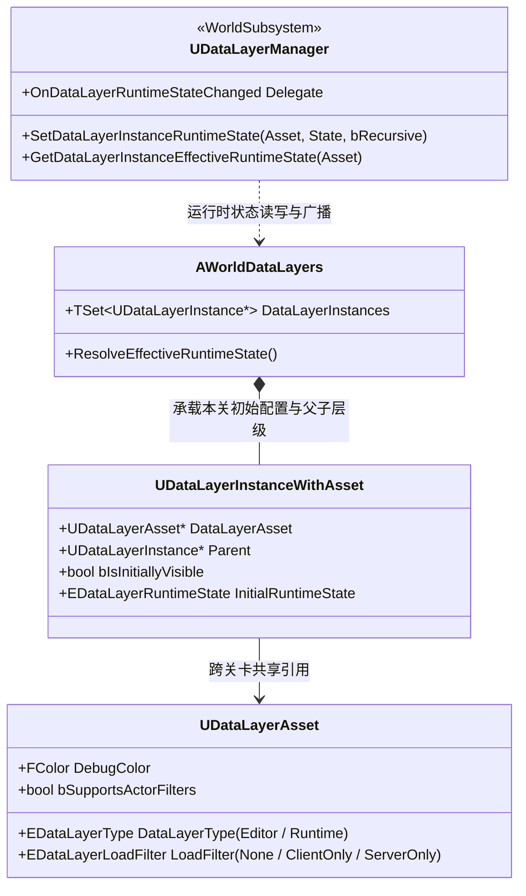

# 06 · `Level_DataLayers`：数据层动态世界状态切换与运行时流送全解

> **对应工程地图**：`/Game/Maps/Level/Level_DataLayers`  
> **所属领域目录**：`04_Level_世界构建与PCG`  
> **关卡实测规模**：总 Actor 数 `90` | 展台数 `14`（`#1` ~ `#14` 零遗漏全拆解） | 示例交互与环境 Actor 数 `64`

---

## 一、 导言：从“空间流送”到“状态流送”——为什么开放世界离不开 Data Layers？

在现代无缝开放世界（Open World）工程中，**World Partition（世界分区）** 的 2D/3D 空间哈希网格完美回答了一个问题：**“当玩家站在坐标 $(X, Y, Z)$ 时，东南西北多远半径内的地形与建筑应该滑入内存？”**

然而，真实商业大作的场景绝不是一成不变的静态沙盘。关卡设计师与系统架构师每天都在面对另一个维度的拷问：**“同样是王城中央广场这一块 $256\text{ m} \times 256\text{ m}$ 的土地，在不同开发阶段、不同剧情章节或不同网络端上，究竟该呈现哪一套平行时空？”**
- **剧情状态演进**：第一章庆典期间广场挂满彩旗、摆满集市摊位；第五章巨龙袭城后，同一坐标的原地建筑坍塌为焦土弹坑与燃烧路障——总不能把两套高精度建筑同时塞进显存再靠 `SetActorHiddenInGame` 硬藏吧？
- **灰盒（Blockout）与终版美术（Final Art）并行迭代**：关卡策划搭建的灰盒碰撞体（Blockout）需要在编辑器中常驻对齐尺度，但进 PIE 或打包后必须自动卸载，无缝切换为环境美术精雕的木屋、围栏与山体。
- **Dedicated Server（专用服务器）极致瘦身**：成千上万簇纯表现向的鲜花碎石、环境音效与远景山脉（Vista），客户端渲染必不可少，但 Linux 专用服务器加载它们纯属浪费宝贵的内存开销。

打开 `/Game/Maps/Level/Level_DataLayers`，这座建构于 World Partition 基座之上的示范关卡沿着 X 轴从 `-1097` 延伸至 `10783`（远景圆锥山脉甚至延展至 `143703` 厘米的百米视距之外），通过 **3 大主题展区（`Intro` 导览廊、`Using Data Layers` 实操厅、户外开放世界灰盒演武场）与 14 座展台**，完整呈现了 **Data Layers（数据层）** 的全生命周期架构。


### 1.1 次世代流送双轴正交模型：空间网格 $\times$ 数据层（Spatial $\times$ Logical）

初学者最容易产生的一个误区是：*“把 Actor 放进一个 Runtime Data Layer 并切为 Activated，它是不是就会无视玩家距离、全图常驻加载？”*

**答案是否定的（除非显式关闭空间加载）！** 在 UE5 的底层流送调度器中，World Partition 空间网格与 Data Layers 构成了一组严谨的**正交双轴与门（Logical AND Gate）**：


对于任意一个勾选了默认 `bIsSpatiallyLoaded = true` 且归属于某个运行时数据层 $DL$ 的 Actor，引擎决定其最终生命周期的布尔判据如下：

$$\text{ShouldLoad}(A) = \Big(\neg A.\text{bIsSpatiallyLoaded} \;\lor\; \text{Dist}(A, \text{StreamingSource}) \le R_{\text{grid}}\Big) \;\land\; \Big(\text{EffectiveState}(DL_A) \ge \text{Loaded}\Big)$$

$$\text{ShouldActivate}(A) = \text{ShouldLoad}(A) \;\land\; \Big(\text{EffectiveState}(DL_A) == \text{Activated}\Big)$$

换言之：
1. 若某座废墟建筑开启了空间加载（`bIsSpatiallyLoaded = true`）且归入 `DL_Invasion`：即便剧情已推进至入侵阶段（`DL_Invasion = Activated`），只要玩家远在 5 公里外，该废墟依然静静躺在磁盘里不占内存；只有当玩家走近其所在网格加载半径 $R_{\text{grid}}$ 内时，它才会流送入场！
2. 反之，若某件全局管理器或本关的演示展厅走廊关闭了空间加载（`bIsSpatiallyLoaded = false`），它的加载与否就完全听命于其所属 Data Layer 的状态（若未分配任何 Data Layer，则退化为全图永久常驻 `Always Loaded`）。

### 1.2 从 UE 5.0 到 UE 5.1+ 的架构跃迁：`UDataLayerAsset` 资产化解耦

在本关实测提取的资产清单（`/Game/ExampleContent/DataLayers/DataLayers/`）中，我们可以看到 4 个独立的 `DataLayerAsset` 资产文件：`DL_DemoDisplay`、`DL_BlockoutRuntime`、`DL_BlockinRuntime` 与 `DL_BlockoutEngine`，同时关卡内驻留着一个坐标 `(0, 0, 0)` 的全局管理 Actor `WorldDataLayers`（`/Script/Engine.WorldDataLayers`）。这体现了 UE 5.1 之后极具前瞻性的**“资产（Asset）与世界实例（Instance）二元分离”**架构：



- **为什么必须拆成外部资产 `UDataLayerAsset`？** 在早期 UE 5.0 中，数据层只是保存在 `AWorldDataLayers` 内部的一串 `FName` 标签，不仅跨关卡复用主线任务阶段极不方便，多人新建图层还容易抢占 `WorldDataLayers` 文件锁。升级为外部资产后，全项目的主关卡、副本关卡与打包关卡实例（PLI）都可以引用同一个 `/Game/.../DL_QuestPhase2` 资产；而每个 Actor 加入数据层时，仅修改该 Actor 自身的 **OFPA（`__ExternalActors__`）** 独立小文件，实现百人团队零锁冲突协作！

### 1.3 本关 14 座展台全景索引矩阵

| 展台编号 | 展台标题 (`BP_DemoDisplay` 标签) | 空间坐标 `(X, Y, Z)` | 所属展厅分区 | 核心演示机制与绑定资产 |
| :--- | :--- | :--- | :--- | :--- |
| **#1** | `Data Layers` (`BP_DemoDisplay13`) | `(-1097, -2750, 0)` | `Intro` 导览区 | World Partition 前置依赖说明、`Always Loaded` 常驻走廊防卸载保护 |
| **#2** | `Data Layers Types` (`BP_DemoDisplay19`) | `(-117, -2750, 0)` | `Intro` 导览区 | `Editor`（仅开发期，Cook 自动剥离）与 `Runtime`（运行时动态流送）双类型分野 |
| **#3** | `Data Layers States` (`BP_DemoDisplay21`) | `(882, -2750, 0)` | `Intro` 导览区 | 运行时三态生命周期（`Unloaded` / `Loaded` / `Activated`）与父子层级取最低态法则 |
| **#4** | `Data Layer Configuration` (`BP_DemoDisplay18`) | `(1898, -2750, 0)` | `Intro` 导览区 | `DL_DemoDisplay` 配置图板展示（`MI_DLDemoDisplay_Settings`） |
| **#5** | `Assigning Actors to a Data Layer` (`BP_DemoDisplay26`) | `(3394, -2750, 0)` | `Using Data Layers` | Actor 归属分配总纲展台（统领 #6 事后框选添加与 #8 上下文直编两种范式） |
| **#6** | `Select Assets and Add` (`BP_DemoDisplay28`) | `(3202, -2741, 6)` | `Using Data Layers` | 视口选中 Actor 右键加入/移出数据层工作流（`MI_AddActorsToDataLayer`） |
| **#7** | `Activate a Runtime Datalayer {DL_DemoDisplay}` (`BP_DemoDisplay20`) | `(3343, -1850, 0)` | `Using Data Layers` | 交互按钮 `BP_Button_Toggle_ShowRoomDataLayer` 实时切换 `DL_DemoDisplay` 激活态 |
| **#8** | `Active Data Layer` (`BP_DemoDisplay27`) | `(3592, -2741, 6)` | `Using Data Layers` | `Make Current Data Layer(s)` 当前工作层上下文自动归属（`MI_ActiveDataLayer` 等） |
| **#9** | `Active Data Layer` (`BP_DemoDisplay24`) | `(4403, -2750, 0)` | `Using Data Layers` | PIE 运行时 Outliner 实时状态观测与控制台调试命令集 |
| **#10** | `Data Layer Settings` (`BP_DemoDisplay29`) | `(5385, -2750, 0)` | `Using Data Layers` | 数据层双层配置架构总纲（统领 #11 资产级属性与 #12 大纲实例级属性） |
| **#11** | `Data Layer Asset` (`BP_DemoDisplay31`) | `(5193, -2741, 6)` | `Using Data Layers` | `UDataLayerAsset` 面板详解：`DataLayerType`、`DebugColor` 与 `LoadFilter` 主客端过滤 |
| **#12** | `Outliner Settings` (`BP_DemoDisplay30`) | `(5583, -2741, 6)` | `Using Data Layers` | Outliner 实例面板：`Initially Visible`、`Initially Loaded = False` 加速大地图开编 |
| **#13** | `Toggle between Editor and Runtime Data Layers` (`BP_DemoDisplay37`) | `(6823, -1850, -5)` | 户外演武场入口 | 交互按钮 `BP_Button_ToggleEditorRuntimeDL` 实时互切 `DL_BlockoutRuntime` 与 `DL_BlockinRuntime` |
| **#14** | `Using Data Layers for Gameplay` (`BP_DemoDisplay32`) | `(8149, -2973, 172)` | 户外开放地形演武场 | 3×3 `LandscapeStreamingProxy` 地形块、四色世界网格灰盒与动态机关/分支路径实战 |

---

## 二、 逐展台（Stand #1 ~ #14）零遗漏深度拆解

### 展台 #1：`Data Layers` — 世界分区前置基座与常驻防流送保护

- **展牌标识与空间坐标**：`BP_DemoDisplay13`，位于 `(-1097, -2750, 0)`
- **官方展牌原文**：
  > *"Important Note: This map uses the world partition system. It's reccomended to view Level_WorldParition if you havn't already done so. The corridors and demo displays are configured to be always loaded. As a result, they will not be streamed during demos, ensuring they remain consistently available."*
- **展台内陈列的示例 Actor（1 个）**：
  - `DocumentationActor`（`/Script/Engine.DocumentationActor`，坐标 `(-1085, -2280, 150)`）：官方文档链接锚点。

#### 深度解析：为什么演示走廊必须设为 `Always Loaded`？
在开启了 World Partition 的地图中，所有新建 Actor 默认都会勾选 Details 面板 `World Partition` 分类下的 **`Is Spatially Loaded`（空间化加载）**。在本关为了在几百米范围内直观演示流送效果，网格尺寸与加载半径被刻意调得很小；如果展厅的地板、墙壁（`BP_DemoRoom`）和展牌（`BP_DemoDisplay`）也保持 `Is Spatially Loaded = true`，玩家稍微走远几步身后的走廊就会被卸载成虚空，甚至角色刚出生时脚下地板尚未完成异步流送便直接坠入深渊！

因此，凡是承担**全局导航骨架、核心出生点安全地面、全局环境光源（`DirectionalLight` / `SkyAtmosphere`）以及跨区域任务管理器**职责的 Actor，务必取消勾选 `Is Spatially Loaded`（即设为 `Always Loaded`），将其从空间距离网格裁剪中豁免。

---

### 展台 #2：`Data Layers Types` — Editor 编辑器层与 Runtime 运行时层的本质分野


- **展牌标识与空间坐标**：`BP_DemoDisplay19`，位于 `(-117, -2750, 0)`
- **官方展牌原文**：
  > *"Data Layers let you organize and control the loading of world content in both the Editor and at Runtime. At runtime, they're used to manage level variations, game progression, missions, cinematics, and control memory and performance by loading only what's needed. In the Editor, they help keep your level organized, isolate and preview specific sets of content, work on specific assets in context without distraction. Note: Editor-only Data Layers won’t appear in PIE or cooked builds—they’re strictly for development use."*

#### 深度解析：两种数据层在 Cook 打包管线中的命运分流
在虚幻引擎中，`EDataLayerType` 枚举严格划定了数据层的编译边界：

| 对比维度 | `Editor` 数据层（编辑器专属层） | `Runtime` 数据层（运行时数据层，默认） |
| :--- | :--- | :--- |
| **核心工程职责** | 白盒体块参考（Blockout Reference）、原画立牌、关卡尺寸标尺、PCG 辅助引导框、分专业美术视图隔离（如单独隐藏高密树冠修地形） | 昼夜/季节地貌变体、主支线剧情阶段场景改写、过场动画专属布景、Boss 战封路机关、主客端差异化加载 |
| **PIE（编辑器内运行）表现** | **自动剥离消失！** 按下 Play 进入 PIE 瞬间，归属于 Editor Data Layer 的纯开发辅助 Actor 不会参与运行时世界构建 | 按 Outliner 中设定的 `Initial Runtime State` 初始化，并响应蓝图/C++ 状态机调度 |
| **Cook（打包发布）行为** | **零包体残留！** UAT Cook 阶段直接跳过纯 Editor 层内的开发参考物，绝不打入 `.pak` / `.utoc` IoStore 归档 | 随 World Partition 流送单元一起分桶烘焙（注意：若一个空间格子里有 3 个不同的 Runtime Data Layer，引擎会自动将该格拆分为独立的流送生成块 Cell，互不污染内存！） |

> [!WARNING]
> **多图层归属陷阱**：如果一个 Actor **同时**被加进了一个 `Editor` 数据层和一个 `Runtime` 数据层，会发生什么？只要它身上挂着哪怕一个有效的 `Runtime` 数据层，引擎就会认定它在运行时需要存在；反之，如果你希望某个白盒标尺**彻底不进 PIE 和正式包**，请确保它只归属于 `Editor` 数据层（或将其自身的 `bIsEditorOnlyActor` 置为 `true`）。

---

### 展台 #3：`Data Layers States` — 三态生命周期与父子层级仲裁法则

- **展牌标识与空间坐标**：`BP_DemoDisplay21`，位于 `(882, -2750, 0)`
- **官方展牌原文**：
  > *"Runtime Data Layers can be in one of three states: Content is not in memory and not visible. Content is in memory but still hidden. Content is both in memory and visible in the world. When Data Layers are nested in a hierarchy, the lowest state between parent and child applies (e.g. if a parent is Loaded, the child can't be 'Activated')."*

#### 深度解析：为什么在 `Unloaded` 和 `Activated` 之间非要设计一个 `Loaded` 中间态？
很多刚从旧版 `SetActorHiddenInGame` 转过来的开发者会疑惑：既然有“卸载”和“显示”，为什么还要多此一举搞一个“占了内存却看不见”的 `Loaded` 状态？这恰恰是 **3A 级无缝过场“零卡顿瞬切（Zero-Hitch Transition）”** 的核心命门！


试想：当主角拔出石中剑，整座冰封神殿在一道闪光瞬间融化为繁花盛开的春之神殿。如果直接从 `Unloaded` 跨跳到 `Activated`，引擎要么在一帧内同步阻塞加载几百兆网格与贴图（导致画面死卡 500ms），要么异步慢慢流送（导致玩家眼睁睁看着花草树木一坨一坨凭空蹦出来 Pop-in）。有了 **`Loaded` 预热态**，你可以在拔剑动画刚开始播放的第 0 秒就将 `DL_SpringTemple` 切为 `Loaded`，让 IoStore 在过场播放的 4 秒内通过后台线程把所有模型、材质与碰撞体静默搬进内存；等到闪光最亮的第 4.0 秒那一帧，再调用 `SetDataLayerRuntimeState(Activated)`——一瞬间繁花满地，帧率稳如泰山！

#### 父子嵌套层级的“木桶短板法则（Min-State Clamping）”
当你在 Data Layers Outliner 中把多个子数据层拖拽挂在父数据层之下（例如父层 `DL_Chapter2_War` 下辖子层 `DL_War_Fires`、`DL_War_Enemies`、`DL_War_Barricades`）时，引擎内部按枚举序关系 `Unloaded (0) < Loaded (1) < Activated (2)` 计算任意子层的最终生效状态：

$$\text{EffectiveState}(\text{Node}) = \min\Big(\text{EffectiveState}(\text{Parent}),\; \text{RequestedState}(\text{Node})\Big)$$

- **实战威力**：各子层默认都可以预先设为 `Initial Runtime State = Activated`，只需将顶层父节点 `DL_Chapter2_War` 设为 `Unloaded`——整章所有敌兵、火海与路障便全部处于休眠态！过场前把父节点切到 `Loaded`，所有子节点最高只能达到 `Loaded`（集体预热进内存但绝不提前刷出怪物打玩家）；高潮一到把父节点切为 `Activated`，全体子节点瞬间同步解锁激活！

---

### 展台 #4：`Data Layer Configuration` — `DL_DemoDisplay` 配置实例检视

- **展牌标识与空间坐标**：`BP_DemoDisplay18`，位于 `(1898, -2750, 0)`
- **官方展牌原文**：
  > *"The settings for DL_DemoDisplay found in the Data Layers Outliner."*
- **展台内陈列的示例 Actor（1 个）**：
  - `Plane7`（`StaticMeshActor`，坐标 `(1893, -2710, 144)`）：使用基础平面 `/Engine/BasicShapes/Plane`，覆写材质实例 `MI_DLDemoDisplay_Settings`（母材质 `M_TextureBoard_Master`，绑定贴图 `/Game/ExampleContent/DataLayers/Textures/T_DataLayerSettings`）。
- **关联数据层资产实测参数（`/Game/ExampleContent/DataLayers/DataLayers/DL_DemoDisplay`）**：
  ```json
  {
    "bSupportsActorFilters": false,
    "dataLayerType": "Runtime",
    "debugColor": { "r": 0.4392, "g": 0.8118, "b": 0.5176, "a": 1.0 },
    "loadFilter": "None"
  }
  ```

#### 深度解析：展板背后的真实资产映射
展台 #4 的巨幅面板 `T_DataLayerSettings` 为接下来的展台 #7 做了铺垫：本关专门创建了一个翠绿色调试色（RGB `0.44, 0.81, 0.52`）的运行时数据层资产 **`DL_DemoDisplay`**。它在编辑器里勾选了 `Is Initially Visible = true` 以便开发者打开地图就能看到展品，但在运行时配置了可由按钮动态翻转的状态，让你亲眼验证同一组展品如何在运行时凭空加载与卸载。

---

### 展台 #5 & 展台 #6：`Assigning Actors to a Data Layer` 与 `Select Assets and Add` — 事后框选归属工作流


- **展台 #5（总标题台）**：`BP_DemoDisplay26`，位于 `(3394, -2750, 0)`，标题 `Assigning Actors to a Data Layer`，作为左侧子展台 #6（`X = 3202`）与右侧子展台 #8（`X = 3592`）的母展牌，居中统领两种截然不同的关卡编排流派。
- **展台 #6（左翼子展台）**：`BP_DemoDisplay28`，位于 `(3202, -2741, 6)`，标题 `Select Assets and Add`
- **官方展牌原文（#6）**：
  > *"You can add actors to a Data Layer by selecting them in the viewport. Once selected, right click the desired Data Layer from the Data Layer Outliner and choose 'Add Selected Actor(s) to Selected Data Layer(s)' You can also remove actors this way too."*
- **展台 #6 陈列的示例 Actor（1 个）**：
  - `Plane3`（`StaticMeshActor`，坐标 `(3198, -2710, 144)`）：覆写材质实例 `MI_AddActorsToDataLayer`（绑定界面演示贴图 `/Game/ExampleContent/DataLayers/Textures/T_AddActorToDataLayer`）。

#### 深度解析：当一个 Actor 同时加入多个 Runtime Data Layers 时怎么算？
除了右键菜单 `Add Selected Actor(s) to Selected Data Layer(s)`，你还可以在 Actor 的 Details 面板底部 `Data Layers` 数组中直接拖入多个 `UDataLayerAsset`。这就引出了一个关键架构问题：**父子层级取 `min`（短板与门），那同一个 Actor 平级挂载多个数据层（如同时挂上 `DL_Chapter1` 和 `DL_Chapter2`）时取什么？**

- **答案是取 `max`（并集或门，Logical OR）！**
  假设城门口的老卫兵既要在第一章站岗（`DL_Chapter1`），又要在第二章继续站岗（`DL_Chapter2`），直到第三章才撤离。你不需要复制两个一模一样的老卫兵 Actor——只需把**同一个**老卫兵同时加入 `DL_Chapter1` 和 `DL_Chapter2`！只要这两个图层中**任意一个**处于 `Activated`，老卫兵就保持激活；只有当两个图层**全部**变为 `Unloaded` 时，老卫兵才会真正从内存中卸载！

---

### 展台 #7：`Activate a Runtime Datalayer {DL_DemoDisplay}` — 蓝图动态驱动数据层流送实战

- **展牌标识与空间坐标**：`BP_DemoDisplay20`，位于 `(3343, -1850, 0)`（正对展台 #5/#6/#8 的走廊中央交互台）
- **展台内陈列的交互 Actor（1 个）**：
  - `BP_Button_Toggle_ShowRoomDataLayer`（`/Game/ExampleContent/DataLayers/Blueprints/BP_Button_Toggle_ShowRoomDataLayer`，坐标 `(3243, -1850, 7)`）
    - **继承体系**：继承自全局切换按钮基类 `/Game/Global/Blueprints/Interactive/BP_Button_Parent_Toggle`
    - **暴露实例参数**：`In Data Layer = DataLayer_D51BA1324F2741176DBEFBAC9261D5D4`（指向本关的 `DL_DemoDisplay` 实例），组件包含 `ButtonMesh`（`Display_Button` 静态网格 + 动态发光材质 `MID_M_Button2_0`）与 `ButtonCollision` 交互盒。

#### 深度解析：在蓝图与 C++ 中操控 Data Layer 的标准工业范式
当你在 PIE 中走近展台 #7 按下交互键触发 `BP_Button_Toggle_ShowRoomDataLayer` 时，按钮脚本通过引擎内置的 **`DataLayerManager`（世界子系统 `UDataLayerManager`）** 实时改写 `DL_DemoDisplay` 的运行态。在 UE 5.3 / 5.4 / 5.5 现代生产管线中，推荐的标准调用链路如下：

1. **蓝图标准节点链**：
   `Get Data Layer Manager` $\rightarrow$ `Set Data Layer Instance Runtime State`（或直接传入资产引用 `Set Data Layer Runtime State`）：
   - `Data Layer Asset`：拖入 `DL_DemoDisplay`；
   - `State`：按钮按下传 `Activated`，再次按下传 `Unloaded`（若需保留缓存高频切换则传 `Loaded`）；
   - `bRecursive`：若该图层下挂有子图层且希望一并级联改写，勾选 `true`。
2. **C++ 生产级异步监听代码模板**：
   ```cpp
   #include "WorldPartition/DataLayer/DataLayerManager.h"
   #include "WorldPartition/DataLayer/DataLayerAsset.h"

   void AMyQuestDirector::PrewarmAndActivateInvasionLayer(const UDataLayerAsset* InvasionLayer)
   {
       if (UDataLayerManager* DLManager = UDataLayerManager::GetDataLayerManager(GetWorld()))
       {
           // 第 1 步：提前切入 Loaded 状态，触发后台 IoStore 异步预加载流送单元
           DLManager->SetDataLayerRuntimeState(InvasionLayer, EDataLayerRuntimeState::Loaded, /*bRecursive=*/true);
       }
   }
   ```
   配合 `UWorldPartitionSubsystem::IsStreamingCompleted()` 检查目标区域流送网格是否全部就绪后，再切至 `Activated`，即可彻底杜绝高潮演出的模型迟滞闪烁！

---

### 展台 #8：`Active Data Layer` — `Make Current` 上下文直编模式

- **展牌标识与空间坐标**：`BP_DemoDisplay27`，位于 `(3592, -2741, 6)`（展台 #5 右翼子展台）
- **官方展牌原文**：
  > *"You can also work directly in a Data Layer, so that any changes to the world happen in that Data Layer. Right click the Data Layer and choose 'Make Current Data Layer(s) The Data Layer will turn green in the outliner and the viewport will show the Current Context."*
- **展台内陈列的示例 Actor（2 个上下叠放图板）**：
  - `Plane4`（坐标 `(3594, -2710, 73)`）：覆写 `MI_ActiveDataLayer`（贴图 `T_ActiveDataLayer`）；
  - `Plane9`（坐标 `(3594, -2710, 203)`）：覆写 `MI_ActiveDataLayerContext`（贴图 `T_ActiveDataLayerContext`）。

#### 深度解析：大型关卡美术团队防漏挂图层的第一铁律
假设一位环境美术要花一整天在森林里摆 800 个万圣节南瓜灯与蜘蛛网（属于节日限时活动层 `DL_HalloweenEvent`）。如果采用展台 #6 的“先摆完再框选添加”，一旦漏选了躲在树根底下的 3 个南瓜灯，正式服平时非万圣节期间就会诡异地残留 3 个孤零零的南瓜灯（俗称“图层幽灵泄露”）！

展台 #8 演示的 **`Make Current Data Layer(s)`（设为当前活动数据层）** 从源头根治了这一痛点：
- 右键目标图层选择 `Make Current Data Layer(s)` 后，Outliner 中该图层名称立刻变为醒目的**亮绿色**，同时三维视口左上角常驻浮现绿字角标 **`Current Data Layers: DL_HalloweenEvent`**；
- 此后你往视口里拖拽任何模型、复制粘贴（`Alt + Drag`）Actor、甚至用植被笔刷或 PCG 生成独立实例，引擎都会在 `OnActorSpawned` 钩子中**自动将其归入 `DL_HalloweenEvent`**！收工时只需点击 `Clear Current Data Layers` 即可安全退出上下文。

---

### 展台 #9：`Active Data Layer`（运行时监测）— PIE 大纲实时状态追踪与控制台调试指令

- **展牌标识与空间坐标**：`BP_DemoDisplay24`，位于 `(4403, -2750, 0)`
- **官方展牌原文**：
  > *"While playing in runtime, the Data Layers Outliner will show the status of each Data layer. You can also use the console command to display a list of Data Layers and their states."*

#### 深度解析：开放世界 QA 与流送排查必备控制台武器库
在编辑器中启动 PIE（`Alt + P`）但不全屏独占鼠标（`Shift + F1` 切出光标）时，打开 `Window -> World Partition -> Data Layers Outliner`，你会看到原本静态的图层列表变成了**实时状态监控仪**——`Unloaded`、`Loaded`、`Activated` 会以不同颜色与图标实时跳变。而在打包后的 Development 包或真机联调中，没有编辑器面板怎么办？记住以下 4 条救命控制台命令（按 `~` 键输入）：

| 控制台命令 (CVar / Exec) | 核心调试用途 |
| :--- | :--- |
| **`wp.Runtime.ShowDataLayerHierarchy`** | 在屏幕 HUD 左上角实时打印整棵 `WorldDataLayers` 树及每一层的 `RequestedState` 与 `EffectiveState`（展台 #9 官方文案所指核心命令！） |
| **`wp.Runtime.SetDataLayerRuntimeState [LayerName] [Unloaded\|Loaded\|Activated]`** | 无需写任何测试蓝图，直接在命令行强行切任意数据层状态，快速重现剧情翻转 Bug |
| **`wp.Runtime.ToggleDrawRuntimeHash2D`** | 在屏幕角落绘制 2D 世界分区流送俯视雷达图，直观查看玩家周围哪些网格因数据层激活而变为绿色加载态 |
| **`wp.Runtime.ToggleDrawDataLayersLoadTime`** | 统计并显示各数据层切换时的异步 I/O 耗时，精准揪出哪个数据层塞入了未压缩的超大单体资产导致卡顿 |

---

### 展台 #10、展台 #11 与展台 #12：`Data Layer Settings` 双层配置体系全解


这三座紧密排列的展台构成了一组完整的三联展板（主标题台 #10 居中 `X = 5385`，左翼 #11 `X = 5193` 讲资产，右翼 #12 `X = 5583` 讲关卡大纲实例）：

- **展台 #10（总标题台）**：`BP_DemoDisplay29`，位于 `(5385, -2750, 0)`，标题 `Data Layer Settings`。
- **展台 #11（左翼 · 资产面板）**：`BP_DemoDisplay31`，位于 `(5193, -2741, 6)`，标题 `Data Layer Asset`
  - **官方展牌原文（#11）**：
    > *"A Data Layer Asset lets you adjust settings, including switching between Editor Only and Runtime Data Layer (default). You can also change the debug color and apply filters for better organization. The Load Filter will let you determain if a Data Layer is valid on Client or Server Only."*
  - **陈列 Actor**：`Plane5`（坐标 `(5188, -2710, 144)`），覆写材质 `MI_DL_DLASettings`（贴图 `T_DataLayerAssetSettings`）。
- **展台 #12（右翼 · 大纲实例面板）**：`BP_DemoDisplay30`，位于 `(5583, -2741, 6)`，标题 `Outliner Settings`
  - **官方展牌原文（#12）**：
    > *"Clicking on a Data Layer lets you adjust its settings, including options like Initially Visible, Initially Loaded, how to load at Runtime, and the Data Layer Source, giving you control over how it behaves in the level. For large maps, setting a Data Layer to Initially Loaded: False can speed up the process of opening the editor by reducing the amount of data loaded at startup."*
  - **陈列 Actor**：`Plane6`（坐标 `(5583, -2700, 155)`），覆写材质 `MI_DL_DLOSettings`（贴图 `T_DataLayerOutlinerSettings`）。

#### 深度解析一（展台 #11）：`Load Filter` —— 大型多人在线网游（MMO / 搜打撤）的服务器减负神器
双击打开任意一个 `UDataLayerAsset`（如本关的 `DL_DemoDisplay`），最值得架构师关注的属性莫过于 **`Load Filter`（`EDataLayerLoadFilter`）**：
1. **`None`（默认）**：客户端与服务器双端同步遵循该数据层规则。
2. **`Client Only`（仅客户端有效）**：在 Linux Dedicated Server Cook 阶段或服务器启动时，**整层直接视同不存在**！实战中将全图无碰撞的远景云海山体（Vista）、贴花污渍、环境点光源、篝火粒子、纯客户端风铃音效统统归入 `DL_FX_ClientOnly`，能让单台物理机承载的 Dedicated Server 进程密度直接翻倍！
3. **`Server Only`（仅服务器有效）**：客户端包体完全剥离该层数据！不仅节省手机/主机端内存，还能把刷怪笼权重触发器、高价值宝箱刷新锚点、反外挂校验体积盒彻底藏在服务端，从物理包体层面杜绝外挂解包透视刷宝点！

#### 深度解析二（展台 #12）：`Initially Loaded = False` —— 拯救百平方公里大地图的“开编辑器 15 分钟”噩梦
在展台 #12 的大纲实例面板（`UDataLayerInstance`）中，请严格区分两组名字极易混淆的开关：
- **编辑器期开关（仅影响开发者打开 `.umap` 时的视口体验）**：
  - `Is Initially Visible`：开图时是否默认睁开“小眼睛”显示。
  - **`Is Initially Loaded`**：开图时是否把这层成千上万个 OFPA Actor 读进编辑器内存！在大团队开发中，灯光师打开主世界只需要地形、建筑和灯光层；如果把百万株灌木层、全支线 NPC 层都设为 `Initially Loaded: False`，编辑器冷启动时间能从 10 分钟骤降至 30 秒！
- **运行期开关（仅在 `DataLayerType == Runtime` 时出现）**：
  - **`Initial Runtime State`**：决定游戏刚开局进入关卡第 0 帧时，该图层处于 `Unloaded`、`Loaded` 还是 `Activated`。

---

### 展台 #13：`Toggle between Editor and Runtime Data Layers` — 灰盒白模与终版美术无缝交接工作流

- **展牌标识与空间坐标**：`BP_DemoDisplay37`，位于 `(6823, -1850, -5)`（走出室内长廊、俯瞰户外开放地形演武场的观景台正中央）
- **官方展牌原文**：
  > *"The 'DL_BlockoutRuntime' is set to show in editor and unload at runtime resulting in hiding what you see in editor. The 'DL_BlockInRuntime' is set to be hidden inititally in editor but Activted on runtime. Feel free to toggle between the two."*
- **展台内陈列的示例 Actor（4 个）**：
  1. `BP_Button_ToggleEditorRuntimeDL`（`/Game/ExampleContent/DataLayers/Blueprints/BP_Button_ToggleEditorRuntimeDL`，坐标 `(6868, -1850, 3)`）：继承自 `BP_Button_Parent_Toggle`，暴露两个数据层槽位变量：
     - `Editor Data Layer`：`DataLayer_0D925F534CF3A5FAC4D22B83FFD7FAF1`（绑定 `/Game/ExampleContent/DataLayers/DataLayers/DL_BlockoutRuntime`，粉色调试色 `(0.957, 0.804, 0.933)`）；
     - `Runtime Data Layer`：`DataLayer_01814DA6436238C187CF038536774D8B`（绑定 `/Game/ExampleContent/DataLayers/DataLayers/DL_BlockinRuntime`）。
  2. `LandscapeStreamingProxy_0_2_0`（坐标 `(7489, -1150, 11)`）：承载 `LandscapeComponent_24/25/30/31`、高度场碰撞组件及自动草丛 `GrassInstancedStaticMeshComponent_3`（静态网格 `S_Nordic_Coastal_Groundcover_vlqkdeaja_Var24_lod0`）。
  3. `Cube14`（坐标 `(7636, -1015, 74)`）与 `Cube11`（坐标 `(7796, -1541, 74)`）：护栏灰盒体块，覆写材质实例 `MI_WS_GridBlockout_Railings`。

#### 深度解析一：“编辑器看灰盒、进游戏看精模”的精妙反向配置
请注意展牌上那句极具启发性的工程配置对比：
- **`DL_BlockoutRuntime`（灰盒设计层）**：`Is Initially Visible (Editor) = True` + **`Initial Runtime State = Unloaded`**！
  关卡策划打开编辑器，一眼就能看到清晰醒目的米制刻度灰盒体块（建筑物橙色、道具绿色、护栏红色、远景品红色），方便测算跳跃距离、掩体高度与视线遮挡（Sightline）；而一旦按下 Play 进入游戏，灰盒层自动退场卸载！
- **`DL_BlockinRuntime`（精模美术层）**：`Is Initially Visible (Editor) = False` + **`Initial Runtime State = Activated`**！
  平时在编辑器里默认隐藏，不干扰策划调灰盒；一旦进游戏自动上场接管画面！而展台 #13 的按钮 `BP_Button_ToggleEditorRuntimeDL` 则在运行时通过互斥翻转这两层的 `Activated` / `Unloaded` 状态，让参观者可以在游戏里一键对比“关卡策划眼中的灰盒骨架”与“玩家眼中的自然山野精模”！

#### 深度解析二：工业级世界空间标尺材质 `M_WS_GridBlockout` 拆解
本关所有灰盒体块（无论怎么非均匀缩放 `Cube`、`Cylinder` 或 `Cone`，网格刻度永远不会拉伸变形！）全部派生自母材质 `/Game/ExampleContent/DataLayers/Materials/Blockout/M_WS_GridBlockout`（共 27 个材质表达式节点）：
- **核心原理**：通过 `MaterialExpressionWorldPosition_0` 读取像素绝对世界坐标，送入两次材质函数 `/Game/Global/Materials/ML_WorldGrid_Lines`——主网格 `Grid Size = 100`（1 米大格，`Thickness = 5`），副网格 `Secondary Grid Size = 50`（0.5 米半身掩体格，`Secondary Thickness = 0.2`），再配合 `Clamp Height?` 静态开关实现高程渐变染色。
- **四色语义化材质实例规范**（关卡设计团队可直接照搬的标准色板）：
  - `MI_WS_GridBlockout_Buildings`（建筑主体，如 `Cube`, `Cube2`, `Cube3`, `Cube4`）：暖橙色 `BaseColor = (0.831, 0.205, 0.0)`；
  - `MI_WS_GridBlockout_Props`（掩体/交互小道具，如 `Cube5~10`, `Cylinder~Cylinder11`）：翠绿色 `BaseColor = (0.0, 0.831, 0.129)`；
  - `MI_WS_GridBlockout_Railings`（防跌落护栏/边界引导，如 `Cube11~19`）：警示红 `BaseColor = (0.831, 0.010, 0.0)`；
  - `MI_WS_GridBlockout_Vista`（超远景地标山峰，如数十米至上千米外的 `Cone ~ Cone6`）：品红色 `BaseColor = (0.831, 0.0, 0.426)`，且由于远景体量巨大，特意将 `Grid Size` 放大至 `7306.66` 厘米（约 73 米一格），避免远距离摩尔纹闪烁！

---

### 展台 #14：`Using Data Layers for Gameplay` — 开放世界动态玩法、HLOD 与全局环境全解


- **展牌标识与空间坐标**：`BP_DemoDisplay32`，位于 `(8149, -2973, 172)`（深入户外开放地形区右侧高台）
- **官方展牌原文**：
  > *"Data Layers can enable or disable gameplay elements dynamically. Examples include: Traps that appear only when a puzzle is solved. Alternate pathways that open based on player choices."*
- **展台配对及户外演武场全局 Actor 完整编组拆解**：
  1. **3×3 世界分区地形阵列（共 1 个主 `Landscape` + 9 个 `LandscapeStreamingProxy`）**：
     - 展台 #13/#14 近景块：`LandscapeStreamingProxy_0_0_0`、`0_1_0`、`0_2_0`、`1_0_0`、`1_1_0`；
     - 演武场远景扩展块（见全局列表）：`LandscapeStreamingProxy_1_2_0`、`2_0_0`、`2_1_0`、`2_2_0`，底部托盘框为 `Box`（静态网格 `SM_LandscapeHolder`，材质 `M_Tile_Glossy`），地表自动铺设北欧海岸地被草丛 `S_Nordic_Coastal_Groundcover`（`Var24` 与 `Var52`）。
  2. **灰盒玩法沙盘组件**：
     - 建筑体块 `Cube3`（及全局 `Cube`, `Cube2`, `Cube4`）；
     - 掩体与可通行路径道具组 `Cube5~10`、`Cylinder`、`Cylinder2~11`；
     - 道路护栏组 `Cube12~19`；
     - 远景天际线圆锥群 `Cone ~ Cone6`（分布在 `(-68051, -111604)` 至 `(143703, 147830)` 环绕整个演示场外围）。
  3. **隐藏在目录中的高阶精模、HLOD 与 PCG 联动资产（`/Game/ExampleContent/DataLayers/`）**：
     - **合并代理木屋（Merged Actors）**：`MergedActors/CorttageOne/SM_PROXY_S_Worn_Wooden_Beam_tgmrafyfa_high`（材质 `M_CottageOne`）与 `CottageTwo/SM_PROXY_Plane`（材质 `M_CottageTwo`）——将数十根独立木梁合并为单 Draw Call 代理网格，绑定至精模层 `DL_BlockinRuntime`；
     - **远景山脉高度雾化消隐材质 `M_DataLayer_MasterWorldFade`（实例 `MI_VistaMountains`，网格 `SM_SM_VistaMountains`）**：采用 `BLEND_Masked` 配合 `DitherTemporalAA` 时域抖动半透明，根据 `WorldPosition.Z` 与参数 `HeightBlendOffset = 2853.15`、`HeightBlendOpacity = 5129.28` 让远山底部自然消融于高度雾中，消除山脚生硬穿帮；
     - **两级分层 HLOD 资产链**：
       - 第 0 级 `Level_DataLayers_HLODLayer_Instanced`：`layerType = Instancing`，`cellSize = 25600`（256m），`loadingRange = 76800`（768m），其 `parentLayer` 指向下一级 Merged 层；
       - 第 1 级 `Level_DataLayers_HLODLayer_Merged`：`layerType = MeshMerge`，构建器为 `HLODBuilderMeshApproximate`（网格近似烘焙 + 虚拟纹理拍平材质 `FlattenMaterial_VT`），`bIsSpatiallyLoaded = false`（最顶层远景轮廓常驻内存），实现近看精细构件、中看实例化合批、远看近似烘焙简模的三级平滑过渡！
     - **PCG 样条木栅栏联动（`BP_Rails_PCG` + `/Game/ExampleContent/DataLayers/PCG/PCG_Fence` + 全局 `PCGWorldActor`）**：演武场中的木围栏并非手工摆放，而是由 `PCG_Fence` 图表按标签 `CreateSpline` 读取样条每隔 `345` 厘米生成一段 `SM_Fence`，同时按标签 `RemoveActor` 读取阻挡块经 **`Difference`（差集节点）** 自动挖空通道口，最后经 `Projection` 贴合地形起伏！

---

## 三、 开放世界生产级实战指南：Data Layers 架构避坑四大铁律

在真实百人规模的 UE5 开放世界项目中，把 Data Layers 从“能跑通 Demo”推向“百万玩家稳定运行”，必须死守以下四条架构红线：

### 3.1 铁律一：警惕“城堡炸平了，远处的完整城堡 HLOD 却还立在半空”！
这是几乎所有开放世界团队第一次用 Data Layers 做大型地貌破坏时必踩的大坑：
- **病灶原因**：默认情况下，静态网格在离线构建 HLOD（`Build -> Build HLODs`）时会被烘焙进默认 HLOD 层的合并网格中。如果主线任务把 `DL_Castle_Intact`（完整城堡）切为 `Unloaded`、把 `DL_Castle_Ruins`（废墟城堡）切为 `Activated`，玩家站在近处看确实是废墟；但一旦骑马跑出 768 米加载半径外，主网格卸载、默认 HLOD 顶替上场——完好无损的城堡竟然又在天边诈尸了！
- **标准解法**：凡是参与宏观轮廓变化的 Runtime Data Layer，必须为它们对应的建筑分配**专属的 Data Layer 感知型 HLOD 配置**（在 UE5 中，归属于特定 Runtime Data Layer 的 Actor 在构建 HLOD 时会自动按 Data Layer 分桶生成独立的 `AWorldPartitionHLOD` Actor，并自动继承相同的 Data Layer！切忌手动把不同状态层的建筑用 `Merge Actors` 工具硬焊成同一个静态网格）。

### 3.2 铁律二：动态通路切换时的 NavMesh 寻路同步
展台 #14 提到用 Data Layer 开启隐藏捷径或升起陷阱墙。如果捷径里既有玩家又有 AI 同伴，直接激活新地形路障后 AI 为什么会一头撞在墙上或不敢走新桥？
- **标准解法**：前往 `Project Settings -> Navigation Mesh -> Runtime`，将 **`Runtime Generation`** 从 `Static` 改为 **`Dynamic Modifiers Only`**（仅动态重算 `NavModifierVolume` 开销极小，推荐用于门/陷阱开关）或 **`Dynamic`**（配合 World Partition 局部脏区 Tile 异步重算），确保新激活数据层中的碰撞体立即触发局部导航网格更新。

### 3.3 铁律三：严禁将单帧巨量同步切层绑在无遮挡玩法帧上
永远不要在玩家高速冲刺跑图正盯着前方时，直接把一个包含 3000 个独立带复杂碰撞蓝图 Actor 的数据层从 `Unloaded` 一步切到 `Activated`！
- **标准解法**：严格执行展台 #3 拆解的**两阶段状态机**：
  1. 在玩家踏入外围预警触发器（或对话倒数第二句台词）时，先调用 `SetDataLayerRuntimeState(Asset, Loaded)`；
  2. 利用电梯关门、洞口拐弯视线遮挡（Sightline Block）、过场切镜或烟雾弹遮蔽的瞬间，再执行 `SetDataLayerRuntimeState(Asset, Activated)`。

### 3.4 铁律四：Data Layer 运行时状态不会自动写进存档（SaveGame）！
`AWorldDataLayers` 在每次重新加载地图（或客户端断线重连）时，都会严格重置回 Outliner 里配置的 `Initial Runtime State`。
- **标准解法**：你的任务系统（Quest Subsystem）或存档结构（`USaveGame`）必须持久化记录当前已解锁/已覆写的 `TArray<TSoftObjectPtr<UDataLayerAsset>>` 状态表，并在 `GameMode::InitGame` 或加载流送等待界面（Loading Screen）尚未揭幕前批量恢复各图层的运行时状态，然后再放行 `WorldPartitionSubsystem` 完成出生点周围网格流送！

---

> **下一篇预告**：在 `Level_DataLayers` 中我们反复提到了支撑数据层运作的底层空间底座——World Partition。下一章 **[07 · `Level_WorldPartitionStreaming`：世界分区自动网格流送与打包关卡实例](./07_Level_WorldPartitionStreaming_世界分区自动网格流送与打包关卡实例.md)**，我们将深入拆解全部 12 座世界分区展台与 `PLI_Fence` 打包子关卡，彻底讲透 **OFPA 一 Actor 一文件、Location Volumes、Landscape Streaming Proxies 独立红框流送、25600 植被网格与后处理流送雷达材质 `M_WorldPartitionViz`** 的底层数学与工程奥秘！
