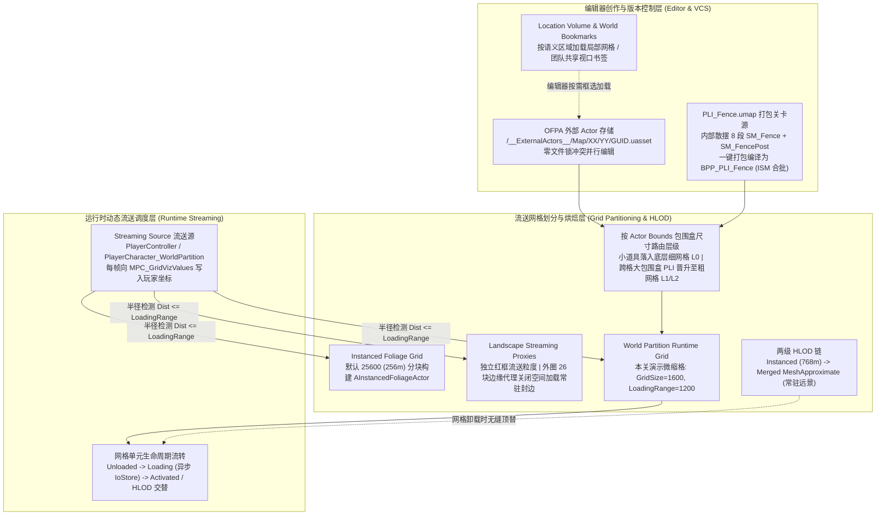

# 07 · `Level_WorldPartitionStreaming`：世界分区自动网格流送与打包关卡实例全解

> **对应工程地图**：`/Game/Maps/Level/Level_WorldPartitionStreaming` + 打包子关卡 `/Game/ExampleContent/Level_WorldPartition/PLI_Fence`  
> **所属领域目录**：`04_Level_世界构建与PCG`  
> **关卡实测规模**：主关卡总 Actor 数 `69`（`12` 座展台 `#1` ~ `#12` + `44` 个示例 Actor） | `PLI_Fence` 打包子关卡总 Actor 数 `22`（`12` 个核心构建 Actor）

---

## 一、 导言：终结手动切分子关卡时代——World Partition 的工业革命

在 UE4 时代开发开放世界（如使用旧版 *World Composition* 或手动 *Level Streaming*）是一场漫长的体力与沟通消耗战：技术美术和关卡策划不得不拿着尺子把一张 $8\text{ km} \times 8\text{ km}$ 的大陆生生切成上百张独立的 `.umap` 子关卡（`Sublevel_A1`, `Sublevel_A2`...）。一旦美术造了一座横跨 `A1` 与 `A2` 交界线的石桥，或者策划想把一座村庄整体往东平移 200 米，团队就会陷入无休止的争论：**“这座桥到底该塞进哪个子关卡？检出（Check-out）`A1.umap` 时为什么把隔壁调灯光的同事锁在门外整整一下午？”**

虚幻引擎 5 推出的 **World Partition（世界分区）** 从根源上重塑了大世界底层存储与运行时流送架构。它用三大核心支柱一次性铲平了传统工作流的所有痛点：
1. **单一持久世界 + OFPA（One File Per Actor，一 Actor 一外部文件）**：全图所有内容逻辑上同属一张主 `.umap`，物理磁盘上却将每一个 Actor 拆解为几 KB 的独立微文件，百人团队在同一座城镇里背靠背改模型也互不抢锁。
2. **2D / 3D 运行时空间哈希网格（Runtime Spatial Hash / RuntimeHashSet）**：无需人工划分任何流送边界，编译器根据每个 Actor 的空间位置与包围盒（Actor Bounds）尺寸，自动将其归入多分辨率四叉树/空间网格单元（Cell），运行时围绕 **流送源（Streaming Source）** 按距离全自动滑入与卸载。
3. **打包关卡实例（Packed Level Instance, `PLI`）与分层 HLOD**：既允许关卡美术将模块化预制建筑（如本关的 `PLI_Fence`）当作独立子世界随时进出精修，又能在主世界中将其自动合并为极少量 `ISM` 实例化组件，配合远景 HLOD 实现从几米到十几公里的无缝视距过渡。

打开 `/Game/Maps/Level/Level_WorldPartitionStreaming`，整座演示馆由 `BP_DemoRoom2` 划分为三大递进空间（`Introduction` 导览厅 $\rightarrow$ `World Partition Editor / Location Volumes` 编辑器实操廊 $\rightarrow$ `World Example` 户外实时网格流送沙盘），共计 **12 座展台**。

### 1.1 World Partition 全链路流送架构图解

为了把本关涉及的 **OFPA、Location Volume、Streaming Source、多分辨率 Cell 晋升、Landscape Streaming Proxy 以及 `PLI_Fence`** 串联成完整的知识网络，请先审视以下核心管线图：

### 1.2 本关专属游戏模式与“脚下流送雷达”材质揭秘

当你按下 Play（PIE）走进 `Level_WorldPartitionStreaming` 的户外草地时，你会惊讶地发现：**脚下的草地表面竟然实时绘制着浅蓝色的世界分区网格线、红色的地形代理边界框，以及一个死死跟随玩家移动的高亮加载半径圆环！** 这套酷炫的可视化系统并非引擎硬编码 C++ Debug 画线，而是由 `/Game/ExampleContent/Level_WorldPartition/` 下的一套完整蓝图 + 后处理着色器驱动：
1. **专属游戏模式 `CE_WP_Game`**：指定自定义控制器与角色 `PlayerCharacter_WorldPartition`，并在屏幕上挂载 `WBP_PlayerHUD_WorldPartition`；
2. **材质参数集 `MPC_GridVizValues`**：定义了三个全局着色器参数——标量 `GridSize = 1600`（16 米微缩演示格）、标量 `Loading Range = 1200`（12 米微缩加载半径）以及向量 `Position`（由玩家角色每帧 Tick 将自身世界坐标写入）；
3. **274 节点后处理材质 `M_WorldPartitionViz`（`MD_PostProcess`）**：读取场景深度还原每个像素的 `WorldPosition`，一方面对 `WorldPosition.XY / GridSize` 执行 `Frac -> Abs` 数学取模画出锐利的浅蓝色世界分区网格；另一方面计算像素到玩家 `Position` 的欧氏距离 `Length(WorldPos - PlayerPos)`，用 `SmoothStep` 勾勒出品红/亮白色动态流送触发圈！

### 1.3 本关 12 座展台 + `PLI_Fence` 全景索引矩阵

| 展台编号 | 展台标题 (`BP_DemoDisplay` 标签) | 空间坐标 `(X, Y, Z)` | 所属展区 | 核心技术机制与关联资产 |
| :--- | :--- | :--- | :--- | :--- |
| **#1** | `World Partition` (`BP_DemoDisplay13`) | `(-2480, -2595, 0)` | `Introduction` | 常驻演示走廊（`Always Loaded`）与微缩网格参数声明 |
| **#2** | `What is World Partition` (`BP_DemoDisplay14`) | `(-1450, -2595, 0)` | `Introduction` | 单持久关卡、空间网格单元（Grid Cells）与流送源（Streaming Source）总纲 |
| **#8** | `One File Per Actor (OFPA)` (`BP_DemoDisplay20`) | `(-1470, -795, 0)` | `Introduction` 对侧 | `__ExternalActors__` 外部文件拆解与多人零锁冲突源码管理机制 |
| **#3** | `Location Volumes` (`BP_DemoDisplay12`) | `(184, -2381, 68)` | `WP Editor` 走廊 | 编辑器专属语义区域标记体积盒 `ALocationVolume` 原理 |
| **#4** | `World Partition Location Volumes` (`BP_DemoDisplay8`) | `(1012, -1820, 0)` | `WP Editor` 走廊 | `Example Location Volume` 实例与 `LandscapeStreamingProxy_0_4_0` 联动演示 |
| **#9** | `World Partition Editor` (`BP_DemoDisplay11`) | `(798, -1222, 68)` | `WP Editor` 对侧 | 2D 世界分区网格编辑器窗口、框选加载单元格与 7 大全局环境单例 |
| **#5** | `Landscape Cells` (`BP_DemoDisplay29`) | `(4405, -2003, 236)` | `World Example` 户外 | 世界分区地形创建预览（`MI_Landscape`）与 `WorldPartitionMiniMapVolume` |
| **#10** | `Landscape Streaming Proxies` (`BP_DemoDisplay30`) | `(2991, -461, 267)` | `World Example` 户外 | 蓝圈流送半径 vs 红框 `LandscapeStreamingProxy` 独立流送与边缘块常驻封边 |
| **#11** | `Instanced Foliage Grid Size` (`BP_DemoDisplay31`) | `(6063, 363, 442)` | `World Example` 户外 | 实例化植被网格粒度（默认 `25600` 厘米）对剔除精度与渲染合批的权衡 |
| **#12** | `Actor Bounds` (`BP_DemoDisplay32`) + **`PLI_Fence`** | `(6669, -1139, 287)` | `World Example` 户外 | 打包关卡实例 `BPP_PLI_Fence` 合并包围盒跨格提前加载 vs 对侧散件独立流送对比 |
| **#6** | `World Bookmarks` (`BP_DemoDisplay34`) | `(9938, -2102, 312)` | `World Example` 远端 | 资产化世界书签（可进 Git/P4 团队共享）与局部 `PostProcessVolume2` |
| **#7** | `Foliage Settings` (`BP_DemoDisplay33`) | `(10621, -1279, 312)` | `World Example` 远端 | 植被类型资产（`FT_DeadTree` / `FT_Flowers` / `FT_Rock`）距离剔除与流送调优 |

*(注：上表展示了沿走廊两侧推进的物理动线，下文将严格按展台编号 **`#1` ~ `#12`** 逐号逐台深度拆解，并在展台 #12 处完整剖析子关卡 `PLI_Fence`。)*

---

## 二、 逐展台（Stand #1 ~ #12）与 `PLI_Fence` 零遗漏深度拆解

### 展台 #1：`World Partition` — 微缩实验场声明与生产级网格起始尺寸

- **展牌标识与空间坐标**：`BP_DemoDisplay13`，位于 `(-2480, -2595, 0)`
- **官方展牌原文**：
  > *"Important Note: The corridors and demo displays are configured to be always loaded. As a result, they will not be streamed during demos, ensuring they remain consistently available. For the purposes of this demo, the grid size and streaming distance have been made much smaller. For an example of an ideal starting streaming size, create a new level and select open world."*
- **展台内陈列的示例 Actor（1 个）**：
  - `DocumentationActor`（`/Script/Engine.DocumentationActor`，坐标 `(-2475, -2296, 100)`）。

#### 深度解析：演示场 `16m` 微缩网格 vs 商业开放世界黄金参数表
为了让你在短短百米长的户外草坪上肉眼看清远方石头与栅栏“随步伐一格一格刷出来又卸掉”的全过程，本关将空间哈希网格特意微缩到了 `Cell Size = 1600`（16 米）、`Loading Range = 1200`（12 米）。**但在真实商业项目中，千万不要照抄这个微缩数值！** 过小的网格会导致流送单元（Streaming Cell）总数爆炸至数十万个，引发严重的 `UWorldPartitionSubsystem` CPU 调度开销与合批碎片化。

打开 UE5 `File -> New Level -> Open World` 标准开放世界模板（或在 `World Settings -> World Partition Setup -> Runtime Settings -> Grids` 中配置），生产级推荐起跑基准如下：

| 网格层级 / 用途 | 推荐 `Cell Size`（单元格边长） | 推荐 `Loading Range`（流送加载半径） | 适用放置的内容类型 |
| :--- | :--- | :--- | :--- |
| **`MainGrid`（默认主网格）** | `12800`（128 米）~ `25600`（256 米） | `25600`（256 米）~ `76800`（768 米） | 常规房屋建筑、中型岩石、道路构件、交互机关、普通 NPC |
| **`SmallPropsGrid`（精细小物件网格，可选拆层）** | `6400`（64 米） | `12800`（128 米） | 桌面瓶罐、室内碎杂物、近景高模摆件（出了 128 米根本看不见，无需占 768 米内存！） |
| **`Vista / HLOD0`（中远景代理层）** | `25600`（256 米）~ `51200`（512 米） | `76800`（768 米）~ `153600`（1.5 公里） | 本关 `Level_WorldPartitionStreaming_HLODLayer_Instanced` 恰好采用 `cellSize = 25600, loadingRange = 76800`！ |

---

### 展台 #2：`What is World Partition` — 空间网格与流送源（Streaming Source）核心机制

- **展牌标识与空间坐标**：`BP_DemoDisplay14`，位于 `(-1450, -2595, 0)`
- **官方展牌原文**：
  > *"World Partition is an automatic data management and distance-based level streaming system that provides a complete solution for large world management. The system removes the previous need to divide large levels into sublevels by storing your world in a single persistent level separated into grid cells, and provides you with an automatic streaming system to load and unload those cells based on distance from a streaming source. Per level settings for World Parttion can be found in Windw / World Settings. Additional Tabs to control world partition can be found in Window / World Partition."*

#### 深度解析：谁有资格充当 `Streaming Source`（流送源）？
World Partition 在运行时并不知道谁是“主角”——它只认向 `UWorldPartitionSubsystem` 注册了流送源接口的对象。在引擎中默认与扩展的流送源有三类：
1. **玩家控制器（`APlayerController`）**：默认开启 `bEnableStreamingSource = true`，自动以玩家当前控制视角（或 Pawn 位置）为圆心加载周围网格。
2. **独立流送源组件（`UWorldPartitionStreamingSourceComponent`）**：这是**远距离狙击镜、无人机侦察、大地图快速传送（Fast Travel）与远程过场镜头**的救命法宝！
   - **经典翻车现场**：主角站在山顶用 16 倍狙击镜瞄准 1.2 公里外的敌军营地，或者过场 Sequencer 镜头突然切到 3 公里外的反派城堡——由于玩家 `PlayerController` 肉身还在原地，3 公里外的网格处于 `Unloaded`，镜头切过去只能看到糊成一团的 HLOD 简模甚至角色悬空下坠！
   - **工业标准解法**：在远程过场摄像机、无人机或传送目标点放置一个挂有 `WorldPartitionStreamingSourceComponent` 的预热 Actor，提前 3 秒调用 `EnableStreamingSource()`，待 `IsStreamingCompleted()` 返回 `true` 后再切镜头或执行 `TeleportTo`！
3. **2D 网格 vs UE 5.3+ `RuntimeHashSet` 3D 网格**：传统 `WorldPartitionRuntimeSpatialHash` 默认在 XY 平面投射 2D 网格（适合广袤地表平原）；若你的开放世界包含**多层地下城溶洞、海底深渊与万米浮空岛**（同一 $(X, Y)$ 上下叠了三层世界），可在 World Settings 中切换至支持 Z 轴切分的 **3D Grid**，避免走在地面时把脚底深渊溶洞的百万面怪物一并塞进内存！

---

### 展台 #3 & 展台 #4：`Location Volumes` — 用语义化地名取代枯燥的网格坐标

- **展台 #3（概念说明台）**：`BP_DemoDisplay12`，位于 `(184, -2381, 68)`，标题 `Location Volumes`
  - **官方展牌原文（#3）**：
    > *"You can use 'Location Volumes' to load and unload regions of your map. These are editor-only volumes placed in the level to mark specific areas in the World Partition window. You can see 'Example Location Volume' in the World Partition Window. Try loading from the World Partition Editor"*
- **展台 #4（实例展示台）**：`BP_DemoDisplay8`，位于 `(1012, -1820, 0)`，标题 `World Partition Location Volumes`
  - **陈列示例 Actor（2 个）**：
    1. `Example Location Volume`（`/Script/Engine.LocationVolume`，坐标 `(400, -1782, 0)`，携带 `BrushComponent0`）：编辑器专属空间书签体；
    2. `LandscapeStreamingProxy_0_4_0`（坐标 `(1916, -1661, 199)`）：包含地形组件 `LandscapeComponent_32`、高度场碰撞及 3 组自动草地组件（`S_Nordic_Coastal_Groundcover` 的 `Var24`、`Var52`、`Var6` 变体）。

#### 深度解析：为什么 `LocationVolume` 是百人关卡团队的“行政区划图”？
打开一张 $64\text{ km}^2$ 的大地图，World Partition 窗口里最初是一片漆黑未加载的网格。如果主美在群里喊一声：*“请大家把坐标 `X=345000, Y=-128000` 附近的铁匠铺灯光改一下”*，没人能凭空找准格子；而如果关卡架构师提前在全图每座城镇、副本入口、Boss 竞技场外围套上一个 **`Location Volume`**（如本关的 `Example Location Volume` 以及展台 #12 处的 `Map Demo Location Volume`），这些体积盒的名字就会直接显示在 World Partition 2D 俯视地图上！
- **零运行时负担**：`ALocationVolume` 源码中硬编码了 `bIsEditorOnlyActor = true`，仅向编辑器注册区域包围盒，打包客户端自动剔除，不耗费 1 字节运行时内存。

---

### 展台 #5：`Landscape Cells` — 世界分区地形切分与编辑器俯视小地图烘焙

- **展牌标识与空间坐标**：`BP_DemoDisplay29`，位于 `(4405, -2003, 236)`
- **官方展牌原文**：
  > *"If your level has World Partition enabled, you can create a landscape specifically designed to work with it. For this demo, the landscape is set to its smallest size. The default settings usually serve as a solid starting point. When creating a landscape with World Partition, you'll get a preview to review before finalizing."*
- **展台内陈列的示例 Actor（2 个）**：
  1. `Plane6`（`StaticMeshActor`，坐标 `(4533, -1877, 471)`）：覆写材质 `MI_Landscape`（母材质 `M_TextureBoard_Master`，贴图 `/Game/ExampleContent/Level_WorldPartition/Textures/T_CreateLandscape`，展示地形创建面板中的 `World Partition Grid Size` 参数）；
  2. `WorldPartitionMiniMapVolume`（`/Script/Engine.WorldPartitionMiniMapVolume`，坐标 `(4830, -1938, 1617)`，携带 `BrushComponent0`）。

#### 深度解析：`WorldPartitionGridSize` 与 `WorldPartitionMiniMapVolume` 的黄金搭档
1. **地形创建的 `World Partition Grid Size` 参数**：在 Landscape Mode 创建地形时，该数值决定了**每多少个 `LandscapeComponent` 打包成一个独立的 `ALandscapeStreamingProxy` 流送代理 Actor**。例如默认值为 `2` 时，每 $2 \times 2 = 4$ 个地形组件生成一个代理文件；本关为了极致演示细粒度流送，将地形设为最小规格（每个 `LandscapeStreamingProxy_X_Y_0` 仅含 `1` 个 `LandscapeComponent`，边长恰为 `1500` 厘米！），整张户外地形共切分为 $8 \times 8 = 64$ 块代理！
2. **为什么场景里躺着一个 `WorldPartitionMiniMapVolume`？** 如果没有小地图背景，你在 `Window -> World Partition` 里只能看到光秃秃的黑底白线格子，根本分不清哪格是河、哪格是山。放置 `WorldPartitionMiniMapVolume` 框住核心可玩区域，并执行菜单 `Build -> Build World Partition Editor Minimap`，引擎就会在后台从高空正交俯拍整片地形与建筑，将生成的虚拟纹理写入全局单例 `WorldPartitionMiniMap` Actor 中，让整个团队在未加载任何 3D 模型的情况下就能在 2D 窗口里看着高清卫星航拍图精准选区！

---

### 展台 #6：`World Bookmarks` — 可纳入 Git / Perforce 版本控制的团队共享书签

- **展牌标识与空间坐标**：`BP_DemoDisplay34`，位于 `(9938, -2102, 312)`
- **官方展牌原文**：
  > *"This location is saved as a World Bookmark. Bookmarks allow you to quickly jump between key areas of the world. Bookmarks are stored as assets and can be shared with the team. You can view bookmarks by going to Window > World Partition > World Bookmarks"*
- **展台内陈列的示例 Actor（1 个）**：
  - `PostProcessVolume2`（`/Script/Engine.PostProcessVolume`，坐标 `(9778, -2291, 730)`）：局部有界后处理盒（`bUnbound = false`, `blendRadius = 100`, `blendWeight = 1`, `priority = 0`），用于为该书签观景点定制专属局部曝光与调色氛围。

#### 深度解析：传统视口快捷键 `Ctrl + 1~9` vs 次世代 `World Bookmark` 资产
老虚幻用户习惯在视口按 `Ctrl + 1` 存机位、按 `1` 跳机位。但在 World Partition 大地图时代，传统快捷键有两个致命缺陷：一是它只存在本地配置文件或主关卡元数据里，没法按功能模块发给同事；二是当你按 `1` 飞到 10 公里外的雪山顶时，**那里的格子根本没加载**，你只能对着空气发呆！

而通过 `Window -> World Partition -> World Bookmarks` 创建的 **`UWorldPartitionBookmark`** 是真正的 `.uasset` 独立资产：
- **状态全快照**：它不仅记录了编辑器摄像机的精准 `Location / Rotation`，还一并保存了当时**哪些 World Partition 区域被加载、哪些 Data Layers 被激活/显示**！
- **一键复现现场**：QA 发现某处山洞穿模，只需保存一个 `BM_Bug_CaveClip` 书签资产提交到 Perforce；美术拉取后双击该书签，编辑器自动跳转到完全一致的镜头角度并自动流送加载该山洞所需网格与图层！

---

### 展台 #7：`Foliage Settings` — 开放世界植被距离剔除与流送协同调优

- **展牌标识与空间坐标**：`BP_DemoDisplay33`，位于 `(10621, -1279, 312)`
- **官方展牌原文**：
  > *"The foliage in this example uses default settings for demo purposes, but you should review and adjust culling settings in the foliage paint tool or the 'Static Mesh Foliage' asset, along with streaming settings, to ensure optimal performance in your project."*
- **本关关联的 3 大植被类型资产（`/Game/ExampleContent/Level_WorldPartition/Foliage/`）**：
  1. `FT_DeadTree`（`FoliageType_InstancedStaticMesh`）：引用枯树网格 `/Game/ExampleContent/Landscapes/Meshes/SM_Dead_Tree`；
  2. `FT_Flowers`（`FoliageType_InstancedStaticMesh`）：引用野花地被 `S_Nordic_Coastal_Groundcover_vlqkdeaja_Var52_lod0`；
  3. `FT_Rock`（`FoliageType_InstancedStaticMesh`）：引用森林层岩 `S_Forest_Rock_Shelf_wjsqdii_lod0_Var1`。

#### 深度解析：“流送卸载”与“硬件距离剔除（Cull Distance）”绝不能混为一谈！
很多初学者以为有了 World Partition 自动卸载远处格子，就不用配 `FoliageType` 里的 `Cull Distance` 了——**这会导致灾难性的渲染过载！**
- **算一笔账**：在真实开放世界中，`MainGrid` 的流送加载半径通常高达 **512 米 ~ 768 米**（为了保证高大枯树 `FT_DeadTree` 和巨石 `FT_Rock` 在半公里外依然清晰可见）。如果不给 15 厘米高的碎野花 `FT_Flowers` 设置 `Cull Distance (Min = 3000, Max = 4500)`（30~45 米渐隐剔除），那么半径 768 米圆域内**全部几百万朵肉眼连 1 个像素都占不到的野花**都会被送入 GPU 光栅化或 Nanite VisBuffer 管线！
- **双层分级黄金法则**：
  - **内存边界由 World Partition `Instanced Foliage Grid` 管控**（决定多少米外释放 `HISM` 实例变换矩阵内存）；
  - **GPU 渲染边界由 `UFoliageType::CullDistance` + `Scalability` 密度缩放管控**（野花碎石 40m 剔除、灌木 120m 剔除、乔木 600m 交接给 `Include in HLOD` 简模！）。

---

### 展台 #8：`One File Per Actor (OFPA)` — 百人团队零锁冲突并行开发的基石

- **展牌标识与空间坐标**：`BP_DemoDisplay20`，位于 `(-1470, -795, 0)`
- **官方展牌原文**：
  > *"In previous versions of Unreal Engine, when you wanted to make changes to one or more Actors inside a Level, you needed to check the file out of source control. This locked other team members out of that file until your work was complete, slowing down the development process since only one person could work on a file at a time. One File Per Actor (OFPA) reduces overlap between users by saving data for instances of Actors in external files, removing the need to save the main Level file when making changes to its Actors. The One File Per Actor feature is enabled by default when using World Partition. To enable OFPA in a non-partitioned world, set 'Use External Actors' to true in World Settings."*

#### 深度解析：`__ExternalActors__` 磁盘哈希目录结构与工程内幕
如果我们在 Windows 资源管理器中查看本工程的 `Content/__ExternalActors__/Maps/Level/Level_WorldPartitionStreaming/` 目录，会发现里面并不是把所有 Actor 平铺在一个文件夹下，而是类似 `0/A/3X9F8K...uasset` 的**两级短哈希目录树**：
1. **为什么要做两级子目录哈希分桶？** 一张大型开放世界地图动辄包含 **30 万 ~ 100 万个外部 Actor 文件**。如果把 50 万个 `.uasset` 直接塞进同一个文件夹，Windows NTFS 文件系统的目录索引树与 Perforce/Git 状态扫描会出现指数级卡死！通过 Actor `FGuid` 哈希分散到两级子目录后，每个末级目录仅有几十到几百个文件，I/O 寻址始终保持 $O(1)$ 极速响应。
2. **非世界分区箱庭关卡也能白嫖 OFPA！** 展牌最后一句点出了一个极实用的技巧：哪怕你做的是传统室内小副本（未开启 World Partition），只要去 `World Settings` 勾选 **`Use External Actors = true`**，引擎就会把当前关卡原地转换为 OFPA 存储——关卡策划摆怪、灯光师打光、环境美术挪箱子从此彻底告别 `.umap` 二进制独占锁！
3. **版本控制提交铁律**：由于磁盘上的文件名是一串无意义的哈希码（如 `74563C31B49F.uasset`），千万不要去外部 Git 客户端里凭文件名瞎猜谁是谁！务必在 **Unreal Editor 内置的 `Revision Control -> Submit Content`（或 `Check Out Modified Files`）面板**中提交，编辑器会自动反查元数据，把哈希路径翻译为可读的 Actor Label（如 `BP_DemoDisplay20`）与所属目录！

---

### 展台 #9：`World Partition Editor` — 2D 网格按需加载工作台与全局环境单例

- **展牌标识与空间坐标**：`BP_DemoDisplay11`，位于 `(798, -1222, 68)`
- **官方展牌原文**：
  > *"The World Partition Editor lets you manage and stream parts of large levels in Unreal Engine. To open it, go to Window > World Partition. Once open, you'll see a grid representing your world. To load a region, click and drag to select an area of the grid, then right-click and choose 'Load Selected Cells'. This helps you work on specific parts of your level without loading the entire world."*
- **归属于展台区域及原点的 7 个全局单例/环境 Actor**：
  1. `WorldDataLayers`（`/Script/Engine.WorldDataLayers`，`(0, 0, 0)`）：本关数据层实例总表宿主；
  2. `WorldPartitionMiniMap`（`/Script/Engine.WorldPartitionMiniMap`，`(0, 0, 0)`）：存储展台 #5 烘焙出的 2D 俯视卫星底图；
  3. `Actor`（携带 `ChaosDebugDrawComponent_0`，`(0, 0, 0)`）：Chaos 物理调试渲染单例；
  4. `DirectionalLight`（`(0, 10, 0)`）：`Intensity = 6`，`Mobility = Movable`，纯白平行主光；
  5. `SkyLight`（`(0, 10, 0)`）：`Intensity = 3`，`Mobility = Movable`；
  6. `SkyAtmosphere`（`(0, 10, 0)`）与 `ExponentialHeightFog`（`(0, 10, 0)`）：全局天空大气与指数高度雾（均关闭空间加载，全图常驻）。

#### 深度解析：高效驾驭 World Partition Editor 的三大快捷键技巧
在大地图日常开发中，打开一张 World Partition 地图时默认是**零网格加载（全空黑屏，秒开编辑器）**。熟练使用 `Window -> World Partition -> World Partition Editor` 能每天省下数小时等待时间：
- **拖拽框选 + 右键 `Load Region from Selection`**：只加载你今天负责精修的那两条街区，32GB 内存开发机也能丝滑跑动百平方公里巨型工程；
- **`Ctrl + Shift + 左键点击` 小地图任意位置**：编辑器三维视口摄像机瞬间空降飞跃至该平面坐标正上方！
- **过滤搜索栏**：直接输入 `Example Location Volume` 或 `Map Demo Location Volume`（展台 #4 与 #12 放置的体积盒），一键聚焦并加载对应业务片区。

---

### 展台 #10：`Landscape Streaming Proxies` — 独立于通用网格的地形红框流送与边缘封边设计

- **展牌标识与空间坐标**：`BP_DemoDisplay30`，位于 `(2991, -461, 267)`
- **官方展牌原文**：
  > *"The light blue grid shows the World Partition streaming cell size, while the circle represents the loading range around the player. The red grid outlines the bounds of each Landscape Proxy. These proxies load independently based on their own setup, not the World Partition streaming cell size; allowing more control over landscape streaming regardless of the general grid configuration. The Landscapes edge cells have had Spatial Loaded disabled and are not affected by streaming."*
- **展台配对及全图地形代理矩阵拆解**：
  - 展台近旁动态流送块：`LandscapeStreamingProxy_0_5_0`（坐标 `(1916, -161, 199)`，含 `LandscapeComponent_40` + 三组北欧海岸草地组件，材质采用 18 节点虚拟纹理地形材质 `/Game/ExampleContent/Level_WorldPartition/Materials/M_Landsacap_WP` 驱动 `LGT_Grass`）；
  - **为什么实测档案第四节列出了整整 26 块未配对的 `LandscapeStreamingProxy`？看一眼它们的行列下标瞬间破案！**
    仔细核对档案第 96~122 行提取出的全局代理坐标下标：
    - 底边行（$Y = 0$）：`0_0_0`, `1_0_0`, `2_0_0`, `3_0_0`, `4_0_0`, `5_0_0`, `6_0_0`, `7_0_0`
    - 顶边行（$Y = 7$）：`0_7_0`, `1_7_0`, `2_7_0`, `3_7_0`, `4_7_0`, `5_7_0`, `6_7_0`, `7_7_0`
    - 左列边（$X = 0$）：`0_1_0`, `0_2_0`, `0_3_0`, `0_4_0`, `0_5_0`, `0_6_0`
    - 右列边（$X = 7$）：`7_1_0`, `7_2_0`, `7_3_0`, `7_4_0`, `7_5_0`, `7_6_0`
    这 $8 + 8 + 6 + 6 = 28$ 块正好拼成了整块 $8 \times 8$ 地形棋盘**最外围的一圈“回字形边框”**！正如展牌原文最后一句所揭示：Epic 关卡设计师特意把最外圈地形代理的 **`Is Spatially Loaded` 全部设为 `False`（常驻不卸载）**，从而为沙盘围出一圈永不破洞的山脊地平线边框；而棋盘内部 `1_1_0` ~ `6_6_0` 共 $6 \times 6 = 36$ 块中心地形代理则开启空间流送，当你漫步其间时，脚下红框外的内部地形块会真实地动态加载与卸载！

#### 深度解析：为什么地形代理（红框）不直接复用通用网格（浅蓝框）？
地表起伏山体是整个世界最底层的视觉承托面与物理地面。通常道具（浅蓝框）可以在 256 米外卸载，但地形山峦（红框）往往需要在 `LandscapeGrid`（专门为 `ALandscapeStreamingProxy` 设立的独立 Runtime Grid）中配置 **768 米 ~ 1500 米** 的超远加载半径，或者采用 `256m ~ 512m` 的大块代理边长以减少地形 Draw Call 与碰撞组件注册次数。将地形流送网格与常规 Actor 网格解耦，赋予了技术美术独立微调“地表视距”与“建筑道具视距”的绝对自由！

---

### 展台 #11：`Instanced Foliage Grid Size` — 256 米植被分块与剔除合批博弈

- **展牌标识与空间坐标**：`BP_DemoDisplay31`，位于 `(6063, 363, 442)`
- **官方展牌原文**：
  > *"The 'Instanced Foliage Grid Size' sets the size of the grid cells used to manage and render foliage. Smaller grid sizes give you finer control over culling and loading, but they can be heavier on performance. Larger grid sizes are more efficient but might not be as precise when it comes to culling. It's all about finding the right balance for your project. For this demo, the settings are left at the default '25600' grid size. You can adjust this in the Project Settings if needed. The Instanced Foliage Grid Size is visualized as the blue grid on the floor."*

#### 深度解析：`InstancedFoliageGridSize = 25600` 背后的 `IFA` 分片原理
在旧版单关卡中，你用植被笔刷（Foliage Mode）在全图刷下的 50 万棵树，全都塞在**唯一一个** `AInstancedFoliageActor`（简称 `IFA`）肚子里——一旦保存就锁死全图，一旦加载就全图上内存！

开启 World Partition 后，引擎按照 `World Settings -> Instanced Foliage Grid Size`（默认 **`25600` 厘米 = 256 米**，地面由深蓝色贴花 `M_WS_GridFoliage_Decal_Inst` 投射标出）：
- 每 $256\text{ m} \times 256\text{ m}$ 自动切分出一个独立的 `AInstancedFoliageActor_X_Y` 外部 OFPA 文件！张三在北边森林刷树只签出 `IFA_0_3`，李四在南边海滩刷草只签出 `IFA_0_-2`，多人刷草彻底告别冲突！
- **尺寸调优博弈表**：
  - **调得太小（如 `< 6400`，64 米）**：虽然流送进出内存的边界更精细，但玩家视野内同时存在上百个碎小的 `IFA`，每个 `IFA` 内部的每种树都要单独建立一个 `UHierarchicalInstancedStaticMeshComponent (HISM)`，导致同一种松树无法跨格子合批（Draw Call 激增数倍），且磁盘 OFPA 文件数暴涨！
  - **调得太大（如 `> 51200`，512 米）**：合批极佳、Draw Call 极低，但玩家只要刚蹭到一个 512 米大格子的边缘，整片 $0.26\text{ km}^2$ 的几十万株植被实例数据就会一口气冲进内存！因此 **`12800` ~ `25600`（128m ~ 256m）** 是绝大多数 3A 开放世界的黄金甜点值。

---

### 展台 #12：`Actor Bounds` 与打包关卡实例 `PLI_Fence` 完全拆解

- **展牌标识与空间坐标**：`BP_DemoDisplay32`，位于 `(6669, -1139, 287)`
- **官方展牌原文**：
  > *"This Packed Level Instance shows how combined mesh bounds load across multiple cells. Compare it to the individual meshes on the opposite side of the road, which load separately based on their own bounds."*
- **主关卡展台 #12 陈列的示例与贴花 Actor（3 个）**：
  1. `Map Demo Location Volume`（`/Script/Engine.LocationVolume`，坐标 `(7364, -1656, 1445)`）：框定本演示路段的编辑器位置体积；
  2. `FOliage Grid Size`（`DecalActor`，坐标 `(7551, -926, 467)`）：投射深蓝材质实例 `M_WS_GridFoliage_Decal_Inst`（`Grid Size = 25600`，`Line Color = (0, 0.017, 1)`，标识 256m 植被大网格边界）；
  3. `FOliage Grid Size2`（`DecalActor`，坐标 `(7551, -926, 467)`）：投射鲜红材质实例 `M_WS_Grid_Decal_Inst`（`Grid Size = 1500`，`Line Color = (1, 0, 0.073)`，对齐 15m 级局部网格参考线）。

#### 子关卡深拆：`/Game/ExampleContent/Level_WorldPartition/PLI_Fence` 内部到底装了什么？
顺着展台 #12 展牌所指的道路两侧观察：马路一侧摆放的是散装栅栏对比蓝图/网格（`BP_FenceBounds`，携带半透明包围盒可视化网格 `SM_BoundsVisulizer`），而另一侧摆放的则是打包关卡实例蓝图 **`/Game/ExampleContent/Level_WorldPartition/BPP_PLI_Fence`**，其数据源正是子关卡 **`/Game/ExampleContent/Level_WorldPartition/PLI_Fence`**！

根据实测档案 `PLI_Fence_dossier.md` 提取的数据，打开 `PLI_Fence.umap` 源关卡（共 22 个原始 Actor，其中 12 个核心构件）可见其内部完整装配表：

| 序号 | 子关卡内 Actor 名称 | 类型 (`Class`) | 局部相对坐标 `(X, Y, Z)` | 局部旋转 `Pitch / Yaw` | 工程职责 |
| :--- | :--- | :--- | :--- | :--- | :--- |
| 1 ~ 8 | `SM_Fence`, `SM_Fence2` ~ `SM_Fence7` | `StaticMeshActor` | 从 `(-927, 126, 129)` 蜿蜒排布至 `(645, -13, 50)` | 随坡度微调 `Yaw = 0° ~ -20°`, `Pitch = 0° ~ 4.93°` | 8 段首尾相连、总跨度长达 **约 18 米（> 1600cm 单元格尺寸！）** 的模块化木栅栏（`/Game/ExampleContent/DataLayers/Meshes/SM_Fence`） |
| 9 | `SM_FencePost` | `StaticMeshActor` | `(876, -121, 23)` | `(0, 0, 0)` | 末端收口木桩（`SM_FencePost`） |
| 10 | `TriggerBox` | `TriggerBox` | `(-570, 500, 357)` | `(0, 0, 0)` | 子关卡内测试触发盒（证明 PLI 源关卡可包含逻辑体积，但打包为 `APackedLevelActor` 时仅提取静态网格合并为 `ISM`！） |
| 11 ~ 12 | `WorldDataLayers`, `WorldPartitionMiniMap`, `Actor` | 系统默认单例 | `(0, 0, 0)` | `(0, 0, 0)` | 独立世界容器自带的基础框架单例 |

#### 核心顿悟：为什么合并成 `PLI_Fence` 后流送时机彻底变了？（“大包围盒层级晋升效应”）
这是整个 `Level_WorldPartitionStreaming` 最具含金量的实战架构考点！请对比马路两边的现象：
1. **马路对侧的散装栅栏（Individual Meshes）**：8 段栅栏是 8 个独立的 `StaticMeshActor`，每段长仅约 `2.8 米`（远小于 `16 米` 的网格边长）。因此它们各自落入底层最精细的 $L_0$ 小格子里——当你顺着马路往前走时，加载圆圈扫到第 1 格刷出第 1 段栅栏，再走两步扫到第 2 格才蹦出第 2 段栅栏，整排栅栏像多米诺骨牌一样一段一段零碎蹦出来，且占用 8 个独立 OFPA 文件与多次 Draw Call！
2. **马路本侧的打包关卡实例（`BPP_PLI_Fence`）**：
   - **渲染合批收益**：在编辑器选中这 8 段栅栏与木桩右键执行 `Level -> Create Packed Level Actor` 生成 `BPP_PLI_Fence` 后，8 段 `SM_Fence` 被自动压合进同一个 `UInstancedStaticMeshComponent`，Draw Call 从 8 次骤降为 **1 次**！同时美术随时可以点击 Details 面板的 **`Edit`** 按钮进入 `PLI_Fence` 独立视口微调第 4 段栅栏的角度，退出保存后全场所有引用该 PLI 的营地自动同步刷新！
   - **流送网格晋升（Hierarchical Grid Promotion）与巨型包围盒双刃剑**：因为 `BPP_PLI_Fence` 是一个单一的整体 Actor（`bIsSpatiallyLoaded = true`），它的 **合体包围盒（Combined Actor Bounds）** 长达 **18 米以上**，一脚横跨了好几个微缩网格单元！在 World Partition 的四叉树哈希算法中：
     - **优势**：一旦玩家加载圆环触碰到这排大包围盒覆盖的边缘（或者该 Actor 因跨格被晋升至上一级更大尺度的父网格 $L_1$），**整排 8 段栅栏会在更远处一次性完整加载显现**，绝不会出现“栅栏断成半截”的穿帮画面！
     - **致命反面教材（千万别犯！）**：正因为 PLI 使用**整体合并包围盒**判定流送，曾有新手美术图省事，把环绕整座主城长达 **4 公里** 的城墙或横跨半张地图的 200 盏路灯全打进了**同一个** `Packed Level Instance`！结果这个巨无霸 PLI 的包围盒覆盖了整张地图，直接被晋升到了四叉树最顶层根节点——导致玩家哪怕躲在地图最偏远的角落，也得把全图 4 公里的城墙全扛在内存里，**彻底废掉了空间流送**！

> [!IMPORTANT]
> **Packed Level Instance (PLI) 封装粒度黄金准则**：
> **“一栋房子一个 PLI，一座哨塔一个 PLI，一段 20~50 米长的院墙一个 PLI——绝不跨街区打包！”** 保持单个 PLI 的包围盒对角线控制在 `MainGrid Cell Size`（如 `128m`）的 $1/4 \sim 1/2$ 以内，才能同时吃满 `ISM` 单次 Draw Call 合批红利与 World Partition 精细空间卸载红利！

---

## 三、 开放世界流送性能诊断与生产级调优清单

在完成 `Level_WorldPartitionStreaming` 全部 12 座展台与 `PLI_Fence` 的拆解后，我们将大型开放世界项目上线前必查的流送调优要点浓缩为一份工程核查表：

1. **检查意外的“巨型包围盒晋升（Bounds Bloat）”**：
   - 在编辑器打开 `Window -> World Partition`，或在 PIE 输入 `wp.Runtime.ToggleDrawRuntimeHash2D`。如果发现大量本该在 256m 卸载的小物件竟然跑进了 `L3 / L4` 顶层巨型网格，立即排查是谁把相隔几公里的两个灯笼合并成了一个 Actor / PLI！
2. **远程切镜与传送门流送阻塞保护**：
   - 凡涉及大跨度 `TeleportTo`、重生点复活或 Sequencer 跨区切镜，严禁直接瞬移角色；务必先在目标点激活 `WorldPartitionStreamingSourceComponent`（或保持 Loading 黑幕），轮询 `UWorldPartitionSubsystem::IsStreamingCompleted()` 通过后再揭幕，彻底根除“角色比地面先到、掉出世界 KillZ”的恶性线上事故。
3. **地形、植被与静态网格的三轨网格对齐**：
   - 推荐保持整数倍对齐关系：例如 `MainGrid CellSize = 12800 (128m)`、`Instanced Foliage Grid Size = 25600 (256m = 2×128m)`、`HLOD0 CellSize = 25600 (256m)`、`Landscape Streaming Proxy = 256m × 256m`。规整的 2 的幂次对齐能让玩家跨越区块边界时异步 I/O 负载平滑均摊，避免多套非对齐网格在同一帧叠加爆发流送尖峰（Streaming Hitch）！

---

> **下一篇预告**：至此，我们已经用 **World Partition** 搭起了百平方公里无缝流送的骨架，用 **Data Layers** 赋予了它跨时空切换的灵魂。但谁来在这片广袤大地上种满百万棵层次分明的森林、沿着起伏山路自动铺出避让岩石的木栅栏、甚至在青铜雕像肩头自动积满向上生长的青苔？下一章压轴巨献——**[08 · `Level_PCG`：程序化内容生成图节点与空间点云算子全解（33 座展台 100% 逐台深拆）](./08_Level_PCG_程序化内容生成图节点与空间点云算子全解.md)**，带你彻底征服虚幻引擎最强大的程序化造景武器！
