# 08 · `Level_PCG`：程序化内容生成图节点与空间点云算子全解

> **对应工程地图**：`/Game/Maps/Level/Level_PCG`  
> **所属领域目录**：`04_Level_世界构建与PCG`  
> **关卡实测规模**：总 Actor 数 `103` | 展台数 **`33`（`#1` ~ `#33` 100% 逐号逐台零遗漏深拆）** | 示例交互与环境 Actor 数 `56` | 核心拆解 `PCGGraph` 资产 `23` 张 + 交互蓝图 `8` 套

---

## 一、 导言：从“手工种树苦力”到“空间点云规则编排”的造景革命

在传统 3D 游戏工业管线中，环境美术（Environment Artist）最痛苦的噩梦莫过于**“返工连锁反应”**：当你花费两周时间用植被笔刷在一片 $4\text{ km}^2$ 的山谷里精心刷好了十万棵松树、蕨类、碎石与木栅栏后，关卡策划突然跑过来说：*“山谷中间的泥土小路太直了，我刚把路往北挪了 8 米，顺便在坡顶加了两块巨石掩体。”* —— 瞬间，新路面中央长满了穿模的大树，原本路面留出的空地秃成一条死板的黄土带，木栅栏悬在了半空，美术只能含泪拿着橡皮擦重刷三天！

虚幻引擎 5 原生内置的 **PCG（Procedural Content Generation Framework，程序化内容生成框架）** 彻底终结了这种破坏性（Destructive）手工堆砌历史。与离线 DCC 工具（如 Houdini 导出静态烘焙包，改一根线条需重新经历漫长的跨软件导出导入）互补，UE5 PCG 直接扎根于引擎运行时与编辑器世界上下文之中：**策划拖动样条线（Spline）或挪动一块石头松开鼠标的那 0.1 秒内，PCG 依赖图立刻增量重算，自动挖空新路面的草木、贴合新坡度重排木栅栏、并在巨石根部重新聚拢一圈喜阴蕨类！**

打开 `/Game/Maps/Level/Level_PCG`，整座长达 **206 米**（X 轴从 `0` 跨越至 `20629`）的恢弘展馆由 `BP_DemoRoom` 串联起 **五大递进式主题展厅**，共计 **33 座展台**，从最原子的单点创建一直演进到集地形图层、距离场、空间布尔差集、样条围栏与三维网格花艺雕塑于一体的终极自然生态山谷！

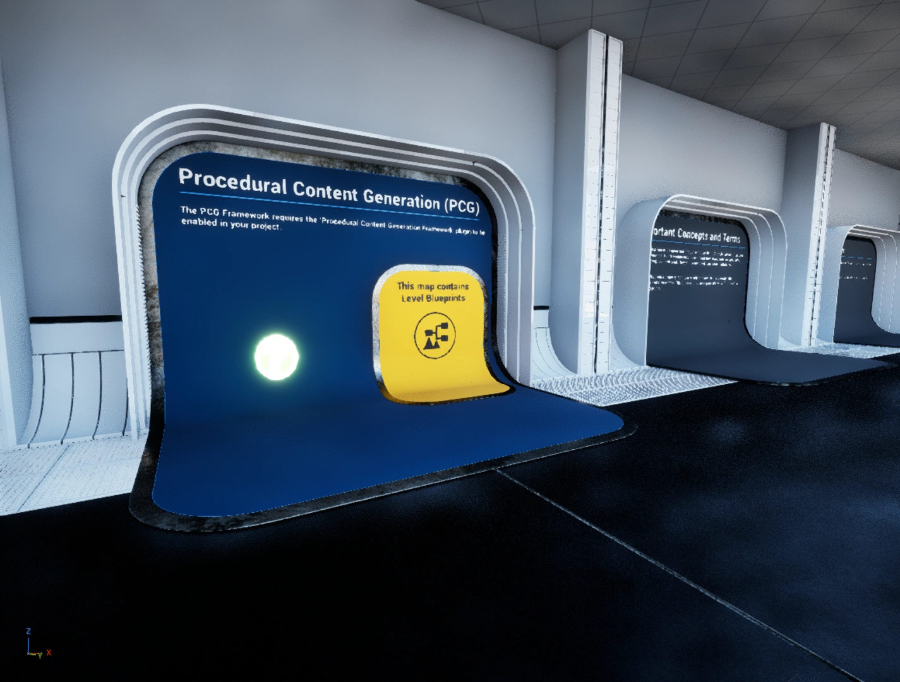

### 1.1 彻底参透 PCG 的第一性原理：`FPCGPoint` 空间点云数据流

很多初学者第一次点开复杂的 `PCGGraph` 时容易被几十种算子绕晕。其实，你只需要在脑海中建立一条铁律，所有 PCG 节点的行为都将变得像搭积木一样透明：

> **PCG 图表里流淌的核心介质不是沉重的网格顶点，而是轻量级的“带属性空间点云（`UPCGPointData` / `TArray<FPCGPoint>`）”！一切采样器（Sampler）本质上都是“无中生有造点的水龙头”；一切过滤器与布尔算子（Filter / Difference / Projection）本质上都是“改写点属性或筛除不合格点的筛子”；直到管线最末端的 `Static Mesh Spawner`，幸存下来的点才会真正实例化为渲染网格！**

在引擎 C++ 源码（`PCGPoint.h`）中，每一个 `FPCGPoint` 实例天然携带 **8 个核心内置系统属性**（在图表中以 **`$` 前缀** 直接访问，如 `$Position.Z`、`$Density`、`$Extents`），并可通过 `MetadataEntry` 键挂载任意数量的**用户自定义元数据属性（Metadata Attributes）**：

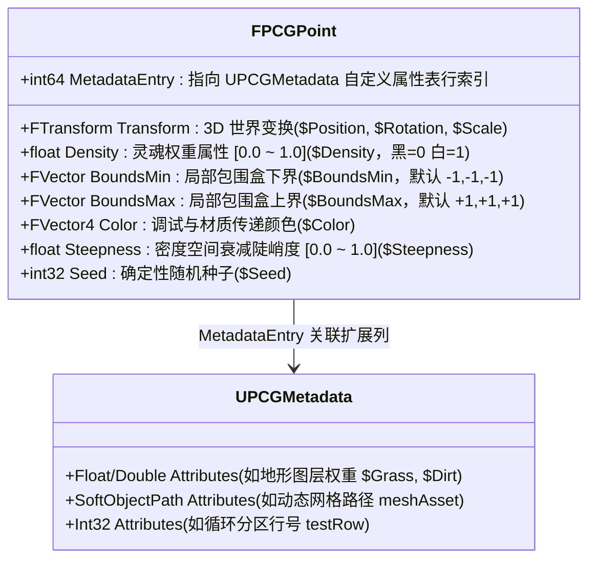

请特别留意 **`$Steepness`（陡峭度）** 与 **`$BoundsMin/Max`（点包围盒）** 这对孪生概念——理解了它们，你就读懂了 PCG 空间布尔运算（`Difference` / `Intersection` / `Self Pruning`）的全部数学秘密：
- 在 PCG 中，一个点并不是无穷小的几何奇点，而是一个具有三维体积（由 `Transform` 缩放后的 `[BoundsMin, BoundsMax]` 决定）的**模糊空间场核（Spatial Kernel）**！
- 当 `Steepness = 1.0` 时，该点的密度场是一个边界硬朗的方盒子（盒内密度恒为 `Density`，盒外瞬间跌落为 `0`）；当 `Steepness = 0.5`（如本关 `PCG_SampleSurface` 所设）时，密度从中心向边缘呈平滑线性坡度衰减！这正是 `Difference` 差集节点既能“一刀切硬挖空路面”，又能“在路边做出自然稀疏过渡带”的数学根基！

### 1.2 展馆五大物理空间与 `#1 ~ #33` 展台完整映射导览图

需要特别提醒读者注意：在本工程底层的 `BP_DemoDisplay` 实例序列中，展台编号 `#1 ~ #33` 是按关卡序列化顺序索引的，而展馆沿 `+X` 轴的物理空间被划分为 **5 座大房间**。为了让既想“按展厅漫步顺序系统学习”又需“按 `#1 ~ #33` 编号精准检索”的开发者都能一目了然，我们先给出空间拓扑总图与全量 33 台速查表，随后在第二章严格按 **`#1` $\rightarrow$ `#33`** 逐号逐台深拆到底！

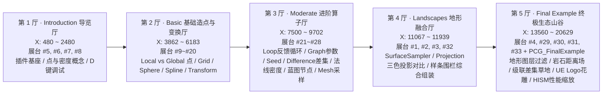

| 展台号 | 展台标题 (`BP_DemoDisplay` 标识) | 坐标 `(X, Y, Z)` | 物理展厅 | 绑定核心 `PCGGraph` / 蓝图资产 |
| :--- | :--- | :--- | :--- | :--- |
| **#1** | `Surface Sampler ` (`BP_DemoDisplay14`) | `(11067, -1268, 3)` | 第 4 厅 `Landscapes` | `Basic/PCG_SampleSurface` |
| **#2** | `Surfaces and Landscape` (`BP_DemoDisplay15`) | `(11489, -1336, -1)` | 第 4 厅 `Landscapes` | `Landscape3`（地形区总标题展台） |
| **#3** | `Projections` (`BP_DemoDisplay16`) | `(11939, -1268, 3)` | 第 4 厅 `Landscapes` | `Moderate/PCG_NoProjection`, `PCG_Projection`, `PCG_ProjectionRotations` |
| **#4** | `Distance Node` (`BP_DemoDisplay30`) | `(19051, -1854, 460)` | 第 5 厅 `Final Example` | `Moderate/PCG_FinalExample`（岩石基座距离场聚拢植被） |
| **#5** | `Procedural Content Generation (PCG)` (`BP_DemoDisplay1`) | `(480, -871, -1)` | 第 1 厅 `Introduction` | `PCGWorldActor0`, `PCG Documentation` |
| **#6** | *(无标题副牌 · 关卡蓝图提示)* (`BP_DemoDisplay26`) | `(621, -844, 7)` | 第 1 厅 `Introduction` | `M_LevelBlueprintIcon` + 关卡蓝图 `Level_PCG_C` |
| **#7** | `Important Concepts and Terms` (`BP_DemoDisplay2`) | `(1480, -900, -1)` | 第 1 厅 `Introduction` | `Points` 与 `Density [0..1]` 核心概念定义 |
| **#8** | `Debug Nodes` (`BP_DemoDisplay3`) | `(2480, -900, -1)` | 第 1 厅 `Introduction` | `D` 键单节点可视化调试与 `StaticMeshSpawner` 模拟 |
| **#9** | `Create Points` (`BP_DemoDisplay4`) | `(4030, -900, -1)` | 第 2 厅 `Basic` | Local Space 局部空间创建点母标题台 |
| **#10** | *(无标题右翼台 · 局部双点)* (`BP_DemoDisplay6`) | `(4194, -895, 7)` | 第 2 厅 `Basic` | `Basic/PCG_CreatePointsLocallyMultiple` |
| **#11** | *(无标题左翼台 · 局部单点)* (`BP_DemoDisplay5`) | `(3862, -895, 7)` | 第 2 厅 `Basic` | `Basic/PCG_CreatePointsLocally` |
| **#12** | `Create Points Grid` (`BP_DemoDisplay10`) | `(4015, 895, -1)` | 第 2 厅 `Basic` | `BP_PCG_Grid` + `Basic/PCG_CreatePointsGrid_BP` + 双滑块 |
| **#13** | *(无标题左翼台 · 全局单点)* (`BP_DemoDisplay8`) | `(4837, -895, 7)` | 第 2 厅 `Basic` | `Basic/PCG_CreatePointsGlobal` |
| **#14** | `Create Points` (`BP_DemoDisplay9`) | `(5005, -900, -1)` | 第 2 厅 `Basic` | Global Space 世界绝对空间创建点母标题台 |
| **#15** | *(无标题右翼台 · 全局双点)* (`BP_DemoDisplay7`) | `(5169, -895, 7)` | 第 2 厅 `Basic` | `Basic/PCG_CreatePointsGlobalMultiple` |
| **#16** | `Create Points Sphere` (`BP_DemoDisplay12`) | `(5015, 895, -1)` | 第 2 厅 `Basic` | `BP_PCG_Sphere` + `Basic/PCG_CreatePointsSphere` + 三滑块 |
| **#17** | `Closed Loop` (`BP_DemoDisplay24`) | `(5787, -895, 7)` | 第 2 厅 `Basic` | `BP_SplineSampler_PointsClosed` + `Basic/PCG_SplineSampler_Basic` |
| **#18** | `Spline Sampler` (`BP_DemoDisplay23`) | `(5988, -900, -1)` | 第 2 厅 `Basic` | 样条采样器母标题台（统领 #17 闭合内部与 #19 沿线采样） |
| **#19** | `Along Spline` (`BP_DemoDisplay25`) | `(6183, -895, 7)` | 第 2 厅 `Basic` | `BP_SplineSampler_PointsAlong` + `Basic/PCG_SplineSampler_BasicAlong` |
| **#20** | `Transform Points` (`BP_DemoDisplay13`) | `(5978, 895, -1)` | 第 2 厅 `Basic` | `BP_PCG_TransformPoints` + `Basic/PCG_CreatePointsSphere_Transform` |
| **#21** | `Loop and Maths` (`BP_DemoDisplay17`) | `(7505, -900, -1)` | 第 3 厅 `Moderate` | `Basic/PCG_Maths` + 子图 `Basic/PCG_Loop_exponentiallyScale` |
| **#22** | `Graph Parameters` (`BP_DemoDisplay11`) | `(7500, 876, -4)` | 第 3 厅 `Moderate` | `Basic/PCG_GraphParameters`（`PCGMeshSelectorByAttribute`） |
| **#23** | `Seed` (`BP_DemoDisplay18`) | `(8486, -900, -1)` | 第 3 厅 `Moderate` | `Basic/PCG_Seed` + 关卡蓝图每秒动态刷新随机种子 |
| **#24** | `Difference` (`BP_DemoDisplay19`) | `(8487, 876, -1)` | 第 3 厅 `Moderate` | `Basic/PCG_Difference` + 动态球体标签挖空交互 |
| **#25** | `Normal to Density` (`BP_DemoDisplay22`) | `(9294, 874, 7)` | 第 3 厅 `Moderate` | `Basic/PCG_MeshSample_NormalToDesnity`（雕像顶面长草） |
| **#26** | `Execute Blueprint` (`BP_DemoDisplay27`) | `(9509, -900, -1)` | 第 3 厅 `Moderate` | `Moderate/PCG_ExecuteBlueprint` + 自定义节点 `BP_GetMeshSockets` |
| **#27** | `Mesh Sampler` (`BP_DemoDisplay21`) | `(9702, 874, 7)` | 第 3 厅 `Moderate` | `Basic/PCG_MeshSample`（雕像三角面体素点云采样 + `SelfPruning`） |
| **#28** | `Sampling Meshes` (`BP_DemoDisplay20`) | `(9500, 876, -1)` | 第 3 厅 `Moderate` | 网格采样母标题台 + `WindDirectionalSource` 动态风场 |
| **#29** | `Attribute Filter` (`BP_DemoDisplay33`) | `(13560, -470, 422)` | 第 5 厅 `Final Example` | `M_Landscape_PCG_Inst` 图层权重过滤（`Grass` 长草 / `Dirt` 铺石） |
| **#30** | `Optimization` (`BP_DemoDisplay29`) | `(15637, -951, 474)` | 第 5 厅 `Final Example` | `FoliageInstancedStaticMeshComponent` + `Density Scaling` 画质分级 |
| **#31** | `Grass` (`BP_DemoDisplay32`) | `(15869, 698, 485)` | 第 5 厅 `Final Example` | `Moderate/PCG_FinalExample` 多源级联 `Difference` 草地防穿模 |
| **#32** | `Combining Methods` (`BP_DemoDisplay28`) | `(11525, 1312, -1)` | 第 4 厅 `Landscapes` 对侧 | `BP_PCG_Rails` + `Moderate/PCG_Fence`（样条栅栏+差集开门+地形投影） |
| **#33** | `Mesh Sampler` (`BP_DemoDisplay31`) | `(19829, 1923, 811)` | 第 5 厅 `Final Example` 山巅 | `UELogo` 巨型虚幻徽标花艺网格采样与自剪枝压轴雕塑 |

---

## 二、 逐展台（Stand #1 ~ #33）零遗漏深度拆解

### 展台 #1：`Surface Sampler`（地形展区 · 表面点云采样与密度梯度）

- **展牌标识与空间坐标**：`BP_DemoDisplay14`，位于 `(11067, -1268, 3)`（第 4 厅 `Landscapes` 左翼）
- **官方展牌原文**：
  > *"Generate points on a sampled surface, in this case Landscape Data. Spawned points have a density value given. These are represented from the Black and White colors, where Black is 0 and White is 1. Applying a Density Filter will allow you to cull a range of points based on their density."*
- **展台内陈列的示例 Actor（2 个）**：
  1. `Landscape`（`/Script/Landscape.Landscape`，坐标 `(10717, -570, 25)`）：承载单块起伏微型地形 `LandscapeComponent_0`；
  2. `PCG_SampleSurface`（`PCGVolume`，坐标 `(11052, -855, 242)`）：`generationTrigger = GenerateOnLoad`，`seed = 42`，实例化组件 `ISM_PCG_Cube_2`（网格 `PCG_Cube`，覆写调试绿材质 `/PCG/DebugObjects/PCG_DebugGreen`）。

#### 真实 `PCGGraph` 拓扑全解：`/Game/ExampleContent/PCG/PCGs/Basic/PCG_SampleSurface`
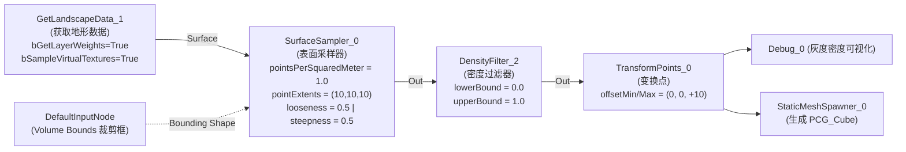
- **核心算子参数深挖**：
  1. **`Points Per Squared Meter = 1.0`**：决定采样基准分辨率（每平方米生成 1 个候选网格格心）。
  2. **`Looseness = 0.5`（松散度抖动）**：若设为 `0.0`，所有点将像阅兵方阵一样死板排列在规整网格中心；设为 `0.5 ~ 1.0` 时，每个点会在自身所属网格单元内根据随机种子做抖动偏移（Jittered Grid Sampling），瞬间呈现自然无规律散布感，同时又不像纯白噪声那样扎堆重叠！
  3. **为什么不直接输出，中间还要串一个 `TransformPoints (Z + 10)`？** 因为 `PCG_Cube` 的轴心在中心或底部，微抬 `10cm` 可避免调试方块与起伏地形斜面发生半截穿插遮挡。

---

### 展台 #2：`Surfaces and Landscape`（地形展区总领展台）

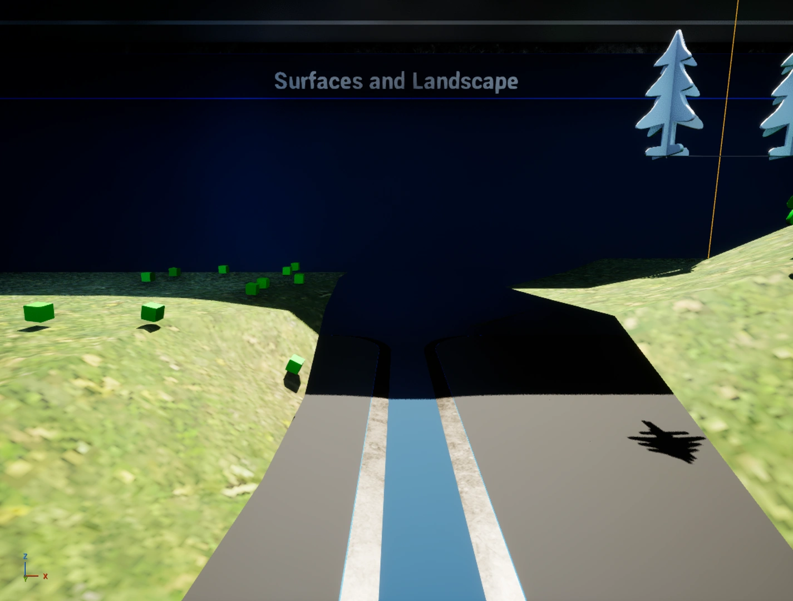

- **展牌标识与空间坐标**：`BP_DemoDisplay15`，位于 `(11489, -1336, -1)`（宽度达 `18.07m` 的巨幅联排母展台，左拥展台 #1 `Surface Sampler`，右揽展台 #3 `Projections`）
- **展台内陈列的示例 Actor（1 个）**：
  - `Landscape3`（`/Script/Landscape.Landscape`，坐标 `(11597, -570, 25)`）：横贯第 4 厅北侧的起伏山丘实验台基底，供观察地形高程差与表面法线倾角对点云的影响。

#### 深度解析：`Get Landscape Data` 相比通用 `World Ray Hit Query` 的压倒性性能优势
在 PCG 中采样地面有两种途径：一是用 `World Ray Hit Query`（物理射线向下打碰撞），二是用本展区演示的 **`Get Landscape Data`**。在百平方公里开放世界中，**只要目标是 `ALandscape`，永远优先用 `Get Landscape Data`**！原因在于它无需唤醒繁重的 Chaos 物理场景做三角形射线求交，而是直接从引擎内存中的 **地形高度场缓存（Landscape Heightfield Cache / Grass Map）** 以 $O(1)$ 双线性插值直接读取高度 $Z$、表面法线 $\vec{N}$ 以及各绘制图层的混合权重（Paint Layer Weights）！

---

### 展台 #3：`Projections`（空间投影算子 · 位置贴地与法线旋转控制）

- **展牌标识与空间坐标**：`BP_DemoDisplay16`，位于 `(11939, -1268, 3)`
- **官方展牌原文**：
  > *"Project points to landscape using the 'Landscape Data' and 'Projection' nodes. White = No Projection | Green = Project Location and Rotation | Orange = Project Location Only"*
- **展台内陈列的示例 Actor（4 个，并排架设在起伏地形上方的三条样条线）**：
  1. `PCG_NoProjection`（`PCGVolume`）与悬空白色参考点链：绑定图表 `Moderate/PCG_NoProjection`（无 `Projection` 节点，点集悬停在样条线原始半空高度）；
  2. `BP_SplineSampler_Projection` 与 `BP_SplineSampler_Projection2`（坐标 `Y = -915` 与 `Y = -775`）：实例化绿色玩具树 `SM_Toy_Tree`（`PCG_DebugGreen`），绑定图表 **`Moderate/PCG_Projection`**；
  3. `BP_SplineSampler_Projection3`（坐标 `Y = -582`）：实例化橙色玩具树 `SM_Toy_Tree`（`PCG_DebugOrange`），绑定图表 **`Moderate/PCG_ProjectionRotations`**。

#### 真实 `PCGGraph` 三路对比拆解与“官方命名乌龙提示”
对比 `Moderate/` 目录下的三张同源图表（主干均为 `GetSplineData_1 [Tag: Spline] -> SplineSampler_2 [OnSpline, subdivisionsPerSegment=3] -> BoundsModifier_0 -> [Projection] -> TransformPoints_1 -> StaticMeshSpawner_3`）：

| 视觉颜色编码 | 对应蓝图实例 / 图表资产 | `Projection` 节点参数 (`projectionParams`) | 几何行为与真实造景适用对象 |
| :--- | :--- | :--- | :--- |
| **白色 (White)** | `Moderate/PCG_NoProjection` | *(未接入 `Projection` 节点)* | 点严格停留在半空 Spline 曲线上 $\rightarrow$ **高架桥、空中索道、悬挂彩旗电线** |
| **绿色 (Green)** | `Moderate/PCG_Projection` | 默认全开：`bProjectPositions = True`, **`bProjectRotations = True`** | 点沿 $-Z$ 拍落贴合地形表面，且点的 $+Z$ 轴**随山坡法线歪斜** $\rightarrow$ **贴地碎石、枯枝落叶、灌木草皮、匍匐藤蔓** |
| **橙色 (Orange)** | `Moderate/PCG_ProjectionRotations` | 显式覆写：`bProjectPositions = True`, **`bProjectRotations = False`** | 点沿 $-Z$ 落到坡面上，但**保持绝对竖直向上（抗重力生长）** $\rightarrow$ **高大乔木（松树永远向天直立生长，绝不垂直于 45° 斜坡歪长！）、路灯杆、木栅栏桩（见展台 #32）** |

> [!NOTE]
> **源码资产阅读防坑提示**：Epic 美术在保存资产时闹了一个小乌龙——名为 `PCG_ProjectionRotations` 的图表里，节点注释写的其实是 `'Remove Rotation Projections'` 且实际参数设为了 **`bProjectRotations: False`（对应橙色直立树）**！大家在工程中点开这两个资产对照时，认准 `Projection Params -> Project Rotations` 复选框即可，切勿被资产文件名误导！

---

### 展台 #4：`Distance Node`（空间距离场算子 · 巨石根部伴生植被群落）

- **展牌标识与空间坐标**：`BP_DemoDisplay30`，位于 `(19051, -1854, 460)`（位于第 5 厅 `Final Example` 终极山谷南坡巨石群旁）
- **官方展牌原文**：
  > *"The Distance Node is used to generate foliage around the rock bases."*

#### 深度解析：如何用 `Distance` 节点告别“一眼假的均匀撒豆子”？
在真实自然界中，植物分布具有强烈的**微生境聚集效应（Ecological Clustering）**：雨水顺着巨石表面滑落汇集在岩石根部土壤中，加上岩石遮挡烈日与人为踩踏，岩石根部一圈往往簇拥着格外茂盛高大的灌木与蓝绣球花，而远离岩石的开阔地则较为低矮稀疏。

`Distance`（距离计算算子，`UPCGDistanceSettings`）正是模拟这种伴生关系的利器：
1. **双输入引脚**：`Source` 接全地表候选草花点云，`Target` 接巨石（`SM_Rock1 / SM_RockTwo`）生成点云；
2. **场梯度写入（`bSetDensity = true`）**：计算每个候选花草点 $p_s$ 到最近一块岩石表面/中心 $p_t$ 的三维欧氏距离 $d = \min \|p_s - p_t\|$，并在设定的 `Maximum Distance`（如 `300cm`）内将其线性归一化映射为密度值 `$Density`（离石头越近密度越接近 `1.0`，超过 3 米衰减为 `0.0`）；
3. **下游联动**：紧接一个 `Density Filter` 剔除远端零密度点，再用 `Density` 乘以缩放系数——一圈紧紧依偎在巨石脚下、由内向外自然由高变矮的伴生花丛便全自动诞生了！

---

### 展台 #5 & 展台 #6：`Procedural Content Generation (PCG)` 导览入口与关卡蓝图声明

- **展台 #5（主入口导览台）**：`BP_DemoDisplay1`，位于 `(480, -871, -1)`（第 1 厅 `Introduction` 起点）
  - **官方展牌原文（#5）**：*"The PCG Framework requires the 'Procedural Content Generation Framework' plugin to be enabled in your project."*
  - **配对全局基座 Actor（7 个）**：
    1. **`PCGWorldActor0`（`/Script/PCG.PCGWorldActor`，坐标 `(0, 0, 0)`）**：启用 PCG 插件后每个关卡自动生成的**核心全局调度单例**！它负责管理全图分块网格（Partitioned PCG Grid Sizes）、地形高度图全局缓存以及异步多线程生成任务队列（`FPCGSubsystem`）；
    2. `PCG Documentation`（`DocumentationActor`）与全局光影环境组（`DirectionalLight` 强度 6、`SkyLight` 强度 3、`SkyAtmosphere2`、`ExponentialHeightFog2`、`ChaosDebugDrawComponent_0`）。
- **展台 #6（紧邻副展牌）**：`BP_DemoDisplay26`，位于 `(621, -844, 7)`
  - **官方展牌原文（#6）**：*"This map contains Level Blueprints"*
  - **陈列 Actor**：`Plane`（坐标 `(621, -836, 102)`），挂载掩码图标材质 `M_LevelBlueprintIcon`（贴图 `T_LevelBlueprint`）。本关关卡蓝图 `/Game/Maps/Level/Level_PCG.Level_PCG_C` 主要承担两项动态演示任务：一是启动 1 秒循环定时器实时改写展台 #23 `PCG_Seed` 组件的随机种子并调用 `GenerateLocal`；二是监听展台 #24 单次按钮事件随机挪动差集球体 `Sphere` 的坐标并触发运行时重生成！

---

### 展台 #7：`Important Concepts and Terms` — 点（Points）与密度（Density）的数学本质

- **展牌标识与空间坐标**：`BP_DemoDisplay2`，位于 `(1480, -900, -1)`
- **官方展牌原文**：
  > *"Points: Locations in 3D space that are generated by the PCG graph and are often used to spawn meshes. Points contain information about their transforms, bounds, color, density, steepness, and seed. They can be assigned user-defined attributes. Density: Float value property used by a variety of nodes such as Density Filter, Difference and Intersection. This is represented as a grayscale value (0 to 1) when debugging points."*

#### 深度解析：为什么 PCG 把 `$Density` 设计成连续浮点数 $[0, 1]$ 而不是布尔值 `bool`？
如果点只有“存在 (`true`)”和“删除 (`false`)”两种状态，你就无法表达“模糊概率与连续场运算”！将 `Density` 设计为 $[0, 1]$ 灰度值带来了三大算子统一性：
1. **模糊集合代数（Fuzzy Set Algebra）**：
   - 交集 `Intersection` $\iff \rho_{\text{out}} = \rho_A \cdot \rho_B$（或 $\min(\rho_A, \rho_B)$）；
   - 并集 `Union` $\iff \rho_{\text{out}} = 1 - (1 - \rho_A)(1 - \rho_B)$（或 $\max(\rho_A, \rho_B)$）；
   - 差集 `Difference` $\iff \rho_{\text{out}} = \max(0, \rho_{\text{source}} - \rho_{\text{diff}})$！
2. **一值多用**：同一个 `$Density` 既能喂给 `Density Filter (0.3 ~ 0.8)` 做概率裁剪，又能直接绑定到树苗的 `Scale`（中心土壤肥沃处密度 `1.0` 长参天大树，林缘贫瘠处密度 `0.3` 长低矮小树苗）！

---

### 展台 #8：`Debug Nodes` — `D` 键单步点云透视与生产环境模拟

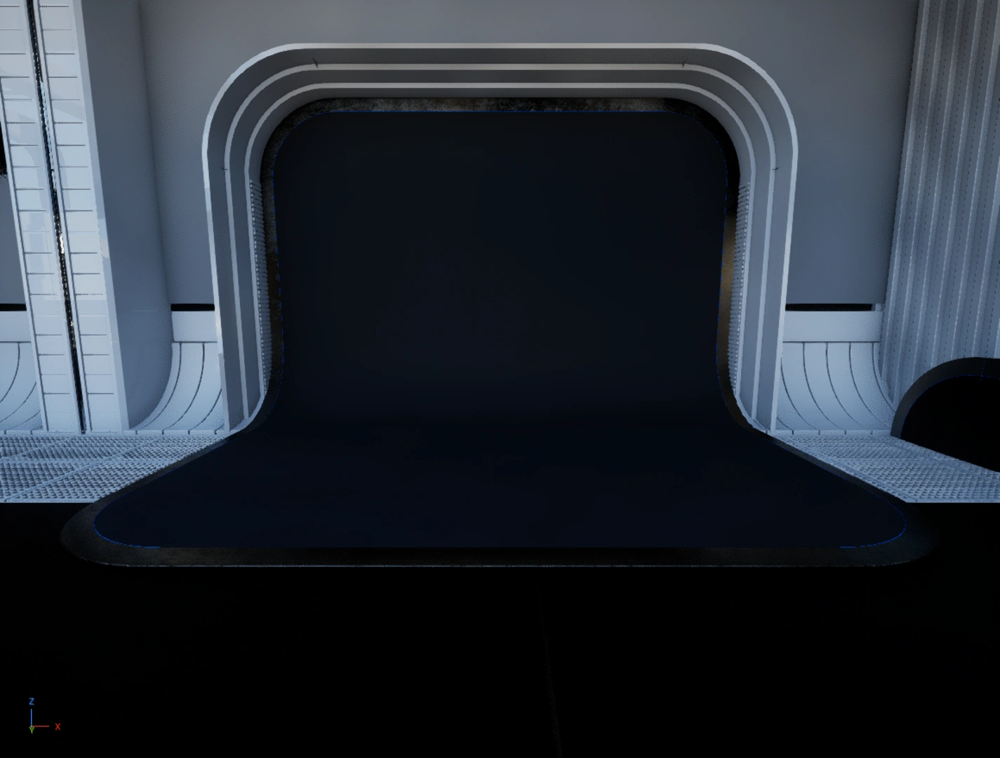

- **展牌标识与空间坐标**：`BP_DemoDisplay3`，位于 `(2480, -900, -1)`
- **官方展牌原文**：
  > *"You can highlight almost any node in a PCG Graph and press 'D' to enable a debug view. Most graphs in this map will output to a Static Mesh Spawner to simulate the debug view."*

#### 深度解析：PCG 图表高效排错四大金刚快捷键
在编写具有 50+ 节点的复杂生态图时，如果只看最终长没长出树，一旦中间某步阈值设错导致全军覆没（0 个点输出），根本无从查起。请牢记以下四个编辑器调试神技：
1. **`D` 键（Toggle Debug）**：选中任意一个或多个节点按 `D`（节点右上角亮起彩色调试灯），三维视口立刻渲染该节点输出瞬间的点云方块——**方块尺寸反映 `Transform.Scale × Extents`，方块明暗灰阶直接映射 `$Density`（纯黑 = 0，纯白 = 1）**！
2. **`I` 键（Inspect 数据表检视）**：选中节点按 `I`，在下方面板 `Attributes List` 中以电子表格形式精确列出第 `0 ~ N` 号点的 `$Position`、`$Density`、`$Seed` 以及每一个自定义属性值，数值精度排查一目了然！
3. **`E` 键（Enable / Disable Node）**：临时旁路禁用某个过滤节点，秒级 A/B 对比过滤前后的点云差异。
4. **为什么本关展台最后都接了一个绿色 `PCG_Cube` 的 `StaticMeshSpawner`？** 因为 `D` 键原生 Debug 方块只在编辑器打开该图表调试时显示，进入正常游玩模式（PIE）会自动隐藏；为了让读者在游览展厅时直接肉眼看到每个展台的点云结果，官方特意用生成 `PCG_Cube`（配 `PCG_DebugGreen` 材质）在游戏态完美复刻了 Debug 视图！

---

### 展台 #9、展台 #10 与展台 #11：`Create Points`（Local Space 局部空间坐标点组）

这是一组左中右三联展台，居中母台 #9 阐明局部空间法则，左翼 #11 演示单点，右翼 #10 演示双点数组：

- **展台 #9（母标题台）**：`BP_DemoDisplay4`，位于 `(4030, -900, -1)`，标题 `Create Points`，展牌原文：*"An array of points set to Local Space"*。
- **展台 #11（左翼 · 局部单点）**：`BP_DemoDisplay5`，位于 `(3862, -895, 7)`
  - **展牌原文**：`Index [0]  0 , 0 , 0`
  - **陈列 Actor**：`PCG_CreatePointsLocally`（`PCGVolume`，世界坐标 `(3849, -700, 100)`），绑定图表 `/Game/ExampleContent/PCG/PCGs/Basic/PCG_CreatePointsLocally`：
    - `CreatePoints_0`（`coordinateSpace = LocalComponent`，默认 `Index[0] = (0, 0, 0)`）$\rightarrow$ `StaticMeshSpawner_1`（`PCG_Cube`）。生成的绿色方块精确悬浮在该 Volume 自身中心 `(3849, -700, 100)` 处！
- **展台 #10（右翼 · 局部多点数组）**：`BP_DemoDisplay6`，位于 `(4194, -895, 7)`
  - **展牌原文**：`Index [0] 0 , 0 , 0 | Index [1] 50 , 0 , 50`
  - **陈列 Actor**：`PCG_CreatePointsLocallyMultiple`（`PCGVolume`，世界坐标 `(4165, -700, 100)`），绑定图表 `/Game/ExampleContent/PCG/PCGs/Basic/PCG_CreatePointsLocallyMultiple`：
    - `CreatePoints_0`（`coordinateSpace = LocalComponent`，`pointsToCreate` 包含 `[0]: (0,0,0)` 与 `[1]: (50,0,50)`）$\rightarrow$ `StaticMeshSpawner_1`。第二个方块自动相对第一个方块向东（`+X`）偏移 `50cm`、向上（`+Z`）抬升 `50cm`！

#### 深度解析：`Coordinate Space` 三种枚举空间的工程选型
在 `Create Points`、`Create Points Grid` 与 `Create Points Sphere` 中，都有一个决定命运的下拉框 `Coordinate Space`：
- **`World`（全局世界空间，见展台 #13~#15）**：无论把宿主 Actor 拖到天涯海角，点永远死钉在世界绝对坐标 $(X, Y, Z)$；
- **`OriginalComponent`（原始组件空间）** 与 **`LocalComponent`（当前局部组件空间）**：在普通单体积下二者均跟随宿主 Actor 平移旋转（**制作可复用蓝图预制件如“自动摆放书架的书”、“吊灯周围的飞蛾”时必须选 Local / OriginalComponent！**）；二者的微妙区别仅在开启 **Partitioned（世界分区网格切分）** 时显现：`OriginalComponent` 锚定你最初放置的那个母 Actor 原点，而 `LocalComponent` 则锚定被 `PCGWorldActor` 切分出来的每一个局部子网格分片组件中心！

---

### 展台 #12：`Create Points Grid` — 三维体素网格点阵与 `Get Actor Property` 蓝图实时联动

- **展牌标识与空间坐标**：`BP_DemoDisplay10`，位于 `(4015, 895, -1)`（第 2 厅南侧交互墙）
- **官方展牌原文**：
  > *"Greate points in a Grid from 'Cell Center' | Sliders change the Grid extends and Cell Size"*
- **展台内陈列的交互 Actor（3 个）**：
  1. `BP_PCG_Grid`（`/Game/ExampleContent/PCG/Blueprints/BP_PCG_Grid`，坐标 `(4035, 634, 192)`）：暴露成员变量 **`GridExtents`**（初始 `(150, 150, 150)`）与 **`CellSize`**（初始 `(75, 75, 75)`），带实时 3D 文本组件 `GridExtentsText` 与 `CellExtentsText`；
  2. `BP_Slider`（坐标 `(4158, 406, 9)`，`range = [0, 500]`）：拖动实时调节网格半边长 `GridExtents`；
  3. `BP_Slider2`（坐标 `(4158, 279, 9)`，`range = [0, 200]`）：拖动实时调节单元格步长 `CellSize`。

#### 真实 `PCGGraph` 拓扑全解：`/Game/ExampleContent/PCG/PCGs/Basic/PCG_CreatePointsGrid_BP`
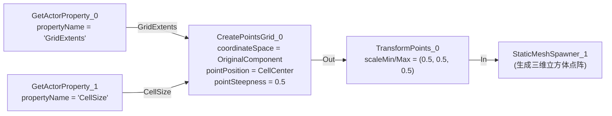
- **核心亮点解析**：
  1. **`Get Actor Property`（反射读取宿主蓝图变量）**：不需要写任何 C++ 胶水代码！只要宿主蓝图 `BP_PCG_Grid` 里定义了名为 `GridExtents`（`FVector`）和 `CellSize`（`FVector`）的变量，`Get Actor Property` 节点就能通过 UE 反射系统直接把变量值抽出来，连线覆盖（Pin Override）到 `CreatePointsGrid_0` 的同名参数引脚上！当玩家松开滑块触发 `OnReleaseSliderED` 事件分发器时，蓝图更新变量并通知 PCG 组件刷新，半空中的 3D 魔方点阵瞬间随之伸缩裂变！
  2. **点数计算公式**：当 `GridExtents`（半尺寸半径）为 $(150, 150, 150)$ 时，总包围盒边长为 $2 \times 150 = 300\text{ cm}$；除以 `CellSize = (75, 75, 75)`，每个轴向切出 $300 / 75 = 4$ 格，三维体素共生成 $4 \times 4 \times 4 = 64$ 个中心点（若将 `Blockout` 的 Z 范围压扁为 `0` 或勾选 `Cull Points Outside Volume` 即可退化为 2D 平面铺砖网格！）。

---

### 展台 #13、展台 #14 与展台 #15：`Create Points`（Global Space 世界绝对空间坐标点组）

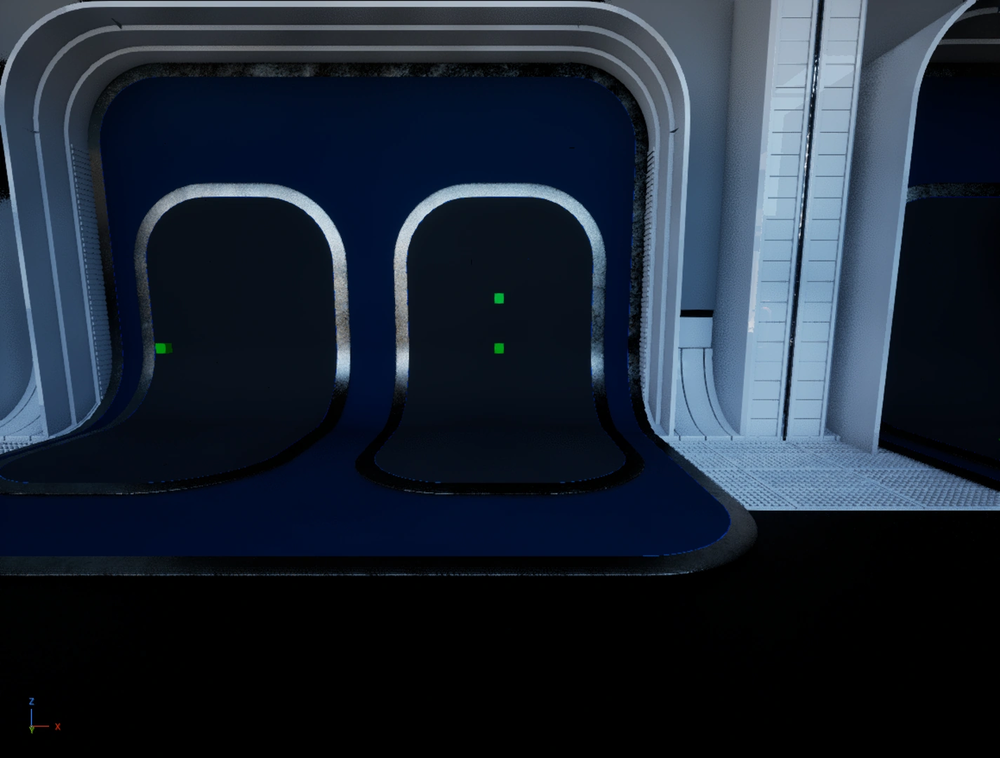

与展台 #9~#11 的局部空间形成精准镜像对比，这组三联展台展示了默认 `World`（全局绝对空间）模式下的造点行为：

- **展台 #14（居中母标题台）**：`BP_DemoDisplay9`，位于 `(5005, -900, -1)`，标题 `Create Points`，展牌原文：*"An array of points set to default Global Space"*。
- **展台 #13（左翼 · 全局单点）**：`BP_DemoDisplay8`，位于 `(4837, -895, 7)`
  - **展牌原文**：`Index [0]  5168 , -714 , 113`
  - **陈列 Actor**：`PCG_CreatePointsGlobal`（`PCGVolume`，体积中心在 `(4829, -742, 114)`），绑定图表 `/Game/ExampleContent/PCG/PCGs/Basic/PCG_CreatePointsGlobal`：
    - `CreatePoints_0` 未覆写 `coordinateSpace`（保持默认 **`World`**），`pointsToCreate[0].location = (4828, -741, 113)` $\rightarrow$ `StaticMeshSpawner_1`。*(注：展牌文字是从右台复制后未改 X 数字的小笔误，实际节点内部硬编码坐标为 `4828, -741, 113`，刚好落在该左台正中央！)*
- **展台 #15（右翼 · 全局多点数组）**：`BP_DemoDisplay7`，位于 `(5169, -895, 7)`
  - **展牌原文**：`Index [0] 5168 , -714 , 113 | Index [1] 5168 , -714 , 163`
  - **陈列 Actor**：`PCG_CreatePointsGlobalMultiple`（`PCGVolume`，注意该体积故意被摆在了贴近地板的 `Z = 25` 处！），绑定图表 `/Game/ExampleContent/PCG/PCGs/Basic/PCG_CreatePointsGlobalMultiple`：
    - `CreatePoints_0`（默认 `World` 空间）硬编码了两个世界绝对点：`(5168, -741, 113)` 与 `(5168, -741, 163)`。尽管宿主 `PCGVolume` 的原点低至 `Z = 25`，生成的两颗绿色方块依然稳稳悬浮在离地 `113cm` 和 `163cm` 的半空中——直观印证了 **Global Space 点完全免疫宿主组件自身坐标偏移** 的特性！

---

### 展台 #16：`Create Points Sphere` — 测地线（Geodesic）与经纬角球面点云生成

- **展牌标识与空间坐标**：`BP_DemoDisplay12`，位于 `(5015, 895, -1)`
- **官方展牌原文**：
  > *"Generate Points on the surface of a sphere"*
- **展台内陈列的交互 Actor（4 个）**：
  1. `BP_PCG_Sphere`（`/Game/ExampleContent/PCG/Blueprints/BP_PCG_Sphere`，坐标 `(5029, 547, 215)`）：暴露变量 `Radius`（初始 `100`）、`Subs`（测地线细分阶数，初始 `2`）与 `LatStart`（起始纬度角，初始 `-90°`）；
  2. 三组交互滑块：`BP_Slider3`（`range = [10, 200]`，控制球半径 `Radius`）、`BP_Slider4`（`range = [1, 5]`，控制细分阶数 `Subs`）、`BP_Slider5`（`range = [-90, 90]`，控制纬度裁剪起始角 `LatStart`）。

#### 真实 `PCGGraph` 拓扑全解：`/Game/ExampleContent/PCG/PCGs/Basic/PCG_CreatePointsSphere`
- **节点连线**：3 个 `GetActorProperty` 节点分别抓取 `Radius`、`Subs`、`LatStart` $\rightarrow$ 注入 **`CreatePointsSphere_1`** 的 `Radius`、`GeodesicSubdivisions`、`LatitudinalStartAngle` 引脚（`coordinateSpace = LocalComponent`）$\rightarrow$ `StaticMeshSpawner_1`。
- **两种球面离散数学算法对比（`Sphere Generation` 枚举）**：
  1. **`Geodesic`（二十面体测地线细分，本台演示模式）**：以正二十面体为基底递归细分三角面（`Subs = 1 ~ 5`）。最大优势是**球面各向同性均匀分布**，赤道与南北两极的点间距完全一致，绝不会在两极挤成一团疙瘩！非常适合制作**蒲公英绒球、魔法护盾能量节点、星球表面陨石坑或爆炸破片发射源**。
  2. **`Angle`（经纬度球面坐标采样，见展台 #20）**：按经度步长（Longitude）与纬度步长（Latitude）切分经纬网，配合 `LatitudinalStartAngle`（如设为 `0° ~ 90°` 即可一键切出**上半球穹顶 Dome**！）。

---

### 展台 #17、展台 #18 与展台 #19：`Spline Sampler` — 闭合区域内部填充 vs 沿曲线一维步进

这是开放世界**道路、河流、围栏、森林群落划界**最核心的一组三联展台：居中母台 #18 立定总纲，左翼 #17 演示“画个圈填满圈内”，右翼 #19 演示“顺着线排成一串”：

- **展台 #18（母标题台）**：`BP_DemoDisplay23`，位于 `(5988, -900, -1)`，标题 `Spline Sampler`。
- **展台 #17（左翼 · 闭合样条内部采样 `OnInterior`）**：`BP_DemoDisplay24`，位于 `(5787, -895, 7)`，标题 `Closed Loop`，原文：*"(Sample On Interior)"*
  - **陈列 Actor**：`BP_SplineSampler_Points`（类 `BP_SplineSampler_PointsClosed_C`，内含闭合环状 `Spline` 组件与 `PCG` 组件），绑定图表 **`Basic/PCG_SplineSampler_Basic`**：
    - `GetSplineData_0`（按组件标签 `Spline` 提取样条）$\rightarrow$ **`SplineSampler_0`**（**`dimension = OnInterior`**，`interiorSampleSpacing = 7`，`interiorBorderSampleSpacing = 10`，`bUnbounded = True`）$\rightarrow$ `TransformPoints_0`（`scale = (0.25, 1, 1)`）$\rightarrow$ `StaticMeshSpawner_0` + `Debug_0`。
- **展台 #19（右翼 · 沿样条曲线采样 `OnSpline`）**：`BP_DemoDisplay25`，位于 `(6183, -895, 7)`，标题 `Along Spline`
  - **陈列 Actor**：`BP_SplineSampler_PointsAlong`（内含开放蜿蜒 `Spline` 组件），绑定图表 **`Basic/PCG_SplineSampler_BasicAlong`**：
    - `GetSplineData_1`（按标签 `Spline` 提取）$\rightarrow$ **`SplineSampler_2`**（**`dimension = OnSpline`**，`mode = Subdivision`，`subdivisionsPerSegment = 3`）$\rightarrow$ `BoundsModifier_0`（`boundsMin = (8.617, 1, 1)`）$\rightarrow$ `TransformPoints_1` $\rightarrow$ `StaticMeshSpawner_3`。

#### 深度解析：`Spline Sampler` 两大维度的工程妙用与曲线衰减秘籍
1. **`Dimension = OnInterior`（闭合多边形填充，#17）**：只要把 `USplineComponent` 勾选 `Closed Loop = true`，关卡策划就能像在 Photoshop 里用套索工具一样，在地上随手拉出一个不规则花坛、一片沼泽毒潭或一片桦树林边界！更绝的是其内置参数 **`Interior Density Falloff Curve`（内部边缘密度衰减曲线）**：你可以让多边形圆心处 `$Density = 1.0`（长参天乔木），越靠近样条边界线密度平滑跌落至 `0.2`（长低矮灌木野草），一条曲线全自动做出森林边缘的自然生态退化带！
2. **`Dimension = OnSpline`（一维路径采样，#19）**：注意 `Mode` 的两种核心选型——
   - `Subdivision`（按控制点段数等分，如 #19 每段切 3 个点）：适合控制点间距均匀的装饰点；
   - **`Distance`（按固定弧长厘米步进，如展台 #32 `distanceIncrement = 280`）**：**模块化围栏、铁轨枕木、城墙垛口的唯一正确选择**！无论策划把某两个样条点拉得多长或多短，PCG 都会严格按弧长积分每隔 `2.8m` 精准打下一根桩，绝不拉伸或重叠！

---

### 展台 #20：`Transform Points` — 随机偏移、360° 朝向打散与非均匀缩放

- **展牌标识与空间坐标**：`BP_DemoDisplay13`，位于 `(5978, 895, -1)`
- **官方展牌原文**：
  > *"Generate Points on the surface of a sphere"* *(注：此处展牌副标题沿用了隔壁球面底板文案，主标题与交互核心为 `Transform Points` 点变换算子)*
- **展台内陈列的交互 Actor（2 个）**：
  1. `BP_Button_Parent_SinglePress`（坐标 `(6001, 222, 8)`）：单次按压交互按钮；
  2. `BP_PCG_Sphere2`（类 `BP_PCG_TransformPoints_C`，坐标 `(5991, 547, 215)`）：暴露 6 个范围变量 `OffsetMin`, `OffsetMax`, `RotationMin`, `RotationMax`, `ScaleMin`, `ScaleMaxv`（注：蓝图源码中作者手误多敲了一个字母 `v`），每次按下按钮执行自定义函数 `AddUniformValues` 递增扰动幅度并刷新 3D 数值看板！

#### 真实 `PCGGraph` 拓扑全解：`/Game/ExampleContent/PCG/PCGs/Basic/PCG_CreatePointsSphere_Transform`
- `CreatePointsSphere_0`（`sphereGeneration = Angle`, `coordinateSpace = OriginalComponent`）生成规整经纬球点阵 $\rightarrow$ 送入 **`TransformPoints_0`**（由 6 个 `GetActorProperty` 节点动态覆写 `OffsetMin/Max`、`RotationMin/Max`、`ScaleMin/Max`）$\rightarrow$ `StaticMeshSpawner_1`。
- **自然造景防穿帮三件套（`Transform Points` 必调参数）**：
  - **破除“克隆人军团感”**：同样一棵松树资产种 1000 棵，只要给 `Rotation Min = (0, 0, 0)`、`Rotation Max = (0, 0, 360)`（绕 Z 轴 Yaw 随机旋转 $360^\circ$，再加 Pitch/Roll $\pm 4^\circ$ 微倾）以及 `Scale Min = 0.75, Scale Max = 1.35`（勾选 **`Uniform Scale = true`** 防止模型被压扁拉长！），肉眼立刻看不出重复感！
  - **`Absolute Rotation`（绝对旋转复选框）**：若勾选，将直接无视上游地形斜坡传下来的法线倾斜角，强行重置回世界水平基准——当上游忘了关旋转投影时，可用它一键把歪斜的房屋地基扶正！

---

### 展台 #21：`Loop and Maths` — 子图循环（Loop Subgraph）、反馈引脚（Feedback Pin）与模运算换模

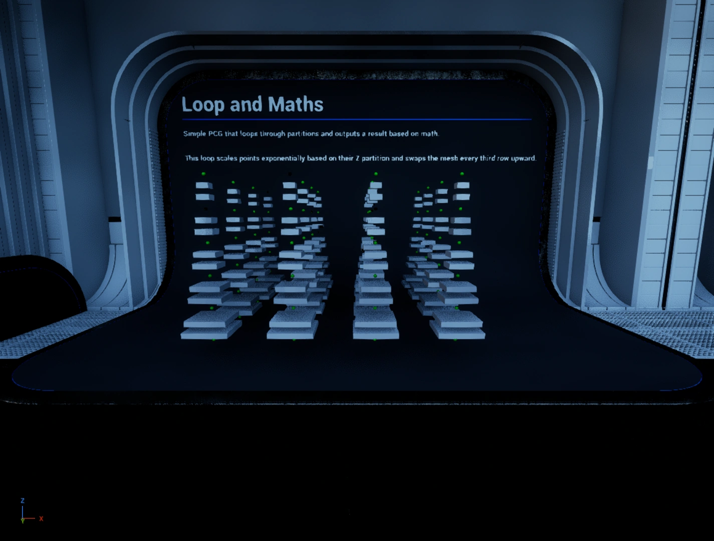

- **展牌标识与空间坐标**：`BP_DemoDisplay17`，位于 `(7505, -900, -1)`（第 3 厅 `Moderate` 进阶算子厅开篇王牌展台！）
- **官方展牌原文**：
  > *"Simple PCG that loops through partitions and outputs a result based on math. This loop scales points exponentially based on their Z partition and swaps the mesh every third row upward."*
- **展台内陈列的示例 Actor（1 个）**：
  - `PCG_Maths`（`PCGVolume`，坐标 `(7505, -700, 100)`）：同时挂载两组实例化网格组件——`ISM_PCG_Cube_259`（白色基础材质 `M_PCG_Base` 方块）与 `ISM_Attenuation_sphere_01_24`（绿色调试材质 `Attenuation_sphere_01` 圆球），由下至上层层递减缩小，且每逢第 3 层整排变为绿球！

#### 双层真实 `PCGGraph` 深度拆解（母图 `PCG_Maths` + 循环子图 `PCG_Loop_exponentiallyScale`）
这是全展馆**最具编程美感与高阶算法价值**的一座展台！很多开发者以为 PCG 只能做无状态并行流水线，不知道 PCG 竟然支持**带跨轮次状态传递（Daisy-chained Feedback Pin）的 `For-Each` 循环子图**！

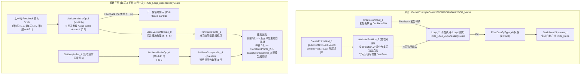

- **两大高阶核心算子精讲**：
  1. **`Attribute Partition`（属性分割，按 `$Position.Z` 分桶）**：原本 `CreatePointsGrid_1` 输出的是混在一个篮子里的单包三维点集。经过 `Attribute Partition ($Position.Z)` 后，同一高度 $Z$ 的所有点被归入同一个独立 `UPCGPointData` 数据包，由底向上拆成了十几个有序切片数组，为 `Loop` 逐层遍历做好了准备！
  2. **`Feedback Pin`（菊花链反馈引脚）实现递推公式 $S_k = S_{k-1} \times r$**：普通 Loop 各次迭代并行独立，而将子图的输入输出引脚标记为 **Feedback Pin** 后，第 $0$ 层算出的 `5.0 × 0.9 = 4.5` 会直接串行喂给第 $1$ 层做输入，算出的 `4.05` 再喂给第 $2$ 层……这让你能在 PCG 中轻松搭建**宝塔逐层收分、树木主干逐节变细、蜿蜒石阶逐级旋转攀升**等迭代生成算法！

---

### 展台 #22：`Graph Parameters` — 图表参数化实例化与“按属性动态选模型”黑科技

- **展牌标识与空间坐标**：`BP_DemoDisplay11`，位于 `(7500, 876, -4)`
- **官方展牌原文**：
  > *"PCG Graph Parameters are user-defined, overridable values that let you create customizable and flexible graphs, similar to how parameters work in the Material Editor. Once created, they can be adjusted directly in the PCG graph or from the Details panel of a PCG asset in the 'Parameters overrides' section. This graph uses parameters to let you customize the mesh, set a height filter, and adjust the grid size."*
- **展台内陈列的示例 Actor（1 个）**：
  - `PCG_GraphParameters`（`PCGVolume`，坐标 `(7500, 680, 100)`）：实例化生成蓝绣球花簇 `SM_BlueFlower`（材质 `MI_Foliage_BlueFlower`）。

#### 真实 `PCGGraph` 拓扑全解：`/Game/ExampleContent/PCG/PCGs/Basic/PCG_GraphParameters`
完全类比虚幻材质系统中的 `Material` 与 `Material Instance`（母材质定逻辑，材质实例改参数），PCG 提供了 **`PCGGraph` 与 `PCGGraphInstance`**！本图定义了多达 5 个用户可重载图表参数（`GetGraphParameter`）：
1. `Grid Extents` 与 `Cell Size` $\rightarrow$ 动态控制 `CreatePointsGrid_0` 网格范围与间距；
2. `Spawn Mesh`（`bool` 开关）$\rightarrow$ 驱动 **`Branch_1`（条件路由分支节点）**：若为 `False` 走 A 路仅生成 `TransformPoints_1` 缩放预览方块，若为 `True` 走 B 路生成真实自定义资产！
3. **`PCGMeshSelectorByAttribute`（按点属性动态指定静态网格）**：这是工业管线必学大招！在传统用法中，一个 `Static Mesh Spawner` 里的模型列表是写死的；而在本图 B 路末端，`GetGraphParameter_3 ('Mesh Asset')` 读取外部暴露的 `TSoftObjectPtr<UStaticMesh>` 参数，通过 **`MatchAndSetAttributes_0`** 将模型软路径写入点的 `'meshAsset'` 属性，随后 `StaticMeshSpawner_3` 将选择器模式切换为 **`By Attribute`（绑定属性名 `'meshAsset'`）**！这意味着关卡美术无需复制修改 `PCGGraph`，只需在场景里拖入 10 个不同的 `PCGVolume` 并在 Details 面板的 `Parameters Overrides` 里一个选松树、一个选路灯、一个选蓝花，就能一套母图通吃全项目百种资产变体！

---

### 展台 #23：`Seed` — 确定性伪随机架构与运行时动态重播

- **展牌标识与空间坐标**：`BP_DemoDisplay18`，位于 `(8486, -900, -1)`
- **官方展牌原文**：
  > *"The 'PCG seed' controls randomness in procedural generation, ensuring consistency in terrain, foliage, or structures when using the same seed while allowing variation with a different one. For this example, a new seed is generated every second via the Level Blueprint."*
- **展台内陈列的示例 Actor（1 个）**：
  - `PCG_Seed`（`PCGVolume`，初始 `seed = 42`），绑定图表 `/Game/ExampleContent/PCG/PCGs/Basic/PCG_Seed`：
    - `CreatePointsGrid_0`（`gridExtents=(250,100,1), cellSize=(50,50,5), pointPosition=CellCorners`）$\rightarrow$ `TransformPoints_0`（`bUniformScale = False, scaleMax = (1, 1, 10)` 随机高度柱状图）$\rightarrow$ `StaticMeshSpawner_0`。在 PIE 中，关卡蓝图每 1.0 秒修改一次 `PCG Component -> Seed` 并重生成，整排绿色方柱像音乐频谱仪一样每秒跳出一组全新高低组合！

#### 深度解析：为什么在多人联机开放世界里，PCG 能在零网络流量下保证所有玩家看到同一棵树？
答案正是 **三级确定性哈希种子（Deterministic Hierarchical Seeding）**！PCG 每个节点计算每个点的随机数流 `FRandomStream` 时，由三部分哈希合成：

$$\text{FinalPointSeed} = \text{Hash}\Big(\text{PCGComponent.Seed},\; \text{UPCGSettings.Seed},\; \text{Hash}(\text{Point.WorldPosition})\Big)$$

- **工程奇迹**：只要 `PCGComponent.Seed` 固定（如默认的 `42`），无论是在张三的 RTX 4090 PC 上、李四的 PS5 主机上，还是在 Linux 专用服务器上，同一世界坐标长出来的那块岩石位置、旋转角与缩放比例**精确到小数点后第 6 位都分毫不差**！因此对于数百万株运行时动态生成的岩石树木（`GenerateAtRuntime`），服务器根本不需要通过网络同步任何一棵树的数据，各端本地凭同一个整数 `Seed` 算出的森林天然 100% 物理对齐！

---

### 展台 #24：`Difference` — 空间布尔差集挖空与非破坏性动态避让

- **展牌标识与空间坐标**：`BP_DemoDisplay19`，位于 `(8487, 876, -1)`
- **官方展牌原文**：
  > *"The 'Difference Node' spatially subtracts the target data from source data, outputting the difference of the two. The 'Red points' show the original point locations but are offset in front of the mesh for better visibility. The PCG Graph uses the Sphere via a Tag as the target. Use the button to randomly place the sphere's location."*
- **展台内陈列的交互 Actor（4 个）**：
  1. `PCG_Difference_Editor`（`GenerateOnLoad`，用于编辑器静态展示）与 `PCG_Difference`（**`generationTrigger = GenerateAtRuntime`**，用于 PIE 运行时动态重算！）；
  2. `Sphere`（`StaticMeshActor`，坐标 `(8810, 700, 62)`，带有 Actor Tag **`PCG_DifferenceDemo`**）；
  3. `BP_Button_Parent_SinglePress2`：按下按钮时，关卡蓝图将 `Sphere` 瞬移到栅栏内一个新的随机坐标，并触发 `PCG_Difference` 刷新——只见大白球撞到哪里，哪里的绿色高柱就瞬间自动消失让出一个完美的球形空洞，而前景一排小红点（`PCG_DebugRed`）则忠实标示着被挖掉前的原始列位！

#### 真实 `PCGGraph` 拓扑全解：`/Game/ExampleContent/PCG/PCGs/Basic/PCG_Difference`
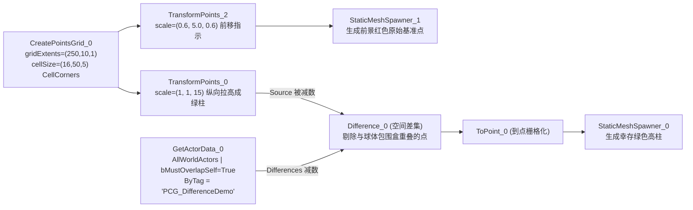
- **深度解析：`Difference` 节点的三种 `Density Function`（密度扣减函数）与 `To Point` 的必要性**：
  1. 为什么 `Difference_0` 后面要紧跟一个 **`To Point`（`UPCGCollapseSettings`）**？因为当 `Source`（点云）减去 `Differences`（Actor 空间体积数据 `UPCGSpatialData`）时，在默认连续空间布尔模式下，`Difference` 输出的是一个延迟求值的复合空间差集对象 `UPCGDifferenceData`；接上 `To Point`（或直接把 `Difference` 的 `Mode` 设为 `Discrete` 离散模式）即可立即求值坍缩回标准 `UPCGPointData` 数组！
  2. **`Density Function` 三种核心模式必背口诀**：
     - **`Minimum` / `Clamped Subtraction`（默认渐变减法）**：输出密度 $\rho = \max(0, \rho_{\text{src}} - \rho_{\text{diff}})$，若减数边缘带有柔和 `Steepness`，交界处点密度会降低但未必归零（需配合 `Density Filter` 滤除低密度残余点）；
     - **`Binary`（一刀切硬布尔挖空，路面/房屋避让最常用！）**：只要减数区域内密度 $> 0$，被覆盖的源点密度**直接强制清零剔除**，绝不留任何一棵半死不活的小树卡在房子地板里！

---

### 展台 #25：`Normal to Density` — 基于表面法线点乘的“向阳坡/雕像肩头自动积雪生苔”算子

- **展牌标识与空间坐标**：`BP_DemoDisplay22`，位于 `(9294, 874, 7)`（第 3 厅南侧网格采样三联台之左翼）
- **官方展牌原文**：
  > *"Using Z Normal"*
- **展台内陈列的示例 Actor（2 个）**：
  1. `SM_HeadBust2`（`StaticMeshActor`，坐标 `(9306, 673, 130)`）：石膏大理石半身人像雕塑（网格 `/Game/ExampleContent/Skin/Meshes/SM_HeadBust`，次表面大理石材质 `MI_Marble_Simple`）；
  2. `PCG_MeshSample_NormalToDesnity`（`PCGVolume`）：实例化北欧海岸绿植 `S_Nordic_Coastal_Groundcover_vlqkdeaja_Var24_lod0`——仔细观察可见，**茂密的青苔草丛只长在雕像的天灵盖、眉弓上缘、鼻梁与宽阔的双肩顶面上，而垂直的脸颊与朝下的下巴底面一根草都没有！**

#### 真实 `PCGGraph` 拓扑全解：`/Game/ExampleContent/PCG/PCGs/Basic/PCG_MeshSample_NormalToDesnity`
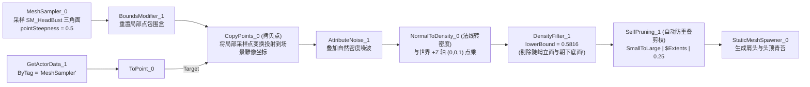
- **核心数学算子精讲（`Normal to Density`）**：
  采样自网格三角面的每一个点，其局部 $+Z$ 轴（`Transform.GetUnitAxis(EAxis::Z)`）天然对齐该处三角面的法线向量 $\vec{N}$。`NormalToDensity_0` 默认取目标方向向量 $\vec{D} = (0, 0, 1)$（世界正上方），计算点乘并重映射为密度：
  $$\rho = \text{Clamp}\Big((\vec{N} \cdot \vec{D})^{\text{Strength}} + \text{Offset},\; 0,\; 1\Big)$$
  当下游 `DensityFilter_1` 卡死下界 `lowerBound = 0.5816`（即 $\cos\theta > 0.5816 \implies$ 坡面倾角 $\theta < 54.4^\circ$）时，所有大于 $54.4^\circ$ 的陡峭脸颊与负向底面全部被精准剔除！**在开放世界中，无论是山脉悬崖不长树、屋檐瓦片自动积雪、遗迹神像肩头生苔，还是幽暗岩洞顶壁倒挂钟乳石（只需把方向向量改为 `(0, 0, -1)`！），全靠这一个算子一招制敌！**

---

### 展台 #26：`Execute Blueprint` — 自定义 `UPCGBlueprintElement` 读取模型插槽（Mesh Sockets）

- **展牌标识与空间坐标**：`BP_DemoDisplay27`，位于 `(9509, -900, -1)`（第 3 厅北侧高阶扩展台）
- **官方展牌原文**：
  > *"Blueprints can be executed inside a PCG Graph. This BP returns data on mesh sockets. Variables inside the Blueprint are editable, letting you assign the 'Mesh Reference' and 'Tags' as needed."*
- **展台内陈列的示例 Actor（2 个）**：
  1. `PCG_SocketMesh`（`StaticMeshActor`，坐标 `(9500, -695, 104)`）：带有预设 Socket 插槽的演示网格 `/Game/ExampleContent/PCG/Meshes/PCG_SocketMesh`，挂有 Actor Tag **`MySocketMesh`**；
  2. `PCG_ExecuteBlueprint`（`PCGVolume`）：精确在 `PCG_SocketMesh` 的每一个 Socket 插槽坐标处生成一颗绿色指示方块！

#### 自定义算子资产与 `PCGGraph` 双重拆解
当内置的几十个 C++ PCG 节点满足不了你的特殊业务需求（例如“读取房屋墙面预先摆好的窗户 Socket 自动挂花盆”、“读取骨骼网格体关键骨骼位置生成护甲藤蔓”或“查询自定义游戏数据库刷宝箱”）时，你可以直接用蓝图写一个专属 PCG 节点！
1. **自定义算子蓝图 `/Game/ExampleContent/PCG/Blueprints/BP_GetMeshSockets`**：
   - **父类**：继承自 **`/Script/PCG.PCGBlueprintElement`**；
   - **暴露可编辑属性（勾选 `Instance Editable`）**：`StaticMesh`（静态网格引用）与 `Socket Tag Search`（插槽过滤标签）——这两个变量会自动出现在 PCG 图表右侧的节点 Details 面板中供美术配置；
   - **重载核心函数**：
     - `NodeTitleOverride`：将图表节点标题自定义为醒目的 `'GetMeshSockets'`；
     - **`ExecuteWithContext(InContext, Input)`**：遍历 `StaticMesh` 上所有匹配的 `UStaticMeshSocket`，提取每个插槽的局部 `RelativeLocation / RelativeRotation`，构造 `FPCGPoint` 数组塞入输出 `UPCGPointData`！
2. **宿主图表 `/Game/ExampleContent/PCG/PCGs/Moderate/PCG_ExecuteBlueprint`**：
   - `ExecuteBlueprint_0 (GetMeshSockets)` 输出模型局部空间下的插槽点云 $\rightarrow$ `FilterDataByType_0 (Point)` 作为 **`CopyPoints_0` 的 `Source`（源模板点）**；
   - `GetActorData_0 (ByTag = 'MySocketMesh')` 抓取场景里摆放的 `PCG_SocketMesh` 实例世界变换 $\rightarrow$ `ToPoint_0` 作为 **`CopyPoints_0` 的 `Target`（目标锚点）**；
   - `CopyPoints_0` 将局部插槽坐标矩阵乘到世界锚点上，送入 `StaticMeshSpawner_0` 精准命中所有插槽！*(性能提示：在自定义 `PCGBlueprintElement` 中处理上万个点时，优先使用内置的 `PointLoopBody` / `IterationLoopBody` 多线程并行回调，避免在主线程单线程跑巨大 ForEach 循环！)*

---

### 展台 #27 & 展台 #28：`Mesh Sampler` 与 `Sampling Meshes` — 任意三维曲面泊松采样、拷贝投射与自剪枝防穿模

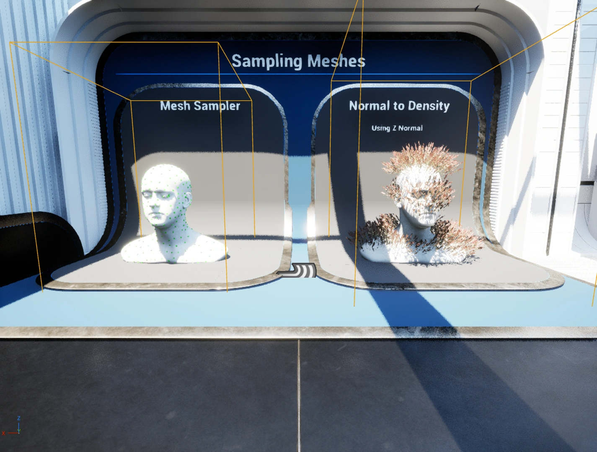

这两座展台与左翼展台 #25 共同组成了第 3 厅南侧压轴的“网格曲面采样三联展区”：

- **展台 #28（居中母标题台）**：`BP_DemoDisplay20`，位于 `(9500, 876, -1)`，标题 `Sampling Meshes`
  - **配对环境 Actor**：`WindDirectionalSource`（`/Script/Engine.WindDirectionalSource`，坐标 `(9504, 637, 3)`），向整个展台区域吹送全局方向风场，驱动雕像头顶与肩头生成的海岸绿植材质（`M_FoliageBase`）产生逼真的枝叶摇曳！
- **展台 #27（右翼 · 全曲面均匀网格采样）**：`BP_DemoDisplay21`，位于 `(9702, 874, 7)`，标题 `Mesh Sampler`
  - **陈列 Actor**：`SM_HeadBust`（坐标 `(9714, 673, 130)`）与 `PCG_MeshSample`（`PCGVolume`），将整尊半身像从头到下巴全身均匀包裹上一层细密的绿色立方体点阵！

#### 真实 `PCGGraph` 拓扑全解：`/Game/ExampleContent/PCG/PCGs/Basic/PCG_MeshSample`
对比左翼 #25，本图去掉了 `NormalToDensity` 法线过滤，完整展示了三维静态网格采样的三大工程基石节点：
1. **`MeshSampler_1`（网格体采样器）**：直接读取 GPU/CPU 静态网格资源 `SM_HeadBust` 的三角形表面（无需开启复杂物理碰撞！），在模型局部原点空间围绕整个复杂雕像五官轮廓提取高密表面点云。
2. **`CopyPoints_1`（拷贝点算子 —— 模板实例化的灵魂节点！）**：
   为什么 `MeshSampler` 采出来的点不在雕像身上，而在世界原点 `(0,0,0)`？因为资产采样是在资产局部坐标系下离线完成的！如果场景里摆了 50 尊旋转角度各异的同款雕像，你**只需要运行 1 次昂贵的 `MeshSampler`** 作为 `CopyPoints` 的 `Source`，再把 50 尊雕像的 Actor 点作为 `Target` 连入 `CopyPoints`——瞬间以极低开销把同一份局部点云复制变换到全部 50 尊雕像身上！
3. **`SelfPruning_0`（自剪枝 / 自动防重叠剔除）**：
   - 实测参数：`pruningType = SmallToLarge`（小包围盒让位或按序保留），`comparisonSource = '$Extents'`，`radiusSimilarityFactor = 0.25`，`bRandomizedPruning = True`。
   - **为什么任何自然散布图末尾都强烈建议挂一个 `Self Pruning`？** 因为无论是三角形曲面采样还是松散网格抖动，总免不了有两个点随机撞在相距仅 2 厘米的地方——如果不剪枝，两块大石头或两棵树干就会丑陋地叠穿在一起（Z-Fighting 闪面）！开启 `Self Pruning` 后，算子会自动构建空间八叉树检测点与点之间的包围盒（`Bounds × Scale`）交集，自动拔除发生碰撞穿插的冗余点！

---

### 展台 #29：`Attribute Filter` — 读取地形绘制材质层权重（Paint Layers）精准分流草地与碎石路

- **展牌标识与空间坐标**：`BP_DemoDisplay33`，位于 `(13560, -470, 422)`（步入第 5 厅 `Final Example` 宏大开放自然山谷的第一站！）
- **官方展牌原文**：
  > *"Using the 'Attribute Filter' with 'Landscape Data' allows points to be populated based on Landscape Paint Layers. In this example, Grass only generates points on the Grass Layer, and Pebble Points are generated on the Path Layer."*
- **展台周边配对及地形材质资产拆解**：
  - 近景围栏实例：`BP_PCG_Rails2`（坐标 `(13150, 417, 146)`，生成岩石 `SM_Rock1`、`SM_RockTwo`、木栅栏 `SM_Fence` 及红色箭头剔除盒 `RemoveFence1`）与木桩 `SM_FencePost3`；
  - 山谷主地形 `Landscape4`（材质实例 `/Game/ExampleContent/PCG/Materials/M_Landscape_PCG_Inst`，母材质 `M_Landscape_PCG`）：混合了两个 `LandscapeLayerInfoObject` 图层资产——**`Grass_LayerInfo`（图层名 `'Grass'`，野草贴图 `T_Wild_Grass`）** 与 **`Dirt_LayerInfo`（图层名 `'Dirt'`，黄土小径贴图 `T_Patchy_Grass_On_Soil`）**！

#### 深度解析：“美术画笔刷到哪，对应生态自动跟到哪”的联动秘诀
当 `Get Landscape Data` 勾选了 `bGetLayerWeights = True` 时，从 `Surface Sampler` 诞生的每一个地形表面点，其元数据表（Metadata）里都会**自动多出与地形材质图层同名的浮点属性列**（例如 `Grass` $\in [0, 1]$ 与 `Dirt` $\in [0, 1]$，且权重和为 $1.0$）！

随后只需接上 **`Attribute Filter`（属性过滤器，`UPCGAttributeFilteringSettings`）**：
- **分流支路 1（青草与蓝花）**：设置 `Target Attribute = Grass`，`Operator = Greater`（`>`），`Threshold = 0.5` $\rightarrow$ 凡是美术涂了草地材质的地方自动铺满茂盛草丛，一碰到泥土小径边缘自动收口停步；
- **分流支路 2（路边鹅卵石与碎石）**：直接利用同一个 `Attribute Filter` 的 **`Outside Filter` 引脚**（或另起一个 `Dirt > 0.6` 过滤器）$\rightarrow$ 在泥土路面与路肩交界处自动撒落细碎鹅卵石！当关卡美术拿起地形笔刷（Landscape Paint）在草地上随手画一条新土路时，青草实时退让、碎石实时铺路，真正实现“一笔成景”！

---

### 展台 #30：`Optimization` — `FoliageInstancedStaticMeshComponent` 与引擎画质分级联动

- **展牌标识与空间坐标**：`BP_DemoDisplay29`，位于 `(15637, -951, 474)`（山谷中段道路优化展示点，配对道路样条网格 `SplineMeshActor`）
- **官方展牌原文**：
  > *"Meshes spawned via PCG have the usual properties exposed. The foliage here has 'Density Scaling' checked - so that it scales with the set Engine Scalability. The componant class is also set to 'FoliageInstancedStaticMeshComponent'"*

#### 深度解析：百万级 PCG 植被不掉帧的 `Static Mesh Spawner` 终极调优手册
很多团队抱怨 PCG 种了十万株草后帧率暴跌，90% 的原因都是直接用了 `Static Mesh Spawner` 的默认裸配置！展开节点里的 `Mesh Entries -> Descriptor`（静态网格描述符），请务必逐项核查展台 #30 示范的工业级配置：
1. **组件类切换为 `FoliageInstancedStaticMeshComponent`（基于 `HISM` 分层实例化）**：
   默认可能采用普通 `InstancedStaticMeshComponent (ISM)`（所有实例共享单一包围盒与单一 LOD，要么全画要么全剔除，对于传统非 Nanite 网格堪称灾难）。切换为 `UFoliageInstancedStaticMeshComponent` 后，底层自动构建集群剔除树（Cluster Tree），支持按局部簇独立做视锥剔除（Frustum Culling）、遮挡剔除与平滑逐簇 LOD 切换！
2. **勾选 `Density Scaling`（动态响应引擎 `Scalability` 画质档位）**：
   玩家在游戏设置菜单里把“植被质量（Foliage Quality）”从 `Epic` 调低到 `Medium` 或 `Low`（底层修改控制台变量 `foliage.DensityScale = 0.4`）时，勾选了该选项的 PCG 草丛会在 GPU/渲染侧**自动按比例稀疏减半渲染实例数**，无需重新跑一遍 PCG 图就能让核显轻薄本或 Steam Deck 瞬间暴涨 20 帧！
3. **关闭无意义的物理碰撞与远距阴影**：
   - 纯视觉花草碎石务必将 Descriptor 的 `Collision Profile Name` 设为 **`NoCollision`**（否则十万个 Chaos 物理刚体句柄直接撑爆物理场景内存并拖慢角色射线检测！）；
   - 设置合理的 `Instance Start / End Cull Distance`（如小草 `3500 ~ 5000`），并对细碎矮草视情况关闭动态级联阴影投射或限制 `World Position Offset Disable Distance`（远处关掉顶点风吹计算，省下海量 GPU 顶点着色器算力！）。

---

### 展台 #31：`Grass` — 多层级生态优先级与级联 `Difference` 草地避让网

- **展牌标识与空间坐标**：`BP_DemoDisplay32`，位于 `(15869, 698, 485)`（配对路标桩 `SM_FencePost4` 与全局生态体积 `PCG_FinalExample`）
- **官方展牌原文**：
  > *"The 'Difference node' removes grass points where other points exist, like under rocks, the logo, and flowers."*

#### 深度解析：自然生态系统的“大鱼吃小鱼（Big-to-Small Hierarchy）”级联排他架构
仔细蹲下来观察山谷里的任何一块大岩石、每一簇蓝绣球花以及山巅巨大的 UE Logo 底座——你会发现**没有任何一片草叶从石头肚子里穿模长出来**！这在 `Moderate/PCG_FinalExample` 图表中遵循了标准的**三级尺寸金字塔生成顺序**：
1. **第一优先级（地标与大型障碍层）**：先采集场景手工地标（`UELogo`）、样条道路/栅栏（`BP_PCG_Rails`）以及低频大岩石点云；
2. **第二优先级（中型花丛群落层）**：通过大尺度平铺空间噪波 `Spatial Noise_1`（`scale = (80, 80, 80), contrast = 3`）配合苛刻的 `DensityFilter_1 (0 ~ 0.1376)` 提取块状团簇生成蓝绣球花 `SM_BlueFlower`，同时用 `Difference` 避开第一层岩石与道路；
3. **第三优先级（高密地表草皮层）**：`SurfaceSampler_0` 以每平米 **10 个点**（`pointsPerSquaredMeter = 10`）撒下海量草点，先经 `Spatial Noise_0` 与蓝图节点 `ScaleByDensity` 做出高低起伏的草浪，最后在生成草网格前，用 **`Union`（并集）汇总“岩石 + 道路 + 花丛 + UE Logo”的所有占位包围盒，一次性送入 `Difference`（差集）从草点中彻底抠除**！

---

### 展台 #32：`Combining Methods` — 模块化样条木栅栏、动态开口与防倾斜地形贴合综合实战

- **展牌标识与空间坐标**：`BP_DemoDisplay28`，位于 `(11525, 1312, -1)`（第 4 厅 `Landscapes` 南侧综合演练台）
- **官方展牌原文**：
  > *"A quick demonstration of basic PCG demonstrations combined. Use of Spline, Difference and Transforms."*
- **展台内陈列的示例 Actor（4 个）**：
  1. `Landscape2`（坐标 `(10796, 536, 24)`）：双组件起伏山坡基底；
  2. `SM_FencePost` 与 `SM_FencePost2`：起止收口木桩；
  3. **`BP_PCG_Rails`**（`/Game/ExampleContent/PCG/Blueprints/BP_PCG_Rails`，坐标 `(11904, 690, 228)`）：内含一条带标签 `CreateSpline` 的样条线、一个带标签 `RemoveActor` 的红色箭头立方体 `RemoveFence1`（材质 `M_Arrows_Red`）、一个植被剔除盒 `RemoveFoliage1`，以及绑定图表 **`/Game/ExampleContent/PCG/PCGs/Moderate/PCG_Fence`** 的 PCG 组件！

#### 真实生产级工具图表全解：`/Game/ExampleContent/PCG/PCGs/Moderate/PCG_Fence`
这套蓝图是每个关卡策划梦寐以求的**“全自动地形围栏开口铺设器”**——把样条线往山坡上一拉自动摆好首尾严丝合缝的木栅栏；想在栅栏中间留一道 3 米宽的木门缺口？根本不用把样条线剪断成两根，直接拖动那个红色箭头方块 `RemoveFence1` 滑到任意位置，碰到红盒子的那两扇栅栏瞬间自动消失留出大门！

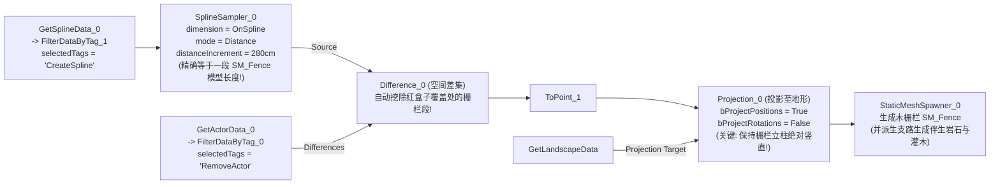

请细细品味这 5 个节点的黄金组合拳：
- **为什么 `distanceIncrement = 280`？** 因为静态网格 `SM_Fence` 的模型宽度正好是 `280cm`（2.8 米）！按固定弧长 280cm 采样保证了栅栏横梁首尾相接！
- **为什么 `Projection_0` 必须加注释强调 `'Remove Rotation Projections'`（`bProjectRotations = False`）？** 回顾展台 #3 的橙色树！现实中木匠在斜坡上打栅栏桩，桩子永远是拿铅锤吊着竖直往土里打的，只有高低落差阶梯，绝不会顺着坡面法线歪倒 30 度（否则两段栅栏转折处会拧成麻花脱节）！

---

### 展台 #33：`Mesh Sampler`（山巅压轴 · 虚幻引擎 `UELogo` 巨型立体花雕与 `PCG_FinalExample` 总览）

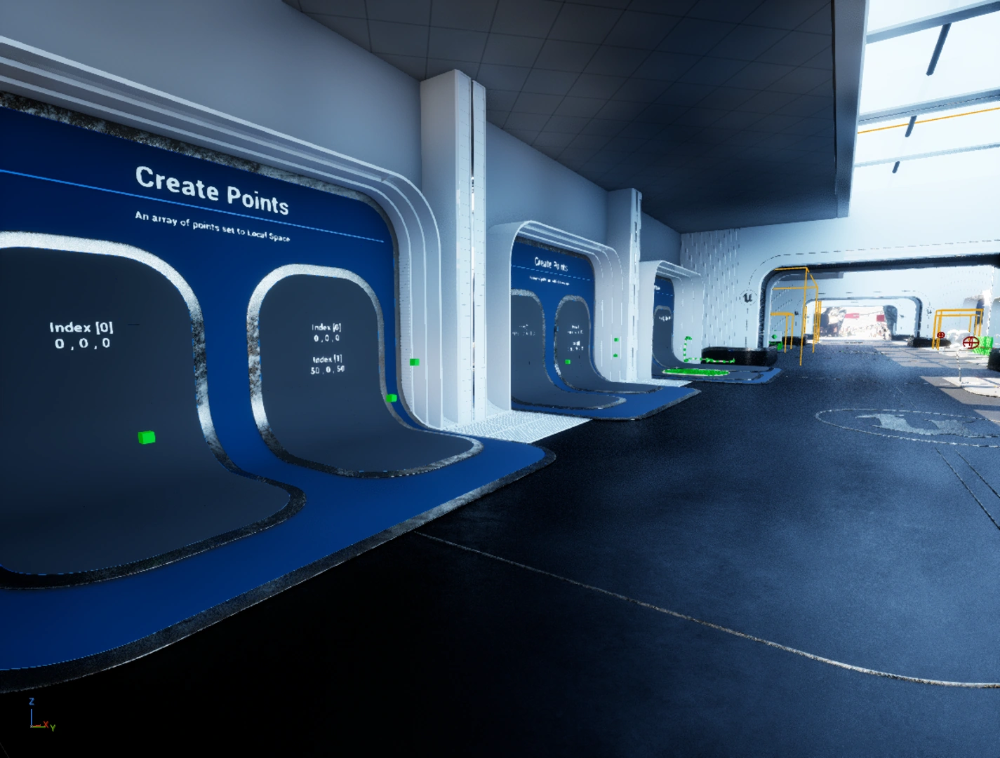

- **展牌标识与空间坐标**：`BP_DemoDisplay31`，位于 `(19829, 1923, 811)`（整座 206 米展馆最东端山巅观景台！）
- **官方展牌原文**：
  > *"Mesh Sample is used to generate a flower arrangement as the UE logo. Self Pruning and Density is used to control the bulk."*
- **展台及第 5 厅全局压轴 Actor 组合**：
  1. `UELogo`（`StaticMeshActor`，坐标 `(20629, 920, 1375)`）：矗立在山谷最高处的巨型虚幻引擎三维徽标网格 `/Game/Global/DemoRoom/Meshes/UELogo`；
  2. **`PCG_FinalExample`（全局 `PCGVolume`，坐标 `(19324, -40, 43)`，绑定图表 `/Game/ExampleContent/PCG/PCGs/Moderate/PCG_FinalExample`）**：一次性统领整座山谷的 4 组 `UFoliageInstancedStaticMeshComponent`（三种北欧海岸地被草丛 `Var24`、`Var52`、`Var6` 以及蓝绣球花 `SM_BlueFlower`），并在山巅对 `UELogo` 执行 `Mesh Sampler + Density Noise + Self Pruning`，将冰冷的几何 Logo 化作一座繁花簇拥的巨型立体园艺花雕！

#### 终极生态图 `Moderate/PCG_FinalExample` 全管线汇总复盘
站在展台 #33 回望整片生机盎然的山谷，前文拆解的 32 座展台原子算子在这里完成了大一统合流：
- **地表基底输入**：`GetLandscapeData_0`（提取 `Landscape4` 的高度、法线与 `Grass / Dirt` 图层权重）$\rightarrow$ `SurfaceSampler_0`（`pointsPerSquaredMeter = 10`）；
- **图层路由与路径避让（#29 + #32）**：通过 `Attribute Filter` 区分草地层与黄土小径，同时配合两侧 `BP_PCG_Rails` 沿路自动生成避让开口的木栅栏与路缘巨石；
- **多频空间噪声与群落聚散（#4 + #23）**：
  - 高频噪波 `Spatial Noise_0`（`scale = 10, contrast = 3`）+ `DensityFilter_0 (0.268 ~ 0.755)` + `ScaleByDensity` + `TransformPoints_0`（Yaw $360^\circ$ 随机旋转，缩放 `0.5 ~ 1.3`）塑造自然草海；
  - 低频巨尺噪波 `Spatial Noise_1`（`scale = 80, contrast = 3`）+ `DensityFilter_1 (0 ~ 0.138)` 凝聚局部蓝绣球花海，配合 `Distance` 节点环绕巨石根部繁茂生长；
- **三维网格花艺采样（#27 + #33）**：对山巅 `UELogo` 执行 `Mesh Sampler` + `Self Pruning` 控制花团蓬松体积；
- **全局级联布尔差集与高性能渲染输出（#24 + #30 + #31）**：经级联 `Difference` 净空岩石、花团与徽标底部的穿模草叶，最终全部以开启 `Density Scaling` 的 `FoliageInstancedStaticMeshComponent` 合批输出！

---

## 三、 次世代百平方公里开放世界 PCG 工程实战指南

掌握了 `Level_PCG` 全部 33 座展台的算子精髓后，当你真正担纲一款 $64\text{ km}^2$ 商业开放世界的程序化技术负责人时，请务必将以下四项高阶工程架构落到实处：

### 3.1 开启 `Is Partitioned`（分区化 PCG 组件）与分层生成（Hierarchical Generation, HiGen）
在本关室内小展台中，`PCGVolume` 默认是单块整体求值。但在真实 World Partition 大地图上，如果你拉了一个 $4\text{ km} \times 4\text{ km}$ 的巨型生态框，千万不能单块硬算！
- **勾选 `PCG Component -> Is Partitioned = True`**：`PCGWorldActor` 会自动将你的巨型体积按空间网格（如 `256m × 256m`）切分成成百上千个独立的 `PCGPartitionActor`（各自存储为独立 OFPA 文件，完美融入 World Partition 空间流送！）；
- **启用 UE 5.4+ `Hierarchical Generation (HiGen)`**：在同一个 `PCGGraph` 内为不同节点指定不同的 `Grid Size`！例如：参天红杉树干与巨型山岩在 `512m` 大网格层级先算出全局骨干点云，灌木在 `128m` 网格读取上游大树点云做树荫避让，而脚下细密野花碎草则采用 **`2560cm (25.6m)` + `GenerateAtRuntime`（运行时围绕玩家动态即时生成，连磁盘包体大小都省了 0 字节存储！）**！

### 3.2 `Generate On Load` vs `Generate On Demand` vs `Generate At Runtime` 选型矩阵

| 触发时机 (`Generation Trigger`) | 编辑器离线烘焙落盘？ | 运行时 CPU 计算开销 | 最佳工程适用场景 |
| :--- | :--- | :--- | :--- |
| **编辑器离线烘焙（`GenerateOnDemand` / 保存静态结果）** | **是**（实例写入分区 Actor，参与烘焙 HLOD 与 NavMesh！） | **0**（纯流送静态 `HISM`） | 需要阻挡玩家移动与 AI 寻路的**乔木森林、巨石掩体、模块化建筑围栏** |
| **`GenerateOnLoad`**（如本关绝大多数展台） | 随组件加载触发 | 加载帧产生一次性后台线程计算 | 快速原型验证、种子随存档/关卡初始化决定的动态副本关卡 |
| **`GenerateAtRuntime`**（配合小网格分区，如展台 #24） | **否**（包体体积 = 0！） | 玩家跑图跨越 16m/32m 微网格时极轻量增量求值 | **无碰撞的高密贴地野花、碎石子、落叶、菌菇**（省下数 GB 包体与数十万 OFPA 文件！） |

### 3.3 性能剖析与异步预算兜底命令
在开放世界跑图测试时，如果怀疑帧时间尖峰（Frame Spike）来自运行时 PCG 算子，请打开控制台输入：
- **`stat pcg`**：实时查看每帧 PCG 主线程调度耗时（Game Thread Time）与后台 Worker 线程总耗时；
- **`pcg.FrameTime` / `pcg.GraphMultithreading`**：限制每帧允许主线程用于组件注册（`ISM` 创建与更新）的最大毫秒预算（如 `1.5ms`），将重负载拆分摊销到连续多帧平滑完成，确保 60FPS / 120FPS 丝滑跑图体验！

---

## 四、 `04_Level_世界构建与PCG` 领域全卷收官总结

回顾整个 `04_Level_世界构建与PCG` 专卷八大篇章，我们完整走通了虚幻引擎 5 支撑次世代开放世界工业化生产的全部技术栈：
1. 用 **`Volumes`、`Level Scripting`、`Landscape` 与 `PostProcessing`** 铸造关卡的物理规则、导演编排、地貌底色与镜头影调；
2. 用 **`World Partition`（OFPA + Runtime Spatial Grid + Streaming Source）+ `PLI_Fence` 打包关卡实例** 攻克百人团队零冲突并行协作与超大规模资产自动流送合批；
3. 用 **`Data Layers`（`Unloaded / Loaded / Activated` 三态状态机 + 主客端 `Load Filter`）** 在同一片大地上自由编织多章节剧情演进与零卡顿过场切换；
4. 最终用 **`PCG` 空间点云算子管线（采样 $\rightarrow$ 属性/法线/距离场调制 $\rightarrow$ 级联布尔差集避让 $\rightarrow$ 自剪枝与分层实例化）** 将海量重复劳作升维成优雅的非破坏性生成艺术！
