# 第 01 章 · `Blueprint_Overview`：蓝图核心结构、组件树、构造脚本与事件图全解

> **关卡资产路径**：`/Game/Maps/Blueprint/Blueprint_Overview`  
> **示例资产目录**：`/Game/ExampleContent/Blueprints/Blueprints/`  
> **关卡实测规模**：总计 `50` 个 Actor | `8` 座编号展台 | `17` 个核心示例 Actor  

---

## 一、 展厅总览：揭开虚幻蓝图（Blueprint）作为面向对象字节码虚拟机的面纱

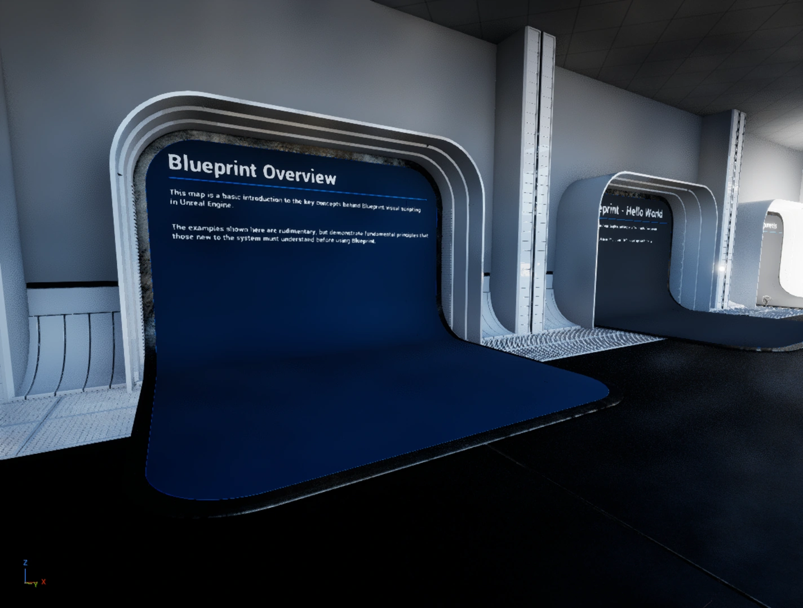

初学者踏入虚幻引擎时，最容易对蓝图（Blueprint Visual Scripting）产生两种极端的误判：要么把它当成“不需要懂编程就能乱连一气的玩具积木”，要么把它轻视为“性能低下、大型项目不可用的策划草稿”。

事实上，当你点击蓝图编辑器左上角的 **Compile（编译）** 按钮时，虚幻引擎的 Kismet 编译器（`FKismetCompilerContext`）正在后台执行一套极其严谨的编译管线：
1. **收集类骨架（Class Layout）**：扫描组件面板（`SimpleConstructionScript`）与成员变量列表，生成与 C++ `UCLASS()` 完全同构的反射类对象 **`UBlueprintGeneratedClass`**（这也是为什么实测档案里所有蓝图实例类名都带有 `_C` 后缀，例如 `BP_HelloWorld_C`）；
2. **展开宏与折叠纯函数（Macro Expansion & Pure Node Evaluation）**：将 `ForLoop`、`DoOnce` 等宏实例内联展开为底层条件跳转原语；
3. **合并事件总图（Ubergraph Flattening）**：将多张事件图表合并编译为单一的字节码入口函数 `ExecuteUbergraph_<BPName>(int32 EntryPoint)`，交由虚幻引擎跨平台字节码虚拟机执行！

`Blueprint_Overview` 这座入门展厅虽然只有短短 8 座展台，却严丝合缝地沿着**“事件触发 -> 组件装配 -> 变量封装 -> 构造期自动化 -> 运行期状态演进 -> 帧循环算术 -> 流程控制原语”**的七层阶梯，把一套现代游戏对象的完整解剖学摊开在了我们面前。

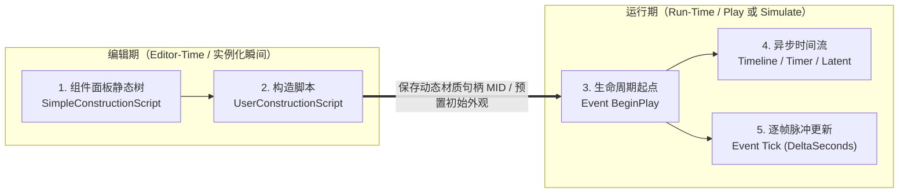

---

## 二、 逐展台 100% 零遗漏深度拆解（#1 ~ #8）

---

### 展台 #1：`Blueprint Overview`（展厅导览与环境基座）
- **展牌标识**：`BP_DemoDisplay8` | **空间坐标**：`(492, -895, 0)`
- **官方展牌原文**：
  > *This map is a basic introduction to the key concepts behind Blueprint visual scripting in Unreal Engine. The examples shown here are rudimentary, but demonstrate fundamental principles that those new to the system must understand before using Blueprint.*

#### 展台构成与关卡脚本基座
本展台位于走廊入口处，负责承载整张地图的光照大气与物理调试基座，共包含 **5 个基础环境 Actor**，关卡蓝图（`/Game/Maps/Blueprint/Blueprint_Overview.Blueprint_Overview_C`）保持零额外属性注入的纯净状态，将全部教学逻辑内聚于各展台的独立 Actor 蓝图中：
- `DirectionalLight`（定向主光源，强度 `5.0`，纯白光，`Movable` 动态阴影）
- `SkyLight`（天空光组件 `SkyLightComponent0`，强度 `3.0`，`Movable`）
- `SkyAtmosphere` 与 `ExponentialHeightFog`（物理大气散射与指数高度雾）
- 承载 `ChaosDebugDrawComponent_0` 的调试辅助 `Actor`

> [!TIP]
> **为什么关卡蓝图（Level Blueprint）在这里完全留空？**  
> 这正是 Epic 在第一座展厅无声传递的第一条架构铁律：**属于对象自身的行为，永远封装在可复用的 Actor 蓝图类（Class Blueprint）里，而不是写死在单张地图的关卡脚本中。**

---

### 展台 #2：`Blueprint - Hello World`（第一个运行期事件驱动蓝图）
- **展牌标识**：`BP_DemoDisplay1` | **空间坐标**：`(1506, -900, 0)`
- **核心陈列资产**：`HelloWorld`（类：`BP_HelloWorld_C`，路径：`/Game/ExampleContent/Blueprints/Blueprints/BP_HelloWorld`，父类：`Actor`）
- **官方展牌原文**：
  > *Using the Event Graph to set text on a Text Render Component. Simulate or Play to see "Hello World" appear in the air.*

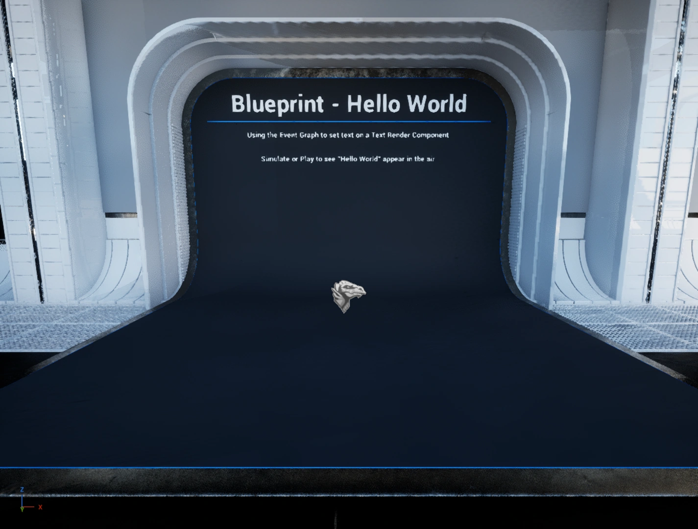

#### 1. 组件结构拆解
打开 `BP_HelloWorld` 的组件树，内部极其精简，仅挂载了两个组件：
- **`Sprite1`（`BillboardComponent`）**：作为场景根部辅助图标。当你在编辑器视口中尚未按下运行键时，空中的文字是空的，正是靠这枚仅在编辑器可见（`bHiddenInGame = true`）的小恐龙/蓝图精灵图标，关卡设计师才能在三维空间里点选并拖拽这个“隐形”的 Actor。
- **`HelloWorld`（`TextRenderComponent`）**：三维文本渲染组件，默认文本留空，等待运行期代码注入。

#### 2. `EventGraph` 内部节点连线全还原
在 `BP_HelloWorld` 中，`UserConstructionScript` 为空；核心逻辑位于 **`EventGraph`** 中，由 4 个核心节点组成一条直白却经典的执行链：

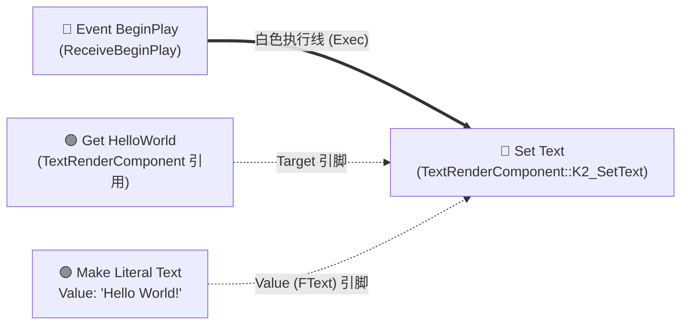

- **执行入口**：红色的 **`Event BeginPlay`** 节点。当你在编辑器工具栏点击 **Play（运行）** 或 **Simulate（模拟）** 的瞬间，引擎为关卡中所有已激活的 Actor 派发一次 `BeginPlay` 生命周期通知。
- **数据准备（Pure Nodes，绿色/无执行线节点）**：
  - **`Get HelloWorld`**：从当前蓝图实例读取名为 `HelloWorld` 的 `TextRenderComponent` 对象引用，连入目标函数的 `Target` 引脚；
  - **`Make Literal Text`**（或直接在引脚框输入）：构造本地化安全的 `FText` 字面量 `"Hello World!"`（注意：UE 中面向屏幕/世界显示的文本一律使用支持多语言本地化的 `FText`，而非内部调试用的 `FString` 或哈希标识符 `FName`）。
- **动作执行（Impure Function，蓝色带执行引脚节点）**：调用 `TextRenderComponent` 的 **`Set Text`**（底层绑定 `K2_SetText`），瞬间让 `"Hello World!"` 悬浮在展台中央。

---

### 展台 #3：`Blueprint - Components`（组合优于继承：组件化预制体哲学）
- **展牌标识**：`BP_DemoDisplay2` | **空间坐标**：`(2498, -900, 0)`
- **官方展牌原文**：
  > *A small selection of Components usable in Blueprints*
- **展台内 3D 悬浮文字标签**：`Sprite Component`、`StaticMesh Component`、`PointLight Component`，以及右侧汇总标签 `Sprite Component / StaticMesh Component / PointLight Component / in single Blueprint Actor`

#### 四组对照蓝图与材质参数实测拆解
本展台没有任何一行 `EventGraph` 连线（4 个蓝图的构造脚本与事件图均为空），它专门用来展示蓝图的**第一大核心职责——数据与组件的容器装配（`SimpleConstructionScript`）**：

| 陈列 Actor 名称 | 对应蓝图资产路径 | 内部挂载组件与实测关键属性 | 典型游戏工程用途 |
| :--- | :--- | :--- | :--- |
| `BP_SpriteComponent` | `.../BP_SpriteComponent` | `Sprite1` (`BillboardComponent`) | AI 巡逻路点、刷怪点、空逻辑管理器（编辑器可见，游戏内零渲染开销） |
| `BP_StaticMeshComponent` | `.../BP_StaticMeshComponent` | `StaticMesh1`：网格体为 `/Engine/EngineMeshes/SM_MatPreviewMesh_01`，槽位 0 覆写材质为 `M_Opaque` | 可复用的静态装饰物、机关底座 |
| `BP_PointLightComponent` | `.../BP_PointLightComponent` | `PointLight1`：强度 `3.14159` ($\pi$)，纯白光，衰减半径 `1024`，`CastShadows = false`，`Movable` | 模块化局部补光灯源 |
| `BP_SeveralComponents` | `.../BP_SeveralComponents` | **单蓝图复合挂载**：同时包含 `Sprite1` + `StaticMesh1`（配 `M_Opaque`）+ `PointLight1`（强度 $\pi$，半径 `1024`） | **完整游戏预制体（如发光路灯、火把、带碰撞与音效的宝箱）** |

- **关联材质资产 `M_Opaque`（`/Game/ExampleContent/Materials/Materials/M_Opaque`）深拆**：
  - 材质域 `MD_Surface`，混合模式 `BLEND_Opaque`，着色模型 `MSM_DefaultLit`；
  - 内部仅含 1 个三维常量节点 `MaterialExpressionConstant3Vector_3`，颜色值为温暖的亮橙色 `(R=1.0, G=0.4936, B=0.0)`，直连主材质节点的 `Base Color` 引脚。

#### 工程设计心法：为什么 UE 没有单独的“Prefab（预制体）”菜单？
从 Unity 转入 UE 的开发者常问：“Prefab 在哪？”展台 #3 的 `BP_SeveralComponents` 给出了标准答案：**Actor 蓝图本身就是血统最纯正、支持多层嵌套继承与逻辑内聚的超集 Prefab！** 在虚幻架构中，你不需要写一个 `GlowingMeshLightActor` C++ 类，只需在一个空 `Actor` 蓝图的 **Components（组件）** 面板里把网格体、点光源、粒子、碰撞盒像搭积木一样挂成父子层级树——移动根组件时，子组件自动保持相对变换同步跟随。

---

### 展台 #4：`Blueprint - Variables`（公有与私有变量的封装边界与实例定制）
- **展牌标识**：`BP_DemoDisplay3` | **空间坐标**：`(3506, -900, 0)`
- **核心陈列资产**：`BP_Variables`（路径：`/Game/ExampleContent/Blueprints/Blueprints/BP_Variables`，父类：`Actor`）

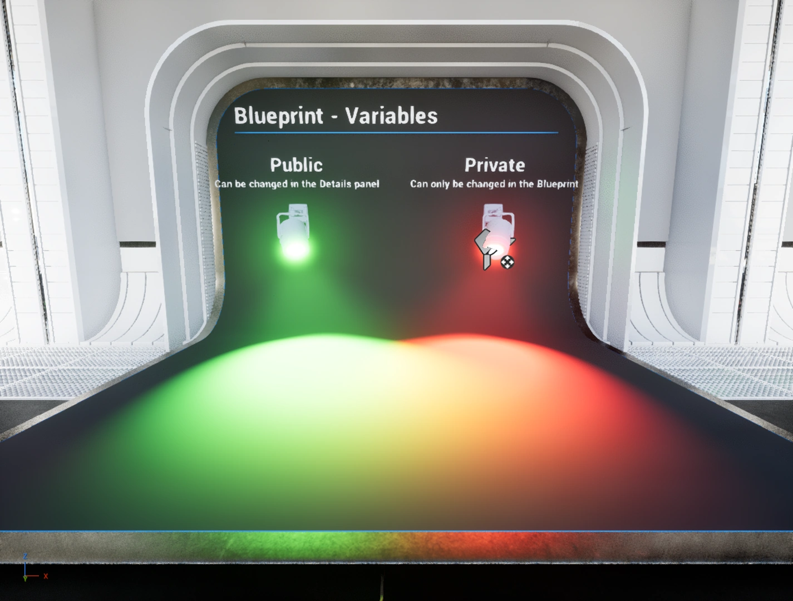

#### 1. 展台视觉现象与组件对称布局
如实拍图所示，墙面上并排安装了两盏工业聚光灯（由底座 `SM_Spotlight_Base`、铰链支架 `SM_Spotlight_Hinge` 与灯筒 `SM_Spotlight` 三段网格拼装而成）：
- **左侧聚光灯（Public 组）**：包含 `PublicWallMount`、`PublicBracket`、`PublicLightFixture` 与动态聚光灯组件 `PublicSpotLight`（强度 `100`，半径 `750`，开启投射阴影），散发着鲜亮的**翠绿色光芒** `(R=0.396, G=1.0, B=0.341)`；
- **右侧聚光灯（Private 组）**：包含 `PrivateWallMount`、`PrivateBracket`、`PrivateLightFixture`、`PrivateSpotLight` 与说明文字 `PrivateDescription`，锁定为刺眼的**深红色光芒** `(R=1.0, G=0.017, B=0.017)`。

#### 2. 成员变量表（Variables）与可见性修饰符
`BP_Variables` 定义了 4 个成员变量，精准划分了“暴露给关卡美术的定制旋钮”与“深藏在类内部的运行缓存”：

| 变量名 | 类型 | `Instance Editable`（睁眼图标） | 变量职责与实测值 |
| :--- | :--- | :---: | :--- |
| `PublicColor` | `LinearColor` | **开启（Public）** | 允许在关卡选中实例后于 Details 面板自由调色；本关实例被覆写为绿色 `(0.396, 1.0, 0.341)` |
| `PrivateColor` | `LinearColor` | **关闭（Private）** | 仅允许在蓝图编辑器内部修改默认值 `(1.0, 0.017, 0.017)`，关卡细节面板中彻底隐藏 |
| `PublicLightLensMaterial` | `MaterialInstanceDynamic` | 关闭（Private） | 缓存左侧灯筒镜片的动态材质实例句柄（`MID_SpotLightLensMaterial_2`） |
| `PrivateLightLensMaterial` | `MaterialInstanceDynamic` | 关闭（Private） | 缓存右侧灯筒镜片的动态材质实例句柄 |

#### 3. `UserConstructionScript` 完整节点链还原
为什么不运行游戏，你在关卡编辑器里拖动 `PublicColor` 拾色器，聚光灯的光束和灯头玻璃镜片就会**实时同步变色**？秘密全在 **`Construction Script`（构造脚本）** 的 3 步连线中：

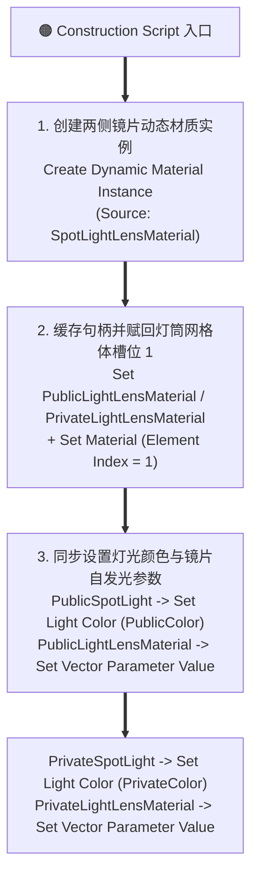

1. **创建动态材质实例（MID）**：灯筒模型 `SM_Spotlight` 有两个材质槽（槽位 0 是金属外壳，槽位 1 是灯头玻璃镜片 `SpotLightLensMaterial`）。构造脚本分别为左右灯筒调用 `Create Dynamic Material Instance`，将返回的动态材质引用存入 `PublicLightLensMaterial` 与 `PrivateLightLensMaterial` 变量（注意：这里直接使用了 `Set` 变量节点右侧自带的返回值直出引脚 `Output_Get`，省去了额外拖一个 `Get` 节点的连线冗余），并调用 `Set Material (Element Index = 1)` 贴回灯筒；
2. **光效与材质双剑合璧**：单纯改 `SpotLightComponent` 的 `Set Light Color` 只能让照在地板上的光斑变绿，灯筒本身的玻璃镜片如果不改自发光颜色就会显得“假熄火”。因此脚本将同一个 `PublicColor` 同时喂给 `PublicSpotLight -> Set Light Color` 和 `PublicLightLensMaterial -> Set Vector Parameter Value`，实现了光源与灯罩材质的绝对一致！

> [!IMPORTANT]
> **面向对象封装铁律（最小暴露原则）**：  
> 绝不要图省事把蓝图里所有变量的小眼睛（`Instance Editable`）都点亮！如果把 `PublicLightLensMaterial` 这种内部材质句柄也暴露到关卡 Details 面板，关卡美术一旦误点清空，整套逻辑就会报 `Accessed None` 空指针错误。**只暴露意图参数（如颜色、开关、强度），绝不暴露内部状态缓存！**

---

### 展台 #5：`Blueprint - ConstructionScript`（静态组件树 vs 构造脚本动态增删组件）
- **展牌标识**：`BP_DemoDisplay4` | **空间坐标**：`(4508, -900, 0)`
- **官方展牌原文**：
  > *The Construction Script is executed once at creation of the object; here it is used to add components to Blueprint Actor.*
- **展台内陈列对比 Actor（2 个）**：
  1. 左侧对照品：`BP_SeveralComponents_2`（直接复用展台 #3 在组件面板静态添加好三个组件的蓝图）
  2. 右侧主角：`BP_ConstructionScript`（路径：`/Game/ExampleContent/Blueprints/Blueprints/BP_ConstructionScript`）

#### 1. 公开布尔开关变量与动态生成的组件名特征
仔细观察实测档案中 `BP_ConstructionScript` 实例的组件命名，你会发现一个极具辨识度的底层特征：
- 左侧静态添加的组件名叫：`StaticMesh1`、`PointLight1`；
- 右侧由构造脚本生成的组件名却叫：**`NODE_AddStaticMeshComponent-0`**、**`NODE_AddPointLightComponent-0`**（且标记为 `EComponentCreationMethod::UserConstructionScript`）！

`BP_ConstructionScript` 暴露了 3 个 `Instance Editable` 布尔变量（关卡实例中默认均为 `true`）：
- `AddSpriteComponent`（是否动态挂载广告牌组件）
- `AddStaticMeshComponent`（是否动态挂载橙色材质球网格体）
- `AddLightComponent`（是否动态挂载点光源）

#### 2. `UserConstructionScript` 内部节点连线全还原
构造脚本由 3 组串联的 **`Branch`（条件分支 `K2Node_IfThenElse`）** 与 **`Add ... Component`（`K2Node_AddComponent`）** 节点构成：

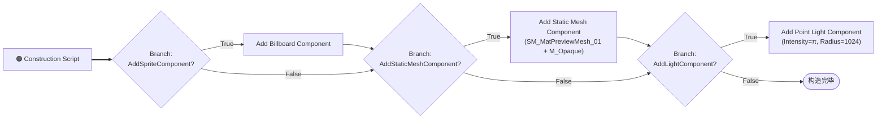

- 当关卡策划在编辑器里取消勾选 `AddLightComponent` 的一瞬间，虚幻引擎会**立即销毁旧的构造脚本生成组件，并重新跑一遍 `UserConstructionScript`**，此时第三个 `Branch` 走 `False` 分支，点光源组件当场从该实例上彻底移除——零残留内存、零运行期点光源渲染开销！

> [!WARNING]
> **构造脚本的性能红线**：  
> 在编辑器视口里用鼠标拖动 Actor 滑行 1 秒钟，`Construction Script` 可能会连续重跑几十次！因此：
> 1. 构造脚本里适合做**按需挂载模块化组件、计算样条栅栏木桩数量、初始化动态材质实例**；
> 2. **严禁**在构造脚本里做全图 `GetAllActorsOfClass` 暴力扫描或生成成千上万个未合并的独立 `StaticMeshComponent`（大量重复几何体请务必改用 `InstancedStaticMeshComponent` / `HISM`！）。

---

### 展台 #6：`Blueprint - Event Graph`（编辑期构造脚本与运行期时间轴的双剑接力）
- **展牌标识**：`BP_DemoDisplay5` | **空间坐标**：`(5506, -900, 0)`
- **核心陈列资产**：`BP_EventGraph`（路径：`/Game/ExampleContent/Blueprints/Blueprints/BP_EventGraph`，父类：`Actor`）
- **官方展牌原文**：
  > *Set the rocket color for the Construction Script and Event Graph. The Blueprint setup allows you to change the Material Colors. Select the rocket and change Colors without editing the Material.*

#### 1. 火箭资产与变量清单
展台上陈列着一枚卡通小火箭（静态网格体 `SM_ExampleMesh_Rocket`，母材质实例 `BlueprintRocket_Inst`），内部配有时间轴组件 `Color Blend Timeline` 与 3 个核心变量：
- `ConstructionScriptColor`（`LinearColor`，公开可编辑）：编辑器态初始涂装颜色，实测实例值为亮紫品红色 `(R=0.862, G=0.0075, B=0.848)`；
- `EventGraphColor`（`LinearColor`，公开可编辑）：游戏运行后过渡的目标涂装颜色，实测实例值为深邃蔚蓝色 `(R=0.0756, G=0.0954, B=1.0)`；
- `RocketDynamicMat`（`MaterialInstanceDynamic`，私有缓存）：保存构造期创建的火箭动态材质实例（`MID_BlueprintRocket_Inst_1`）。

#### 2. 跨图表协同：从 `Construction Script` 到 `Event Graph` 的完整节点链
这是整张地图最具架构美感的一座展台——它完美演示了**如何让构造脚本与事件图共享同一个动态材质句柄**：

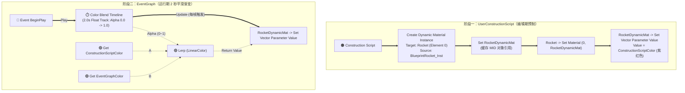

- **为什么不在 `BeginPlay` 里才调用 `Create Dynamic Material Instance`？**  
  如果等到 `BeginPlay` 才创建动态材质，那么关卡美术在编辑器里调整 `ConstructionScriptColor` 时，视口里的火箭根本不会变色，只能“盲调”完进游戏看效果！而在 `Construction Script` 中先行创建 `MID`、赋上初始色并缓存进 `RocketDynamicMat` 变量，不仅让编辑期拥有所见即所得的实时预览，而且进入 `BeginPlay` 后无需二次创建材质，直接拿起现成的 `RocketDynamicMat` 配合 **2 秒长的 `Color Blend Timeline` + `Lerp (LinearColor)`** 就能丝滑完成紫红到蔚蓝的渐变！

---

### 展台 #7：`Blueprint - Simple Math`（逐帧算术累加、类型转换链与帧率陷阱）
- **展牌标识**：`BP_DemoDisplay6` | **空间坐标**：`(6503, -900, 0)`
- **核心陈列资产**：`BP_SimpleMath`（路径：`/Game/ExampleContent/Blueprints/Blueprints/BP_SimpleMath`，父类：`Actor`）
- **官方展牌原文**：
  > *This Blueprint uses the Event Tick to add every Tick +1 to the Integer Variable.*

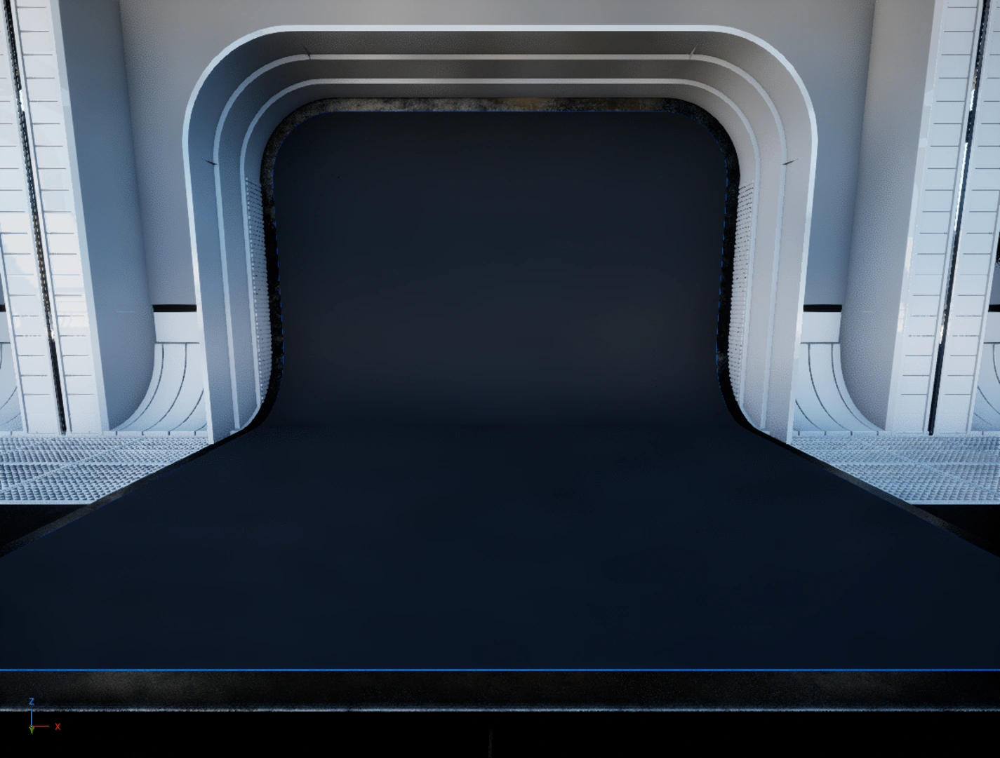

#### 1. 组件与变量结构
- **组件**：`SceneRoot`（场景根）、`Label`（固定标题文本组件）、`Time`（动态刷新数值的 `TextRenderComponent`）。
- **成员变量**：`IntegerVariable`（`int32`，初始默认值 `0`）。

#### 2. `EventGraph` 内部节点连线全还原
打开 `BP_SimpleMath` 的事件图，一条经典的“读取 -> 运算 -> 写回 -> 转型输出”流水线跃然眼前：

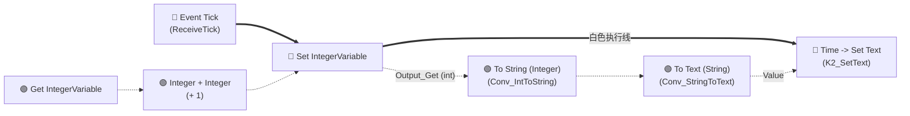

- **隐式转型节点（Conversion Nodes）**：在蓝图中，当你把 `Set IntegerVariable` 右侧的绿色整数输出引脚直接拖向 `Set Text` 的粉色 `FText` 输入引脚时，蓝图编辑器会自动在中间插入两个紧凑型无标题转换圆点：**`Conv_IntToString`**（整数转字符串）与 **`Conv_StringToText`**（字符串转本地化文本）。

#### 3. 首席程序员深度警示：`Event Tick + 1` 的帧率依赖大坑！
仔细看展台组件明明起名叫 `Time`，说明注释里甚至曾写着 `Seconds of Game Time`，但实际运行后你会发现数字疯涨——在 60 FPS 的机器上 1 秒钟涨 60，在 120 FPS 的高刷屏上 1 秒钟涨 120！
- **核心教训**：`Event Tick` 是**按渲染帧触发**而非按固定物理时间步长触发！任何速度、位移、蓄力或冷却计算，一旦在 `Event Tick` 中脱离了它自带的 **`Delta Seconds`（上一帧到当前帧流逝的真实秒数）** 引脚直接硬加常数，你的游戏在不同配置电脑上的运行快慢就会完全失控！
- 如果真想实现“每秒钟精准 `+1` 的秒表”，在生产级蓝图中应当在 `BeginPlay` 调用 **`Set Timer by Event (Time = 1.0, Looping = true)`**——平时零每帧轮询开销，每秒准时唤醒一次！

---

### 展台 #8：`Blueprint - Flow Control`（四大流程控制原语驱动金币动画与粒子特效）
- **展牌标识**：`BP_DemoDisplay7` | **空间坐标**：`(7509, -900, 0)`
- **核心陈列资产**：`BP_FlowControl`（路径：`/Game/ExampleContent/Blueprints/Blueprints/BP_FlowControl`，父类：`Actor`）
- **官方展牌原文**：
  > *This Blueprint uses different type of flow control nodes to modify movement, color and effects.*

#### 1. 金币道具组件与 6 大控制变量深拆
展台中央悬浮着一枚闪闪发光的拾取物金币（组件 `Coin`，静态网格体 `SM_Pickup_Coin`，材质 `M_Pickup_Coin`），公开了丰富的交互调试变量供读者在运行中实时拨动测试：

| 变量名 | 类型 | 默认实测值 | 内部控制职责（源自蓝图实测 Tooltip 还原） |
| :--- | :--- | :--- | :--- |
| `BranchCondition` | `bool` | `false` | 喂给 `Branch` 节点：`true` 时将金币材质染成绿色，`false` 时染成红色 |
| `MovementDirection` | `BP_FlowControl_Enum` | `None` / 枚举项 | 喂给 `Switch on Enum` 节点：选择金币沿上下（Up/Down）还是左右（Left/Right）正弦往复运动 |
| `NumberOfSparks` | `int32` | `5` | 喂给 `ForLoop` 的 `Last Index`：控制每次金币迸发出的 Niagara 火花粒子束数量 |
| `ElapsedTime` | `double` | `0.0` | 逐帧累加 `DeltaSeconds`，作为正弦波 `Sin(ElapsedTime)` 的相位角输入 |
| `CoinMaterial` | `MaterialInstanceDynamic` | `MID_M_Pickup_Coin_0` | 构造脚本中为 `Coin` 网格体创建的动态材质实例引用 |
| `IntegerVariable` | `int32` | `0` | 辅助流程计数变量 |

#### 2. `UserConstructionScript` 与 `EventGraph` 完整节点链还原
- **构造脚本（`UserConstructionScript`）**：对 `Coin` 静态网格体调用 `Create Dynamic Material Instance`（源材质 `M_Pickup_Coin`），存入变量 `CoinMaterial`，为后续实时改色铺好通道。
- **事件图表（`EventGraph`）—— 四大流程控制节点同台炫技**：

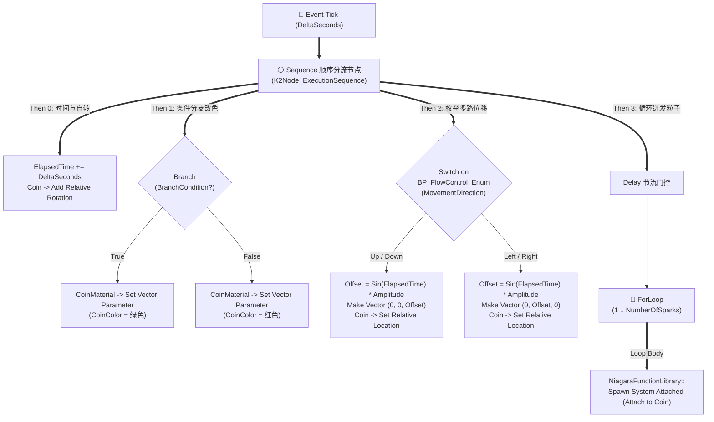

让我们逐一把这四颗高频流程控制节点的工程语义吃透：
1. **`Sequence`（顺序执行器 `K2Node_ExecutionSequence`）**：  
   不要误以为 `Sequence` 是多线程并行！它在**同一帧、同一个调用栈内严格按照 `Then 0 -> Then 1 -> Then 2 -> Then 3` 的先后顺序同步执行**。它的真正价值是**消除横向长达三米的面条连线**——把“更新时间”、“改颜色”、“算位移”、“放特效”拆成纵向整齐排列的四条短支路，图表可读性立竿见影提升十倍！
2. **`Branch`（条件分支 `K2Node_IfThenElse`）**：  
   即代码中的 `if (BranchCondition) { ... } else { ... }`（快捷键按住 **`B` + 鼠标左键** 秒建）。
3. **`Switch on Enum`（强类型枚举多路路由 `K2Node_SwitchEnum`）**：  
   相比用一串 `0, 1, 2` 魔术数字做 `Switch on Int`，自定义枚举资产 `BP_FlowControl_Enum` 让每条输出执行引脚都自动带上自解释的业务名称（如上下浮动 vs 左右横移），新增枚举值时蓝图节点还会自动长出对应引脚！
4. **`ForLoop`（标准宏 `K2Node_MacroInstance`）+ `Delay` 潜伏节点（Latent Action）**：  
   注意在 `Sequence` 的最后一条支路中，如果前面挂了 `Delay` 节点，当执行流撞上正在倒计时的 `Delay` 时会直接重入忽略（天然充当节流阀），倒计时归零的瞬间触发后方的 `ForLoop`，一口气循环 `NumberOfSparks`（5）次调用 `Spawn System Attached`，在金币表面炸开一簇绚丽的 Niagara 火花！

---

## 三、 本章核心架构心法小结

走完 `Blueprint_Overview` 的全部 8 座展台，请将这四条底层心法刻入你的虚幻开发直觉中：
1. **组件拼装即预制体**：优先用 `Components` 面板组合网格体、光源与碰撞体（静态 `SimpleConstructionScript`），仅在需要根据参数动态裁切组件数量时才动用 `Construction Script` 的 `Add Component`。
2. **编辑期与运行期各司其职**：在 `Construction Script` 中完成 `Create Dynamic Material Instance` 句柄缓存与初始外观预览；在 `Event Graph` 中利用 `BeginPlay` + `Timeline` 驱动运行期平滑过渡。
3. **严守变量封装红线**：只对关卡设计师需要调参的输入项开启 `Instance Editable`（睁眼图标），内部对象引用与运行时状态一律保持 `Private`。
4. **警惕 `Event Tick` 与帧率陷阱**：凡涉及连续时间演进必乘 `Delta Seconds`，凡能用事件/定时器/Timeline 唤醒的逻辑绝不空跑 `Tick`，善用 `Sequence` 与 `Switch on Enum` 让蓝图图表如教科书般清爽整洁！
