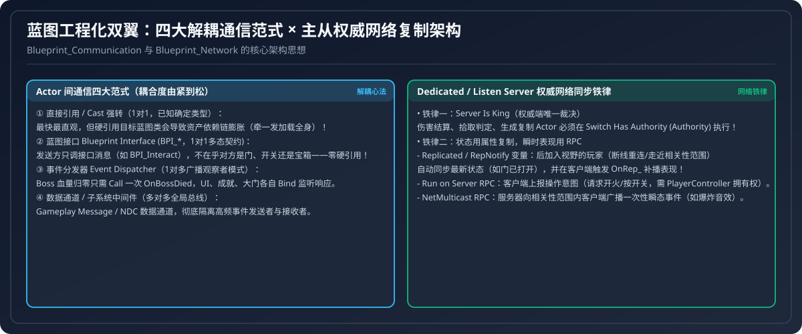
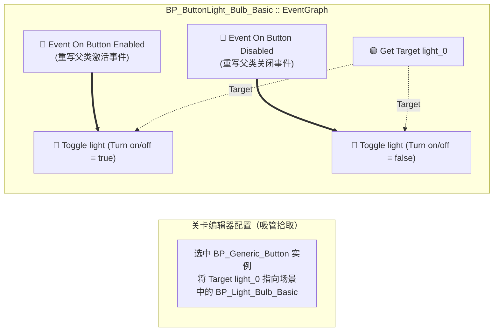
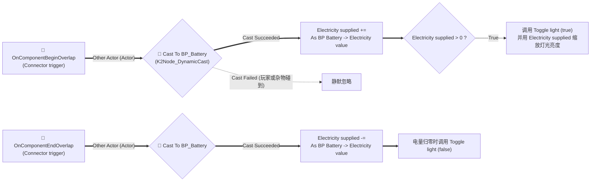
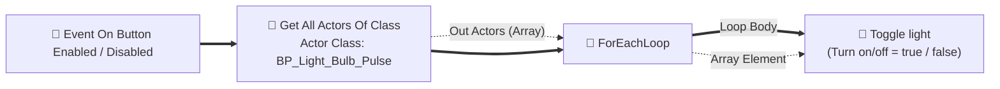
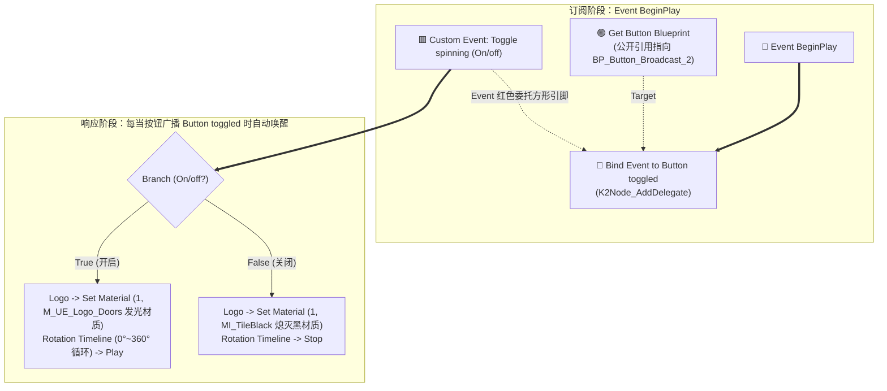
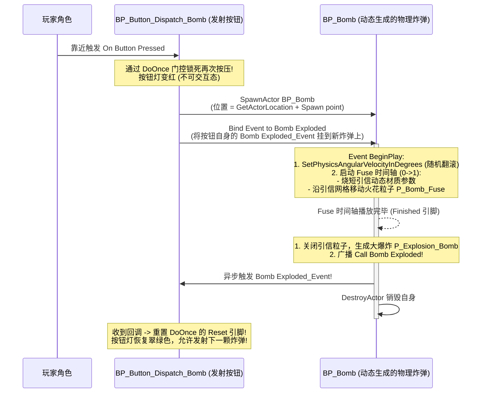
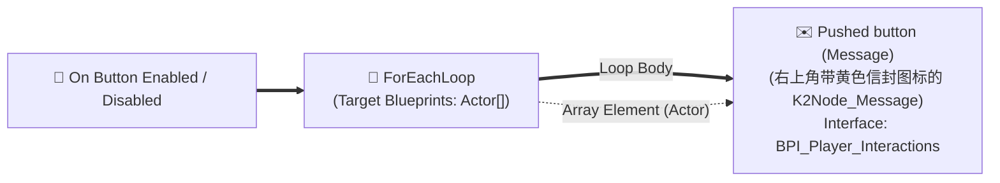
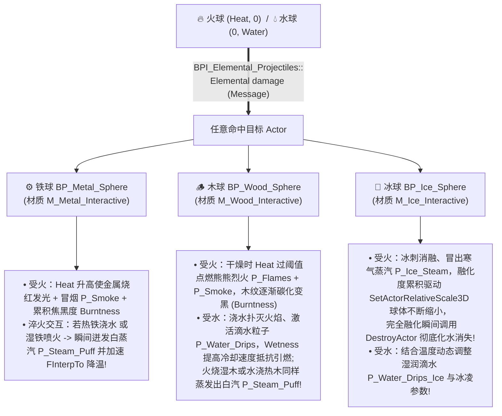

# 第 02 章 · `Blueprint_Communication`：蓝图四大通信范式——直连、类型强转、蓝图接口与事件分发器架构全解

> **关卡资产路径**：`/Game/Maps/Blueprint/Blueprint_Communication`  
> **示例资产目录**：`/Game/ExampleContent/Blueprint_Communication/Blueprints/` 与 `/Game/Global/Blueprints/Interactive/`  
> **关卡实测规模**：总计 `114` 个 Actor | `11` 座编号展台 | `89` 个示例 Actor  

---

## 一、 架构总纲：为什么“蓝图通信”是区分初级连线员与首席玩法架构师的分水岭？

如果说上一章 `Blueprint_Overview` 教你如何打造一颗功能完备的“单细胞神经元”，那么本章 `Blueprint_Communication` 教你搭建的就是整座游戏的**“中枢神经系统”**。

在真实工业级虚幻项目中，90% 的内存爆炸、编译卡死、循环依赖崩溃与“改一个开关牵连三十个系统报错”的灾难，根源全在于**选错了蓝图之间的通信方式**。当你写下“物体 A 通知物体 B 做某件事”之前，首席架构师脑海中永远先过一遍下面这张通信决策与网络同步全景架构图：

### 四大通信范式工程选型速查矩阵

| 通信范式 | 方向与基数 | 发送方是否知晓接收方具体类？ | 资产内存硬引用（Hard Ref）风险 | 黄金适用场景与本关对应展台 |
| :--- | :---: | :---: | :---: | :--- |
| **1. 实例直连引用（Direct Reference）** | `1 -> 1` | **是**（持有强类型对象变量） | 高（同关卡静态绑定可接受） | 关卡内确定配对的固定机关（如 A 电闸专控 B 吊灯）—— **展台 #2** |
| **2. 动态类型转换（`Cast To`）** + `GetAllActorsOfClass` | `1 -> 1` 或 `1 -> N` | **是**（字节码硬绑定目标类） | **极高！（内存传染病头号元凶）** | 碰撞触发检测特定父类家族（电池插槽识别大小电池）—— **展台 #3, #4, #5** |
| **3. 事件分发器（Event Dispatcher）** | `1 -> N`（广播） | **完全不知**（发送方零依赖） | 仅订阅方引用事件源，事件源纯净 | 观察者模式：按钮按动、炸弹爆炸、角色阵亡通知 UI/成就/音效—— **展台 #6, #7, #8** |
| **4. 蓝图接口（Blueprint Interface）** | `1 -> 1` 或 `1 -> N` | **完全不知**（仅依赖轻量契约） | **零硬引用！（工业解耦之王）** | 异构多态交互：玩家按 E 交互万物、水火球命中木/铁/冰不同材质—— **展台 #9, #10, #11** |

---

## 二、 关卡全局交互框架预拆解（GameMode、Character、HUD 与按钮基类族）

在逐座展台漫游之前，我们先拆解支撑整张 `Blueprint_Communication` 地图运转的两套底层底座（均由实测字节码完整还原）：

### 1. 本关专属玩家三件套（`BP_GameMode_BP_Comms`）
- **`MyCharacter_BP_Comms`**（继承自全局 `PlayerCharacter`）：除了常规第一人称移动，还内置了两套核心交互管线：
  1. **近身抓取射线/重叠交互**：检测最近的实现了 `BPI_Player_Interactions` 接口的机关（展台 #10），将鼠标拖拽的二维向量 `Player aim movement` 实时传入机关，并接收把手注视点旋转视角；
  2. **元素法术发射器**：当布尔变量 `Powers enabled` 在展台 #11 区域被激活后，按住左键启动循环定时器发射火球 `BP_Projectile_Fireball`，按住右键发射水球 `BP_Projectile_Water`。
- **`BP_HUD_BP_Comms`**（继承自 `HUD`）：重写 `Event ReceiveDrawHUD` 绘制准星；当 `Powers enabled` 变为真时，通过 `DoOnce` 唤醒 `Text pop` 时间轴动画，在屏幕下方弹出 `"Left click: Shoot fire / Right click: Shoot water"` 的操作提示。

### 2. 展厅按钮三层继承树（`/Game/Global/Blueprints/Interactive/`）
展厅中几乎所有展台前的立柱按钮，都优雅地复用了同一棵面向对象继承树：
- **顶层基类 `BP_Button_Parent`**：在构造脚本中为按钮网格 `Display_Button` 创建动态材质实例存入 `Button light material`，实现 `BPI_PlayerInteraction` 接口响应玩家准星悬停与按压，切换按钮红/绿自发光标量参数；
- **乒乓开关中间类 `BP_Button_Parent_Toggle`**：每次玩家交互时对布尔状态取反（`NOT`），派发虚事件 `On Button Enabled` 与 `On Button Disabled` 供各展台子蓝图重写；
- **单次触发中间类 `BP_Button_Parent_SinglePress`**：按下后派发 `On Button Pressed`，专为展台 #8 的定时炸弹发射器打造。

---

## 三、 逐展台 100% 零遗漏深度拆解（#1 ~ #11）

---

### 展台 #1：`Blueprint Communication`（展厅总序言）
- **展牌标识**：`BP_DemoDisplay20` | **空间坐标**：`(500, -900, 0)`
- **官方展牌原文**：
  > *This map provides examples of ways that Blueprints can communicate with one another. Included are demonstrations of direct communication via casting, using Event Dispatchers, and sending data between Blueprints using Interfaces.*
- **展台环境陈列（5 个基础 Actor）**：`SkyLight`（强度 `3.0`）、`SkyAtmosphere`、`ExponentialHeightFog`、Chaos 调试容器 `Actor` 以及 `Blueprint Communication Documentation` 文档链接节点。展厅地面铺设了直观的金属导管（`SM_Pipe_Straight`、`SM_Pipe_Bend`）来隐喻信号从按钮流向目标装置的拓扑路径。

---

### 展台 #2：`Basic communication with a target blueprint`（公开实例引用的 1 对 1 直连通信）
- **展牌标识**：`BP_DemoDisplay19` | **空间坐标**：`(1498, -900, 0)`
- **官方展牌原文**：
  > *This example features a button Blueprint that toggles a light Blueprint on and off via a custom event. Approach the button while playing to activate it.*
- **展台陈列核心资产**：按钮实例 `BP_Generic_Button`（类：`BP_ButtonLight_Bulb_Basic_C`）通过金属管道连接墙上的白炽灯泡 `BP_Light_Bulb_Basic`（类：`BP_Light_Bulb_Basic_C`）。

#### 1. 接收方拆解：白炽灯泡 `BP_Light_Bulb_Basic` 内部节点链
灯泡蓝图不依赖任何按钮，它只管把自己封装成一台“提供标准开关接口的家用电器”：
- **组件与材质**：挂载灯泡网格 `Light bulb`（`SM_Lightbulb`，拥有槽位 0 玻璃泡壳 `M_Light_Bulb_Glass` 与槽位 1 灯座金属两套材质）、动态点光源 `Light`（暖白光 `(1.0, 0.922, 0.769)`，半径 `350`，初始强度 `0`）以及时间轴组件 **`Light flash`**。
- **`UserConstructionScript`**：调用两次 `Create Dynamic Material Instance` 分别创建槽位 0 与槽位 1 的动态材质实例，存入 `Light bulb material 1` 与 `Light bulb material 2`。
- **`EventGraph` 核心入口**：定义了一个带布尔参数的自定义事件 **`Custom Event: Toggle light (Turn on/off: bool)`**，连入 `Branch` 分支：
  - 当 **`Turn on/off == true`（开灯）**：触发 `Light flash` 时间轴从头播放（模拟钨丝通电瞬间的电压闪烁曲线），在 `Update` 引脚实时驱动自定义函数 `Update light color`——同步修改 `Light` 组件的 `Set Intensity` / `Set Light Color` 与玻璃材质的 `Emissive color` 向量参数；
  - 当 **`Turn on/off == false`（关灯）**：先调用 `Light flash -> Stop` 中断正在播放的闪烁时间轴，再将灯光颜色与材质自发光直接置黑归零！

#### 2. 发送方拆解：开关按钮 `BP_ButtonLight_Bulb_Basic` 内部节点链
按钮继承自 `BP_Button_Parent_Toggle`，内部新增了一个类型为 **`BP_Light_Bulb_Basic` 对象引用**、且点亮了睁眼图标（`Instance Editable = true`）的公开变量 **`Target light_0`**：

- **工程边界评价**：这种“公开强类型引用 + 关卡吸管拾取（Eyedropper Tool）”是关卡机关白盒搭建最快的方式；但缺点也显而易见——`BP_ButtonLight_Bulb_Basic` 被死死焊在了 `BP_Light_Bulb_Basic` 这一个类上，哪怕你想让它去开一扇门或一盏 LED 灯，吸管都会拒绝拾取！

---

### 展台 #3：`Blueprint communication via actor casting`（碰撞重叠检测与 `Cast To` 动态类型转换）
- **展牌标识**：`BP_DemoDisplay11` | **空间坐标**：`(2510, -900, 0)`
- **官方展牌原文**：
  > *In this example, a lightbulb Blueprint is toggled on and off by connecting a battery. The lightbulb uses an overlap event to detect contact with the battery Blueprint and turns on/off accordingly.*
- **展台陈列三件套**：按钮 `BP_Battery_Button_2`（`BP_Button_Battery_C`） -> 中号电池 `BP_Battery`（`SM_Battery_Medium`） -> 电池供电灯泡 `BP_Light_Bulb_Battery_Powered`。

#### 1. 按钮驱动电池升降：`BP_Button_Battery` -> `BP_Battery`
1. 按钮 `BP_Button_Battery` 持有公开引用 `Target battery`，按下与弹起时调用 `BP_Battery` 上的自定义事件 **`Move up/down (Reverse movement: bool)`**；
2. 在 `BP_Battery` 内部：
   - **成员变量**：公开浮点电量 **`Electricity value`**（代表这节电池的供电功率）与静态网格体变量 `Battery mesh`（构造脚本调用 `Set Static Mesh` 应用该模型）；
   - **升降动画**：`Move up/down` 根据布尔方向驱动时间轴 `Movement` 正向 `Play` 或反向 `Reverse`，在 `Update` 中同时执行向量插值 `VLerp`（向上平移插入灯座）与旋转插值 `RLerp`（旋紧电池触点），驱动 `Set Relative Location` 与 `Set Relative Rotation`！

#### 2. 核心焦点：灯泡 `BP_Light_Bulb_Battery_Powered` 如何识别撞上来的是电池？
当电池缓缓升起，其顶部的碰撞盒与灯泡底部的触发盒 **`Connector trigger`** 发生物理重叠。但引擎物理系统派发的 `OnComponentBeginOverlap (Connector trigger)` 给出的引脚 `Other Actor`，静态类型仅仅是最顶层的基类 **`Actor`**！在 `Actor` 基类上，根本不存在 `Electricity value` 这个变量！

于是，`BP_Light_Bulb_Battery_Powered` 在 `EventGraph` 中构建了如下完整执行链：

> [!NOTE]
> **细节满分的设计**：实测字节码还揭示出，`BP_Light_Bulb_Battery_Powered` 在 `Event BeginPlay` 时还主动调用了一次 `Connector trigger -> GetOverlappingActors` 并循环 `Cast To BP_Battery`！为什么？因为如果关卡设计师在编辑器里摆关卡时直接把电池插在灯座里开局，运行瞬间不会触发新的 `BeginOverlap` 边沿事件——这步 `BeginPlay` 初始重叠扫描保证了开局已插好的电池也能正常点亮灯泡！

> [!CAUTION]
> **架构师红线警告：`Cast To` 背后的“硬引用内存雪崩”（Hard Reference Chain）！**  
> 很多新手习惯在玩家蓝图里写一排：`Cast To BP_Goblin` -> 失败则 `Cast To BP_DragonBoss` -> 失败则 `Cast To BP_Chest`。  
> 请记住虚幻引擎资产加载器的铁律：**只要蓝图 A 的图表里出现了一个 `Cast To BP_DragonBoss` 节点，哪怕当前新手村地图里连一根龙毛都没有，引擎在加载蓝图 A 时就会强制把 `BP_DragonBoss` 的类、4K 贴图、全身骨骼动画、火焰粒子和咆哮音频全部同步加载进物理内存！**  
> - **什么时候允许 `Cast To`？** 仅用于 C++ 原生轻量基类（如 `Cast To Character`、`Cast To PlayerController`），或像本展台中灯泡与电池本来就必定同时出现在同一关卡的小体量配对资产。  
> - **跨系统未知对象交互怎么办？** 请往下看展台 #9 ~ #11 的 **Blueprint Interface**！

---

### 展台 #4：`Blueprint communication via actor casting to child Blueprint`（向上转型与父子继承多态）
- **展牌标识**：`BP_DemoDisplay` | **空间坐标**：`(3498, -900, 0)`
- **官方展牌原文**：
  > *These lightbulb Blueprints are turned on/off by connecting different types of batteries. Each battery is derived from the same parent Blueprint, but has different energy values that affect the brightness of the light.*

#### 三组并排电池功率对照实验
本展台一口气并排架设了 3 套完全相同的灯泡（`BP_Light_Bulb_Battery_Powered`）与按钮（`BP_Button_Battery`），唯一不同的是中间放置的 3 节电池分属同一继承家族的不同代数：

| 实验列 | 电池实例名 | 蓝图类与父类继承链 | 挂载网格体 | 供电亮度表现 |
| :---: | :--- | :--- | :--- | :--- |
| 左列 | `BP_Battery_Small` | `BP_Battery_Small_Child` $\to$ 继承自 `BP_Battery` | `SM_Battery_Small`（9V 小方块电池） | `Electricity value` 最小 $\to$ 灯泡微弱昏黄 |
| 中列 | `BP_Battery_2` | 基类 `BP_Battery` 本尊 | `SM_Battery_Medium`（圆柱中号电池） | `Electricity value` 中等 $\to$ 灯泡正常亮起 |
| 右列 | `BP_Battery_Big` | `BP_Battery_Big_Child` $\to$ 继承自 `BP_Battery` | `SM_Battery_Big`（重型工业蓄电池） | `Electricity value` 最大 $\to$ 灯泡炽烈耀眼 |

#### 内部字节码真相：子蓝图里一行新节点都没写！
实测拆解 `BP_Battery_Small_Child.uasset` 与 `BP_Battery_Big_Child.uasset` 发现，它们的 `EventGraph` 完全为空，`Construction Script` 也仅仅是默认调用父类 `Parent: Construction Script`（`K2Node_CallParentFunction`）——子类仅仅在 **Class Defaults（类默认值）** 面板里修改了继承自父类的两个变量默认值：`Battery mesh` 与 `Electricity value`！

而上方的三颗灯泡依然是展台 #3 里一模一样的 `BP_Light_Bulb_Battery_Powered`，内部只有一句 **`Cast To BP_Battery`（转换到父类）**！由于 `Small_Child` 和 `Big_Child` 满足面向对象的 **`Is-A`（是一个父类实例）** 关系，`Cast To BP_Battery` 对三个子类**全部转换成功**，并多态读取出各自不同的 `Electricity value`！

---

### 展台 #5：`Communicating with all actors of a specific class`（按类全图检索与一对多群控）
- **展牌标识**：`BP_DemoDisplay15` | **空间坐标**：`(4498, -900, 0)`
- **官方展牌原文**：
  > *This collection of lightbulb Blueprints are all turned on and off by one button. The button Blueprint finds all instances of the lightbulb class and calls the "Toggle light" custom event in each of them.*
- **展台陈列资产**：1 枚总控按钮 `BP_Pulse_Button_6`（`BP_Button_Light_Bulb_Pulse_C`）与墙上阵列排布的 **6 盏脉动呼吸灯** `BP_Light_Bulb_Pulse_2 ~ 7`（`BP_Light_Bulb_Pulse_C`）。

#### 1. 发送方拆解：`BP_Button_Light_Bulb_Pulse` 内部节点链
注意看实测变量表——这枚按钮身上**没有任何公开变量**（无需美术用吸管连 6 次线）！它的 `EventGraph` 直接利用引擎全局静态库搜寻目标：

#### 2. 接收方拆解：`BP_Light_Bulb_Pulse` 为何 6 盏灯闪烁节奏各不相同？
明明被同一个 `ForEachLoop` 在同一帧同时唤醒，为什么墙上 6 盏灯却呈现出错落有致、五彩斑斓的呼吸流光？实测字节码揭示了 `BP_Light_Bulb_Pulse` 里的两处巧思：
1. **随机播放速率**：开灯瞬间调用 `Random Float in Range`，通过 **`Light pulse -> Set Play Rate`** 为每盏灯的时间轴赋予独一无二的呼吸频率；
2. **随机双色插值**：生成随机色彩，在 `Light pulse` 时间轴（0 到 1 往复循环）的 `Update` 中调用 `LinearColorLerp` 在两种颜色间平滑过渡，同步刷新点光源（开启了动态阴影 `castShadows: true`）与玻璃材质自发光。

> [!WARNING]
> **`Get All Actors Of Class` 性能铁律**：  
> 该节点底层会遍历当前 `UWorld` 的 Actor 哈希桶，时间复杂度与关卡内 Actor 总数相关。**在按钮点击、`BeginPlay` 初始化缓存等低频事件中使用完全合法；但绝对禁止将其连在 `Event Tick` 上每帧调用！**

---

### 展台 #6：`Using an Event Dispatcher function to call an event in the Level Blueprint`（事件分发器第一式：关卡蓝图订阅）
- **展牌标识**：`BP_DemoDisplay12` | **空间坐标**：`(5998, -900, 0)`
- **官方展牌原文**：
  > *This is an example of a button Blueprint toggling a lightbulb Blueprint on and off via an Event Dispatcher function. The button calls the Event Dispatcher, which fires the event in the Level Blueprint to toggle the light on or off.*
- **展台陈列资产**：广播按钮 `BP_Button_Broadcast`（类：`BP_Button_Dispatch_C`）与普通白炽灯泡 `BP_Light_Bulb_Basic_2`（直接复用展台 #2 的灯泡类！）。

#### 1. 事件源的彻底净化：`BP_Button_Dispatch`
从展台 #6 开始，我们正式进入**观察者模式（Observer Pattern / Publish-Subscribe）**殿堂！打开 `BP_Button_Dispatch`：
- 它不再引用任何灯泡、任何门、任何齿轮；
- 它在左侧 **Event Dispatchers（事件分发器）** 栏定义了一个多播委托签名：**`Button toggled (On/off: bool)`**；
- 在 `EventGraph` 中，当按钮开启或关闭时，它只干一件事——扯开嗓子向虚空广播一句 **`Call Button toggled`**（底层节点 `K2Node_CallDelegate`）！至于有没有人听、有几个人听，按钮毫不在乎！

#### 2. 关卡蓝图（`Blueprint_Communication_C`）充当粘合中介
既然按钮不认识灯泡，灯泡也不认识按钮，谁把它们撮合在一起？实测关卡蓝图字节码显示，关卡中选中 `BP_Button_Broadcast` 后，直接在关卡蓝图右键创建了绑定事件节点 **`BndEvt__BP_Button_Broadcast_C_0_K2Node_ActorBoundEvent_176_Button toggled`**，将传出的 `On/off` 布尔引脚直接连向场景中 `BP_Light_Bulb_Basic_2` 的 `Toggle light`！
- **适用场景**：做单机线性战役的关卡脚本编排（Level Scripting）极其顺手——比如“玩家踩下神庙祭坛机关，触发关卡内专属过场动画、落石和BOSS登场”。

---

### 展台 #7：`Binding an Event Dispatcher function to a custom event`（事件分发器第二式：Actor 内部动态绑定）
- **展牌标识**：`BP_DemoDisplay13` | **空间坐标**：`(6998, -900, 0)`
- **官方展牌原文**：
  > *In this example, the same button Blueprint starts and stops a rotating animation. In this case, the rotating Blueprint binds the button's Event Dispatcher function to a custom event internally, instead of using the Level Blueprint.*
- **展台陈列资产**：按钮 `BP_Button_Broadcast_2`（**与展台 #6 完全同一个类 `BP_Button_Dispatch_C`，一行未改！**）与旋转虚幻标志 `BP_Spinning_Logo_Dispatch2`（类：`BP_Spinning_Logo_Dispatch_C`）。

#### 摆脱关卡蓝图：接收方 `BP_Spinning_Logo_Dispatch` 主动订阅执行流
如果不希望把逻辑散落在难以跨地图复用的关卡蓝图中，可以让监听者自己在 `BeginPlay` 时主动拿“收音机”调频订阅广播源：

- 看明白这步解耦的威力了吗？同一个 `BP_Button_Dispatch` 在展台 #6 控制电灯，在展台 #7 控制旋转雕塑，未来还可以同时让 10 个不同的音效器、计分板在 `BeginPlay` 调用 `Bind Event to Button toggled` 挂靠到同一个按钮上——**事件源永远闭合免改（符合 SOLID 开闭原则）！**

---

### 展台 #8：`Binding an Event Dispatcher to a custom event on spawn`（事件分发器第三式：动态生成定时炸弹的异步回调闭环）
- **展牌标识**：`BP_DemoDisplay14` | **空间坐标**：`(7998, -900, 0)`
- **官方展牌原文**：
  > *This button will spawn a bomb Blueprint when pressed. The button can only be pressed once, until it received a Dispatch Event notifying it that the bomb Blueprint has exploded.*
- **展台陈列资产**：展台上起初只有 1 枚按钮 `BP_Button_Dispatch_Bomb`（父类：`BP_Button_Parent_SinglePress`）；按下后动态生成物理定时炸弹 `/Game/ExampleContent/Blueprint_Communication/Blueprints/BP_Bomb`。

#### 全场最经典的动态对象委托绑定范式拆解
展台 #6 和 #7 的对象都是事先摆在关卡里的静态实例；但游戏里 80% 的投射物、怪物、召唤物都是运行时用 **`SpawnActorFromClass`** 凭空生成的！生出来的炸弹滚出去几秒后才爆炸，按钮怎么知道它什么时候炸完以便解锁下一次按压？

让我们把 **`BP_Button_Dispatch_Bomb`** 与 **`BP_Bomb`** 的双端字节码连线完整拼合：

> [!TIP]
> **刷怪笼 / Boss 战波次管理器的标准模板**：  
> 把上面的 `BP_Button_Dispatch_Bomb` 换成“关卡刷怪笼（Spawner）”，把 `BP_Bomb` 换成“生成的怪物（Monster）”，把 `Bomb Exploded` 换成 `OnMonsterDied`——每刷出一只怪就立刻 `Bind Event to OnMonsterDied`，计数器减到 0 时刷下一波怪或开门发奖。这就是全行业最干净、零轮询的异步生命周期监听范式！

---

### 展台 #9：`Basic communication using a Blueprint Interface function`（蓝图接口第一式：异构数组多态广播）
- **展牌标识**：`BP_DemoDisplay16` | **空间坐标**：`(9498, -900, 0)`
- **官方展牌原文**：
  > *In this example, a button Blueprint activates an array of different Blueprints via a Blueprint Interface message. Although each Blueprint is a different class, the fact that they employ the same Blueprint Interface Event makes it possible to activate them all with a single function, without the need to cast to each class first.*

#### 1. 契约资产拆解：`BPI_Player_Interactions`（蓝图接口）
打开 `/Game/ExampleContent/Blueprint_Communication/Blueprints/BPI_Player_Interactions`，这是一个**纯函数签名契约（没有任何实现代码、没有任何成员变量）**，内部声明了两个接口函数：
1. **`Pushed button()`**：无参无返回值（因此实现后在蓝图里表现为一个红色事件节点 `Event Pushed button`）；
2. **`Grab interact(Player aim movement: Vector2D) -> (Player focus target: Vector)`**：带输入参数且带**输出返回值**（因此实现后在蓝图左侧栏表现为一个必须双击进去填充返回值的子函数图！将在展台 #10 大显身手）。

#### 2. 异构一拖三：1 枚按钮同时驱动 3 个毫无血缘关系的类！
如实拍图所示，三岔金属管道（`SM_Pipe_Junction`）从中间的按钮 `BP_Generic_Button_Interface`（`BP_Button_Interface_C`）分出三条支路，连接着三个**父类与内部结构截然不同**的目标：
1. 左路：**`BP_Light_Bulb_Interface`**（白炽灯泡）—— 在 **Class Settings -> Implemented Interfaces** 中挂载了 `BPI_Player_Interactions`，当收到 `Event Pushed button` 时通过 `FlipFlop` 交替闪烁开/关白炽灯；
2. 中路：**`BP_LED_Interface`**（微型发光二极管 `SM_LED`）—— 收到同一个 `Event Pushed button` 时，通过 `FlipFlop` 驱动 `Light flash` 时间轴线性插值点亮或熄灭 LED；
3. 右路：**`BP_Spinning_Logo`**（虚幻引擎旋转门锁雕塑 `SM_DoorLock`）—— 收到同一个 `Event Pushed button` 时，切换发光标志材质并开关 0°~180° 循环翻转动画！

#### 3. 发送方 `BP_Button_Interface` 的极致优雅
打开 `BP_Button_Interface` 的变量列表，它公开的变量 **`Target Blueprints`** 类型仅仅是**最基础的 `Actor` 对象引用数组（`TArray<AActor*>`）**！它的 `EventGraph` 更是清爽到了极致：

- **底层机制点睛**：注意这里调用的是右上角带信封图标的 **`Pushed button (Message)`** 节点！在运行时，虚拟机对每个 `Actor` 检查其接口表：实现了 `BPI_Player_Interactions` 就分发到它自己的多态实现函数；哪怕关卡策划不小心把一块普通的石头 `StaticMeshActor` 塞进了 `Target Blueprints` 数组，消息也会**安全静默跳过，绝不崩溃、绝不产生任何具体业务类的内存硬引用**！

---

### 展台 #10：`Communication using a Blueprint Interface function`（蓝图接口第二式：带双向输入输出参数的物理机械推拉摇转）
- **展牌标识**：`BP_DemoDisplay17` | **空间坐标**：`(10498, -900, 0)`
- **官方展牌原文**：
  > *In this example, a button Blueprint activates an array of different Blueprints via a Blueprint Interface Message. Although each Blueprint is a different class, the fact that they employ the same Blueprint Interface Event makes it possible to activate them all with a single function, without the need to cast to each class first.*

> [!NOTE]
> 虽然官方展牌复用了与 #9 相同的说明文案，但展台 #10 陈列的实物完全升级为了《失忆症（Amnesia）》式的**第一人称拟真鼠标推拉摇转机械交互台**！

#### 1. 双向契约机制：玩家角色 `MyCharacter_BP_Comms` 与三台异构机械的对话
展台上并排立着三台连接着 `BP_LED_Basic` 指示灯的机械装置，当玩家走近踏入任一装置的 `Interact trigger` 时，装置调用 `ToggleVisibility` 显示套有橙色高亮材质 **`M_Orange_Shiny_Highlighted`**（由 `Fresnel` 菲涅尔边缘光乘以 `Sine(Time)` 时间正弦脉冲驱动 `EmissiveColor`）的把手模型，提示“按住左键拖拽交互”：
- 当玩家按住鼠标左键晃动鼠标时，`MyCharacter_BP_Comms` 读取鼠标轴输入拼成 `Vector2D (MouseX, MouseY)`，每帧向当前锁定的交互对象发送接口调用：**`Grab interact(Player aim movement)`**；
- 与此同时，每台机械在自己的 `Grab interact` 函数实现中，不仅消化鼠标位移驱动机械运动，还通过 `GetSocketLocation` 将把手握持点的实时三维坐标填入输出引脚 **`Player focus target`** 返回给玩家角色；玩家角色拿到返回坐标后，调用 `FindLookAtRotation` + `RInterpTo` + `SetControlRotation` 让摄像机平滑凝视正在扳动的把手！

#### 2. 三台机械装置各自的内部解算节点全拆解

| 机械装置蓝图 | 核心组件构成 | `Grab interact` 与 `EventGraph` 内部独门算法拆解 | 对关联 `BP_LED_Basic` 的控制效果 |
| :--- | :--- | :--- | :--- |
| **1. 拉闸电门** `BP_Interactive_Switch` | 底座 `SM_Interactive_Switch` + 闸刀把手 `SM_Interactive_Switch_Handle` + `Rotate switch` 时间轴 | 拆解 `Player aim movement.Y` 判断玩家是在向上推还是向下拉，结合当前 `Switch position` 状态触发自定义事件 `Flip switch` -> 驱动 `Rotate switch` 时间轴在 `30°` 到 `-30°` 之间平滑旋转闸刀 Pitch 角 | 时间轴播放完毕（`Finished`）时根据方向调用 `Target LED -> Toggle light(true/false)` 啪嗒一声拉闸亮灯 |
| **2. 手摇曲柄转轮** `BP_Interactive_Crank` | 底座 `SM_Interactive_Crank` + 转轮 `SM_Interactive_Crank_Wheel` | 将玩家二维拖拽转为三维向量 `Player drag direction`；在 `Event Tick` 中获取转轮当前相位的切线右向量 `GetRightVector`，与玩家拖拽向量做 **点积（`Dot Product`）**！玩家鼠标顺着轮缘切线画圈越准越快，点积驱动 `FInterpTo` 累加的转速 `Abs(Rotation value)` 越大，并调用 `AddLocalRotation` 转动手轮 | 实时将转速绝对值传入 `Target LED -> Change light brightness (New brightness)`，手摇越快 LED 越亮，停手则缓缓熄灭（手摇发电机！） |
| **3. 物理铁链拉环** `BP_Interactive_Chain` | 顶盒 `SM_Interactive_Box` + **骨骼铁链 `S_Chain`** + 拉环 `SM_Interactive_Chain_Handle` + 动态 `PhysicsHandleComponent` | 构造脚本动态挂载 `PhysicsHandleComponent` 抓住骨骼铁链末端；水平晃动鼠标时结合玩家朝向旋转偏移调用 `SetTargetLocation` 真实甩动整根物理铁链；一旦检测到玩家鼠标大幅向下猛拽，立即覆写侧向运动，播放 `-5` 到 `-50` 的 `Chain pull` 时间轴将拉环拉到底，松手则自动弹回 | 拉环拉到底部（时间轴正向 `Finished`）瞬间通过 `FlipFlop` 切换 `Target LED -> Toggle light`，犹如拉绳台灯开关！ |

---

### 展台 #11：`Communication using a Blueprint Interface function`（蓝图接口终极实战：水火元素法术 × 铁木冰多材质物理化学反应）
- **展牌标识**：`BP_DemoDisplay18` | **空间坐标**：`(11498, -900, 0)`
- **官方展牌原文**：
  > *This example demonstrates a Blueprint Interface Message use for handling projectile collisions. The projectile Blueprints call an Interface function on the sphere Blueprints when they hit, and each sphere responds differently to the information passed through the Interface.*

#### 1. 场地赋能触发器（`TriggerBox` + 关卡蓝图）
展台地面前方布置了一个透明的 `TriggerBox`：
- 当你走进射击区触发 `OnActorBeginOverlap (TriggerBox)`，关卡蓝图将重叠者 `Cast To MyCharacter_BP_Comms` 开启 `Powers enabled = true`，并获取 `BP_HUD_BP_Comms` 同样开启 `Powers enabled = true` 弹出射击提示：左键连发火球、右键连发水球；离开区域触发 `EndOverlap` 则自动关闭法术权限。

#### 2. 元素投射物契约：`BPI_Elemental_Projectiles` 与水火球蓝图
打开接口资产 `/Game/ExampleContent/Blueprint_Communication/Blueprints/BPI_Elemental_Projectiles`，里面只有一个极其精炼的函数签名：
- **`Elemental damage (Heat: float, Water: float)`**

再看玩家射出的两类弹丸（`BP_Projectile_Fireball` 与 `BP_Projectile_Water`）：
- `BeginPlay` 按朝向赋予初速度，并启动 `LifeSpan` 时间轴（将弹丸缩放从 `1.0` 渐变缩小至 `0.15` 后淡出粒子销毁）；
- 当弹丸发生阻挡碰撞（`Event Hit`）或动态重叠（`Event ActorBeginOverlap`）时：
  - 若火球撞上水球（互相识别对方弹丸类），半空直接抵消湮灭；
  - 若命中场景目标 `Other Actor`，**根本不写任何 `Cast To Wood / Metal / Ice`！** 火球只管发送 **`Elemental damage (Heat > 0, Water = 0)`** 并炸开火花 `P_Explosion_Fireball`；水球只管发送 **`Elemental damage (Heat = 0, Water > 0)`** 并溅起水花 `P_Water_Splash`！

#### 3. 铁球、木球、冰球三大受击者截然不同的状态机与动态材质解算
正前方悬浮着三颗同样基于引擎球体网格 `EditorSphere` 打造、同样实现了 `BPI_Elemental_Projectiles` 接口的元素标靶，收到完全相同的 `(Heat, Water)` 数值后，各自在内部 `EventGraph` 演绎出了令人拍案叫绝的物理化学反应（《塞尔达传说：旷野之息》化学引擎的核心缩影！）：

- **逐帧平滑衰减机制**：三颗球体都在 `Construction Script` 中预先创建了各自的动态材质实例（`Metal material` / `Wood material` / `Ice material`）；在运行期 `Event Tick` 中缓存 `Delta seconds`，利用数学插值节点 **`FInterpTo`** 将 `Heat` 与 `Wetness` 随时间平滑衰减回 `0`（且 `Wetness` 越高，热量 `Heat` 的冷却插值速度 `Interp Speed` 越快！），随后调用多组 `Set Scalar Parameter Value` 将 `Heat`、`Wetness`、`Burntness` 等浮点状态实时刷入着色器，并按阈值调用 `Set Active` 精准启停身上的 `Fire`、`Smoke`、`Drips`、`Steam` 粒子系统组件！

---

## 四、 本章架构师终极复盘：如何写出“十年不腐”的蓝图通信网？

走出 `Blueprint_Communication` 的 11 座展台，当你回到自己的虚幻工程准备连线时，请务必遵循以下三条黄金军规：
1. **向“盲目 `Cast To` 具体业务蓝图”宣战**：凡是玩家角色、投射物、UI、通用武器等高频常驻资产，严禁在内部直接 `Cast To` 具体的怪物、道具或机关蓝图！请一律提取轻量的 **`Blueprint Interface`**（如 `BPI_Interactable`、`BPI_Damageable`），斩断硬引用内存传染链。
2. **用“调用方向”区分 Interface 与 Event Dispatcher**：
   - **主动点名求办事（主调方知道目标 `Actor` 指针，如射线点中了门、火球撞上了木箱）** $\longrightarrow$ 用 **Blueprint Interface**；
   - **被动广播昭告天下（事件源不知道谁关心自己，如血量归零、炸弹引爆、昼夜交替）** $\longrightarrow$ 用 **Event Dispatcher**。
3. **善用父类封装共性**：如同本关的 `BP_Button_Parent` 与 `BP_Battery`，先把动态材质创建、基础时间轴和碰撞触发沉入父类，子类只需覆写参数默认值或重写一两个虚事件，就能以十分之一的节点量衍生出庞大的交互生态！
