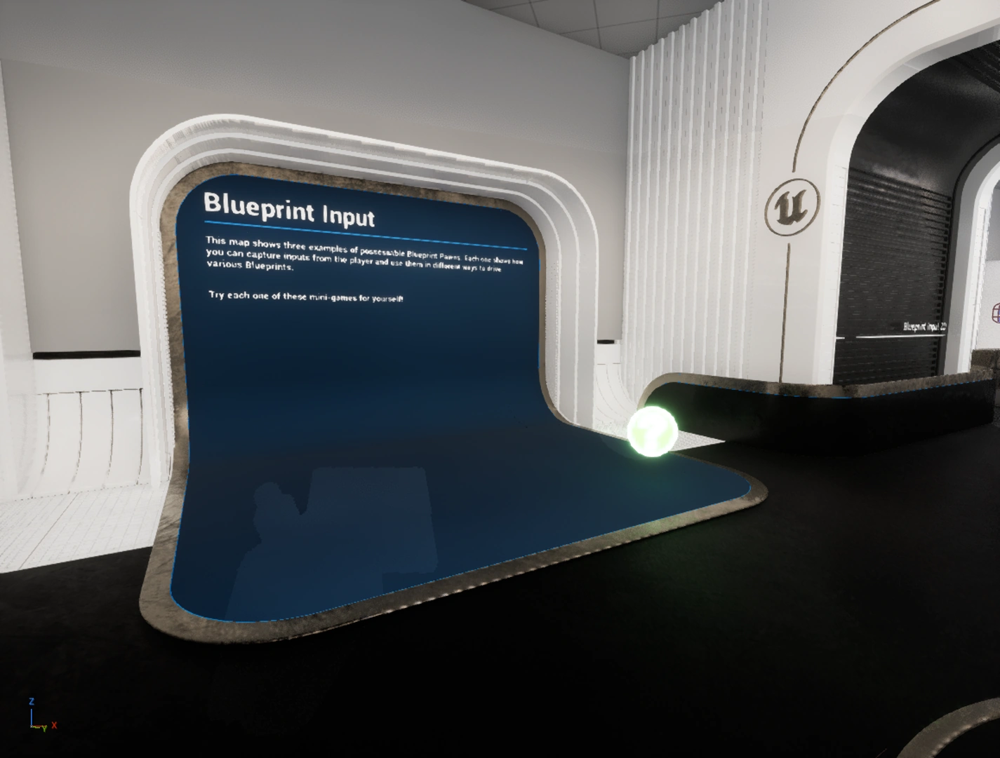
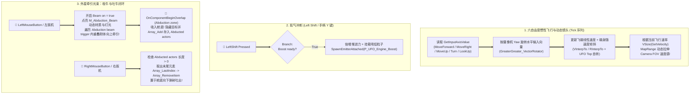
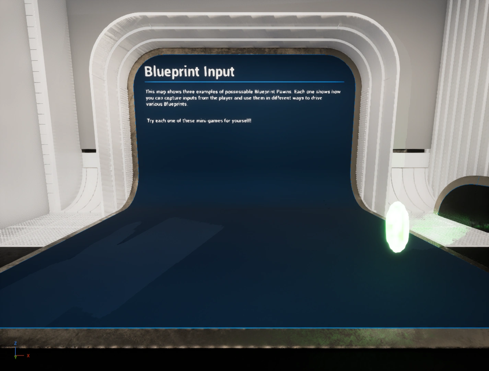
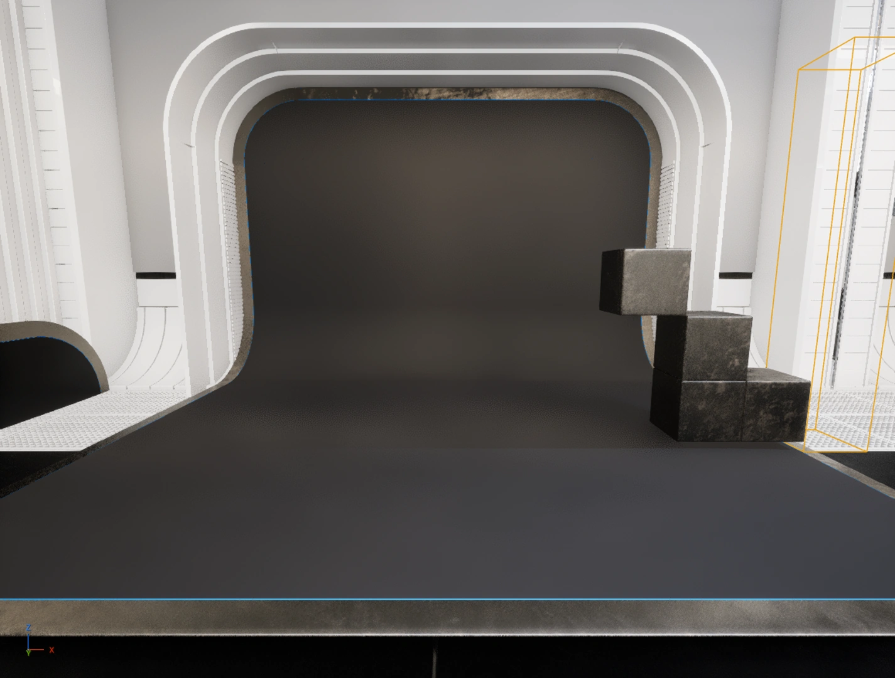
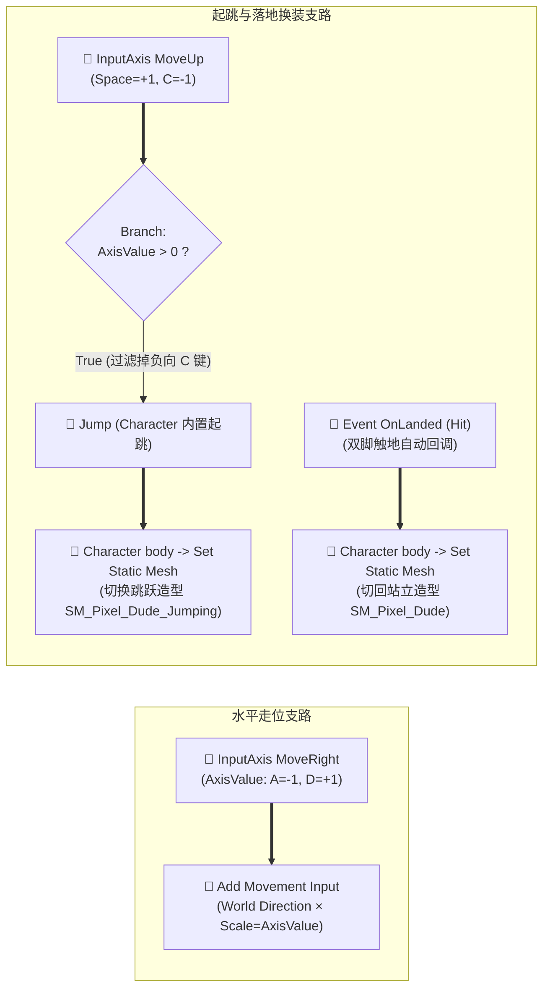
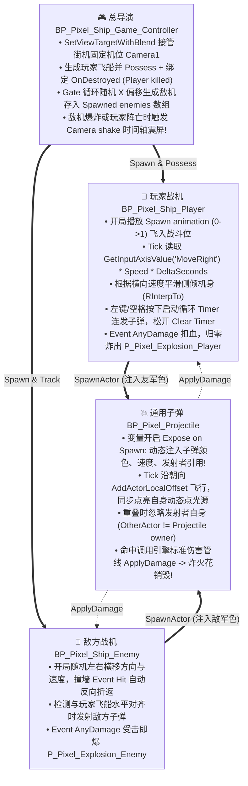
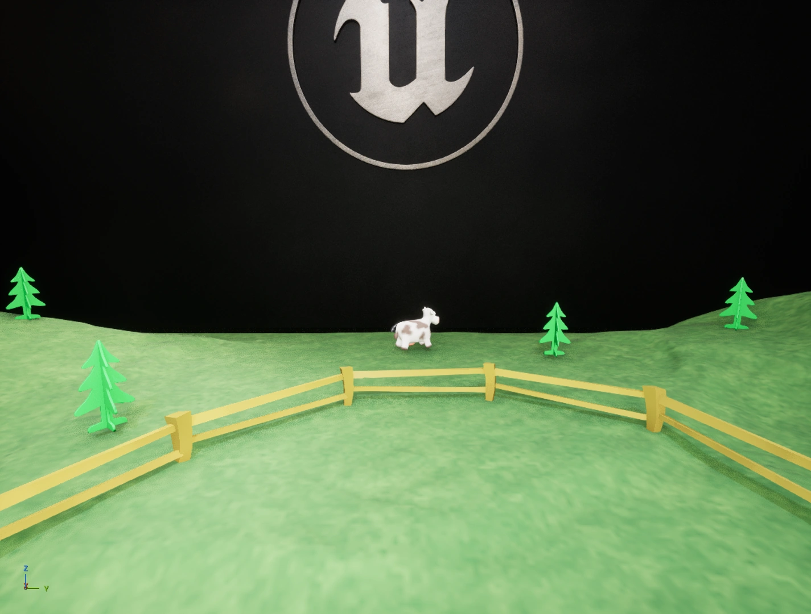

# 第 03 章 · `Blueprint_Input_Examples`：经典输入响应、多 Pawn 附身切换与三款迷你游戏控制全解

> **关卡资产路径**：`/Game/Maps/Blueprint/Blueprint_Input_Examples`  
> **示例资产目录**：`/Game/ExampleContent/Input_Examples/Blueprints/`  
> **关卡实测规模**：总计 `81` 个 Actor | `5` 座编号展台 | `58` 个示例 Actor  

---

## 一、 展厅总览：虚幻引擎的“灵魂与肉身分离”哲学（Controller vs Pawn）



走进 `Blueprint_Input_Examples` 展厅，你会发现它根本不像一座枯燥的代码陈列馆，而是一间摆满了**可上手游玩的独立街机游乐场**——你可以踩下踏板变身为 2D 横版跳跃像素小人、化身太空战机打一场弹幕空战，甚至驾驶一艘拥有引力牵引光束的物理飞碟（UFO）去牧场把逃跑的奶牛抓回围栏！

这三款截然不同的迷你游戏之所以能在同一张地图里无缝切换，依托的正是虚幻引擎 Gameplay 框架最核心的顶层设计——**`PlayerController`（玩家意志/灵魂）与 `Pawn`（受控躯壳/肉身）的彻底解耦**：
- **`APlayerController`** 全程唯一常驻，代表坐在屏幕前的真实玩家与硬件输入通道；
- **`APawn` / `ACharacter`** 只是世界里的物理替身。当你调用一行 **`Possess(NewPawn)`**（附身），玩家的键盘鼠标输入流就会瞬间从第一人称参观者角色拔出，无缝注入到像素小人、太空飞船或飞碟的 `InputComponent` 中！

---

## 二、 关卡全局调度中枢：关卡蓝图（`Blueprint_Input_Examples_C`）附身状态机拆解

在逐台剖析之前，我们先拆解本关的关卡脚本 Actor（`/Game/Maps/Blueprint/Blueprint_Input_Examples.Blueprint_Input_Examples_C`）。实测提取出的属性与字节码揭示了它是如何调度全场 3 块脚踏板（`1.1 Button`、`1.2 Button`、`1.3 Button`，类均为 `BP_PressureButton_Dispatch_C`）与 `Q` 键退出的：

```mermaid
stateDiagram-v2
    [*] --> VisitorPawn: Event BeginPlay<br/>缓存 Default player pawn
    VisitorPawn --> PixelDude: 踩上 1.1 Button (展台 #3)<br/>Possess(BP_Pixel_Dude_Character)
    VisitorPawn --> PixelShip: 踩上 1.2 Button (展台 #4)<br/>调用 BP_Pixel_Ship_Game_Controller::Start game
    VisitorPawn --> UFOPawn: 踩上 1.3 Button (展台 #1/#5)<br/>Possess(BP_UFO_Physics)

    PixelDude --> VisitorPawn: 按下 Q 键 / 手柄 B(圆圈)键
    PixelShip --> VisitorPawn: 按下 Q 键 或 玩家飞船阵亡
    UFOPawn --> VisitorPawn: 按下 Q 键 / 手柄 B(圆圈)键
```

### 关卡蓝图防坑三连招（源自实测节点注释还原）
当你踩上任意一块 `BP_PressureButton_Dispatch` 踏板触发 `Button pressed` 事件分发器时，关卡蓝图并不是鲁莽地直接 `Possess` 就完事，而是做足了**现场保护三部曲**：
1. **挪开原身体防死循环（`Move player off button`）**：先调用 `SetActorLocation` 把原本的第一人称参观者角色稍微往踏板外挪开一段距离——否则等你按 `Q` 键切回原身体时，脚还踩在踏板上，又会瞬间再次触发进入小游戏！
2. **关闭原身体碰撞与准星（`Turn off collision on the FPS pawn` & `Hide HUD crosshairs`）**：对 `Default player pawn` 调用 `SetActorEnableCollision(false)` 防止飞碟或怪物撞到呆立在原地的玩家躯壳，并隐藏 FPS 十字准星。
3. **全局退出监听（`InpActEvt_Q` / `Gamepad_FaceButton_Right`）**：判断当前 `GetPlayerPawn != Default player pawn` 为真时，重新开启 `Default player pawn` 碰撞，调用 `GetPlayerController -> Possess(Default player pawn)` 瞬间灵魂归位！

---

## 三、 工程基座：`DefaultInput.ini` 经典输入映射表实测对照

本关构建于虚幻经典输入管线（Legacy Input System，下一章我们将看到它如何全面演进为 UE5 `Enhanced Input`）。实测读取工程配置文件 `Config/DefaultInput.ini`（第 126–162 行），本关各 Pawn 监听的轴映射（`AxisMappings`）与动作映射（`ActionMappings`）如下：

| 映射类别 | 映射名称 | 绑定物理按键与缩放系数（`Scale`） | 蓝图事件特征 |
| :--- | :--- | :--- | :--- |
| **Axis Mapping**<br/>（连续轴） | `MoveForward` | `W` (`+1.0`), `S` (`-1.0`), `Up`/`Down`, 左摇杆 Y | **每帧持续触发**（未按键时也会每帧传入 `AxisValue = 0.0`！） |
| **Axis Mapping** | `MoveRight` | `A` (`-1.0`), `D` (`+1.0`), 左摇杆 X | 每帧持续触发，输出区间 `[-1.0, +1.0]` |
| **Axis Mapping** | `MoveUp` | `SpaceBar` (`+1.0`), `C` (`-1.0`), `LeftControl` (`-1.0`) | 供飞碟垂直升降与像素小人跳跃共用 |
| **Axis Mapping** | `Turn` / `LookUp` | `MouseX` / `MouseY`（灵敏度 `0.07`），右摇杆 X/Y | 驱动飞碟自由环绕摄像机视角 |
| **Action Mapping**<br/>（离散动作） | `Jump` / 直接按键节点 | `SpaceBar`、`LeftMouseButton`、`RightMouseButton`、`LeftShift` | **仅在按下（`Pressed`）与松开（`Released`）边沿瞬间触发一次** |

---

## 四、 逐展台 100% 零遗漏深度拆解（#1 ~ #5）

> [!NOTE]
> **展厅空间动线提示**：在关卡内按 X 轴从左往右漫步时，你依次经过的是入口总览 **#2 (`X=485`)** $\to$ 横版跳跃 **#3 (`X=2005`)** $\to$ 太空射击 **#4 (`X=2995`)** $\to$ 物理飞碟控制台 **#1 (`X=4500`)** $\to$ 逃跑奶牛牧场 **#5 (`X=6920`)**。下面我们严格按照实测档案编号 `#1 ~ #5` 逐座彻底拆解所有内部蓝图节点！

---

### 展台 #1：`Physics-driven movement example`（六自由度物理飞碟与牵引光束吸牛控制器）
- **展牌标识**：`BP_DemoDisplay2` | **空间坐标**：`(4500, -1450, 0)`
- **官方展牌原文**：
  > *Movement: W,A,S and D keys | Move up or down: Spacebar or C | Speed boost: Left shift | Use abduction beam: Left and right mouse buttons | Quit: Q*
- **展台陈列核心资产**：启动踏板 `1.3 Button`（`BP_PressureButton_Dispatch_C`）与飞碟母舰 **`BP_UFO_Physics`**（路径：`/Game/ExampleContent/Input_Examples/Blueprints/BP_UFO_Physics`，父类：`Pawn`）。

#### 1. `BP_UFO_Physics` 组件层级与 8 大核心状态变量
为什么飞碟继承自轻量的 `Pawn` 而不是 `Character`？因为 `Character` 强绑定了直立行走的人形胶囊体与地面重力步态，而飞碟需要全向六自由度（6-DOF）悬浮惯性飞行！
- **核心组件装配**：主碟身 `UFO Body`（`SM_UFO_Main`，带物理材质 `PM_UFO`）、旋转穹顶 `UFO Top`（`SM_UFO_Hub`）、弹簧臂摄像机 `SpringArm + Camera`、双推进器挂点 `Engine1 / Engine2`、底部暖黄补光灯 `Light`（强度 `2000`），以及牵引光束四件套：`Abduction beam`（光柱网格）、`Abduction beam trigger`（吸取范围触发体）、`Abduction zone`（舱底收纳触发体）与 `Abduction light`。
- **成员变量**：`Delta seconds`、`Movement speed`、`Boost ready`（冲刺冷却就绪）、`Camera speed`、`Abduction beam material`（光柱动态材质 `M_Abduction_Beam`）、`Beam on`（光束开关）、`Beam strength`（牵引力强度）、**`Abducted actors`（已吸入船舱的战利品 Actor 数组！）**。

#### 2. `BP_UFO_Physics` 事件图四大核心执行序列全还原
实测字节码揭示，`BP_UFO_Physics` 在 `EventGraph` 中利用清晰的模块化序列完成了极其细腻的飞行手感与吸牛玩法：



- **碰撞中断保护（`Event Hit`）**：当玩家开着飞碟鲁莽撞上树木或围栏触发 `ReceiveHit` 时，蓝图会在撞击点 `ImpactPoint` 生成金属火花 `P_Metal_Impact`，并立即调用自定义事件 `Interrupt beam` 切断牵引光束，细节拉满！

---

### 展台 #2：`Blueprint Input`（展厅入口总导览）
- **展牌标识**：`BP_DemoDisplay4` | **空间坐标**：`(485, -900, 0)`
- **官方展牌原文**：
  > *This map shows three examples of possessable Blueprint Pawns. Each one shows how you can capture inputs from the player and use them in different ways to drive various Blueprints. Try each one of these mini-games for yourself!*



#### 虚幻输入路由优先级栈（Input Stack）深度解析
本展台除承载大气雾与文档 Actor 外，在架构上揭示了虚幻引擎收到一次物理按键后，事件在对象链上的传递优先级（从高到低，一旦某层勾选了 `Consume Input` 就会截断下层）：
1. **开启了输入监听的普通 Actor**（按最近启用顺序后进先出，如关卡中的特殊交互机关）
2. **`PlayerController`**（处理全局暂停菜单、打开背包等与具体肉身无关的系统指令）
3. **`Level Blueprint`（关卡蓝图）**（如本关全局监听 `Q` 键强制脱离迷你游戏）
4. **当前被 `Possess` 的 `Pawn / Character`**（处理角色移动、跳跃、射击——只有当前被附身的那个 Pawn 才会收到输入，站在旁边未被附身的另外两个 Pawn 静默休眠！）

---

### 展台 #3：`2D input example`（2D 横版平台跳跃：`CharacterMovementComponent` 实战）
- **展牌标识**：`BP_DemoDisplay3` | **空间坐标**：`(2005, -900, 0)`
- **官方展牌原文**：
  > *Movement: A and D keys | Jump: Spacebar | Quit: Q*
- **展台陈列资产**：由 17 块金属方块 `SM_DemoCube` 搭成的立体跳台关卡、前后两道限制走位的空气墙 `BlockingVolume`、启动踏板 `1.1 Button`，以及主角像素小人 **`BP_Pixel_Dude_Character`**（父类：`Character`）。



#### `BP_Pixel_Dude_Character` 内部节点连线全还原
与手写物理插值的飞碟完全不同，`BP_Pixel_Dude_Character` 直接继承自引擎王牌类 **`ACharacter`**，白嫖了工业级防穿墙、斜坡滑落与重力跳跃解算器 `CharacterMovementComponent`：



- **帧装切换巧思**：像素小人并没有做复杂的骨骼蒙皮动画，而是在起跳瞬间将静态网格体切换为挥手跃起的体素模型 `SM_Pixel_Dude_Jumping`，并在引擎原生回调 **`Event OnLanded`** 触发瞬间换回站立模型 `SM_Pixel_Dude`——寥寥数个节点就还原出地道清脆的红白机像素跳跃质感！
- **退出归位保护**：当玩家退出迷你游戏时，执行重置逻辑将网格体恢复为站立姿态，并调用 `SetRelativeTransform` 将角色瞬移回开局记录的 `InitialCharacterTransform`。

---

### 展台 #4：`2D input example with shooting`（街机太空侵略者：游戏导演器 + 暴露生成参数弹幕系统）
- **展牌标识**：`BP_DemoDisplay1` | **空间坐标**：`(2995, -900, 0)`
- **官方展牌原文**：*2D input example with shooting* | **3D 悬浮文字**：`Movement: A and D keys` / `Shoot: Left mouse` / `Quit: Q`
- **展台陈列资产**：启动踏板 `1.2 Button`、两侧边界 `BlockingVolume3/4`、深空滚动背景板 `Cube`（配视差材质 `M_Space_Background`），以及整台街机的总导演 **`BP_Pixel_Ship_Game_Controller`**！

#### 1. 视觉黑科技：单张平面做出四层立体深空视差（`M_Space_Background`）
实测拆解背景板材质 `/Game/ExampleContent/Input_Examples/Materials/M_Space_Background`（共 32 个材质表达式节点），它没有摆多层透明面片，而是对星空贴图 `T_Space` 采样了 4 次，分别串联了不同滚动速度的 **`Panner`** 与高度偏移量分别为 `-10`、`-5`、`-10` 的 **`BumpOffset`（视差偏移节点）** 再叠加输出至 `BaseColor` 与 `EmissiveColor`——仅靠 1 个平面 `StaticMesh` 就营造出了深邃立体的街机太空纵深！

#### 2. 四大蓝图协同作战架构（控制器 + 玩家战机 + 敌机 + 通用发光子弹）
这台街机麻雀虽小五脏俱全，堪称小型 2D/2.5D 射击游戏的教科书级四层分治架构：



#### 3. 架构亮点精析：为什么玩家和敌机共用同一个 `BP_Pixel_Projectile`？
实测 `BP_Pixel_Projectile.uasset` 的编译符号中出现了关键标记 **`ExposeOnSpawn`**！
- 在虚幻蓝图中，当你同时勾选变量的 **`Instance Editable`** 与 **`Expose on Spawn`（生成时暴露）** 时，任何外部蓝图放置 `SpawnActor BP_Pixel_Projectile` 节点时，该节点面板上就会**自动长出 `Projectile color`、`Speed`、`Projectile owner` 三个输入引脚**！
- 玩家战机生成它时传入亮蓝色、向上速度与 `Self`；敌机生成它时传入危险红色、向下速度与敌机 `Self`；子弹飞出去重叠时只需判断一句 `Other Actor != Projectile owner` 就绝不会炸到开枪者自己，命中对方后直接调用虚幻内置伤害框架 **`GameplayStatics::ApplyDamage`** 唤醒对方的 **`Event AnyDamage`**——零子类冗余、零硬编码耦合！

---

### 展台 #5：`The cows have escaped the fence!`（外星飞碟立体牧场沙盒试验场）
- **展牌标识**：`BP_DemoDisplay` | **空间坐标**：`(6920, 0, 0)`



#### 牧场空间布局与物理交互闭环（共 25 个陈列 Actor）
这座位于大厅尽头的微缩田园沙盒是专门为展台 #1 的物理飞碟 **`BP_UFO_Physics`** 准备的实景游乐场：
- **地形基座**：1 块由 9 个 `LandscapeComponent` 拼接而成的起伏草坡地形 `Landscape`（材质 `M_Cow_Pasture`）；
- **木质牛栏与森林装饰**：10 段木栅栏 `SM_Wood_Fence ~ 10` 围成中央牛圈，四周点缀着 9 棵玩具松树 `SM_Toy_Tree ~ 9`；
- **逃跑的物理奶牛**：5 只开启了刚体物理模拟的玩具奶牛 `SM_Toy_Cow ~ 5` 散落在围栏之外！
- **完整游玩体验**：在展台 #1 踩下 `1.3 Button` 附身 UFO 后，按住 `WASD` + `Left Shift` 呼啸飞临这座牧场上空，按住**鼠标左键**开启绿色牵引光束将草坡上的奶牛逐一吸进飞碟肚子里（存入 `Abducted actors` 数组），再悬停到木栅栏正上方按下**鼠标右键**，把奶牛稳稳空投回牛圈之中！

---

## 四、 承上启下：经典输入系统暴露出的三大历史痛点

尽管 `Blueprint_Input_Examples` 用经典输入做出了三款乐趣十足的小游戏，但细心的架构师已经在源码里看到了三处“时代痛点”：
1. **全局命名空间污染**：飞碟的升降、像素小人的跳跃、第一人称参观者的行走全部挤在同一个全局 `DefaultInput.ini` 里抢夺 `MoveUp` 和 `SpaceBar`，小人甚至不得不写一个 `Branch (AxisValue > 0)` 来手动屏蔽飞碟下潜用的 `C` 键负值！
2. **上下文切换笨重**：如果同一个角色既能步行、又能开车、又能进钓鱼小游戏，经典输入无法在运行时优雅地按优先级热插拔整套键位表。
3. **长按蓄力、双击、死区全靠手搓**：想做“长按蓄力松开发射”或“摇杆径向死区”，在经典输入里必须在蓝图里拉一堆布尔变量、计时器和向量运算。

为了彻底终结这些痛点，虚幻引擎 5 推出了里程碑式的现代输入标准——请翻开下一章 **`Blueprint_EnhancedInput`（增强输入系统全解）**！
