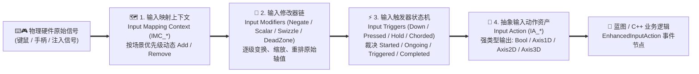
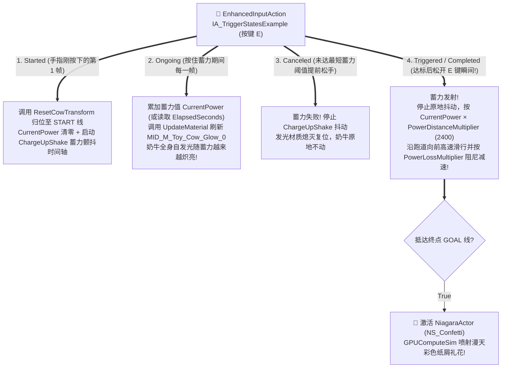
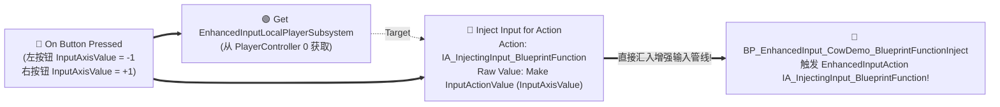

# 第 04 章 · `Blueprint_EnhancedInput`：UE5 增强输入系统——Action、Mapping Context、修改器、触发器与输入注入全解

> **关卡资产路径**：`/Game/Maps/Blueprint/Blueprint_EnhancedInput`  
> **示例资产目录**：`/Game/ExampleContent/EnhancedInput/` 与 `/Game/Global/Blueprints/Interactive/`  
> **关卡实测规模**：总计 `189` 个 Actor | `12` 座编号展台 | `162` 个示例 Actor  

---

## 一、 展厅总览：为什么 `Enhanced Input` 彻底淘汰了虚幻经典输入管线？

在上一章 `Blueprint_Input_Examples` 的结尾，我们亲眼目睹了经典输入（Legacy Input）在复杂项目中的窘境：硬编码在 `DefaultInput.ini` 里的全局字符串、无法在运行期按情景热插拔键位表、手搓长按蓄力与摇杆死区带来的满屏面条节点。

从 Unreal Engine 5.1 起，**增强输入系统（Enhanced Input System）** 正式成为引擎默认标准（实测本工程 `Config/DefaultInput.ini`（第 163–164 行） 已配置 `DefaultPlayerInputClass=/Script/EnhancedInput.EnhancedPlayerInput` 与 `DefaultInputComponentClass=/Script/EnhancedInput.EnhancedInputComponent`）。它将原本混成一团的输入逻辑，干净利落地拆解为**四大资产化数据驱动支柱**：

在本张地图中，Epic 工程师用一排排趣味十足的**“围栏遛玩具奶牛（`CowInputDemo`）”**对照实验台，把从实时调试面板、动态上下文热插拔、蓄力状态机、自定义蓝图修改器到无按键输入注入的全部工业级特性拆解得淋漓尽致！

---

## 二、 公共基础设施预拆解：踏板挂载器与奶牛基类

在进入全部 12 座展台之前，我们先摸清本关反复出场的三个基础设施蓝图：
1. **上下文热插拔踏板 `BP_PressureButton_EnhancedInput`**（继承自 `BP_PressureButton_Parent`）：
   - 内部维护重叠列表 `OverlappedActors` 并驱动 `Press` 时间轴动画；公开了一个 `UInputMappingContext` 引用变量 **`MappingContext`**。
   - **核心逻辑链**：当玩家踩上踏板（首个重叠者进入）时，通过 `GetPlayerController -> GetLocalPlayer -> GetSubsystem<UEnhancedInputLocalPlayerSubsystem>()`，调用 **`Add Mapping Context (MappingContext)`** 将该展台的专属键位表动态挂载到玩家身上；当玩家走下踏板（列表清空）时，立即调用 **`Remove Mapping Context`** 卸载该键位表！
2. **控制台可视化踏板 `BP_Visulizer_PressureButton`**：
   - 公开字符串变量 `EnterCommand`、`ExitCommand` 与布尔开关 `UseExitCommand?`。玩家踩上时自动调用 `KismetSystemLibrary::ExecuteConsoleCommand` 向引擎发送调试或按键模拟指令，并在踏板表面的 `ConsoleText` 三维文本组件上打印出当前执行的命令原文。
3. **玩具奶牛演示基类 `BP_EnhancedInput_CowDemo_Parent`**：
   - 包含奶牛网格体 `Cow`（`SM_Toy_Cow`）、左右摇摆步伐动画 `CowWaddleAnimation`，并封装了带前方障碍物碰撞检测的公共函数 **`Move(Direction/Step)`**。各展台子蓝图只需专注监听各自的 `IA_*` 资产并将数值喂给父类 `Move` 函数即可！

---

## 三、 逐展台 100% 零遗漏深度拆解（#1 ~ #12）

---

### 展台 #1：`Enhanced Input`（增强输入总序言与全局环境）
- **展牌标识**：`BP_DemoDisplay1` | **空间坐标**：`(480, -900, 0)`
- **官方展牌原文**：
  > *Enhanced Input implements features like radial dead zones, chorded actions, contextual input, and prioritization, as well as the ability to extend your own filtering and processing of raw input data in an Asset-based environment.*
- **展台环境陈列（7 个基础 Actor）**：无边界全局后期处理体积 `PostProcessVolume`（`bUnbound: true`）、`DirectionalLight`（强度 `6.0`）、`SkyLight`（强度 `3.0`）、`SkyAtmosphere`、`ExponentialHeightFog`、Chaos 调试容器以及 `DocumentationActor`。

---

### 展台 #2：`Debug Commands`（增强输入实时透视镜：两大内置控制台调试命令）
- **展牌标识**：`BP_DemoDisplay8` | **空间坐标**：`(1510, -900, 0)`
- **官方展牌原文**：
  > *There are several input related debug commands available to help you debug any input-related behavior you may be working on. Step on the pressure plates below to toggle the debug information on or off.*

#### 两块可视化调试踏板实测参数全揭秘
当你怀疑“为什么我按了键角色没反应？是不是被高优先级 UI 吞了输入？还是死区设太大了？”，千万不要去蓝图里傻傻地连一百个 `Print String`！展台 #2 地面并排放置了两块 `BP_Visulizer_PressureButton` 踏板，实测提取出的实例参数直接给出了虚幻官方排错双神器：

| 踏板实例标签 | 踩上触发控制台指令 (`enterCommand`) | 开关模式 (`lED Should Toggle`) | 屏幕 HUD 实时透视内容 |
| :--- | :--- | :---: | :--- |
| **`BP_Visulizer_PressureButton`** | **`showdebug enhancedinput`** | `true`（再踩一次自动关闭） | 实时列出当前玩家身上挂载的**全部 `IMC` 上下文及其优先级排序**、每个 `IA` 动作当前的触发阶段（`None` / `Ongoing` / `Triggered`）、经过修改器处理后的实时浮点/向量值！ |
| **`BP_Visulizer_PressureButton2`** | **`showdebug devices`** | `true`（再踩一次自动关闭） | 实时监控底层物理外设连接状态与原始键鼠/手柄模拟轴硬件读数，一秒甄别是硬件未识别还是上层映射未命中！ |

> [!TIP]
> **实战技巧**：建议你在游玩本关后续展台 #3 ~ #12 之前，**先踩一下展台 #2 左边的 `showdebug enhancedinput` 踏板把它保持开启**，然后再走到后面的奶牛展台去踩踏板——你能亲眼看到屏幕左上角的 `IMC_EnhancedInput_Cow...` 随着你的脚步动态挂载进列表、离开踏板又瞬间消失的全过程！

---

### 展台 #3：`Dynamic and Contextual input mappings`（运行时动态上下文挂载与 `Axis1D` 一维轴动作）
- **展牌标识**：`BP_DemoDisplay2` | **空间坐标**：`(2510, -900, 0)`
- **官方展牌原文**：
  > *When you use Enhanced Input you can add and remove Mapping Contexts at runtime for the player. This makes it easier to manage a large number of Actions. Whilst stood on the pressure plate a mapping context is added which lets you control the Cow using a 1D axis input action. Q - Move left | E - Move right*
- **展台陈列资产**：14 段木围栏、动态挂载踏板 `BP_PressureButton_EnhancedInput`（绑定 `IMC_EnhancedInput_Cow1DAxis`）与奶牛蓝图 **`BP_EnhancedInput_CowDemo_1DAxis`**。

#### 1. 数据资产层：`IA_CowMovement_Axis1D` + `IMC_EnhancedInput_Cow1DAxis` 拆解
实测资产属性表清晰展示了“一个一维轴动作如何合并左右两个按键”：
- **输入动作 `IA_CowMovement_Axis1D`**：
  - `valueType`: **`"Axis1D"`（单精度浮点一维轴）**
  - `bConsumeInput`: `true`
  - `accumulationBehavior`: **`"TakeHighestAbsoluteValue"`**（如果玩家同时按住多个映射键，取绝对值最大的输入）
- **映射上下文 `IMC_EnhancedInput_Cow1DAxis`**：
  - 按键 **`Q`** $\longrightarrow$ 映射到 `IA_CowMovement_Axis1D`，挂载了修改器 **`InputModifierNegate`**（键盘按键按下原始值为 `+1.0`，经 `Negate` 取反后变为 **`-1.0`**！）；
  - 按键 **`E`** $\longrightarrow$ 映射到同一个 `IA_CowMovement_Axis1D`，无修改器，输出原始值 **`+1.0`**！

#### 2. 蓝图逻辑层：`BP_EnhancedInput_CowDemo_1DAxis` 节点链
在奶牛子蓝图的 `EventGraph` 中，只需要 **1 个事件节点**：
- **`EnhancedInputAction IA_CowMovement_Axis1D`** $\longrightarrow$ 从 **`Triggered`** 执行引脚连出，将自带的绿色浮点输出引脚 **`Action Value`（`-1.0` 或 `+1.0`）** 直接传给父类的 **`Move`** 函数并播放摇摆步伐动画 `CowWaddleAnimation`！
- 由于 `IMC` 里没有显式指定特殊触发器，系统默认采用 **`Down`（按住期间每帧触发 `Triggered`）**，因此只要你站在踏板上按住 `Q` 或 `E`，奶牛就会丝滑连续地左右小跑！

---

### 展台 #4：`Input Actions`（离散布尔 `Digital (bool)` 动作 vs 连续轴动作的本质分野）
- **展牌标识**：`BP_DemoDisplay3` | **空间坐标**：`(3510, -900, 0)`
- **官方展牌原文**：
  > *Input Actions are the communication link between the Enhanced Input system and your project's code. Input Actions are the conceptual equivalent to Action and Axis mapping names, except they are data assets. Each Input Action should represent something that the user can do, like "Crouch" or "Fire Weapon". This time the Cow is moved using 2 digital bool input actions rather than an axis input action. Q - Move left | E - Move right*

#### 为什么在展台 #4 按住 `Q/E` 不松手，奶牛却只往前蹦一步就停下？
表面上看，展台 #4 和展台 #3 都是“按 Q 左移、按 E 右移”，但当你亲自踩上 `BP_PressureButton_EnhancedInput2`（挂载 `IMC_EnhancedInput_CowDigitalBool`）实操时，手感截然不同——**按住不放没用，必须狂按键盘奶牛才会一步一顿地挪动！**

实测提取出的两个 `InputAction` 资产属性揭开了底层真相：
1. **`IA_MoveLeft_DigitalBool`**（绑定 `Q` 键）：`valueType = "Boolean"`，且其内部 `triggers` 数组挂载了 **`InputTriggerPressed_0`**！
2. **`IA_MoveRight_DigitalBool`**（绑定 `E` 键）：`valueType = "Boolean"`，同样挂载了 **`InputTriggerPressed_0`**！
3. 在蓝图 `BP_EnhancedInput_CowDemo_DigitalBool` 中，不得不拖出**两个独立的事件节点**（`IA_MoveLeft_DigitalBool` 与 `IA_MoveRight_DigitalBool`），在各自的 `Triggered` 引脚硬编码传入左移或右移定长步幅。

> [!IMPORTANT]
> **Input Action 建模黄金准则**：  
> - 凡是具有**连续方向或幅度**的同类意图（如平面移动 `WASD`、镜头旋转、油门刹车、左右横移），**永远合并为 1 个 `Axis1D (float)` 或 `Axis2D (Vector2D)` 动作**，靠 `IMC` 里的 `Negate` 与 `Swizzle` 区分方向——代码少一半，且天然兼容手柄摇杆的无级模拟量！  
> - 只有真正的**二元离散瞬时意图**（跳跃、开火、互动、打开地图），才定义为 `Digital (bool)`！

---

### 展台 #5：`Trigger States`（五大触发状态生命周期实战：按住 `E` 蓄力颤抖、松开弹射冲线放礼花！）
- **展牌标识**：`BP_DemoDisplay4` | **空间坐标**：`(5510, -900, 0)`
- **官方展牌原文**：
  > *A Trigger State represents the current state of an action, such as Started, Ongoing, Triggered, Completed, and Canceled. Often, you will use the "Triggered" state. You can bind to specific states in both C++ and Blueprint. Hold 'E' To charge up speed | Release 'E' to launch*
- **展台内陈列资产**：跑道起点 `START` 与终点 `GOAL` 三维文字、两侧金属界管 `Pipe`、7 棵景观树、踏板 `BP_PressureButton_EnhancedInput3`（挂载 `IMC_EnhancedInput_CowTriggerStates`）、GPU 彩纸礼花粒子 `NS_Confetti`，以及核心蓄力奶牛 **`BP_EnhancedInput_CowDemo_TriggerStates`**！

#### 1. 双触发器组合资产拆解：`IA_TriggerStatesExample`
打开 `IA_TriggerStatesExample` 的实测 JSON 属性，你会看到它的 `triggers` 数组精妙地装入了两个触发器：
- **`InputTriggerHold_1`**（按住计时触发器）
- **`InputTriggerHoldAndRelease_1`**（按住蓄力并在松手瞬间触发器）

#### 2. `BP_EnhancedInput_CowDemo_TriggerStates` 五引脚全生命周期节点连线还原
在增强输入的蓝图事件节点上，点开底部折叠三角，共有 **5 个各司其职的执行输出引脚**：`Triggered`、`Started`、`Ongoing`、`Canceled`、`Completed`。本展台把这套状态机玩出了花：

- 回想一下在经典输入里写这套“按下归位 -> 按住蓄力发光抖动 -> 按太短取消 -> 按够松手按时长比例发射”需要建多少个布尔标记、分支和 Tick 计时器？而在 Enhanced Input 中，**仅仅是一个事件节点的四个引脚天然分流**，状态边界清晰得像艺术品！

---

### 展台 #6：水平上下文副展台 `Q - Left / E - Right`（多上下文空间分治左翼）
- **展牌标识**：`BP_DemoDisplay10` | **空间坐标**：`(7784, -468, 8)`
- **官方展牌原文**：`Q - Left | E - Right`

#### 展台 #6 陈列与映射拆解
如实拍图所示，展台 #6、#7、#8 共同围合出一座大型方形木栅栏牧场，栅栏中央只有 **1 头共享的玩具奶牛 `BP_EnhancedInput_CowDemo_InputMappingContexts`**，而栅栏外侧左右分列着两块踏板：
- 展台 #6 脚下是左踏板 **`BP_PressureButton_EnhancedInput4`**，实测绑定的上下文是 **`IMC_EnhancedInput_Horizontal`**：
  - `Q`（挂 `InputModifierNegate_0`）与 `E` $\longrightarrow$ 驱动水平轴动作 **`IA_CowMovement_Horizontal`**。
- 当你站在左踏板上时，只有 `IMC_EnhancedInput_Horizontal` 处于激活态，因此你按 `Q/E` 可以让奶牛左右横移，而按 `R/F` 完全无效！

---

### 展台 #7：`Input Mapping Contexts`（多上下文叠加、解绑与优先级裁决总纲）
- **展牌标识**：`BP_DemoDisplay5` | **空间坐标**：`(8000, -900, 0)`
- **官方展牌原文**：
  > *Input Mapping Contexts are a collection of Input Actions that represents a certain context that the player can be in. They describe the rules for what triggers a given Input Action. Mapping Contexts can be dynamically added, removed, or prioritized for each user.*

#### 架构师深潜：`Priority`（优先级）与组合触发器（`Chorded Action`）在大型游戏中的妙用
站在 #6 与 #8 之间的主展牌 #7 前，我们把多 `IMC` 栈的核心工程法则彻底讲透：
1. **分层栈式覆盖（Layered Context Priority）**：
   - 假设常驻底层 `IMC_BaseCharacter (Priority = 0)` 将 `鼠标左键` 映射为 `IA_FireWeapon`；
   - 当玩家打开建造轮盘或进入载具时，压入 `IMC_Driving (Priority = 10)`，里面把 `鼠标左键` 映射为 `IA_Horn`（鸣笛）且 `IA_Horn` 默认勾选了 **`bConsumeInput = true`**；
   - 引擎从最高 `Priority = 10` 往下匹配：`IA_Horn` 率先响应并吞掉 `鼠标左键` 信号，底层的开枪逻辑自动静默，无需写一行 `if (!bIsDriving)`！
2. **高阶触发器拓展（`Chorded Action` 组合键 & `Combo` 连招）**：
   - 除了单键 `Hold` / `Pressed`，Enhanced Input 还内置了 **`Chorded Action`（和弦组合键触发器）**——例如定义修饰动作 `IA_Modifier_Alt`，再给技能动作挂上 `Chorded Action (IA_Modifier_Alt)`，即可零代码实现“单按 `1` 喝血瓶，按住 `Alt + 1` 给队友加血”且高优先级组合键自动屏蔽单键误触！

---

### 展台 #8：纵向上下文副展台 `R - Up / F - Down`（多上下文空间分治右翼）
- **展牌标识**：`BP_DemoDisplay11` | **空间坐标**：`(8217, -468, 8)`
- **官方展牌原文**：`R - Up | F - Down`

#### 展台 #8 陈列与 `BP_EnhancedInput_CowDemo_InputMappingContexts` 双轴汇聚节点链
- 展台 #8 脚下是右踏板 **`BP_PressureButton_EnhancedInput5`**，实测绑定的上下文是 **`IMC_EnhancedInput_Vertical`**：
  - `R`（挂 `InputModifierNegate_0`）与 `F` $\longrightarrow$ 驱动纵向轴动作 **`IA_CowMovement_Vertical`**。
- 再看栅栏里那头共享奶牛 `BP_EnhancedInput_CowDemo_InputMappingContexts` 的内部依赖与 `EventGraph`：
  - 它同时放置了 `EnhancedInputAction IA_CowMovement_Horizontal`（驱动左右横移）和 `EnhancedInputAction IA_CowMovement_Vertical`（驱动前后纵移）两个事件节点；
  - 当你从 #6 左踏板移步踩上 #8 右踏板时，左踏板自动执行 `RemoveMappingContext(IMC_Horizontal)`，右踏板自动执行 `AddMappingContext(IMC_Vertical)`——**奶牛本身的代码没有发生任何状态切换，仅仅通过外部 `IMC` 资产的热插拔，同一头奶牛就从“横行螃蟹”变成了“前后纵跳”**！如果两名玩家（或用一个重物压住左踏板，玩家踩住右踏板）同时激活两块踏板，两套 `IMC` 并存叠加，奶牛当场解锁二维平面全向移动！

---

### 展台 #9：`Input Modifiers`（输入修改器管线：用 `Scalar` 标量修改器定制非对称移速）
- **展牌标识**：`BP_DemoDisplay6` | **空间坐标**：`(10010, -900, 0)`
- **官方展牌原文**：
  > *Input Modifiers are pre-processors that alter the raw input values that UE receives before sending them on to Input Triggers. The Enhanced Input Plugin has a variety of Input Modifiers to perform tasks like changing the order of axes, implementing "dead zones", and converting axial input to world space. In the example, scalar modifiers are used to change the speed of the cow in each direction. Q - Move left | E - Move right*

#### 1. `IMC_EnhancedInput_CowInputModifier` 实测修改器链拆解
奶牛蓝图 `BP_EnhancedInput_CowDemo_InputModifier` 内部代码与展台 #3 几乎完全一致，但当你踩上踏板 `BP_PressureButton_EnhancedInput6` 按 `Q` 和 `E` 时，会发现奶牛**往一个方向跑得飞快，往另一个方向却像慢动作蜗牛爬**！秘密全在 `IMC_EnhancedInput_CowInputModifier` 的修改器数组顺序中：
- **按键 `Q` 的修改器流水线**：
  1. `InputModifierNegate_2`：将 `+1.0` 变为 `-1.0`；
  2. **`InputModifierScalar_4`**：乘以左向专属缩放倍率 $k_{\text{left}}$；
- **按键 `E` 的修改器流水线**：
  1. **`InputModifierScalar_5`**：乘以右向专属缩放倍率 $k_{\text{right}}$（与左向倍率截然不同）！

> [!TIP]
> **五大内置高频 `Input Modifier` 速查手册**：
> 1. **`Negate`**：对指定轴（X/Y/Z）乘以 `-1`（用于 `S` 后退、`A` 左移、鼠标 Y 轴反转设置）；
> 2. **`Swizzle Input Axis Values`**：轴向重排神器！键盘 `W` 键原本产生 `(X=1, Y=0, Z=0)`，挂一个 `Swizzle (YXZ)` 立刻变成 `(X=0, Y=1, Z=0)`，让 `WASD` 四个单键完美拼成一个 `Axis2D (Vector2D)` 移动向量；
> 3. **`Dead Zone`**：过滤手柄摇杆微小硬件漂移（推荐选择 **`Radial` 径向死区**，消除十字轴向吸附感）；
> 4. **`Scalar`**：各轴独立乘以灵敏度系数（玩家设置菜单里的“水平/垂直视角灵敏度”直接改它即可）；
> 5. **`Smooth` / `Interp Constant To`**：对生硬的键盘阶跃输入 `0 -> 1` 进行多帧平滑阻尼过渡。

---

### 展台 #10：`Custom Input Modifiers`（继承 `UInputModifier` 编写自定义蓝图修改器：每秒随机变速奶牛！）
- **展牌标识**：`BP_DemoDisplay7` | **空间坐标**：`(11010, -900, 0)`
- **官方展牌原文**：
  > *You can create your own Input Modifier by creating a new Blueprint Child Class using Input Modifier as the parent. In this example the input is scaled by a different random value every second. Q - Move left | E - Move right*

#### 自定义修改器蓝图 `IM_RandomScaleEverySecond` 内部机制深拆
如果引擎内置的修改器满足不了你的奇思妙想（比如角色中了“混乱醉酒 Debuff”或“根据角色当前负重动态衰减转向输入”），你只需右键新建蓝图类，搜索父类 **`InputModifier`**（对应本展台资产 `/Game/ExampleContent/EnhancedInput/IM_RandomScaleEverySecond`）：
- **重写唯一核心函数：`Modify Raw`**
  - **函数输入引脚**：`Player Input`（玩家输入对象）、`Current Value`（结构体 `FInputActionValue`，承载上一步传来的值）、`Delta Time`（帧间隔秒数）；
  - **内部节点逻辑**：累加 `Delta Time` 计时器，每满 `1.0` 秒重新调用一次 `Random Float in Range` 刷新随机倍率变量，然后将 `Current Value` 乘以该随机倍率，打包塞回 **返回值 `Return Value`（`FInputActionValue`）**！
- **无感挂载**：打开 `IMC_EnhancedInput_CowCustomInputModifier`，把这枚自制的蓝图修改器直接塞进 `Q` 键和 `E` 键的 `Modifiers` 槽位里（注意修改器是**每个按键映射独立实例化**的！）。奶牛蓝图 `BP_EnhancedInput_CowDemo_CustomInputModifier` 一行代码没多写，走起来却每秒钟忽快忽慢！

---

### 展台 #11：`Injecting Input `（输入注入第一式：用控制台命令模拟硬件按键自动遛牛）
- **展牌标识**：`BP_DemoDisplay9` | **空间坐标**：`(12010, -900, 0)`
- **官方展牌原文**：
  > *Enhanced Input also brings along the concept of "Injecting Input" to your player. This provides the means for you to call a function in Blueprints, C++, or use a console command to simulate input on your player. Here is an example of simulating keys using console commands.*

#### 实测踏板命令揭秘：`Input.+key` 与 `Input.-key`
展台 #11 前并排放着两块无需你动手按键盘的控制台踏板（后台自动由区域触发器挂载了 `IMC_EnhancedInput_InjectingInput`），实测提取出的精确命令字符串如下：
- **左踏板 `BP_Visulizer_PressureButton3`**：
  - 踩上执行 `enterCommand`：**`Input.+key q 1`**（通知增强输入底层假装物理键盘上的 `Q` 键被以力度 `1.0` 死死按住！）
  - 离开执行 `exitCommand`：**`Input.-key q`**（通知系统松开虚拟的 `Q` 键！）
- **右踏板 `BP_Visulizer_PressureButton4`**：
  - 踩上执行 `enterCommand`：**`Input.+key e 1`**
  - 离开执行 `exitCommand`：**`Input.-key e`**

> [!NOTE]
> **小彩蛋观察**：仔细看 `IMC_EnhancedInput_InjectingInput` 的实测配置，`IA_InjectingInput_ConsoleCommand` 上的 `Q` 和 `E` 都挂载了单次边沿触发器 **`InputTriggerPressed`**！因此每当你踩一下踏板，注入的按下边沿触发奶牛往对应方向迈出一步；这一整套 `Input.+key` 语法正是**自动化跑图测试脚本（Gauntlet / QA Smoke Test）**模拟玩家手柄与键盘输入的官方后门！

---

### 展台 #12：`Injecting Input`（输入注入第二式：零物理按键绑定，纯靠蓝图函数直接向 `InputAction` 泵入信号！）
- **展牌标识**：`BP_DemoDisplay12` | **空间坐标**：`(13010, -900, 0)`
- **官方展牌原文**：
  > *Here is an example of injecting input using a blueprint function.*
- **展台陈列四件套**：
  1. 隐形区域上下文触发盒 `BP_EnhancedInput_InputMappingTrigger`（玩家走近展台时自动挂载 `IMC_EnhancedInput_InjectingInput`）；
  2. 左立柱按钮 `BP_Button_EnhancedInput_InjectInput`（实测公开变量 **`inputAxisValue = -1`**）；
  3. 右立柱按钮 `BP_Button_EnhancedInput_InjectInput2`（实测公开变量 **`inputAxisValue = +1`**）；
  4. 受控奶牛 `BP_EnhancedInput_CowDemo_BlueprintFunctionInject`。

#### 颠覆认知的资产配置：`key: "None"` 的无键位动作！
打开 `IMC_EnhancedInput_InjectingInput` 的第 3 条映射记录，你会看到一行极具启发性的配置：
- `action`: `IA_InjectingInput_BlueprintFunction`（`Axis1D`）
- **`key`: `"None"`（竟然没有绑定任何键盘、鼠标或手柄物理按键！）**

那奶牛是怎么动起来的？全靠两座立柱按钮 `BP_Button_EnhancedInput_InjectInput` 在被玩家按下（`On Button Pressed`）时执行的**蓝图输入注入节点链**：

#### 工程架构顿悟：为什么要“绕一圈”注入输入，而不是按钮直接调奶牛的 `Move()`？
初学者一定会问：“按钮直接调奶牛不就行了吗？干嘛向 `EnhancedInputSubsystem` 注入 `IA`？”  
设想你在做一款跨平台动作手游或带过场演出的 3A 大作：
- 角色身上已经写好了全套基于 `IA_Move`、`IA_Attack` 的连招缓冲、耐力消耗、修改器减速与触发器判定；
- 当你在手机屏幕上画一个 **UMG 虚拟摇杆/技能按钮**，或者在**新手引导/过场剧情**中需要强制角色往前走两步挥一刀，又或者做**格斗游戏回放系统（Replay）**时，你根本不需要去拆改角色蓝图里复杂的战斗状态机——直接从 UI 按钮或剧情脚本调用 **`Inject Input for Action`**，你自制的虚拟按钮就能 100% 享受与物理手柄完全同等的修改器、触发器与上下文优先级待遇！

---

## 四、 本章增强输入架构落地清单

合上 `Blueprint_EnhancedInput` 的 12 座展台，在新建任何 UE5 项目时，请直接按以下四步搭建生产级输入架构：
1. **按“意图”而非“按键”创建 `IA_*`**：移动统一用 `Axis2D (Vector2D)`，观察统一用 `Axis2D`，跳跃/开火/互动用 `Digital (bool)`。
2. **按“玩法状态”拆分多套 `IMC_*`**：例如 `IMC_Default (Priority=0)`、`IMC_Vehicle (Priority=10)`、`IMC_MenuUI (Priority=100)`，通过 `AddMappingContext` / `RemoveMappingContext` 实现零 `if-else` 的状态热插拔。
3. **把脏活累活下沉进 `Modifiers` 与 `Triggers`**：反向用 `Negate`，轴重排用 `Swizzle`，手柄防漂移用 `Dead Zone (Radial)`，长按蓄力用 `Hold` + `Hold And Release` 配合事件节点的 `Started / Ongoing / Canceled / Triggered` 四大引脚。
4. **善用 `showdebug enhancedinput` 与 `Inject Input for Action`**：前者让你 3 秒定位一切按键失灵疑难杂症，后者让移动端虚拟触控 UI 与自动化测试无缝接入同一套核心玩法管线！
