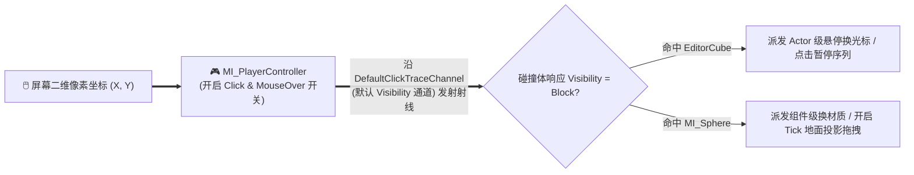
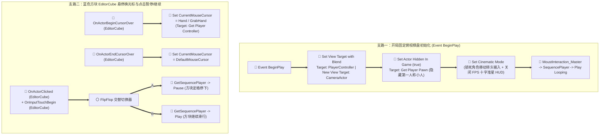
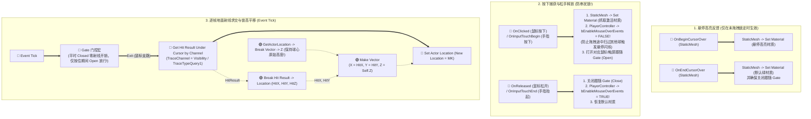

# 第 05 章 · `Blueprint_Mouse_Interaction`：鼠标点击、悬停反馈、屏幕射线拾取与三维拖拽交互全解

> **关卡资产路径**：`/Game/Maps/Blueprint/Blueprint_Mouse_Interaction`  
> **示例资产目录**：`/Game/ExampleContent/MouseInterface/`  
> **关卡实测规模**：总计 `40` 个 Actor | `1` 座综合沙盒展台 | `25` 个示例与环境 Actor  

---

## 一、 展厅总览：为什么 RTS、战棋、卡牌与三维解谜游戏离不开这套鼠标交互管线？

在前两章中，我们的鼠标移动一直被视口死死锁在屏幕正中央（`CapturePermanently`），专门用来驱动第一人称或第三人称摄像机的旋转（`Turn / LookUp`）。然而在《星际争霸》式即时战略（RTS）、《博德之门 3》式俯视角 CRPG、《炉石传说》式三维棋盘卡牌以及密室机关解谜游戏中，玩家需要的是**释放自由游走的二维屏幕光标，直接去悬停高亮、点选开关、按住拖拽三维世界中的实体模型**！

`Blueprint_Mouse_Interaction` 虽然浓缩在一座全景俯视棋盘展台中，却一步到位地展示了跨 **PC 鼠标（Mouse）** 与 **移动端触屏（Touch）** 双平台的完整拾取与拖拽闭环：
1. **控制器权限解锁**：`GameMode` 与自定义 `PlayerController` 如何开启引擎默认关闭的鼠标悬停与点击射线；
2. **关卡级固定机位与序列动画交互**：俯视镜头锁定、鼠标移入动态切换系统光标样式、左键点击启停 `LevelSequence` 运动方块；
3. **三维地面投影拖拽算法**：用双 `Gate`（门控）+ `GetHitResultUnderCursorByChannel` 驱动 16 颗球体丝滑贴地跟手拖拽，并彻底解决高速拖拽时的旁路悬停误触闪烁问题！

---

## 二、 核心基石预拆解：`MI_GameInfo` 与 `MI_PlayerController` 的四大隐藏开关

99% 的虚幻新手第一次在 Actor 蓝图里添加 `Event ActorOnClicked` 或 `OnBeginCursorOver` 时，进游戏猛点鼠标却发现**节点根本不触发**！

原因很简单：屏幕光标每帧向三维场景发射拾取射线是有 CPU 碰撞查询成本的，因此引擎默认 `APlayerController` 将这些开关全部设为 `false`。实测拆解本关的专属游戏模式 `/Game/ExampleContent/MouseInterface/Blueprints/MI_GameInfo` 及其绑定的控制器 `/Game/ExampleContent/MouseInterface/Blueprints/MI_PlayerController`，必须在控制器的 **Class Defaults -> Mouse Interface** 分类下点亮以下开关：

| `MI_PlayerController` 核心布尔属性 | 实测状态 | 底层工程作用 |
| :--- | :---: | :--- |
| **`bShowMouseCursor`** | `true` | 显示操作系统鼠标指针，解除视口对鼠标位移的永久隐藏捕获 |
| **`bEnableClickEvents`** | `true` | 允许鼠标左/右键按下与松开时，向光标下命中的组件/Actor 派发 `OnClicked` / `OnReleased` |
| **`bEnableMouseOverEvents`** | `true` | 允许每帧检测光标移入与移出，派发 `OnBeginCursorOver` / `OnEndCursorOver` |
| **`bEnableTouchEvents` / `TouchOver`** | `true` | 在 iOS/Android 触屏设备上将手指按压映射为 `OnInputTouchBegin` / `End` |

---

## 三、 逐展台 100% 零遗漏深度拆解（#1）

### 展台 #1：`Blueprint Mouse Input`（俯视棋盘点击、悬停变光标与三维地面投影拖拽）

- **展牌标识**：`BP_DemoDisplay2` | **空间坐标**：`(1510, -659, 0)`
- **官方展牌原文**：
  > *This example shows how you can use mouse inputs to control your game. The key is to set up your Player Controller to enable mouse clicks. Click + Hold LEFT MOUSE BUTTON to drag spheres | Press LEFT MOUSE BUTTON to stop and start the moving cube.*

### 1. 展台空间全量陈列清单（20 个核心交互 Actor + 5 个全局环境光照 Actor）
1. **16 颗 4×4 矩阵排布的拖拽球体（`MI_Sphere` ~ `MI_Sphere_16`）**：
   - 类：`MI_Sphere_C`（路径：`/Game/ExampleContent/MouseInterface/Blueprints/MI_Sphere`，父类：`Actor`）；
   - 组件：挂载球体静态网格 `StaticMesh`（`/Engine/EditorMeshes/EditorSphere`），默认覆写鲜绿色材质 `/Engine/MapTemplates/Materials/BasicAsset02`。
2. **1 枚自动巡游的蓝色方块（`EditorCube`）**：
   - 类：`StaticMeshActor`，网格 `/Engine/EditorMeshes/EditorCube`，覆写材质 `M_Procedural_Sky_Daytime`。
3. **1 个驱动方块往复运动的关卡序列播放器（`MoustInteraction_Master`）**：
   - 资产路径：`/Game/ExampleContent/MouseInterface/MoustInteraction_Master`（`LevelSequence`）；
   - 实测序列参数：帧率 **`30 FPS`**，播放帧区间 **`[0, 300]`（共 10 秒循环）**，内部包含轨道 `MovieScene3DTransformTrack_1` 直接绑定场景中的 `EditorCube` 做平移往复运动（注：关卡蓝图注释中提到的 `Matinee` 系早期引擎遗留称呼，UE5 中已升级为标准 `LevelSequenceActor`）。
4. **1 台高空俯视固定摄像机（`CameraActor`）** + `InstancedFoliageActor`。
5. **5 个全局照明与环境 Actor**：`DirectionalLight`（强度 `2.0`）、`SkyLight`（强度 `3.0`）、`SkyAtmosphere`、`ExponentialHeightFog` 与 Chaos 调试容器。

---

### 2. 关卡蓝图（`Blueprint_Mouse_Interaction_C`）双支路节点连线全还原

打开关卡脚本字节码，里面清晰编排了**“开局上帝视角接管”**与**“运动方块点击启停 + 光标变形”**两大逻辑模块：

- **用户体验点睛细节（动态鼠标指针反馈）**：当你的鼠标划过那块正在移动的蓝色 `EditorCube` 时，关卡蓝图立刻修改 `PlayerController` 的 **`CurrentMouseCursor`** 枚举属性，将普通箭头变成可交互手型图标；移开时还原为 `DefaultMouseCursor`——无需制作任何额外 UI 控件，一行赋值就向玩家传达了强烈的“此物可点”直觉暗示！

---

### 3. 核心重头戏：可拖拽球体 `MI_Sphere` 内部节点连线全拆解

为什么你可以随便点住 16 颗绿球中的任意一颗在桌面上极速画圈甩动，松手即停，而且甩动途中擦过其他绿球时不会把别的球搞得乱闪？实测提取的 `MI_Sphere.uasset` 字节码与官方注释完整还原了这套工业级**双平台（鼠标 + 触屏）射线投影拖拽架构**：

#### 三大精妙工程细节深度剖析

1. **为什么必须在 `OnClicked` 时临时关闭 `bEnableMouseOverEvents`？**  
   当你用力一甩鼠标时，屏幕光标一帧飞出去 200 像素，往往比球体移动还要超前一步扫过旁边别的球体。如果不关掉全局 `MouseOverEvents`，你拖着 1 号球路过 2~8 号球时，沿途所有球都会疯狂触发 `OnBeginCursorOver` 变色闪烁；更糟的是，光标一旦短暂脱离 1 号球表面就会误触发 1 号球自己的 `OnEndCursorOver` 导致半途脱手！**“抓取瞬间锁死全局悬停检测，松手瞬间恢复”** 是三维拖拽防脱手、防串扰的教科书级神来之笔！
2. **为什么不用 `Hit.Z`，而要用 `Make Vector (Hit.X, Hit.Y, Self.Z)`？**  
   因为 `GetHitResultUnderCursorByChannel` 发射的射线首先打中的可能是球体自己的上半球面（`Z` 越来越高导致球一路往摄像机脸上飞过来！），或者是地板表面（`Hit.Z = 0` 导致球心一半陷进地板底下！）。只取射线交点的水平坐标 `(Hit.X, Hit.Y)` 并锁死球体原本离地悬浮的 `Self.Z`，既避免了球体钻地，又彻底杜绝了射线打中自身球顶引发的“无限升空 Bug”！
3. **鼠标与触屏双通道对称架构**：  
   在 `MI_Sphere` 内部同时并列了两条 `Gate`：鼠标 `OnClicked` 打开第一扇门调用 **`Get Hit Result Under Cursor by Channel`**；触屏 `OnInputTouchBegin` 打开第二扇门调用 **`Get Hit Result Under Finger by Channel`**——同一份资产放到 PC 端和 iPad 平板上都能零修改丝滑拖拽！

---

## 四、 首席程序员进阶锦囊：如果场景下面是万丈深渊（没有地板碰撞）怎么拖拽？

在本关展台中，球体下方铺着坚实平整的展厅地板，因此 `GetHitResultUnderCursorByChannel` 总能打中地面返回 `(HitX, HitY)`。但如果你在做一款**太空舰队布阵**或**悬空浮岛建造游戏**，光标下面根本没有物理地板碰撞体，`HitResult` 返回 `false`，球体就卡住不动了！

在大型商业项目中，更通用的**纯数学虚拟平面拖拽公式**只需 3 个纯计算节点（零物理射线开销！）：
1. 调用 `PlayerController -> Convert Mouse Location to World Space`（底层 `DeprojectScreenPositionToWorld`），得到摄像机镜头起点 **`WorldLocation`** 与鼠标射线方向单位向量 **`WorldDirection`**；
2. 构造射线终点：`LineEnd = WorldLocation + WorldDirection × 100000.0`；
3. 调用数学库纯节点 **`Line Plane Intersection (Origin & Normal)`**（传入平面原点 `(0, 0, Self.Z)` 与法线 `(0, 0, 1)`），直接一步解出射线与水平虚拟平面的精确三维交点 **`Intersection`**——无论脚下有没有地板、哪怕中间隔着十个障碍物，拖拽手感永远如丝般顺滑稳定！
