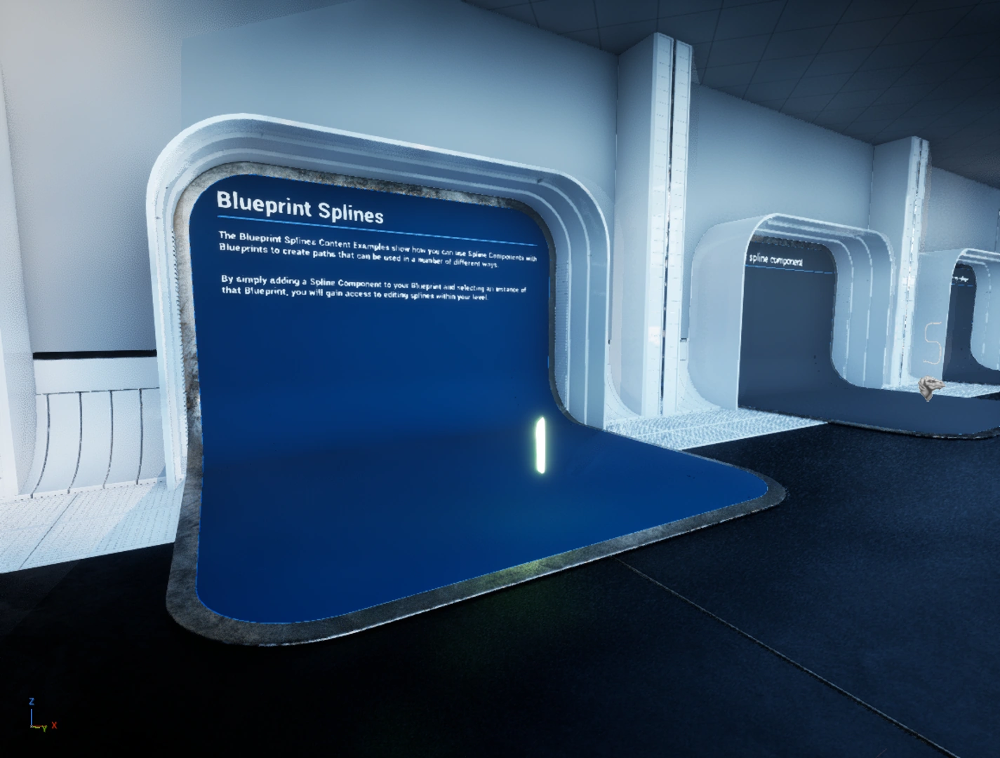
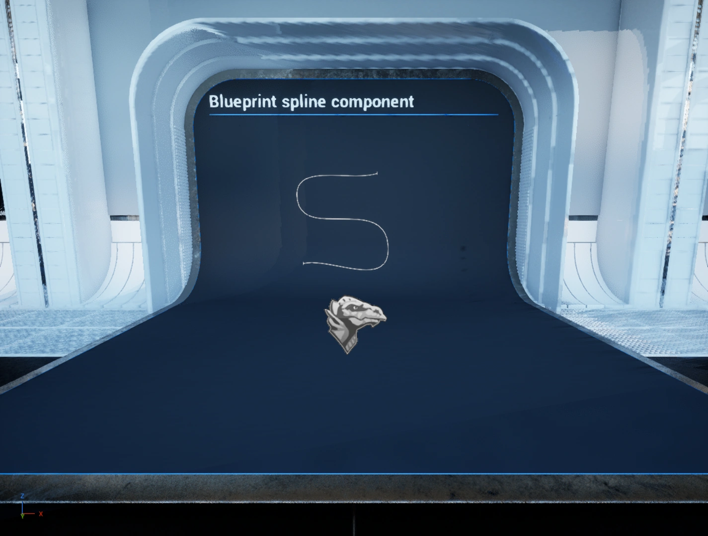
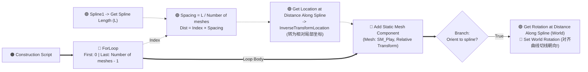
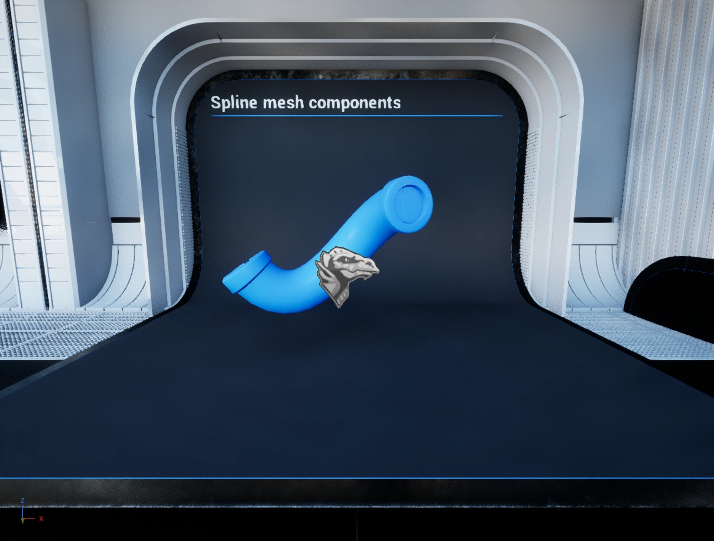
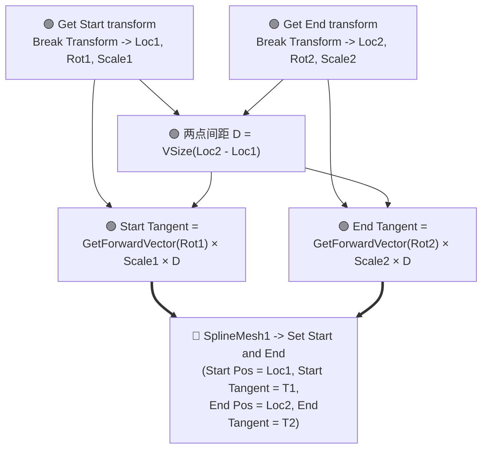
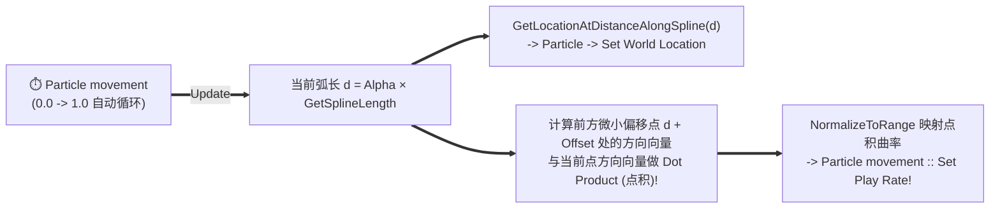
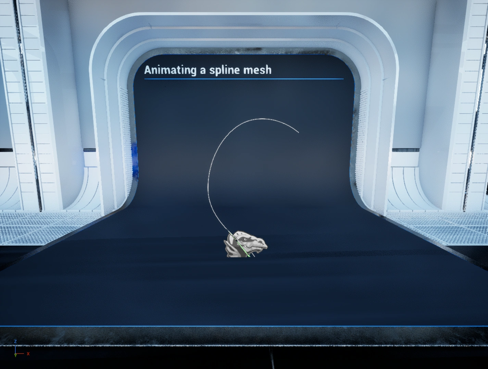
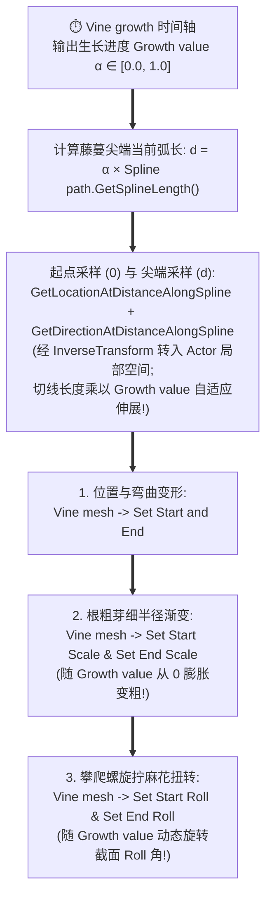
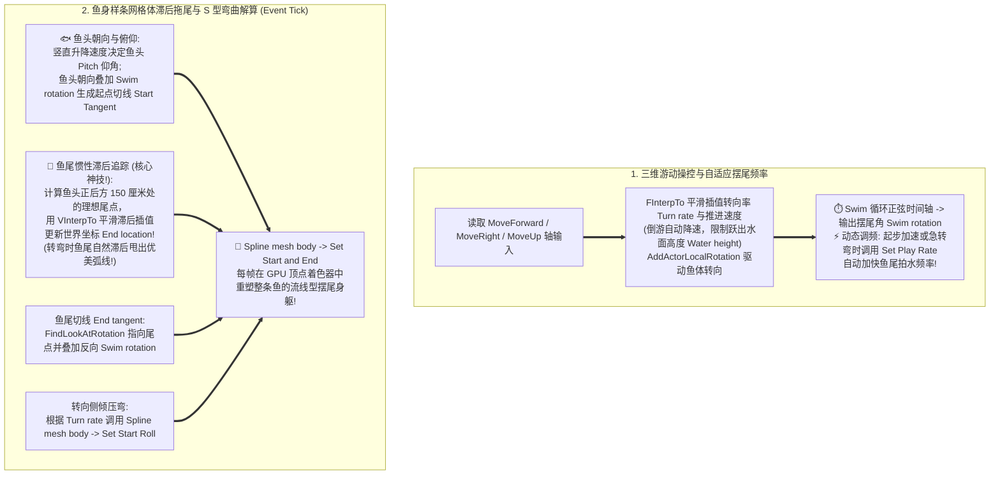

# 第 06 章 · `Blueprint_Splines`：样条线组件、弧长采样、样条网格体变形与无骨骼游鱼程序化动画全解

> **关卡资产路径**：`/Game/Maps/Blueprint/Blueprint_Splines`  
> **示例资产目录**：`/Game/ExampleContent/Blueprint_Splines/Blueprints/`  
> **关卡实测规模**：总计 `37` 个 Actor | `8` 座编号展台 | `15` 个示例 Actor  

---

## 一、 展厅总览：样条线（Spline）背后的埃尔米特曲线数学与 GPU 几何变形魔法

在大型三维关卡制作中，如果让美术纯靠手动旋转摆放静态模型去拼一条蜿蜒曲折的盘山铁轨、错综复杂的工厂管道、随风摇曳的吊桥灯笼绳，甚至是攀爬古堡墙面的螺旋藤蔓，无异于一场工期灾难。

虚幻引擎提供的 **`USplineComponent`（三维样条线组件）** 与 **`USplineMeshComponent`（样条网格体组件）**，正是将关卡美术与程序化动画从繁琐手调中解放出来的几何神器！

### 1. 一分钟看懂 `USplineComponent` 的底层三次埃尔米特插值（Cubic Hermite Spline）
在虚幻引擎底层，相邻两个样条控制点（起点坐标 $\mathbf{P}_0$、离开切线向量 $\mathbf{T}_0$，与终点坐标 $\mathbf{P}_1$、到达切线向量 $\mathbf{T}_1$）之间的曲线段，由局部参数 $u \in [0, 1]$ 按标准**三次埃尔米特多项式**精确求值：

$$\mathbf{P}(u) = (2u^3 - 3u^2 + 1)\mathbf{P}_0 + (u^3 - 2u^2 + u)\mathbf{T}_0 + (-2u^3 + 3u^2)\mathbf{P}_1 + (u^3 - u^2)\mathbf{T}_1$$

- **切线方向决定弯曲朝向，切线模长 $\|\mathbf{T}\|$ 决定拐弯弧度的饱满程度**！
- **弧长重参数化查找表（ReparamTable）**：多项式参数 $u$ 均匀步进时，空间点在曲率变化处会忽密忽疏。为此，`USplineComponent` 在内部预计算了一张高精度的**弧长映射表**——当你调用 **`Get Location at Distance Along Spline`** 按真实物理米数 $s \in [0, L]$ 采样时，无论控制点摆得有多歪斜不均，取出来的坐标永远是**绝对等弧长间距**的！

### 2. `USplineComponent` vs `USplineMeshComponent` 核心分工对比
初学者最容易混淆这两个名字相近的组件，请牢记它们的本质区别：
- **`USplineComponent`（纯数学隐形轨道）**：没有材质、不渲染任何三角形！它只负责存储一串控制点并提供“查询某距离处的位置/切线/朝向”的数学服务；
- **`USplineMeshComponent`（单段 GPU 顶点弯曲变形网格）**：它是一个真正的渲染网格体组件，只管**一头一尾两个端点**（`Start Pos/Tangent` 与 `End Pos/Tangent`），在 GPU 顶点着色器中沿指定主轴（X / Y / Z）实时扭曲、拉伸、螺旋旋转模型的每一个顶点！（如果一条长样条有 $N$ 个控制点，通常用 `ForLoop` 生成 $N-1$ 个首尾相接的 `SplineMeshComponent` 铺满整条曲线）。

---

## 二、 逐展台 100% 零遗漏深度拆解（#1 ~ #8）

---

### 展台 #1：`Blueprint Splines`（展厅总导览与视口交互编辑秘籍）
- **展牌标识**：`BP_DemoDisplay7` | **空间坐标**：`(500, -890, 0)`
- **官方展牌原文**：
  > *The Blueprint Splines Content Examples show how you can use Spline Components with Blueprints to create paths that can be used in a number of different ways. By simply adding a Spline Component to your Blueprint and selecting an instance of that Blueprint, you will gain access to editing splines within your level.*
- **展台环境陈列（6 个基础 Actor）**：`DirectionalLight`（强度 `10.0`）、`SkyLight`（强度 `3.0`）、`SkyAtmosphere`、`ExponentialHeightFog`、Chaos 调试容器及文档节点。

> [!TIP]
> **关卡视口编辑样条线三大高频快捷键**：
> 1. **分裂新增控制点**：选中关卡内蓝图实例上的白色样条控制点，按住 **`Alt` 键 + 拖动坐标轴**，即可丝滑拉出下一个新控制点！
> 2. **切换拐点平滑模式**：右键点击控制点可在 `Curve`（自动平滑切线 `CIM_CurveAuto`）、`Curve Clamped`、`Linear`（折线硬拐角 `CIM_Linear`）与 `Constant` 之间切换。
> 3. **微调饱满度**：直接拖拽控制点两侧伸出的品红色切线手柄，即可实时改变埃尔米特切线向量 $\mathbf{T}$ 的方向与长度！

---

### 展台 #2：`Blueprint spline component`（最纯净的样条组件可视化解剖）
- **展牌标识**：`BP_DemoDisplay` | **空间坐标**：`(1500, -900, 0)`
- **核心陈列资产**：`BP_Spline_Example`（路径：`/Game/ExampleContent/Blueprint_Splines/Blueprints/BP_Spline_Example`，父类：`Actor`）

#### 资产内部结构拆解
实测提取 `BP_Spline_Example.uasset` 显示，它的 `Construction Script` 与 `EventGraph` **完全为空**，内部仅挂载了广告牌根组件 `Billboard1` 与样条组件 **`Spline1`**。
- 正如官方导览所言：哪怕一行蓝图节点都不连，只要给 Actor 挂上一个 `SplineComponent`，每个放到关卡里的实例就立刻拥有了自己独立序列化的 `SplineCurves` 控制点数据（标记为 `bSplineHasBeenEdited = true`），为后续展台的所有构造脚本和运行期轨迹提供了空间几何载体。

---

### 展台 #3：`Placing components along splines`（构造脚本按弧长等距阵列摆放箭头模型）
- **展牌标识**：`BP_DemoDisplay6` | **空间坐标**：`(2500, -900, 0)`
- **核心陈列资产**：`BP_Spline_Mesh_Placement`（类：`BP_Spline_Component_Placement_C`，路径：`/Game/ExampleContent/Blueprint_Splines/Blueprints/BP_Spline_Component_Placement`）

#### 1. 公开定制变量与实测参数
- **`Number of meshes`**（`int32`，关卡实例设为 `18`）：沿样条线等距生成的静态网格体总数量；
- **`Orient to spline`**（`bool`，关卡实例设为 `true`）：是否让每个生成的三角箭头模型（`/Game/ExampleContent/Paper2D/Meshes/SM_Play`）自动旋转对齐曲线切线朝向。

#### 2. `UserConstructionScript` 内部节点连线全还原
打开 `BP_Spline_Component_Placement` 的构造脚本，一套经典的**“总弧长等分步进 + 坐标系转换 + 动态挂载组件”**流水线清晰呈现：

- **坐标空间易错点提醒（`Coordinate Space` 枚举引脚）**：  
  注意 `Add Static Mesh Component` 接收的 `Relative Transform` 是**相对于当前 Actor 根组件的局部空间（Local Space）**！如果你在采样样条点时选了 `ESplineCoordinateSpace::World`，就必须像官方这样补一个 `InverseTransformLocation` 减去 Actor 自身的世界偏移（或者更简单：直接在 `Get Location / Rotation at Distance Along Spline` 节点下拉框里把 `Coordinate Space` 选为 **`Local`**，一步到位免转换！）。

---

### 展台 #4：`Spline mesh components`（用三维变换手柄自由弯折金属圆管）
- **展牌标识**：`BP_DemoDisplay3` | **空间坐标**：`(3500, -900, 0)`
- **核心陈列资产**：`BP_Spline_Mesh`（路径：`/Game/ExampleContent/Blueprint_Splines/Blueprints/BP_Spline_Mesh`，父类：`Actor`）

#### 1. `Show 3D Widget` 视口三维菱形操纵手柄
选中关卡中的 `BP_Spline_Mesh` 实例，你不需要进蓝图改数字，视口里直接浮现出两个可自由拖拽、旋转、缩放的三维坐标轴控件！这是因为它的两个公开 `Transform` 变量 **`Start transform`** 与 **`End transform`** 同时勾选了 `Instance Editable` 与 **`Show 3D Widget`**。

#### 2. `UserConstructionScript` 切线矢量合成公式全还原
展台上这根圆润弯曲的金属管道（网格体 `/Game/ExampleContent/Blueprint_Splines/Meshes/S_Pipe_Spline`）并没有使用 `USplineComponent`，而是直接挂载了一个 **`SplineMesh1`（`USplineMeshComponent`）**，将弯曲主轴设为 **`ESplineMeshAxis::Z`**（因为 `S_Pipe_Spline` 建模时管身是竖直沿 Z 轴延伸的！），并在构造脚本中把两个 `Transform` 巧妙解算为埃尔米特四元组：

- **数学巧思点赞**：为什么计算切线向量时要乘上两点直线距离 `D = VSize(Loc2 - Loc1)`？  
  如果不乘以 `D` 而写死固定切线长度 `100`，当你把水管拉长到 10 米时，两端拐角会变得极其尖锐干瘪；当你把水管缩到 20 厘米时，过长的切线又会让管子扭成打结的麻花！**“朝向旋转决定喷口方向 × 缩放手柄微调曲率 × 两点距离自适应比例”**，让美术在任意尺度下拖拽都能获得最自然圆润的弧度！

---

### 展台 #5：`Using a spline as a path`（流光粒子沿样条巡航 + 急转弯点积自动减速算法）
- **展牌标识**：`BP_DemoDisplay1` | **空间坐标**：`(4980, -900, 0)`
- **核心陈列资产**：`BP_Spline_Location`（路径：`/Game/ExampleContent/Blueprint_Splines/Blueprints/BP_Spline_Location`，挂载样条 `Spline1`、拖尾粒子 `P_Trail_Trace` 与自动循环时间轴 `Particle movement`）

#### `EventGraph` 惊艳物理直觉拆解：如何让粒子在急弯处自动踩刹车？
如果只是让粒子匀速沿样条跑，只需 `Timeline (0~1) × GetSplineLength -> GetLocationAtDistanceAlongSpline -> SetWorldLocation` 四步即可。但实测拆解 `BP_Spline_Location.uasset` 发现了官方暗藏的一段高阶物理细节（源自节点注释：`Slow down play rate at sharp corners in the spline`）：

- **几何原理解析**：两个单位切向量的点积 $\cos\theta = \hat{\mathbf{d}}(s) \cdot \hat{\mathbf{d}}(s + \Delta s)$ 直接度量了前方道路的弯曲剧烈程度！在笔直路段 $\cos\theta \approx 1.0$，时间轴全速飞驰；一旦驶入发卡急弯，$\cos\theta$ 骤降，实时压低 `Set Play Rate` 让流光优雅减速过弯，出弯后再度呼啸提速！这套几行节点的曲率前瞻算法在**赛车 AI 过弯控速、过山车镜头运镜**中百试百灵！

---

### 展台 #6：`Changing splines while simulating`（运行期动态摆动悬链绳索与双红灯笼物理摇曳）
- **展牌标识**：`BP_DemoDisplay4` | **空间坐标**：`(5980, -900, 0)`
- **核心陈列资产**：`BP_Spline_Moving`（路径：`/Game/ExampleContent/Blueprint_Splines/Blueprints/BP_Spline_Moving`，挂载两盏中国风红灯笼 `Lantern1 / Lantern2`（`S_Hanging_Lantern`）及配套暖橙点光源 `Light1 / Light2`）

#### 运行期动态改写样条控制点 + 灯笼惯性摆角全还原
谁说样条线只能在编辑器里静态摆好？展台 #6 演示了如何在游戏运行期间每帧实时揉捏样条控制点：
1. **构造与初始化**：动态创建样条组件 `Spline`，传入左端点 `Start point`、中心下垂点与右端点 `End point` 三个坐标初始化三点悬链线（`SetSplinePoints`），并将两盏灯笼组件打包进 `Lanterns` 数组；
2. **`EventGraph` 摇摆时间轴 `Sway` 实时更新闭环**：
   - **第一步（晃动绳索中点）**：在 `Sway` 时间轴的 `Update` 引脚，调用 **`Spline -> Set Location at Spline Point (Point Index = 1, bUpdateSpline = true)`**，驱动正中央的 1 号控制点沿 Y 轴往复荡秋千（注意必须勾选 `bUpdateSpline = true`，否则弧长查找表不会重新烘焙！）；
   - **第二步（灯笼跟绳走 + 惯性侧倾）**：遍历 `Lanterns` 数组，按比例弧长调用 `GetLocationAtDistanceAlongSpline` 算出灯笼挂点的新世界坐标；更绝的是，将横向摆动位移转化为目标倾角，通过 **`RInterpTo`（结合 `GetWorldDeltaSeconds`）** 平滑插值灯笼的 Roll/Pitch 旋转，调用 `SetWorldTransform` 让两盏红灯笼带着逼真的滞后惯性随风摇曳！

---

### 展台 #7：`Animating a spline mesh`（破土而出、边长边粗且螺旋盘绕的生长藤蔓）
- **展牌标识**：`BP_DemoDisplay2` | **空间坐标**：`(6980, -900, 0)`
- **核心陈列资产**：`BP_Spline_Mesh_Animated`（路径：`/Game/ExampleContent/Blueprint_Splines/Blueprints/BP_Spline_Mesh_Animated`，挂载引导轨道 `Spline path`、变形藤蔓网格 `Vine mesh`（`S_Vine`）与生长时间轴 `Vine growth`）

#### “轨道样条 + 变形网格”黄金搭档：四维生长节点链拆解
如何做出电影里魔法植物顺着墙壁蜿蜒疯长的特效？`BP_Spline_Mesh_Animated` 给出了零骨骼、纯靠单个 `SplineMeshComponent` 沿着 `SplineComponent` 爬行的经典配方：

- 仔细品味第 2、3 步！很多开发者只知道调 `Set Start and End`，做出来的藤蔓像一根粗细死板的绿水管；而加上 **`Set Start/End Scale`（粗细锥度）** 与 **`Set Start/End Roll`（截面绕轴扭转弧度）** 后，植物边往前钻、根部边变粗壮、嫩梢边螺旋盘绕的生命感瞬间拉满！

---

### 展台 #8：`Spline mesh for pawn animation`（压轴神作：零骨骼蒙皮！纯样条网格打造玩家可附身畅游的活鱼）
- **展牌标识**：`BP_DemoDisplay5` | **空间坐标**：`(7980, -900, 0)`
- **官方展牌原文**：*Step on button to control fish*
- **展台陈列资产**：启动踏板 `BP_Button_2.4`（`BP_PressureButton_Dispatch_C`）与可操控游鱼角色 **`BP_Spline_Pawn`**（路径：`/Game/ExampleContent/Blueprint_Splines/Blueprints/BP_Spline_Pawn`，父类：`Character`）。

#### 1. 关卡蓝图附身与复位闭环（`Blueprint_Splines_C`）
- `Event BeginPlay`：记录原始玩家引用 `Default pawn` 以及游鱼初始位姿 `Fish start transform`；
- 踩上 `BP_Button_2.4` 踏板：隐藏 FPS 准星，调用 `PlayerController -> Possess(BP_Spline_Pawn)` 打开 `Gate` 允许按 `Q` 退出；按下 **`Q` 键** 时重新 `Possess(Default pawn)`，调用游鱼的 `Reset pawn` 清空速度输入，并通过 `SetActorTransform` 把鱼送回起点！

#### 2. 颠覆传统动画认知：没有一根骨骼的 `BP_Spline_Pawn` 是怎么活灵活现摆尾游动的？
查看实测档案中 `BP_Spline_Pawn` 的组件参数，你会惊讶地发现：继承自 `Character` 的骨骼网格组件 `CharacterMesh0` 的 `skinnedAsset` 竟然是 **`None`**！整条鱼完全由两块**纯静态网格**拼成：
- 前半截刚性鱼头：**`S_Fish_Head`**（普通 `StaticMeshComponent`）
- 后半截柔性鱼身与尾鳍：**`S_Fish_Body`**（挂载在 **`Spline mesh body`（`USplineMeshComponent`）** 上！）

实测提取出的 `BP_Spline_Pawn.uasset` 字节码与完整内部注释，揭开了这套堪称惊艳的**程序化流体脊椎动力学算法**：

- **为什么这条无骨骼小鱼游起来比录死的关键帧骨骼动画还要自然灵动？**  
  因为传统的游泳循环骨骼动画（Swim Loop AnimSequence）在原地急转 90 度时，鱼身体仍然是笔直僵硬地横着转过去的！而在 `BP_Spline_Pawn` 中，由于鱼尾终点 `End location` 是通过 **`VInterpTo` 在世界空间滞后追踪鱼头后方 `150` 单位处**，当你猛打方向左转时，鱼头已经朝左，鱼尾还留在右后方慢慢追赶，传进 `Set Start and End` 后，整条鱼的脊椎会自动顺着你真实的游动轨迹弯成一道完美契合物理流体力学的 **C 型过弯弧线 + S 型正弦拍水波浪**！

---

## 三、 前六章蓝图架构修炼阶段总结

至此，我们已经走完了 `05_Blueprints_蓝图编程全解` 前半程的全部 6 座核心展厅：
- 在 **`01_Blueprint_Overview`** 中，我们掌握了组件树、变量封装、构造脚本与事件图表的底层生命周期；
- 在 **`02_Blueprint_Communication`** 中，我们确立了拒绝盲目 `Cast To`、用 `Blueprint Interface` 做异构多态、用 `Event Dispatcher` 做观察者广播的工业解耦架构；
- 在 **`03_Blueprint_Input_Examples`** 与 **`04_Blueprint_EnhancedInput`** 中，我们跨越了从 `Controller/Pawn` 附身切换到 UE5 `IA + IMC + Modifiers + Triggers + Input Injection` 的现代数据驱动输入体系；
- 在 **`05_Blueprint_Mouse_Interaction`** 与 **`06_Blueprint_Splines`** 中，我们打通了从二维屏幕射线拾取拖拽到三维埃尔米特样条几何程序化变形动画的空间数学直觉。

带着这套扎实的蓝图内功，接下来的后半程展厅将进一步向**高阶构造脚本算法、运行时程序化三角网格切割（`ProceduralMesh`）、GPU 离屏渲染目标波动方程（`RenderToTarget`）、多人联机权威网络同步（`Network`）以及虚幻编辑器工具开发（`EditorUtilities`）**发起全面冲锋！
