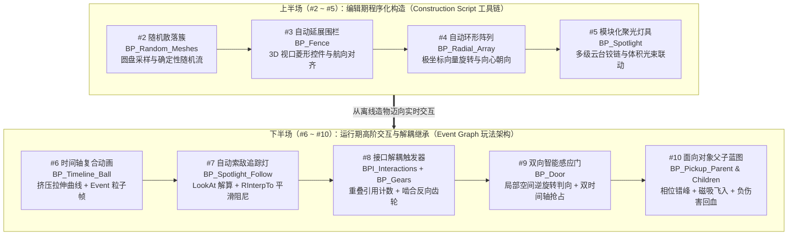
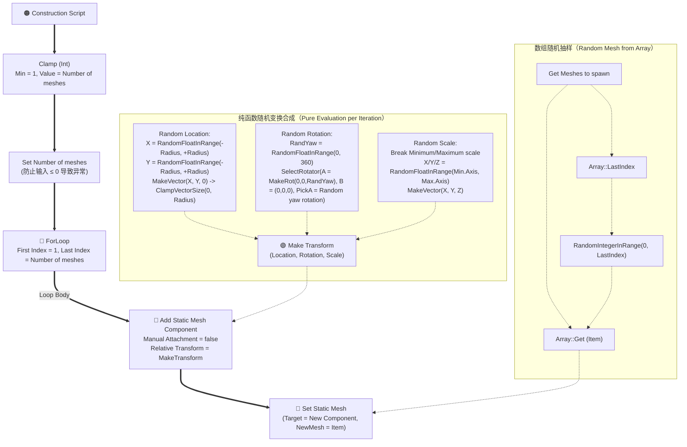
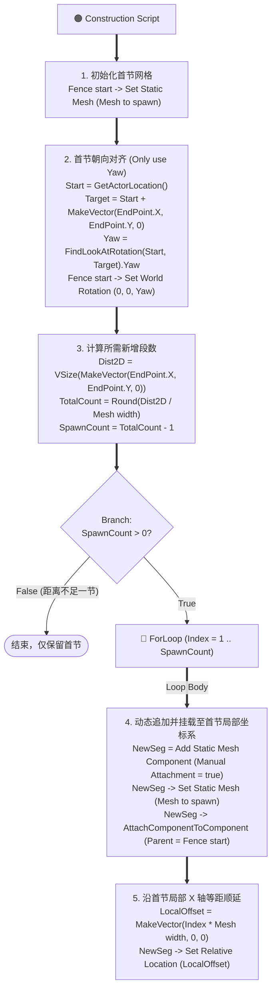
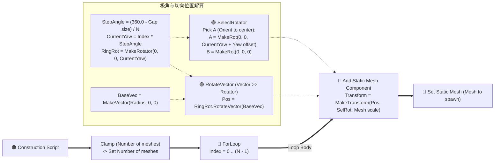
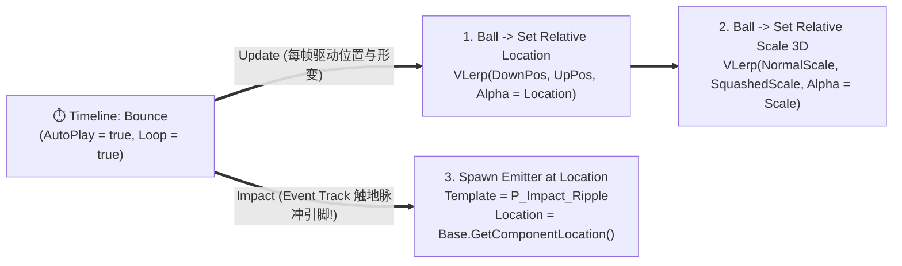
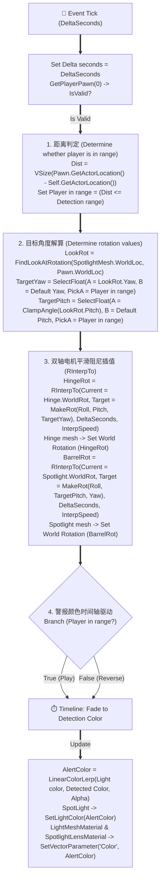
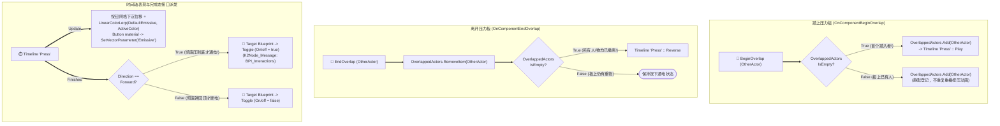
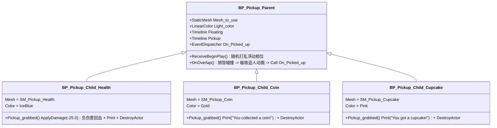

# 第 07 章 · `Blueprint_Advanced`：高阶蓝图算法、确定性随机流、程序化生成与性能优化

> **关卡资产路径**：`/Game/Maps/Blueprint/Blueprint_Advanced`  
> **示例资产目录**：`/Game/ExampleContent/Blueprints/Blueprints/`  
> **关卡实测规模**：总计 `42` 个 Actor | `10` 座编号展台 | `18` 个核心示例 Actor（外加 `1` 个全局 `InstancedFoliageActor`）

---

## 一、 展厅总览：从“连线脚本”跨越到“程序化关卡工具与可复用玩法架构”

如果说 `Blueprint_Overview` 教会了我们如何点亮一盏灯、移动一个球，那么 `Blueprint_Advanced` 则是虚幻引擎将蓝图推向**工业级关卡生产力（Level Art Automation）**与**模块化玩法工程（Modular Gameplay Engineering）**的真正分水岭。

在大型商业游戏研发中，关卡设计师（Level Designer）与环境美术（Environment Artist）每天面临两类高频痛点：
1. **重复性空间摆放灾难**：散落一地的碎石杂物、蜿蜒百米的围栏栅栏、围绕祭坛等距排布的石柱阵列、带支架铰链与体积光束的复合灯具——若靠纯手工逐一拖拽对齐，不仅耗时数倍，一旦需求变更（例如“石柱从 8 根改成 10 根”、“栅栏间距从 50cm 改为 65cm”），所有手工劳动瞬间推倒重来。
2. **高度耦合且难以扩展的机关逻辑**：追踪索敌的哨戒探照灯、踩下压力板联动齿轮组、根据玩家朝向自动顺推开启的双开/双向门、共享磁吸拾取表现却触发截然不同结算效果的百种掉落物——若每个机关各自硬编码，代码冗余与性能隐患将呈指数级膨胀。

`Blueprint_Advanced` 的 **10 座展台**完美划分为上下半场，给出了虚幻官方的标准工程范式：

---

## 二、 逐展台 100% 零遗漏深度拆解（#1 ~ #10）

---

### 展台 #1：`Blueprints Advanced`（展厅导览与环境基座）
- **展牌标识**：`BP_DemoDisplay10` | **空间坐标**：`(500, -900, 0)`
- **官方展牌原文**：
  > *This map covers some useful tricks and techniques for using Blueprint in your levels. Included are some randomization examples, creation of object arrays, as well as gameplay behavior such as tracking spotlights and working doors.*

#### 展台构成与关卡环境基座
本展台位于走廊起点，承载整座展厅的光照与物理调试基础设施（关卡脚本 `/Game/Maps/Blueprint/Blueprint_Advanced.Blueprint_Advanced_C` 保持零逻辑纯净状态，另有一个全局 `InstancedFoliageActor` 备用）：
- **`DirectionalLight`**：主定向光源，强度 `10.0`，纯白光 `(1, 1, 1, 1)`，开启 `CastShadows`，移动性 `Movable`；
- **`SkyLight`**：天空漫反射补光（`SkyLightComponent0`），强度 `3.0`，`Movable`；
- **`SkyAtmosphere` & `ExponentialHeightFog`**：物理天空大气与指数高度雾；
- **`Actor`（`ChaosDebugDrawComponent_0`）**：Chaos 物理碰撞可视化辅助调试器。

---

### 展台 #2：`Randomly scattered meshes`（圆盘随机散落生成、确定性随机流 `RandomStream` 与实例化优化）
- **展牌标识**：`BP_DemoDisplay1` | **空间坐标**：`(1500, -900, 0)`
- **核心陈列资产**：`BP_Random_Meshes`（路径：`/Game/ExampleContent/Blueprints/Blueprints/BP_Random_Meshes`，父类：`Actor`）
- **官方展牌原文**：
  > *Construction script is used to randomly position a specified number of meshes in a radius*

#### 1. 成员变量与关卡实测参数表
选中展台中央由方块与雕塑混排而成的随机簇，其实例暴露了 6 个高自由度的公开调参旋钮：

| 变量名 | 类型 | 关卡实例实测值 | 工程语义 |
| :--- | :--- | :--- | :--- |
| `Number of meshes` | `int32` | `20` | 目标生成的随机网格体总数（内部带 `Clamp >= 1` 保护） |
| `Radius` | `double` / `float` | `170.0` | 散落圆盘的最大半径（单位：cm） |
| `Minimum scale` | `FVector` | `(0.25, 0.25, 0.5)` | XYZ 三轴独立随机缩放下限 |
| `Maximum scale` | `FVector` | `(0.5, 0.5, 1.0)` | XYZ 三轴独立随机缩放上限 |
| `Random yaw rotation` | `bool` | `true` | 是否绕 Z 轴赋予 `0° ~ 360°` 随机偏航角 |
| `Meshes to spawn` | `TArray<UStaticMesh*>` | `[SM_LightSculpture, SM_DemoCube]` | 候选静态网格体资产池，随机从中抽取 |

#### 2. `UserConstructionScript` 完整节点流还原
打开 `BP_Random_Meshes` 的构造脚本，可以看到作者用 5 个清晰的注释框（`Set Number of Meshes from property variable` -> `Loop to spawn meshes randomly` -> `Random Location / Rotation / Scale / Mesh`）搭建了一条紧凑的几何装配管线：

#### 3. 三大核心算法与架构师进阶重构指南

##### （1）几何陷阱：`ClampVectorSize` 虽然把正方形切成了圆，但为什么边缘会偏密？
仔细看蓝图注释：*“Clamp the length of the vector so that the radius is a circle instead of a square”*。
- 如果只写 `X = Rand(-R, R), Y = Rand(-R, R)`，生成的点会铺满边长为 $2R$ 的**正方形**，四个角落超出半径 $R$（最大达 $\sqrt{2}R \approx 1.414R$）。
- 官方脚本调用了 **`ClampVectorSize(Min=0, Max=Radius)`**：任何落在内切圆外四个角（占正方形面积 $1 - \frac{\pi}{4} \approx 21.46\%$）的点，都会被沿着径向强行推回圆周边界 `r = Radius` 上！这会导致**约 21.5% 的模型扎堆挤在最外圈圆环上**！
- **标准均匀圆盘采样公式（极坐标面积开方修正）**：若要在半径 $R$ 的圆内实现真正的面积均匀分布，切忌直接用 `r = Rand(0, R)`（否则圆心过密），正确数学公式为：
  $$\theta = \text{Rand}(0, 2\pi), \quad r = R \cdot \sqrt{\text{Rand}(0, 1)}, \quad (x, y) = (r\cos\theta, r\sin\theta)$$
  或在蓝图中直接调用引擎内置节点 **`RandomPointInBoundingBox`** 配合拒绝采样，或 **`RandomUnitVector`** 平面投影乘以 $\sqrt{U} \cdot R$。

##### （2）致命痛点：为什么拖动 Actor 时所有石头都在“疯狂闪烁洗牌”？—— `RandomStream` 确定性伪随机流全解！
如果你在视口中用鼠标轻轻把 `BP_Random_Meshes` 往左挪动 1 厘米，你会惊恐地发现：**原本好不容易看顺眼的雕塑布局瞬间面目全非！**
- **根因剖析**：`BP_Random_Meshes` 用的是全局无状态节点 `RandomFloatInRange` 与 `RandomIntegerInRange`（底层调用全局 `FMath::SRand()` / `rand()`）。每次拖动 Actor 触发 `Construction Script` 重跑时，全局随机数发生器都会吐出一串全新的序列，导致无法复现、更无法在多人联机或 PCG 烘焙中固定结果！
- **工业级标准解法——引入 `FRandomStream`（随机流结构体）**：
  1. 在蓝图中新建一个公开（`Instance Editable`）变量 **`Seed`（类型为 `Random Stream` 或 `Integer`）**；
  2. 在 `Construction Script` 开头第一节点必须调用 **`Reset Random Stream`**（或 `Set Random Stream Seed`），将游标归零回初始种子状态（若漏掉 `Reset`，每次重跑构造脚本游标继续往后走，依然会变！）；
  3. 将所有随机节点替换为带 `Stream` 输入引脚的确定性版本：**`Random Float in Range from Stream`**、**`Random Integer in Range from Stream`**、**`Random Rotator from Stream`**。
  4. **神奇效果**：从此无论你怎么在关卡里平移、旋转这个 Actor，哪怕重开关卡百次，这 20 块石头的品种、朝向、高矮位置都**纹丝不动（100% 确定性复现）**！只有当美术对当前造型不满意、手动修改 `Initial Seed` 整数时，才会瞬间刷出下一套固定造型！

##### （3）渲染性能重构：`AddStaticMeshComponent` vs `InstancedStaticMeshComponent (ISM)`
观察实测档案第 33 行，这个小小的展台实例在底层生成了 `NODE_AddStaticMeshComponent-0` 到 `_19` 共 **20 个独立的 `UStaticMeshComponent`**。
- 当 `Number of meshes = 20` 时，UE 的动态合批（Dynamic Instancing）尚可招架；一旦美术把数量拉到 `2000` 铺满山坡，2000 个独立 SceneComponent 的变换更新、包围盒剔除与刚体注册会瞬间拖垮编辑器帧率！
- **生产级重构法则**：对于不需要单独拆开做独立物理模拟的纯静态散落物，应在蓝图挂载对应候选网格体数量的 **`InstancedStaticMeshComponent`（或支持单实例 LOD 剔除的 `HierarchicalInstancedStaticMeshComponent`，即 `HISM`）**，在 `ForLoop` 中改调 **`Add Instance (Instance Transform)`**——2000 块石头合并为 **1 个组件、1 次 GPU Instanced Draw Call**！

---

### 展台 #3：`Automatic wall`（视口 3D 菱形控件驱动的自动延展围栏）
- **展牌标识**：`BP_DemoDisplay2` | **空间坐标**：`(2510, -900, 0)`
- **核心陈列资产**：`BP_Fence`（路径：`/Game/ExampleContent/Blueprints/Blueprints/BP_Fence`，父类：`Actor`）
- **官方展牌原文**：
  > *Construction script is used to extend a row of meshes from the actor's pivot point to a specified end point.*

#### 1. 组件结构与 `Show 3D Widget` 交互黑科技
在 `BP_Fence` 中，预设了一个默认静态网格体组件 `Fence start`（网格体 `SM_Fence_Segment`），并暴露了 3 个核心变量：
- **`End point`**（`FVector`，实测值 `(350, 0, 0)`）：不仅开启了 `Instance Editable`，更勾选了细节面板中的黄金选项 —— **`Show 3D Widget`（显示 3D 控件）**！勾选后，关卡视口中会在相对于 Actor 原点 `(350, 0, 0)` 的位置浮现一枚**蓝色半透明三维菱形手柄**，关卡设计师无需在右侧面板盲输 XYZ 坐标，直接拖拽这枚菱形往任意方向拉长，一排整齐的栅栏就会像拉链一样实时跟着鼠标生长并自动转向对准终点！
- **`Mesh width`**（`float`，实测值 `50.0`）：单节栅栏网格体 `SM_Fence_Segment` 的有效拼接宽度；
- **`Mesh to spawn`**（`UStaticMesh*`，实测值 `SM_Fence_Segment`）：支持一键把木栅栏替换成铁丝网或石墙段。

#### 2. `UserConstructionScript` 几何解算与节点链还原
本例实测总长度 $L = 350$，单节宽度 $W = 50$，故总节数 $350 / 50 = 7$ 节（其中第 0 节复用自带的 `Fence start`，循环额外补齐第 `1 ~ 6` 共 6 个动态组件）：

#### 3. 空间数学精妙之处：巧借父子局部坐标系省去三角函数！
请注意第 4、5 步中极具巧思的工程技巧：
- 如果把新生成的栅栏段挂在 `Base` 根组件下，那么当 `End point` 斜向偏转 $\theta$ 角时，每一节的世界/根相对坐标都必须手动计算 $(i \cdot W \cos\theta,\; i \cdot W \sin\theta,\; 0)$ 并单独赋旋转角。
- 而 `BP_Fence` 先把首节 **`Fence start`** 用 `FindLookAtRotation`（提取纯水平 `Yaw`，剔除 `Pitch` 以防坡地栅栏歪斜插地）转向了对准终点的方向，随后将后续所有分段 **`Attach`（挂载）为 `Fence start` 的子组件**！在 `Fence start` 的局部空间里，“朝向终点的方向”永远是纯净的 $+X$ 轴 `(Index * Mesh width, 0, 0)`，局部旋转永远是 `(0, 0, 0)`！利用场景图变换矩阵层级（Scene Graph Hierarchy）化繁为简，这是资深工具开发者的标志性手法。

---

### 展台 #4：`Automatic ring`（极坐标环形阵列、向量旋转运算符与向心朝向控制）
- **展牌标识**：`BP_DemoDisplay3` | **空间坐标**：`(3498, -900, 0)`
- **核心陈列资产**：`BP_Radial_Array`（路径：`/Game/ExampleContent/Blueprints/Blueprints/BP_Radial_Array`，父类：`Actor`）
- **官方展牌原文**：
  > *Construction script is used to space out a specified number of meshes in a circle, with rotation determined by each meshes position in the ring.*

#### 1. 成员变量与实例实测配置
展台上 10 个立方体（`SM_DemoCube`）围成一圈精准朝向圆心，其实例公开参数如下：
- `Number of meshes` = `10`（内部带 `Clamp` 范围保护，防止除零或过大卡死）
- `Radius` = `120.0`（环形半径）
- `Gap size` = `0.0`（预留缺口角度：当设为 `0` 时闭合为 $360^\circ$ 完整圆环；若设为 `90` 则展开为 $270^\circ$ 扇形半包围掩体！）
- `Orient to center` = `true`（每个元素是否根据所处方位自动转向圆心，关闭则保持统一朝向）
- `Yaw offset` = `-180.0`（模型自身前向轴修正角，支持让石像背对圆心或侧向切线排布）
- `Mesh scale` = `(0.5, 0.5, 1.0)`，`Mesh to spawn` = `SM_DemoCube`

#### 2. `UserConstructionScript` 极坐标解算节点流
在蓝图底层，这里用到了一个极其优雅的向量算子 **`RotateVector`**（内部符号名为 `GreaterGreater_VectorRotator`，即 C++ 中的 `FRotator::RotateVector`）：

- **算理点睛**：与其分别调用 `Cosd(CurrentYaw) * Radius` 和 `Sind(CurrentYaw) * Radius` 再 `MakeVector`，直接构造初始基准向量 $\mathbf{v}_0 = (\text{Radius}, 0, 0)$ 并通过 **`RotateVector`** 绕 Z 轴旋转 `CurrentYaw`，不仅连线少一半，而且天然推广至任意三维倾斜圆环（只需给 `RingRot` 加上 Pitch/Roll 即可生成斜置星环）！

---

### 展台 #5：`Customizable spotlight`（双轴云台组件装配、Alpha 亮度复用与假体积光束材质深拆）
- **展牌标识**：`BP_DemoDisplay4` | **空间坐标**：`(4498, -900, 0)`
- **核心陈列资产**：`BP_Spotlight`（路径：`/Game/ExampleContent/Blueprints/Blueprints/BP_Spotlight`，父类：`Actor`）
- **官方展牌原文**：
  > *An example of using construction script to combine all the necessary components of a light fixture into one actor*

#### 1. 五层父子组件运动学装配树（Kinematic Hierarchy）
为什么现实中的舞台探照灯既能水平 $360^\circ$ 旋转（Yaw），又能上下俯仰（Pitch），而支架永远不会穿模错位？打开 `BP_Spotlight` 的组件树，你会看到教科书级的机械骨骼级联设计：
1. **`Base mesh`**（`SM_Spotlight_Base`）：固定在天花板或地面上的金属底座（不动）；
2. **`Hinge mesh`**（`SM_Spotlight_Hinge`，挂在 `Base mesh` 下）：U 型旋转云台支架 —— **只负责水平偏航旋转 `Yaw`**；
3. **`Spotlight mesh`**（`SM_Spotlight`，挂在 `Hinge mesh` 下）：灯筒主体，含材质槽 0（金属漆面 `M_ReflectionDemo_Metallic_3`）与槽 1（发光镜片 `MID_M_Spotlight_Glass_0`） —— **只负责局部俯仰旋转 `Pitch`**（因为它是 `Hinge` 的子组件，自然继承了父级的水平 `Yaw`！）；
4. **`SpotLight`**（`SpotLightComponent`，挂在 `Spotlight mesh` 下）：真实动态聚光灯（加载了光学配光曲线 `/Engine/EngineLightProfiles/Complex_IES`，实测强度 `5.0`，暖白光 `(1.0, 0.906, 0.737)`，半径 `800`，跟随灯筒同步指向前方）；
5. **`Light beam mesh`**（`S_EV_SimpleLightBeam_03`，挂在 `Spotlight mesh` 下）：圆锥形半透明假体积光束网格体，覆写动态材质 `MID_M_Light_Beam_0`。

#### 2. `UserConstructionScript` 完整参数驱动逻辑
`BP_Spotlight` 暴露了 `Yaw`、`Pitch`、`Light Radius`、`Light color`、`Turned off`、`Beam Opacity` 共 6 个公开变量，构造脚本一气呵成完成五大职责：
1. **防穿模俯仰限位（Pitch Clamping）**：对输入的 `Pitch` 执行 `FClamp`（限制在安全仰俯角区间内，防止灯筒翻转 $180^\circ$ 切进底座支架），随后分别对 `Hinge mesh` 调用 `SetRelativeRotation(0, 0, Yaw)`、对 `Spotlight mesh` 调用 `SetRelativeRotation(ClampedPitch, 0, 0)`；
2. **一色双用（Color Alpha 通道巧作亮度倍增器）**：调用 `Break Color (LinearColor)` 拆解 `Light color`——将 RGB 赋给聚光灯颜色，而将 **Alpha (`A`) 通道直接作为光源强度（`Set Intensity`）的控制源**，少暴露一个冗余变量；
3. **几何光束随光域等比伸缩**：将 `Light Radius` 经 `ClampVectorSize` 最大尺寸锁定后缩放 `Light beam mesh`（`SetRelativeScale3D`），确保假体积光锥的长度恰好与真实 `SpotLight` 的 `AttenuationRadius` 吻合；
4. **双动态材质同步染色**：分别为灯头镜片（`M_Spotlight_Glass`）与体积光锥（`M_Light_Beam`）创建 `MID`，同步注入 `Color` 与 `Beam Opacity`；
5. **一键断电开关（`Turned off`）**：末尾通过 `Branch (Turned off)` 控制 `SpotLight` 开关及 `Light beam mesh` 的 `SetVisibility`、镜片自发光归零。

#### 3. 关联双材质源码级深拆：`M_Spotlight_Glass` 与 `M_Light_Beam`
- **灯头镜片材质 `M_Spotlight_Glass`（`BLEND_Opaque` + `MSM_DefaultLit`，11 个表达式节点）**：
  - 基础色给极暗底色 `0.1`，核心亮点在 `Emissive Color`：利用 `TextureCoordinate` 与中心点 `(0.5, 0.5)` 喂入 **`SphereMask`**，再经 `Power` 幂次锐化与 `Color` 向量参数相乘，模拟出灯芯中央炽热发白、向镜片边缘柔和衰减的菲涅尔灯珠质感。
- **高性能假体积光材质 `M_Light_Beam`（`BLEND_Translucent` + `MSM_Unlit` + `TwoSided`，30 个表达式节点）**：
  - 在移动端或无需开启昂贵全局 Volumetric Fog 的室内场景中，圆锥网格体 + `M_Light_Beam` 是性价比最高的丁达尔光束方案！其 `Opacity` 通道集成了三重软化黑科技：
    1. **轴向衰减贴图**：采样引擎内置渐变图 `T_EV_LightBeam_Falloff_01`，让光束从灯口到末端自然消散；
    2. **掠射角边缘消隐**：通过 `ReflectionVectorWS` 变换至局部空间提取切向分量开方，消除圆锥模型两侧生硬的多边形轮廓线；
    3. **软粒子深度消隐（`DepthFade` + `PixelDepth / NearFadeDistance`）**：当光束穿插地面墙壁、或玩家摄像机一头扎进光锥内部时，自动根据深度差平滑淡出透明度，彻底杜绝半透明硬切边穿帮！

---

### 展台 #6：`Timeline animation`（双浮点曲线挤压拉伸与 Event Track 帧精准粒子触发）
- **展牌标识**：`BP_DemoDisplay5` | **空间坐标**：`(6040, -900, 0)`
- **核心陈列资产**：`BP_Timeline_Ball`（路径：`/Game/ExampleContent/Blueprints/Blueprints/BP_Timeline_Ball`，父类：`Actor`）
- **官方展牌原文**：
  > *An example of using a timeline to animate a static mesh component, with an event track used to spawn an emitter at a specified point.*

#### 1. 展品构成与迪士尼动画“挤压与拉伸（Squash & Stretch）”实现
展台中央是一颗涂有高光蓝塑料材质 `M_ShinyPlastic`（`Color = (0, 0.162, 0.745)`，`Roughness = 0.2`）的弹力球 `Ball`（`EditorSphere`），无需任何物理刚体碰撞，仅靠一个勾选了 **`AutoPlay`（自动播放）** 与 **`Loop`（循环）** 的时间轴组件 **`Bounce`** 就演出了极具生命力的弹跳动画！

双击打开 `Bounce` 时间轴编辑器，里面并不是只有一条高度曲线，而是**三条协同轨道**：
1. **浮点轨道 1：`Location`（高度归一化曲线 `0.0 ~ 1.0`）**：顶部抛物线缓入缓出（平滑滞空），底部触地瞬间呈尖锐折角（高速撞击反弹）；
2. **浮点轨道 2：`Scale`（内部属性 `Bounce_Scale`，形变权重曲线）**：腾空阶段为 `0`（正常球体 `(1, 1, 1)`），触地瞬间猛冲至 `1`（横向压扁纵向缩矮的扁球态，如 `(1.3, 1.3, 0.6)`）；
3. **事件轨道 3：`Impact`（`TimelineEventEntry` 离散关键帧轨道）**：在球体曲线跌落最低点（触地帧）打下一枚精确的事件关键帧脉冲！

#### 2. `EventGraph` 完整节点流还原

> [!TIP]
> **为什么绝不要在 `Update` 引脚里写 `if (Height <= 0.05) SpawnEmitter`？**  
> 新手常犯的致命错误是在连续更新引脚里判断高度接近 `0` 来播落地灰尘特效：一旦帧率波动跳过 `0.05` 阈值就会**漏播特效**，而在高帧率下停留两帧又会**连炸两次特效**！使用时间轴原生的 **Event Track（事件轨）**，引擎底层保证每次跨过该时间点时**严格且仅触发 1 次**脉冲，犹如动画蒙太奇里的 `AnimNotify` 一样精准可靠！

---

### 展台 #7：`Actor tracking`（球形测距索敌、双轴云台 `RInterpTo` 阻尼跟随与色彩警报渐变）
- **展牌标识**：`BP_DemoDisplay6` | **空间坐标**：`(7040, -900, 0)`
- **核心陈列资产**：`BP_Spotlight_Follow`（实例名 `BP_Spotlight_2`，路径：`/Game/ExampleContent/Blueprints/Blueprints/BP_Spotlight_Follow`，父类：`Actor`）
- **官方展牌原文**：
  > *Event graph script is used to make the spotlight turn to face the player when it comes within a specified range*

#### 1. 核心状态变量与潜行哨戒表现
当你操作角色走近展台 #7（进入 `Detection range` 半径内）时，原本静止发暖黄光的聚光灯突然“苏醒”：灯头瞬间由暖黄渐变为刺眼的警报红（`Detected Color`），同时金属云台支架与灯筒带着真实的电机惯性阻尼感，死死咬住你的移动轨迹；当你退回安全距离外，探照灯又缓缓褪回暖黄色并转回初始巡逻角度 `(Yaw, Pitch)`。

其内部共定义了 **11 个成员变量**：
- 继承自 #5 静态聚光灯的基础配置：`Yaw`、`Pitch`、`Light Radius`、`Light color`、`Turned off`；
- 新增索敌追踪专有变量：`Detection range`（索敌半径）、`Detected Color`（发现目标时的警戒红）、`Player in range`（布尔状态位）、`Delta seconds`（帧间隔缓存）、`Light Mesh Material` 与 `Spotlight Lens Material`（构造期缓存的两个 `MID` 句柄，省去运行期重复创建！）。

#### 2. `EventGraph` 四段式追踪状态机完整还原
打开 `BP_Spotlight_Follow` 的事件图，这是一套非常经典的哨戒炮塔 / 监控探头 AI 原型：

#### 3. 两大核心技术细节与首席架构师性能优化方案
1. **为什么不用 `Lerp(Rotator)` 而必须用 `RInterpTo`？**  
   玩家在移动，目标角度 `TargetYaw` 每一帧都在动态变化！如果在 `Tick` 中用固定曲线做线性插值，当跨越 `-180° / +180°` 奇异点时灯头会突然原地疯转 $360^\circ$；而 **`RInterpTo`** 内部基于四元数/最短弧角差做**指数衰减阻尼逼近**（$\Delta \theta = (\theta_{\text{target}} - \theta_{\text{current}}) \cdot (1 - e^{-k \cdot \Delta t})$），既天然免疫帧率波动，又能自动走最短路径丝滑追上移动目标，逼近终点时自然减速停稳。
2. **为什么每帧往 Timeline 的 `Play` / `Reverse` 引脚灌执行流不会卡在第一帧？**  
   注意区分 Timeline 的两对引脚：**`Play from Start`** 每次调用都会把时间轴强行拉回 `0.0s` 重头播（若连在 `Tick` 上就会永远卡死在第 0 帧！）；而 **`Play`** 与 **`Reverse`** 引脚在内部带有方向状态判重——若当前已经在正向播放中，再次触发 `Play` 会直接无视，抵达终点 `1.0s` 后自动休眠！
3. **性能优化诊断（干掉全场空转 `Event Tick`！）**：  
   如果关卡里摆了 80 盏这样的哨戒探照灯，即使玩家远在十公里外，80 个 `Event Tick` 依然每帧都在算 `VSize` 测距与 `RInterpTo`！**生产环境优化重构**：
   - 将类默认值中的 `Start with Tick Enabled` 设为 **`false`**（默认彻底关闭 Tick，0 CPU 开销）；
   - 添加一个半径等于 `Detection range` 的 **`SphereCollision`** 组件（仅对 `Pawn` 通道开启 `Overlap`）；
   - 当 `OnComponentBeginOverlap` 触发时，调用 `SetActorTickEnabled(true)` 并触发 `Fade to Detection Color -> Play`；当玩家离开且云台回归原位误差 `< 0.1°` 时，再次 `SetActorTickEnabled(false)` 进入深度休眠！

---

### 展台 #8：`Button trigger using a blueprint interface`（多对象重叠引用计数压力板 + 蓝图接口 `BPI` + 啮合齿轮组）
- **展牌标识**：`BP_DemoDisplay7` | **空间坐标**：`(8040, -900, 0)`
- **核心陈列资产（2 个协作 Actor + 1 个接口资产）**：
  1. 蓝图接口：`BPI_Interactions`（`/Game/ExampleContent/Blueprints/Blueprints/BPI_Interactions`）
  2. 压力板按钮：`BP_Pressure_Plate`（类 `BP_PressureButton_BPIInteract_Child_C`，继承自全局基类 `/Game/Global/Blueprints/Interactive/BP_PressureButton_Parent_BPIInteract`）
  3. 三联齿轮组：`BP_Gears`（`/Game/ExampleContent/Blueprints/Blueprints/BP_Gears`）
- **官方展牌原文**：
  > *A blueprint interface asset is used to allow the button blueprint to trigger an event in the gear blueprint*

#### 1. 解耦契约：`BPI_Interactions` 接口定义
打开 `BPI_Interactions`，里面只声明了一个无实现体的纯虚契约函数：**`Toggle(bool On/off)`**。
- 压力板身上的公开变量 **`Target Blueprint`** 类型是基类 **`Actor` 对象引用**（而非写死的 `BP_Gears` 引用！）。这意味着在关卡里，策划今天可以用吸管吸取旁边的齿轮组 `BP_Gears`，明天可以吸取一扇防爆门、一台升降机或一面激光墙——只要目标 Actor 在 **Class Settings -> Implemented Interfaces** 中挂载了 `BPI_Interactions`，压力板无需任何 `Cast To` 强转、更不会产生任何跨模块硬引用内存污染，直接发送一条信封图标的 **`Toggle (Message)`** 即可驱动万物！

#### 2. 压力板基类 `BP_PressureButton_Parent_BPIInteract` 的工业级防抖设计
很多新手写压力板只写“进触发盒按下、出触发盒弹起”，结果在双人联机或推箱子解谜中出现严重 Bug：**玩家 A 和箱子同时压在板上，玩家 A 刚走开，箱子还在上面，压力板却错误弹起断电了！**
实测拆解 `BP_PressureButton_Parent_BPIInteract` 内部字节码，看看 Epic 是如何用 **`OverlappedActors` 数组引用计数**写出滴水不漏的状态机的：

#### 3. 接收端 `BP_Gears`：三齿轮正反向咬合传动数学
`BP_Gears` 包含三个静态网格组件 `Gear 1`、`Gear 2`、`Gear 3`（均使用 `SM_Gear`）以及变量 `On/off`（`bool`）、`Rotation Speed`（`float`）、`Delta seconds`（`float`）：
- **接口事件响应**：实现 **`Event Toggle (On/off)`**（红底黄标接口事件节点），直接将传入的布尔值存入成员变量 `Set On/off`；
- **帧率无关的反向啮合旋转**：在 `Event Tick` 中，仅当 `Branch (On/off == true)` 时继续执行：
  - 将 `Rotation Speed * Delta seconds` 得到本帧基础转角 $\Delta \theta$；
  - 对主动轮与奇数从动轮旋转 $+\Delta \theta$，而对中间咬合齿轮乘以 **`-1.0`（Invert rotation speed）** 旋转 $-\Delta \theta$，调用 `AddLocalRotation`，使三枚齿牙严丝合缝反向咬合运转，绝不穿模打架！

---

### 展台 #9：`Opening door with trigger`（局部空间逆旋转判向算法与双时间轴平滑抢占）
- **展牌标识**：`BP_DemoDisplay8` | **空间坐标**：`(9040, -900, 0)`
- **核心陈列资产**：`NewSelectedComponents_Blueprint`（类 `BP_Door_C`，路径：`/Game/ExampleContent/Blueprints/Blueprints/BP_Door`，父类：`Actor`）
- **官方展牌原文**：
  > *An example of using a timeline in event graph script to open and close a door. The direction the door moves in depends on which side of it the player is on*

#### 1. 经典游戏体验细节：“永远顺着玩家前进方向推开”的双向门
在《生化危机》或《最后生还者》等 3A 动作游戏中，如果玩家从门外冲向门内，门却迎面往外扇过来把玩家撞退卡住，体验会极其糟糕。优秀的双向铰链门必须自动判断**玩家站在门框的正面还是背面**，永远向远离玩家的一侧顺势推开（`+90°` 或 `-90°`）！

但这里藏着一个空间几何陷阱：**关卡设计师把这扇门摆进走廊时，可能会把门旋转任意角度（比如斜着摆 `Yaw = 45°` 或 `90°`），因此绝不能直接用世界坐标 `Player.X > Door.X` 来判断前后！**

#### 2. 空间坐标逆变换判向数学与双时间轴抢占节点链
实测拆解 `BP_Door` 的字节码，它使用了虚幻引擎空间变换皇冠上的明珠节点 —— **`UnrotateVector`**（内部符号 `LessLess_VectorRotator`，即用旋转矩阵的逆矩阵 $R^{-1}$ 将世界位移向量还原回门框自身的局部坐标系）：

```mermaid
flowchart TB
    subgraph OpenFlow["开门序列：局部空间判向 + 抢占关门动画"]
        BGN["🔴 Trigger :: OnComponentBeginOverlap (OtherActor)"] ==> STOP1["Swing closed -> Stop<br/>(立即中断正在进行的关门动画!)"]
        STOP1 ==> MATH["1. 计算世界相对向量:<br/>WorldDiff = Self.GetActorLocation() - OtherActor.GetActorLocation()<br/>2. 逆旋转还原至门框局部空间 (UnrotateVector / Vector << Rotator):<br/>LocalDiff = WorldDiff << Self.GetActorRotation()"]
        MATH ==> SIDE["3. 判定前后侧:<br/>IsFront = (LocalDiff.X > 0.0)<br/>Set Open direction = SelectFloat(A = +90.0, B = -90.0, PickA = IsFront)"]
        SIDE ==> PLAY1["⏱️ Swing open -> Play from Start"]
        PLAY1 ==>|"Update"| R1["Door -> Set Relative Rotation<br/>RLerp(CurrentDoorRot, MakeRot(0, 0, Open direction), Alpha, ShortestPath=true)"]
    end

    subgraph CloseFlow["关门序列：中断开门动画 + 平滑回正"]
        END_OV["🔴 Trigger :: OnComponentEndOverlap"] ==> STOP2["Swing open -> Stop<br/>(立即中断尚未开完的开门动画!)"]
        STOP2 ==> PLAY2["⏱️ Swing closed -> Play from Start"]
        PLAY2 ==>|"Update"| R2["Door -> Set Relative Rotation<br/>RLerp(CurrentDoorRot, MakeRot(0, 0, 0), Alpha, ShortestPath=true)"]
    end
```

- **算法精髓拆解**：
  1. **逆旋转判向（等同于法向点积 $\mathbf{n}_{\text{forward}} \cdot (\mathbf{p}_{\text{player}} - \mathbf{p}_{\text{door}})$）**：经过 `UnrotateVector` 把门框自身的旋转角剥离后，无论这扇门在世界里怎么歪斜摆放，`LocalDiff.X` 的正负号永远百分之百代表玩家处于门板的局部正前方还是正后方！
  2. **半途折返无跳变（Interrupt Handling）**：假如门刚推开到 `45°` 玩家就退出了触发盒，`Swing open -> Stop` 先冻结开门时间轴，随后 `Swing closed` 用 `RLerp` 从门板当前的实时角度平滑插值回 `0°`（勾选 `Shortest Path` 最短路径插值），全程如液压闭门器般丝滑连贯，绝无角度瞬移抽搐！

---

### 展台 #10：`Child Blueprints`（面向对象父子继承、初相随机错峰、磁吸飞入与负伤害治疗）
- **展牌标识**：`BP_DemoDisplay9` | **空间坐标**：`(10040, -900, 0)`
- **核心陈列资产（1 个抽象基类 + 3 个具象派生类实例）**：
  - **基类资产**：`BP_Pickup_Parent`（`/Game/ExampleContent/Blueprints/Blueprints/BP_Pickup_Parent`，父类：`Actor`）
  - **展台陈列子蓝图实例（3 个）**：
    1. `BP_Pickup_Child_Health`（冰蓝光血包 `(0.58, 0.94, 1.0)`，网格体 `SM_Pickup_Health`）
    2. `BP_Pickup_Child_Coin`（暖金光金币 `(1.0, 0.90, 0.61)`，网格体 `SM_Pickup_Coin`）
    3. `BP_Pickup_Child_Cupcake`（蜜桃粉光纸杯蛋糕 `(1.0, 0.835, 0.784)`，网格体 `SM_Pickup_Cupcake`）
- **官方展牌原文**：
  > *An example of using parent and child blueprints for actors that benefit from sharing the same base script. These collectible pickup blueprints are derived from the same parent, but each contains additional script allowing different results when collected by the player.*

#### 1. 基类 `BP_Pickup_Parent`：封装 95% 通用拾取表现的模板骨架
如果游戏里有 50 种掉落物（金币、宝石、血瓶、蓝瓶、弹药箱、任务卷轴），绝不能复制粘贴 50 份蓝图！`BP_Pickup_Parent` 把所有掉落物共有的组件（`Pickup mesh`、`Pickup trigger`、`Light` 点光源）与双时间轴（`Floating` 悬浮自转、`Pickup` 磁吸飞入）全部下沉到了基类中：

1. **构造期外观配置（`Construction Script`）**：读取受保护/可覆写变量 `Mesh to use` 与 `Light color`，自动替换 `Pickup mesh` 模型与 `Light` 点光源颜色——子类甚至无需写一行构造代码，只需在 **Class Defaults（类默认值）** 面板改一下这两个属性，外观立变！
2. **初相随机错峰防机械同步（`Event BeginPlay` 精妙细节！）**：  
   如果关卡里并排摆了 20 枚金币，全都从 `0.0s` 启动 `Floating` 上下浮动时间轴，20 枚金币就会像广播体操一样死板地齐上齐下！`BP_Pickup_Parent` 在 `BeginPlay` 中先调用 **`Floating -> Set New Time (RandomFloatInRange(0.0, TimelineLength))`** 随机拨乱每枚道具的时间轴初始相位指针，再启动循环播放，瞬间让整排道具呈现出灵动自然的波浪起伏感！
3. **磁吸飞向玩家演出 + 事件分发钩子（`OnComponentBeginOverlap`）**：
   - 玩家触碰瞬间，**第一时间销毁碰撞触发器**（`Pickup trigger -> DestroyComponent`，彻底杜绝飞行途中被二次重复拾取刷金币的致命漏洞！）；
   - 停止 `Floating` 悬浮动画，启动 **`Pickup` 磁吸时间轴**：在 0.3 秒内，利用 `VLerp` 将道具世界坐标实时吸附插值至 `GetPlayerPawn(0)->GetActorLocation()`（哪怕玩家正在高速奔跑跳跃，道具也会像装了追踪导弹一样精准追进玩家胸口！），同时将模型缩放从 `1.0` 缩小至 `0`、点光源亮度瞬间暴涨闪烁（`Light flash` 轨道）；
   - 时间轴播放完毕（`Finished` 引脚）的瞬间，触发事件分发器广播：**`Call On Picked up`**！

#### 2. 三个派生子蓝图的多态差异化实现与 `Call Parent Function` 铁律

打开任意一个子蓝图（尤其重点看 `BP_Pickup_Child_Health`），你会学到两条虚幻继承体系的核心工程技巧：
1. **永远别忘了棕色节点 `Parent: BeginPlay`（`K2Node_CallParentFunction`）！**  
   当子类重写 `Event BeginPlay`（用于调用 `Bind Event to On Picked up -> Pickup grabbed` 绑定拾取回调）时，如果不右键点击 `Event BeginPlay` 选择 **Add Call to Parent Function** 把棕色的 `Parent: BeginPlay` 串在最前面，父类的 `BeginPlay` 就会被彻底静默屏蔽——导致子类金币不再随机错峰甚至失去悬浮动画！（这等同于 C++ 重写虚函数时漏写了 `Super::BeginPlay();`！）
2. **巧用引擎内置伤害框架做治疗：`Apply Damage` 传入负数（Negative Base Damage）**：  
   在 `BP_Pickup_Child_Health` 的 `Pickup grabbed` 回调中，作者调用了 `GameplayStatics::ApplyDamage(DamagedActor = GetPlayerPawn(0), BaseDamage = -25.0)`（注释原文：*“Apply negative damage to heal the pawn”*），打印 `"You restored some health!"` 后调用 `DestroyActor` 自毁；而 `Coin` 与 `Cupcake` 则分别打印 `"You collected a coin!"` 与 `"You got a cupcake!"` 后自毁。

---

## 三、 高阶蓝图性能优化与生产级避坑总表

将 `Blueprint_Advanced` 的 10 座展台放到百万销量商业项目的性能显微镜下审视，请务必掌握以下四条架构演进准则：

| 展台原型写法 | 大规模量产环境隐患 | 首席架构师生产级升级方案 |
| :--- | :--- | :--- |
| `#2 BP_Random_Meshes` 使用无种子 `RandomFloatInRange` + `AddStaticMeshComponent` | 1. 挪动位置随机结果全乱跳； 2. 上千个独立组件产生海量 DrawCall 与场景树开销 | 1. 强制改用 **`FRandomStream` + 开头 `ResetRandomStream`** 锁定确定性种子； 2. 静态散落物一律改用 **`HISM` (`AddInstance`)** 或 UE5 **PCG 框架** |
| `#7 BP_Spotlight_Follow` 默认常开 `Event Tick` 每帧轮询距离 | 关卡布置百盏探照灯时，无人在场仍消耗大量 GameThread 虚拟机字节码开销 | 默认 `StartWithTickEnabled = false`；用 **`SphereCollision` 重叠事件**按需唤醒与休眠 `Tick`，或改用 `0.1s` 低频 `Timer` 索敌 |
| `#8 BP_Gears` / `#9 BP_Door` 纯客户端单机旋转 | 多人联机时若直接在 Tick 算旋转，客户端帧率差异导致齿轮相位轻微漂移 | 开关状态通过 `BPI` 交由权威端切换，运动表现优先使用确定性曲线 `Timeline` 或材质 `WorldPositionOffset` GPU 旋转（0 CPU 开销！） |
| `#10 BP_Pickup_Child_*` 重写生命周期事件 | 漏连 **`Parent: BeginPlay`** 导致父类初始化断链；拾取后频繁 `Spawn / Destroy` 触发 GC 抖动 | 养成重写事件必查 `Super` 调用的肌肉记忆；高频弹幕/经验球改用**对象池（Actor Pool）**隐藏休眠复用或交由 Niagara 数据通道驱动 |
