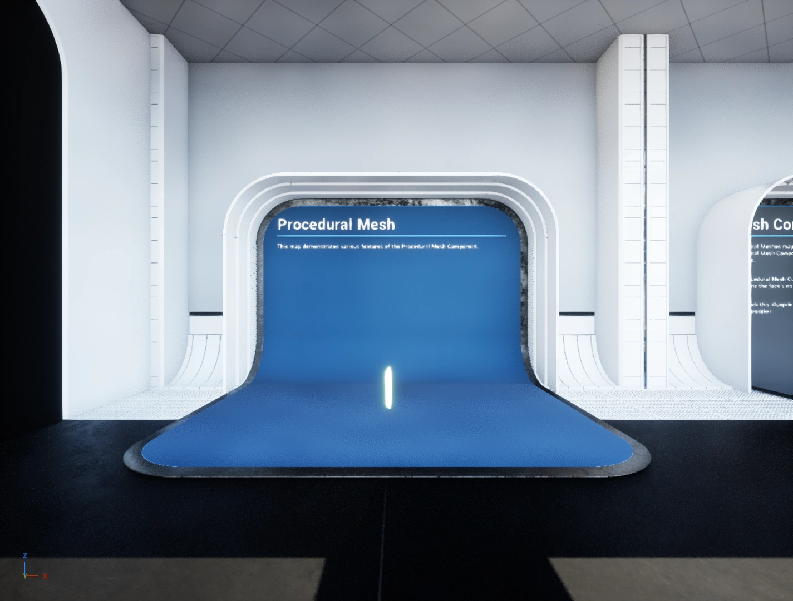
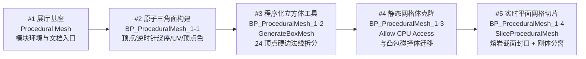
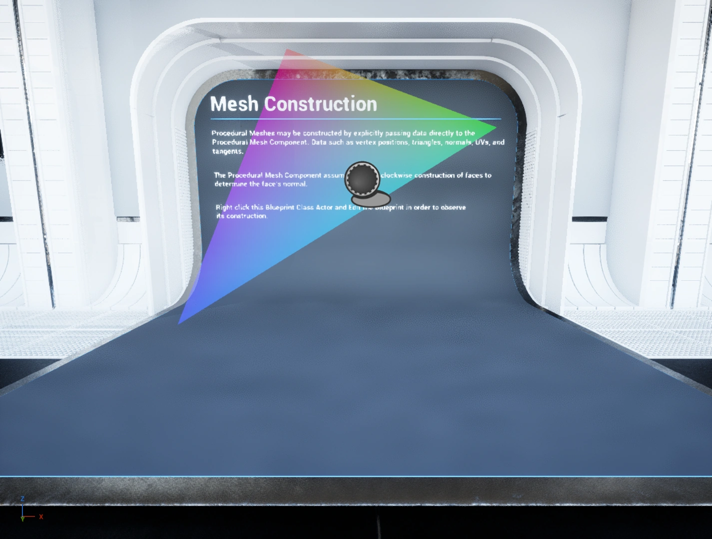
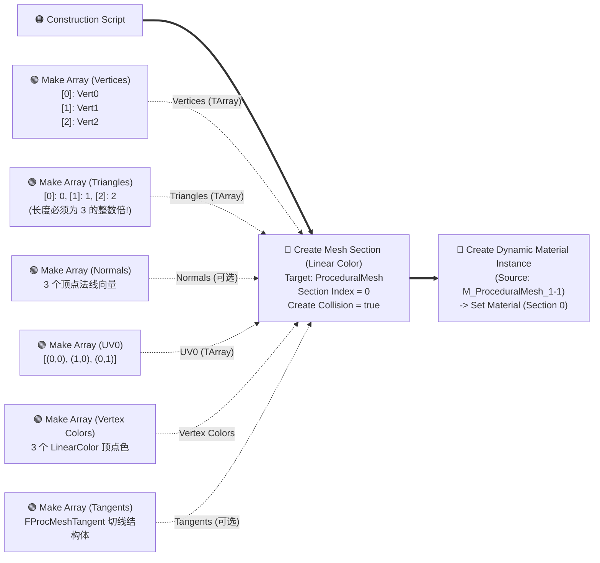
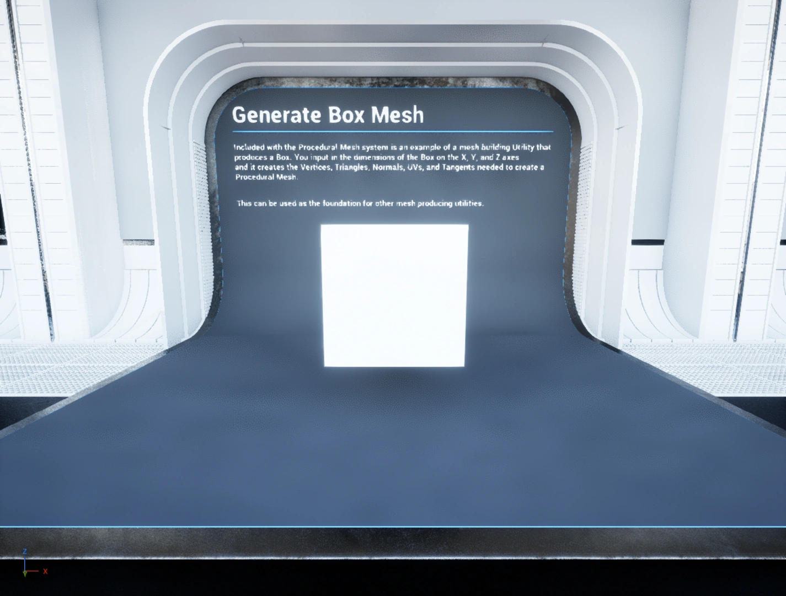
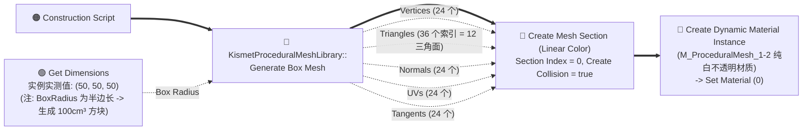
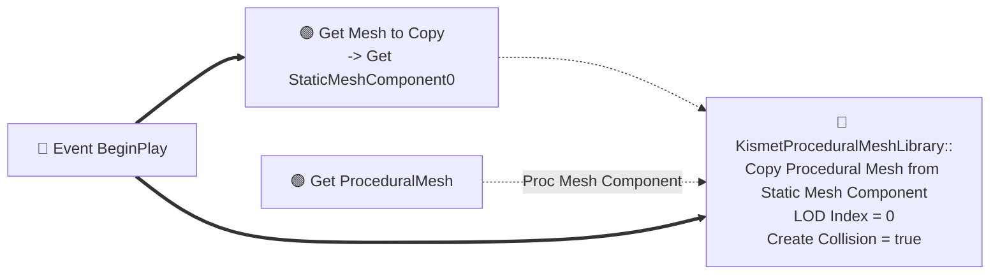
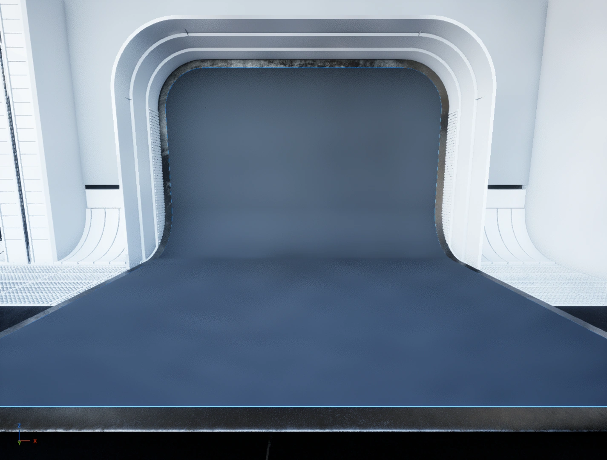
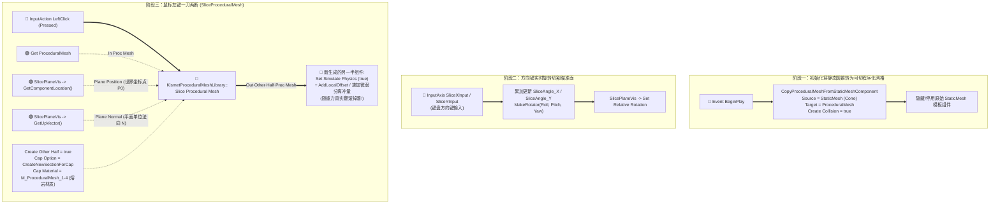

# 第 08 章 · `Blueprint_ProceduralMesh`：程序化网格体顶点缓冲、三角绕序、UV 构建与实时刀锋切片

> **关卡资产路径**：`/Game/Maps/Blueprint/Blueprint_ProceduralMesh`  
> **示例资产目录**：`/Game/ExampleContent/ProceduralMesh/`  
> **关联核心插件模块**：`/Script/ProceduralMeshComponent`（`UProceduralMeshComponent` & `UKismetProceduralMeshLibrary`）  
> **关卡实测规模**：总计 `33` 个 Actor | `5` 座编号展台 | `13` 个核心示例 Actor（外加 `1` 个全局 `InstancedFoliageActor1`）

---

## 一、 展厅总览：打破离线 DCC 边界，在运行时用数学直接锻造三维网格

在常规游戏管线中，三维网格体（`UStaticMesh`）是由美术师在 Blender、Maya 或 Houdini 中离线建模导出 FBX，经编辑器烘焙顶点缓冲（Vertex Buffer）与索引缓冲（Index Buffer）后锁死在显存中的“只读冰雕”。

然而，总有一类高光玩法是离线预制模型永远无法满足的：
- 《合金装备崛起：复仇》或《水果忍者》中，玩家沿**任意角度挥出一刀**，将圆柱、石柱或敌人护甲一刀两断，切口截面泛起炽热的熔岩红光，切下来的上半截顺着重力翻滚落地；
- 《无人深空》或《Astroneer》中，实时用体素等值面（Marching Cubes）生成的异星洞穴地形；
- 运行时根据玩家绘制轨迹实时挤压生成的剑气拖尾、建筑截面、程序化晶簇或可撕裂护盾。

`Blueprint_ProceduralMesh` 展厅虽然精炼地浓缩为 **5 座展台**，却由浅入深地打通了实时图形学最核心的**“单三角面原子缓冲 -> 24 顶点硬边立方体构建器 -> 静态网格 CPU 内存拷贝与碰撞迁移 -> 任意平面实时几何切割与切口封盖（Cap）”**全链路：

---

## 二、 逐展台 100% 零遗漏深度拆解（#1 ~ #5）

---

### 展台 #1：`Procedural Mesh`（展厅导览与环境基座）
- **展牌标识**：`BP_DemoDisplay4` | **空间坐标**：`(500, -900, 0)`
- **官方展牌原文**：
  > *This map demonstrates various features of the Procedural Mesh Component.*

#### 展台构成与基础设施
本展台位于展厅入口，关卡脚本类 `/Game/Maps/Blueprint/Blueprint_ProceduralMesh.Blueprint_ProceduralMesh_C` 保持零额外属性状态，共配对 **6 个基础环境与文档 Actor**：
- **`DirectionalLight`**（强度 `10.0`，纯白光，`Movable` 动态阴影）与 **`SkyLight`**（强度 `3.0`，`Movable`）；
- **`SkyAtmosphere`** 与 **`ExponentialHeightFog`**（另在 #4 附近配有经典天空球 `BP_Sky_Sphere`）；
- **`Actor`**（挂载 `ChaosDebugDrawComponent_0`，用于辅助观察切碎后的刚体碰撞体）；
- **`Procedural Mesh Examples Documentation`**（`DocumentationActor`，官方离线文档锚点）。

---

### 展台 #2：`Mesh Construction`（手工装填五大图形缓冲区与逆时针三角绕序铁律）
- **展牌标识**：`BP_DemoDisplay` | **空间坐标**：`(1489, -900, 0)`
- **核心陈列资产**：`BP_ProceduralMesh_1-1`（路径：`/Game/ExampleContent/ProceduralMesh/BP_ProceduralMesh_1-1`）
- **官方展牌原文**：
  > *Procedural Meshes may be constructed by explicitly passing data directly to the Procedural Mesh Component. Data such as vertex positions, triangles, normals, UVs, and tangents. The Procedural Mesh Component assumes counter clockwise construction of faces to determine the face's normal. Right click this Blueprint Class Actor and Edit the Blueprint in order to observe its construction.*

#### 1. 实测实例参数与视口三维顶点拖拽
观察展台 #2 空中悬浮的那片半透明三角形薄片，选中 `BP_ProceduralMesh_1-1` 实例可见其公开参数：
- `vert0` = `(-100.0, -144.246, 183.601)`
- `vert1` = `(162.416, -108.916, 78.478)`
- `vert2` = `(-120.0, 140.0, -95.706)`
- `refreshConstruction` = `false`（勾选或拨动此布尔开关即可在编辑器中强制重触发一次 `Construction Script` 刷新网格！）

配套材质 **`M_ProceduralMesh_1-1`**（`/Game/ExampleContent/ProceduralMesh/M_ProceduralMesh_1-1`）实测参数：
- **混合模式**：`BLEND_Translucent`，着色模型 `MSM_DefaultLit`，**`twoSided = false`（刻意开启单面背面剔除！）**；
- **材质连线**：`Opacity` 连接常量 `0.52`；`Base Color` 由 **`VertexColor`（顶点色表达式节点）** 乘以纯白常量 `(1, 1, 1)` 驱动——这意味着三角形表面的渐变色彩完全来自蓝图在运行时喂进顶点缓冲区的 `Vertex Colors` 数组！

#### 2. `UserConstructionScript` 完整节点流与 `CreateMeshSection_LinearColor` 解剖
在 `BP_ProceduralMesh_1-1` 的构造脚本中，核心主角是 `UProceduralMeshComponent` 最底层的造物原语 —— **`Create Mesh Section (Linear Color)`**：

#### 3. 图形学底层必考铁律：三角绕序（Winding Order）与背面剔除（Backface Culling）
为什么官方展牌专门用一整句话强调 **“assumes counter clockwise construction of faces（假定按逆时针顺序构建面）”**，而且故意把 `M_ProceduralMesh_1-1` 的 `Two Sided` 设为 `false`？
- 当你绕到展台 #2 这片三角形的背面观察时，**整片三角形会瞬间隐形消失！**
- **底层光栅化原理**：GPU 光栅化器为了省去实心物体背面一半像素的无用着色开销，会计算投影到屏幕空间（Screen Space）后三角形三个顶点的缠绕方向：
  - 在虚幻引擎中，**当你正对三角形正面观察时，顶点索引按逆时针（Counter-Clockwise，CCW）排列的一面被判定为正面（Front Face）**，其几何面法线指向你的眼睛；
  - 若你不小心把 `Triangles` 数组填反成了顺时针 `[0, 2, 1]`，该面就会朝向背面而被光栅化器硬件剔除（Backface Culled），还会导致物理碰撞法线反置把玩家吸进模型内部！
- **数组对齐约束**：`Vertices` 若有 $V$ 个元素，则任何非空的 `Normals`、`UV0`、`Vertex Colors`、`Tangents` 数组长度都**必须严格等于 $V$**（一一对应）；而 `Triangles` 索引数组的长度**必须是 $3$ 的整数倍**（每 3 个整数构成 1 个三角面，值域在 $0 \dots V-1$ 之间）。

> [!WARNING]
> **高频性能大坑：`CreateMeshSection` vs `UpdateMeshSection`！**  
> 如果你想做一个随正弦波实时起伏的丝带或果冻网格，**千万不要在 `Event Tick` 里每帧调用 `CreateMeshSection_LinearColor`！** 因为 `CreateMeshSection` 会销毁并重建底层渲染代理（`FPrimitiveSceneProxy`）、重新分配索引缓冲区甚至重烤物理碰撞网格，每帧调用必掉帧！  
> **正确做法**：只要顶点数量和三角拓扑连线没变，仅在 `BeginPlay` 调一次 `CreateMeshSection`；随后在 `Tick` 中改调 **`UpdateMeshSection_LinearColor`** —— 它会在既有 GPU 顶点缓冲区上做极速原地覆盖（In-Place Vertex Buffer Update），开销骤降一个数量级！

---

### 展台 #3：`Generate Box Mesh`（程序化几何工具库与“为什么立方体是 24 顶点而非 8 顶点”）
- **展牌标识**：`BP_DemoDisplay1` | **空间坐标**：`(2499, -900, 0)`
- **核心陈列资产**：`BP_ProceduralMesh_1-2a`（类 `BP_ProceduralMesh_1-2_C`，路径：`/Game/ExampleContent/ProceduralMesh/BP_ProceduralMesh_1-2`）
- **官方展牌原文**：
  > *Included with the Procedural Mesh system is an example of a mesh building Utility that produces a Box. You input in the dimensions of the Box on the X, Y, and Z axes and it creates the Vertices, Triangles, Normals, UVs, and Tangents needed to create a Procedural Mesh. This can be used as the foundation for other mesh producing utilities.*

#### 1. `UserConstructionScript` 节点流还原
如果要手写 `MakeArray` 敲一个立方体的全部顶点、索引、法线和切线，连线会高达上百个节点。为此，引擎在 `UKismetProceduralMeshLibrary` 函数库中内置了开箱即用的网格生成器 **`Generate Box Mesh`**：

#### 2. 深度几何面试题：为什么 `GenerateBoxMesh` 生成了 24 个顶点，而不是几何课本上的 8 个顶点？
很多初学者打印 `GenerateBoxMesh` 输出的 `Vertices` 数组长度时会大吃一惊：一个立方体明明只有 8 个角点，为什么这里足足生成了 **24 个顶点**？
- **根因在于 GPU 顶点属性的一对一绑定机制（Hard Edges & UV Seams）**：
  - 在现代图形 API（DX12 / Vulkan）中，同一个顶点索引 `i` 只能拥有**唯一的一条法线 `Normals[i]`** 和**唯一的一组纹理坐标 `UVs[i]`**；
  - 立方体的每一个角点同时被 **3 个互相垂直的面**共享（例如右上前角点同时属于顶面 $\mathbf{n}=(0,0,1)$、右面 $\mathbf{n}=(0,1,0)$、前面 $\mathbf{n}=(1,0,0)$）。如果强行只用 8 个共享顶点，每个角点只能取三条法线的平均值 $(\frac{1}{\sqrt{3}}, \frac{1}{\sqrt{3}}, \frac{1}{\sqrt{3}})$——整个立方体在光照下就会变成一颗圆乎乎、黑一块亮一块的“充气球”（Smooth Shading 伪影），且 6 个面的贴图 UV 也会彻底扭曲撕裂！
  - 因此，凡是需要 **90° 硬边折角（Hard Edge）** 或 **UV 接缝断开（UV Seam）** 的地方，程序化网格构建器都必须将角点拆裂复制为独立顶点：$6\text{ 个面} \times 4\text{ 顶点/面} = \mathbf{24}\text{ 个顶点}$，$6\text{ 个面} \times 2\text{ 三角形/面} \times 3\text{ 索引} = \mathbf{36}\text{ 个索引}$！
- **扩展工具函数**：当你自己编写地形或曲面生成器，只算出了 `Vertices`、`Triangles` 和 `UVs`，懒得手推偏导切线与光滑组法线时，可以直接调用同属 `UKismetProceduralMeshLibrary` 的神器 **`Calculate Tangents for Mesh`**（自动计算平滑法线与 MikkTSpace 风格切线）与 **`Create Grid Mesh Triangles`**（一行节点生成 $N \times M$ 规则网格拓扑索引）！

---

### 展台 #4：`Static Mesh Copy`（静态网格体 CPU 内存解锁与凸包物理碰撞迁移）
- **展牌标识**：`BP_DemoDisplay2` | **空间坐标**：`(3513, -900, 0)`
- **展台内 3D 悬浮文字标签**：`Static Mesh`（左）、`Procedural Mesh`（右）
- **核心陈列资产（2 个主体对比 Actor + 1 个背景天空球）**：
  1. 左侧源资产：`StaticMeshActor_1-3`（静态网格体 `/Game/ExampleContent/ProceduralMesh/StaticMesh_1-3`，材质 `M_StaticMesh_1-3`）
  2. 右侧克隆体：`BP_ProceduralMesh_1-3`（公开变量 `meshToCopy` 直接吸取左侧 `StaticMeshActor_1-3`）
- **官方展牌原文**：
  > *The Procedural Mesh Component can duplicate an existing Static Mesh Component. This process can copy collision as well! Just make sure to disable "Use Complex as Simple" on the Procedural Mesh Component. The Static Mesh Asset must have the "Allow CPU Access" property enabled. This property can be found by opening the Static Mesh in the Static Mesh Editor.*

#### 1. `EventGraph` 克隆节点流还原
在 `BP_ProceduralMesh_1-3` 的 `Event BeginPlay`（以及构造刷新逻辑）中，核心只需调用一行高度封装的桥接函数：

该函数会自动遍历源 `UStaticMesh` 指定 LOD 层级下的所有材质 Section，把顶点、索引、法线、UV、切线以及材质球完整搬运进右侧的 `UProceduralMeshComponent` 中，使左右两尊雕塑在视觉上分毫不差！

#### 2. 两大血泪避坑铁律（99% 打包崩溃与物理失效的根源！）
展牌上的两句叮嘱，每一句背后都是商业项目打包上线时真实发生过的严重事故：

##### 铁律一：为什么源静态网格体必须勾选 `Allow CPU Access`（`bAllowCPUAccess = true`）？
- **编辑器假象陷阱**：在 Unreal Editor（PIE）环境下，由于编辑器为了支持模型编辑与烘焙，内存中始终驻留着网格体的原始数据（Mesh Description / RenderData CPU 副本），即便你忘了勾选 `Allow CPU Access`，有时也能侥幸工作或只报警告；
- **打包 Shipping 必崩/空模型真相**：在打包后的独立客户端（Cooked Build）中，引擎加载 `UStaticMesh` 的默认行为是：把顶点缓冲（Vertex Buffer）和索引缓冲通过 RHI DMA 传进显卡显存（VRAM）后，**立即释放掉系统内存（System RAM）中的 CPU 副本以节省内存**！此时 CPU 端调用 `CopyProceduralMeshFromStaticMeshComponent` 试图回读顶点数组，读到的将是空缓冲区，克隆出的网格瞬间消失！
- **操作位置**：双击打开源静态网格体资产（如 `StaticMesh_1-3`），在右侧 Details 面板搜索并勾选 **`Allow CPU Access`**，强制引擎在打包后依然在主存保留一份可读的几何缓冲。

##### 铁律二：为什么必须取消勾选 `ProceduralMesh` 上的 `Use Complex as Simple`？
- `UProceduralMeshComponent` 默认勾选了 **`Use Complex as Simple`（将复杂逐三角面网格直接当作简单物理碰撞使用）**。
- 在 Chaos 物理引擎中，**复杂三角网格碰撞（Trimesh / Complex Collision）只能作为静止不动的地面墙壁（Kinematic / Static），绝不允许开启刚体重力模拟（`Simulate Physics = true`）！**
- 只有取消勾选 `Use Complex as Simple`，`CopyProceduralMeshFromStaticMeshComponent` 从源静态网格体拷贝过来的**三维凸包碰撞集合（Convex Elements，`FKConvexElem`）**才会正式接管物理模拟，为下一座展台的“切碎后受重力自由滚落”铺平道路！

---

### 展台 #5：`Mesh Slicing`（实时激光平面一刀两断、熔岩切口自动封盖与刚体碰撞分裂）
- **展牌标识**：`BP_DemoDisplay3` | **空间坐标**：`(4520, -900, 0)`
- **核心陈列资产**：`BP_ProceduralMesh_1-4`（路径：`/Game/ExampleContent/ProceduralMesh/BP_ProceduralMesh_1-4`，开启 `AutoReceiveInput = Player0`）
- **官方展牌原文**：
  > *Procedural Mesh Components can be sliced using a plane. The Slice function can create caps for the cut areas, and it even slices the collision! This enables the seperated bits to fall and interact with each other. Use the Arrow keys to orient the slice plane then Left Click to slice.*

#### 1. 组件结构与呼吸刀锋平面 + 炽热熔岩切口双材质深拆
站在展台 #5 前运行游戏，你会看到一枚洁白的圆锥体 `Cone` 被一片闪烁呼吸的半透明平面 `SlicePlaneVis` 贯穿：按下键盘**方向键（上下左右）**调整刀锋倾角，点击**鼠标左键**——圆锥瞬间沿平面整齐断开，暴露出的新鲜切口闪烁着高达 50 倍亮度的炽热橙红自发光，切掉的尖顶顺势滑落砸在展台上！

我们先拆解 `BP_ProceduralMesh_1-4` 的精妙组件与双材质设计：
- **组件架构**：
  1. `StaticMesh`（网格体 `/Game/ExampleContent/ProceduralMesh/Cone`，作为几何与凸包碰撞的数据母本，运行后隐藏或替换为 `ProceduralMesh`）；
  2. `ProceduralMesh`（承载被切主体的 `UProceduralMeshComponent`，关闭了 `Use Complex as Simple`）；
  3. `SlicePlaneVis`（网格体 `S_1_Unit_Plane`，直观展示当前切割平面位置与倾角的激光瞄准面）及其法向指示箭头 `Arrow_SliceDirection`。
- **呼吸瞄准平面材质 `M_SlicePlane`（`BLEND_Translucent` + `MSM_Unlit` + `TwoSided = true`，8 个节点）**：
  - `Emissive Color` = 纯白 `(1, 1, 1)`；
  - `Opacity` = `ConstantBiasScale(Sine(Time * 1.0))` —— 用正弦时间波驱动半透明度周期性明暗呼吸，既看清刀路又不遮挡后方模型。
- **高光熔岩切口截面材质 `M_ProceduralMesh_1-4`（`BLEND_Opaque` + `MSM_DefaultLit`，3 个节点）**：
  - `Base Color` = 暖橙色常量 `(R=1.0, G=0.508, B=0.065)`；
  - `Emissive Color` = `(1.0, 0.508, 0.065) * 50.0` —— 高达 `50.0` 的 HDR 自发光倍增配合 Lumen / Bloom 泛光，瞬间营造出等离子光剑切开金属后的高温熔融切口视觉冲击力！

#### 2. `EventGraph` 完整节点流还原（拷贝母本 -> 方向键调角 -> 左键挥刀分裂）

#### 3. 源码级几何算法拆解：`SliceProceduralMesh` 在几毫秒内究竟做了什么？
很多开发者好奇：把一个封闭三维网格沿任意平面 $\Pi: \mathbf{n} \cdot (\mathbf{x} - \mathbf{p}_0) = 0$ 一刀切开并补齐截面，引擎底层 C++（`UKismetProceduralMeshLibrary::SliceProceduralMesh`）经历了哪四步硬核几何运算？

1. **顶点有向距离分类（Signed Distance Classification）**：  
   遍历 `InProcMesh` 中每一个顶点 $\mathbf{v}_i$，计算点到平面的有向距离 $d_i = \mathbf{n} \cdot (\mathbf{v}_i - \mathbf{p}_0)$：
   - $d_i > 0$：归入正半空间（保留在原 `InProcMesh` 中）；
   - $d_i < 0$：归入负半空间（移入新建的 `OutOtherHalfProcMesh` 组件中）。
2. **跨平面三角形线性插值劈裂（Triangle-Plane Clipping）**：  
   遍历所有三角形 $(A, B, C)$：
   - 若三顶点同正或同负，原封不动归入对应半边；
   - 若三顶点异号（必为 **“1 个顶点在一侧，2 个顶点在另一侧”**），则在两条跨越切割面的边上按距离比 $t = \frac{d_A}{d_A - d_B}$ 精确线性插值生成两个新交点 $I_1, I_2$（同时插值坐标、法线、UV、顶点色与切线）：单顶点一侧形成 **1 个小三角形**，双顶点一侧剖分为 **2 个三角形组成的四边形**！
3. **截面轮廓环缝合与耳切三角化封盖（Planar Cap Generation）**：  
   如果只切开外壳不封口，切出来的圆锥就像空心蛋壳一样露馅！当 `CapOption = CreateNewSectionForCap` 时，算法收集刚才所有被劈断三角形留下的截交线段 $(I_1, I_2)$，首尾相接拼成闭合二维多边形环（Polygon Loops），投影到切割平面的正交切空间计算平面 UV，执行多边形三角剖分（Triangulation），为正半边生成法线朝 $-\mathbf{n}$ 的截面、为负半边生成法线朝 $+\mathbf{n}$ 的镜像截面，作为全新材质槽单独赋予 `M_ProceduralMesh_1-4` 熔岩材质！
4. **3D 凸包物理碰撞体同步平面削切（Convex Hull Slicing）**：  
   最绝的一步：它遍历组件身上的 `AggGeom.ConvexElems`（三维凸多面体顶点云），同样用切割平面 $\Pi$ 将凸包一分为二重新计算上下两半的缩小版三维凸包（Convex Hull），所以切下来的圆锥尖不仅画面上变小了，连物理碰撞体积也严丝合缝变成了圆锥尖的真实形状！

> [!CAUTION]
> **`SliceProceduralMesh` 的拓扑局限性与连续狂切优化**：
> 1. **仅完美支持水密凸/简单凹闭合网格（Watertight Manifold）**：如果源模型本身破洞漏面（非流形网格），截面轮廓环无法首尾闭合，`CreateNewSectionForCap` 会导致封盖破面或漏封；
> 2. **多次连切组合爆炸防护**：如果你允许玩家对着切下来的碎片再连砍 20 刀（每次 `Create Other Half = true` 都会使组件数量 $2^k$ 翻倍并产生极碎微三角面），务必设置**最小包围盒体积阈值**或**最大切割代数（Max Slice Depth $\le 3$）**，碎块小于阈值时直接播粒子消散销毁！

---

## 三、 UE5 次世代程序化几何选型全景指南：何时用 `PMC`，何时升级？

随着 UE5 几何管线的飞速演进，`UProceduralMeshComponent` 已不再是唯一选择。作为首席架构师，请根据下表精准选型：

| 方案名称 | 核心优势 | 局限性 | 最佳适用场景 |
| :--- | :--- | :--- | :--- |
| **`UProceduralMeshComponent` (PMC)** （本章主角，引擎内置最稳健） | API 极简直观，原生自带 `SliceProceduralMesh` 平面切刀与凸包切割，零外部依赖 | 每次修改 Section 拷贝开销较大，缺乏布尔运算（打孔/并差集）与自动网格简化 | **刀剑实时平面斩切、简易丝带/地形块、教学与轻量动态网格** |
| **`UDynamicMeshComponent` + `GeometryScript`** （UE5 官方建模内核运行时版） | 支持完整 **3D 布尔挖孔（Mesh Boolean）**、体素重拓扑、自动减面（Simplify）、UV 自动展平与法线修复 | CPU 半边网格数据结构（`FDynamicMesh3`）内存占用高于 PMC | **墙体实时炸洞、运行时复杂程序化建模工具、编辑器 EUW 几何批处理** |
| **`Chaos Geometry Collection`** （Chaos 破碎场系统） | 离线预切 Voronoi 碎块树 + 运行时分级簇释放，支持万级碎片 GPU 骨骼/实例化高速渲染 | 裂纹走向由离线 Fracture 决定，不能像 PMC 那样按任意一刀激光平面精准光滑齐切 | **整栋大楼坍塌、石柱粉碎爆裂、大规模物理破坏场景** |
