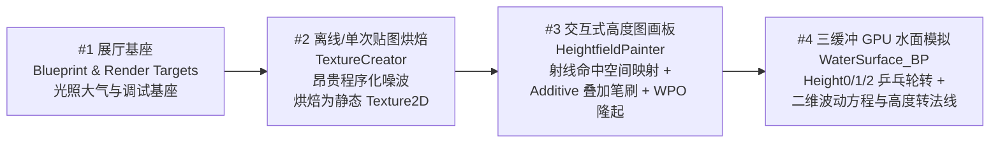
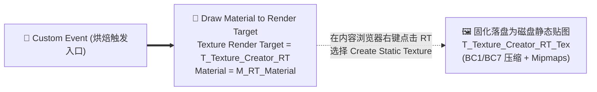
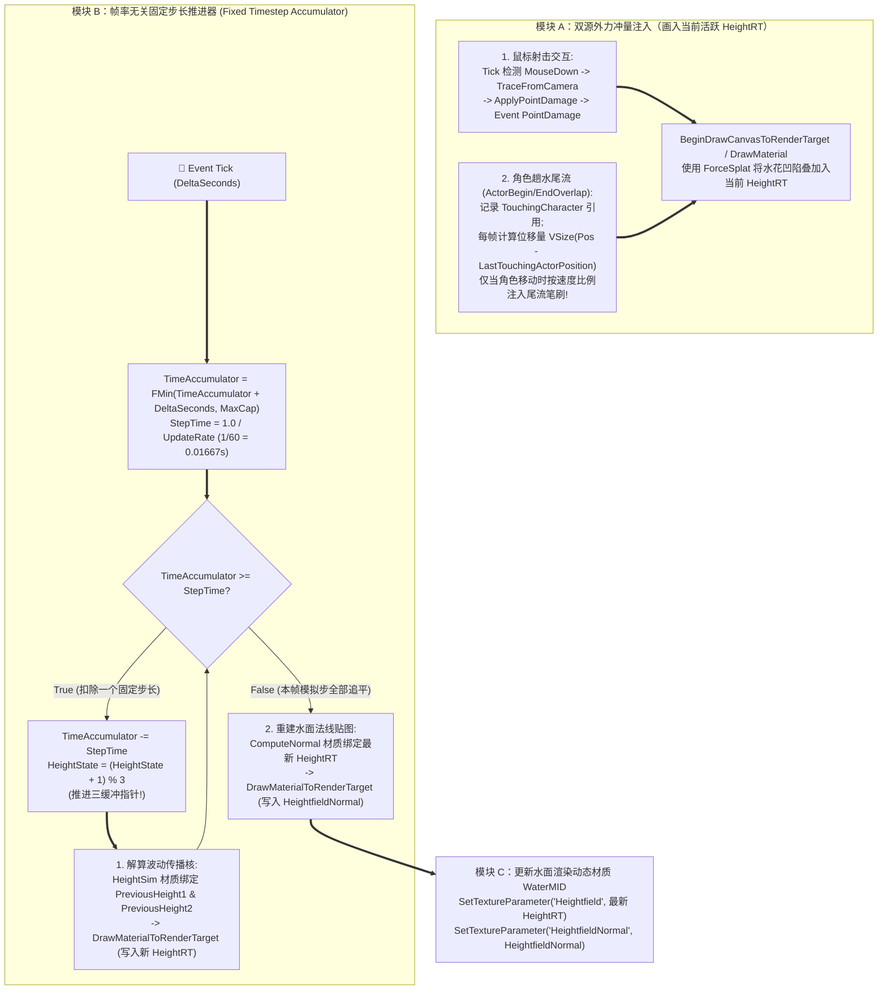

# 第 09 章 · `Blueprint_RenderToTarget`：渲染到纹理（RTT）画布绘制、交互高度场与 Ping-Pong 水波解算

> **关卡资产路径**：`/Game/Maps/Blueprint/Blueprint_RenderToTarget`  
> **示例资产目录**：`/Game/ExampleContent/Blueprint_RenderToTarget/`  
> **核心引擎函数库**：`UKismetRenderingLibrary`（`DrawMaterialToRenderTarget` / `BeginDrawCanvasToRenderTarget` / `CreateRenderTarget2D`）  
> **关卡实测规模**：总计 `31` 个 Actor | `4` 座编号展台 | `12` 个核心示例 Actor

---

## 一、 展厅总览：把材质着色器变成通用 GPU 并行计算器（GPGPU in Blueprints）

初学者眼中的材质（Material）只是贴在模型表面决定“是木头还是金属”的被动外衣；而在资深技术美术（Technical Artist）与图形程序员眼中，**材质编辑器本质上是一套极其强大的跨平台像素着色器（Pixel Shader）并行编程环境，而渲染目标（`UTextureRenderTarget2D`，简称 RT / RTT）就是显卡显存中可读写的二维浮点数组（VRAM Buffer）！**

一旦你在蓝图中打通了 **`Draw Material to Render Target`** 这座桥梁，原本只能在 C++ Compute Shader 里实现的高阶视觉黑科技便悉数向蓝图敞开大门：
- 《荒野大镖客 2》与《战神》中，角色踏过厚厚积雪或泥地留下的**持久化凹陷脚印轨迹**；
- 《喷射战士（Splatoon）》中，颜料弹炸裂涂满全场墙壁地面的**实时动态墨水遮罩**；
- 《魔兽争霸》RTS 战争迷雾擦除、载具装甲弹孔刮擦露底漆、以及本章压轴登场的 **60Hz 实时反射干涉水波纹物理模拟**！

`Blueprint_RenderToTarget` 展厅用紧凑递进的 **4 座展台**，完整呈现了 RTT 技术从“离线单次烘焙”到“运行期单缓冲累积绘制”，再到“三缓冲循环迭代偏微分方程（PDE）解算”的三级跳：

---

## 二、 逐展台 100% 零遗漏深度拆解（#1 ~ #4）

---

### 展台 #1：`Blueprint & Render Targets`（展厅导览与环境基座）
- **展牌标识**：`BP_DemoDisplay` | **空间坐标**：`(460, -900, 0)`
- **官方展牌原文**：
  > *This map shows examples of using Blueprint render-to-texture to implement a simple Texture creator, a Heightfield painter, and a more complex GPU fluid surface simulation.*

#### 展台构成与光照配置
入口展台负责整张地图的环境照明（之所以专门配置充足的天空光与定向光，是为了让展台 #4 的高反射水面菲涅尔波纹清晰可见），关卡脚本类 `/Game/Maps/Blueprint/Blueprint_RenderToTarget.Blueprint_RenderToTarget_C` 保持零额外属性，共包含 **5 个基础环境 Actor**：
- **`DirectionalLight`**（强度 `5.0`，纯白光，`Movable` 动态阴影）与 **`SkyLight`**（强度 `3.0`，`Movable`）；
- **`SkyAtmosphere`**、**`ExponentialHeightFog`** 与携带 `ChaosDebugDrawComponent_0` 的辅助 **`Actor`**。

---

### 展台 #2：`Creating Textures Using Render Targets`（将昂贵程序化噪波材质烘焙为廉价静态贴图）
- **展牌标识**：`BP_DemoDisplay1` | **空间坐标**：`(1550, -870, 0)`
- **核心陈列资产（3 个对比 Actor）**：
  1. 烘焙触发器蓝图：`TextureCreator`（`/Game/ExampleContent/Blueprint_RenderToTarget/Blueprints/TextureCreator`，父类：`Actor`）
  2. 左侧实时计算平面：`SM_Plane1000_513`（网格体 `SM_Plane1000_512`，覆写材质 **`M_RT_Material`**）
  3. 右侧烘焙贴图平面：`SM_Plane1000_512`（网格体 `SM_Plane1000_512`，覆写材质 **`M_Texture_Creator_StaticTexture`**）

#### 1. 左右两块平面为何肉眼一模一样，GPU 开销却天差地别？
观察实拍图中的两块黑白云雾噪波板，对比它们背后的材质源码拆解：

| 对比维度 | 左侧平面材质 `M_RT_Material` | 右侧平面材质 `M_Texture_Creator_StaticTexture` |
| :--- | :--- | :--- |
| **着色模型** | `MSM_Unlit`（无光照，直连 `MP_EmissiveColor`） | `MSM_DefaultLit`（标准受光，直连 `MP_BaseColor`） |
| **核心节点构成** | `TexCoord` + `Constant` -> `AppendVector` -> **`MaterialExpressionNoise_0`（三维程序化噪波节点）** | 仅 **1 个 `TextureSample`**，采样静态资产 `/Game/Global/Textures/T_Texture_Creator_RT_Tex` |
| **每像素 GPU 代价** | **极高 ALU 算术指令开销**！多倍频（Octaves）Perlin/Simplex 3D 噪波每帧每像素需执行数十次哈希与三次插值指令 | **极低（仅 1 次硬件 Mipmap 纹理采样）**，开销降低 90% 以上且天然支持远景抗锯齿过滤！ |

#### 2. `TextureCreator` 蓝图节点链与静态固化流程
打开 `TextureCreator` 蓝图，其核心事件通过一行 **`KismetRenderingLibrary::DrawMaterialToRenderTarget`** 完成离屏渲染：

- **底层原理与两种绘制 API 的选型边界**：
  1. **`DrawMaterialToRenderTarget`（本展台使用）**：引擎在后台生成一个恰好铺满整个 Render Target 视口 `[0, 1] x [0, 1]` 的全屏三角形（Full-Screen Quad），以正交无透视方式执行一次 `M_RT_Material` 的像素着色器，将 `Emissive Color` 输出直接写入目标贴图 `T_Texture_Creator_RT`。适合**整图过滤、全局噪波烘焙、全图状态推进**。
  2. **`BeginDrawCanvasToRenderTarget` -> `Canvas::K2_DrawMaterial` -> `EndDrawCanvasToRenderTarget`**：打开一个 2D 画布上下文（`UCanvas`），允许你在单次 Render Pass 内指定局部像素坐标 `(ScreenPosition, ScreenSize, Rotation)` 连续盖上几十枚小尺寸笔刷印章（Splatting），避免每次盖章都切换一次 RHI Render Pass，适合**局部高频脚印/弹孔批量绘制**！

---

### 展台 #3：`Height Map Painter`（动态创建浮点 RT、点伤害解耦交互、Additive 叠加笔刷与 WPO 顶点隆起）
- **展牌标识**：`BP_DemoDisplay2` | **空间坐标**：`(2581, -870, 0)`
- **核心陈列资产（3 个协作 Actor）**：
  1. 交互式高度画板：`HeightfieldPainter`（`/Game/ExampleContent/Blueprint_RenderToTarget/Blueprints/HeightfieldPainter`，父类：`StaticMeshActor`）
  2. 一键清零按钮：`BP_Button_ResetHeightfield`（`/Game/ExampleContent/Blueprint_Communication/Blueprints/BP_Button_ResetHeightfield`，引用 `HeightfieldPainter`）
  3. 阻挡体积：`BlockingVolume`
- **官方展牌原文**：
  > *Point and left click to draw on the plane. Use the button to reset.*

#### 1. 展品现象与高密网格选型秘密
运行游戏，准星对准展台 #3 的黑色画板按住**鼠标左键涂抹**，鼠标划过之处立刻像挤奶油或造山运动一样**隆起立体的白色山脊**！走近旁边的立柱按钮触发 `BP_Button_ResetHeightfield`，整座山脉瞬间夷为平地。
- **为什么网格体名叫 `SM_Plane1000_512`？**  
  因为顶点着色器的 **`World Position Offset`（世界位置偏移，简称 WPO）只能移动已有顶点，不能凭空细分出新顶点**！如果用普通只有 4 个角点的默认平面，无论贴图画得多精细，整块板子只能四个角上下翘动；而 `SM_Plane1000_512` 是一块边长 `1000cm`、横纵细分高达 **`512 × 512`（约 26.2 万顶点）** 的高密网格，足以精准还原每一道细腻的笔刷起伏！

#### 2. `HeightfieldPainter` 三大图表完整节点流还原
实测拆解 `HeightfieldPainter.uasset` 的字节码，其内部包含 7 个成员变量（`HeightfieldRT`、`PainterMaterialInstance`、`ForceSplatMID`、`MouseDown`、`InteractionDistance = 1000`、`BrushSize = 0.04`、`BrushStrength = 1.0`）以及一条极具架构美感的**“射线 -> 点伤害 -> 局部空间转 UV -> 叠加盖章”**闭环：

```mermaid
flowchart TB
    subgraph Init["1. 初始化动态渲染目标与双材质实例 (Event BeginPlay)"]
        BP["🔴 Event BeginPlay"] ==> CRT["🔵 Create Render Target 2D<br/>(动态分配显存缓冲 -> 存入 HeightfieldRT)"]
        CRT ==> CLR["🔵 Clear Render Target 2D<br/>(Clear Color = (0,0,0,1) 纯黑零高度)"]
        CLR ==> MID1["创建画板材质 MID (PainterMaterialInstance)<br/>Set Texture Parameter ('Heightfield' = HeightfieldRT)<br/>赋给 StaticMeshComponent0"]
        MID1 ==> MID2["创建笔刷材质 MID (ForceSplatMID, 源材质 ForceSplat)"]
    end

    subgraph Shoot["2. 鼠标按住连续发射屏幕中心射线 (Tick + TraceFromCamera)"]
        LMB["🔴 LeftMouseButton<br/>Pressed / Released"] ==> SETM["Set MouseDown = true / false"]
        TICK["🔴 Event Tick"] ==> CHK{"MouseDown?"}
        CHK -->|"True"| TRC["函数 TraceFromCamera:<br/>CamLoc = GetPlayerCameraManager().GetActorLocation()<br/>CamDir = Conv_RotatorToVector(GetActorRotation())<br/>LineTraceSingle(CamLoc, CamLoc + CamDir * 1000)"]
        TRC ==> HIT{"bBlockingHit?"}
        HIT -->|"True"| DMG["🔵 Apply Point Damage<br/>DamagedActor = HitActor, HitLocation = Location"]
    end

    subgraph Paint["3. 受击点转 UV 空间并向 RT 叠加笔刷 (Event PointDamage)"]
        PD["🔴 Event PointDamage (HitLocation)"] ==> UV["世界坐标转平面 [0,1] UV:<br/>LocalPos = InverseTransformLocation(ComponentToWorld, HitLocation)<br/>NormalizedUV = (LocalPos / 1000.0) + (0.5, 0.5, 0)"]
        UV ==> SETP["ForceSplatMID:<br/>SetVectorParameter('ForcePosition', LinearColor(NormalizedUV))<br/>SetScalarParameter('ForceSize', BrushSize)<br/>SetScalarParameter('ForceStrength', BrushStrength)"]
        SETP ==> DRAW["🔵 Draw Material to Render Target<br/>Target = HeightfieldRT, Material = ForceSplatMID"]
    end
```

- **一键重置按钮 `BP_Button_ResetHeightfield` 逻辑**：玩家靠近按钮触发重叠时，检查公开引用 `Heightfield -> IsValid`，直接对其 `HeightfieldRT` 调用 **`Clear Render Target 2D (ClearColor = Black)`**，一行节点瞬间抹平全部高度数据！

#### 3. 架构精髓与双核心材质源码深拆

##### （1）为什么故意绕一圈调用 `ApplyPointDamage` 而不是直接在 `LineTrace` 后面画贴图？
这正是虚幻玩法架构师的高明之处！把“涂抹高度图”绑定在引擎标准虚函数 **`Event PointDamage`** 上后，这块画板瞬间与所有武器系统解耦：未来哪怕你换成一把散弹枪、一门激光炮或者怪物吐出的酸液球，只要武器命中时照常调用标准的 `ApplyPointDamage`，根本不需要知道对方是敌人还是高度场画板，就能直接在地面炸出弹坑或涂上痕迹！

##### （2）为什么笔刷材质 `ForceSplat` 必须设为 `BLEND_Additive`（加法混合）？—— 彻底规避读写冲突（Read-Write Hazard）！
查看实测材质档案中 **`ForceSplat`**（14 个表达式节点）的属性：
- **`blendMode`: `BLEND_Additive`（加法叠加混合！）**，`shadingModel`: `MSM_Unlit`；
- **径向圆锥衰减公式**：
  $$\text{Emissive} = \operatorname{Clamp}\!\left(1.0 - \frac{\|\text{TexCoord} - \text{ForcePosition}_{xy}\|}{\text{ForceSize}},\; 0,\; 1\right) \times \text{ForceStrength}$$
- **图形学关键原理**：在 GPU 管线中，**绝对禁止在同一个 DrawCall 里一边用 `TextureSample` 读取某张 Render Target 的旧像素，一边又往同一张 Render Target 里写入新像素**（这会触发 RHI 资源状态读写竞态，导致花屏或驱动崩溃）！
  如果用 `BLEND_Opaque`（不透明覆盖），新画下去的一笔会把整张贴图其余区域全涂黑清零！而将 `ForceSplat` 设为 **`BLEND_Additive`** 后，GPU 后端的光栅化输出合并单元（ROP / Output Merger）会在硬件层面自动执行：
  $$\text{RT}_{\text{new}}(x,y) = \text{RT}_{\text{old}}(x,y) + \text{Emissive}(x,y)$$
  **无需在 Shader 里采样旧贴图，零额外 Ping-Pong 缓冲开销，就能在单张 Render Target 上无限次累加笔刷高度！**

##### （3）如何把这套画板升级到任意曲面模型（如角色身体伤痕或岩石表面）？
注意官方蓝图注释里留下的进阶提示：*“Convert the hit location into texture space for this mesh (should be replaced by line trace UV to work on any mesh)”*。
- 本展台因为是规则正方形平面，直接用 `(LocalPos / 1000) + 0.5` 算出了 UV；
- 如果你想在复杂凹凸的汽车外壳或怪物网格上实时画弹孔血迹，只需两步：
  1. 在 **Project Settings -> Physics -> Optimization** 中勾选 **`Support UV From Hit Results`**；
  2. 在 `LineTraceByChannel`（勾选 `Trace Complex = true`）命中后，对 `HitResult` 调用引擎内置节点 **`Find Collision UV`**，即可直接拿到任意复杂模型被击中三角面处的精确重心插值 UV 坐标！

---

### 展台 #4：`Fluid Surface`（三缓冲乒乓轮转、固定时间步二维波动方程解算与高度场实时转法线）
- **展牌标识**：`BP_DemoDisplay3` | **空间坐标**：`(3526, -870, 0)`
- **核心陈列资产**：`WaterSurface_BP`（路径：`/Game/ExampleContent/Blueprint_RenderToTarget/Blueprints/WaterSurface_BP`，父类：`StaticMeshActor`）
- **官方展牌原文**：
  > *Point and left click to interact with the water surface.*

这是整套蓝图示例中最令人拍案叫绝的图形学杰作！无论你对准水面点击左键，还是直接操纵角色跳进水池里趟水奔跑，水面上都会荡漾开物理真实的环形涟漪——波峰波谷向外扩散，撞击四周池壁后**自动镜面反射回来并与后续水波发生波峰叠加干涉**，最终在阻尼作用下缓缓归于平静如镜！

让我们把这套工业级 **2D 高度场水波模拟器（2D Heightfield Wave Solver）** 从三缓冲架构、固定步长蓝图调度到三张核心 Shader 源码，剥茧抽丝拆解到底！

#### 1. 核心灵魂拷问：为什么普通的 Ping-Pong 是 2 张贴图，而这里必须用 3 张高度贴图（`Height0`、`Height1`、`Height2`）？
观察 `/Game/ExampleContent/Blueprint_RenderToTarget/RenderTargets/` 目录，你会发现共有 **4 张渲染目标资产**：`Height0`、`Height1`、`Height2` 以及 `HeightfieldNormal`。
- 在高斯模糊或生命游戏（Conway's Game of Life）这类**一阶状态演化** $S_{t+1} = f(S_t)$ 中，只需读 `RT_A` 写 `RT_B`，下一帧读 `RT_B` 写 `RT_A`（双缓冲 Ping-Pong，2 张贴图足矣）。
- 然而，真实的物理水波服从经典的**二阶双曲型偏微分方程——二维波动方程（2D Wave Equation）**：
  $$\frac{\partial^2 h}{\partial t^2} = c^2 \left( \frac{\partial^2 h}{\partial x^2} + \frac{\partial^2 h}{\partial y^2} \right)$$
  将左侧对时间的二阶导数按中心有限差分展开：$\frac{h_{t+1} - 2h_t + h_{t-1}}{\Delta t^2} = c^2 \nabla^2 h_t$，移项后可知：**要算出下一帧的水面高度 $h_{t+1}$，像素着色器必须同时读取“当前帧高度 $h_t$”和“上一帧高度 $h_{t-1}$”两张历史贴图**（正是靠 $h_t - h_{t-1}$ 隐式编码了每个水分子的上下振动惯性速度！）。
- 由于 GPU 严禁同时读写同一张贴图，输出目标 $h_{t+1}$ 必须是独立于 $h_t$ 和 $h_{t-1}$ 的**第三张贴图**！因此，`WaterSurface_BP` 通过整数变量 `HeightState`（取值 `0, 1, 2`）和辅助函数 `GetHeightRT` / `GetLastHeight` 构建了严丝合缝的 **Modulo-3 三缓冲旋转木马**：

| 模拟帧步 (`HeightState`) | `PreviousHeight2` ($h_{t-1}$ 上上帧输入) | `PreviousHeight1` ($h_t$ 上一帧输入) | 当前写入目标 `HeightRT` ($h_{t+1}$ 最新帧输出) |
| :---: | :---: | :---: | :---: |
| **State = 0** | `Height1` | `Height2` | 写入 **`Height0`** |
| **State = 1** | `Height2` | `Height0` | 写入 **`Height1`** |
| **State = 2** | `Height0` | `Height1` | 写入 **`Height2`** |

*（零贴图内存拷贝！每一帧仅仅交换材质参数里的贴图指针引用，三张 $256 \times 256$ RT 循环复用！）*

#### 2. `WaterSurface_BP` 完整蓝图管线：双通道外力注入 + CFL 固定时间步长循环
打开 `WaterSurface_BP` 的事件图，整套调度由四大模块精密咬合而成：

> [!IMPORTANT]
> **为什么波动方程绝不能直接乘 `DeltaSeconds`，而必须写 `TimeAccumulator` 固定 `60Hz` 步长循环？**  
> 在数值流体力学中，显式有限差分格式受制于著名的 **CFL 条件（Courant–Friedrichs–Lewy Condition，$c \frac{\Delta t}{\Delta x} \le \frac{1}{\sqrt{2}}$）**：
> - 如果直接把抖动的帧时间 $\Delta t$ 传进波动材质，一旦卡顿一下出现一帧大 $\Delta t$，Courant 数超限，整池水面会在 **2 帧之内发生数值爆炸（高频棋盘格震荡飙升至无穷大白屏）**！
> - 反之在 240 FPS 机器上波速又会异变。使用 `TimeAccumulator` 累加器以恒定 `UpdateRate = 60` 推进，无论玩家是 30 帧还是 240 帧，水波扩散的物理速度与阻尼半衰期在所有机器上 100% 恒定且绝对数值稳定！

#### 3. 三张核心 GPU 着色器材质源码逐节点数学破译

##### （1）波动解算核材质：`HeightSim`（`BLEND_Opaque` + `MSM_Unlit`，36 个表达式节点）
查看实测档案中 `HeightSim` 的标量参数：`TexelSize = 0.003906`（即 $\frac{1}{256} = 0.00390625$，对应 $256 \times 256$ 分辨率单纹素跨度）、`TravelSpeed = 1.0`、`Dampening = 0.98`。
它在每个纹素 $(u, v)$ 处执行经典的**五点十字拉普拉斯算子（5-Point Laplacian Stencil）**采样：
1. 对 `PreviousHeight1`（$h_t$）分别偏移 `(-TexelSize, 0)`、`(+TexelSize, 0)`、`(0, -TexelSize)`、`(+0, +TexelSize)` 及中心 `(0, 0)` 共采样 5 次，求得离散二阶空间导数和：
   $$\nabla^2 h_t = h_t(u-\Delta, v) + h_t(u+\Delta, v) + h_t(u, v-\Delta) + h_t(u, v+\Delta) - 4 h_t(u, v)$$
2. 结合 `PreviousHeight2`（$h_{t-1}$）推导出下一时刻高度并乘以能量衰减阻尼系数 `Dampening = 0.98`（防止水波永动不息）：
   $$h_{t+1}(u, v) = 0.98 \times \Big( 2 h_t(u, v) - h_{t-1}(u, v) + \text{TravelSpeed} \cdot \nabla^2 h_t \Big)$$
3. **池壁自动反射的秘密**：当边缘纹素向外偏移采样 `(u - TexelSize)` 越出 `[0, 1]` 边界时，Render Target 的硬件采样器采用 **Clamp（边缘拉伸钳制）** 寻址模式，等价于流体力学中的**诺伊曼零法向梯度固壁边界条件（$\frac{\partial h}{\partial n} = 0$）**——不写一行额外判断代码，水波撞上四面池壁就天然发生完美的物理全反射！

##### （2）中心差分法线重建材质：`ComputeNormal`（`BLEND_Opaque` + `MSM_Unlit`，40 个表达式节点）
水波如果只有上下起伏没有高光折射扭曲，看起来就像一块灰扑扑的塑料布。`ComputeNormal` 读取最新算出的高度图 `Heightfield`，通过四邻域中心差分重建平滑切空间法线：
1. 分别计算水平 U 方向与垂直 V 方向的三维表面切向量（`TexelSize = 0.003906`，`HeightScale = 0.01`）：
   $$\mathbf{T}_u = \big(2 \cdot \text{TexelSize},\; 0,\; (h(u+\Delta, v) - h(u-\Delta, v)) \cdot \text{HeightScale}\big)$$
   $$\mathbf{T}_v = \big(0,\; 2 \cdot \text{TexelSize},\; (h(u, v+\Delta) - h(u, v-\Delta)) \cdot \text{HeightScale}\big)$$
2. 调用 **`CrossProduct`**（$\mathbf{T}_u \times \mathbf{T}_v$）后接 **`Normalize`** 归一化，直接输出平滑细腻的法线向量至 `HeightfieldNormal` 渲染目标！（相比在材质里偷懒用屏幕空间偏导 `DDX / DDY`，独立法线通道彻底消除了 $2 \times 2$ 像素块马赛克棱角伪影！）

##### （3）最终水面表现材质：`WaterMaterial`（`BLEND_Translucent` + `MSM_DefaultLit` + `TLM_Surface`，12 个节点）
最后，水池网格 `SM_Plane1000_512` 身上的 `WaterMaterial` 将两张实时贴图合二为一：
- **照明模式**：特意开启最昂贵也最逼真的 **`TLM_Surface`（表面半透明前向镜面反射模式）** 配合 `Metallic = 1.0` 与低粗糙度，让水面能够直接映出天空光与定向太阳高光；
- **几何起伏（`MP_WorldPositionOffset`）**：采样 `Heightfield * HeightScale (10.0)` 沿 Z 轴实时顶起真实三维波浪；
- **光学折射与菲涅尔（`MP_Normal` + `MP_Opacity` + `MP_Refraction`）**：将 `HeightfieldNormal` 接入法线槽，配合 `Fresnel` 掠射角全反射透明度与 `RM_PixelNormalOffset`（`RefractionScale = 2.0`）水下光线折射扭曲，造就了清澈灵动的交互水池！

---

## 三、 RTT 离屏渲染管线生产级工程规范与避坑清单

在大型开放世界或多人动作游戏中落地 Render Target 交互系统（雪地、草地压伏、水面涟漪）时，请严守以下四条底层军规：

1. **像素格式精准选型（切勿盲目使用默认 `RTF_RGBA8`！）**：
   - `RTF_RGBA8` 每通道仅 8 位无符号整数，不仅精度只有 256 阶（做水波会出现肉眼可见的等高线断层），而且**无法存储负数波谷**（小于 0 直接截断为 0，波动方程当场失效）！
   - 物理水波与高精度高度场请务必选用 **`RTF_R16f` / `RTF_RG16f` / `RTF_RGBA16f`（16 位半精度浮点，支持正负值与 HDR 累加）**；且若只需单通道高度，用单通道 **`RTF_R16f`** 可直接立省 **75% 显存带宽**！
2. **禁止虚拟纹理流送与多余 Mipmap**：
   - 如同实测资产 `Height0` 与 `HeightfieldNormal` 中设置的那样（`NeverStream`、`Auto Generate Mip Maps = false`），每帧高频重绘的模拟 RT 必须关闭自动生成 Mipmap，否则每画一帧都要额外跑好几趟全图降采样 Pass。
3. **大世界滑动窗口（Sliding Window Toroidal Wrapping）**：
   - 展台 #4 的水池只有 $10\text{m} \times 10\text{m}$，一张 $256 \times 256$ RT 精度约 $3.9\text{cm}/\text{px}$；但在 $4\text{km} \times 4\text{km}$ 的开放世界雪地里，绝不可能开一张 $100000 \times 100000$ 的贴图！工业界标准做法是让一张 $1024 \times 1024$ 的 RT **以玩家角色为圆心跟随平移（覆盖主角周围 $30\text{m}$ 范围）**，利用 UV 取模环绕（`Frac` Toroidal Update）只擦除移出视野的新边缘条带。
4. **次世代演进路线**：若你的项目面向本世代主机与高端 PC，在掌握本章蓝图 Ping-Pong RT 原理后，可无缝进阶至 UE5 **Niagara Simulation Stages (`Grid2DCollection`)** —— 底层数学公式与本章 `HeightSim` 分毫不差，但全流程在 Niagara GPU Compute Shader 内闭环运转，彻底免去蓝图 GameThread 每帧提交多个材质绘制命令的调度开销！
