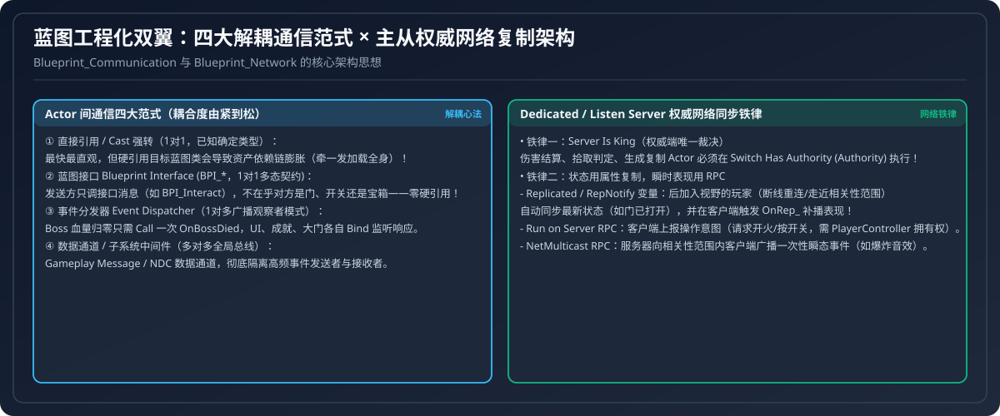
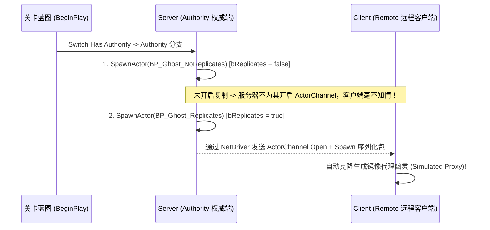
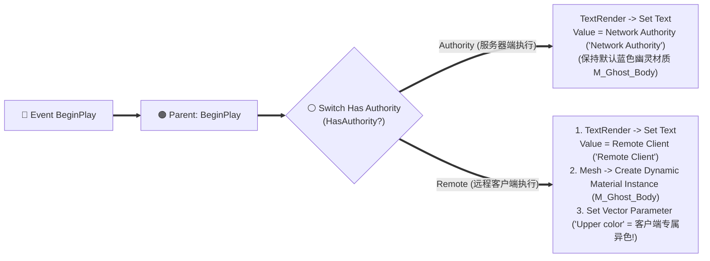
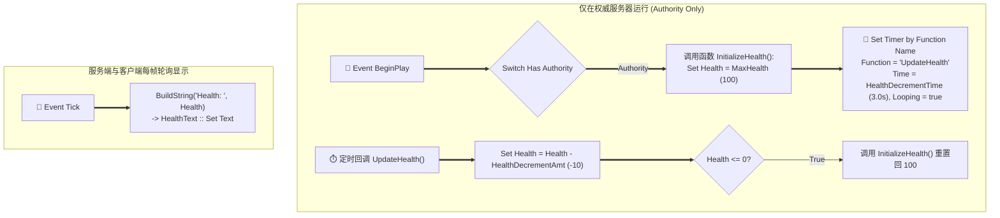
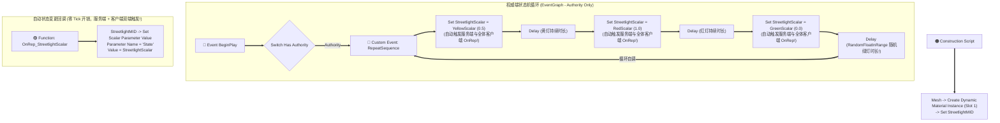
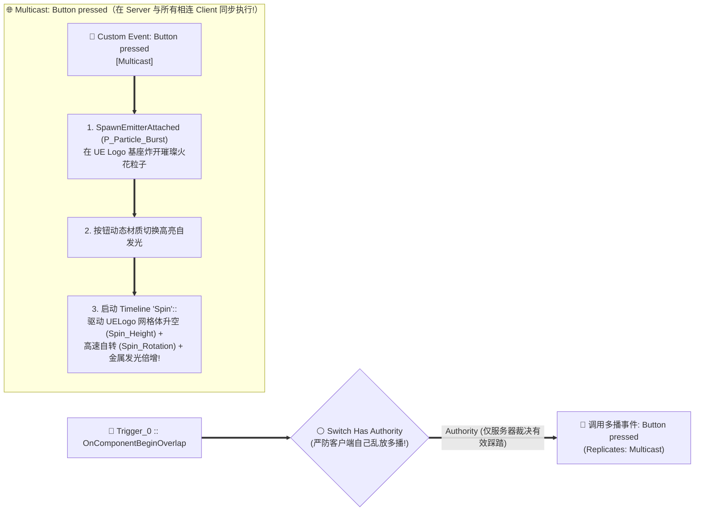
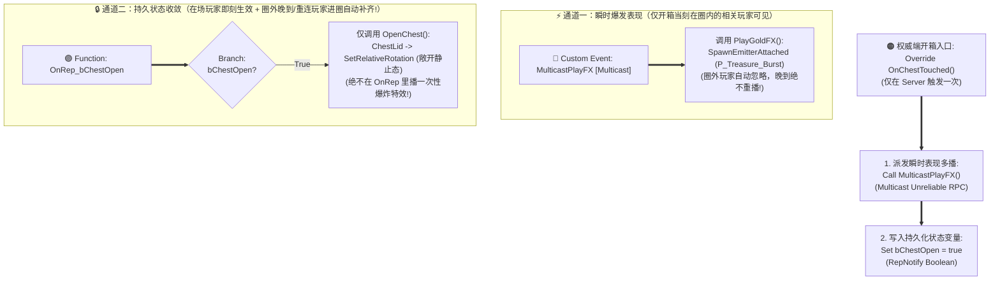

# 第 10 章 · `Blueprint_Network`：多人网络同步、服务器权威性、属性复制、`RepNotify`、RPC 与相关性剔除全解

> **关卡资产路径**：`/Game/Maps/Blueprint/Blueprint_Network`  
> **示例资产目录**：`/Game/ExampleContent/NetworkFeatures/`  
> **核心网络框架类**：`BP_GameMode_Network` / `BP_HUD_Network` / `PlayerCharacter_NEtwork`  
> **关卡实测规模**：总计 `55` 个 Actor | `11` 座编号展台 | `18` 个核心示例 Actor

---

## 一、 展厅总览：揭秘虚幻引擎 Client-Server 主从权威网络架构

从单机游戏迈向多人联机游戏，绝不是“在写完项目最后一周勾上几个 `Replicates` 复选框”那么简单，而是一场彻头彻尾的**世界观重构**。

在单机游戏里，世界上只有一台电脑、一份内存，`GetPlayerPawn(0)` 就是唯一的神；而在多人联机游戏里，假如有 1 名房主（Listen Server）和 3 名客户端玩家（Clients）联机，**同一时刻在地球上其实是 4 台独立电脑各自运行着一份虚幻引擎世界副本**！
为了防止外挂篡改内存（锁血、秒杀、瞬移）并消除多端状态分叉，虚幻引擎自《虚幻竞技场（Unreal Tournament）》诞生之日起便确立了铁血的 **Server-Authoritative（服务器绝对权威）架构**：
1. **唯有服务器（Network Authority）运行的才是“真实的物理与规则世界”**；
2. **所有客户端（Remote Clients）看到的仅仅是服务器通过网络通道（Actor Channel）按需投射过来的“影子戏（Simulated / Autonomous Proxy）”**！

`Blueprint_Network` 这座含金量极高的展厅共设 **11 座展台**，从最基础的 PIE 联机环境配置起步，一路剖析 Actor 生成复制、主从分支分流、变量复制、`RepNotify` 状态回调、RPC 远程调用，直至在最后四座展台（`#8 ~ #11`）用一组传世经典的**“四宝箱与网络相关性圆环（Net Cull Distance）”对比实验**，把困扰无数联机开发者的“中途加入/远距靠近状态丢失与特效诈尸 Bug”讲得醍醐灌顶！

---

## 二、 关卡全局联机基座拆解：`GameMode`、`HUD` 与关卡蓝图权威生成

在踏入 11 座展台前，我们先拆解支撑整张地图多人运行的三大幕后蓝图（均位于 `/Game/ExampleContent/NetworkFeatures/Blueprints/`）：

1. **`BP_GameMode_Network`（仅存在于服务器内存中的最高裁判！）**：
   - **铁律**：`AGameModeBase / AGameMode` **永远只存在于服务器端，任何客户端内存中对 `GetGameMode()` 求值结果永远是 `nullptr`（空指针）**！
   - **多玩家轮流出生点分配**：重写了 **`Event OnPostLogin (NewPlayer)`**（每当一名新客户端握手登录成功并获配 `PlayerController` 时触发） -> 调用 `GetAllActorsOfClass(PlayerStart)` -> 按整型变量 `spawn order` 索引取出出生点变换，调用 `SpawnActor(PlayerCharacter_NEtwork)` 并让 `NewPlayer` 附身（`Possess`），随后 `spawn order + 1`，确保多名玩家整齐排开不重叠卡死。
2. **`BP_HUD_Network`（一眼分清哪个窗口是主机、哪个是客机）**：
   - 重写 `Event ReceiveDrawHUD(SizeX, SizeY)` -> 调用 `GetOwningPlayerController() -> HasAuthority()`：若为 `true`，在屏幕醒目位置绘制 **`"Server"`**；若为 `false`，绘制 **`"Client"`**。
3. **关卡蓝图 `Blueprint_Network_C`（动态生成测试幽灵）**：
   - 在 `Event BeginPlay` 后紧接 **`Switch Has Authority`**，**仅在 `Authority` 引脚**执行两次 `SpawnActorFromClass`（为展台 #3 动态刷出两只对照幽灵）。

---

## 三、 逐展台 100% 零遗漏深度拆解（#1 ~ #11）

---

### 展台 #1：`Network Features`（展厅总导览牌）
- **展牌标识**：`BP_DemoDisplay10` | **空间坐标**：`(510, -900, 0)`
- **官方展牌原文**：
  > *Examples showcasing Blueprint Networking Features*

本展台位于出生走廊正前方左侧，宣示整座展厅的主题：用最小可视化的对比实验，拆解虚幻引擎网络复制系统的每一个原子概念。

---

### 展台 #2：`On the "Play" dropdown, set the number of players.`（PIE 多端联机仿真测试环境指南）
- **展牌标识**：`BP_DemoDisplay1` | **空间坐标**：`(500, 900, 0)`（位于展台 #1 正对面右侧墙壁，确保玩家一进图回头即见！）
- **官方展牌原文标题**：
  > *On the "Play" dropdown, set the number of players.*

#### 1. 展台环境组件与单机运行的常见误区
本展台承载了关卡的全局光照与空间锚点（`DirectionalLight` 强度 `3.14`、`SkyLight` 强度 `3.0`、`SkyAtmosphere`、`ExponentialHeightFog`、`ChaosDebugDrawComponent_0`、`TargetPoint1` 与 `InstancedFoliageActor`）。
如果你像逛前几张地图一样直接按 `Alt + P` 单人进入本关，你只能看到孤零零的 `"Server"` 视角，完全体会不到联机差异！

#### 2. 正确的 PIE（Play In Editor）多窗口联机测试姿势
点击编辑器顶部工具栏 **Play 按钮右侧的三个竖点菜单 `⋮`**：
1. 将 **`Number of Players`（玩家人数）** 设为 **`2`**（或 `3`）；
2. 选择 **`Net Mode`（网络模式）**：
   - **`Play As Listen Server`（监听服务器模式，推荐本关首选）**：窗口 1 既是服务器（显示 `Server`）本身又有一具玩家肉身可供操作；窗口 2 是纯远程客户端（显示 `Client`）。方便你把窗口 2 停在圈外，切回窗口 1 跑去开宝箱对比观察！
   - **`Play As Client`（专用服务器 Dedicated Server 模式）**：引擎在后台隐形启动一个无画面的纯净权威端进程，弹出的窗口 1 和窗口 2 **全都是纯客户端（`Client 1` & `Client 2`）**——这是上线商业竞技网游前检验“房主特权 Bug”（Listen Server 独有 Bug）的终极试金石！

---

### 展台 #3：`Actor Replication`（`bReplicates` 开关：决定对象在客户端宇宙是否存在）
- **展牌标识**：`BP_DemoDisplay5` | **空间坐标**：`(1500, -900, 0)`
- **展台内 3D 悬浮文字标签**：`No Actor Replication`（左）、`Actor Replication`（右）
- **展台陈列锚点与动态生成蓝图**：
  - 出生锚点：`NonReplicatedSpawnPoint`（左 `TargetPoint`）与 `ReplicatedSpawnPoint`（右 `TargetPoint`）
  - 左侧动态生成：`BP_Ghost_NoReplicates`（默认 `Replicates = false`）
  - 右侧动态生成：`BP_Ghost_Replicates`（继承自左者，唯一改动是在 Class Defaults 勾选了 **`Replicates = true`**！）
- **官方展牌原文**：
  > *This example demonstrates the use of the "Replicates" boolean on the server, from a networking perspective, on actors. When enabled, it allows clients to be aware of actors spawned. Notice that the dynamically spawned actor that does not have "Replicates" set does not even appear for client players.*

#### 现象拆解与底层 Actor Channel 生命周期
当你开启双人联机走到展台 #3 面前时，左右分屏会出现震撼的一幕：
- **`Server` 窗口**：左边和右边**各飘着一只幽灵（共 2 只）**；
- **`Client` 窗口**：左边台子上**空空如也（只有空气）**，只有右边台子上飘着 1 只幽灵！

> [!WARNING]
> **联机新手高频翻车点**：
> 1. **如果反过来在客户端（Remote）私自调用 `SpawnActor(BP_Ghost_Replicates)` 会怎样？**  
>    即使该蓝图勾了 `Replicates = true`，**服务器和其他玩家也绝对看不见它**！因为网络复制通道的创建权 100% 垄断在服务器手中。客户端私自 Spawn 出来的只能是纯本地残影（仅可用于本地碎石屑、弹壳等纯装饰物）。
> 2. **为什么摆在关卡里的静态墙体没勾 `Replicates`，客户端也能看见？**  
>    因为预先摆在 `.umap` 里的静态关卡 Actor 默认勾选了 **`Net Load on Client = true`**——客户端加载地图文件时各自从本地硬盘读出了它们，并非通过网络包动态生成。而运行期 `SpawnActor` 刷出的怪物、子弹、掉落物则必须开启 `Replicates`！

---

### 展台 #4：`Detecting Network Authority and Remote Clients in Blueprints`（`Switch Has Authority` 主从执行流分流阀）
- **展牌标识**：`BP_DemoDisplay6` | **空间坐标**：`(2500, -900, 0)`
- **核心陈列资产**：`BP_Ghost_Replicates_AuthoritySwitch`（路径：`/Game/ExampleContent/NetworkFeatures/Blueprints/BP_Ghost_Replicates_AuthoritySwitch`，父类：`BP_Ghost_Replicates`）
- **官方展牌原文**：
  > *This example demonstrates a blueprint executing different logic depending on whether the blueprint is running on the network authority (server) or a remote machine (client).*

#### 1. `EventGraph` 完整节点流还原
同一个蓝图文件同时在服务器和客户端上触发了 `Event BeginPlay`，如何让服务器跑裁判代码、让客户端跑本地差异化视觉代码？答案就是网络蓝图出镜率排名第一的宏节点 —— **`Switch Has Authority`**（底层封装 `AActor::HasAuthority()`，判断 `GetLocalRole() == ROLE_Authority`）：

#### 2. 视觉结果与权限边界深剖
- 在 `Server` 窗口看这只幽灵，头顶写着 `"Network Authority"`，身体泛着原本的幽蓝光泽（材质 `M_Ghost_Body` 内含 59 个节点，带 Fresnel 边缘光与正弦时间顶点上下飘动）；
- 在 `Client` 窗口看**同一只幽灵**，头顶写着 `"Remote Client"`，且身体上半部被本地动态材质染成了醒目的异色！
- **工程准则**：凡涉及**伤害结算、金钱增减、战利品掉落、胜负判定、生成复制 Actor**，必须严丝合缝锁死在 `Authority` 引脚之后；而 `Remote` 引脚仅用于纯客户端本地表现（且要注意：在 Dedicated Server 架构下，`Authority` 端没有显示器，而 Listen Server 的 `Authority` 端自己也是玩家之一！若要判断“当前机器是不是需要渲染画面的非无头机器”，在生产代码中常配合 **`Is Dedicated Server` 取反** 使用）。

---

### 展台 #5：`Variable Replication`（服务端权威变量同步 vs 未同步状态撕裂）
- **展牌标识**：`BP_DemoDisplay2` | **空间坐标**：`(3500, -900, 0)`
- **展台内 3D 悬浮文字标签**：`No Variable Replication`（左）、`Variable Replication`（右）
- **核心陈列对比资产（2 个）**：
  1. 左侧未复制版：`BP_Ghost_Variable_Replication_None`（`Health` 变量 `Replication = None`）
  2. 右侧已复制版：`BP_Ghost_Variable_Replication_None_2`（类 `BP_Ghost_Variable_Replication_Enabled_C`，唯一区别是将 `Health` 变量的 `Replication` 设为 **`Replicated`**，蓝图变量右上角出现两枚白色小球徽标！）
- **官方展牌原文**：
  > *Variables that are important to gameplay should only be modified on the network authority (server), and then replicated to remote machines (clients) on a need-to-know basis. In this example, the ghost's health is being modified on a timer exclusively on the network authority. In the non-replicated ghost, the remote machines never receive updated health values. In the replicated ghost, they receive updates as the server changes the health.*

#### 1. 蓝图源码拆解：完全相同的逻辑，仅差一个变量复制选项
两只幽灵拥有完全一致的 4 个整型/浮点变量（`Health = 0`、`MaxHealth = 100`、`HealthDecrementAmt = 10`、`HealthDecrementTime = 3.0`）与三段图表逻辑：

#### 2. 双端实测对比与底层增量压缩机制（Delta Serialization）
- **左侧幽灵（`No Variable Replication`）**：`Server` 窗口头顶每隔 3 秒跳变 `100 -> 90 -> 80 ...`，而 `Client` 窗口永远死死卡在默认值 `Health: 0`！因为定时器只在 `Authority` 启动，客户端既没跑扣血定时器，又收不到服务器的变量同步包。
- **右侧幽灵（`Variable Replication`）**：每当服务器定时器把 `Health` 改小 `10` 点，虚幻引擎的复制系统（Replication Driver / Iris）在下一个网络 Tick 自动比对属性阴影缓冲区（Shadow State），发现 `Health` 变脏（Dirty），立即将新整数打包发往客户端更新客户端内存中的 `Health` 副本！若 3 秒内 `Health` 没变，则 **0 字节带宽消耗**！
- **单向铁律**：属性复制永远是 **`Server -> Client` 单向覆盖**！如果客户端自己偷偷改本地的 `Replicated` 变量，不仅不会发回给服务器，还会在下次服务器发包时被无情覆盖打回原形。

---

### 展台 #6：`Variable Replication (RepNotify)`（告别每帧轮询！变量变更事件驱动红绿灯）
- **展牌标识**：`BP_DemoDisplay` | **空间坐标**：`(4490, -890, 0)`
- **核心陈列资产**：`BP_Stoplight_Variable_RepNotify`（路径：`/Game/ExampleContent/NetworkFeatures/Blueprints/BP_Stoplight_Variable_RepNotify`，父类：`Actor`，开启 `bReplicates = true`）
- **官方展牌原文**：
  > *Oftentimes, it is desired to execute some logic in response to the value of a replicated variable changing. Variables that are marked "RepNotify," have a special function called automatically any time the value is changed, on both authority and remote machines. In this example, the network authority controls changing a scalar value indicating which color the streetlight should display using a RepNotify variable. When the value is changed, the auto-generated OnRep function is called, which in this example then updates a material parameter.*

#### 1. 为什么展台 #5 用 `Event Tick` 刷血条很蠢，而展台 #6 的 `RepNotify` 才是正道？
回看展台 #5：幽灵每 3 秒才扣一次血，在 60 FPS 下 `180` 帧里其实有 `179` 帧血量根本没变，却每帧都在跑字符串拼接 `Event Tick`！如果是改材质参数、播换灯音效或触发死亡布娃娃呢？总不能每帧重设材质吧！
为此，只需将变量 `StreetlightScalar` 的复制选项从 `Replicated` 升级为 **`RepNotify`**，蓝图编译器会自动在函数列表中为你生成专属回调函数 **`OnRep_StreetlightScalar`**！

#### 2. `BP_Stoplight_Variable_RepNotify` 完整节点流还原
交通信号灯模型 `SM_Traffic_Light` 的槽位 1 挂载动态材质 `StreetlightMID`（参数名 `"State"`：`0.0` 为绿灯，`0.5` 为黄灯，`1.0` 为红灯）：

- **看那处神来之笔**：绿灯切黄灯前故意用了 `RandomFloatInRange` 随机时长！尽管客户端根本算不出服务器随机了多少秒，但只要服务器一改 `StreetlightScalar`，所有客户端立刻在同一瞬间收到网络包并触发 `OnRep_StreetlightScalar` 同步变灯，分秒不差且全程 **0 `Event Tick` 开销**！

> [!CAUTION]
> **资深架构师必考陷阱：蓝图 `RepNotify` 与 C++ `ReplicatedUsing` 的双端触发差异！**
> - **在蓝图中**：当服务器执行 `Set StreetlightScalar` 节点时，蓝图虚拟机自动插入了一行本地调用，因此 **`OnRep_StreetlightScalar` 在服务器端和收到网络更新的客户端上都会自动执行**！
> - **在 C++ 中**：当你声明 `UPROPERTY(ReplicatedUsing = OnRep_StreetlightScalar) float StreetlightScalar;` 并在服务器写 `StreetlightScalar = 1.0f;` 时，**C++ 底层默认只在远程客户端收到网络包时自动调用 `OnRep_StreetlightScalar()`，服务器端自己不会自动调用**！将蓝图逻辑重构下沉到 C++ 时，服务器端赋值后切记手动补一行 `OnRep_StreetlightScalar();`，否则 Listen Server 房主自己眼里的红绿灯永远不会变色！

---

### 展台 #7：`Function Replication`（三大 RPC 远程过程调用、Net Owner 所有权铁律与多播按钮）
- **展牌标识**：`BP_DemoDisplay7` | **空间坐标**：`(5490, -890, 0)`
- **核心陈列资产**：`BP_Button_Multicast`（路径：`/Game/ExampleContent/NetworkFeatures/Blueprints/BP_Button_Multicast`，父类：`Actor`，开启 `bReplicates = true`）
- **官方展牌原文**：
  > *Function calls can also be replicated, and can either be "reliable" or "unreliable." Unreliable calls may be dropped during heavy traffic, so most replicated functions that handle cosmetic visuals are unreliable to avoid network saturation. There are 3 primary types: Multicast, Server, and Client. Multicast functions should be called on the server, where they are executed, and then forwarded automatically to clients. Server functions are called by a client and then only execute on the server. Client functions are called by the server and then only execute on the owning client. Server and Client replication functions can only be used on actors that have a "Net Owner." Actors have net owners if they are a player controller or owned by a player controller. Example: A pawn possessed by a player controller can have Server or Client replicated functions executed upon it. In this example, a Multicast function handles a cosmetic event triggered from a button press.*

#### 1. 一张表彻底吃透虚幻三大 RPC 路由规则与 `Net Owner` 生死线
展牌原文浓缩了虚幻网络面试必考的 RPC 铁律，我们将其提炼为精准对照表：

| RPC 类型 | 发起方 -> 执行方 | 是否要求 `Net Owner`（网络所有者）？ | 典型适用场景 |
| :--- | :--- | :---: | :--- |
| **`Run on Server`** | 客户端调用 $\rightarrow$ **仅在权威服务器执行** | **强制要求！**（只能写在 `PlayerController`、被附身的 `Pawn` 或 `SetOwner` 归属该玩家的武器上；写在无主场景门/按钮上会被静默丢弃！） | 玩家按下开火键、请求购买装备、请求按动机关开关 |
| **`Run on Owning Client`** | 服务器调用 $\rightarrow$ **仅在该 Actor 所属的唯一客户端执行** | **强制要求！** | 单独通知某玩家弹出私人背包更新提示、受击屏幕血雾音效 |
| **`Multicast`（多播）** | **服务器调用** $\rightarrow$ **在服务器本地执行 + 自动广播给所有相关客户端执行** | 不要求（任意开启 `Replicates` 的场景 Actor 均可使用） | 播放一次性爆炸粒子、挥砍刀光、受击飙血等**瞬时视觉/听觉表现（推荐 `Unreliable` 不可靠传输防拥塞断线）** |

#### 2. `BP_Button_Multicast` 完整节点流还原
当任意玩家踩上展台 #7 的压力按钮 `Trigger_0` 时，物理重叠事件在服务端和客户端上其实都会触发，看看 `BP_Button_Multicast` 如何严谨拦截并多播：

---

### 展台 #8 ~ #11 压轴大戏：网络相关性（`Network Relevancy`）与“四宝箱同步之谜”全拆解！

现在请走到走廊后半段（坐标 `X = 7010 ~ 10050`）。在《绝地求生》或《堡垒之夜》这样百人同图、方圆数十平方公里的超大地图里，如果东海岸有人开了一枪或开了一个宝箱，服务器也要把数据包发给远在 8 公里外西海岸的玩家，服务器出网带宽会瞬间爆炸，而且外挂只需抓包就能全图透视所有人的动向！

因此，虚幻引擎引入了至关重要的带宽与反作弊优化机制 —— **网络相关性剔除（Network Relevancy & `Net Cull Distance Squared`）**：
- 每个可复制 Actor 都有一个默认相关性裁剪距离平方属性 **`NetCullDistanceSquared`**（默认 $225,000,000\text{ cm}^2$，即半径 $150\text{ 米}$）；
- 当客户端玩家与该 Actor 的距离超过裁剪半径时，服务器判定该 Actor 对该玩家 **“不相关（Net Irrelevant）”**，**立即关闭该客户端上的 Actor 通道（客户端本地甚至会销毁动态生成的远距 Actor 副本），彻底停止向该客户端发送此 Actor 的任何 RPC 与变量包**！
- 等到玩家稍后跑近、跨入相关性半径的瞬间（或者**新玩家中途加入残局 Join-in-Progress / 断线重连**），该 Actor 重新变为 **“相关（Relevant）”**，服务器才会重新为该客户端建立同步！

为了让你在几米宽的室内展厅里亲眼见证“150 米外相关性剔除”引发的惊天大坑，Epic 工程师把后三座宝箱（`#9, #10, #11`）的 `NetCullDistanceSquared` 刻意改得极小（约数米），并在 `BeginPlay` 中用数学公式 **`Sqrt(NetCullDistanceSquared)`** 动态缩放地面上的发光圆环模型 **`SM_Radius_Ring`**（材质 `M_Radius_Glow`）——**地上的发光圆圈边界，就是毫厘不差的网络相关性生死线！**

下面我们逐座展台解剖这四只一脉相承的宝箱！

---

### 展台 #8：`Network Relevancy (Part I)`（基准对照：零复制单机宝箱基类）
- **展牌标识**：`BP_DemoDisplay3` | **空间坐标**：`(7010, -900, 0)`
- **展台内 3D 悬浮文字标签**：`No Replication`
- **核心陈列资产**：`BP_Relevancy_Replication_None`（路径：`/Game/ExampleContent/NetworkFeatures/Blueprints/BP_Relevancy_Replication_None`，同时也是后三只宝箱的共同父类！）
- **官方展牌原文**：
  > *It often doesn't make sense for a client to receive network data for every actor, all of the time... One side effect of the optimization is that one also has to consider how to handle the case where an actor was irrelevant and then becomes relevant (usually as a result of the player moving nearby). This is very similar to the problem of handling a player who joins an existing game-in-progress. In this room, all of the examples lead to reproducing the behavior of this chest properly in a networked scenario, accounting for relevancy.*

#### 基类模块化三函数设计
`BP_Relevancy_Replication_None` 挂载了箱底 `ChestBottom`、箱盖 `ChestLid`、金币堆 `Treasure` 与碰撞盒 `Trigger`，并将开箱行为干净利落地拆成了三个可由子类重写（Override）的函数：
1. **`EventGraph` 权威单次触发锁**：`Trigger :: OnComponentBeginOverlap` $\rightarrow$ **`Switch Has Authority (Authority)`** $\rightarrow$ **`DoOnce`**（保证宝箱一辈子只会被开启一次！） $\rightarrow$ 调用虚函数 **`OnChestTouched()`**；
2. **`OpenChest()`（持久状态表现函数）**：调用 `ChestLid -> SetRelativeRotation` 将箱盖仰起打开；
3. **`PlayGoldFX()`（瞬时爆发表现函数）**：调用 `SpawnEmitterAttached(P_Treasure_Burst)` 喷射出一股璀璨但播完即逝的一次性金币喷泉粒子！
- **本台实测表现**：在基类 `OnChestTouched()` 中直接顺序调用了 `OpenChest()` 与 `PlayGoldFX()`，未开任何网络复制。结果：**Server 走过去开箱金光四射，站在旁边的 Client 眼里箱子纹丝不动紧闭如初**。

---

### 展台 #9：`Network Relevancy (Part II)`（反面教材一：纯 `Multicast` RPC 导致圈外玩家永久状态丢失！）
- **展牌标识**：`BP_DemoDisplay4` | **空间坐标**：`(8030, -900, 0)`
- **核心陈列资产**：`BP_Relevancy_Replication_RPC`（继承自 `BP_Relevancy_Replication_None`，开启 `bReplicates = true` 并设极小裁剪距离）
- **官方展牌原文**：
  > *This example attempts to network the chest's behavior through the use of a replicated Multicast function... Stand the client outside of the ring and the chest will be irrelevant to the client, even though it is visible. Now move the server to the chest to activate it and observe what happens on the client. The client doesn't see anything change at all! This is expected, as the chest was not relevant to the client when the multicast was called. The issue with this solution is that all of the actions related to updating the chest were sent through a replicated function, which the client didn't receive due to relevancy, and never executed anything to open the chest.*

#### 1. 错误代码还原与现场复现步骤
许多刚学会 `Multicast` 的新手最爱这么写：子类重写 `OnChestTouched()` $\rightarrow$ 调用自定义多播事件 **`ChestTouchMulticast`（`Multicast`）** $\rightarrow$ 在多播里一口气调 `OpenChest()` + `PlayGoldFX()`。
- **假象（测试时两人站在一起）**：如果 Client 一开始就站在地上的光圈里面，Server 走去开箱，Client 确实完美看到了箱盖打开和金币喷泉——测试员大喜过望，签入代码上线！
- **灾难现场（复现步骤）**：
  1. 先把 **Client 角色停在发光圆圈外面**（此时宝箱对 Client 处于 **Irrelevant 不相关剔除态**）；
  2. 操控 **Server 角色走进圈内触碰宝箱**：Server 屏幕箱盖大开、金光喷涌，服务器发出了 `ChestTouchMulticast` 多播包——但网络驱动一看 Client 在相关性圈外，**直接跳过了向该 Client 发送这条多播包**；
  3. 3 秒后，操控 **Client 角色走进发光圆圈内**：宝箱重新变为相关，然而 **`Multicast` RPC 是阅后即焚的瞬时脉冲，绝不会被引擎历史重放**！于是恐怖的 Bug 发生了：**Server 眼里宝箱早已大开露着财宝，Client 走近贴脸看，宝箱盖子竟然还是死死关着的！永久状态不同步！**

---

### 展台 #10：`Network Relevancy (Part III)`（反面教材二：纯 `RepNotify` 导致晚到玩家遭遇“特效诈尸重播”！）
- **展牌标识**：`BP_DemoDisplay8` | **空间坐标**：`(9020, -900, 0)`
- **核心陈列资产**：`BP_Relevancy_Replication_RepNotify`（继承自 `BP_Relevancy_Replication_None`，新增 `RepNotify` 布尔变量 **`bChestOpened`**）
- **官方展牌原文**：
  > *This example attempts to solve the problem by using a variable instead. A RepNotify bool is used to save whether the chest is open or not. Stand the client outside of the ring and have the server activate the chest. What happens when the client walks into the ring afterwards? The client sees the chest open, but also sees the gold effects play, even though that happened a while ago on the server! When the chest becomes relevant to the client again, the client gets the change to the replicated variable and the corresponding RepNotify function is called. Unfortunately, the client has no way of knowing that the variable actually changed well in the past, which is insufficient to handle this particular case.*

#### 1. 矫枉过正的“特效诈尸”现象拆解
为了修掉 #9 箱盖打不开的 Bug，程序员把多播删了，改用 `RepNotify` 变量 `bChestOpened`：
- 权威端 `OnChestTouched()`：执行 `Set bChestOpened = true`；
- 回调函数 `OnRep_bChestOpened()`：当 `bChestOpened == true` 时，同时调用 **`OpenChest()` + `PlayGoldFX()`**！
- **复现尴尬 Bug**：
  1. Client 依然站在圈外，Server 进圈开箱（金光喷完消散，宝箱静静敞开）；
  2. 过了整整 5 分钟，Client 慢悠悠溜达进发光圆圈内；
  3. 跨入圆圈的一刹那，宝箱对 Client 恢复相关性！服务器立刻把当前最新状态 `bChestOpened = true` 补发给 Client，触发客户端的 `OnRep_bChestOpened()`——箱盖确实正确打开了，**但紧接着一团巨大的金币爆炸火花 `P_Treasure_Burst` 突然凭空在陈年旧空箱子上炸开（俗称“尸体仰卧起坐 / 特效诈尸 Bug”）**！试想在一局大逃杀里，你走进一间 10 分钟前发生过激战的空房子，屋里十具尸体突然在你面前集体重新飙血惨叫倒地一遍，是何等滑稽的灾难！

---

### 展台 #11：`Network Relevancy (Part IIII)`（终极满分架构：`RepNotify` 管持久状态 + `Multicast` 管瞬态表现！）
- **展牌标识**：`BP_DemoDisplay9` | **空间坐标**：`(10050, -900, 0)`
- **核心陈列资产**：`BP_Relevancy_Replication_Combined`（路径：`/Game/ExampleContent/NetworkFeatures/Blueprints/BP_Relevancy_Replication_Combined`，新增 `RepNotify` 布尔变量 **`bChestOpen`** + 多播事件 **`MulticastPlayFX`**）
- **官方展牌原文**：
  > *Both of the prior examples failed because neither could handle the two cases the chest example needs: 1) To play an instant effect at the time of interaction, and 2) to preserve a change in state in the actor over time. In this example, a hybrid solution combining the use of both techniques is employed to actually solve the problem. The Multicast function handles playing the instant gold effect for clients relevant at that specific time, while a replicated boolean preserves whether the chest lid is open or not. If the chest was not relevant for a client during the initial opening of the chest, the client will only see the lid open when the chest becomes relevant.*

#### 1. 工业级标准黄金组合拳完整节点流还原
拆开 `BP_Relevancy_Replication_Combined.uasset` 的字节码与作者亲笔注释，这就是全世界所有 3A 虚幻联机项目（《堡垒之夜》《无畏契约》《战争机器》）严格奉行的**“状态与事件正交分离法则”**：

#### 2. 四座宝箱（#8 ~ #11）全场景表现终极对比真值表

| 展台与实现蓝图 | 同步技术手段 | 场景 A：开箱时 Client **在圈内（相关）** | 场景 B：开箱时 Client **在圈外（或中途加入）**，事后走进圈内 | 工程评级 |
| :--- | :--- | :--- | :--- | :---: |
| **#8 `..._None`** | 无复制 | ❌ 箱盖紧闭，无特效 | ❌ 箱盖紧闭，无特效 | 单机玩具 |
| **#9 `..._RPC`** | 纯 `Multicast` RPC | ✅ 开盖 + 播金币爆炸 | ❌ **致命 Bug：箱盖永远紧闭锁死（状态永久丢失）！** | 严禁用于状态 |
| **#10 `..._RepNotify`** | 纯 `RepNotify` 变量 | ✅ 开盖 + 播金币爆炸 | ⚠️ **瑕疵 Bug：箱盖打开，但当场诈尸重播一遍陈年金币爆炸！** | 混淆状态与瞬态 |
| **#11 `..._Combined`** | **`RepNotify` 存箱盖状态 + `Multicast` 播爆炸粒子** | ✅ **即刻开盖 + 同步目睹金币爆炸** | ✅ **进圈瞬间箱盖静默呈现已敞开态，绝不诈尸重播旧爆炸！** | 🏆 **3A 生产级标准** |

---

## 四、 虚幻多人联机架构师十六字真言与自检清单

在结束本章前，请将这套经过 `Blueprint_Network` 11 座展台千锤百炼的联机铁律贴在你的显示器旁：

1. **“权威裁决归 Server”**：客户端的键盘鼠标永远只是“向服务器提交请求（`Run on Server`）”，所有玩法数值变更前必过 `Switch Has Authority`。
2. **“持久状态靠 RepNotify”**：门开没开、灯亮没亮、宝箱空没空、角色是不是死了——凡是晚来 10 分钟的玩家也必须看到最终结果的属性，一律做成 `Replicated` / `RepNotify` 变量，且 `OnRep` 函数必须是**幂等的状态收敛函数**。
3. **“瞬时爆发配 Multicast”**：枪口火光、受击音效、开箱礼花——凡是一闪而过、错过就无需重看的视听脉冲，一律做成 **`Unreliable Multicast`**。
4. **“必测圈外与重连”**：以后每写完一个联机机关，在 PIE 里必须测两遍——第一遍两个窗口站在一起测即时表现，**第二遍务必把 Client 窗口拉到 `NetCullDistance` 之外再走回来**，能同时通过这两关的代码，才是无懈可击的商业级联机代码！
