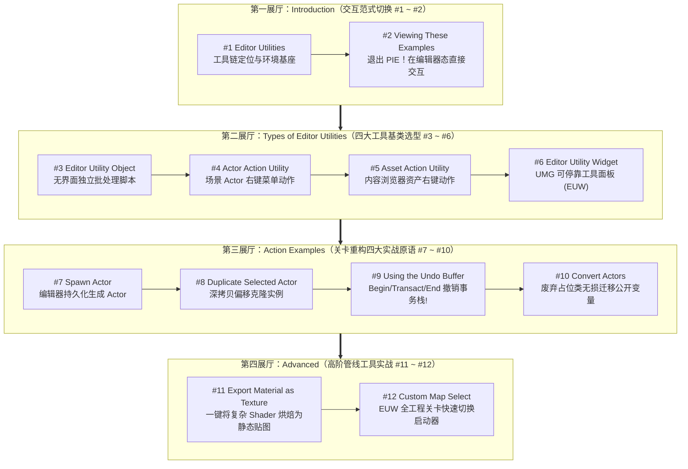
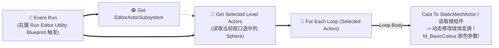
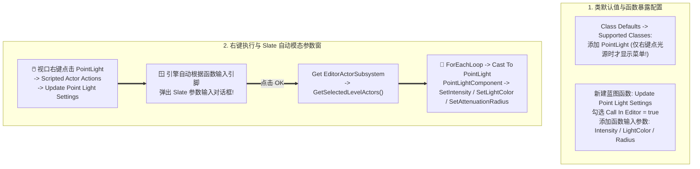
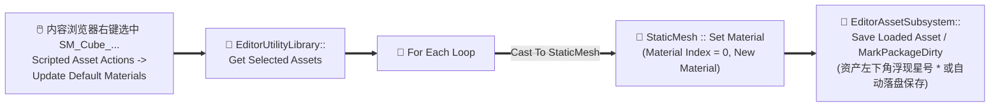
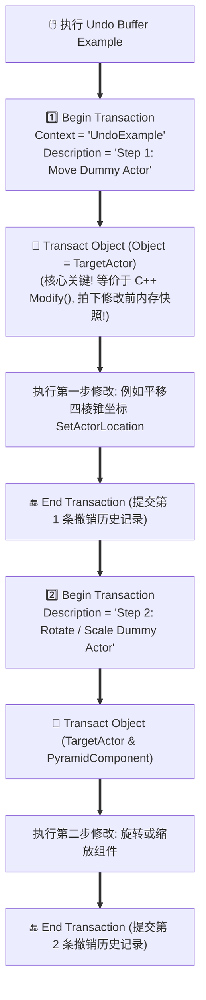
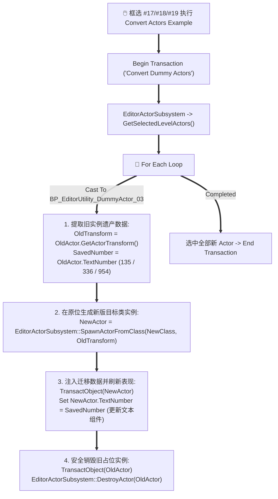
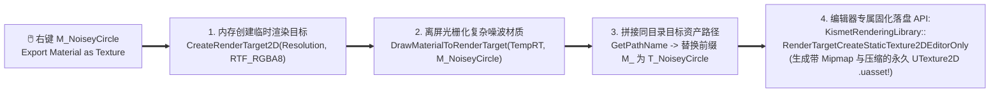
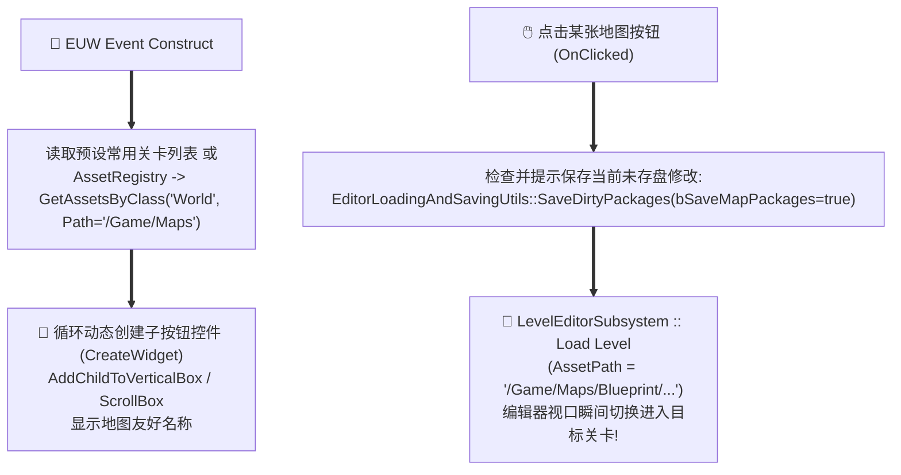

# 第 11 章 · `Blueprint_EditorUtilities`：编辑器工具蓝图、EUW 自定义面板、撤销事务与资产自动化管线

> **关卡资产路径**：`/Game/Maps/Blueprint/Blueprint_EditorUtilities`  
> **示例资产目录**：`/Game/ExampleContent/EditorUtilities/`  
> **核心引擎模块与子系统**：`Blutility` / `EditorScriptingUtilities` / `UMGEditor`（`EditorActorSubsystem`、`EditorAssetSubsystem`、`LevelEditorSubsystem`）  
> **关卡实测规模**：总计 `53` 个 Actor | `4` 大主题展厅分区 | `12` 座编号展台 | `28` 个核心示例 Actor

---

## 一、 展厅总览：不用写一行 C++ Slate，用蓝图直接给虚幻编辑器造“工业外挂”

在早期虚幻引擎（UE3 ~ UE4 初期）时代，如果你想在编辑器的右键菜单里加一个“一键对齐所有路灯”按钮，或者做一个带滑条与列表的自定义关卡检查器窗口，你必须深入啃下数千行晦涩难懂的 C++ `Slate` UI 宏（`SLATE_BEGIN_ARGS`）、`FExtender` 菜单挂载钩子与自定义编辑器模块编译配置——极高的门槛将大量懂业务痛点的技术美术（TA）与关卡策划拒之门外。

为了彻底解放团队的工具生产力，Epic 推出了革命性的 **Editor Utility Blueprints（编辑器工具蓝图，底层代号 `Blutility`）** 架构：
- 它允许你使用最熟悉的**蓝图节点图**与 **UMG 可视化界面编辑器**，直接调用虚幻编辑器底层的资产注册表（Asset Registry）、关卡 Actor 选择集、材质烘焙管线与撤销重做事务栈（Undo Buffer）；
- 凡是人工重复操作超过 3 次的枯燥流程——批量修改 500 个模型的碰撞与 LOD、一键将灰盒占位 Actor 迁移替换为正式蓝图并保留旧参数、把高开销程序化噪波材质一键烘焙成静态贴图资产、搭建一键切图面板——全部可以在半小时内固化为全团队共享的自动化工具！

实测读取 `Blueprint_EditorUtilities` 的房间构造数据（`BP_DemoRoom`），整条长达 `130 米` 的巨型长廊按工具链进阶脉络划分为 **四大主题展厅、共计 12 座展台**：

---

## 二、 四大编辑器子系统（Editor Subsystems）架构基石

在逐一拆解 12 座展台前，请先建立现代 UE5 编辑器工具开发的**核心 API 架构认知**。在蓝图节点搜索框中输入 `Get Editor Subsystem`，你会看到四大支柱单例（它们已全面取代早期旧版静态库 `EditorLevelLibrary`）：

| 编辑器子系统类名 | 生命周期与作用域 | 高频核心职责 |
| :--- | :--- | :--- |
| **`UEditorActorSubsystem`** | 随编辑器启动常驻（仅 Editor 可用） | 获取/修改视口选中 Actor（`GetSelectedLevelActors`）、在持久关卡生成/克隆/销毁/替换 Actor |
| **`UEditorAssetSubsystem`** | 随编辑器启动常驻（仅 Editor 可用） | 增删改查磁盘 `.uasset` 资产、检出保存脏包（`SaveLoadedAsset`）、重命名与查找引用关系 |
| **`ULevelEditorSubsystem`** | 随关卡编辑器模块常驻 | 创建新关卡、保存当前关卡、一键无缝切换加载指定地图（`LoadLevel`）、控制视口实时渲染 |
| **`UUnrealEditorSubsystem`** | 全局编辑器主框架 | 读取/移动当前活跃的编辑器透视视口摄像机坐标与朝向（`GetLevelViewportCameraInfo`） |

> [!CAUTION]
> **打包隔离红线（Editor-Only Module Boundary）**：  
> 所有编辑器工具蓝图（`EU_*` / `EUW_*`）及其依赖的 `EditorSubsystem` 节点**仅在 Unreal Editor 下存在，打包游戏（Cooking for Windows/Consoles）时会被引擎自动剥离忽略**。**绝对禁止**在运行时玩法蓝图（如 `PlayerCharacter`、`GameMode`）中引用任何 `EditorUtility` 资产，否则打包 Cooking 阶段会直接报 `Cannot load EditorOnly package in Game` 致命编译错误！

---

## 三、 逐展台 100% 零遗漏深度拆解（#1 ~ #12）

---

### 展台 #1：`Editor Utilities`（展厅总导览与环境基座）
- **展牌标识**：`BP_DemoDisplay1` | **空间坐标**：`(480, -896, 0)` | **所属分区**：`Introduction`
- **官方展牌原文**：
  > *Editor Utilities allow you to create scripted actions that can be run in the editor. These scripted actions can help you batch edit assets, perform checks, manipulate actors, and more. Editor Utilities can be a powerful tool to speed up your workflow.*

#### 展台环境基座配置
入口展台共包含 **7 个基础环境与文档 Actor**，确保整个编辑态视口拥有清晰均匀的照明（无需运行游戏即可直接看清材质变化）：
- 全局无限范围后期盒 `PostProcessVolume`（`bUnbound = true`，`Priority = 0`）；
- `DirectionalLight`（强度 `6.0`，`Movable`）、`SkyLight`（强度 `3.0`，`Movable`）、`SkyAtmosphere`、`ExponentialHeightFog`；
- 携带 `ChaosDebugDrawComponent_0` 的调试 `Actor` 与官方说明锚点 `DocumentationActor`。

---

### 展台 #2：`Viewing These Content Examples`（打破肌肉记忆：切勿按 Play，直接在编辑器态交互！）
- **展牌标识**：`BP_DemoDisplay8` | **空间坐标**：`(1510, -896, 0)` | **所属分区**：`Introduction`
- **官方展牌原文**：
  > *Normally you are recommended to 'play in editor' for the best first time experience with content examples. Since Editor Utility Blueprints are designed to be used in the editor, for the following content examples, you should interact with them using the editor instead. Each demo display will provide instruction on how to view the content. It will typically involve running an Editor Utility Blueprint asset from your content browser.*

#### 为什么本关绝不能按 `Play (PIE)` 来体验？—— `Editor World` vs `PIE World` 内存隔离机制
- 当你按下 **Play** 时，虚幻引擎会将当前编辑器关卡在内存中深拷贝克隆出一份临时的 **`UEDPIE_0_Blueprint_EditorUtilities`（PIE 运行时临时世界）**。你在 PIE 期间所做的任何灯光强度修改、生成的任何方块，在按下 `Esc` 退出游戏的一瞬间都会**灰飞烟灭**！
- 而编辑器工具蓝图（Editor Utilities）存在的根本使命，就是**直接持久化修改真实的编辑器世界（`Editor World`）与硬盘上的 `.uasset` 资产**！因此从展台 #3 开始，请直接退回普通编辑器视口，用鼠标点选场景物体并配合内容浏览器右键菜单实操。

---

### 展台 #3：`Editor Utility Object`（最纯粹的无界面批处理脚本对象）
- **展牌标识**：`BP_DemoDisplay2` | **空间坐标**：`(3010, -896, 0)` | **所属分区**：`Types of Editor Utilities`
- **展台陈列靶机 Actor**：`Sphere`（`StaticMeshActor`，坐标 `(3000, -700, 100)`，网格体 `/Engine/BasicShapes/Sphere`，槽位 0 覆写材质 `MID_M_BasicColour_6`）
- **关联工具资产**：`/Game/ExampleContent/EditorUtilities/Blueprint/EU_EditorUtilityObject`（父类：`EditorUtilityObject`）
- **官方展牌原文**：
  > *There are multiple types of Editor Utility Blueprints. One of the main differences between the different types is how you run your Editor Utility. One way to run an editor utility blueprint is from the content browser. For this example select the sphere in the editor viewport. Then in your content browser navigate to: `All > Content > ExampleContent > EditorUtilities > Blueprint > EU_EditorUtilityObject`. Now right click the editor utility asset in your content browser and select "Run Editor Utility Blueprint"*

#### 1. 触发机制与 `Event Run` 节点流还原
`EditorUtilityObject` 是所有无 UI 编辑器脚本的最轻量基类。它不需要挂载到任何关卡里，也不依赖右键选中特定资产类型，直接在内容浏览器里对着它右键点击 **`Run Editor Utility Blueprint`**，引擎就会实例化该对象并自动触发唯一入口函数 **`Event Run`**：

- **关联基础材质 `M_BasicColour` 实测拆解**：`BLEND_Opaque` + `MSM_DefaultLit`，`Roughness = 1.0`（纯漫反射哑光），`Base Color` 绑定向量参数 `Color`（默认中灰 `(0.46875, 0.46875, 0.46875)`），专门用于清晰直观地反馈编辑器脚本对材质颜色的改写结果。
- **工程定位**：适合编写一次性**全工程资产合规扫描脚本（Asset Validator / Linter）**、**每日构建自动化预处理批命令**，还可在项目设置 `EditorStartupObjects` 中注册为打开工程时自动静默执行的后台初始化脚本！

---

### 展台 #4：`Actor Action Utility`（场景视口右键菜单扩展、`Supported Classes` 过滤与自动弹窗传参）
- **展牌标识**：`BP_DemoDisplay4` | **空间坐标**：`(4010, -896, 0)` | **所属分区**：`Types of Editor Utilities`
- **展台陈列靶机 Actor**：`PointLight`（`/Script/Engine.PointLight`，坐标 `(4002, -639, 152)`，初始 `Intensity = 8.0`、`AttenuationRadius = 500`、`Stationary`）
- **官方展牌原文**：
  > *Actor Action Utilities are designed to affect actors in the scene. In the class defaults you can assign 'Supported Classes'. This is useful for making sure your utility only shows on actors it was designed to be used with. Actor Action Utilities can be run from the right click menu or 'Actor' dropdown in the title bar. Test this now by right clicking the point light, navigating to 'Scripted Actor Actions' and selecting 'Update Point Light Settings'*

#### 1. 三大核心机制拆解：如何把自定义蓝图函数塞进视口右键菜单？
如果每次改场景里的灯都要像展台 #3 那样去内容浏览器翻五层目录找脚本，关卡美术早就崩溃了！**`ActorActionUtility`** 直接把你的蓝图函数挂载到了**视口选中 Actor 的右键上下文菜单 -> `Scripted Actor Actions`（脚本化 Actor 操作）**下：

- **隐藏神技——零 UI 代码自动生成参数弹窗！**  
  很多开发者不知道：在 `ActorActionUtility`（以及下一节的 `AssetActionUtility`）中，只要你给公开函数**添加输入参数（Inputs，如一个 `LinearColor` 拾色器、一个 `Float` 强度值、一个枚举下拉框）**，当你从右键菜单点击该动作时，虚幻编辑器会自动反射函数签名，**当场为你生成一个带拾色器和数值框的原生弹窗**！无需画一像素 UMG，就能实现带参交互工具！

---

### 展台 #5：`Asset Action Utility`（内容浏览器资产批处理与静态网格默认材质改写）
- **展牌标识**：`BP_DemoDisplay3` | **空间坐标**：`(5010, -896, 0)` | **所属分区**：`Types of Editor Utilities`
- **展台陈列观察哨 Actor**：`Cube`（`StaticMeshActor`，引用网格体 `/Game/ExampleContent/EditorUtilities/Meshes/SM_Cube_AssetActionUtilityExample`，注意其实例 `OverrideMaterials` 特意保持为 `["None"]`！）
- **官方展牌原文**：
  > *Asset Action Utilities are instead designed to affect assets in your content browser. Just like with Actor Action Utilities you can define Supported Classes in the class defaults. To run an Asset Action Utility you need to right click a selected asset and your functions will be visible in the 'Scripted Asset Actions' section. Try this now by selecting 'SM_Cube_AssetActionUtilityExample' in the content browser. Right click the asset and select "Update Default Materials" in the Scripted Asset Actions section.*

#### 1. `ActorActionUtility` vs `AssetActionUtility` 的本质分野
- **`ActorActionUtility`（#4）** 改的是**当前这张地图里的某一个实例（Instance）**；
- **`AssetActionUtility`（#5）** 改的是**内容浏览器硬盘上的母本资产（`.uasset` Asset）**！一旦你通过 `Update Default Materials` 修改了 `SM_Cube_AssetActionUtilityExample` 母本的默认材质槽，全工程 50 张地图里所有使用了该立方体（且未覆写 `OverrideMaterials`）的实例——包括眼前展台 #5 上的这颗 `Cube`——**瞬间全部同步换装**！

#### 2. `Update Default Materials` 内部节点流还原

- **高频量产用途**：选中 300 张刚导入的法线贴图一键关闭 `sRGB` 并设为 `TC_Normalmap`、选中 200 个建筑白模批量开启 **Nanite**、自动按资产类型补齐命名前缀（`SM_` / `T_` / `M_` / `MI_`）！

---

### 展台 #6：`Editor Utility Widget`（EUW 可停靠编辑器面板与 13 枚靶机批量操控工作台）
- **展牌标识**：`BP_DemoDisplay5` | **空间坐标**：`(6010, -896, 0)` | **所属分区**：`Types of Editor Utilities`
- **展台陈列靶机群（13 个 Actor）**：`BP_EditorUtility_DummyActor` 至 `DummyActor13`（共 **13 个** `/Game/ExampleContent/EditorUtilities/Blueprint/BP_EditorUtility_DummyActor` 实例，高低错落散布在 `X = 5771 ~ 6216, Z = 62 ~ 197` 空间中）
- **关联面板资产**：`/Game/ExampleContent/EditorUtilities/Blueprint/EU_EditorUtilityWidget`（父类：`EditorUtilityWidget`）
- **官方展牌原文**：
  > *Editor Utility Widgets allow you to create custom UIs for your Editor Utility Blueprints. This is useful for expanding on the tools you create by adding more controls, displaying information, or bundling multiple actions into a single menu. To view this example by navigating to: `All > Content > ExampleContent > EditorUtilities > Blueprint > EU_EditorUtilityWidget`. Then right click and select 'Run Editor Utility Widget'*

#### 1. 为什么复杂工具终将走向 `Editor Utility Widget (EUW)`？
当你的工具需要**实时显示当前关卡统计信息（如当前选中了多少个 DummyActor）**、**在一个统一工具箱里集成七八个功能按钮**，并且像 `World Outliner` 或 `Details` 面板一样**永久停靠在虚幻编辑器侧边栏随叫随用**时，`EU_EditorUtilityWidget` 就是终极形态！
右键点击 `EU_EditorUtilityWidget` 选择 **`Run Editor Utility Widget`**，引擎会将其编译的 UMG 控件树包装进原生 `SDockTab` 选项卡中（且一旦运行过一次，以后随时可从顶部主菜单 **`Tools -> Editor Utility Widgets`** 一键唤出！）。

#### 2. EUW 控件树黄金武器：`DetailsView` 与 `SinglePropertyView` 自反射面板！
在编写 EUW 界面时，如果你傻傻地用游戏内 UMG 的 `EditableTextBox`、`Slider`、`ComboBoxString` 去拼参数输入界面，每加一个资产选择框或结构体数组都要写一大堆繁琐的数据同步回调！
**资深工具架构师在 EUW Designer 面板中的必杀技**，是直接拖入 `Editor Utility` 分类下的两个编辑器专属神级控件：
1. **`Single Property View`（单属性反射视图）**：在 `Event Construct` 中调用 `SinglePropertyView -> SetObject(Self)` 并填入变量名（例如 `TargetActorClass` 或 `OffsetVector`）——它会自动渲染出跟虚幻原生 Details 面板一模一样的**带缩略图与搜索过滤的资产下拉框 / XYZ 三色拖拽条 / 曲线拾取器**！玩家在 UI 上改值，直接等于修改 EUW 自身的成员变量，**0 行同步胶水代码**！
2. **`Details View`（完整细节面板视图）**：传入 `Categories to Show` 分类名，直接把一整组公开变量自动排版成支持折叠分组的专业编辑器属性表！

#### 3. 批量操控展台 #6 全部 13 个 `BP_EditorUtility_DummyActor` 的标准流水线
在 `EU_EditorUtilityWidget` 的按钮点击事件（`OnClicked`）中，操控这 13 枚悬浮方块的标准模式为：
- `Get EditorActorSubsystem` $\rightarrow$ **`Get All Level Actors`** $\rightarrow$ **`Filter Array (ActorClass = BP_EditorUtility_DummyActor)`**（瞬间精准捞出展台 #6 的全部 13 个靶机，绝不误伤旁边的灯光和地板）；
- 一键批量选中（`SetSelectedLevelActors`）、一键统一对齐落地高度、批量随机旋转缩放或刷新实时统计数字到面板 `TextBlock`！

---

### 展台 #7：`Spawn Actor`（在编辑器持久关卡中精准生成新 Actor）
- **展牌标识**：`BP_DemoDisplay6` | **空间坐标**：`(7510, -896, 0)` | **所属分区**：`Action Examples`
- **官方展牌原文**：
  > *Actor Action utilities can be used to create custom logic for spawning actors in the editor. You can see an example of this by Right clicking the floor and in the scripted asset actions select 'Spawn Actor Example'*

#### 编辑器态生成 Actor 的正确 API 与视口落点算法
进入第三展厅 `Action Examples`（注意展牌文案中部分把 `Scripted Actor Actions` 笔误写成了 `scripted asset actions`，实操时请在视口右键选中目标后在 **`Scripted Actor Actions`** 子菜单中点击对应命令）：
- **切忌混用运行时 `SpawnActor`**：在编辑器脚本中生成关卡物体，务必通过 **`EditorActorSubsystem :: Spawn Actor from Class`**（传入蓝图类与 `Location / Rotation`）或 **`Spawn Actor from Object`**（直接传入 `UStaticMesh` 等资产对象生成对应 Actor）！
- **实用进阶技巧——在视口准星落点生成**：结合 `UnrealEditorSubsystem :: GetLevelViewportCameraInfo(CameraLocation, CameraRotation)` 沿视口摄像机朝向发射一条编辑器射线检测地面法线与交点，并在生成后自动调用 `SetActorLabel` 规范命名、`SetFolderPath("Generated/Props")` 归入大纲目录树，再调 `SetSelectedLevelActors` 自动聚焦选中新生成的对象！

---

### 展台 #8：`Duplicate Selected Actor`（保留全量实例覆写属性的深拷贝克隆）
- **展牌标识**：`BP_DemoDisplay7` | **空间坐标**：`(8510, -896, 0)` | **所属分区**：`Action Examples`
- **展台陈列靶机 Actor**：`BP_EditorUtility_DummyActor14`（类 `BP_EditorUtility_DummyActor_02_C`，挂载四棱锥网格体 `/Engine/VREditor/BasicMeshes/SM_Pyramid_01` 与材质 `M_BasicColour`）
- **官方展牌原文**：
  > *Actor Action utilities can also be used to create custom logic for Duplicating actors in the editor. You can see an example of this by Right clicking the Dummy Actor and in the scripted asset actions select 'Duplicate Actor Example'*

#### 为什么用 `DuplicateActor` 而不是重新 `SpawnActorFromClass`？
当你右键点击展台 #8 的四棱锥靶机执行 **`Duplicate Actor Example`** 时，内部调用的是 **`EditorActorSubsystem :: Duplicate Actor`**（或批量版 `Duplicate Actors`）：
- 如果用 `SpawnActorFromClass`，生成出来的只是恢复出厂默认值的“白板新实例”——关卡美术之前在这个四棱锥上精心调好的缩放比例、组件局部材质覆写、公开变量参数与 Actor 标签全丢了！
- 而 `DuplicateActor(ActorToDuplicate, ToWorld, Offset)` 执行的是完整的 **UObject 属性序列化深拷贝（等价于视口按住 `Alt` 拖拽复制）**，并在复制的同时自动施加自定义空间偏移向量 `Offset`（如阵列步进 `(0, 150, 0)`），实现一键等距阵列复制器！

---

### 展台 #9：`Using the Undo Buffer`（工具开发第一铁律：`BeginTransaction` + `TransactObject` 撤销事务栈！）
- **展牌标识**：`BP_DemoDisplay9` | **空间坐标**：`(9510, -896, 0)` | **所属分区**：`Action Examples`
- **展台陈列靶机 Actor**：`BP_EditorUtility_DummyActor15`（类 `BP_EditorUtility_DummyActor_02_C`，四棱锥靶机）
- **官方展牌原文**：
  > *Scripted Actions don't always automatically add to the undo buffer because you need to manually define at what points in the logic an undo buffer 'transaction' should start and end. One benefit to this is that a more complex scripted action could be split into multiple transactions. You can see an example of this by Right clicking the Dummy Actor and in the scripted asset actions select 'Undo Buffer Example'. Next use 'undo' to step back through the steps executed by the asset action.*

#### 1. 血泪事故警示：不写 Undo Transaction 的工具就是“删库炸弹”！
想象一个真实研发惨案：技术美术写了一个 EUW 按钮“一键随机打乱全图树木朝向”，关卡美术点了一下觉得效果不好，习惯性按下 **`Ctrl + Z`（撤销）**——结果全图 2000 棵树纹丝不动没有撤回，反而把美术 10 分钟前辛辛苦苦摆好的一栋房子给撤没了！
**原因**：蓝图函数直接调用 `SetActorLocation / SetStaticMesh / SetScalarParameter` 修改内存属性时，**默认不会自动开启编辑器撤销事务（Transaction）**！

#### 2. 黄金三件套节点链与“多段分步回退”高级技巧
拆解展台 #9 的 **`Undo Buffer Example`**，掌握 `KismetSystemLibrary` 中缺一不可的**事务三剑客**：

> [!IMPORTANT]
> **90% 开发者踩过的巨坑：写了 `BeginTransaction` 和 `EndTransaction`，为什么按 `Ctrl + Z` 还是没反应？！**  
> 因为你漏掉了夹在中间最关键的那颗节点 —— **`Transact Object`**！
> - `BeginTransaction` 和 `EndTransaction` 只是在编辑器的撤销历史面板（`Window -> Undo History`）里建了一个空的文件夹壳子；
> - **必须在修改任何一个 `Actor`、它的 `RootComponent`（改坐标实际改的是 `RootComponent`！）或 `UAsset` 属性之前，先对该对象调用一次 `Transact Object`**，虚幻引擎才会把该对象修改前的旧字节流快照拷贝进撤销缓冲区！
> - 此外，正如展台 #9 演示的那样：把一个复杂宏拆成两对独立的 `Begin -> Transact -> End`，美术按下第一次 `Ctrl + Z` 只撤回第 2 步旋转，再按一次 `Ctrl + Z` 才撤回第 1 步位移，粒度精准可控！

---

### 展台 #10：`Convert Actors`（废弃占位蓝图升级：跨类替换与公开变量无损迁移管线）
- **展牌标识**：`BP_DemoDisplay12` | **空间坐标**：`(10510, -896, 0)` | **所属分区**：`Action Examples`
- **展台陈列靶机群（3 个带独立编号的球体 Actor）**：
  1. `BP_EditorUtility_DummyActor17`（类 `BP_EditorUtility_DummyActor_03_C`，球体 + 3D 文本组件 `Number`，公开整型变量 **`TextNumber = 135`**）
  2. `BP_EditorUtility_DummyActor18`（同上，公开整型变量 **`TextNumber = 336`**）
  3. `BP_EditorUtility_DummyActor19`（同上，公开整型变量 **`TextNumber = 954`**）
- **官方展牌原文**：
  > *Actor Asset Actions can be used to convert actors from one actor to another. By doing this through an Actor Asset Action you are able to add additional logic to how the actors are processed. In this example we want a public variable to be copied to the new actor. This might happen when updating deprecated actors or replacing placeholder assets. Test this now by right clicking one of the dummy actors and in the Scripted Asset Actions section select "Convert Actors Example"*

#### 1. 为什么编辑器自带的“Replace Selected Actors with...”不够用？
在长达三年的项目研发周期里，前期关卡策划在地图里摆了 100 个早期原型机关 `BP_DummyActor_03`，并且给每一个实例单独配置了不同的门牌密码或刷怪波次编号（比如这里的 `135`、`336`、`954`）。
半年后，程序重构出了全新的正式机关类 `BP_NewMechanism`（并非前者的子类）。如果策划直接用编辑器自带的 `Replace Selected Actors`，100 个旧 Actor 被删掉换成新 Actor 的瞬间，**那 100 个精心配置的编号 `135 / 336 / 954` 全部丢失归零**！

#### 2. `Convert Actors Example` 无损属性迁移完整节点流还原

这一套**“读旧值 $\rightarrow$ 原位生新类 $\rightarrow$ 拷属性 $\rightarrow$ 毁旧身 $\rightarrow$ 包事务”**的标准五步法，是大型项目架构升级与灰盒资产迭代（Greybox-to-Final Replacement）的救命神器！

---

### 展台 #11：`Export Material as Texture`（一键将高开销程序化噪波材质离线烘焙为静态贴图资产）
- **展牌标识**：`BP_DemoDisplay13` | **空间坐标**：`(12010, -896, 0)` | **所属分区**：`Advanced`
- **目标待烘焙材质资产**：`/Game/ExampleContent/EditorUtilities/Blueprint/RenderMaterialToTexture/M_NoiseyCircle`
- **官方展牌原文**：
  > *Scripted Asset Actions can be used to create a quicker way to convert a material to a texture. This can be useful to bake down complex shader instructions such as noise. To see an example, navigate to: `Game > ExampleContent > EditorUtilities > Blueprint > RenderMaterialToTexture > M_NoiseyCircle`. Right click and select the "Export Material as Texture" scripted asset action.*

#### 从手动 6 步到一键全自动：串起第 09 章 RTT 与第 11 章资产管线！
还记得我们在**第 09 章（`Blueprint_RenderToTarget`）展台 #2** 看到的流程吗？当时为了把噪波材质 `M_RT_Material` 变成静态贴图，需要手动建 RT、摆蓝图 Actor、运行触发绘制、再去内容浏览器右键点击 RT 点 `Create Static Texture`、改名保存——整整 6 步手工操作！

而在展台 #11 的高级 `AssetActionUtility`（`Supported Classes = [Material, MaterialInstance]`）中，只需对 `M_NoiseyCircle` 右键点击 **`Export Material as Texture`**，蓝图在 0.1 秒内一气呵成跑完全自动烘焙落盘管线：

- **核心节点点睛**：**`Render Target Create Static Texture 2D Editor Only`** 是引擎专为编辑器工具链开放的序列化接口——它直接将显存中的临时 `TempRT` 回读封装成正统的 `UTexture2D` 资产包写入同级目录，连临时 RT 都不必存盘，真正做到“点一下材质，旁边立刻多出一张烤好的静态贴图”！

---

### 展台 #12：`Custom Map Select`（基于 EUW + `LevelEditorSubsystem` 的全工程关卡快速传送台）
- **展牌标识**：`BP_DemoDisplay15` | **空间坐标**：`(13010, -896, 0)` | **所属分区**：`Advanced`
- **关联面板资产**：`/Game/ExampleContent/EditorUtilities/Blueprint/EUW_CustomMapSelect`（父类：`EditorUtilityWidget`）
- **官方展牌原文**：
  > *Editor Utility Widgets can be used to help manage levels in your project. Navigate to: `All > Content > ExampleContent > EditorUtilities > Blueprint > EUW_CustomMapSelect`. Right click and run the editor utility widget to see an example of a simple map select.*

#### 1. UMG 控件架构与一键切图实现拆解
在拥有数十张关卡的大型工程（例如拥有 70+ 张独立展示地图的 `ContentExamples` 本身，或包含主城、副本、美术测试场的商业 RPG）中，每次去内容浏览器翻目录双击 `.umap` 极其低效。
右键运行 `EUW_CustomMapSelect`，你会看到一个清爽实用的**关卡导航启动器面板**：

- **实战扩展方向**：在商业团队的日常开发面板（Studio Hub EUW）中，我们通常会在 `EUW_CustomMapSelect` 基础上进一步加上：
  1. **视角书签一键瞬移**：切图后调用 `UnrealEditorSubsystem::SetLevelViewportCameraInfo` 直接飞到指定 Boss 房或 Bug 坐标点；
  2. **常用控制台指令（CVar）快捷开关按钮**：一键切换 `r.Lumen.Visualize`、`stat unit`、线框模式或昼夜灯光预设，让策划、美术、QA 拥有统一高效的团队工作台！

---

## 四、 编辑器工具蓝图（Blutility）四大类型选型速查与架构黄金准则

至此，我们完整走完了 `05_Blueprints_蓝图编程全解` 的收官之作！最后用一张选型决策表总结何时该用哪一种编辑器工具基类：

| 编辑器工具父类 | 触发入口位置 | 是否有持续停靠 UI？ | 最佳工程适用场景 |
| :--- | :--- | :---: | :--- |
| **`EditorUtilityObject`** (#3) | 内容浏览器右键点击工具本身 -> `Run`（或开机自启） | 无 | 全工程无人值守批处理、命名与引用规范扫描器、构建前自动化脚本 |
| **`ActorActionUtility`** (#4, #7~#10) | 关卡视口/大纲右键点击场景 Actor -> `Scripted Actor Actions` | 无（支持函数入参自动弹窗！） | 针对选中场景物体的快捷操作：贴地对齐、等距克隆、占位蓝图替换迁移 |
| **`AssetActionUtility`** (#5, #11) | 内容浏览器右键点击目标资产 -> `Scripted Asset Actions` | 无（支持函数入参自动弹窗！） | 针对选中磁盘资产的批处理：材质一键烘焙贴图、批量改贴图压缩/LOD/Nanite |
| **`EditorUtilityWidget` (EUW)** (#6, #12) | 右键 `Run Editor Utility Widget` 或顶部 `Tools` 菜单唤出停靠页签 | **有（完整 UMG + `DetailsView`）** | 关卡快速切换台、场景白盒搭建工作台、复杂多步检查修复中心、TA 综合工具箱 |

**工具链架构师三条铁律回顾**：
1. **必包撤销事务**：凡改场景 Actor 或组件属性，必写 **`BeginTransaction` $\rightarrow$ `TransactObject` $\rightarrow$ 修改 $\rightarrow$ `EndTransaction`**，守护用户的 `Ctrl + Z` 安全感；
2. **必设 `Supported Classes`**：为 `ActorActionUtility` 与 `AssetActionUtility` 精确配置支持的类过滤列表，绝不污染无关资产的右键菜单；
3. **严禁反向引用**：保持游戏运行时资产（`/Game/Gameplay/`）对编辑器工具目录（`/Game/EditorUtilities/`）**零引用依赖**，确保打包管线永远干净畅通！
