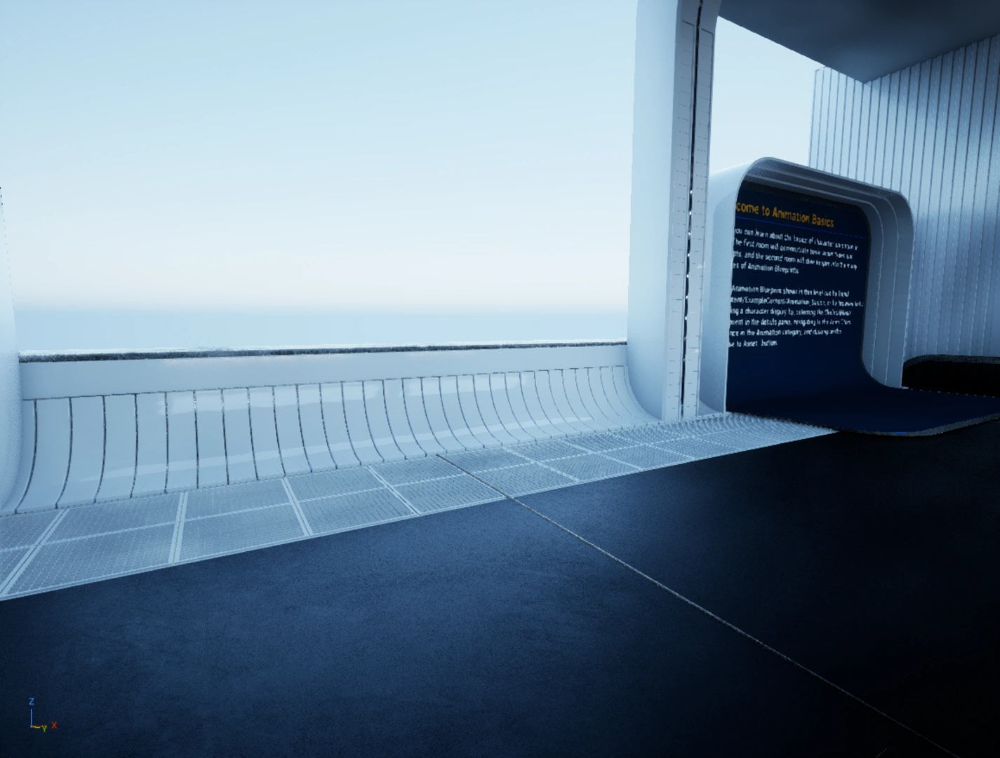
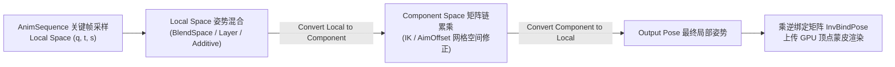
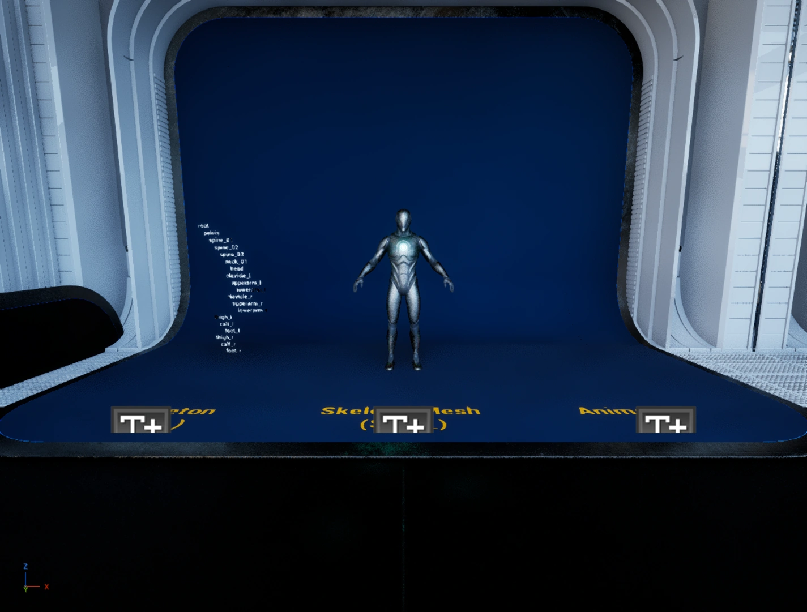
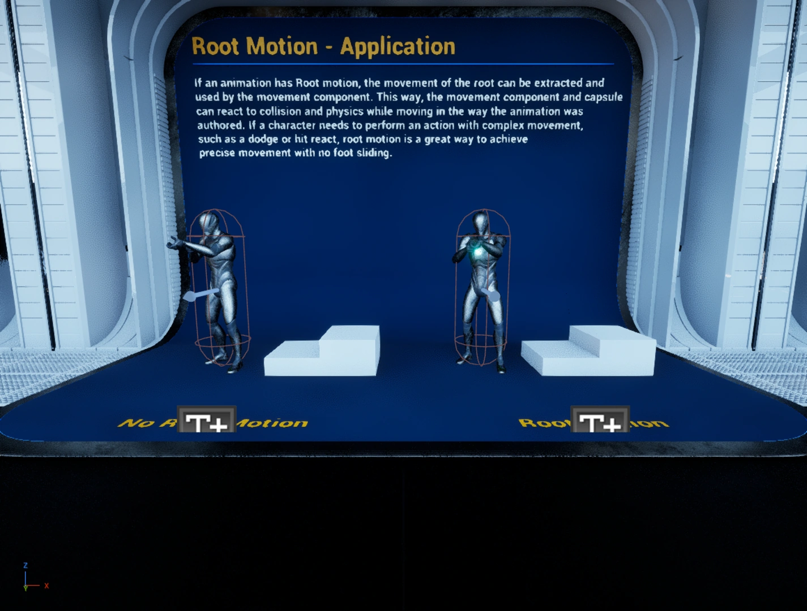
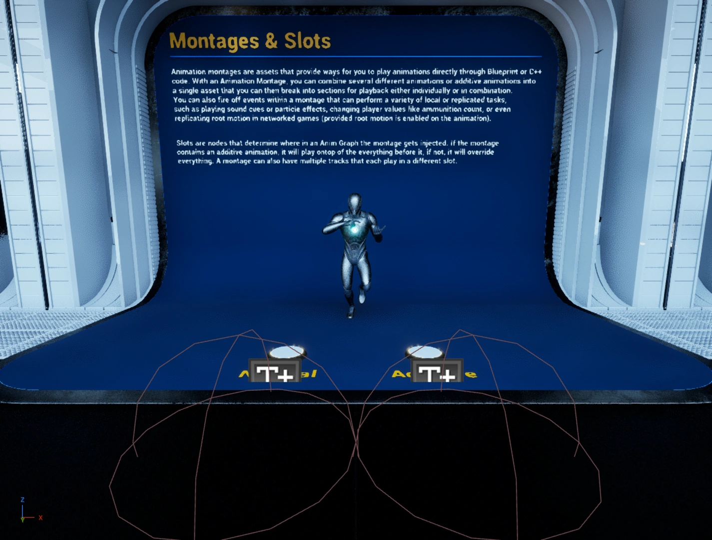
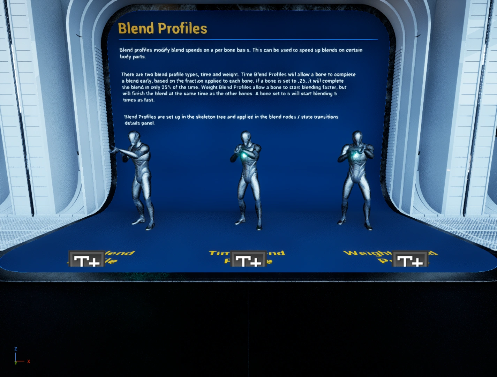
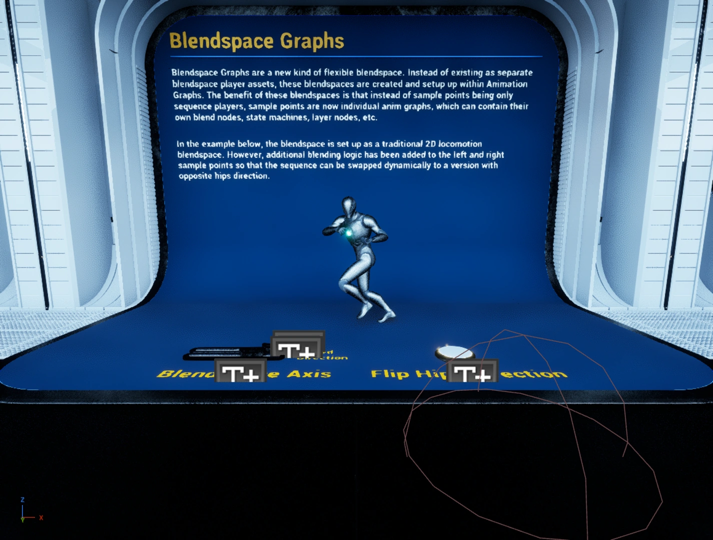

# 01 · 骨骼动画基石：混合空间、状态机、蒙太奇与瞄准偏移全解（`Animation_Basics`）

> **本篇实测拆解关卡档案**
> - **关卡路径**：`/Game/Maps/Animation/Animation_Basics`（关卡总 Actor 数：`176` | 展台数：`18` | 示例 Actor 数：`71`）
> - **关卡脚本类**：`/Game/Maps/Animation/Animation_Basics.Animation_Basics_C`
> - **核心资产目录**：`/Game/ExampleContent/Animation_Basics/`（涵盖 `BP_CharacterDisplay`、`BP_RootMotionCharacter`、第一展厅 `1-2` 至 `1-8` 基础动画蓝图系列、第二展厅 `2-1` 至 `2-8` 高阶混合与分层动画蓝图系列，以及 `/Game/Characters/Mannequins/` 标准 Manny 骨骼与动作库）

---

## 一、 在连第一根 AnimGraph 姿势线之前，先看懂骨骼矩阵链与次世代角色管线

许多刚踏入虚幻角色动画领域的开发者，打开动画蓝图（Animation Blueprint）看到满屏的小人图标连线（Pose Link）时，往往把它当成“播放 MP4 视频的播放器开关”：走路播 A、跑步播 B、开枪播个蒙太奇 C。直到项目进入深水区——角色斜向跑动时双脚像溜冰一样打滑、上半身举枪瞄准时枪口随着下半身跑步疯狂歪斜、翻滚撞墙后模型直接穿进墙体而胶囊体还留在原地、或者同屏 50 个 AI 同时切状态机直接把主线程（Game Thread）卡爆时，才意识到自己从未真正摸清骨骼动画底层的数据流与空间数学。

在深入拆解第一座展台前，让我们先站在虚幻引擎 5 现代角色动画全栈架构的制高点，俯瞰本系列 11 张动画地图共同构成的工业级流水线：

而今天我们踏入的 **`/Game/Maps/Animation/Animation_Basics`**，正是整座大厦最核心的承重地基。这条横跨 **180 米**（`X` 坐标从 `1500` 一路延伸至 `19500`）、划分为前后两大主题展厅、囊括 **18 座精密对照展台与 71 个交互示例 Actor** 的长廊，将骨骼资产解耦、镜像对称、根运动提取、加法空间、重心混合空间、惯性化过渡与多插槽分层蒙太奇逐一摊开在显微镜下。

### 1.1 角色动画的“四大坐标空间”与蒙皮矩阵链（Skinning Matrix Chain）

为什么 AnimGraph 里的姿势连线有的是**白色（Local Space Pose）**，而一旦连上 IK 或瞄准修正就会自动插入一个转换节点变成**蓝色（Component Space Pose）**？因为骨骼层级本质上是一棵**有向树（Directed Tree）**，每一根骨骼 $i$（父骨骼记为 $p(i)$）在不同计算阶段处于完全不同的刚体变换空间中：

1. **骨骼局部空间（Bone Local Space / Parent Space）——“混合与插值的黄金温床”**
   动画序列（`UAnimSequence`）中存储的每一帧关键帧，并不是骨骼在世界里的绝对坐标，而是**子骨骼相对于其直接父骨骼 $p(i)$ 的局部仿射变换** $T_i^{\text{local}} = (\mathbf{q}_i^{\text{local}}, \mathbf{t}_i^{\text{local}}, \mathbf{s}_i^{\text{local}})$（单位四元数旋转 + 平移向量 + 缩放向量）。
   - **为什么几乎所有动画混合都在 Local Space 进行？** 假设肘关节弯曲 $90^\circ$，如果你在世界空间或组件空间对小臂末端位置直接做线性插值，手腕会沿着弦线穿过身体内部，导致小臂长度严重缩短！而在 Local Space 中，我们对旋转四元数执行球面线性插值（SLERP）或快速归一化线性插值（NLERP），骨骼长度 $\|\mathbf{t}_i^{\text{local}}\|$ 恒定不变，天然满足前向运动学（Forward Kinematics, FK）的刚体弧线运动！
2. **组件空间（Component Space / Mesh Space）——“跨层级约束与 IK 的统一标尺”**
   顺着骨骼树从根骨骼 `root`（索引 `0`）一路向叶节点累乘局部变换矩阵，就得到了第 $i$ 根骨骼相对于 `SkeletalMeshComponent` 原点的**组件空间矩阵**：
   $$M_i^{\text{comp}} = M_{p(i)}^{\text{comp}} \cdot M_i^{\text{local}} = \prod_{k \in \text{Path}(\text{root} \to i)} M_k^{\text{local}}$$
   当你需要让右手精确抓住胸前的步枪握把（跨越多条骨骼分支），或者做全向平稳的 `Aim Offset`（网格空间加法叠加）时，必须先通过 `Convert Local to Component` 算出 $M_i^{\text{comp}}$（蓝色连线），解算完毕后再通过左乘父骨骼逆矩阵 $M_i^{\text{local}} = \left(M_{p(i)}^{\text{comp}}\right)^{-1} M_i^{\text{comp}}$ 转回白色局部空间输出。
3. **世界空间（World Space）——“与关卡物理地形握手”**
   再左乘 Actor 组件自身在关卡中的世界变换矩阵 $M_{\text{Actor}}^{\text{world}}$，即得世界空间变换：
   $$M_i^{\text{world}} = M_{\text{Actor}}^{\text{world}} \cdot M_i^{\text{comp}}$$
   脚部射线检测贴地高度、注视世界中的某个移动靶标、提取 Root Motion 驱动胶囊体移动，全部在此空间完成交互。
4. **GPU 线性混合蒙皮矩阵（Reference-to-Current Skinning Matrix）**
   建模师在 DCC 软件里绑定模型时的初始静止姿态称为 **Reference Pose（或 Bind Pose）**，此时第 $i$ 根骨骼在组件空间的初始矩阵记为 $B_i^{\text{ref}}$。当引擎在每一帧将动画姿势提交给渲染线程（Render Thread）时，真正上传到 GPU 顶点着色器（或 GPU Skin Cache Compute Shader）的并非 $M_i^{\text{comp}}$，而是**先将模型空间顶点剥离回骨骼局部空间、再变换到当前动画组件空间的蒙皮差值矩阵** $S_i$：
   $$S_i = M_i^{\text{comp}} \cdot \left(B_i^{\text{ref}}\right)^{-1}, \qquad \mathbf{v}_{\text{skinned}}^{\text{comp}} = \sum_{j=1}^{K} w_{v,j} \left( S_{b(v,j)} \cdot \mathbf{v}_{\text{bind}} \right), \quad \sum_{j=1}^{K} w_{v,j} = 1$$

带着这套严密的空间坐标系直觉，让我们正式步入第一展厅（展台 `#1` ~ `#10`）与第二展厅（展台 `#11` ~ `#18`），逐台拆解全部 18 座展台！

---

## 二、 第一展厅（#1 ~ #10）：核心资产三剑客、根运动、混合空间与蒙太奇

### 展台 #1：`Welcome to Animation Basics` — 双厅导览与资产寻址工作流

- **空间元数据**：展牌 Label `BP_DemoDisplay_1.3` | 坐标 `(1500, -850, 0)`

#### 1.1 官方展厅分区与快速逆向技巧
迎宾展牌清晰交代了本关卡的双展厅教学编排逻辑：
- **第一展厅（Room 1，对应内部编号 `1.1` ~ `1.8`，即展台 `#2` ~ `#10`）**：聚焦虚幻动画系统的**核心资产类型与原子概念**（骨骼三剑客、镜像表、根运动、加法动画、混合空间、瞄准偏移、蒙太奇插槽，最后在 `#10` 汇总成首个完整动画蓝图）。
- **第二展厅（Room 2，对应内部编号 `2.1` ~ `2.8`，即展台 `#11` ~ `#18`）**：深入 **AnimGraph 的高阶工程特性**（过渡曲线、逐骨骼混合配置 Blend Profiles、惯性化混合 Inertialization、多路混合节点、有限状态机、UE5 新一代 Blendspace Graphs，以及上下半身局部叠加与分层蒙太奇）。

官方同时给出了阅读 Content Examples 动画展台的标准操作路径：选中场景中的任意展示底座 `BP_CharacterDisplay` $\rightarrow$ 在 `Details` 面板点选其内部的 `SkeletalMesh` 组件 $\rightarrow$ 找到 `Animation -> Anim Class` 引用的动画蓝图资产 $\rightarrow$ 点击放大镜图标（`Browse to Asset`），即可直接跳转到 `/Game/ExampleContent/Animation_Basics/` 目录打开对应的 `ABP` 图表！

#### 1.2 展台陈列 Actor 实测清单（共 1 个）
- **`SKM_Mannequin_Male`**（类 `/Script/Engine.SkeletalMeshActor`）：挂载 `SkeletalMeshComponent0`，MCP 实测其 `skinnedAsset = None`、`animClass = None`，作为入口展牌处的轻量占位锚点 Actor。

---

### 展台 #2：`Core Asset Types` — 骨骼（Skeleton）、骨骼网格体与动画序列的“解耦铁三角”

- **空间元数据**：展牌 Label `BP_DemoDisplay_1.1` | 坐标 `(3000, -850, 0)`
- **展台内 3D 悬浮文字标签**：`Skeleton (SK_)` | `Skeletal Mesh (SKM_)` | `Animation` | 以及完整 3D 骨骼层级树文本（从 `root -> pelvis -> spine_01..03` 分叉至 `neck_01/head`、`clavicle_l/r` 与 `thigh_l/r`）

#### 2.1 为什么虚幻要把“骨头名字列表”和“模型网格”强行拆成两个独立资产？
在早期游戏引擎或 DCC 软件中，骨架和蒙皮模型往往是焊死在一起的。但想象一个大型 RPG 项目：主角有 50 套体型相似的盔甲外观，共享 800 个战斗与跑酷动作。如果每个模型都自带一套独立骨架，800 个动画资产岂不是要复制 50 份？

因此，虚幻引擎构建了极其优雅的**三资产职责分离架构**：
1. **`USkeleton`（前缀 `SK_`，骨骼资产）——“纯名字拓扑契约与元数据中枢”**
   请注意官方展牌上那句颠覆新手认知的话：**“Skeleton 资产本质上只是一张层级化的骨骼名称列表（Bone Name Hierarchy），它本身不包含任何蒙皮权重，也不驱动具体的几何体变形！”**
   它的核心职责是充当**路由中介（Mapping Table）**，把动画序列里的通道数据按骨骼名与索引映射到不同的网格体上；同时集中托管跨网格共享的元数据：**动画曲线名（Anim Curves）**、**同步标记（Sync Markers）**、**自定义动画通知（Anim Notifies）**、**插槽（Sockets）**以及我们在展台 `#12` 即将见到的 **混合配置（Blend Profiles）**。在 UE5 中，甚至还引入了 **Compatible Skeletons（兼容骨骼列表）**，无需复制任何资产即可跨骨骼直接共享动画库！
2. **`USkeletalMesh`（前缀 `SKM_`，骨骼网格体）——“多边形皮肤与逆绑定矩阵宿主”**
   真正承载顶点坐标、三角面拓扑、每个顶点最多 4/8/12 根骨骼的蒙皮权重（Skin Weights）、基准绑定姿态（Reference Pose / Inverse Bind Matrices），以及关联材质槽与物理资产（`UPhysicsAsset`，用于布娃娃与射线碰撞）的几何体容器。
3. **`UAnimSequence`（前缀 `AS_` / `MM_`，动画序列）——“压缩后的骨骼变换时间流”**
   仅记录随时间变化的各骨骼局部变换轨迹与浮点曲线（经 ACL —— Animation Compression Library 无损级高比压缩），可无缝在任何共享（或兼容）该 `USkeleton` 的 `USkeletalMesh` 上播放。

#### 2.2 展台 2 个示例 Actor 与“隐形材质透视骨骼”黑科技拆解
仔细看上方实拍图左侧：为什么展台左边能悬空画出一副纯白色的动态火柴人骨架，却看不见半点人体皮肤？MCP 实测数据揭开了官方技术美术的巧妙障眼法：
1. **右侧角色 `BP_CharacterDisplay_1.1_1`**（`BP_CharacterDisplay_C`）：
   - 实例参数：`characterNumber = 0`，`drawBones = false`。
   - 组件 `SkeletalMesh`：赋入 `/Game/Characters/Mannequins/Meshes/SKM_Manny_Simple`，保持默认材质（`overrideMaterials = [None, None]`），展示完整的蒙皮角色网格体。
2. **左侧纯骨架展示台 `BP_CharacterDisplay_1.1_2`**（`BP_CharacterDisplay_C`）：
   - 实例参数：`characterNumber = 1`，**`drawBones = true`**，`boneColor = (1, 1, 1, 1)`，`boneThickness = 1`（由蓝图每帧遍历骨骼层级调用 Debug Line 绘制白色骨骼连线！）。
   - 组件 `SkeletalMesh`：底层同样挂载了 `SKM_Manny_Simple`（因为没有 `SkeletalMeshComponent` 就无法求值骨骼矩阵！），但它的两个材质槽全部被重载成了 **`/Game/ExampleContent/Effects/Materials/Invisible_material`**！
   - **资产深拆 `Invisible_material`**：`blendMode = BLEND_Translucent`，`shadingModel = MSM_Unlit`，`bUsedWithSkeletalMesh = true`，全图仅含 **1 个常量节点 `MaterialExpressionConstant_0`**（值为 `0`）直连 **`MP_Opacity`**！用全透明材质隐去网格三角面，只保留骨骼变换求值与蓝图绘制的白色骨骼树（对应一旁 `TextRenderActor` 展示的 `root -> pelvis -> spine_01..03 -> neck_01/head, clavicle_l/r, thigh_l/r` 标准人形拓扑）。

---

### 展台 #3：`Mirroring` — 镜像数据表（Mirror Data Table）与四元数矢状面反射数学

- **空间元数据**：展牌 Label `BP_DemoDisplay_1.2` | 坐标 `(4000, -850, 0)`
- **展台内 3D 悬浮文字标签**：`Original Animation ->` | `Mirror Data Table`（完整骨骼映射清单） | `-> Mirrored Animation`

#### 3.1 少做一半资产的工业魔法：镜像姿势（Mirror Pose）在底层怎么算？
在格斗、足球或第三人称射击游戏中，角色往往有“左势站姿（Left Stance）”和“右势站姿（Right Stance）”，或者“向左闪避”与“向右闪避”。如果每个动作都要让动画师在 Maya 里手动反K一遍，资产维护量和内存占用都会翻倍！

UE5 原生内置的 **`UMirrorDataTable`（镜像数据表）+ `Mirror` 动画图节点** 彻底自动化了这一流程。观察展台中央 `TextRenderActor` 列出的映射规则，骨骼被严格分为两类：
- **中轴自对称骨骼（Self-Mirrored Central Chain）**：`root -> root`、`pelvis -> pelvis`、`spine_01 -> spine_01`、`spine_02 -> spine_02`、`spine_03 -> spine_03`、`neck_01 -> neck_01`、`head -> head`。它们留在原位，但绕矢状面法线方向的偏航（Yaw）与翻滚（Roll）分量必须反向，而俯仰（Pitch，低头抬头）保持同向！
- **对侧互换骨骼对（Contralateral Paired Bones）**：`clavicle_l <-> clavicle_r`、`upperarm_l <-> upperarm_r`、`lowerarm_l <-> lowerarm_r`、`hand_l <-> hand_r` 以及下肢 `thigh_l <-> thigh_r`、`calf_l <-> calf_r`、`foot_l <-> foot_r`（自动通过正则规则将后缀 `_l` 与 `_r` 配对）。

从数学上看，设角色的对称平面（矢状面，通常法向量为组件空间 $X$ 轴或 $Y$ 轴）对应反射对角矩阵 $R_{\text{plane}} = \text{diag}(1, -1, 1)$（因为 $\det(R_{\text{plane}}) = -1$ 会把右手系翻成左手系！），引擎必须同时结合左右骨骼在 Reference Pose 下的局部轴朝向修正旋转 $Q_{\text{flip}}$，执行相似变换：
$$M_{B'}^{\text{comp, mirrored}} = R_{\text{plane}} \cdot M_B^{\text{comp}} \cdot Q_{\text{flip}, B \to B'}$$
不仅如此，`UMirrorDataTable` 还会**同步镜像动画曲线（如 `FootPlant_L <-> FootPlant_R`）、同步标记（Sync Markers：`LeftFoot <-> RightFoot`）以及动画通知**，确保镜像后的脚步声和混合相位分毫不差！

#### 3.2 展台 2 个对照 Actor 与动画蓝图拆解
- **`BP_CharacterDisplay_1.2_1`**（`characterNumber = 0`）与 **`BP_CharacterDisplay_1.2_2`**（`characterNumber = 1`）：两者共享同一个动画蓝图 **`/Game/ExampleContent/Animation_Basics/1-2_ABP_Mirroring`**（`1-2_ABP_Mirroring_C`）。在 AnimGraph 内部，通过读取宿主 `characterNumber` 决定 `Mirror` 节点的布尔开关 `bMirror`：左侧输出原版动作，右侧实时解算输出 100% 严丝合缝的镜像动作。

---

### 展台 #4：`Root Motion - What is it?` — 原地动画（In-Place）与根骨骼烘焙位移的本质分野

- **空间元数据**：展牌 Label `BP_DemoDisplay_1.3.1` | 坐标 `(5000, -850, 0)`
- **展台内 3D 悬浮文字标签**：`Root` / `No Root Motion`（左） | `Root` / `Root Motion`（右）

#### 4.1 眼睛看到的“角色往前冲”，骨头根部到底动没动？
在这个展台上，两个 `BP_CharacterDisplay`（`1.3.1_1` 与 `1.3.1_2`）双双开启了 **`drawBones = true`**，把平时隐藏在脚底地板处的第 0 号根骨骼 **`root`** 暴露在阳光下：
- **左侧 `BP_CharacterDisplay_1.3.1_1`（`No Root Motion`）**：播放动作时，角色的骨盆 `pelvis` 带着全身网格体往前扑倒在数米之外，但脚底原点的 **`root` 骨骼像钉死在地面上一样纹丝不动**，两者之间拉出一条长长的白色骨骼连线！
  > **工程后果**：如果这是一个没有动画师提取根运动的死亡/翻滚动作，游戏逻辑里的 `CapsuleComponent`（碰撞胶囊体，绑定在组件原点即 `root` 处）还傻傻留在原地，而玩家的肉体模型早就穿墙飞出去了——别人朝地上的尸体开枪打不中，朝原地的空气开枪反而飙血！
- **右侧 `BP_CharacterDisplay_1.3.1_2`（`Root Motion`）**：动画师在制作时，将角色重心的水平位移与朝向旋转同步烘焙到了底部的 **`root` 骨骼**上——当角色向前扑倒时，`root` 贴着地面一路跟随身体重心同步前移！这就为下一座展台的“物理胶囊体接管驱动”铺平了道路。

---

### 展台 #5：`Root Motion - Application` — 根运动提取数学与物理碰撞闭环

- **空间元数据**：展牌 Label `BP_DemoDisplay_1.3.2` | 坐标 `(6000, -850, 0)`
- **展台内 3D 悬浮文字标签**：`No Root Motion`（左道） | `Root Motion`（右道）

#### 5.1 根运动提取（Root Motion Extraction）底层究竟经历了哪三步偷梁换柱？
很多同学以为勾选了 `EnableRootMotion = true` 后，是 `root` 骨头推着模型走——**恰恰相反！一旦开启根运动提取，动画求值器做的第一件事就是把 `root` 骨头强行清零锁回原点！** 完整的帧间增量接管方程如下：
1. **帧间局部增量采样**：在时间步 $[t, t + \Delta t]$ 内，采样动画资产中 `root` 骨骼在两个时刻的局部变换 $T_{\text{root}}(t)$ 与 $T_{\text{root}}(t + \Delta t)$，计算增量变换：
   $$\Delta T_{\text{root}}(t, t+\Delta t) = \left(T_{\text{root}}(t)\right)^{-1} \cdot T_{\text{root}}(t + \Delta t)$$
2. **网格局部归零锁死**：将该帧最终输出给渲染蒙皮的 `root` 骨骼变换强制重置为单位矩阵 $I$（Identity），从而保证网格体永远乖乖待在 `CapsuleComponent` 肚子正中央，绝不“灵魂出窍”。
3. **运动组件物理扫掠（Sweep）**：将 $\Delta T_{\text{root}}$ 变换到世界空间，移交给 `UCharacterMovementComponent`（`CharMoveComp`），通过物理引擎执行带碰撞体积的胶囊体扫掠移动（`SafeMoveUpdatedComponent`）与重力结算！

#### 5.2 展台 6 个 Actor 碰撞对比实验深拆
官方在这里不再使用纯展示架 `BP_CharacterDisplay`，而是专门派出了继承自完整 `ACharacter`（自带 `CollisionCylinder` 胶囊体与 `CharMoveComp` 角色移动组件，并由 `AIController` 自动托管）的实战角色类 **`/Game/ExampleContent/Animation_Basics/BP_RootMotionCharacter`**，并在他们身前各砌起了两道 `Cube` 障碍矮墙：
1. **左道实验组：`BP_RootMotionCharacter_1.3.2_1` + 障碍物 `Cube4`、`Cube5`**
   - **MCP 实测参数**：播放序列 **`/Game/Characters/Mannequins/Animations/Manny/MM_Death_Front_03_NoRM`**（无根运动版向前扑街死亡），驱动动画蓝图 `1-3_ABP_RootMotion_C`。
   - **灾难现场**：因为胶囊体根本没动，不会触发与前方矮墙 `Cube4`/`Cube5` 的碰撞阻挡，角色的头和上半身网格体**毫无物理廉耻地直接穿透插进了白色立方体内部**！
2. **右道实验组：`BP_RootMotionCharacter_1.3.2_2` + 障碍物 `Cube2`、`Cube3`**
   - **MCP 实测参数**：播放序列 **`/Game/Characters/Mannequins/Animations/Manny/MM_Death_Front_03_ExtractedRM`**（已启用根运动提取版），同样挂载 `1-3_ABP_RootMotion_C`。
   - **完美物理响应**：动画师精调的踉跄步伐做到 **100% 零滑步（Zero Foot Sliding）**，同时驱动胶囊体真实前移；当撞上矮墙 `Cube2`/`Cube3` 时，胶囊体被物理刚体稳稳挡住，角色顺着墙沿滑落倒在墙前，绝不穿模！

> [!WARNING]
> **联机游戏的致命性能与同步红线：`Root Motion Mode` 千万别乱选！**
> 在动画蓝图的 `Class Defaults` 中，`Root Motion Mode` 默认是 **`Root Motion from Montages Only`（仅从蒙太奇提取根运动）**。这是因为虚幻原生的 `CharacterMovementComponent` 网络同步协议只对 **AnimMontage** 实现了轻量级的客户端预测与服务器纠偏（Server Correction）；如果你贪图省事改成了 `Root Motion from Everything`（在普通状态机序列里直接开根运动），单机跑起来虽然很爽，但在多人联机模式下会彻底丧失网络预测同步支持，导致角色疯狂瞬移拉回！多人游戏的技能位移（闪避、处决、重劈）请务必封装进 Montage 或使用 Mover 2.0 / Gameplay Ability System 根运动任务。

---

### 展台 #6：`Additive Animations` — 加法动画的“差值提取”与骨骼叠加代数

- **空间元数据**：展牌 Label `BP_DemoDisplay_1.4` | 坐标 `(7000, -850, 0)`
- **展台内 3D 悬浮文字标签**：`Base Pose ->` | `Additive Animation ->` | `Applied Additive`

#### 6.1 为什么受击颤抖、呼吸起伏不需要为“站立、走路、跑步、蹲伏”各做一套？
假设角色中了一箭胸口后仰颤抖（Hit React）。如果用普通覆盖式动画，角色在狂奔中中箭就会瞬间变成原地站着挨打；如果做 10 套“跑步挨打、蹲着挨打、左移挨打”，动画师会当场崩溃。

**加法动画（Additive Animation）** 的核心思想是：**只提取“变化量（Delta）”，再把变化量嫁接到任意底层动作上！**
设基准参考帧（Base Pose）中第 $i$ 根骨骼的局部变换为 $(\mathbf{q}_{\text{base}}, \mathbf{t}_{\text{base}})$，源动画帧（Source Pose）为 $(\mathbf{q}_{\text{src}}, \mathbf{t}_{\text{src}})$，引擎在烘焙加法数据时预计算差值姿势 $\Delta P = P_{\text{src}} \ominus P_{\text{base}}$：
$$\Delta \mathbf{t}_i = \mathbf{t}_{\text{src}, i} - \mathbf{t}_{\text{base}, i}, \qquad \Delta \mathbf{q}_i = \mathbf{q}_{\text{src}, i} \cdot \mathbf{q}_{\text{base}, i}^{-1}$$
在运行时，通过 **`Apply Additive`** 节点（权重 $\alpha \in [0, 1]$）将其叠加到底层奔跑姿势 $(\mathbf{q}_{\text{run}}, \mathbf{t}_{\text{run}})$ 上：
$$\mathbf{t}_{\text{out}, i} = \mathbf{t}_{\text{run}, i} + \alpha \Delta \mathbf{t}_i, \qquad \mathbf{q}_{\text{out}, i} = \text{Slerp}(\mathbf{q}_{\text{identity}}, \Delta \mathbf{q}_i, \alpha) \cdot \mathbf{q}_{\text{run}, i}$$

#### 6.2 展台 3 个递进式展示角色拆解
1. **`BP_CharacterDisplay_1.4_1`（标签 `Base Pose`）**：展示作为减法被减数的静止基准参考帧 $P_{\text{base}}$。**铁律**：Base Pose 必须与制作该加法动作时的起始参考姿态严格匹配！如果拿 T-Pose 当作持枪呼吸动作的 Base Pose，相减出来的 $\Delta P$ 就会包含“双手从水平折到胸前”的巨大角度，叠加到持枪跑步上时双臂会直接拧成麻花！
2. **`BP_CharacterDisplay_1.4_2`（标签 `Additive Animation`）**：展示尚未剥离 Base Pose 前的原始动态动作 $P_{\text{src}}$。
3. **`BP_CharacterDisplay_1.4_3`（标签 `Applied Additive`）**：挂载动画蓝图 **`/Game/ExampleContent/Animation_Basics/1-4_ABP_AdditiveAnimations`**，通过 `Apply Additive` 节点将 $(P_{\text{src}} \ominus P_{\text{base}})$ 实时叠加到底层循环跑步动作上，既保留了双腿迈步节奏，又完美融合了上半身的附加律动。

---

### 展台 #7：`Blendspaces` — 1D/2D 混合空间的 Delaunay 三角剖分与重心插值算法

- **空间元数据**：展牌 Label `BP_DemoDisplay_1.5` | 坐标 `(8000, -850, 0)`
- **展台内 3D 悬浮文字标签**：`1D Blendspace` / `Speed`（左） | `2D Blendspace` / `Speed` / `Direction`（右）

#### 7.1 当玩家推动摇杆在二维平面游走时，BlendSpace 底层如何算出每个样本的权重？
混合空间（`UBlendSpace1D` / `UBlendSpace`）允许我们将离散的动画采样点布置在一维数轴或二维平面网格上，根据连续输入参数平滑插值：
- **1D BlendSpace（线性区间分段插值）**：假设采样点按速度升序排列在 $x_0 < x_1 < \dots < x_n$（如 `Idle = 0`、`Walk = 150`、`Run = 500`）。当输入速度 $x \in [x_k, x_{k+1}]$ 时，仅激活相邻两个样本，权重为 $w_{k+1} = \frac{x - x_k}{x_{k+1} - x_k}$，$w_k = 1 - w_{k+1}$。
- **2D BlendSpace（Delaunay 三角剖分 + 重心坐标 Barycentric Coordinates）**：
  当样本点分布在二维参数空间 $(x, y) = (\text{Direction}, \text{Speed})$ 时，引擎通过 **Delaunay 三角剖分**（最大化最小内角，消除狭长退化三角形引发的权重剧烈跳变）或规则网格剖分将平面划分为若干互不重叠的三角形。当实时查询点 $\mathbf{p} = (x, y)$ 落入由三个动画样本 $\mathbf{a}=(x_A, y_A)$、$\mathbf{b}=(x_B, y_B)$、$\mathbf{c}=(x_C, y_C)$ 构成的三角形 $\triangle ABC$ 内部时，最多只需同时求值这 **3 个动画样本**，其混合权重 $(w_A, w_B, w_C)$ 严格等于点 $\mathbf{p}$ 的有向面积比（重心坐标）：
  $$w_A = \frac{(y_B - y_C)(x - x_C) + (x_C - x_B)(y - y_C)}{(y_B - y_C)(x_A - x_C) + (x_C - x_B)(y_A - y_C)}, \quad w_B = \frac{(y_C - y_A)(x - x_C) + (x_A - x_C)(y - y_C)}{(y_B - y_C)(x_A - x_C) + (x_C - x_B)(y_A - y_C)}, \quad w_C = 1 - w_A - w_B$$
  满足凸组合性质 $w_A, w_B, w_C \ge 0$ 且 $w_A + w_B + w_C = 1$。
- **防“太空碎步”核心机制：相位同步（Phase / Sync Marker Synchronization）**：
  假如 `Walk` 周期是 `1.2 秒`，`Run` 周期是 `0.7 秒`——如果不做时间轴同步，跑了 3 秒钟后，`Walk` 正迈左脚往前踢，而 `Run` 正迈右脚往前踢！两者各取 $0.5$ 权重一平均，双腿直接在胯下互相抵消，变成滑稽的原地半蹲漂移！因此 BlendSpace 默认按最高权重样本作为 **Leader**，对齐归一化播放进度（Normalized Time $\tau \in [0, 1]$）或按 `LeftFoot` / `RightFoot` **Sync Markers（同步组标记）** 动态伸缩 Follower 样本的瞬时播放速率，确保所有参与混合的样本永远同迈左脚、同迈右脚！

#### 7.2 展台 5 个交互 Actor 实测拆解
展台前摆放了 3 根可拖拽交互滑杆（`/Game/Global/Blueprints/BP_Slider`，内部维护 `Range = (0, 1)`、`Value` 与事件分发器 `OnReleaseSliderED`），统一驱动挂载 **`/Game/ExampleContent/Animation_Basics/1-5_ABP_Blendspaces`** 的两个角色：
- **左组**：`BP_CharacterDisplay_1.5_1`（`characterNumber = 0`）+ 单滑杆 `BP_Slider3`（控制 `Speed`），实时演示 **1D BlendSpace** 从待机、慢走到全速冲刺的无级变速。
- **右组**：`BP_CharacterDisplay_1.5_2`（`characterNumber = 1`）+ 双滑杆 `BP_Slider2` 与 `BP_Slider`（分别控制 `Speed` 与水平移动夹角 `Direction`），实时演示 **2D BlendSpace** 八向全向移动（Omnidirectional Locomotion）的三角形重心混合。

---

### 展台 #8：`Aim Offsets` — 为什么瞄准偏移必须使用“网格空间加法（Mesh Space Additive）”？

- **空间元数据**：展牌 Label `BP_DemoDisplay_1.6` | 坐标 `(9000, -850, 0)`
- **展台内 3D 悬浮文字标签**：`Base Pose ->` | `Additive Poses` / `Pitch ->` | `Applied Additive`

#### 8.1 价值千金的骨骼数学追问：Local Space Additive 与 Mesh Space Additive 差在哪？
官方展牌指出：**Aim Offset（瞄准偏移资产，`UAimOffsetBlendSpace`）本质上就是“内部所有样本强制规定为 Mesh Space Additive 帧的 BlendSpace”**。
为什么 `Aim Offset` 坚决不用展台 `#6` 默认的 `Local Space Additive`，而强制要求所有瞄准帧都设为 **`Mesh Space`（即 Component Space）加法**？让我们算一笔旋转轴的账：

假设角色底层正在播一个“侧身 $45^\circ$ 端枪奔跑”动作——此时他的第一、二、三节脊椎（`spine_01`, `spine_02`, `spine_03`）在组件空间里各自都已经扭转、倾斜了不同的欧拉角，局部坐标轴早就歪向了身体侧面。
- 如果使用 **Local Space Additive**：把“正前方抬头 $30^\circ$”提取出的局部旋转增量 $\Delta \mathbf{q}_i^{\text{local}}$ 乘在已经歪了 $45^\circ$ 的父骨骼局部系上，三级脊椎每往上一节，旋转轴就会顺着斜向父轴偏折一次，最终角色抬起头来不是朝正上方瞄准，而是**歪着脖子往斜后方翻白眼，枪口划出一道诡异的香蕉曲线**！
- 而使用 **Mesh Space Additive**：引擎将差值旋转定义在**全局统一的组件坐标系（Component Space）** 中：
  $$\Delta \mathbf{q}_i^{\text{comp}} = \mathbf{q}_{\text{aim}, i}^{\text{comp}} \cdot \left(\mathbf{q}_{\text{base}, i}^{\text{comp}}\right)^{-1}, \qquad \mathbf{q}_{\text{out}, i}^{\text{comp}} = \Delta \mathbf{q}_i^{\text{comp}}(\text{Yaw}, \text{Pitch}) \cdot \mathbf{q}_{\text{run}, i}^{\text{comp}}$$
  无论底层下半身和腰部怎么侧身、弯腰、狂奔，组件空间的水平面与竖直轴永远正对前方！左乘组件空间旋转增量后，准星仰俯与偏航永远笔直精准！

#### 8.2 展台 4 个示例 Actor 拆解
- **`BP_CharacterDisplay_1.6_1`**：静态展示中央平视基准帧（`Base Pose`）。
- **`BP_Slider14`** + **`BP_CharacterDisplay_1.6_2`**（`characterNumber = 0`）+ **`BP_CharacterDisplay_1.6_3`**（`characterNumber = 1`）：后两者共享 **`/Game/ExampleContent/Animation_Basics/1-6_ABP_AimOffsets`**。拉动滑杆改变 `Pitch` 仰俯角时，中间角色展示纯瞄准偏移采样姿态，右侧角色将其以网格空间加法完美叠乘在动态基础动作之上。

---

### 展台 #9：`Montages & Slots` — 动画蒙太奇时间轴编排与 AnimGraph 插槽注入机制

- **空间元数据**：展牌 Label `BP_DemoDisplay_1.7` | 坐标 `(10000, -850, 0)`
- **展台内 3D 悬浮文字标签**：`Normal`（左按钮） | `Additive`（右按钮）

#### 9.1 为什么 C++ 和游戏逻辑蓝图从不直接操控状态机内部节点，而是调 `PlayAnimMontage`？
状态机擅长管理**连续、持久的运动状态**（走、跑、跳、蹲），但游戏里充斥着大量由玩家按键或技能逻辑瞬时触发的**一次性事件型动作（One-Shot Actions）**：挥刀三连击（Combo Sections）、换弹夹、喝血瓶、被重击硬直。如果把 50 个技能全连进状态机，转移连线会瞬间变成灾难级的盘丝洞！

**`UAnimMontage`（动画蒙太奇）+ `Slot`（插槽节点）** 构成了逻辑层向表现层“空降注入动作”的高速通道：
1. **逻辑层点播控制**：在角色蓝图、C++ 或 Gameplay Ability（`PlayMontageAndWait`）中随时调用 `Montage_Play`，支持将多段动画拼接切分为命名片段（**Sections**，如 `Attack_1 -> Attack_2 -> Recovery`），在连招判定窗口内动态调用 `Montage_JumpToSection` 实现派生变招！
2. **高精度事件触发**：蒙太奇时间轴挂载的 `AnimNotify` / `AnimNotifyState`（开启武器刀光粒子、开启攻击碰撞盒窗口、扣除弹药、播放音效）支持 `Queued`（队列异步安全触发）与 `Branching Point`（帧内精确同步触发，零帧误差切段）。
3. **AnimGraph 里的 `Slot` 守门员机制**：蒙太奇本身并不知道自己该覆盖全身还是只覆盖上半身——这完全取决于 **它的 Slot 节点插在 AnimGraph 的哪个位置**！
   - 当没有任何指向该插槽名（如 `DefaultSlot`）的蒙太奇播放时，`Slot` 节点相当于一根透明直通水管，原封不动透传上游输入的 `Source` 姿势；
   - 当播放**非加法蒙太奇（Normal Montage）** 时，`Slot` 节点按蒙太奇的 `Blend In` / `Blend Out` 时间平滑接管并 **100% 覆盖（Override）** 上游姿势；
   - 当播放**加法蒙太奇（Additive Montage）** 时，`Slot` 节点自动识破其加法身份，在不打断上游动作的前提下直接将其**叠加（Apply On Top）** 到上游输入姿势之上！

#### 9.2 展台 3 个交互 Actor 拆解
- **`BP_CharacterDisplay_1.7_1`**：挂载 **`/Game/ExampleContent/Animation_Basics/1-7_ABP_Montage`**，持续播放底层基础循环动作，并在输出端前串联了 `Slot` 节点。
- **`BP_AnimDemoTrigger`（左按钮 `Normal`）** 与 **`BP_AnimDemoTrigger2`（右按钮 `Additive`）**（类 `/Game/Global/Interactable/BP_AnimDemoTrigger`）：玩家走上前踩下或交互触发左按钮时，播放普通覆盖式蒙太奇，角色立即停下原动作执行完整全身演出；触发右按钮时，播放加法蒙太奇，在保留原底层动作的同时叠加上受击/抖动反馈！

---

### 展台 #10：`Animation Blueprints` — 第一展厅毕业大成：EventGraph 逻辑采集与 AnimGraph 姿势合成

- **空间元数据**：展牌 Label `BP_DemoDisplay_1.8` | 坐标 `(11000, -850, 0)`
- **展台内 3D 悬浮文字标签**：`Speed` | `Melee` | `Hit` | `Aim Pitch` | `Jump`

#### 10.1 双图协同架构与 UE5 多线程求值（Thread-Safe Update）性能铁律
作为第一展厅的收官综合台，展台 `#10` 将前面学到的混合空间、瞄准偏移、状态机跳跃与普通/加法蒙太奇全部熔铸进了同一个工业级动画蓝图 **`/Game/ExampleContent/Animation_Basics/1-8_ABP_AnimationBlueprints`**（父类 `/Script/Engine.AnimInstance`）之中：
- **MCP 实测成员变量清单**：`["Speed", "AimPitch", "IsJumping", "SpeedSlider", "AimSlider"]`。
- **数据流分工**：
  1. **`Event Graph` / 更新阶段**：每帧读取外部速度滑杆（实战中为 `PawnOwner` 的水平速度向量模长）写入 `Speed`，读取俯仰滑杆写入 `AimPitch`，监听跳跃布尔量 `IsJumping`。
  2. **`Anim Graph` / 姿势管线阶段**：底层状态机根据 `Speed` 采样 `Blendspace`，根据 `IsJumping` 切入起跳/滞空/落地循环；出状态机后经过 `Slot` 节点承接 `Melee`（近战挥击覆盖蒙太奇）与 `Hit`（受击加法蒙太奇）；最后串联 `Aim Offset` 根据 `AimPitch` 叠加网格空间抬头低头偏移！

> [!TIP]
> **首席动画工程师性能锦囊：彻底消灭 Game Thread 上的 `BlueprintUpdateAnimation` 瓶颈！**
> 在同屏几十个角色的项目中，传统的 `Event BlueprintUpdateAnimation` 强制运行在**游戏主线程（Game Thread）** 上，逐个 Cast Pawn 读变量极易吃掉数毫秒帧预算。在 UE5 生产环境中，请务必开启 `Use Multi Threaded Animation Update`，改用 **`BlueprintThreadSafeUpdateAnimation`** 搭配动画蓝图内置的 **`Property Access`（属性访问器节点，如直接绑定 `TryGetPawnOwner.CharacterMovement.Velocity`）**——引擎会在主线程批量做一次零开销内存拷贝，然后把变量计算与整张 AnimGraph 骨骼矩阵求值 100% 卸载到后台 **Worker Threads** 并行跑满多核 CPU！

#### 10.2 展台 6 个全套控制台 Actor 清单
围绕中央主角 **`BP_CharacterDisplay_1.8_1`**，前方一字排开 5 个交互控制器：2 根连续滑杆 **`BP_Slider4`**（`Speed`）、**`BP_Slider5`**（`Aim Pitch`），以及 3 枚脉冲按钮 **`BP_AnimDemoTrigger6`**、**`BP_AnimDemoTrigger5`**、**`BP_AnimDemoTrigger3`**（分别触发 `Melee` 近战蒙太奇、`Hit` 加法受击蒙太奇与 `Jump` 状态机跳跃状态）。强烈建议在编辑器运行模式下边拉高 `Speed` 与 `Aim Pitch`、边狂按 `Hit` 与 `Jump`，亲眼体会多层动画系统正交解耦组合的丝滑魅力！

---

## 三、 第二展厅（#11 ~ #18）：AnimGraph 混合曲线、逐骨配置、惯性化与局部骨骼分层

穿过走廊来到 `X = 12500` 开启的第二展厅，我们将深入剖析专业动作游戏如何打磨“动作切换瞬间的打击感、响应速度与全身协调度”。

### 展台 #11：`Blend Curves` — 过渡缓动函数（Easing Curves）决定动作的轻重缓急

- **空间元数据**：展牌 Label `BP_DemoDisplay_2.1` | 坐标 `(12500, -850, 0)`
- **展台内 3D 悬浮文字标签**：`Linear` | `Cubic` | `Custom`

#### 11.1 为什么默认线性混合（Linear）看起来总是像“机械木偶匀速体操”？
几乎所有状态机转移连线（State Transition）与混合节点（Blend Node）的细节面板里都有一个 `Blend Settings -> Mode`（`EAlphaBlendOption`）枚举。设归一化过渡进度为 $u = \text{clamp}(t / T, 0, 1)$，混合曲线函数 $w = f(u) \in [0, 1]$ 直接决定了骨骼角速度的变化率（即角加速度！）：
1. **`Linear`（线性曲线，左角色 `BP_CharacterDisplay_2.1_1`，`characterNumber = 0`）**：
   $$f_{\text{linear}}(u) = u$$
   一阶导数 $f'(u) = 1$ 为常数，但在起点 $u=0$ 和终点 $u=1$ 处速度瞬间阶跃突变（二阶导数 $f''$ 为无穷大脉冲），真实肌肉绝不可能在 0 秒内瞬间加到匀速又瞬间刹停，因此视觉上显得生硬机械。
2. **`Cubic`（三次 Hermite 平滑缓入缓出，中角色 `BP_CharacterDisplay_2.1_2`，`characterNumber = 1`）**：
   $$f_{\text{cubic}}(u) = 3u^2 - 2u^3$$
   满足边界导数 $f'(0) = 0, f'(1) = 0$——动作从静止温柔起步加速，在中段达到峰值速度，最后缓缓减速优雅落位（Ease-In-Out），完美契合人类自然肢体摆动！
3. **`Custom`（自定义浮点曲线资产 `UCurveFloat`，右角色 `BP_CharacterDisplay_2.1_3`，`characterNumber = 2`）**：
   引用任意横纵坐标严格归一在 $[0, 1] \times [0, 1]$ 的自定义曲线（驱动蓝图 **`2-1_ABP_BlendCurves_C`**）。例如制作重锤砸地或武士拔刀斩时，美术师会画一条“前 $15\%$ 时间狂飙到 $0.9$ 权重、后 $85\%$ 时间极慢微调收势”的爆发型曲线，甚至加入微小超过 $1.0$ 的弹性过冲（Overshoot），瞬间拉满拳拳到肉的力量张力！

---

### 展台 #12：`Blend Profiles` — 逐骨骼混合速度控制：Time 模式 vs Weight 模式深度辨析

- **空间元数据**：展牌 Label `BP_DemoDisplay_2.2` | 坐标 `(13500, -850, 0)`
- **展台内 3D 悬浮文字标签**：`No Blend Profile` | `Time Blend Profile` | `Weight Blend Profile`

#### 12.1 实战痛点：全身统一用 `0.4 秒` 过渡太肉，改用 `0.1 秒` 下半身又咔嚓闪现，怎么破？
想象竞技射击游戏里的“奔跑转开镜瞄准（Sprint to ADS）”：设计要求玩家按下右键后，**双手和枪口必须在 `0.1 秒` 内闪电般举到屏幕准星处**保证极致操控手感；但如果把整个状态机过渡时长直接设成 `0.1 秒`，双腿和骨盆也会在 `0.1 秒` 内瞬移抽搐！

定义在 `USkeleton` 骨骼树面板中的 **`UBlendProfile`（逐骨骼混合配置表）** 正是解决全身响应速度矛盾的手术刀！在 **`2-2_ABP_BlendProfiles_C`** 驱动的三个对照角色上，官方精妙对比了两种截然不同的底层数学模式（设总过渡时长为 $T$，归一化全局进度 $u = t / T \in [0, 1]$）：

| 对照角色 Actor | 模式名称 | 单骨骼因子 $k_b$ 含义与权重映射方程 | 运动学特征与最佳适用场景 |
| :--- | :--- | :--- | :--- |
| **`BP_CharacterDisplay_2.2_1`** (`#0`) | **No Blend Profile** | 所有骨骼共用同一全局进度：$w_b(u) = f(u)$ | 全身上下齐步走、同时起步、同时停下，缺乏主次发力层次（无运动引导感 Lead & Follow）。 |
| **`BP_CharacterDisplay_2.2_2`** (`#1`) | **Time Blend Profile**（时间分数模式） | $k_b \in (0, 1]$ 表示完成混合所需的**时间比例**！ $$w_b(u) = f\left(\text{clamp}\left(\frac{u}{k_b},\, 0,\, 1\right)\right)$$ | 若双臂设为 $k_b = 0.25$，双臂在 **$25\%$ 的过渡时间内就提前 100% 到位锁定**，而双腿仍在剩余 $75\%$ 时间里从容迈步收势！**FPS 快速举枪开镜、格斗快速出拳收脚的首选神器**！ |
| **`BP_CharacterDisplay_2.2_3`** (`#2`) | **Weight Blend Profile**（权重倍率模式） | $k_b \ge 1$ 表示起始阶段的**权重抢跑倍率**！ $$w_b(\alpha) = \frac{k_b \cdot \alpha}{k_b \cdot \alpha + (1 - \alpha)}, \quad \alpha = f(u)$$ | 若某部位设为 $k_b = 5$，它在起步瞬间的斜率是其他骨骼的 **5 倍**（率先发力领跑），但随着 $\alpha \to 1$，全身所有骨骼**依然在 $t = T$ 同一时刻严丝合缝共同完成混合**！最适合表现“转头带动肩膀、肩膀带动腰胯”的有机生物次级跟随节奏。 |

---

### 展台 #13：`Inertial Blends` — 惯性化混合（Inertialization）：五次多项式衰减与零开销单流求值

- **空间元数据**：展牌 Label `BP_DemoDisplay_2.3` | 坐标 `(14500, -850, 0)`
- **展台内 3D 悬浮文字标签**：`Standard Blend` | `Inertial Blend`

#### 13.1 现代 3A 动作系统的革命：为什么《战争机器》与 UE5 都在力推 Inertialization？
传统的交叉淡入淡出混合（Crossfade / Standard Blend）有两个困扰业界二十年的顽疾：
1. **双倍求值性能税**：在过渡的 `0.3 秒` 内，引擎必须**同时求值旧状态（Outgoing State）和新状态（Incoming State）两套完整的动画树**（如果连着三连切，甚至同时求值三四套！）。
2. **状态重入跳帧（Re-entry Pop）与反向死锁**：当玩家快速点按瞄准“进入 B $\to$ 还没混完立刻退回 A $\to$ 又立刻重进 B”时，传统状态机因单状态单实例限制，往往被迫重置时间轴引发突兀的咔嚓跳变！

**惯性化混合（Inertialization，需在下游放置一个 `Inertialization` 接收节点）** 给出了一个天才般的物理方案：**切状态的那一瞬间，当场直接砍断并停止求值旧状态！只求值新状态这一路姿势！**
那怎么保证画面不跳帧呢？`Inertialization` 节点在切换瞬间记录下最后一帧与倒数第二帧的姿势快照，算出切换时刻 $t=0$ 新旧姿势之间的**位置/角度差值 $x_0$** 以及**瞬时线速度/角速度 $v_0$**（$x_0 \le 0$ 归一化对齐符号后），然后构造一条在 $[0, T]$ 内满足边界条件 $x(0)=x_0,\, x'(0)=v_0,\, x(T)=0,\, x'(T)=0,\, x''(T)=0$ 的**五次多项式衰减曲线（Quintic Polynomial Decay）**：
$$x(t) = A t^5 + B t^4 + C t^3 + \frac{1}{2} a_0 t^2 + v_0 t + x_0$$
在接下来的 $[0, T]$ 时间内，只需将这个纯代数算出的衰减余量 $x(t)$ 叠回新状态姿势上——既完美继承了旧动作断开瞬间的运动惯性（连切十次都丝滑无跳帧！），又立省一半以上的动画图求值开销！

#### 13.2 展台 2 个对照角色揭示的“适用边界”
观察 **`2-3_ABP_InertialBlends_C`** 驱动的 **`BP_CharacterDisplay_2.3_1`（`Standard Blend`）** 与 **`BP_CharacterDisplay_2.3_2`（`Inertial Blend`）**：正如官方展牌诚实指出的那样，**惯性化混合并非万能银弹**！当两个动作姿态跨度极大且中间包含特定绕行轨迹（例如双手从背后绕过头顶拿到胸前）时，由于惯性化已经抛弃了旧动画的后续关键帧，仅靠切换瞬间的速度向量做自由外推衰减，手臂可能会走最短直线掠过躯干，或因初速度过大产生轻微惯性甩尾。因此：**高频状态中断重入、Motion Matching / Chooser 选片切换首选 `Inertialization`；大跨度精密受控双人交互或固定弧线过渡保留 `Standard Blend`**。

---

### 展台 #14：`Blend Nodes` — 四大程序化路由混合节点与非活跃分支裁剪机制

- **空间元数据**：展牌 Label `BP_DemoDisplay_2.4` | 坐标 `(15500, -850, 0)`
- **展台内 3D 悬浮文字标签**：`0` / `1` / `Blend` | `0` / `Blend Multi` / `1` | `Pose 1` / `Pose 2` / `Pose 0` | `By Bool` | `0` / `1` / `By Int` / `2`

#### 14.1 展台 10 个交互 Actor 与四大混合节点逐一拆解
本展台是整张地图交互密度最高的实验台之一，共陈列 **4 个角色 + 5 根滑杆 + 1 枚触发按钮**，统一挂载 **`/Game/ExampleContent/Animation_Basics/2-4_ABP_BlendNodes`**：
1. **`Blend`（双路 Alpha 混合，`BP_CharacterDisplay_2.4_1` `#0` + 滑杆 `BP_Slider6`）**：最基础的 `Two-Way Blend` 节点，输入连续浮点 `Alpha` $\in [0, 1]$ 在 `A`、`B` 两路姿势间插值。
2. **`Blend Multi`（多路权重数组混合，`BP_CharacterDisplay_2.4_2` `#1` + 滑杆组 `BP_Slider7`、`BP_Slider8`、`BP_Slider9`）**：允许动态添加多个姿势引脚（`Pose 0`, `Pose 1`, `Pose 2`...），通过独立的浮点权重引脚自由调配多动作混合比例。
3. **`Blend Poses by Bool`（布尔分支混合，`BP_CharacterDisplay_2.4_3` `#2` + 按钮 `BP_AnimDemoTrigger4`）**：根据 `Active Value`（`True` / `False`）在两套姿势子树间带过渡时长切换（典型应用：是否持枪 `bIsArmed`、是否处于瞄准态 `bIsAiming`、是否死亡）。
4. **`Blend Poses by Int`（整型枚举多路路由，`BP_CharacterDisplay_2.4_4` `#3` + 滑杆 `BP_Slider10`）**：根据整数索引（`0, 1, 2...`）或 `Blend Poses by Enum`（武器种类枚举：徒手=0、手枪=1、步枪=2、重剑=3）切换到对应槽位的整套子动画树，且每个槽位均可独立配置 `Blend Time` 与 `Blend Profile`！

> [!NOTE]
> **AnimGraph 惰性求值优化（Child Pose Culling）**：在 `Blend Poses by Bool / Int / Enum` 节点中，一旦某个分支的混合权重彻底衰减到 `0.0`，AnimGraph 引擎会自动**停止对该分支下游所有节点的 `Update` 与 `Evaluate` 调用**！如果勾选了节点的 `Reset Child on Activation`，下次重新切回该分支时还会自动把内部序列重置回第 0 帧重头播放。

---

### 展台 #15：`State Machines` — 有限状态机（FSM）拓扑、转移规则与防盘丝洞架构

- **空间元数据**：展牌 Label `BP_DemoDisplay_2.5` | 坐标 `(16500, -850, 0)`
- **展台内 3D 悬浮文字标签**：`Run`（按钮提示） | `State: Idle`（头顶实时状态监视文本）

#### 15.1 状态机如何把乱麻般的混合逻辑收敛为确定性有向图？
在 **`/Game/ExampleContent/Animation_Basics/2-5_ABP_StateMachines`** 驱动的 **`BP_CharacterDisplay_2.5_1`** 面前，踩下 **`BP_AnimDemoTrigger7`** 按钮即可切换运动意图，头顶的 3D 文本也会同步刷新当前激活的状态名（如 `State: Idle` $\leftrightarrow$ `State: Run`）。

在大型角色工程中，驾驭状态机必须掌握以下四项核心机制：
1. **状态（States）与转移规则（Transition Rules）**：每个状态内部是一个独立的子 AnimGraph，输出单路姿势；有向箭头代表转移通道，内部是一张返回布尔值 `bCanEnterTransition` 的纯逻辑图（零副作用纯函数查询，支持多线程安全求值！）。
2. **剩余时间比例自动退出（`Time Remaining (ratio)` / `Automatic Rule Based on Sequence Player in State`）**：对于“起跳 $\to$ 滞空”或“落地缓冲 $\to$ 待机”这类非循环过渡态，无需手动掐表填秒数，直接勾选 `Automatic Rule`，当内部主序列剩余时间小于过渡混合时长时自动平滑切往下一状态！
3. **管道节点（Conduit）**：纯布尔条件汇聚路由站（不产出姿势，在一帧内瞬时穿透评估），用于实现“多对多条件公因子提取”。
4. **UE5 救命神器：状态别名（State Aliases）**：过去如果有 8 个地面状态都能随时切入 `FallLoop`（跌落）或 `HitStun`（硬直），你得连 16 根蜘蛛网箭头；现在只需新建一个名为 `Alias_AnyGroundState` 的 **State Alias** 节点，勾选那 8 个地面源状态，只拉 **1 根**转移线连向 `FallLoop`，图表整洁度瞬间提升十倍！

---

### 展台 #16：`Blendspace Graphs` — 采样点升级为完整子动画图！破解横向侧移“胯部翻转死结”

- **空间元数据**：展牌 Label `BP_DemoDisplay_2.6` | 坐标 `(17500, -850, 0)`
- **展台内 3D 悬浮文字标签**：`Blendspace Axis` / `Direction` / `Speed` | `Flip Hips Direction`

#### 16.1 传统 2D BlendSpace 的世纪难题：正左 `(-90°)` 与正右 `(+90°)` 到底该朝哪扭胯？
做过 3A 第三人称八向移动（8-Way Strafe Locomotion）的动画工程师一定吃过这个大亏：
- 当角色从**正前方 `(0°)` 往左前方 `(-45°)` 再滑到正左方 `(-90°)`** 时，他的骨盆（Hips）是朝左前方敞开的（**Forward-Facing Hips**，右脚从左脚前方交叉迈步）；
- 但当角色从**正后方 `(-180°)` 往左后方 `(-135°)` 滑到正左方 `(-90°)`** 时，他的骨盆原本是朝后退方向撇着的（**Backward-Facing Hips**，左脚在后退节奏中领步）！
在传统独立资产 `UBlendSpace` 里，每个采样点只能死板地塞进 **唯一一个 `UAnimSequence` 序列**！结果在 `-90°` 或 `-135°` 附近来回微调摇杆时，双腿必然发生灾难性的正反打结抽搐！

UE5 全新引入的 **`Blendspace Graph`（动画图内建混合空间节点）** 彻底掀翻了这个天花板：**它直接生长在 AnimGraph 内部，且网格上的每一个 Sample Point（采样点）不再是死序列，而是一张完整的独立子 AnimGraph（可以塞进 Blend Poses by Bool、状态机、分层节点甚至嵌套曲线逻辑）！**

#### 16.2 展台 4 个交互 Actor 实测验证
在 **`/Game/ExampleContent/Animation_Basics/2-6_ABP_BlendspaceGraph`** 驱动的 **`BP_CharacterDisplay_2.6_1`** 前：
- 拉动 **`BP_Slider11`（`Direction`）** 与 **`BP_Slider12`（`Speed`）** 将角色置于横向侧跑点位；
- 点击 **`BP_AnimDemoTrigger8`（`Flip Hips Direction`）**：你会看到在完全相同的 `(Direction, Speed)` 坐标下，左右采样点内部的子 AnimGraph 立即通过布尔分支无缝将侧跑序列切换为相反骨盆朝向的变体（如 `Strafe_Left_FwdHips` $\leftrightarrow$ `Strafe_Left_BwdHips`）！配合 Lyra 式的骨盆朝向滞后状态追踪（Hips Direction hysteresis），彻底终结八向侧跑拧麻花难题！

---

### 展台 #17：`Layering` — 按骨骼分层混合（`Layered Blend Per Bone`）与上下半身解耦秘籍

- **空间元数据**：展牌 Label `BP_DemoDisplay_2.7` | 坐标 `(18500, -850, 0)`
- **展台内 3D 悬浮文字标签**：`Lower Body` | `Upper Body` | `Layered Result`

#### 17.1 从 `spine_01` 一刀切开：如何让“双腿狂奔”与“上身稳稳端枪”合二为一？
观察 **`/Game/ExampleContent/Animation_Basics/2-7_ABP_Layering`** 驱动的三尊角色：
1. **`BP_CharacterDisplay_2.7_1`（`#0`，`Lower Body`）**：全身播放大步流星的徒手奔跑动画（输入至 `Base Pose` 引脚）。
2. **`BP_CharacterDisplay_2.7_3`（`#1`，`Upper Body`）**：全身播放原地持枪瞄准动画（输入至 `Blend Poses 0` 引脚）。
3. **`BP_CharacterDisplay_2.7_2`（`#2`，`Layered Result`）**：经过 **`Layered Blend Per Bone`** 节点融合后的成品！节点在 `Layer Setup -> Branch Filters` 中填入起始骨骼名 **`Bone Name = spine_01`**、混合深度 **`Blend Depth = 0`（或正整数平滑过渡）**：
   - `spine_01` 以下的 `pelvis` 与左右双腿 `thigh_l/r -> foot_l/r` 100% 保留 `Base Pose` 的奔跑动作；
   - 从 `spine_01` 及其整棵子树（`spine_02..03`、脖颈头部、双肩双臂双手）全部替换为 `Blend Poses 0` 的持枪动作！

> [!IMPORTANT]
> **`Layered Blend Per Bone` 两大救命参数解析**
> 1. **`Blend Depth`（混合深度渐变）**：如果 `spine_01` 设 `Blend Depth = 0`，代表从 `spine_01` 起一刀切 100% 接管；若设为 `Blend Depth = 3`，则第 1 层 `spine_01` 混合权重为 $1/3$，第 2 层 `spine_02` 为 $2/3$，到第 3 层 `spine_03` 才达到 $3/3 = 1.0$，让腰腹扭转过渡得无比自然柔和！（若想屏蔽某根子分支，还可填负数深度将其剔除。）
> 2. **`Mesh Space Rotation Blend`（网格空间旋转混合勾选框）**：强烈建议在持枪/举盾分层时**勾选此项**！否则下半身奔跑时骨盆 `pelvis` 左右大幅摆动（Yaw 扭胯），会通过父子局部空间继承直接把上半身端着的步枪甩得左右乱晃；勾选 `Mesh Space Rotation Blend` 后，上半身各骨在组件空间保持稳定朝向，双腿再怎么狂奔，枪口依然稳如泰山！

---

### 展台 #18：`Layered Montages` — 压轴绝技：单蒙太奇双插槽（全身非加法上身 + 加法下身协同）

- **空间元数据**：展牌 Label `BP_DemoDisplay_2.8` | 坐标 `(19500, -850, 0)`（长廊终极压轴展台）
- **展台内 3D 悬浮文字标签**：`Slot 1: Upper (Non Additive)` | `Slot 2: Lower (Additive)` | `Layered Result`

#### 18.1 为什么高手做换弹/挥砍蒙太奇，会在同一个 Montage 里开上下两条轨道？
在展台 `#17` 的纯覆盖分层中，虽然上半身换弹很准，但如果角色站在原地不动，下半身双腿就像两根木头桩子一样死板，完全感受不到拉动枪栓或挥刀时重心下沉传导到膝盖的微震！反过来，如果不用分层直接播全身换弹蒙太奇，角色在跑步时一换弹双腿又会被强行定死在原地！

有没有办法做到**“原地站立时全身上下都有换弹重心律动，奔跑移动时上半身精准换弹、下半身既继续跑步又叠加换弹微震”**？展台 `#18`（**`/Game/ExampleContent/Animation_Basics/2-8_ABP_LayeredMontages`**）给出了 3A 射击游戏的终极答案——**多插槽分层蒙太奇（Multi-Slot Layered Montage）**：
1. 在**同一个 `UAnimMontage` 资产内部**创建两条并行轨道（Slot Tracks）：
   - **轨道 1 指向插槽 `UpperBodySlot`**：放入**非加法（Non-Additive）** 完整换弹动画（保证双手拆装弹匣的指尖空间精度分毫不差，对应展示角色 **`BP_CharacterDisplay_2.8_1`** `#0`）。
   - **轨道 2 指向插槽 `LowerBodySlot`**：放入同一个换弹动画提取出的**加法（Additive）** 版本（只保留骨盆与膝盖随拉栓产生的轻微下沉缓冲余量，对应展示角色 **`BP_CharacterDisplay_2.8_2`** `#1`）。
2. 在 **AnimGraph** 中兵分两路汇入 `Layered Blend Per Bone`（分界点 `spine_01`）：
   - 下半身主干路：`基础待机/奔跑状态机 -> Slot 'LowerBodySlot'（自动以 Additive 模式把微震叠在跑步腿上！） -> Base Pose`；
   - 上半身分支路：`基础姿势 -> Slot 'UpperBodySlot'（以 Non-Additive 覆盖模式接管上半身！） -> Blend Poses 0`。
3. 踩下前方按钮 **`BP_AnimDemoTrigger9`** 观察右侧成品 **`BP_CharacterDisplay_2.8_3`**（`#2`，`Layered Result`）：逻辑代码依然只需要优雅地调用**一行 `PlayAnimMontage`**，上半身严丝合缝完成战术换弹，下半身在保持任意移动状态的同时自然流露出重心的呼吸传导！

*(注：关卡持久层另配置有 6 个全局环境与调试基座 Actor：`DirectionalLight` 强度 `10`、`SkyLight` 强度 `3`、`SkyAtmosphere`、`ExponentialHeightFog`、`InstancedFoliageActor` 以及挂载 `ChaosDebugDrawComponent_0` 的调试 `Actor`。)*

---

## 四、 本章实战总结与骨骼动画架构黄金铁律

走完 `Animation_Basics` 全部 18 座展台，请将以下五条核心工程准则纳入你的角色系统架构规范：

| 核心维度 | 工程实战铁律与避坑指南 |
| :--- | :--- |
| **1. 骨骼解耦与共享** | 同体型换装角色务必共用同一 `USkeleton`（或配置 UE5 `Compatible Skeletons`）；任何只牵涉局部权重速度差异的需求优先上 `Blend Profile`，切勿复制动画资产。 |
| **2. 根运动网络红线** | 凡需胶囊体精确响应物理墙体碰撞且零滑步的位移技能（闪避/处决/受击击退），启用根运动并封装进 `AnimMontage`，严守 `Root Motion from Montages Only` 以保障联机预测同步。 |
| **3. 空间选择铁律** | 常规过渡与混合留守 **Local Space** 保骨骼刚体弧线；`Aim Offset` 与跑动中上半身持枪分层（`Layered Blend Per Bone`）务必开启 **Mesh Space（Component Space）旋转** 斩断父骨扭胯干扰！ |
| **4. 惯性化与多线程** | 高频状态打断、Chooser/Motion Matching 切换标配 **`Inertialization`**（省一半求值开销且免疫重入跳帧）；弃用主线程 `BlueprintUpdateAnimation`，全面拥抱 `Thread-Safe Update + Property Access`。 |
| **5. 单蒙太奇双插槽** | 跑动施法/换弹动作采用 **`UpperSlot (Non-Additive Override) + LowerSlot (Additive)`** 双轨单蒙太奇范式，一行代码兼顾手部绝对精度与下肢动态传导感。 |

至此，我们已经彻底打通了“刚体骨骼层级变换”的任督二脉。但如果我们要表现人类面部眉毛微蹙、嘴角抽动、眼皮开合，或是肌肉充血膨胀这类**无法仅靠刚体旋转表达的逐顶点精细形变**该怎么办？下一篇，让我们移步 **`02_Animation_MorphTargets`**，揭秘稀疏顶点差值融合与材质曲线联动的微观艺术！
