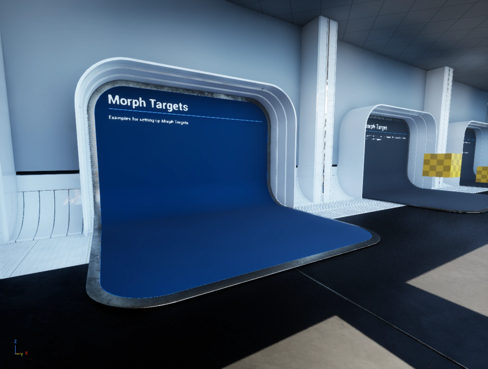
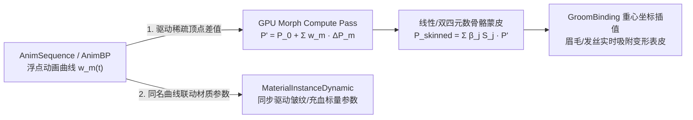
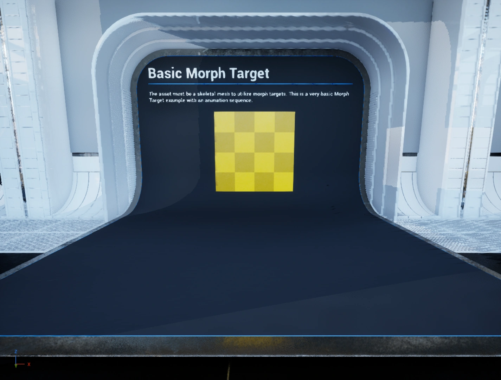
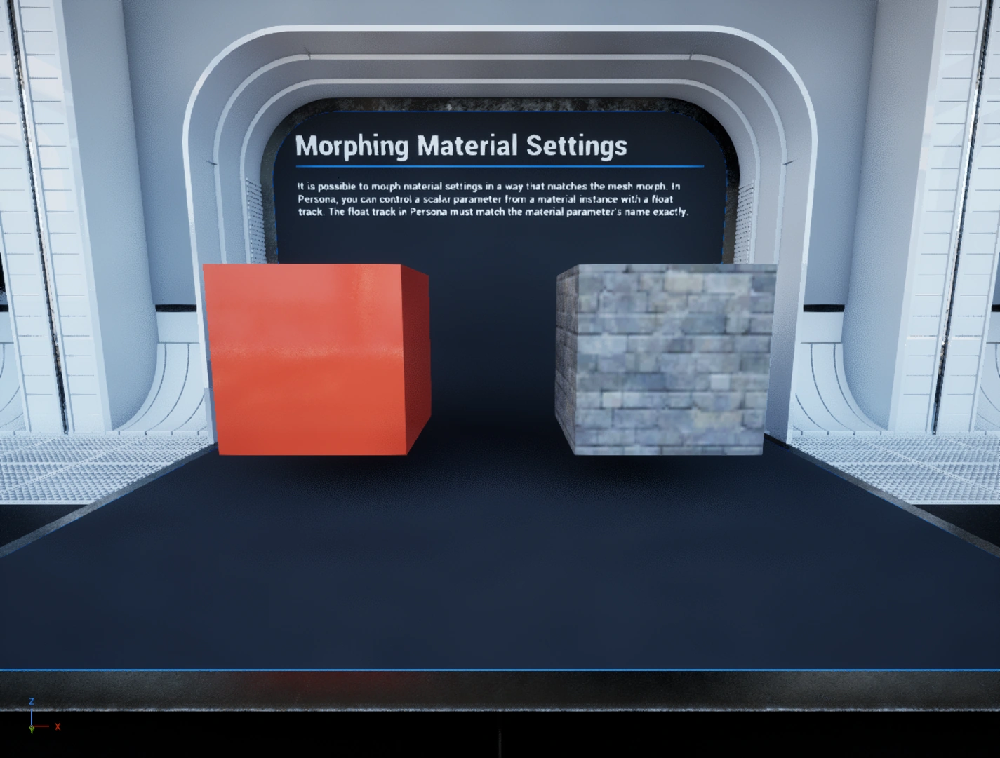
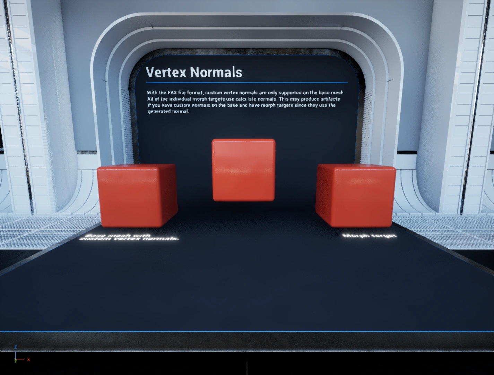

# 02 · 变形目标：稀疏顶点融合、曲线联动材质与表情微调全解（`Animation_MorphTargets`）

> **本篇实测拆解关卡档案**
> - **关卡路径**：`/Game/Maps/Animation/Animation_MorphTargets`（关卡总 Actor 数：`41` | 展台数：`6` | 示例 Actor 数：`15`）
> - **关卡脚本类**：`/Game/Maps/Animation/Animation_MorphTargets.Animation_MorphTargets_C`
> - **核心资产目录**：`/Game/ExampleContent/Morph_Targets/`（涵盖 `SK_Box_Morph_1`、`M_Morph_Material_Simple`、法线对照样本 `SK_Morph_2`）以及 `/Game/Characters/Echo/` 次世代角色面部与 Alembic 毛发绑定全套资产

---

## 一、 当刚体骨骼遇到“微表情与软组织挤压”：为什么我们需要 Morph Targets？

在上一章 `Animation_Basics` 中，我们见证了骨骼层级（Skeleton Hierarchy）驱动角色跑跳劈砍的强大威力。然而，线性混合蒙皮（Linear Blend Skinning, LBS）有一个天然的物理软肋：**每一根骨头本质上只是一个 3D 仿射刚体变换矩阵，而一个顶点的运动只能是有限几根（通常 4 到 8 根）骨头变换的加权平均**。

当你试图表现以下高频艺术细节时，纯骨骼绑定很快就会捉襟见肘：
- **影视级面部微表情（FACS BlendShapes）**：嘴角一丝若有若无的冷笑、鼻翼吸气时的微张、眼球转动顶起上眼睑的角膜隆起（Cornea Bulge）——如果全靠塞几百根微型面部骨骼去刷权重，不仅权重过渡极难雕刻出精准的苹果肌体积挤压感，还会让 CPU 骨骼矩阵链求值开销暴涨；
- **关节弯曲矫正（Joint Corrective Morphs / JCMs / Pose Driver）**：手肘弯曲 $130^\circ$ 时，二头肌充血隆起、肘窝皮肤折叠而不互相穿模，这是纯旋转骨骼永远刷不出来的非线性体积保持（Volume Preservation）；
- **角色捏脸与体型定制（Character Customization）**：高鼻梁、宽下颌、精灵尖耳的无级滑杆混合。

**变形目标（Morph Targets，在 Maya 中称为 Blend Shapes，在 Blender 中称为 Shape Keys）** 正是为解决逐顶点艺术雕刻而生！今天我们走进小巧却字字珠玑的 **`/Game/Maps/Animation/Animation_MorphTargets`**（全长 50 米，包含 **6 座精炼展台与 15 个示例 Actor**），从底层稀疏顶点数据结构一路拆到次世代主角 Echo 的眼球微动与 4.3 万根发丝实时跟随！

### 1.1 Morph Target 的底层稀疏数学方程与 GPU 管线执行时序

很多美术同学担心：“我的主角头部有 `40,000` 个顶点，做了 `150` 个表情 BlendShape，是不是意味着内存里要把 `40,000` 个顶点的完整模型复制 `150` 份？！”
**完全不会！虚幻引擎在导入时会自动执行“稀疏差值压缩（Sparse Vertex Delta Compression）”！**

1. **导入期稀疏剔除（`FMorphTargetLODModel` / `FMorphTargetDelta`）**
   设基础网格体（Base Mesh）中第 $v$ 个顶点的原始模型空间坐标为 $\mathbf{P}_{0, v}$、切线空间法线为 $\mathbf{N}_{0, v}$；第 $m$ 个变形目标在 DCC 软件中雕刻后的顶点坐标为 $\mathbf{P}_{m, v}$、法线为 $\mathbf{N}_{m, v}$。引擎导入器计算差值向量：
   $$\Delta \mathbf{P}_{m, v} = \mathbf{P}_{m, v} - \mathbf{P}_{0, v}, \qquad \Delta \mathbf{N}_{m, v} = \mathbf{N}_{m, v} - \mathbf{N}_{0, v}$$
   凡是位移模长 $\|\Delta \mathbf{P}_{m, v}\| \le \epsilon_{\text{threshold}}$（默认极小阈值，例如“眨左眼”时后脑勺、脖子、右脸那 `97%` 根本没动过的顶点！）会被**直接剔除丢弃**！内存与显存 Buffer 中仅以紧凑结构体 `(uint32 SourceIdx, FVector3f PositionDelta, FVector3f TangentZDelta)` 存储真正发生形变的稀疏顶点子集！
2. **运行期线性叠加（蒙皮前模型空间求值！）**
   这里有一条决定成败的管线时序铁律：**Morph Target 永远在骨骼蒙皮（Skinning）之前、在局部未蒙皮模型空间（Pre-Skinned Local Space）内完成线性累加！**
   给定当前帧动画曲线输出的 $M$ 个活跃变形权重 $w_1(t), w_2(t), \dots, w_M(t)$（通常在 $[0, 1]$，但数学上完全支持负数反向变形或 $>1$ 的夸张超调），先在 GPU Compute Shader（现代 UE5 默认启用硬件加速变形路径 `r.MorphTarget.Mode = 1` 配合 `GPU Skin Cache`）中并行累加增量：
   $$\mathbf{P}'_v(t) = \mathbf{P}_{0, v} + \sum_{m=1}^{M} w_m(t) \cdot \Delta \mathbf{P}_{m, v}, \qquad \mathbf{N}'_v(t) = \text{normalize}\!\left(\mathbf{N}_{0, v} + \sum_{m=1}^{M} w_m(t) \cdot \Delta \mathbf{N}_{m, v}\right)$$
   随后，再将变形后的新基准顶点 $\mathbf{P}'_v(t)$ 送入骨骼蒙皮矩阵链 $S_j$：
   $$\mathbf{P}^{\text{skinned}}_v(t) = \sum_{j=1}^{K} \beta_{v, j} \, S_j(t) \cdot \mathbf{P}'_v(t)$$
   正因为“先在静止脸部模型空间算完眨眼微笑，再乘脖子骨骼旋转矩阵”，无论角色把头歪向哪个方向，眨眼的方向永远紧贴眼眶局部解剖轴，绝不会飞歪！

下面，让我们沿着坐标轴逐一精读 `Animation_MorphTargets` 全部 **6 座展台**。

---

## 二、 `Animation_MorphTargets` 逐展台（#1 ~ #6）全量实测拆解

### 展台 #1：`Morph Targets` — 物理校准级 $\pi$ 照度评测光场

- **空间元数据**：展牌 Label `BP_DemoDisplay6` | 坐标 `(505, -900, 0)`
- **官方展牌原文说明**：`Examples for setting up Morph Targets`

#### 1.1 为什么这座展厅把平行光强度精准填成了圆周率 `3.14`？
翻开 MCP 抓取的 `#1` 号展台环境光源参数，你会发现一个极富工程师浪漫色彩的细节：不同于其他展厅常用的整数 `10` 或 `6`，这里的 `DirectionalLight` 强度被精确设为了 **`3.1400001`（即圆周率 $\pi$）**！
在虚幻引擎的物理光照方程中，标准 Lambert 漫反射 BRDF 为 $f_d = \frac{\text{BaseColor}}{\pi}$。当无单位平行光照度恰好设为 $E = \pi \approx 3.14$ 时，正对光源法线表面（$\mathbf{N} \cdot \mathbf{L} = 1$）反射出的辐射亮度恰好等于 $L_o = \frac{\text{BaseColor}}{\pi} \cdot \pi = \text{BaseColor}$！这种柔和不曝白的 1:1 漫反射标定光场，搭配 `Intensity = 3` 的天光补光，最适合肉眼敏锐捕捉**顶点变形过程中微小的表面曲率起伏与法线明暗瑕疵（如 `#5` 号展台的法线断层）**！

#### 1.2 展台陈列 Actor 实测清单（共 5 个）
- **`DirectionalLight`**（`/Script/Engine.DirectionalLight`）：`Intensity = 3.1400001`，纯白光，`CastShadows = true`，`Mobility = Movable`。
- **`SkyLight`**（`/Script/Engine.SkyLight`）：`Intensity = 3`，纯白光，`CastShadows = true`，`Mobility = Movable`。
- **`SkyAtmosphere`**、**`ExponentialHeightFog`**、**`Actor`**（挂载 `ChaosDebugDrawComponent_0`）：提供完整大气散射背景与物理调试支持。

---

### 展台 #2：`Basic Morph Target` — 为什么变形目标必须挂载在骨骼网格体上？

- **空间元数据**：展牌 Label `BP_DemoDisplay1` | 坐标 `(1515, -900, 0)`
- **官方展牌原文说明**：`The asset must be a skeletal mesh to utilize morph targets. This is a very basic Morph Target example with an animation sequence.`

#### 2.1 展品解析与“单根骨头也得绑”的底层原因
展台中央陈列着 **`SK_Box_Morph`**（类 `SkeletalMeshActor`，引用网格体 **`/Game/ExampleContent/Morph_Targets/Morph_1/SK_Box_Morph_1`**，动态材质实例 `MaterialInstanceDynamic_0`），一个倒角立方体正随着动画序列曲线周期性地膨胀呼吸、在“方盒”与“圆润膨胀体”之间丝滑融合。

许多初学者常问：**“我只想做一个在桌上自己鼓包的宝箱或跳动的心脏道具，根本不需要关节扭动，为什么不能导成 `StaticMesh` 用 Morph Target？”**
原因在于虚幻引擎的渲染与求值管线边界：
1. `UStaticMesh` 的顶点缓冲区（Position / Tangent Vertex Buffer）在 GPU 上被严格视为**全静态只读常量内存**，支持极致的硬件实例化合批（ISM/HISM）与 **Nanite 虚拟微多边形几何体**，不存在逐实例每帧改写顶点的 Compute Skin Cache 通道；
2. 而 `Morph Target` 的权重求值器直接寄生在 `USkeletalMeshComponent` 的动画曲线系统（`ActiveMorphTargets` 映射表）与蒙皮计算着色器管线中。因此，哪怕你的道具没有任何弯曲关节，在 Maya/Blender 导出 FBX 时也必须至少给它创建 **1 根根骨骼（Single Root Bone）执行绑定（Bind Skin）**，并以 `Skeletal Mesh`（勾选 `Import Morph Targets`）导入引擎！
   *(注：如果你需要在成千上万个支持 Nanite 的静态网格体群落上播放顶点变形，现代工程中则会改用 **VAT —— Vertex Animation Textures 顶点动画贴图** 烘焙进材质的 `World Position Offset` 引脚。)*

> [!WARNING]
> **直线插值陷阱（Linear Path Shrinkage）：为什么不能拿单个 Morph Target 做 $90^\circ$ 闭眼？**
> 牢记公式 $\mathbf{P}'_v = \mathbf{P}_{0,v} + w \cdot (\mathbf{P}_{1,v} - \mathbf{P}_{0,v})$——每个顶点走的永远是一条**笔直的欧氏空间线段**，绝不会绕着眼球圆心走弧线！如果睁眼顶点在眼球上方，闭眼顶点在眼球下方，当权重走到一半 $w = 0.5$ 时，眼皮顶点处于两点连线正中间，会**直接割破眼球表面穿进眼珠子里**！
> **三大工业级解法**：① 用眼睑骨骼旋转走圆弧为主、Morph Target 仅做皮肤褶皱微调（即 `#6` 号展台的做法）；② 拆分为 `50% 半闭眼（向外推开弧顶）` + `100% 全闭眼` 两个分段 **In-Between Morph Targets** 用曲线接力驱动；③ 使用次世代 `ML Deformer` 神经网络拟合非线性曲面变形。

---

### 展台 #3：`Morph Target Asset` — 变形目标五件套契约与材质编译变体生死门

- **空间元数据**：展牌 Label `BP_DemoDisplay3` | 坐标 `(2495, -900, 0)`
- **展台内 3D 悬浮文字标签**：`Skeletal Mesh Asset`（左） | `Animation Sequence Asset`（右）

#### 3.1 缺一不可的“变形目标五件套”与打包失效惨案
官方展牌明确列出了在标准工作流中跑通 Morph Target 所需的 **5 类关联资产**：
1. **FBX 骨骼网格体（`Skeletal Mesh`）**：源文件中包含 BlendShape 节点，且导入设置勾选 `Import Morph Targets = true`；
2. **骨骼资产（`Skeleton`）**：注册并托管与 BlendShape 同名的动画浮点曲线元数据；
3. **物理资产（`Physics Asset`）**：用于视锥体裁剪包围盒（Bounds）计算与射线检测（**避坑重点**：如果 Morph Target 把一个很小的种子膨胀成了巨大的怪物，而物理资产球体还只有种子那么大，摄像机稍微偏一点引擎就会误判包围盒出屏，把整个怪物瞬间剔除消失！务必调大 `Bounds Scale` 或完善物理胶体！）；
4. **动画序列（`Animation Sequence`）**：包含随时间变化的 Morph 浮点曲线（当然也可在蓝图中直接调用 `SetMorphTarget("MorphName", Value)` 实时代码驱动）；
5. **勾选了 `Used with Morph Targets` 的材质（`Material`）**！

为什么第 5 条曾让无数项目在 **Editor 里好好的、一打包（Packaged Build）变形全失效或材质变黑灰棋盘格**？
因为材质编译器为了节省 Shader 体积，默认不会编译读取变形顶点流/切线流的顶点工厂变体（Vertex Factory Permutation）。在编辑器里选中模型时引擎会帮你临时自动勾选并重编 Shader，但如果你是通过代码动态加载赋给它的材质且忘记存盘勾选 `Usage -> Used with Morph Targets`（以及 `Used with Skeletal Mesh`），打包后的只读 Shader 库里找不到对应变体就会当场回退成默认灰格材质！（*注：若项目全局强制开启了 `Support Compute Skin Cache` 且走硬件计算变形通道，变形在进入材质 Vertex Shader 前已在 Compute Buffer 算完，对材质变体的耦合度有所降低，但显式勾选 `Used with Morph Targets` 依然是跨平台最稳妥的铁律！*）

#### 3.2 展台 2 个对照 Actor 与内部材质节点逐一深拆
- **左展品 `SK_Box_Morph_2`（标签 `Skeletal Mesh Asset`）**：静态陈列未赋动画的 `/Game/ExampleContent/Morph_Targets/Morph_1/SK_Box_Morph_1`，直接挂载母材质 **`/Game/ExampleContent/Morph_Targets/Morph_1/M_Morph_Material_Simple`**。
- **右展品 `SK_Box_Morph_3`（标签 `Animation Sequence Asset`）**：挂载动画序列与动态材质实例 `MaterialInstanceDynamic_0`，持续循环播放网格膨胀收缩。
- **MCP 深度拆解 `M_Morph_Material_Simple`（共 8 个材质表达式节点）**：
  - 根属性：`MD_Surface`、`BLEND_Opaque`、`MSM_DefaultLit`、`bUsedWithSkeletalMesh = true`；
  - 引脚连线：`TextureCoordinate_0` 采样黑白棋盘格贴图 `/Game/Global/Textures/T_Checker_128`（`TextureSample_0`），结合琥珀暖橙向量 `Constant3Vector_2 = (0.75, 0.388716, 0)` 与乘法系数 `Constant_2 = 0.6`，经 `LinearInterpolate_0` 送入 **`MP_BaseColor`**（用清晰的棋盘格纹理直观暴露顶点拉伸密度变化！）；同时连接 `Constant_1` 至 **`MP_Metallic`**、`Constant_0 = 0.25` 至 **`MP_Roughness`**，赋予温润高光质感。

---

### 展台 #4：`Morphing Material Settings` — 一条曲线双管齐下！同步驱动顶点变形与动态皱纹材质

- **空间元数据**：展牌 Label `BP_DemoDisplay2` | 坐标 `(3500, -900, 0)`
- **官方展牌原文说明**：`It is possible to morph material settings in a way that matches the mesh morph. In Persona, you can control a scalar parameter from a material instance with a float track. The float track in Persona must match the material parameter's name exactly.`

#### 4.1 次世代数字人微表情的核心机密：为什么光靠顶点数不够画鱼尾纹？
哪怕是影视级 MetaHuman 角色，眼角和额头的网格密度也不可能高到用真实几何顶点挤出几十条 `0.2 毫米` 宽的细碎鱼尾纹与毛孔折痕！
真正的 3A 面部管线采用的是 **“宏观体积靠 Morph Target 顶点位移 + 微观纹路靠动画曲线实时混合法线贴图/充血贴图（Animated Wrinkle & Bloodflow Maps）”**！

而虚幻引擎为此设计了一套零蓝图连线开销的**统一动画曲线分发机制（Unified AnimCurve Routing）**：
1. 在动画编辑器（原 Persona）的 `Curves` 面板中，每一条浮点曲线（如 `"Morph_Color"` 或 `"CTRL_BrowDown"`）拥有两个可同时点亮的身份标签：**`Morph Target` 标志位** 与 **`Material`（材质参数）标志位**！
2. 当这条曲线在动画序列或 AnimGraph 中每帧更新数值 $w(t)$ 时，`USkeletalMeshComponent` 在底层执行双重派发：
   - 一路将 $w(t)$ 塞进同名 Morph Target，驱动顶点膨胀变形；
   - 另一路自动在骨骼网格体的材质槽上维护动态材质实例（正如 MCP 实测抓到的 **`SK_Box_Morph_1` 上的 `MaterialInstanceDynamic_191`** 与 **`SK_Box_Morph_4` 上的 `MaterialInstanceDynamic_220`**！），并调用等效于 `SetScalarParameterValue(CurveName, w(t))` 的底层快速通道，**只要材质里的 `ScalarParameter` 名字与动画曲线名一字不差（大小写精确匹配）**，就能零代码同步驱动材质变色、高光粗糙度变化或法线贴图遮罩强度！

#### 4.2 展台 2 个示例 Actor 对照效果
观察实拍图中的 **`SK_Box_Morph_1`** 与 **`SK_Box_Morph_4`**：随着方块鼓胀成球体，表面的材质色泽与参数完全卡死在同一条曲线相位上同步渐变——膨胀到顶点时颜色最鲜亮，收缩回方块时同步褪回初态，绝无一毫秒的逻辑帧延迟！

---

### 展台 #5：`Vertex Normals` — 深扒 FBX 自定义法线与变形目标自动法线的“明暗断层惨案”

- **空间元数据**：展牌 Label `BP_DemoDisplay4` | 坐标 `(4500, -900, 0)`
- **展台内 3D 悬浮文字标签**：`Base mesh with custom vertex normals.` | `Morph target`

#### 5.1 为什么二次元角色或倒角硬表面模型一播表情，脸上就爆出一块黑斑？
这是技术美术面试与日式卡通渲染（Cel-Shading / Anime Face Normal Editing）、硬表面加权法线（Weighted Face Normals）项目中最臭名昭著的巨坑！
让我们结合展台上的 3 个对照网格体（**`test`**、**`SK_Morph_3`**、**`SK_Morph_2`**，均引用专门构造的实验网格 **`/Game/ExampleContent/Morph_Targets/Morph_2/SK_Morph_2`**）把病根彻底剖开：

1. **左模型（Base Mesh）**：美术师在 DCC 软件里对基础模型手动编辑了**自定义顶点法线（Custom Vertex Normals）**——例如二次元角色为了消除鼻梁与脸颊下方的难看阴影，常把整张脸的法线传递成球面平滑法线 $\mathbf{N}_{\text{custom}}$；或者机械硬表面通过倒角面面积加权锁死了平整大面的垂直法线。此时左模型表面高光平滑如镜。
2. **FBX 格式与导入器的历史局限**：在传统 FBX BlendShape 数据结构中，**只有 Base Mesh 完整携带了自定义法线层，而挂载在下面的各个 BlendShape 目标网格往往丢失自定义法线、退化为按面角度自动重算平滑法线 $\mathbf{N}_{\text{auto}}^{\text{morph}}$**！
3. **灾难发生（右模型激活 Morph Target 时）**：
   导入器在计算法线增量 $\Delta \mathbf{N}_v = \mathbf{N}_{\text{auto}, v}^{\text{morph}} - \mathbf{N}_{\text{custom}, v}^{\text{base}}$ 时，哪怕某个边界过渡顶点的位置只动了 `0.01 毫米`，它的目标法线却从“精心手刷的自定义法线”瞬间变成了“粗糙的几何平均法线”！一旦权重 $w > 0$，累加公式 $\mathbf{N}'_v = \text{normalize}(\mathbf{N}_{\text{custom}, v} + w \Delta \mathbf{N}_v)$ 就会把精心调好的球面平滑法线撕开一道突兀的折痕，在视口中产生刺眼的明暗跳变黑斑！

> [!TIP]
> **首席 TA 的三套现代根治方案**
> 1. **方案 A（二次元卡通脸首选）：关闭变形法线叠加！** 在导入设置或骨骼网格体资产中，对于只做微小五官平移的卡通脸，不叠加破坏性的 `TangentZDelta`（或材质中采用独立的面部球心朝向向量 `HeadForward / HeadRight` 计算 SDF 阈值阴影），彻底保住球面自定义法线。
> 2. **方案 B（写实软组织大变形首选）：开启 `GPU Skin Cache` + `Recompute Tangent`！** 在材质勾选 `Support Compute Skin Cache` 并在骨骼网格体对应材质槽（Section）将 `Recompute Tangent` 设为 **`All` 或 `Green`（通过顶点色绿通道遮罩精确指定哪些区域实时根据变形后的真实三角面重算平滑法线，哪些硬边自定义法线区域保持不动！）**。
> 3. **方案 C（次世代管线升级）：拥抱 `Interchange` 框架 / `glTF` 或 `Deformer Graph`**：绕过古老的 FBX 限制，或在第五阶段 GPU `Deformer Graph` 中按自定义拓扑权重实时重建正交切线空间。

---

### 展台 #6：`Morph Targets on Skeletal Mesh` — 次世代角色 Echo 实战：眼球牵动微变形与 4.3 万根发丝重心跟随

- **空间元数据**：展牌 Label `BP_DemoDisplay5` | 坐标 `(5500, -900, 0)`（展厅压轴角色展台）
- **展台内 3D 悬浮文字标签**：`This skeletal mesh uses morph targets for eye movement.`

#### 6.1 为什么真人转动眼珠时，不能只旋转两颗眼球骨头？
走到 `#6` 号展台前凑近端详虚幻 5 标志性女英雄 **`BP_EchoHair`**（类 `/Game/Characters/Echo/BP_EchoHair.BP_EchoHair_C`，主体网格 `/Game/Characters/Echo/Meshes/Echo`）：当她的视线上下左右灵动扫视时，她的上下眼睑、卧蚕与眼角皮肤都在随之产生细腻的牵拉与隆起！
这是因为人类的眼球并不是一颗正球体——前方的**透明角膜（Cornea）是向外凸起的**！当眼球向上看时，凸起的角膜会从内部把上眼皮顶起来；向下看时，上眼皮会自然下垂遮住半边虹膜（Eyelid Fleshy Eye Tracking）。如果只转眼球骨骼而不配合 `EyeLookUp / Down / Left / Right` 四个方向的 **眼周矫正 Morph Targets**，要么角膜直接戳穿眼皮露在外面，要么角色看起来像瞪着两颗死板的玻璃假眼珠！

#### 6.2 终极工程追问：当眉毛皮肤被 Morph Target 顶起来时，长在上面的 1,489 根独立眉毛发丝为什么没穿模悬空？
这是本展台隐藏最深的次世代技术宝藏！通过 MCP 资产深拆，我们捕获到了 `BP_EchoHair` 内部完整的 **Alembic Hair Strands（Groom 毛发系统）** 工业级装配参数：

| 组件名称 | Groom 曲线资产 | 绑定资产 (`GroomBindingAsset`) | MCP 实测曲线规模与几何精度参数 |
| :--- | :--- | :--- | :--- |
| **`EyebrowsGroom`** | `/Game/Characters/Echo/Hair/Eyebrows_L_Echo` | `Eyebrows_L_Echo_Echo_M3D_LOD0_Binding` | • 渲染发丝数 (`numCurves`): **`1,489` 根**（共 `18,839` 个曲线控制顶点！） • 物理引导线 (`numGuides`): `2,380` 根，最大长度 `1.107 cm` • 材质实例: `MI_EchoGroom_eyebrow` |
| **`HairGroom`** | `/Game/Characters/Echo/Hair/Hair_S_UpdoBuns` | `Hair_S_UpdoBuns_Echo_M3D_LOD0_Binding` | • 渲染发丝数 (`numCurves`): **`43,602` 根**（共 **`519,159` 个控制顶点**！） • 物理引导线 (`numGuides`): `3,112` 根（`50,192` 顶点），最大发长 `25.777 cm` • LOD0 线宽缩放 `thicknessScale = 1.1`，材质 `MI_EchoGroom` |

请注意两份 `GroomBindingAsset` 中完全一致的关键属性：**`groomBindingType = SkeletalMesh`**、**`targetSkeletalMesh = Echo`**、**`matchingSection = 0`**、**`numInterpolationPoints = 100`**！
如果眉毛是绑在“头骨 `head`”上的，那当眼周 Morph Target 让眉弓皮肤向上挑起 `5 毫米` 时，`head` 骨头根本没动，眉毛岂不是全陷进肉里去了？！
**`GroomBindingAsset` 的精妙之处正在于“表皮三角面重心锚定（Surface Triangle Barycentric Binding）”**：
1. 离线生成绑定资产时，引擎把每一根眉毛/头发的发根投射到 `Echo` 头部网格体最近的三角面 $\triangle(\mathbf{v}_a, \mathbf{v}_b, \mathbf{v}_c)$ 上，记录下三角面索引与**重心坐标 $(u, v, w)$**；
2. 在运行时每一帧，GPU **先算完 Morph Targets 顶点变形，再算完骨骼蒙皮**，得到变形后表皮三个顶点的实时位置 $(\mathbf{v}'_a, \mathbf{v}'_b, \mathbf{v}'_c)$ 与实时切线标架（Darboux Frame）；
3. 随后，GPU Groom 着色器通过 $\mathbf{P}_{\text{root}} = u \mathbf{v}'_a + v \mathbf{v}'_b + w \mathbf{v}'_c$ 实时重构发根世界位置与局部法线朝向！无论你的 Morph Target 把眉头皱得多紧、额头挑得多高，`1,489` 根真实几何眉毛都像长在真皮毛囊里一样分毫不差地贴合起伏！

*(注：关卡持久层另含 1 个全局空容器 `InstancedFoliageActor`。)*

---

## 三、 本章实战总结与 Morph Targets 生产管线检查表

走完 `Animation_MorphTargets` 全部 6 座展台，请收好这份角色面部与变形系统避坑核查单：

| 工程审查项 | 核心准则与最佳实践 |
| :--- | :--- |
| **1. 内存与顶点数预算** | 利用引擎原生**稀疏差值剔除**特性，严禁在制作局部表情（如左嘴角上扬）时误用全局平滑笔刷微动后脑勺顶点，确保每个 Morph Target 只污染真正形变的 `< 5%` 局部顶点！ |
| **2. 材质与包围盒安全** | 动态赋材质务必核查 **`bUsedWithMorphTargets = true`** 防止打包丢变体；大幅度体型膨胀变形务必检查 `Physics Asset` 或调大组件 `Bounds Scale` 防止视锥误剔除闪烁。 |
| **3. 动态皱纹零代码联动** | 善用同名浮点曲线同时勾选 **`Morph Target` + `Material`** 双通道标志，单条曲线同步驱动几何挤压与动态皱纹/充血法线遮罩（`MID` 标量参数）。 |
| **4. 法线黑斑与毛发吸附** | 二次元自定义法线脸慎叠 FBX 自动法线差值，写实软组织大变形配合 `GPU Skin Cache + Recompute Tangent`；Alembic 眉毛胡须务必生成 **`GroomBindingAsset`** 以获得 Morph 表皮级重心跟随。 |

至此，我们已经掌握了骨骼前向运动学（FK）与逐顶点微变形（Morph Targets）。然而在开放世界崎岖不平的台阶、斜坡与碎石上，动画师在平地上调好的精美走路动画，一上楼梯就会出现“一只脚踩空悬在半空、另一只脚插进石头里”的穿帮惨剧！下一篇，让我们走进 **`03_Animation_IKRig`**，用多目标全身逆向运动学（Full Body IK）赋予角色感知地形与精准抓取目标的物理灵魂！
