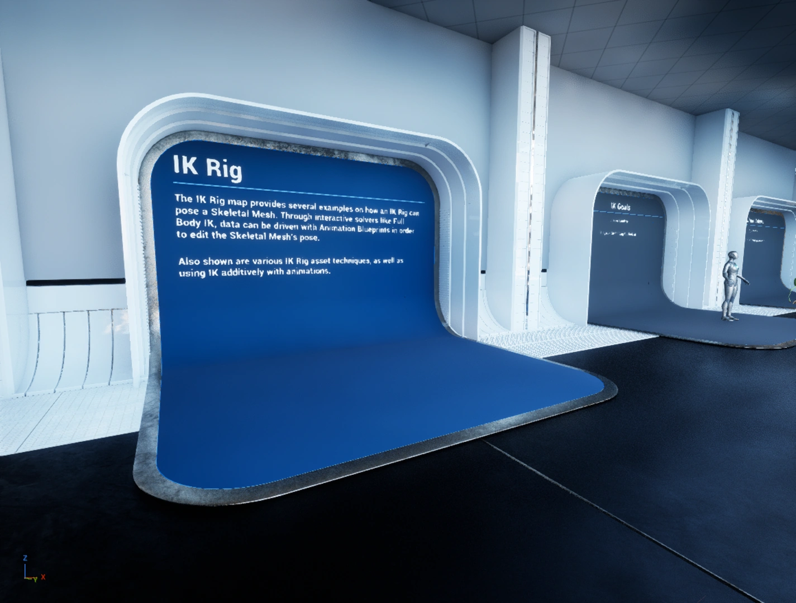
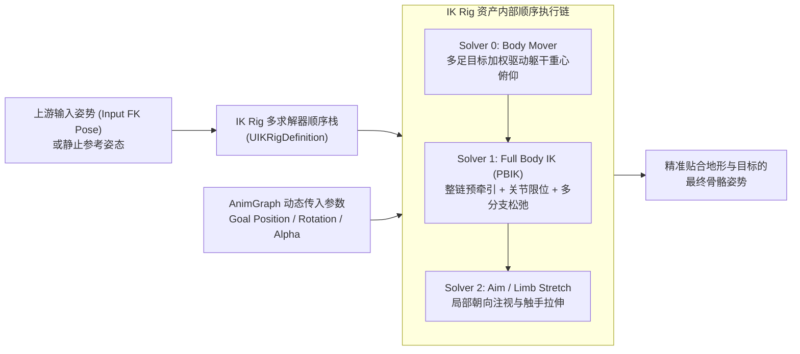
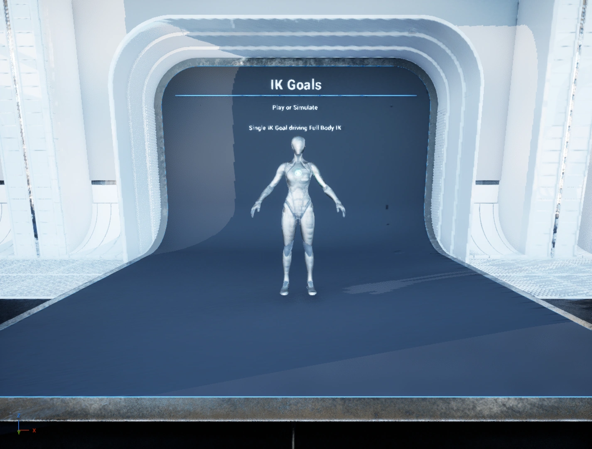
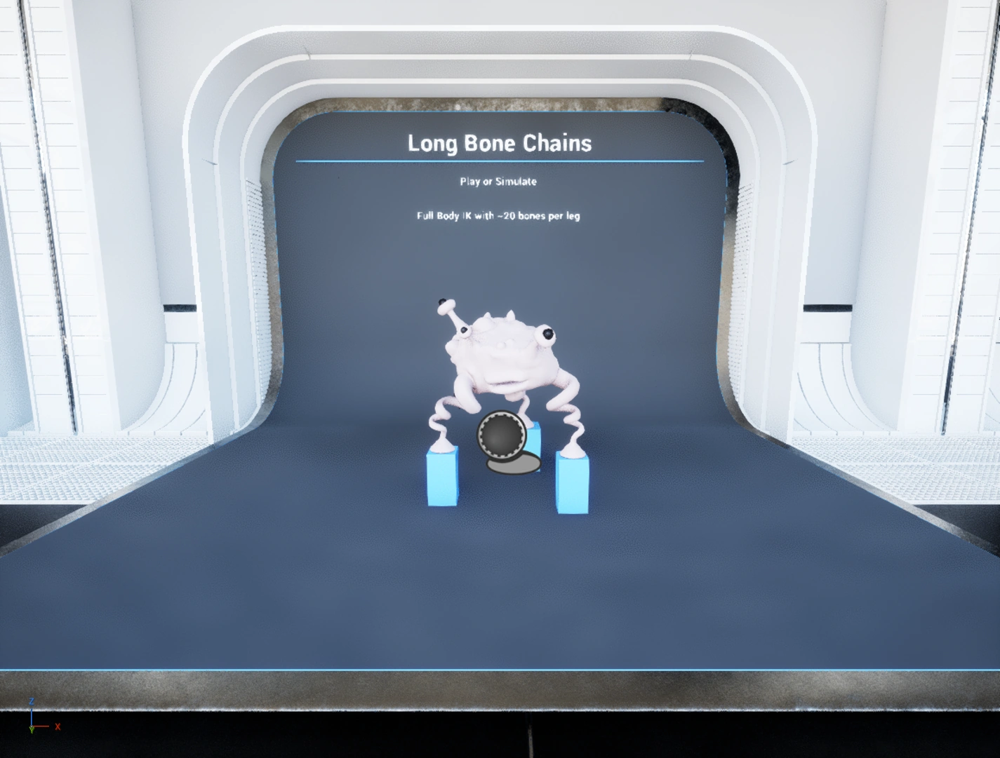
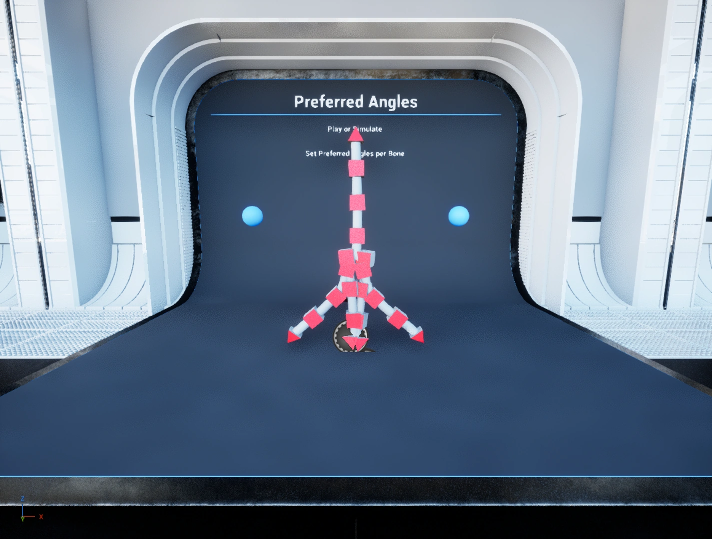

# 03 · 逆向运动学绑定：IK 目标、多求解器栈与 PBIK 全身解算全解（`Animation_IKRig`）

> **本篇实测拆解关卡档案**
> - **关卡路径**：`/Game/Maps/Animation/Animation_IKRig`（关卡总 Actor 数：`48` | 展台数：`16` | 示例 Actor 数：`18`）
> - **关卡脚本类**：`/Game/Maps/Animation/Animation_IKRig.Animation_IKRig_C`（属性：`{"oldPawn": "None"}`）
> - **核心资产目录**：`/Game/ExampleContent/IKRig/`（涵盖人类 `SKM_Quinn_Simple` / `SKM_Manny_Simple`、八足蜘蛛 `SK_Spider`、弹簧长腿怪 `SK_Spelunkle`、螺旋弹簧 `SK_Helix`、关节机器人 `SK_CylinderRobot`、五腕海星 `Starfish`、恐龙飞龙 `SK_DinoDragon`、弹性触手 `tentacle` 等 8 大异构生物测试架及配套 `ABP_*` 动画蓝图库）

---

## 一、 从“死记硬背关键帧”到“实时感知物理世界”：为什么逆向运动学（IK）是 3A 角色的灵魂？

在前两章中，无论是 `BlendSpace` 还是 `AnimMontage`，角色本质上都在执行**前向运动学（Forward Kinematics, FK）**——给定父骨骼旋转角度 $\theta_1$、大臂角度 $\theta_2$、小臂角度 $\theta_3$，顺着矩阵链一路往下乘，指尖最后停在哪儿全凭动画师在平地空房间里调出来的死数据：
$$\mathbf{x}_{\text{end}} = \mathbf{f}(\theta_1, \theta_2, \dots, \theta_n) = \text{Translation}\!\left(\prod_{k=1}^{n} M_k^{\text{local}}(\theta_k)\right)$$

但真实的游戏世界从来不是一块无限平坦的玻璃地板！一旦角色走进高低起伏的乱石滩、斜坡台阶，或者需要伸手去捡桌子上随机掉落的一把钥匙、与身高比自己矮半头的 NPC 握手时，纯 FK 立刻原形毕露：**上坡时前脚直接插进岩石里，下台阶时后脚踩在半空悬空乱蹬，捡东西时手掌离钥匙差了二十厘米抓了个寂寞！**

这时，我们必须把数学方程反过来求——**已知末端骨骼必须抵达的世界/组件目标坐标 $\mathbf{x}_{\text{goal}}$，反向解算出整条骨骼链乃至全身躯干最自然合理的关节旋转角向量 $\boldsymbol{\theta}^* = \mathbf{f}^{-1}(\mathbf{x}_{\text{goal}})$**！这就是**逆向运动学（Inverse Kinematics, IK）**。

在 UE4 时代，开发者往往只能在 AnimGraph 里零散拼凑 `Two Bone IK`（仅限两节骨头的余弦定理解析解）或早期的 `FABRIK`。而在虚幻引擎 5 中，官方推出了革命性的资产化全身逆向运动学框架——**`IK Rig`（`UIKRigDefinition`）及其核心引擎 `PBIK`（Position-Based Inverse Kinematics，基于位置约束的全身刚体迭代求解器）**！它不仅是实时脚步地形自适应、动态伸手抓取、怪物长链触手模拟的利器，更是下一章 **`IK Retargeter`（跨体型任意拓扑动画重定向）** 的底层骨架基座！

### 1.1 直击数学内核：从阻尼伪逆雅可比（DLS）到 UE5 原生 PBIK 位置约束迭代

为什么“全身多目标 IK（Full Body IK）”在数学上远比两节骨头的腿部 IK 难上百倍？因为人体的脊柱在腰部和胸口分叉连接着**左臂、右臂、头颈、左腿、右腿五条相互拉扯的耦合分支树**，自由度高达 $60+$ 个，属于高度欠定（Hyper-Redundant）且带强非线性关节角度硬约束的优化问题！

在工业界，求解全身多目标 IK 主要有两大数学流派，理解它们能让你一眼看透 `IK Rig` 面板里每一个参数的物理本质：

1. **经典微分运动学流派：阻尼最小二乘伪逆雅可比（Damped Least Squares / Levenberg-Marquardt）**
   将非线性正向映射 $\mathbf{x} = \mathbf{f}(\boldsymbol{\theta})$ 在当前姿态附近做一阶泰勒展开 $\Delta \mathbf{x} \approx J(\boldsymbol{\theta}) \Delta \boldsymbol{\theta}$，其中雅可比矩阵（Jacobian Matrix）的第 $k$ 列由第 $k$ 根关节的旋转轴单位向量 $\boldsymbol{\omega}_k$ 与力臂叉积直接给出：
   $$J_k = \frac{\partial \mathbf{x}_{\text{end}}}{\partial \theta_k} = \boldsymbol{\omega}_k \times (\mathbf{p}_{\text{end}} - \mathbf{p}_k)$$
   为防止骨骼完全伸直（$\mathbf{p}_{\text{end}} - \mathbf{p}_k$ 与轴共线或退化）时 $J J^T$ 奇异不可逆引发关节角速度爆炸抽搐，引入阻尼因子 $\lambda > 0$ 求解正规方程：
   $$\Delta \boldsymbol{\theta} = J^T \left(J J^T + \lambda^2 I\right)^{-1} (\mathbf{x}_{\text{goal}} - \mathbf{x}_{\text{current}})$$
2. **UE5 `Full Body IK` 原生流派：基于位置的刚体约束解算（PBIK / XPBD 架构）**
   传统雅可比法在处理**硬角度边界限制（Hinge / Cone Joint Limits，例如膝盖严禁向后反折）**和长链大位移时收敛慢且容易震荡。因此，UE5 内置的 `Full Body IK`（底层源码位于 `PBIK` 模块 `FPBIKSolver`）创造性地引入了现代物理引擎 **XPBD（Extended Position-Based Dynamics）** 的刚体子步迭代思想：
   - **刚体化建模**：将参与求解的每一节骨骼视为拥有空间位置 $\mathbf{p}_i$ 与朝向四元数 $\mathbf{q}_i$ 的微型刚体连杆，定长骨骼间距写成等式距离约束 $C_{\text{dist}}(\mathbf{p}_i, \mathbf{p}_{p(i)}) = \|\mathbf{p}_i - \mathbf{p}_{p(i)}\| - L_i = 0$；
   - **三阶段极速收敛循环**：
     1. **整链预牵引（`Pre Pull` / `Pull Chain Alpha`）**：在进入细粒度逐关节松弛前，先将末端 Goal 的大跨度位移按权重转化为整条骨骼链绕根节点的刚体整体旋转，一举消除 $80\%$ 的宏观距离误差（展台 `#8~#10` 专门演示此项！）；
     2. **优先角预偏置（`Preferred Angles`）**：当检测到骨骼链受压趋于共线奇异态时，主动沿解剖学倾向角注入微弯偏置，充当天然的层级极向量（Pole Vector，展台 `#12` 专门演示此项！）；
     3. **高斯-赛德尔投影松弛（Gauss-Seidel Constraint Projection）**：在每次 `Iteration` 内双向遍历骨骼树，交替投影末端 `Effector Goal` 吸引约束、骨骼刚体定长约束与逐轴欧拉/摆动扭转角度硬钳制（`Bone Limits` & `Stiffness`，展台 `#11` 专门演示此项！），最终反算出精确无拉伸的骨骼局部旋转四元数！

整张 `Animation_IKRig` 关卡共设 **16 座编号展台（`#1` ~ `#16`）**，其中包含两组精妙的“主展牌 + 前排多子展台并排对照阵列”（`#3~#6` 八足蜘蛛多求解器对照阵、`#8~#10` 螺旋弹簧牵引强度对照阵）。下面让我们严格按展台编号 **`#1` 至 `#16`** 逐一拆解每一台实验装置！

---

## 二、 `Animation_IKRig` 逐展台（#1 ~ #16）全量实测拆解

### 展台 #1：`IK Rig` — 交互式逆向运动学总览与评测环境配置

- **空间元数据**：展牌 Label `BP_DemoDisplay8` | 坐标 `(500, -900, 0)`
- **官方展牌原文说明**：`The IK Rig map provides several examples on how an IK Rig can pose a Skeletal Mesh. Through interactive solvers like Full Body IK, data can be driven with Animation Blueprints in order to edit the Skeletal Mesh's pose. Also shown are various IK Rig asset techniques, as well as using IK additively with animations.`

#### 1.1 `UIKRigDefinition` 资产与 `AnimNode_IKRig` 运行时分离设计
与把所有逻辑写死在动画蓝图里的旧式节点不同，UE5 将**“骨架拓扑约束规则（静态配置）”**与**“每帧目标坐标输入（运行时驱动）”**解耦为两层：
- **离线资产层（`IK Rig` 编辑器）**：指定预览骨骼网格体，定义 **Solver Root（求解根骨骼）**、创建 **IK Goals（末端效应器目标）**、挂载一个或多个 **Solvers（求解器栈）**、为特定关节配置刚度与角度限位（Bone Settings），以及标记用于重定向的骨骼链（Retarget Chains）。
- **运行时动画图层（`IK Rig` AnimGraph 节点）**：引用该 `IK Rig` 资产，将选定的 Goal 属性（如 `hand_r_Goal` 的 `Position` 与 `Position Alpha`）暴露为引脚，由游戏蓝图或射线检测每帧喂入实时坐标！

#### 1.2 展台陈列 Actor 实测清单（共 5 个）
- **`DirectionalLight`**（`Intensity = 10`，纯白光，`Movable`，`CastShadows = true`）、**`SkyLight`**（`Intensity = 3`，`Movable`）、**`SkyAtmosphere`**、**`ExponentialHeightFog`** 以及挂载 `ChaosDebugDrawComponent_0` 的 **`Actor`**，构成清晰锐利的几何阴影观察场（以便直观看清脚掌与台阶的接触间隙）。

---

### 展台 #2：`IK Goals` — 单一 IK 目标如何牵一发而动全身？

- **空间元数据**：展牌 Label `BP_DemoDisplay` | 坐标 `(1502, -900, 0)`
- **官方展牌原文说明**：`Play or Simulate Single IK Goal driving Full Body IK`

#### 2.1 为什么拉动右手一个点，Quinn 的肩膀、胸椎和腰胯全都跟着自然侧倾？
在传统的 `Two Bone IK` 里，无论你把目标球拉到十米开外，大臂和小臂最多伸成一条僵硬的死直线，锁骨和脊柱连 `0.1°` 都不会动。
而在展台 `#2` 的 **`BP_IKGoals`**（挂载女性标准角色 **`/Game/Characters/Mannequins/Meshes/SKM_Quinn_Simple`** 与动画蓝图 **`/Game/ExampleContent/IKRig/AnimBlueprints/ABP_IKGoals`**，另有场景可见性体积 `PrecomputedVisibilityVolume1`）中，当你点击运行（Play / Simulate）观察动态巡游的 `Position` 变量牵引单个手部 IK Goal 时，奇迹发生了：
- 随着手部 Goal 向身体远端移动，先是小臂与大臂舒展；紧接着锁骨（`clavicle`）前送，胸椎与腰椎（`spine_05 -> spine_01`）顺势弯曲侧倾，同时为了维持下盘稳定，双脚与骨盆呈现出自然的反向锚定张力！
- **核心参数机密——`Root Behavior`（求解根骨骼行为模式）**：在 `Full Body IK` 求解器设置中，通常将 `pelvis`（或 `spine_01`）指定为 **Solver Root**，其行为有三种档位：
  1. **`Pre Pull`（默认推荐）**：当某个肢体 Goal 超出单臂臂展极限时，允许按比例整体平移和旋转根骨骼去迎合目标，实现最逼真的全身倾身伸展；
  2. **`Pin to Input`（钉死在输入动画位置）**：严格锁死根骨骼不许平移，只允许根骨骼以上的子关节旋转弯曲（适合坐姿或下半身已有严密动作锁定的场合）；
  3. **`Free`（完全自由浮动）**：根骨骼不受原输入位置束缚，随各末端 Goal 合力自由移动（需配合双脚 Goal 钉死地面使用）。

---

### 展台 #3：`Multiple Solvers` — 多求解器顺序级联栈（Solver Stack）总纲

- **空间元数据**：展牌 Label `BP_DemoDisplay7` | 坐标 `(2505, -900, 0)`（后排主展牌，统领前排 `#4`、`#5`、`#6` 三座子展台！）
- **官方展牌原文说明**：`Play or Simulate Use Any Number of Different Types of Solvers`

#### 3.1 为什么一个 `IK Rig` 里允许像图层一样上下叠放多个不同类型的求解器？
许多复杂多足生物（如蜘蛛、螃蟹、四足机甲）面临一个两难困境：
- 如果只调整**躯干重心**而不算腿部关节，脚掌会悬空脱靶；
- 如果只算**腿部关节全身 IK** 而不主动预调躯干倾角，当左边四条腿踩在高坡、右边四条腿踩在低谷时，蜘蛛的肚子还端端正正水平悬着，导致右边四条腿被拉扯到极限崩直，左边四条腿蜷缩顶穿甲壳！

为此，UE5 将 `IK Rig` 内部的求解器列表设计成了一条**严格按上下顺序串行执行的流水线（Sequential Solver Stack）**：排在第 0 位的求解器先读取输入姿势并输出粗调姿态，排在第 1 位的求解器无缝接力在第 0 位的输出基础上完成精调！
为了直观证明“1 + 1 > 2”的级联威力，官方在展台 `#3` 正前方（`Y = -643`）放置了集成蓝图 **`/Game/ExampleContent/IKRig/Blueprints/BP_MultipleSolvers`**（内部同步驱动 `Foot Offset` 变量，并排挂载三只八足蜘蛛网格体 **`/Game/ExampleContent/IKRig/Mesh/Spider/SK_Spider`**），分别对应前排 `#5`、`#4`、`#6` 三座独立子展牌！让我们逐一上前验看这三只蜘蛛的表现差异。

---

### 展台 #4：`Body Mover` — 仅启用躯干移动求解器：八足合力驱动甲壳重心俯仰

- **空间元数据**：展牌 Label `BP_DemoDisplay12` | 坐标 `(2505, -643, 0)`（多求解器实验组中央子展台）

#### 4.1 展品组件与 `Body Mover` 求解器底层数学拆解
本展台对应 `BP_MultipleSolvers` 中的中央蜘蛛组件 **`SKM_BodyMover`**，由动画蓝图 **`/Game/ExampleContent/IKRig/AnimBlueprints/ABP_BodyMover`**（成员变量 `["FootOffset"]`）驱动，其关联的 `IK Rig` 资产内**仅单独启用了一个 `Body Mover` 求解器**。

**`Body Mover` 在算什么？** 它根本不去解算任何一条蜘蛛腿的膝关节弯曲，而是把绑在八只脚尖上的 8 个 `IK Goals` 当作 **8 根牵引弹簧绳，共同拉拽并倾斜蜘蛛的核心躯干骨骼（Body / Pelvis Root）**：
$$\Delta \mathbf{t}_{\text{body}} = \alpha_{\text{pos}} \cdot \frac{1}{N} \sum_{i=1}^{N} \mathbf{M}_{\text{axis}} \odot \left(\mathbf{g}_i - \mathbf{p}_{i, \text{init}}\right)$$
同时根据左右侧、前后侧脚掌目标的高低落差计算力矩，乘上 `Rotation Multiplier` 自动赋予蜘蛛甲壳顺应地形坡度的**俯仰角（Pitch）与侧倾角（Roll）**！
- **实测视觉表现**：当 `FootOffset` 上下起伏时，这只蜘蛛的身体甲壳非常聪明地跟着上下浮动、左右摇摆倾斜；但由于没有后续腿部 IK 求解器，它的八条腿相对于身体甲壳像塑料玩具一样僵硬不动，脚尖无法精准钉在地面目标点上。

---

### 展台 #5：`Full Body IK` — 仅启用全身 IK 求解器：躯干迟钝引发的肢体过度拉扯

- **空间元数据**：展牌 Label `BP_DemoDisplay9` | 坐标 `(2254, -643, 0)`（多求解器实验组左侧子展台）

#### 5.1 为什么单跑 `Full Body IK` 的蜘蛛看起来有点“死板费劲”？
左侧子展台对应组件 **`SKM_FBIK`**，由动画蓝图 **`/Game/ExampleContent/IKRig/AnimBlueprints/ABP_FBIK`**（成员变量 `["FootOffset"]`）驱动，内部**仅单独启用了 `Full Body IK` 求解器**（未加 `Body Mover`）。
- **实测视觉表现**：这一次，蜘蛛的八只脚尖倒是死死踩准了目标偏移位置，腿部关节努力屈伸；但仔细观察它的中央躯干甲壳——只要腿长还够得着，躯干就懒洋洋地端在原位不肯主动随地形倾斜，导致低处的腿被拉得笔直紧绷、高处的腿憋屈地高高拱起，失去了节肢动物贴地潜行的灵动机械美感！

---

### 展台 #6：`Body Mover & Full Body IK` — 双剑合璧：先调躯干倾角、再锁八足落点的工业级多足范式

- **空间元数据**：展牌 Label `BP_DemoDisplay13` | 坐标 `(2755, -643, 0)`（多求解器实验组右侧子展台）

#### 6.1 `Solver[0]: Body Mover` $\rightarrow$ `Solver[1]: Full Body IK` 黄金流水线
右侧子展台对应组件 **`SKM_MultipleSolvers`**，由动画蓝图 **`/Game/ExampleContent/IKRig/AnimBlueprints/ABP_MultipleSolvers`**（成员变量 `["FootOffset"]`）驱动，内部将两座求解器按黄金顺序串联：
1. **第一棒（`Body Mover`）**：读取 8 个脚尖 Goal 的空间分布，率先把蜘蛛中央躯干平移并倾斜到最省力的平衡平面上，提前消化掉大部分地形高差与斜率；
2. **第二棒（`Full Body IK`）**：在躯干已经优雅顺应坡度的基础上，微调八条腿的三节关节，让每一只脚爪严丝合缝钉在目标点上！
- **实战结论**：凡制作**四足兽类（马、狼、怪猎龙类）、六足昆虫、八足蜘蛛或星际多足步行机甲**的地形自适应系统，**`Body Mover + Full Body IK` 双求解器级联是绝对的行业标准答案**！

---

### 展台 #7：`Long Bone Chains` — 单腿约 20 节骨骼！超冗余长链条的毫秒级稳定收敛

- **空间元数据**：展牌 Label `BP_DemoDisplay10` | 坐标 `(3489, -900, 0)`
- **官方展牌原文说明**：`Play or Simulate Full Body IK with ~20 bones per leg`

#### 7.1 当总关节数突破 60 大关：PBIK 如何驯服弹簧腿怪兽 `SK_Spelunkle`？
走到 `#7` 号展台前，你会看到一只造型奇特的三足弹簧腿生物 **`BP_LongBoneChains`**（实例名 `Spelunkle_SpringLeg_Actor_C_1`，挂载网格体 **`/Game/ExampleContent/IKRig/Mesh/Spelunkle/SK_Spelunkle`** 与动画蓝图 **`ABP_LongBoneChains`**）。
在它脚下踩着三块独立上下浮动的高台方块：**`LeftFrontPedastal`**、**`RightFrontPedastal`** 与 **`RearPedastal`**（统一赋有宝蓝色目标标识材质 **`/Game/ExampleContent/IKRig/Materials/IK_Target`**，MCP 实测内部由单节点 `MaterialExpressionVectorParameter_0 "Param" = (0, 0.215665, 1, 0)` 直连 `MP_BaseColor`），蓝图实时将三块踏板的位移数组 `IKGoalOffsets[3]` 传给 `ABP_LongBoneChains`。

**技术震撼点**：这只生物的**每一条腿都由大约 `20` 根串联骨骼组成**，三条腿加上躯干总计超过 **`60` 根活跃解算骨骼**！
- 在传统雅可比矩阵求逆法中，$60$ 根 3-DOF 骨骼意味着维度高达 $180$ 的稠密矩阵运算，极易掉入局部极小值抖动；
- 而在 UE5 的 `PBIK` 中，每次迭代复杂度严格关于骨骼数呈 **$O(N)$ 线性增长**！通过合理配置求解器的 `Iterations`（默认 `30`，超长链可微调至 `30~50`）与 `Mass Multiplier`（质量乘数调整相邻链节动量传递惯性），三条各含 20 节骨头的弹簧长腿如同真实的金属减震弹簧般均匀压缩与舒展，零穿透、零高频震颤！

---

### 展台 #8：`Chain Pull Strength` — 链牵引强度（`Pull Chain Alpha`）的底层矢量重分布原理

- **空间元数据**：展牌 Label `BP_DemoDisplay1` | 坐标 `(4501, -900, 0)`（后排主展牌，统领前排 `#9` 与 `#10` 两座螺旋弹簧对照子展台！）
- **官方展牌原文说明**：`Play or Simulate`

#### 8.1 什么是 `Pull Chain Alpha`？为什么触手、鞭子与钢铁机械臂需要完全不同的牵引系数？
在 `Full Body IK` 的每一个末端 `Effector`（效应器）属性面板里，都有一个极其关键的滑杆参数：**`Pull Chain Alpha` $\in [0, 1]$（默认值 `1.0`）**。
设该分支链条的起始父关节位置为 $\mathbf{p}_{\text{root}}$，进入求解前的初始末端位置为 $\mathbf{p}_{\text{end}}^0$，当前目标点为 $\mathbf{g}$。
- 在逐关节局部松弛迭代开始前，`PBIK` 会计算从初始弦向量 $\mathbf{v}_0 = \mathbf{p}_{\text{end}}^0 - \mathbf{p}_{\text{root}}$ 转向目标弦向量 $\mathbf{v}_{\text{goal}} = \mathbf{g} - \mathbf{p}_{\text{root}}$ 的整体刚体旋转四元数 $Q_{\text{chord}}$ 与长度比例缩放，然后按 **`Pull Chain Alpha`** 的权重预先把整条骨链旋转平移过去！
为了直观对比它的戏剧性差异，官方在前排放置了 **`/Game/ExampleContent/IKRig/Blueprints/BP_ChainPullStrength`**（实例名 `Helix_Pull_Actor_C_1`，共享动态向量 `IKGoalOffset`，并排驱动两根多圈螺旋弹簧骨骼网格体 **`/Game/ExampleContent/IKRig/Mesh/Helix/SK_Helix`**），分别对应 `#9` 与 `#10` 子展台！

---

### 展台 #9：`Low Pull Strength` — 低牵引强度（`Pull Chain Alpha ≈ 0`）：梢端优先卷曲的软鞭/象鼻效应

- **空间元数据**：展牌 Label `BP_DemoDisplay16` | 坐标 `(4350, -622, 0)`（链牵引实验组左侧子展台）

#### 9.1 展品组件与局部波浪传导特性解析
左侧子展台对应组件 **`SkeletalMesh_LowPullStrength`**，由动画蓝图 **`/Game/ExampleContent/IKRig/AnimBlueprints/ABP_LowPullStrength`**（成员变量 `["IKGoal Offset"]`）驱动，内部将末端效应器的 `Pull Chain Alpha` 调至极低（接近 **`0.0`**）。
- **物理与视觉表现**：关闭了整链预牵引后，目标点移动产生的拉力只能从螺旋弹簧的最顶端第 $N$ 节骨头开始，像多米诺骨牌一样一节一节往下游传导！结果就是：**靠近尖端的几圈弹簧剧烈扭曲弯折去够目标，而靠近底座根部的下半截弹簧几乎稳坐钓鱼台纹丝不动**！
- **实战绝配场景**：章鱼触手尖端卷取猎物、大象鼻子末端卷树叶、毒蛇昂头转向、长辫子末梢摆动等**“根部沉重稳定、梢端灵巧卷曲”**的柔性生物器官！

---

### 展台 #10：`High Pull Strength` — 高牵引强度（`Pull Chain Alpha = 1`）：全局均匀受力的刚韧弹簧效应

- **空间元数据**：展牌 Label `BP_DemoDisplay17` | 坐标 `(4650, -622, 0)`（链牵引实验组右侧子展台）

#### 10.1 展品组件与全局协同摆动特性解析
右侧子展台对应 `BP_ChainPullStrength` 中的组件 **`SkeletalMesh_HighPullStrength`**，由动画蓝图 **`/Game/ExampleContent/IKRig/AnimBlueprints/ABP_HighPullStrength`**（成员变量 `["IKGoal Offset"]`）驱动，保持高牵引权重 **`Pull Chain Alpha = 1.0`**。
- **物理与视觉表现**：随着顶部目标球左右前后牵引，从底座第 1 节骨头到最顶端最后一节骨头，**整根螺旋弹簧像一根浑然一体的高弹汽车悬挂弹簧一样整体均匀倾斜、各圈间距平均张开与闭合**，没有任何局部死折！这也是人类四肢手臂与腿部链条默认采用 `1.0` 的原因——伸手拿水杯时大臂与小臂总是协同发力，绝不会大臂贴死肋骨只折手腕！

---

### 展台 #11：`Bone Limits` — 逐骨骼旋转角度硬钳制与刚度分配：拒绝膝盖反折与机械穿模！

- **空间元数据**：展牌 Label `BP_DemoDisplay2` | 坐标 `(5516, -900, 0)`
- **官方展牌原文说明**：`Play or Simulate Set Rotation limits per Bone`

#### 11.1 如何把万能球窝关节改造成精密的工业铰链与解剖学单向关节？
无约束的 IK 求解器只关心“怎么最快够到目标点”，它完全不懂人类解剖学和机械结构——如果不加限制，它随时会把角色的膝盖像鸵鸟一样往前反折 $90^\circ$，或者把液压挖掘机的圆柱转轴往侧向掰断！

展台 `#11` 陈列着机械圆柱机器人 **`ABP_BoneLimits`**（`SkeletalMeshActor`，挂载网格体 **`/Game/ExampleContent/IKRig/Mesh/CylinderRobot/SK_CylinderRobot`** 与动画蓝图 **`/Game/ExampleContent/IKRig/AnimBlueprints/ABP_BoneLimits`**，成员变量 `["End Goal Position"]`）。观察圆柱机器人在追踪旋转移动目标时的严谨姿态：每一节圆柱转轴都严格只绕自身机械轴承轴向旋转，绝无半点侧向歪斜！

这正是通过在 `IK Rig` 中右键点击指定骨骼 $\rightarrow$ **`Add Settings to Selected Bones`** 创建 `UIKRigPBIKBoneSettings` 实现的：
1. **三轴独立自由度开关（`X / Y / Z`：`Free` | `Limited` | `Locked`）**：
   - 将非轴承的两个旋转轴直接设为 **`Locked`（锁死 0 自由度）**，瞬间将 3-DOF 球铰链降维成绝对纯正的 **1-DOF 机械合页（Hinge Joint）**！
   - 将主弯曲轴设为 **`Limited`**，精确填入 `[Min Angle, Max Angle]`（例如人类膝关节 `calf_l` 限制在 `[0°, 145°]`，彻底杜绝任何 `< 0°` 的膝盖反向过伸惨案！）。
2. **关节旋转刚度（`Rotation Stiffness` $\in [0, 1]$）**：值越接近 `1.0`，该关节越“硬、越抗拒转动”，迫使相邻更柔软的关节优先承担弯曲角度（例如给胸椎设 `0.8` 高刚度、颈椎设 `0.2` 低刚度，转头时就会自然脖子先转、胸口微动！）。

---

### 展台 #12：`Preferred Angles` — 优先倾向角：优雅破解共线奇异态（Straight-Chain Singularity）！

- **空间元数据**：展牌 Label `BP_DemoDisplay3` | 坐标 `(6500, -900, 0)`
- **官方展牌原文说明**：`Play or Simulate Set Preferred Angles per Bone`

#### 12.1 数学奇点剖析：为什么笔直的骨头被往回顶时，会失控乱弹（IK Popping）？
观察实拍图中的可爱粉色五腕海星 **`BP_PreferredAngles`**（实例名 `PreferredAngles_Actor_C_1`，网格体 **`/Game/ExampleContent/IKRig/Mesh/Starfish/Starfish`**，动画蓝图 **`ABP_PreferredAngles`**，两侧配有蓝色目标球组件 **`IKTargetLeft`** 与 **`IKTargetRight`** 沿着 `LeftGoalPoint` / `RightGoalPoint` 往海星身体中心挤压）。

想一想：海星初始绑定姿态（Bind Pose）的五条腕足是**100% 笔直呈放射状伸展的（相邻骨骼夹角严格为 $0^\circ$）**！
当蓝色目标球沿着腕足轴线正方向往海星肚子方向直直往里推（轴向压缩）时，从数学上看：向“前”拱起弯曲和向“后”凹陷弯曲所需的能量 **100% 对称相等**；更致命的是，在完全笔直的瞬间，力臂向量 $(\mathbf{p}_{\text{end}} - \mathbf{p}_k)$ 与推力共线，法平面所有方向的梯度一阶导数全对称退化！如果不加人工干预，今天左腕可能朝前撅，明天浮点误差差了 `1e-7` 右腕就突然朝后翻，甚至在运动中啪地一声正反闪现翻转！

在传统 Two-Bone IK 中我们靠外部挂一个 `Pole Vector` 球体指路；而在支持任意 10 节长链的 `PBIK` 中，官方设计了更为内聚优雅的 **`Use Preferred Angles`（优先倾向角）**：
- 在海星腕足各节骨骼的 `PBIK Bone Settings` 中勾选 **`bUsePreferredAngles = true`**，并填入期望的欧拉弯曲倾向角（例如左侧腕足设为向一个方向微折 `(0, +30°, 0)`，右侧腕足设为向特定方向拱起）；
- 每当求解器检测到该骨骼链受到轴向压缩需要弯曲释放长度时，在迭代第一步就会主动沿 `Preferred Angles` 注入确定性预旋转——瞬间打破共线对称奇点，让五腕海星的左右触手永远按照动画师指定的优美弧线方向可控弯曲！

---

### 展台 #13：`Additive IK` — 加法空间 IK：在不破坏精调步态弧线的前提下攀爬崎岖台阶！

- **空间元数据**：展牌 Label `BP_DemoDisplay11` | 坐标 `(7513, -900, 0)`
- **官方展牌原文说明**：`Play or Simulate Use IK Additively with Existing Animations`

#### 13.1 静态摆姿势 vs 动态走台阶：`Position Space = Additive` 的工程魔力
前面 `#2` ~ `#12` 号展台大多是在静止模型上直接拽着绝对坐标摆造型。但在真实游戏里，角色上游已经播放着动画师精雕细琢的循环行走序列（脚掌有优美的抬脚抛物线与前后摆幅）！如果我们直接把脚部 IK Goal 设在组件空间固定点，蜘蛛的脚就会被死死钉在原地迈不开步！

展台 `#13` 的 **`BP_AdditiveIK`**（实例名 `Spider_Additive_Example_C_1`，挂载 `SK_Spider` + **`ABP_AdditiveIK`**，身下摆放白色台阶障碍物组件 **`Cube`**）展示了实战中最核心的 **地形自适应加法 IK 模式**：
1. 在 `AnimGraph` 中，先采样蜘蛛的行走动画序列连入 `IK Rig` 节点的输入姿势引脚；
2. 将 `IK Rig` 节点上对应脚部 Goal 的位置空间模式切换为 **`Additive`（加法偏移空间）**；
3. 蓝图通过向下发射射线（Line/Sphere Trace）探测到脚下白色方块 `Cube` 比平地高出了 $\Delta z = +25\text{ cm}$，于是只需将 `FootOffset = (0, 0, 25)` 传入引脚！
4. 底层自动计算实时合成目标：
   $$\mathbf{g}_{\text{final}}(t) = \mathbf{p}_{\text{FK, walk}}(t) + \Delta \mathbf{g}_{\text{offset}}$$
   蜘蛛既 100% 保留了原有的交替迈步节奏与抬腿弧线，又在踩上 `Cube` 台阶的那一侧自然抬高腿部关节稳稳踏在方块顶面！

---

### 展台 #14：`Additive Look At` — 多骨骼刚度递减的生物视线追踪（飞龙头部平滑注视）

- **空间元数据**：展牌 Label `BP_DemoDisplay4` | 坐标 `(8517, -900, 0)`
- **官方展牌原文说明**：`Play or Simulate`

#### 14.1 展品解析：为什么真实的生物转头看猎物时，绝不只是拧断最后一节脖子？
展台 `#14` 陈列着威猛的双足飞龙 **`BP_AdditiveLookAt`**（挂载骨骼网格体 **`/Game/ExampleContent/IKRig/Mesh/DinoDragon/SK_DinoDragon`** 与动画蓝图 **`/Game/ExampleContent/IKRig/AnimBlueprints/ABP_AdditiveLookAt`**，蓝图内含变量 `["Offset", "Original", "New"]` 驱动空中盘旋的宝蓝色方块靶标 `StaticMesh`）。

观察飞龙追踪空中蓝色方块时的生动神态：
- 它底层持续播放着鲜活的呼吸与翅膀微摆待机动画；
- 同时，通过头部 `IK Rig`（加法目标或内置注视链解算），视线精准锁定移动方块；更重要的是，通过沿着 **`胸椎 -> 后颈 -> 中颈 -> 前颈 -> 头骨`** 逐级递减配置 `Rotation Stiffness`（胸椎刚度最高微转 $10\%$、长颈柔和分摊 $40\%$、头骨灵敏转动 $50\%$），整条长脖子呈现出如真似幻的 S 型流线牵引，彻底告别机械监控摄像头式的生硬扭头！

---

### 展台 #15：`Reaching Targets` — 全身动力学协同：双脚生根、沉腰送肩的人类动态伸手触物

- **空间元数据**：展牌 Label `BP_DemoDisplay5` | 坐标 `(9510, -900, 0)`
- **官方展牌原文说明**：`Play or Simulate`

#### 15.1 3A 叙事交互标配：一套动作通吃任意高度的门把手、密码锁与拾取物！
在《最后生还者》或《荒野大镖客 2》中，主角在废墟里拉开高处的抽屉、按下电梯按钮或捡起矮桌上的罐头时，不可能为从 `0.3 米` 到 `2.0 米` 的每一厘米高度都做一套拾取动画！

展台 `#15` 的 **`BP_ReachingTargets`**（挂载主角 **`SKM_Manny_Simple`**、蓝色目标球 **`EditorSphere`**，驱动动画蓝图 **`/Game/ExampleContent/IKRig/AnimBlueprints/ABP_ReachingTargets`**，核心变量 `["Position", "Position Alpha"]`）完整复刻了这套工业级全身伸手交互方案：
1. **下盘锚定（Foot Pinning）**：为左脚 `foot_l` 和右脚 `foot_r` 创建两个 IK Goals，保持 `Position Alpha = 1.0` 钉死在原动画地面落点上，防止上半身前倾时把双脚拔离地面；
2. **躯干松绑（Solver Root = `pelvis`）**：将全身 IK 的求解根设在骨盆 `pelvis`（配合适当 `Pre Pull` 与腰椎刚度）；
3. **平滑权重切入（`Position Alpha` 曲线驱动）**：当右手伸向空中的蓝色 `EditorSphere` 时，将目标球坐标传给 `hand_r_Goal` 的 `Position`，并用平滑曲线将 `Position Alpha` 从 `0` 推向 `1`——Manny 不仅伸直右臂指尖精准触球，当球体飘向高处或远端时，他会自动**踮腰、挺胸、前送右锁骨、微微侧转肩膀**去够那个球，一举一动皆符合人体生物力学平衡！

---

### 展台 #16：`Stretching` — 弹性骨骼拉伸（Limb / Tentacle Stretching）：突破刚体定长束缚！

- **空间元数据**：展牌 Label `BP_DemoDisplay6` | 坐标 `(10534, -900, 0)`（长廊压轴展台）
- **官方展牌原文说明**：`Play or Simulate`

#### 16.1 从写实刚体到夸张卡通与软体触手：让骨骼局部平移量参与弹性伸长
在前面 15 座展台中，我们一直严守“骨头长度不可变”的写实解剖铁律。但在制作《海贼王》橡胶手臂、史莱姆软体怪物、青蛙捕食长舌或美式卡通夸张的 **Squash & Stretch（挤压与拉伸）** 动画时，我们恰恰需要骨骼链在目标超出原长时像橡皮筋一样拉长！

压轴展台 `#16` 陈列着 **`ABP_Stretching`**（`SkeletalMeshActor`，复用软体触手网格 **`/Game/ExampleContent/ControlRig/Meshes/Tentacle/Meshes/tentacle`** 并挂载动画蓝图 **`/Game/ExampleContent/IKRig/AnimBlueprints/ABP_Stretching`**，核心控制变量 **`["stretchAlpha"]`**）：
- 当目标点距离根部的距离 $d = \|\mathbf{g} - \mathbf{p}_{\text{root}}\|$ 超出触手静止总骨长 $L_{\text{total}} = \sum_{i=1}^{N} L_i$ 时，在 `stretchAlpha` 控制下，求解器不再把末端卡死在半径 $L_{\text{total}}$ 的球面上，而是按比例放大各节子骨骼沿主轴方向的局部平移分量：
  $$\mathbf{t}'_i = \mathbf{t}_i^{\text{ref}} \cdot \text{Lerp}\!\left(1.0,\, \frac{d}{L_{\text{total}}},\, \text{stretchAlpha}\right)$$
  （工程进阶提示：若想保持拉长时体积守恒“越拉越细”，还可同步在垂直于骨轴的两个法向缩放分量上乘以逆平方根缩放因子 $s_{\perp} = \sqrt{L_{\text{total}} / d}$！）

*(注：关卡持久层另含 2 个全局辅助 Actor：`InstancedFoliageActor1` 与光照重要体积 `LightmassImportanceVolume1`。)*

---

## 三、 本章实战总结与 `IK Rig` 调优速查宝典

走完 `Animation_IKRig` 全部 16 座展台，请将以下五条核心调参心法收入囊中：

| 实战需求场景 | `IK Rig` 求解器架构与关键参数配方 |
| :--- | :--- |
| **1. 双足人类地形贴地 & 全身伸手** | `Solver Root = pelvis`（`Pre Pull`）；左右脚 Goal 常驻锚定地面（或 `Additive` 叠加射线高差）；脊柱 `Rotation Stiffness` 设为 `0.6 ~ 0.85` 防止腰部像软面条一样过度弯折。 |
| **2. 四足兽 / 八足蜘蛛斜坡自适应** | 必用双求解器级联：**`Solver 0: Body Mover`**（先算多足平均高度与坡度法线倾斜躯干）$\rightarrow$ **`Solver 1: Full Body IK`**（再精算各腿关节落点）。 |
| **3. 软鞭 / 触手 / 象鼻 vs 刚性弹簧** | 调节末端效应器的 **`Pull Chain Alpha`**：梢端卷曲根部不动调低至 **`0.0 ~ 0.2`**；整条链均匀协同摆动保持 **`1.0`**。 |
| **4. 根治膝盖反折与笔直奇点抽搐** | 在膝/肘关节添加 `Bone Settings`：非弯曲轴设为 **`Locked`**，主轴设为 **`Limited [0°, 145°]`**；凡初始 T-Pose 完全笔直的链条，务必勾选 **`Use Preferred Angles`** 注入解剖弯曲预偏置！ |
| **5. 运行时性能控制** | 常规人形角色 `PBIK Iterations = 20 ~ 30` 足以收敛；同屏海量远景 NPC 可结合 LOD 阈值（`LOD Threshold`）在远距离自动旁路关闭全身 IK 求值。 |

至此，你不仅掌握了如何用 `IK Rig` 实时操控任意生物的全身姿态，更重要的是——你已经拿到了打开虚幻引擎 5 最强生产力核武器的钥匙！想一想：既然 `IK Rig` 能把人类、机器人、大蜘蛛甚至五腕海星全部抽象成“根骨骼 + 标准语义骨骼链 + IK 目标”，那我们能不能**把真人动捕演员为 Quinn 录制的体操跑酷动画，实时无缝喂给矮胖机器人 `StackOBot` 和五条腿的海星 `Starfish` 播放，而且还不滑步、不穿模**？！

下一篇，让我们挺进本批次体量最庞大、足足拥有 **40 座展台标牌** 的重磅殿堂——**`04_Animation_Retargeting`**，彻底征服跨体型任意拓扑动画重定向！
