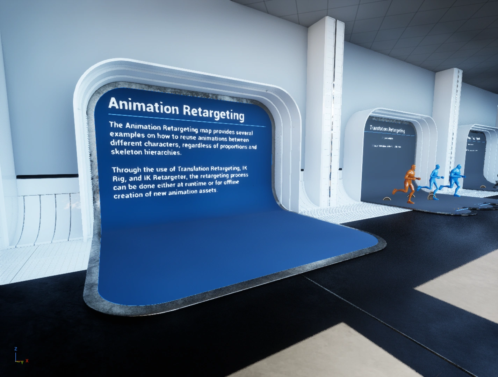
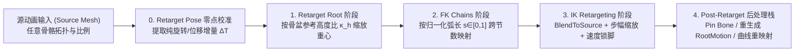
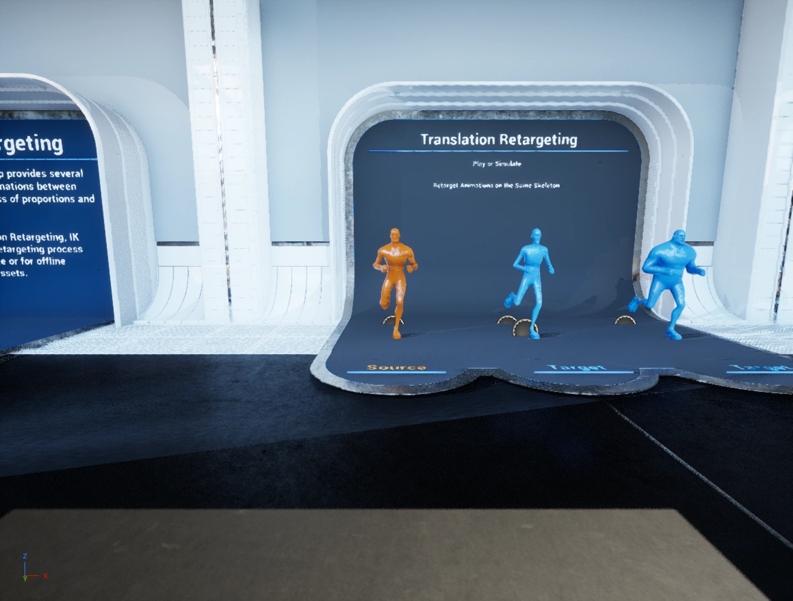
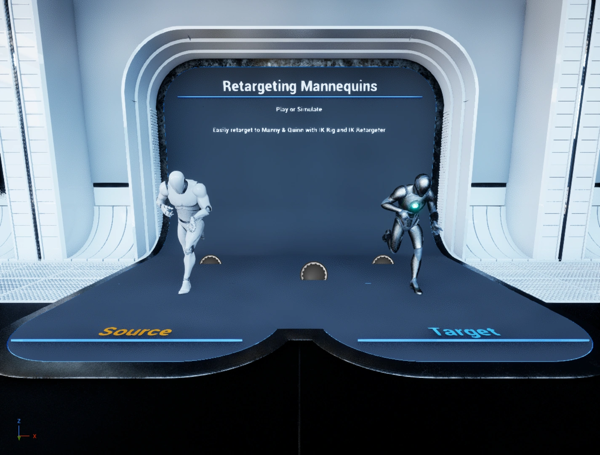
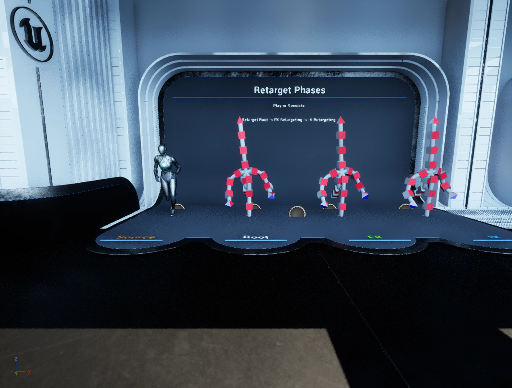
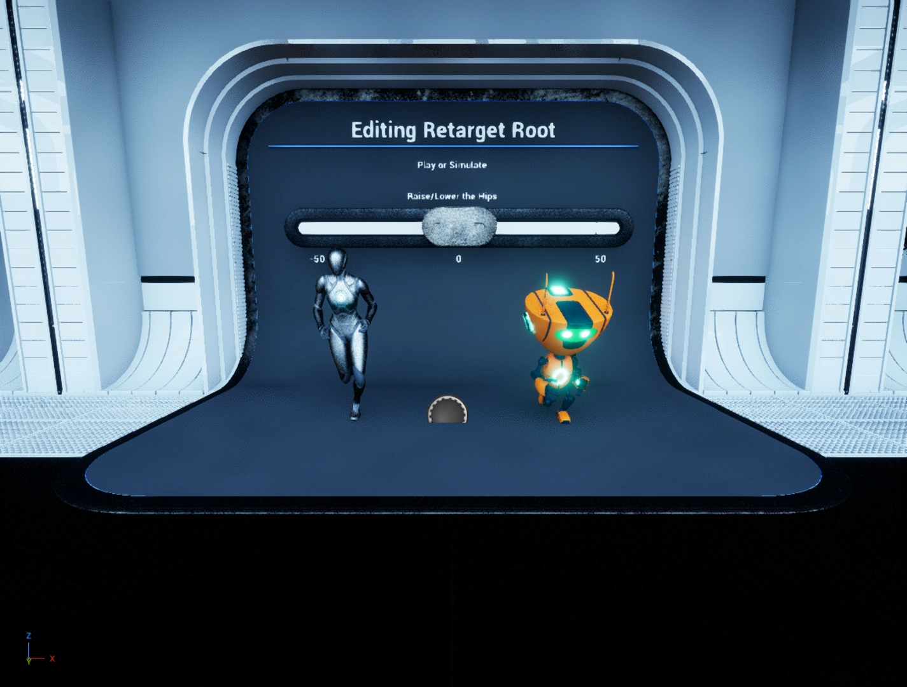
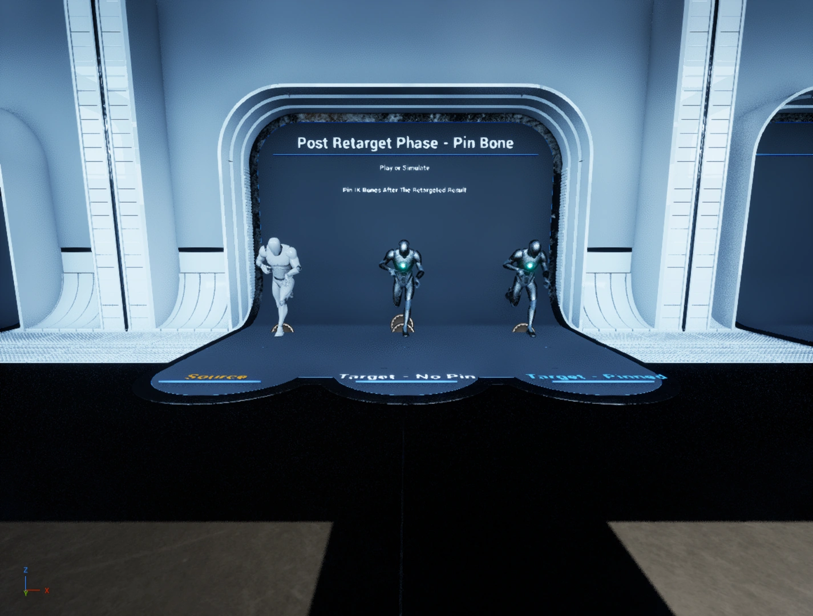

# 04 · 跨体型动画重定向：IK Retargeter 骨骼链映射、步幅修正与根运动重铸全解（`Animation_Retargeting`）

> **本篇实测拆解关卡档案**
> - **关卡路径**：`/Game/Maps/Animation/Animation_Retargeting`（关卡总 Actor 数：`87` | 展台标牌数：`40` | 核心示例 Actor 数：`24`）
> - **关卡脚本类**：`/Game/Maps/Animation/Animation_Retargeting.Animation_Retargeting_C`（属性：`{"oldPawn": "None"}`）
> - **核心资产目录**：`/Game/ExampleContent/AnimationRetargeting/`（涵盖同骨骼高矮体型组 `SK_S/M/L_Male_Base`、跨拓扑角色组 `SK_Mannequin` $\to$ `SKM_Manny/Quinn_Simple` $\to$ `Echo` / `SKM_Bot` / `Starfish` / `SK_Spelunkle`、曲线重映射柱体 `MidBulge` / `TopBulge`，以及全套实时 `Retarget Profile` 与后处理阶段蓝图库）

---

## 一、 动画资产复用的“圣杯之战”：如何让一套动捕库通吃全宇宙奇形怪状的生物？

在现代 3A 游戏工业化生产中，最昂贵的资产莫过于高品质光学动作捕捉（Motion Capture）与资深动画师手K的数千条战斗跑酷序列。试想你的项目里有身高 `1.85 米` 的健美男主角、身高 `1.62 米` 的纤细女法师、身高 `2.6 米` 的重装兽人、身高只有 `0.7 米` 的二头身吉祥物机器人，甚至还有长着五条软腕的深海怪物——如果每增加一个新体型或新骨架拓扑，都要把 1,000 个移动、受击、攀爬、跳舞动作推倒重做一遍，没有任何工作室承担得起这样的研发成本！

**动画重定向（Animation Retargeting）** 正是将动画师从重复劳动地狱中解放出来的生产力核武器。今天我们踏入的 **`/Game/Maps/Animation/Animation_Retargeting`**，是整个角色动画专题展牌密度极高的一座宏大长廊——全长 **135 米**（`X` 从 `500` 延伸至 `14000`），由 **12 大核心实验台及配套前排 `Source / Target` 独立对照标牌共同构成了足足 40 座编号展台（`#1` ~ `#40`）**！

### 1.1 虚幻动画重定向的三代技术演进与 `IK Retargeter` 核心数学方程

沿着展厅从西向东漫步，你将亲历虚幻引擎动画复用体系的三次历史性跨越：
1. **第一代：同骨骼平移重定向（Same-Skeleton Translation Retargeting，展台 `#2~#5`）**
   要求源模型与目标模型必须共享**同一个 `USkeleton`**，仅通过将子骨骼平移通道切为 `Skeleton`（保留目标自身骨长）并只继承动画旋转四元数来适配高矮胖瘦。优点是零额外 CPU 算力开销，缺点是无法跨异构骨骼层级，且无脚部防滑与双手接触点保持能力。
2. **第二代：同拓扑网格姿势直接拷贝（`Copy Pose From Mesh`，展台 `#6~#8`）**
   在运行时按相同骨骼名称直接从源组件拷贝局部变换，常用于角色模块化穿衣换装（上衣、裤子、靴子跟随裸模主骨架），但面对肩宽、初始绑定夹角或骨骼节数不同的角色时束手无策。
3. **第三代：任意拓扑语义骨骼链与全身 IK 重定向（`IK Rig` + `IK Retargeter`，展台 `#9~#40`）**
   彻底打破了“骨骼名字必须一样、骨头数量必须一样、体型必须都是双足人类”的所有枷锁！其底层数学引擎（`UIKRetargetProcessor`）在每一帧按严格的四步几何映射方程运行：

- **第一步：基准姿态零点对齐（Retarget Pose Offset Calibration）**
  设骨骼在源基准姿态（Source Retarget Pose）与目标基准姿态（Target Retarget Pose）下的组件空间旋转分别为 $R_{\text{src}, 0}$ 与 $R_{\text{tgt}, 0}$。当源角色在时刻 $t$ 摆出姿态 $R_{\text{src}}(t)$ 时，绝不能直接硬塞旋转值，而必须提取**相对于各自基准姿态的纯运动增量** $\Delta R(t)$：
  $$\Delta R(t) = R_{\text{src}}(t) \cdot \left(R_{\text{src}, 0}\right)^{-1} \implies R_{\text{tgt}}^{\text{FK}}(t) = \Delta R(t) \cdot R_{\text{tgt}, 0}$$
- **第二步：重定根归一化缩放（Retarget Root Normalized Scaling）**
  测量源与目标在基准姿态下骨盆中心（`Retarget Root`，通常为 `pelvis`）距地面的垂直参考高度 $h_{\text{src}, 0}$ 与 $h_{\text{tgt}, 0}$，计算体型高度缩放比 $\kappa_h = \frac{h_{\text{tgt}, 0}}{h_{\text{src}, 0}}$，将源骨盆的位移增量等比缩放映射至目标骨盆：
  $$\mathbf{p}_{\text{tgt, pelvis}}(t) = \mathbf{p}_{\text{tgt}, 0} + \kappa_h \cdot \left(\mathbf{p}_{\text{src, pelvis}}(t) - \mathbf{p}_{\text{src}, 0}\right) + \mathbf{t}_{\text{offset}}$$
- **第三步：异构骨骼链归一化弧长参数映射（Parametric Bone Chain FK Mapping）**
  当源脊椎有 $M = 3$ 节骨头、目标海星或怪兽脊椎有 $N = 7$ 节骨头（$M \neq N$）时，引擎沿整条骨骼链累计骨长计算每节骨头的**归一化弧长参数坐标** $s \in [0, 1]$：
  $$s_k = \frac{\sum_{j=1}^{k} L_j}{\sum_{j=1}^{\text{ChainLen}} L_j}$$
  将源骨骼链上的离散旋转增量拟合成定义在 $[0, 1]$ 上的连续旋转样条曲线 $\Delta R(s)$，再按目标链各骨骼所处的参数位置 $s'_i$ 重采样并做总转角能量归一化，完美实现“任意节数对任意节数”的丝滑弯曲传递！
- **第四步：IK 目标空间重映射、步幅扭曲与后处理栈（IK Goals, Stride Warping & Post Ops）**
  对挂有 `IK Goal` 的手脚骨骼链，结合链长比、源接触点混合权重 `Blend to Source`（$\beta \in [0, 1]$）、前后/横向步幅扭曲矩阵 $W_{\text{stride}}$ 与速度植脚锁点算得目标效应器坐标，调用目标 `PBIK` 求解器精准落脚；最后依次流经 **Post-Retarget Phase（`Pin Bone` 钉辅助骨 $\to$ `Root Motion Generator` 重铸根运动 $\to$ `Remap Curve` 曲线改名）** 输出完美无瑕的终极姿势！

为了做到 **100% 零遗漏深度还原**，我们将本关全部 **40 座编号展台（`#1` ~ `#40`）** 划分为三大技术乐章，严格按照 `#1` 至 `#40` 的连续编号逐台拆解每一块主展牌与前排 `Source / Target` 对照子展台！

---

## 二、 第一乐章（展台 #1 ~ #8）：传统同骨骼平移重定向与网格姿势直接拷贝

### 展台 #1：`Animation Retargeting` — 重定向长廊总导览与评测光场

- **空间元数据**：展牌 Label `BP_DemoDisplay2` | 坐标 `(500, -900, 0)`
- **官方展牌原文说明**：`The Animation Retargeting map provides several examples on how to reuse animations between different characters, regardless of proportions and skeleton hierarchies. Through the use of Translation Retargeting, IK Rig, and IK Retargeter, the retargeting process can be done either at runtime or for offline creation of new animation assets.`

#### 1.1 运行时实时重定向（Runtime）vs 离线批量导出（Offline Export）选型策略
展牌开宗明义点出了重定向在生产管线中的两种交付形态：
- **运行时实时重定向（Runtime Retargeting）**：在目标角色的 AnimGraph 中使用 `Retarget Pose From Mesh` 节点，每帧实时读取源网格体姿势并解算重定向。优势是**零磁盘动画资产膨胀**（1,000 个动作只需存 1 份在主角名下，10 个队友/皮肤实时共享！），适合主角换装与少量核心小队角色。
- **离线烘焙新资产（Offline Duplicate & Retarget）**：在内容浏览器中右键选中动画序列/混合空间/蒙太奇甚至整张动画蓝图 $\rightarrow$ `Retarget Animations`，通过 `IK Retargeter` 一次性离线烘焙生成专属于目标骨骼的新 `UAnimSequence` 资产。优势是**运行时零重定向解算与零双骨骼组件开销**，适合同屏成百上千只杂兵 AI！

#### 1.2 展台陈列 Actor 实测清单（共 5 个）
- **`DirectionalLight`**（`Intensity = 10`，纯白光，`Movable`，`CastShadows = true`）、**`SkyLight`**（`Intensity = 3`，`Movable`）、**`SkyAtmosphere`**、**`ExponentialHeightFog`** 以及挂载 `ChaosDebugDrawComponent_0` 的 **`Actor`**。

---

### 展台 #2：`Source` — 同骨骼平移重定向实验组：赤陶红标准中等身材源角色

- **空间元数据**：展牌 Label `BP_DemoDisplay7` | 坐标 `(1304, -745, 0)`（第一实验站左前源标牌）

#### 2.1 展品解析与源基准材质标识
观察上方实拍图最左侧的赤陶红色人形角色：这正是第一实验站（由集成 Actor `BP_SimpleRetargeting` 统一承载，旁设 `PrecomputedVisibilityVolume1`）的**源基准网格体 `SkeletalMesh`**：
- **网格资产**：`/Game/ExampleContent/AnimationRetargeting/Meshes/SK_M_MALE_Base`（Medium 标准中等身高男性，所有原始动画均按他的骨长比例制作）；
- **视觉色标规范**：官方专门为本实验站调配了高辨识度色标材质实例 **`/Game/Global/Materials/M_DemoRoomTiles_Inst_Color1`**（母材质 `M_DemoRoomTiles_Inst`，重载向量参数 `"Color" = (0.442478, 0.082706, 0.0, 1.0)` 深赤陶红），后文凡看到赤陶红或源标签即为动画提供方（Source）！

---

### 展台 #3：`Translation Retargeting` — 同骨骼树五种平移重定向模式（`EBoneTranslationRetargetingMode`）全解

- **空间元数据**：展牌 Label `BP_DemoDisplay` | 坐标 `(1502, -900, 0)`（第一实验站后排主展牌）
- **官方展牌原文说明**：`Play or Simulate Retarget Animations on the Same Skeleton`

#### 3.1 为什么共享同一个 `USkeleton` 的高个子和矮个子直接播同一个动画会变成“恐怖片怪物”？
回想第一章的知识：`UAnimSequence` 里不仅存了每根骨头的旋转 $\mathbf{q}_i(t)$，还存了子骨相对于父骨的局部平移向量 $\mathbf{t}_i^{\text{anim}}(t)$！在中等身高 `SK_M_MALE_Base` 上，大腿长 `45 cm`，所以动画里小腿骨 `calf_l` 相对于大腿骨的平移写死了 `45 cm`。
如果你把这个动画直接原封不动播在身高 `2.4 米`（大腿本该长 `65 cm`）的巨人身上，动画里的 `45 cm` 会瞬间覆盖掉巨人自己的 `65 cm` 骨长——**巨人的宽大皮肤网格会被生生压缩揉搓回 `1.75 米` 的骨架上，肩膀塌陷、脖子缩进胸腔，惨不忍睹**！

为此，打开 `USkeleton` 骨骼树勾选 `Show Retargeting Options`，引擎为每根骨骼提供了五种平移通道处理策略：
1. **`Animation`（完全读取动画平移）**：**仅用于 `root`、`pelvis`（重心真的在上下起伏移动！）以及武器/IK 自由移动挂点骨骼**；
2. **`Skeleton`（强制保留网格体自身参考骨长 $\mathbf{t}_i^{\text{ref\_mesh}}$）**：**全身绝大多数四肢与躯干子骨骼（`spine_01..head`、`clavicle..hand`、`thigh..foot`）的标准配置**！只读动画里的旋转角 $\mathbf{q}_i^{\text{anim}}(t)$，平移量严格锁死在各自 `USkeletalMesh` 的绑定骨长上，彻底杜绝巨人缩骨或侏儒拉断骨头！
3. **`AnimationScaled`（按源与目标参考骨长比缩放动画平移）**：$\mathbf{t}_i = \mathbf{t}_i^{\text{anim}}(t) \cdot \frac{\|\mathbf{t}_i^{\text{tgt\_ref}}\|}{\|\mathbf{t}_i^{\text{src\_ref}}\|}$。非常适合设在 **`pelvis`** 上，让高个子跳得更高、矮个子蹲得更适配腿长，同时不丢失挤压拉伸动画细节！
4. **`AnimationRelative` / `OrientAndScale`**：分别用于叠加相对于动画首帧的平移增量，或对齐不同骨骼轴向并缩放位移。

---

### 展台 #4：`Target` — 同骨骼重定向目标一号：魁梧巨人 `SK_L_Male_Base`

- **空间元数据**：展牌 Label `BP_DemoDisplay8` | 坐标 `(1499, -745, 0)`（第一实验站中央目标子展台）

#### 4.1 集成蓝图 `BP_SimpleRetargeting` 与高大体型的骨架保真验证
本子展台坐标正对集成蓝图实例 **`BP_SimpleRetargeting`**（类 `/Game/ExampleContent/AnimationRetargeting/Blueprints/BP_TranslationRetargeting.BP_TranslationRetargeting_C`）中央的巨人组件 **`SkeletalMesh1`**：
- **网格资产与材质**：引用大号魁梧男体 **`/Game/ExampleContent/AnimationRetargeting/Meshes/SK_L_Male_Base`**，两个材质槽均重载为钴蓝色目标色标材质 **`M_DemoRoomTiles_Inst_Color2`**（继承自 `Color1`，重载 `"Color" = (0.0, 0.171092, 0.442478, 1.0)` 深海钴蓝）。
- **实测效果**：得益于四肢躯干骨骼配置了 `Skeleton` 平移重定向模式，`SK_L_Male_Base` 完整保住了宽阔的胸膛与修长的四肢比例，动作孔武有力而毫无网格塌陷。

---

### 展台 #5：`Target` — 同骨骼重定向目标二号：矮小体型 `SK_S_MALE_Base` 与第一代方案的天花板

- **空间元数据**：展牌 Label `BP_DemoDisplay9` | 坐标 `(1699, -745, 0)`（第一实验站右侧目标子展台）

#### 5.1 从小个子 `SK_S_MALE_Base` 看清纯平移重定向的三大死穴
右侧子展台对应 `BP_SimpleRetargeting` 的第三个组件 **`SkeletalMesh2`**（小号矮小男体 **`/Game/ExampleContent/AnimationRetargeting/Meshes/SK_S_MALE_Base`**，钴蓝色材质 `M_DemoRoomTiles_Inst_Color2`）。
虽然小个子同样保住了紧致的身材比例，但仔细盯着巨人与小个子的脚底和双手看，你会立刻发现第一代同骨骼 `Translation Retargeting` 无法逾越的三大硬伤：
1. **无法跨骨骼资产（Same-Skeleton Lock-in）**：一旦新角色多了一节脊椎骨或骨骼名字叫 `Bip001_Pelvis`，连选都选不上；
2. **浮空与穿地滑步**：若 `pelvis` 用纯 `Animation` 模式，小个子腿短却被抬到了中号人的胯部高度，双脚直接悬空离地蹬空气；
3. **双手交互脱靶**：如果中号源角色做一个“双手合十祈祷”动作，宽肩膀长手臂或宽胸膛短手臂的目标角色只照抄肩肘旋转角，两只手要么拍不到一起隔空停住，要么互相穿透手掌！——要想根治这些顽疾，我们必须继续向前探索！

---

### 展台 #6：`Copy Pose From Mesh` — 运行时跨网格同名骨骼姿势直拷原理与换装工程学

- **空间元数据**：展牌 Label `BP_DemoDisplay1` | 坐标 `(2500, -900, 0)`（第二实验站后排主展牌）
- **官方展牌原文说明**：`Play or Simulate Copy Animations Across Similar Skeletons`

#### 6.1 `Copy Pose From Mesh` vs `Leader Pose Component`：换装系统到底该选谁？
在目标角色的 AnimGraph 中拖入 **`Copy Pose From Mesh`** 节点（勾选 `Use Attached Parent = true` 或传入指定 `Source Mesh Component` 引用），引擎会在初始化时通过骨骼名（`FName`）建立一张源骨骼索引到目标骨骼索引的快速映射表，每帧把匹配上的骨骼局部空间变换直接拷贝过来（目标独有的额外飘带、裙摆、头发骨骼则保留自身默认姿势，随后在下游继续接 `AnimDynamics` / `KawaiiPhysics` / `Control Rig` 解算物理摆动！）。

> [!TIP]
> **角色模块化换装（Modular Character）架构选型黄金铁律**
> - **若外套、裤子、手套没有独立物理动画蓝图，且骨骼子集 100% 属于裸模主骨架**：在角色蓝图 Construction Script 中直接调用 **`SetLeaderPoseComponent`（原 `SetMasterPoseComponent`）**！它完全跳过子部件自身的 AnimGraph 求值，直接共享主组件的最终骨骼蒙皮矩阵缓冲区，**CPU 动画开销为 0**！
> - **若披风、盔甲挂件拥有自己独有的额外骨骼且需要跑独立的二级物理/刚体模拟 AnimBP**：则不能用 `SetLeaderPoseComponent`（否则子部件自己的 AnimBP 会被彻底禁用），此时必须让子部件运行专属后处理 AnimBP，第一节点放 **`Copy Pose From Mesh`** 拷走身体主姿态，下游紧跟 `RigidBody` 或 `Control Rig` 驱动裙摆飘带！

---

### 展台 #7：`Source` — 姿势拷贝源角色：标准男性 `SKM_Manny_Simple`

- **空间元数据**：展牌 Label `BP_DemoDisplay10` | 坐标 `(2349, -745, 0)`（第二实验站左前源子展台）

#### 7.1 源骨骼驱动端解析
本子展台展示 `BP_CopyPoseFromMesh` 中的源组件 **`Source_SkeletalMesh`**（挂载 UE5 标准男性 **`/Game/Characters/Mannequins/Meshes/SKM_Manny_Simple`**），持续输出一套大幅度全身肢体舒展动画，作为姿势广播源。

---

### 展台 #8：`Target` — 姿势拷贝目标角色：女英雄 `Echo` + 4.5 万根毛发同步及男女体态微差反思

- **空间元数据**：展牌 Label `BP_DemoDisplay11` | 坐标 `(2649, -745, 0)`（第二实验站右前目标子展台）

#### 8.1 `BP_CopyPoseFromMesh` 全组件拆解与“硬拷旋转”的体态隐患
本子展台容纳蓝图实例 **`BP_CopyPoseFromMesh`**（类 `/Game/ExampleContent/AnimationRetargeting/Blueprints/BP_CopyPoseFromMesh.BP_CopyPoseFromMesh_C`，含开关变量 `["useGroomAssets"]`），其目标端豪华挂载了：
- **`Target_SkeletalMesh`**：女英雄网格 **`/Game/Characters/Echo/Meshes/Echo`**，运行动画蓝图 **`ABP_CopyPoseFromMesh_C`** 实时从左侧 Manny 拷贝同名骨骼变换；
- **全套 Alembic 毛发跟随**：`EyebrowsGroom`（`Eyebrows_L_Echo`，`1,489` 根眉毛）与 `HairGroom`（`Hair_S_UpdoBuns`，`43,602` 根发丝、`519,159` 个控制点），通过 `GroomBindingAsset` 完美跟随拷贝姿势后的 Echo 头部运动！

**工程洞察**：虽然 Echo 的主干骨骼命名遵循了 UE5 Mannequin 规范，得以通过 `Copy Pose From Mesh` 直接跑起来，但仔细对比男女角色：Manny 是倒三角宽肩阔背硬汉，Echo 是窄肩收腰女性体型，且衣服领口与胸廓厚度完全不同。硬生生把男性的大臂局部夹角原样塞给女性骨架，极易出现双臂夹紧肋骨穿模或手部相对位置失真——要想实现**真正尊重各自初始体态与肢体长短比例的精准迁移**，好戏在下一座展台正式开场！

---

## 三、 第二乐章（展台 #9 ~ #24）：IK Retargeter 跨拓扑链映射、三阶段解算与基准姿态校准

### 展台 #9：`Source` — 跨世代迁移源角色：传奇经典的 UE4 小白人 `SK_Mannequin`

- **空间元数据**：展牌 Label `BP_DemoDisplay13` | 坐标 `(3351, -745, 0)`（第三实验站左前源子展台）

#### 9.1 剖析 UE4 旧版骨骼拓扑特征
左前子展台陈列着 `BP_MannequinRetargeting` 的源组件 **`Source_SkeletalMesh`**，挂载了陪伴全球虚幻开发者近十年的 **UE4 初代小白人 `/Game/Characters/Mannequin_UE4/Meshes/SK_Mannequin`**！
在骨骼结构上，UE4 小白人只有 **3 节脊椎（`spine_01..03`）**、**1 节颈椎（`neck_01`）**，手指直接从手腕 `hand_l` 连向第一指节 `index_01_l`（**缺少手掌掌骨 `metacarpal`！**），且大臂小臂扭曲骨（Twist Bones）的层级方向与 UE5 截然不同。

---

### 展台 #10：`Retargeting Mannequins` — 官方无缝桥梁：从 UE4 小白人一键升级至 UE5 Manny & Quinn

- **空间元数据**：展牌 Label `BP_DemoDisplay12` | 坐标 `(3500, -900, 0)`（第三实验站后排主展牌）
- **官方展牌原文说明**：`Play or Simulate Easily retarget to Manny & Quinn with IK Rig and IK Retargeter`

#### 10.1 商城十万套旧版 UE4 动作包的救星：语义骨骼链是怎么抹平骨骼节数鸿沟的？
为什么虚幻商城（Fab）里上万套为 UE4 `SK_Mannequin` 制作的动作包，放进 UE5 项目能一秒重定向给拥有 **89 根骨骼（5 节脊椎 `spine_01..05`、2 节颈椎 `neck_01..02`、双侧五指独立掌骨 `*_metacarpal` 与全新程序化矫正骨）** 的 `SKM_Manny`？
秘诀就在于两份 `IK Rig`（`IK_UE4_Mannequin` 与 `IK_Mannequin`）建立的**同名语义骨骼链映射契约（Retarget Chains）**：

| 语义链名称 (`Chain Name`) | 源端 UE4 `SK_Mannequin` 起止骨骼（节数） | 目标端 UE5 `SKM_Manny` 起止骨骼（节数） | `IK Retargeter` 映射行为 |
| :--- | :--- | :--- | :--- |
| **`Spine`** | `spine_01` $\to$ `spine_03`（**3 节**） | `spine_01` $\to$ `spine_05`（**5 节**） | 参数化弧长插值：3 节弯腰曲率均匀平滑分摊到 5 节脊椎上！ |
| **`Neck` / `Head`** | `neck_01` $\to$ `head`（**2 节**） | `neck_01` $\to$ `head`（含 `neck_02`，**3 节**） | 自动适配双颈椎柔和过渡，消除脖子硬折痕。 |
| **`LeftArm` / `RightArm`** | `upperarm` $\to$ `hand`（3 节 + IK Goal） | `upperarm` $\to$ `hand`（3 节 + IK Goal） | FK 传递肘腕姿态 + IK Goal 对齐手掌空间轨迹（掌骨保持自然握姿，从手指第 1 节 `index_01` 起精确一对一映射五指！）。 |
| **`LeftLeg` / `RightLeg`** | `thigh` $\to$ `ball`（4 节 + IK Goal） | `thigh` $\to$ `ball`（4 节 + IK Goal） | 结合骨盆高度比与脚底 IK Goal，确保脚掌与前脚掌蹬地零误差！ |

---

### 展台 #11：`Target` — 跨世代迁移目标角色：次世代骨骼 `SKM_Manny_Simple`

- **空间元数据**：展牌 Label `BP_DemoDisplay14` | 坐标 `(3651, -745, 0)`（第三实验站右前目标子展台）

#### 11.1 `BP_MannequinRetargeting` 运行时节点链路拆解
右侧子展台容纳蓝图 **`BP_MannequinRetargeting`**，其目标组件 **`Target_SkeletalMesh`**（`SKM_Manny_Simple`）运行着动画蓝图 **`/Game/ExampleContent/AnimationRetargeting/AnimBlueprints/ABP_Mannequin_Retargeting`**——内部仅需一个简洁至极的 **`Retarget Pose From Mesh`** 节点引用官方 `RTG_UE4Manny_UE5Manny` 资产，就将左侧 UE4 小白人的全套动作分毫不差地复刻到了次世代 Manny 身上！（*工程提示：对于 `lowerarm_twist_01_l` 等扭曲矫正骨，UE5 Manny 会自动通过内置的后处理 `Control Rig` 驱动计算，无需在重定向器里手动硬连旧版扭曲骨！*）

---

### 展台 #12：`Retargeting on Different Skeletons` — 彻底打破物种生殖隔离！跨异构骨架重定向原理

- **空间元数据**：展牌 Label `BP_DemoDisplay3` | 坐标 `(4501, -900, 0)`（第四实验站后排主展牌）
- **官方展牌原文说明**：`Play or Simulate Retarget using IK Rig and IK Retargeter`

#### 12.1 当人类遇上二头身铁皮机器人与五腕海星：如何建立跨物种拓扑语义？
如果说 UE4 到 UE5 小白人还算是“人类表兄弟”，那么第四实验站干了一件极其疯狂的事：**把高挑女运动员 Quinn 的体操动作，同时实时重定向给一个大脑袋超短腿机器人 `StackOBot` 和一只没有头颈区分的五角星海洋生物 `Starfish`！**

在 `IK Retargeter` 看来，世界上根本不存在“人”或“海星”，只存在 **`Retarget Root`（重心锚点）+ 若干条有向 `Bone Chains`（语义功能链）**：
- 只要你在海星的 `IK Rig` 里，把朝上的那根触角标记为 `Head` 链、左上和右上两根触角标记为 `LeftArm` 与 `RightArm` 链、左下和右下两根触角标记为 `LeftLeg` 与 `RightLeg` 链，再把中心盘标记为 `Retarget Root`——跨物种的神经连接就在一瞬间打通了！

---

### 展台 #13：`Source` — 异构物种重定向源角色：人类女角色 `SKM_Quinn_Simple`

- **空间元数据**：展牌 Label `BP_DemoDisplay4` | 坐标 `(4301, -745, 0)`（第四实验站左侧源子展台）

#### 13.1 人类标准比例输入源
左侧子展台展示 `BP_RetargetingDifferentCharacters` 的源组件 **`Source_SkeletalMesh`**（`SKM_Quinn_Simple`），提供标准人类大跨步体操运动数据流。

---

### 展台 #14：`Target` — 异构物种目标一号：二头身短腿机器人 `SKM_Bot`（Stack-O-Bot）

- **空间元数据**：展牌 Label `BP_DemoDisplay5` | 坐标 `(4501, -745, 0)`（第四实验站中央目标子展台）

#### 14.1 `BP_RetargetingDifferentCharacters` 与极端头身比适配拆解
中央子展台容纳蓝图实例 **`BP_RetargetingDifferentCharacters`**，其第一目标组件 **`Target_SkeletalMesh`** 挂载了虚幻官方经典示例角色 **`/Game/Characters/StackOBot/Mesh/SKM_Bot`**，运行动画蓝图 **`ABP_StackOBot_Retargeting_C`**（内含动态配置变量 `["Retarget Profile"]`）。
- 尽管 `SKM_Bot` 腿长不足 Quinn 的三分之一、躯干是个僵硬的圆筒电视机，但经过根高度自动缩放（$\kappa_h \approx 0.35$）与短链映射，小机器人迈着呆萌而精准的小碎步，既没飘在半空也没把脚插进地板！

---

### 展台 #15：`Target` — 异构物种目标二号：放射对称五腕海星 `Starfish`

- **空间元数据**：展牌 Label `BP_DemoDisplay6` | 坐标 `(4701, -745, 0)`（第四实验站右侧目标子展台）

#### 15.1 多骨柔性触手承接人类刚体四肢的奇观
右侧子展台对应第二目标组件 **`Target_SkeletalMesh1`**（挂载 **`/Game/ExampleContent/IKRig/Mesh/Starfish/Starfish`**，驱动蓝图 **`ABP_Starfish_Retargeting_C`**，同样支持 `["Retarget Profile"]`）。
- 人类大臂+小臂只有 **2 节主旋转骨**，而海星每条腕足有多节连续软骨！通过 FK 链的 **`Match Chain`（连续样条光滑重采样模式）**，人类肘关节的折角被平滑转化为海星腕足优美的 C 型柔顺弯曲！

---

### 展台 #16：`Source` — 重定向三阶段解剖实验台：源角色 `SKM_Quinn_Simple`

- **空间元数据**：展牌 Label `BP_DemoDisplay21` | 坐标 `(5700, -745, 0)`（第五实验站最左侧源子展台）

#### 16.1 分步透视实验基准源
来到 `X = 5700 ~ 6301` 的第五实验站，官方设计了一组堪称神来之笔的“外科手术级分步拆解台”：最左侧 `#16` 子展台的 **`Source_SkeletalMesh`**（`SKM_Quinn_Simple`）持续播放源动作，而它右侧紧挨着的三只海星（`#18 Root`、`#19 FK`、`#20 IK`）像定格电影胶片一样，一步步为你揭开 `IK Retargeter` 内部每帧执行的三个阶段！

---

### 展台 #17：`Retarget Phases` — 剥洋葱式拆解：`Retarget Root -> FK Retargeting -> IK Retargeting`

- **空间元数据**：展牌 Label `BP_DemoDisplay15` | 坐标 `(6002, -900, 0)`（第五实验站后排主展牌）
- **官方展牌原文说明**：`Play or Simulate Retarget Root ->     FK Retargeting ->     IK Retargeting`

#### 17.1 为什么要把重定向拆成“根传递 $\to$ 前向链 $\to$ 逆向目标”三道工序？
很多同学打开 `IK Retargeter` 的 `Global Settings` 面板时，会看到三个总开关勾选框：**`Enable Root`**、**`Enable FK`**、**`Enable IK`**。为什么要分这三步而不是一步到位？
- 因为 **纯 FK 保神韵与弧线**（挥拳的抛物线、甩袖子的姿态韵律），但它**保不住空间绝对落点**（脚踩地板高度、双手合十接触点）；
- **纯 IK 保空间落点精度**，但如果没有良好的初始 FK 姿态作为求解器迭代起点（Initial Seed Pose），全身 IK 只会走出最呆板的机械最短直线！
- 因此，**先由 Root 定乾坤重心 $\to$ 再由 FK 铺全身姿态气韵 $\to$ 最后由 IK 做毫米级落点修正**，三者缺一不可！下面让我们依次检阅前排 `#18`、`#19`、`#20` 三只海星的实况对比。

---

### 展台 #18：`Root` — 第一阶段（仅开启 `Retarget Root`）：重心起伏已同步，五肢僵直如木星

- **空间元数据**：展牌 Label `BP_DemoDisplay22` | 坐标 `(5901, -745, 0)`（第五实验站左一阶段子展台）

#### 18.1 观察 `Root` 组件海星的孤立行为
如上方同框实拍图左起第二位所示：这只对应组件 **`Root`** 的海星仅点亮了第一阶段 `Retarget Root`（关闭了 FK 与 IK）。
- 你会看到它的五只触角死死定格在初始的“大字型五角星绑定姿势”上，一根指头都不弯曲；但它的中央肚皮（重定根）已经严格按照与 Quinn 腿长缩放后的比例，随着 Quinn 的步伐精准上下颠簸、左右扭胯倾斜！这是整个重定向大厦的移动地基。

---

### 展台 #19：`FK` — 第二阶段（叠加 `FK Retargeting`）：全身舞姿已唤醒，脚底微瑕待收官

- **空间元数据**：展牌 Label `BP_DemoDisplay23` | 坐标 `(6101, -745, 0)`（第五实验站中间阶段子展台）

#### 19.1 `BP_RetargetPhases` 与参数化 FK 链激活实况
本子展台容纳集成蓝图 **`BP_RetargetPhases`**（内部管理 `Source_SkeletalMesh`、`Root`、`FK`、`IK` 四大网格组件，三只海星统一挂载 **`/Game/ExampleContent/AnimationRetargeting/AnimBlueprints/ABP_RetargetPhases`**）。
- 观察组件 **`FK`**（开启 `Root + FK`，关闭 `IK`）：五条腕足瞬间活了过来！顶部的头触角跟着点头，左右手触角欢快摆臂，下方两条腿触角交替迈步。
- **细微破绽**：由于海星身体圆盘宽度、腿根分叉间距与人类骨盆完全不同，纯拷贝旋转角算出来的脚尖高度在迈步最低点时，会出现轻微的**浮空或蹭地穿插**——这就轮到右侧最后一位选手登场收官了！

---

### 展台 #20：`IK` — 第三阶段（叠加 `IK Retargeting`）：全身 PBIK 终极介入，落脚稳如磐石！

- **空间元数据**：展牌 Label `BP_DemoDisplay24` | 坐标 `(6301, -745, 0)`（第五实验站最右侧完整阶段子展台）

#### 20.1 观察 `IK` 组件海星的闭环修正
最右侧的 **`IK`** 组件海星完整开启了 `Root + FK + IK` 全套三阶段管线！
- 在第 2 阶段 FK 优雅姿态的引导下，第 3 阶段将映射后的左右脚 `IK Goals` 送入海星自身的 `Full Body IK` 求解器，动态微调腿部软骨弧度，将海星下方的两只触角尖端稳稳贴合在地板平面上，兼具了人类动作的潇洒神韵与自身解剖结构的物理真实感！

---

### 展台 #21：`Source` — 基准姿态校准实验台：源角色 `SKM_Quinn_Simple`（开合跳预备）

- **空间元数据**：展牌 Label `BP_DemoDisplay25` | 坐标 `(6775, -745, 0)`（第六实验站左侧源子展台）

#### 21.1 观察源角色的初始 A-Pose
来到第六实验站，左侧 `#21` 的 **`Source_SkeletalMesh`**（`SKM_Quinn_Simple`）静静站立在虚幻引擎标准的 **A-Pose（双臂自然向下斜垂约 $45^\circ$，双腿微开直立）** 中，随时准备响应前方按钮跳起大幅度双手过顶击掌的开合跳（Jumping Jacks）！

---

### 展台 #22：`Retarget Poses` — 重定向成败第一定律：源与目标基准姿态（Retarget Pose）零点对齐！

- **空间元数据**：展牌 Label `BP_DemoDisplay16` | 坐标 `(7000, -900, 0)`（第六实验站后排主展牌）
- **官方展牌原文说明**：`Play or Simulate Pose Character to Fit for Retarget - Hit Button to Play Animation`

#### 22.1 90% 新手重定向“手穿脑袋、腿劈叉”的唯一元凶！
重温第一章我们写下的零点差值公式：
$$\Delta R(t) = R_{\text{src}}(t) \cdot \left(R_{\text{src}, 0}\right)^{-1}, \qquad R_{\text{tgt}}(t) = \Delta R(t) \cdot R_{\text{tgt}, 0}$$
这个公式隐含着一条神圣不可侵犯的几何前提：**源角色的 `Source Retarget Pose` ($R_{\text{src}, 0}$) 与目标角色的 `Target Retarget Pose` ($R_{\text{tgt}, 0}$)，在世界/组件空间中必须摆出完全一致的肢体朝向！（比如都摆成标准 T-Pose，或者都摆成双臂下垂 $45^\circ$ 的 A-Pose！）**

想一想会发生什么惨剧：如果源人类 Quinn 的基准姿态是 **A-Pose（手臂斜向下 $-45^\circ$）**，而目标海星直接拿建模师导出的原始五角星做基准姿态（**左右两条上腕斜向上翘着 $+18^\circ$，两者初始相差了整整 $63^\circ$！**）：
- 当 Quinn 做开合跳，把手臂从 $-45^\circ$ 往上抬高 $+135^\circ$ 举到头顶 $+90^\circ$ 拍手时；
- 重定向器忠实地把“向上抬高 $+135^\circ$”这个增量 $\Delta R$ 加到了海星原本就已经 $+18^\circ$ 的胳膊上：
  $$\theta_{\text{starfish}} = +18^\circ + 135^\circ = +153^\circ \quad (\text{越过头顶正上方 } 90^\circ \text{ 足足 } 63^\circ\text{！})$$
  左右两只手直接交叉刺穿自己的头顶触角拧成了麻花！让我们立刻踩下 `#23` 展台前的红色按钮，亲眼见证 `#24 Default` 翻车现场与 `#23 Fixed` 标准解法的震撼对比！

---

### 展台 #23：`Fixed` — 校准后的完美海星 + 交互触发按钮 `BP_DemoTrigger`

- **空间元数据**：展牌 Label `BP_DemoDisplay27` | 坐标 `(7226, -745, 0)`（第六实验站右侧校准后子展台）

#### 23.1 交互触发器与 `Edit Retarget Pose` 无损修姿工作流
本子展台前方安置着交互按钮 **`BP_DemoTrigger`**（类 `/Game/Global/Interactable/BP_DemoTrigger.BP_DemoTrigger_C`，网格 `Display_Button`，触发绑定目标指向旁侧的 `BP_RetargetPoses` 翻转布尔变量 `"Play Jumping Jacks"`），其后方站立着右侧组件 **`FixedPose`**（`Starfish` + `ABP_Starfish_Retargeting_C`）：
- **标准工程操作**：无需把海星模型导回 Maya 改绑定！直接在 `IK Retargeter` 编辑器顶部进入 **`Edit Retarget Pose` 模式**（或点击 `Auto-Align All Bones` 自动对齐骨骼轴向后手动微调），把海星的左右手触角向下旋转压低成与左侧 Quinn 完全一致的 **A-Pose**，将下肢两只脚触角向内收拢直立，并保存为专属 `FixedRetargetPose`！
- **踩下按钮实测**：当开合跳响起时，右侧 `FixedPose` 海星双臂舒展上扬，恰到好处地在头顶正上方优雅合拢，下肢开合跳跃轻盈协调，零自穿插！

---

### 展台 #24：`Default` — 未校准基准姿态翻车实录：双臂反向交叉戳穿头顶！

- **空间元数据**：展牌 Label `BP_DemoDisplay26` | 坐标 `(7000, -745, 0)`（第六实验站中央未校准对照子展台）

#### 24.1 `BP_RetargetPoses` 对照组件警示录
中央子展台容纳集成蓝图 **`BP_RetargetPoses`**（成员变量 `["Play Jumping Jacks"]`），其正中组件 **`DefaultPose`**（`Starfish`）故意保留了未经修改的原始放射五角星绑定姿态。
- 静止时它摆着大字型看似人畜无害；一旦你踩下 `#23` 旁边的按钮触发开合跳，它的左右手触角每次往上挥都会像剪刀一样凶狠地交叉劈进头顶中央，双腿收回时也互相叠压打结！这个对比现场将“**先对齐 Retarget Pose，再谈一切高级参数**”的铁律刻进了每一位读者的骨髓里。

---

## 四、 第三乐章（展台 #25 ~ #40）：运行时动态配置、防滑步扭曲植脚与后处理操作栈

走过前 24 座展台，接下来从 `#25` 到 `#40` 的最后 16 座展台，将带你领略 UE5 `IK Retargeter` 冠绝业界的**运行时程序化控制（`FRetargetProfile`）**与**模块化后处理操作管线（Post-Retarget Phase Ops）**！

### 展台 #25：`Editing Retarget Root` — 运行时动态升降骨盆重心（`FRetargetProfile` 实时驱动）

- **空间元数据**：展牌 Label `BP_DemoDisplay18` | 坐标 `(8000, -900, 0)`
- **官方展牌原文说明**：`Play or Simulate Raise/Lower the Hips`
- **展台内 3D 悬浮文字标签**：`-50` | `0` | `50`

#### 25.1 不改资产、运行时一行结构体动态改写任意重定向参数！
在展台 `#25` 上，蓝图 **`BP_EditingRetargetRoot`**（左为源 `SKM_Quinn_Simple`，右为目标 `SKM_Bot` + `ABP_StackOBot_Retargeting_C`，含变量 `["OffsetZSlider", "OutputRetargetProfile"]`）连接着前方的交互滑杆 **`BP_Slider`**（刻度 `-50` 至 `+50`）。
- 传统观念认为重定向资产的参数是离线写死的；但在 UE5 中，`Retarget Pose From Mesh` 节点暴露了强大的 **`Custom Retarget Profile`（`FRetargetProfile` 结构体）输入引脚**！
- 当你左右拖动滑杆时，`BP_EditingRetargetRoot` 实时更新 `OutputRetargetProfile.RootSettings.TranslationOffset.Z`（从 `-50 cm` 压低深蹲到 `+50 cm` 踮脚拔高）并传入动画蓝图——由于机器人的双脚同时受 IK Goal 钉在地板上，压低 Root 偏移会让 `SKM_Bot` 瞬间弯曲双膝进入潜行低姿态，抬高 Root 则让双腿完全伸直！这在动态适应高低掩体、水深涉水姿态微调中极其好用。

---

### 展台 #26：`Maintaining Contact Points` — `Blend to Source`：让二头身机器人也能双手精准鼓掌与握持双手大剑！

- **空间元数据**：展牌 Label `BP_DemoDisplay17` | 坐标 `(9001, -900, 0)`
- **官方展牌原文说明**：`Play or Simulate Pin Target IK Goals to the Source End Bone's Location`
- **展台内 3D 悬浮文字标签**：`0` | `0.5` | `1`

#### 26.1 解决跨体型自接触与道具接触的黄金插值方程
观察展台 `#26` 的 **`BP_MaintainingContactPoints`**（源 `SKM_Quinn_Simple` 正在做手部交互接触动作，目标 `SKM_Bot` 由滑杆 **`BP_Slider2`** 实时驱动 `["BlendToSourceSlider", "OutputRetargetProfile", "ChainsToRetarget"]`，刻度 `0 -> 0.5 -> 1`）：
- 当 **`Blend to Source = 0.0`**（默认比例缩放模式）时，目标手部 IK Goal 按机器人自身短小的手臂长度比例生成 $\mathbf{G}_{\text{scaled}}$——因为机器人肚子圆滚滚而胳膊极短，源角色双手在胸前合十拍手时，机器人的两只小短手在胸前隔着二十厘米拍空气，根本碰不到一起！
- 当你将滑杆拉向 **`Blend to Source = 1.0`** 时，引擎对 IK Goal 执行源空间绝对锚定插值：
  $$\mathbf{G}_{\text{final}}(t) = \text{Lerp}\!\left(\mathbf{G}_{\text{scaled}}(t),\, \mathbf{G}_{\text{source}}(t) + \mathbf{t}_{\text{static\_offset}},\, w_{\text{BlendToSource}}\right)$$
  此时目标手部 IK Goal 被强行拉向源角色双手的真实交汇空间坐标，配合全身 PBIK 自动前送肩膀与探身，短手机器人的两只手严丝合缝拍在了一起！在**双手持枪（左手托护木必须严丝合缝贴在右手枪身上）、角色推门、按桌面开关**时，动态拉高 `Blend to Source` 就是无敌绝招！

---

### 展台 #27：`Adjusting Strides` — 步幅扭曲（Stride Warping）矢量分解：调校跨物种步长与外八字步宽！

- **空间元数据**：展牌 Label `BP_DemoDisplay19` | 坐标 `(10002, -900, 0)`
- **官方展牌原文说明**：`Play or Simulate Scale Stride Length and Width`
- **展台内 3D 悬浮文字标签**：`0` | `1` | `2`

#### 27.1 为什么人类走路动作转给多足怪兽 `SK_Spelunkle` 时，需要独立缩放前后步幅与横向步宽？
在展台 `#27` 中，**`BP_AdjustingStrides`** 将人类 `SKM_Quinn_Simple` 的行进动作重定向给三足弹簧长腿怪 **`SK_Spelunkle`**（挂载 **`ABP_Spelunkle_Retargeting_C`**），并通过滑杆 **`BP_Slider3`**（刻度 `0 -> 1 -> 2`）实时调节 `StrideSplaySlider` 与 `StrideWarpChainsSettings`！

在 `IK Retargeter` 的链级 IK 设置（或模块化 `Stride Warping Op`）中，引擎首先根据骨盆与双脚历史朝向拟合成一个稳定的**行进局部标架 $(\hat{\mathbf{F}}_{\text{fwd}}, \hat{\mathbf{R}}_{\text{right}}, \hat{\mathbf{U}}_{\text{up}})$**，以骨盆水平投影点 $\mathbf{P}_{\text{pelvis, proj}}$ 为原点，将每只脚 IK Goal 的水平偏移向量 $\mathbf{d} = \mathbf{G}_{\text{IK}} - \mathbf{P}_{\text{pelvis, proj}}$ 正交分解并独立变换：
$$\mathbf{G}'_{\text{IK}} = \mathbf{P}_{\text{pelvis, proj}} + \underbrace{k_{\text{fwd}} (\mathbf{d} \cdot \hat{\mathbf{F}}_{\text{fwd}}) \hat{\mathbf{F}}_{\text{fwd}}}_{\text{Warp Forwards: 前后迈步跨度缩放}} + \underbrace{\left(k_{\text{splay}} (\mathbf{d} \cdot \hat{\mathbf{R}}_{\text{right}}) + d_{\text{side}}\right) \hat{\mathbf{R}}_{\text{right}}}_{\text{Warp Splay & Sideways Offset: 横向步宽张合}} + (\mathbf{d} \cdot \hat{\mathbf{U}}_{\text{up}}) \hat{\mathbf{U}}_{\text{up}}$$
- 拉动滑杆往 `0` 走，三足怪兽的双脚聚拢成模特猫步；拉向 `2`，双脚向外大幅劈开成稳健的螃蟹宽距步态，彻底杜绝粗腿角色重定向人类动作时左右大腿内侧互相穿模擦碰！

---

### 展台 #28：`Source` — 速度植脚实验台源角色：预烘焙脚速曲线的 `SKM_Quinn_Simple`

- **空间元数据**：展牌 Label `BP_DemoDisplay28` | 坐标 `(10800, -745, 0)`（第八实验站左侧源子展台）

#### 28.1 什么是脚踝速率曲线（Foot Speed Curves）？
左侧 `#28` 子展台的 **`Source_SkeletalMesh`**（`SKM_Quinn_Simple`）所播放的源动画序列中，使用引擎内置的 `Animation Modifier`（`MotionExtractorModifier`）预先为左右脚末端骨骼提取并烘焙了**世界空间线速度标量曲线**（如 `LeftFoot_Speed` 与 `RightFoot_Speed`，单位 `cm/s`）：当脚抬在空中向前踢时速度高达 `300 cm/s`，而当脚掌踩实地面支撑身体时速度骤降至 `0 ~ 5 cm/s`！这条曲线正是下一台装置消灭微滑步的情报雷达。

---

### 展台 #29：`Speed Planting` — 基于速度阈值的动态植脚（Speed Planting）与弹簧阻尼解锁原理

- **空间元数据**：展牌 Label `BP_DemoDisplay20` | 坐标 `(11000, -900, 0)`（第八实验站后排主展牌）
- **官方展牌原文说明**：`Play or Simulate Plant IK Goals based on generated Speed Curves`

#### 29.1 根治最后 `2 厘米` 顽固微滑步（Micro Foot-Skating）的工业黑科技！
哪怕经过了归一化高度缩放和步幅调整，当一个人类的原地踏步/转身动作重定向给腿骨分节方式完全不同的海星或矮人时，在支撑脚踩地的那半秒钟里，骨盆旋转投影的非线性几何误差仍会让目标脚尖在地板上产生 `1 ~ 3 厘米` 令人出戏的“搓脚漂移”！

**`Speed Planting`（速度植脚）** 在目标 IK Goal 上运行一个轻量级双状态物理锁：
1. **锁定支撑态（Planted State）**：实时读取源动画同名速率曲线 $v_{\text{src}}(t)$。一旦检测到 $v_{\text{src}}(t) < v_{\text{threshold}}$（默认阈值约 `15 cm/s`），立即宣布该脚进入支撑相，将上一帧目标脚的**世界空间位置 $\mathbf{G}_{\text{planted}}^{\text{world}}$ 像打钢钉一样彻底焊死**！只要源脚没抬起，目标脚在地面上连 `0.01 毫米` 都绝不许晃动！
2. **临界阻尼平滑解锁态（Spring-Damper Unplanting）**：一旦源角色迈步抬脚使 $v_{\text{src}}(t) > v_{\text{threshold}}$，如果瞬间把目标点切回自由移动的 $\mathbf{G}_{\text{free}}(t)$，脚尖会产生咔嚓跳帧；因此引擎采用由 **`Unplant Stiffness`（默认 `250`）** 与 **`Unplant Critical Damping`（默认 `1.0`）** 控制的二阶临界阻尼弹簧平滑追赶回自由轨迹，做到“落脚稳如泰山、抬脚行云流水”！

---

### 展台 #30：`Speed Planted` — 开启速度植脚后的海星：支撑相零漂移吸盘级抓地！

- **空间元数据**：展牌 Label `BP_DemoDisplay30` | 坐标 `(11200, -745, 0)`（第八实验站右侧已植脚子展台）

#### 30.1 观察 `SpeedPlanted` 组件的极致抓地表现
对照地面棋盘格刻度线紧盯右侧 `#30` 子展台的 **`SpeedPlanted`** 海星组件：每当它的下方腕足触地承重时，脚尖就像章鱼吸盘吸在瓷砖交点上一样纹丝不动，随后在迈步瞬间柔和弹起，动画质感瞬间跃升一个世代！

---

### 展台 #31：`Not Planted` — 未开启速度植脚对照海星：肉眼可见的支撑期地面搓滑

- **空间元数据**：展牌 Label `BP_DemoDisplay29` | 坐标 `(11000, -745, 0)`（第八实验站中央未植脚对照子展台）

#### 31.1 `BP_SpeedPlanting` 对照验证
中央子展台容纳集成蓝图 **`BP_SpeedPlanting`**（成员变量 `["OutputRetargetProfile", "ChainsToPlant"]`），其 **`Default`** 海星组件关闭了 `Speed Planting`。与右侧 `#30` 同屏对比，你能清晰看到每次身体重心晃动时，它的落脚尖端都在地面网格线上左右搓动打滑。

---

### 展台 #32：`Post Retarget Phase - Pin Bone` — 后处理阶段第一利器：拯救非蒙皮辅助 IK 挂点骨（`Pin Bone Op`）！

- **空间元数据**：展牌 Label `BP_DemoDisplay31` | 坐标 `(12001, -900, 0)`（第九实验站后排主展牌）
- **官方展牌原文说明**：`Play or Simulate Pin IK Bones After The Retargeted Result`

#### 32.1 无数 UE5 动作迁移者踩过的惊天血泪坑：为什么动作重定向看起来全对，一拿枪或一开脚部 Control Rig 就废了？！
无论在 UE4 `SK_Mannequin` 还是 UE5 `SKM_Manny` 的骨骼树最底部，都有一串名字以 `ik_` 开头的特殊**非蒙皮辅助虚拟骨骼（Auxiliary Virtual / IK Bones）**：
- `root` $\to$ `ik_foot_root` $\to$ **`ik_foot_l`**、**`ik_foot_r`**
- `root` $\to$ `ik_hand_root` $\to$ **`ik_hand_gun`** $\to$ **`ik_hand_l`**、**`ik_hand_r`**

在 Lyra 等现代射击游戏框架中，步枪模型往往挂在 `ik_hand_gun` 上，而下游的程序化脚步贴地 `Control Rig` 则是拿 `ik_foot_l` 和 `ik_foot_r` 当作初始脚底目标去打射线的！
**致命盲区来了**：因为这些 `ik_*` 骨骼直接挂在 `root` 下方，并不在 `pelvis -> thigh_l -> calf_l -> foot_l` 这条腿部骨骼链上！当你跑完前面的 `Root -> FK -> IK` 主重定向后，真实的肉体脚掌 `foot_l` 已经适应了新角色的身高步幅，但底下的 `ik_foot_l` 和空中的 `ik_hand_gun` 要么傻傻停在原点，要么还停留在旧体型的位置上！

UE5 为此专门在主重定向管线之后增设了 **Post-Retarget Phase（后处理操作栈，`Retarget Ops`）**，其中排名第一的救命操作就是 **`Pin Bone`（钉骨操作，`URetargetPinBoneOp`）**：在全身重定向解算彻底完成后，把 `ik_foot_l` 的世界/组件变换 **100% 强制拷贝吸附（Copy Global Transform）** 到刚刚算好的目标 `foot_l` 上，把 `ik_hand_gun` / `ik_hand_r` 精准钉回目标 `hand_r` 上！

---

### 展台 #33：`Target - No Pin` — 未执行钉骨的翻车实证：辅助 IK 骨与肉体手脚严重分家！

- **空间元数据**：展牌 Label `BP_DemoDisplay35` | 坐标 `(12002, -745, 0)`（第九实验站中央未钉骨对照子展台）

#### 33.1 `BP_PinBone_PostRetargetPhase` 脱节现场直击
中央子展台容纳蓝图 **`BP_PinBone_PostRetargetPhase`**，其组件 **`Target_NoPinBone`**（`SKM_Manny_Simple` + **`ABP_NoPinBone_PostRetargetPhase_C`**）故意禁用了后处理 `Pin Bone` 操作。如上方实拍图中央角色所示，一旦下游逻辑依赖 `ik_foot_*` 或 `ik_hand_gun` 驱动挂件或二次 IK，未钉骨的目标角色立即暴露出灾难性的骨骼错位与肢体扭曲！

---

### 展台 #34：`Source` — 后处理钉骨实验源角色：UE4 `SK_Mannequin`

- **空间元数据**：展牌 Label `BP_DemoDisplay34` | 坐标 `(11802, -745, 0)`（第九实验站左侧源子展台）

#### 34.1 携带完整 `ik_*` 通道的旧版源动画
左侧 `#34` 子展台的 **`Source_SkeletalMesh`**（`SK_Mannequin`）展示源动作中原始烘焙的 `ik_*` 骨骼轨迹（仅适配旧版小白人自身比例）。

---

### 展台 #35：`Target - Pinned` — 启用后处理 `Pin Bone` 后的完美 `SKM_Manny_Simple`

- **空间元数据**：展牌 Label `BP_DemoDisplay36` | 坐标 `(12202, -745, 0)`（第九实验站右侧已钉骨子展台）

#### 35.1 满血兼容 Lyra 与下游 Control Rig 的标准成品
右侧 `#35` 子展台的 **`Target_PinBone`**（`SKM_Manny_Simple` + `ABP_Mannequin_Retargeting_C`）挂载了完整的 `Pin Bone` 后处理操作（配置清单：`ik_foot_l <- foot_l`、`ik_foot_r <- foot_r`、`ik_hand_gun <- hand_r`、`ik_hand_l <- hand_l`、`ik_hand_r <- hand_r`），所有辅助虚拟骨骼与真实肉体骨骼实现 `0.00 mm` 误差锁死同步！

---

### 展台 #36：`Source` — 根运动重铸实验源角色：大幅位移的 `SKM_Quinn_Simple`

- **空间元数据**：展牌 Label `BP_DemoDisplay37` | 坐标 `(12753, -745, 0)`（第十实验站左侧源子展台）

#### 36.1 带真实世界位移轨迹的源 Root Motion 输入
来到第十实验站，左侧 `#36` 的 **`Source_SkeletalMesh`**（`SKM_Quinn_Simple`）正在播放一段大幅度向前冲刺跳跃的 **Root Motion（根运动）** 动画——她的第 0 号地板骨骼 `root` 随身体大步向前推进了数米距离。

---

### 展台 #37：`Post Retarget Phase - Root Motion` — 后处理阶段第二利器：跨体型根运动重生成（`Root Motion Generator Op`）！

- **空间元数据**：展牌 Label `BP_DemoDisplay32` | 坐标 `(13002, -900, 0)`（第十实验站后排主展牌）
- **官方展牌原文说明**：`Play or Simulate Generate New Root Motion From Retargeted Animation`

#### 37.1 为什么跨体型重定向后，直接离线导出的 Root Motion 动画全废了？
让我们做一道极其清醒的拓扑推理题：
- 在 `IK Rig` 里，为了让人类的骨盆能够自由缩放高度并驱动双腿，我们把 **`Retarget Root` 设在了第 1 号骨骼 `pelvis`（骨盆）上**；
- 这就意味着：排在 `pelvis` 父级之上的 **第 0 号地面根骨骼 `root` 处于重定向管线的管辖范围之外**！
- 当你把身高 `1.8 米` 人类往前冲刺 `4 米` 的动作重定向给身高 `0.6 米` 的小机器人 `SKM_Bot` 时：小机器人的 `pelvis` 因为乘了高度缩放比 $\kappa_h = 0.33$，只往前跑了 `1.33 米`；但如果 `root` 骨骼没重算——要么 `root` 停在 `(0,0,0)` 原地一动不动（导出的新动画彻底变成原地乱飞丧失根运动！），要么原样照搬人类的 `4 米` `root` 位移（一旦游戏里开启 `EnableRootMotion`，胶囊体狂飙 `4 米` 而小短腿只迈了 `1.33 米` 的步子，脚底滑得像踩了风火轮）！

后处理阶段的 **`Root Motion Generator` 操作（`URetargetRootMotionGeneratorOp`）** 正是专解此局的救星：
- **模式 A（`Copy From Source Root` + 按目标骨盆缩放）**：提取源 `root` 的增量运动并自动乘上源与目标的 `Retarget Root` 高度缩放比 $\kappa_h$，原汁原味保留源动画师精调的地面平滑根轨迹并完美适配新体型步幅！
- **模式 B（`Generate From Target Pelvis` 从目标骨盆投影生成）**：哪怕源动画原本压根没有做 `root` 骨骼运动（In-Place 散装动捕数据！），也能直接将重映射后目标 `pelvis` 的水平位移（$XY$ 平面投影）与偏航角（Yaw）实时抽提写入目标 `root` 骨骼，并勾选 `Maintain Offset From Pelvis` 反推修正子层级，**凭空把无根运动动画洗成标准 Root Motion 动画**！

---

### 展台 #38：`Target - RM Generated` — 启用根运动重生成后的 `SKM_Bot`：步幅与根轨迹严丝合缝！

- **空间元数据**：展牌 Label `BP_DemoDisplay39` | 坐标 `(13250, -745, 0)`（第十实验站右侧已生成根运动子展台）

#### 38.1 观察 `Target_RootMotionGenerated` 的完美根跟随
右侧 `#38` 子展台的 **`Target_RootMotionGenerated`** 组件（`SKM_Bot` + **`ABP_RootMotionGenerator_PostRetargetPhase_C`**）挂载了 `Root Motion Generator` 后处理操作：小机器人脚下的 `root` 原点随着它缩小后的 `1.33 米` 冲刺步伐同步精准前移，离线导出后即可直接装入 `AnimMontage` 驱动物理胶囊体碰撞移动！

---

### 展台 #39：`Target - No RM` — 未启用根运动重生成的对照 `SKM_Bot`：身体跑远而根骨留守原地

- **空间元数据**：展牌 Label `BP_DemoDisplay38` | 坐标 `(13016, -745, 0)`（第十实验站中央未生成根运动对照子展台）

#### 39.1 `BP_RootMotionGenerator_PostRetargetPhase` 对照警示
中央子展台容纳集成蓝图 **`BP_RootMotionGenerator_PostRetargetPhase`**，其组件 **`Target_NoRootMotion`**（`SKM_Bot` + `ABP_StackOBot_Retargeting_C`）未挂载根运动生成器。对比 `#38` 可见其 `root` 骨骼未获有效比例传递，若直接导出用于游戏胶囊体根运动将引发致命的位移失配。

---

### 展台 #40：`Post Retarget Phase - Remap Curve` — 压轴第 40 展台：跨命名空间动画曲线重映射（`Curve Remap Op`）！

- **空间元数据**：展牌 Label `BP_DemoDisplay33` | 坐标 `(14000, -900, 0)`（全馆终极压轴展台）
- **官方展牌原文说明**：`Play or Simulate Remap Curves in IK Retargeter`

#### 40.1 不仅骨头能重定向，连异名面部表情 Morph Target 与材质曲线都能跨资产翻译！
在跨工作室或跨插件整合角色资产时，我们经常遇到“鸡同鸭讲”的曲线命名冲突：例如苹果 iPhone Live Link 面捕录制的源动画里，张嘴曲线名叫 **`jawOpen`**、皱眉叫 **`browDownLeft`**；而你项目里美术自制的二次元主角网格体上，对应的 Morph Target 名字却叫 **`MTH_Angry_Open`** 和 **`EYE_Frown_L`**！如果只拷贝同名曲线（`Copy Curves`），这些名字对不上的表情与动态材质参数在重定向后就会全部静音归零！

在第 `#40` 号压轴展台上，**`BP_RemapCurve_PostRetargetPhase`**（含变量 `["useGroomAssets"]`）布置了一组极其直观的几何柱体实验：
- **左侧 `Source` 组件**：挂载网格体 **`/Game/ExampleContent/AnimationRetargeting/Meshes/MidBulge`**，源动画中有一条驱动柱体**腰部正中间鼓包膨胀**的专属 Morph 曲线（如 `"MidBulge"`）；
- **右侧 `Target` 组件**：挂载另一个完全不同的骨骼网格体 **`/Game/ExampleContent/AnimationRetargeting/Meshes/TopBulge`**（驱动蓝图 **`/Game/ExampleContent/AnimationRetargeting/AnimBlueprints/ABP_CurveRemap_Retargeting`**），它身上根本没有 `"MidBulge"` 这个变形目标，只有一个让**柱体最顶端膨胀**的异名变形目标 `"TopBulge"`！
- **后处理魔法（`Remap Curves` / `Curve Remap Op`）**：在 `IK Retargeter` 后处理栈中添加曲线重映射规则 `Source Curve: "MidBulge" -> Target Curve: "TopBulge"`！运行瞬间，每当左侧柱体肚子鼓起时，这条浮点时间流就被实时翻译成 `"TopBulge"` 注入右侧柱体，驱动右侧柱体头顶同步鼓胀呼吸！无论是 ARKit 52 通道转 MetaHuman、还是旧版脚步速率曲线转新版材质发光曲线，一套映射表即可彻底打通！

*(注：关卡持久层另含 1 个全局光照重要体积 Actor `LightmassImportanceVolume1`。)*

---

## 五、 本章实战总结与跨体型重定向工程铁律

圆满走完 `Animation_Retargeting` 全部 **40 座编号展台**，我们将横跨三代技术的核心工程选型与排错清单浓缩如下：

| 生产环节与常见疑难 | 首席角色工程师的标准处方 |
| :--- | :--- |
| **1. 技术路线三分法** | • 同骨架纯穿衣换装无独立物理 $\to$ **`SetLeaderPoseComponent`**（0 CPU 动画开销） • 同骨架带独立裙摆物理骨骼 $\to$ **`Copy Pose From Mesh`** + 二级物理节点 • 跨高矮胖瘦、跨 UE4/UE5 世代、跨物种异构骨架 $\to$ 全面统一上 **`IK Rig + IK Retargeter`**！ |
| **2. 肢体扭曲穿模首检项** | **永远第一时间检查 `Retarget Pose`！** 严禁一边是 T-Pose 一边是 A-Pose 就直接连线；务必在 `Edit Retarget Pose` 中将两者的四肢空间夹角（含手指微弯度）校准到视觉平行一致。 |
| **3. 滑步与双手合十错位** | • 跨身高步幅滑移 $\to$ 调整 `Stride Warping`（`Warp Forwards` / `Warp Splay`）并在支撑脚启用 **`Speed Planting`** • 双手持枪 / 拍手 / 按开关够不着 $\to$ 通过 `FRetargetProfile` 动态调高双臂链的 **`Blend to Source` $\to 1.0$**！ |
| **4. 后处理三件套必查清单** | 凡将商城旧动作离线导出给 UE5 标准项目角色前，检查后处理栈是否配齐： ① **`Pin Bone`**（钉死 `ik_foot_l/r` 与 `ik_hand_gun` 防止武器与脚步射线崩坏） ② **`Root Motion Generator`**（按目标骨盆比例重铸 `root` 位移防胶囊体溜冰） ③ **`Curve Remap`**（对齐面部表情与速率曲线命名）！ |

---

### 前四篇角色动画基石通关寄语

至此，我们已经连下四城，完整征服了 `06_Animation_角色动画与控制绑定` 专题的前四大核心支柱：
1. 在 **`01_Animation_Basics`**（18 展台）中夯实了四元数混合空间、惯性化状态机与双插槽分层蒙太奇；
2. 在 **`02_Animation_MorphTargets`**（6 展台）中掌握了稀疏顶点差值、曲线联动材质与 4.3 万根发丝重心跟随；
3. 在 **`03_Animation_IKRig`**（16 展台）中拆透了 `Body Mover` 与 `PBIK` 超冗余刚体迭代求解器；
4. 在 **`04_Animation_Retargeting`**（40 展台）中打通了跨物种任意拓扑重定向与模块化后处理全链路！

在接下来的后续篇章中，我们将向虚幻引擎 5 更具颠覆性的前沿深水区进发——引擎内全程序化绑定 **`Control Rig`**、数据驱动告别蜘蛛网状态机的 **`Choosers`**、关键帧与刚体力学融合的 **`Physics Control`**，以及 GPU 计算着色器肌肉变形器 **`Deformer Graph`** 与物理毛发 **`Grooms`**！
