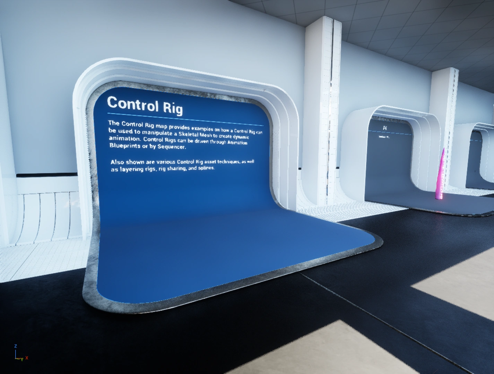
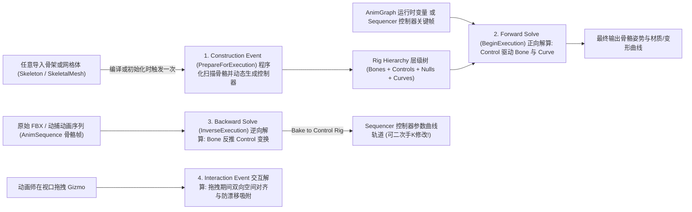
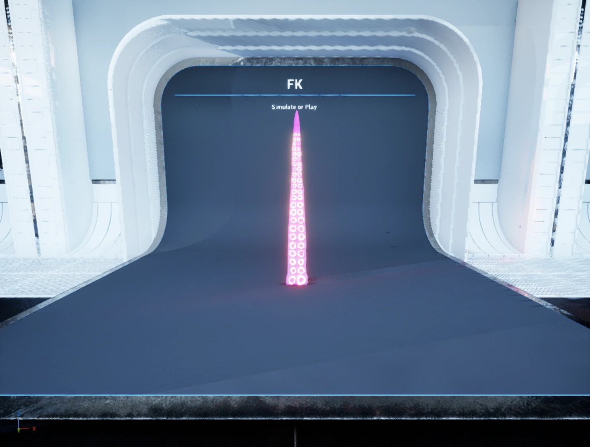
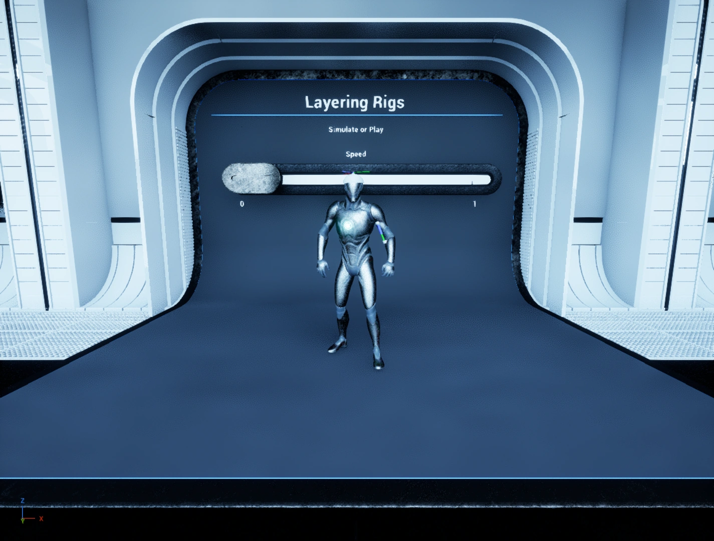
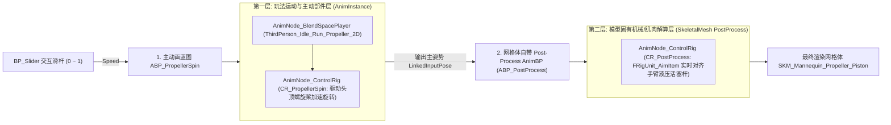
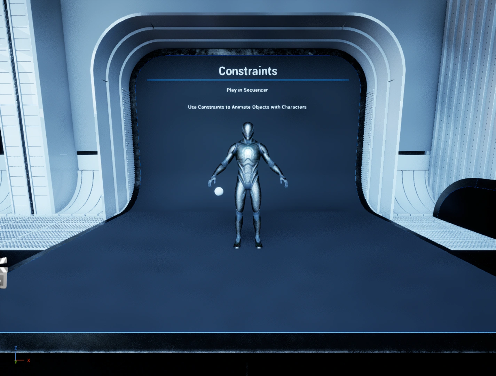
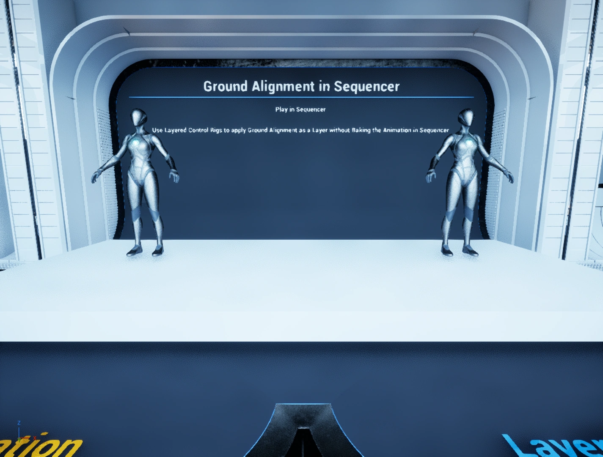
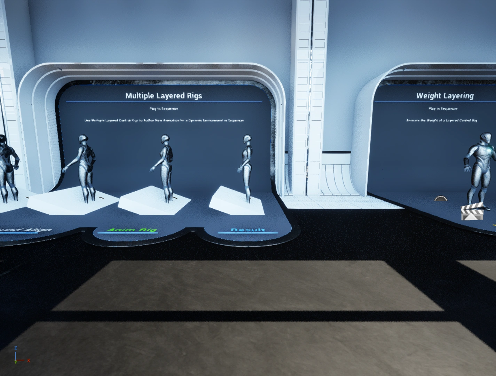

# 05 · 引擎内程序化控制绑定、正向逆向解算与模块化 Rig 全解（`Animation_ControlRig`）

> **本篇实测拆解关卡档案**
> - **关卡路径**：`/Game/Maps/Animation/Animation_ControlRig`（关卡总 Actor 数：`154` | 展台数：`43` | 示例 Actor 数：`94` | 全局未归属辅助 Actor：`InstancedFoliageActor1`）
> - **关卡脚本类**：`/Game/Maps/Animation/Animation_ControlRig.Animation_ControlRig_C`（默认属性：`oldPawn = None`）
> - **核心资产目录**：
>   - `/Game/ExampleContent/ControlRig/Rigs/`（涵盖 `CR_FK`、`CR_Aim`、`CR_LoopingRigElements`、`CR_MorphMaterials`、`CR_SecondaryAnimation`、`CR_SphereTrace`、`CR_IKFootCorrection`、`CR_IKHandCorrection`、`CR_ProceduralAnimStates`、`CR_PropellerSpin`、`CR_PostProcess`、`CR_ConstructionEvent`、`CR_BSpline`、`CR_HermiteSpline`、`CR_GroundAlignment` 共 15 套专精绑定蓝图）
>   - `/Game/ExampleContent/ControlRig/AnimBlueprints/`（13 套运行时驱动动画蓝图 `ABP_*`）
>   - `/Game/ExampleContent/ControlRig/Sequences/`（11 条影视级正逆向烘焙与分层示范序列 `2_1` ~ `3_7`）
>   - `/Game/Characters/Mannequins/Rigs/`（UE5 官方标准人形主绑定 `CR_Mannequin_Body`、脚部自适应 `CR_Mannequin_BasicFootIK` 与程序化扭曲修正 `CR_Mannequin_Procedural`）

---

## 一、 告别“回 Maya 返工地狱”：RigVM 虚拟机与四大生命周期解算架构

在传统游戏开发管线里，引擎与 DCC 软件（Maya、MotionBuilder、Blender）之间横亘着一道厚重的次元壁：引擎里的骨骼网格体（`SkeletalMesh`）本质上只是一台“只读录像放映机”——它只能被动播放烘死在 FBX 里的旋转平移矩阵序列。一旦关卡策划把楼梯台阶垫高了 15 厘米、过场导演想让原本空手奔跑的主角顺手接住半空飞来的苹果、或者物理布娃娃倒地后手臂穿插进了岩石里，动画师就不得不把改后的白盒模型导回 Maya，重新架设绑定、K 帧、烘焙骨骼、再导回虚幻引擎覆盖原资产。在动辄上千个镜头的 3A 项目中，这种“导出—返工—重导”的往返损耗吞噬了难以估量的生产力。

**Control Rig（控制绑定）** 的诞生，相当于直接把整套高性能角色绑定工作台与实时解算器搬进了虚幻引擎内核。



欢迎步入 `/Game/Maps/Animation/Animation_ControlRig` 展厅！这是一条全长超过 **221 米**（`X` 坐标从 `500` 一路延伸至 `22679`）、密集排布着 **43 座受控实验展台** 的宏伟长廊。在出发逐台拆解之前，我们必须先看懂支撑这一切的底层心脏——**RigVM 高性能字节码虚拟机**与**四大解算事件（Execution Events）**。

### 1.1 为什么 Control Rig 没有直接复用普通蓝图虚拟机（Blueprint VM）？
角色全身往往拥有上百根骨骼，在 60 FPS 下同屏几十个角色每帧都要跑一遍逆向运动学（IK）、四元数插值与样条拟合。如果使用面向通用游戏逻辑的传统蓝图虚拟机（每次节点调用都要经历 `UObject` 指针寻址与 `FFrame` 堆栈开销），CPU 瞬间就会爆表。

因此，Epic 专门研发了纯数据导向（Data-Oriented）的 **`RigVM`（`/Script/RigVM`）**：
1. **双缓冲连续内存池**：编译时将所有常量参数收拢进紧凑连续的 **`RigVMMemory_Literal`**（字面量内存块），将运行时弹簧状态、迭代游标与局部变换放入缓存行友好的 **`RigVMMemory_Work`**（工作内存块），彻底消除运行时堆内存分配（Zero Heap Allocation）。
2. **`CachedRigElement` $O(1)$ 索引寻址**：首次评估时将骨骼名（如 `"foot_l"`）或控制器名（如 `"foot_l_ik_ctrl"`）解析并缓存为底层数组下标 `CachedIndex`，后续每帧解算全部退化为极速的连续数组偏移读写。
3. **无状态 C++ 结构体算子（`FRigUnit_*`）**：你在 RigGraph 图表里连的每一个节点，都会被编译成扁平的 **`RigVMByteCode`** 线性指令流，直接调用高度 SIMD 向量化优化的 C++ `FRigUnit` 静态函数。

### 1.2 一张图读懂 Control Rig 的“四权分立”生命周期事件

一个完整的 `ControlRigBlueprint` 并非只有一条单向管线，而是由四个各司其职的入口事件共同构成闭环：



### 1.3 全馆 43 座展台空间拓扑总览
整条 221 米长廊严格按研发管线演进划分为**三大展翼**：
- **第一展翼（展台 `#1` ~ `#11`，`X = 500 ~ 10503`）**：**AnimBP 运行时程序化控制绑定**——在游戏运行期实时执行 FK、Aim 注视、多肢循环遍历、Morph/材质联动、二阶弹簧次级动画、球体射线地形/墙面自适应 IK、程序化状态机、主/后处理双 Rig 叠层，以及一套 Rig 自动适配任意异形骨架的 `Construction Event`。
- **第二展翼（展台 `#12` ~ `#19`，`X = 11849 ~ 15001`）**：**Sequencer 核心制片管线**——利用 `Backward Solve` 将现成跑步序列逆向烘焙为全身控制器曲线、跨不同角色网格体共享同一套绑定（Rig Sharing）、B-Spline 与 Hermite 双样条触手解算，以及基于 `Constraints Manager` 的角色-道具动态父子约束。
- **第三展翼（展台 `#20` ~ `#43`，`X = 16349 ~ 22679`）**：**Sequencer 非破坏性分层绑定（Layered Control Rigs）七大对照实验**——无需烘焙破坏源动画，像 Photoshop 图层一样在走路、开合跳、凹凸地形、飞行道具甚至物理模拟缓存之上无损叠加单层或多层带权重的控制绑定！

现在，让我们从 `#1` 号迎宾台出发，逐一拆解全部 **43 座展台** 的内部工程玄机。

---

## 二、 第一展翼（展台 #1 ~ #11）：AnimBP 运行时程序化绑定与动态造控制器

本展翼所有示例均在游戏运行态（`Simulate or Play`）下实时生效：由关卡中的 `SkeletalMeshActor` 或交互蓝图驱动 `AnimBlueprint`，在 `AnimGraph` 中通过 **`AnimNode_ControlRig`** 节点每帧调度对应的 `CR_*` 资产。

---

### 展台 #1：`Control Rig` — 展厅总纲与全局约束调度基座

- **空间元数据**：展牌 Label `BP_DemoDisplay` | 坐标 `(500, -900, -0)`
- **官方展牌原文说明**：*The Control Rig map provides examples on how a Control Rig can be used to manipulate a Skeletal Mesh to create dynamic animation. Control Rigs can be driven through Animation Blueprints or by Sequencer. Also shown are various Control Rig asset techniques, as well as layering rigs, rig sharing, and splines.*

#### 1.1 展台陈列 Actor 与底层基础设施拆解（共 6 个）
除了提供 `10 : 3` 明亮直射光比的 **`DirectionalLight`**（`Intensity = 10`, `Movable`）、**`SkyLight`**（`Intensity = 3`, `Movable`）、**`SkyAtmosphere`**、**`ExponentialHeightFog`** 以及挂载 `ChaosDebugDrawComponent_0` 的物理调试 **`Actor`** 外，这里隐藏着整张地图极关键的一位幕后总管：
- **`Constraints Manager`**（类 `/Script/Constraints.ConstraintsActor`）：这是 UE5 全局跨对象变换约束系统（Transform Constraints）的持久化管理单例。后续第 `#19`、`#31`~`#32` 号展台中“角色手掌抓握并抛出场景静态网格体球”的父子空间无跳变切换，全部由这枚管理器在 Tick 依赖图中统一协调角色骨骼与外部 Actor 的求值先后顺序！

---

### 展台 #2：`FK` — 正向运动学层级传导与控制器暴露引脚

- **空间元数据**：展牌 Label `BP_DemoDisplay6` | 坐标 `(1500, -900, -0)` | **官方展牌说明**：`Simulate or Play`



#### 2.1 工程原理：为什么不直接改骨骼，而要包一层 `Control`？
正向运动学（Forward Kinematics, FK）遵循最直观的“父动子随”法则：旋转大臂，小臂和手掌跟着一起转。但在动画绑定中，我们绝不直接暴露原始导入骨骼（`Bone`），而是创建专门的控制器（`ERigElementType::Control`，挂载来自 `/ControlRig/Controls/DefaultGizmoLibraryNormalized` 的可视化线框形状），原因有二：一是控制器拥有干净归零的初始偏移空间（Offset/Null Space），随时可一键归零恢复默认姿势；二是控制器可以勾选 **`bExposesAnimatableControls`** 直接暴露为 `AnimNode_ControlRig` 节点上的输入引脚！

#### 2.2 实测资产与 RigGraph 节点深拆
- **陈列 Actor**：
  - `ABP_FK`（`SkeletalMeshActor`）：挂载 15 节紫色吸盘触手网格体 `/Game/ExampleContent/ControlRig/Meshes/Tentacle/Meshes/tentacle`（骨架 `tentacle_Skeleton` 包含 `tent_1` ~ `tent_15` 纵向链）。
  - `ControlRigControlActor13`（`/Script/ControlRig.ControlRigControlActor`）：用于在关卡视口中实时绘制控制器辅助框。
- **驱动动画蓝图 `/Game/ExampleContent/ControlRig/AnimBlueprints/ABP_FK`**：
  - 成员变量：`["FK Control Transform"]`。在 `EventGraph` 中随时间生成周期旋转变换，通过自定义暴露属性引脚 `__CustomProperty_tent_1_fk_ctrl` ~ `__CustomProperty_tent_5_fk_ctrl` 同时喂给 `AnimNode_ControlRig` 上的 5 级 FK 控制器！
- **控制绑定 `/Game/ExampleContent/ControlRig/Rigs/CR_FK` 内部结构**：
  - **层级控制器清单**：`root_ctrl` 以及分段控制触手弯曲的 5 枚欧拉变换控制器 `tent_1_fk_ctrl`、`tent_2_fk_ctrl`、`tent_3_fk_ctrl`、`tent_4_fk_ctrl`、`tent_5_fk_ctrl`（`ERigControlType::EulerTransform`）。
  - **Forward Solve 核心节点流**：
    ```text
    FRigUnit_BeginExecution (Forward Solve)
      ──► FRigUnit_GetTransform / FRigUnit_SetTransform (基础根变换同步)
      ──► FRigUnit_ParentConstraint (× 多级串联, bMaintainOffset = true, InterpolationType = Average)
            ├── Parents[0] = tent_1_fk_ctrl ──► Child = tent_1 等对应触手骨骼段
            └── 逐级向下累加旋转角，使整根触手呈现出富有韵律的波浪卷曲！
    ```

---

### 展台 #3：`Aim` — 视线与胸腔朝向数学解算器（Aim Constraint）

- **空间元数据**：展牌 Label `BP_DemoDisplay7` | 坐标 `(2501, -900, -0)` | **官方展牌说明**：`Simulate or Play`

#### 3.1 工程痛点与双轴四元数对齐原理
在射击或探索游戏中，角色需要时刻转头注视空中的无人机、路边的交互物或玩家准星。如果手动算 Pitch/Yaw 欧拉角再去改脖子骨骼，极易遭遇万向节死锁（Gimbal Lock）或脖子拧麻花翻转。Control Rig 提供了纯向量几何驱动的 **`Aim`** 节点族：指定骨骼的**主轴（`Primary.Axis`）**对准目标点（`EControlRigVectorKind::Location`），同时用**副轴（`Secondary.Axis`，即 Up Vector 上方向参考轴）**锚定头顶或胸腔朝向，从数学根源上杜绝侧翻！

#### 3.2 实测资产与 RigGraph 节点深拆
- **陈列 Actor**：`SKM_Quinn`（网格体 `SKM_Quinn_Simple`）+ `ControlRigControlActor12`。
- **驱动动画蓝图 `/Game/ExampleContent/ControlRig/AnimBlueprints/ABP_Aim`**：
  - 成员变量：`["Aim Target Ctrl Location X", "Aim Target Ctrl Location Z"]`。在运行态动态画圆改变二维平面坐标，通过暴露引脚 `__CustomProperty_aim_target_ctrl` 传入二维/空间目标点控制器。
- **控制绑定 `/Game/ExampleContent/ControlRig/Rigs/CR_Aim` 内部结构**：
  - **核心控制器**：`aim_target_ctrl`（注视靶心控制器）。
  - **Forward Solve 节点链**：调用 **`FRigUnit_AimBoneMath`** 与 **`AimItem`**（`RigUnit_AimItem`），以 `EBoneGetterSetterMode::GlobalSpace` 全局空间计算从角色上半身/头部骨骼指向 `aim_target_ctrl` 的四元数增量，并通过 `Weight` 权重分配让脊柱与头颈自然协同转头注视移动靶心。

---

### 展台 #4：`Looping Rig Elements` — 集合查询与 `ForEach` 循环批处理多肢体

- **空间元数据**：展牌 Label `BP_DemoDisplay8` | 坐标 `(3500, -900, -0)` | **官方展牌说明**：`Simulate or Play`

#### 4.1 为什么要学集合（Collection）与循环？告别“复制粘贴五遍节点”！
展台上是一只拥有五条对称腕足的海星怪 `/Game/ExampleContent/IKRig/Mesh/Starfish/Starfish`（骨架 `Starfish_Skeleton`）。在传统动画蓝图里，给五条腿做同样的卷曲动作往往要把节点复制粘贴五份；一旦蜘蛛有八条腿、蜈蚣有四十条腿，图表立刻灾难性失控。而在 RigVM 中，骨骼与控制器都是可编程的一等公民结构体 **`RigElementKey`**，天然支持数组遍历！

#### 4.2 实测资产与 RigGraph 节点深拆
- **陈列 Actor**：`Starfish` + `ControlRigControlActor4`。
- **驱动动画蓝图 `/Game/ExampleContent/ControlRig/AnimBlueprints/ABP_LoopingRigElements`**：
  - 成员变量：`["Limb Control"]`（单一浮点数正弦往复变化），映射至暴露引脚 `Limb_Control`。
- **控制绑定 `/Game/ExampleContent/ControlRig/Rigs/CR_LoopingRigElements` 内部结构**：
  - **核心控制器**：`Limb_Control`（`ERigControlType::Float`，单通道标量控制器）。
  - **Forward Solve 核心节点流**：
    1. **`FRigUnit_GetControlFloat`**：读取 `Limb_Control` 当前浮点值；
    2. **`FRigUnit_CollectionChildrenArray`**：一次性收集海星根骨骼下属的所有肢体子骨骼集合（`RigElementKeyCollection`）；
    3. **`ERigVMOpCode::ArrayIterator`（ForEach 循环指令）**：遍历每一节腕足骨骼，结合迭代进度比例 `Ratio` 喂入 **`FRigUnit_AnimEvalRichCurve`**（评估内置 `RuntimeFloatCurve` 富曲线，决定腕足根部到尖端的弯曲衰减包络）；
    4. **`FRigUnit_MathTransformFromSRT`** $\rightarrow$ **`FRigUnit_OffsetTransformForItem`**：仅用一套逻辑循环，同步驱动海星全部五条腕足优雅地同步开合呼吸！

---

### 展台 #5：`Animating Morphs and Materials` — 控制器一线双雕驱动变形目标与动态材质

- **空间元数据**：展牌 Label `BP_DemoDisplay9` | 坐标 `(4500, -900, -0)` | **官方展牌说明**：`Simulate or Play`

#### 5.1 工程亮点：打通骨骼、顶点 Morph 与像素着色器的任督二脉
很多开发者误以为 Control Rig 只能旋转骨骼。实际上，虚幻的动画管线除了传递骨骼姿势（Bone Pose），还同步流淌着一套万能信使——**动画曲线（Animation Curves，`ERigElementType::Curve`）**！只要在网格体上存在同名 Morph Target，或者材质参数勾选了曲线驱动（Material Curve），Control Rig 就能用一个控制器同时捏脸变形并让皮肤充血变色！

#### 5.2 实测资产与 RigGraph 节点深拆
- **陈列 Actor**：`SK_Box_Morph_1`（挂载带变形目标的盒子网格体 `/Game/ExampleContent/Morph_Targets/Morph_1/SK_Box_Morph_1`，组件覆写了动态材质实例 `MaterialInstanceDynamic_0`）+ `ControlRigControlActor5`。
- **驱动动画蓝图 `/Game/ExampleContent/ControlRig/AnimBlueprints/ABP_MorphMaterials`**：
  - 成员变量：`["ControlValue"]`（2D 向量），驱动暴露控制器 `MorphMaterial_Ctrl`。
- **控制绑定 `/Game/ExampleContent/ControlRig/Rigs/CR_MorphMaterials` 内部结构**：
  - **核心控制器**：`MorphMaterial_Ctrl`（`ERigControlType::Vector2D` 二维平面滑块控制器，运行于 `MorphMaterial_CtrlSpace` 局部空间）。
  - **Forward Solve 节点流**：
    ```text
    FRigUnit_BeginExecution
      ──► FRigUnit_GetControlVector2D (读取 MorphMaterial_Ctrl 的 Vector.X 与 Vector.Y)
      ──► 分支 A (X 轴): FRigUnit_AnimEvalRichCurve ──► FRigUnit_SetCurveValue (写入网格体 Morph Target 变形权重曲线)
      ──► 分支 B (Y 轴): FRigUnit_AnimEvalRichCurve_1 ──► FRigUnit_SetCurveValue_1 (写入曲线 "MorphColor"，实时改变盒子材质颜色!)
    ```

---

### 展台 #6：`Secondary Animation` — 零刚体开销的二阶弹簧次级跟随动画

- **空间元数据**：展牌 Label `BP_DemoDisplay10` | 坐标 `(5500, -900, -0)` | **官方展牌说明**：`Simulate or Play`

#### 6.1 工程权衡：二阶胡克定律弹簧（`SpringInterp`）vs 韦尔莱积分（`Verlet`）
观察展台上的小机器人 `/Game/Characters/StackOBot/Mesh/SKM_Bot`：当它的骨盆沿 X 轴左右平移急停时，头顶天线与悬空四肢会产生极其 Q 弹自然的惯性滞后摆动（Follow-through & Overlapping Action）！如果为此启动完整的 Chaos 刚体物理资产模拟，不仅开销重，还容易在角色高速传送时炸飞。而在 Control Rig 中，只需几个轻量数学模拟算子即可搞定：
- **`FRigUnit_SpringInterpVectorV2`（本展台实测采用）**：求解带临界阻尼系数（`CriticalDamping`）与刚度（`Strength`）的二阶常微分弹簧阻尼方程：
  $$\mathbf{a}(t) = k \cdot (\mathbf{p}_{\text{target}} - \mathbf{p}(t)) - c \cdot \mathbf{v}(t)$$
  支持注入目标速度前馈量 `TargetVelocityAmount` 与外力 `Force`，能量收敛极稳，特别适合机械天线、背包挂件、尾巴与胸部/肌肉微颤。
- **同门兄弟 `RigUnit_VerletIntegrateVector`（韦尔莱质点积分）**：基于前后两帧位置差隐式推导速度并施加重力与阻尼，更适合纯重力垂坠感强的软绳或披风下摆。

#### 6.2 实测资产与 RigGraph 节点深拆
- **陈列 Actor**：`SKM_Bot` + `ControlRigControlActor7`。
- **驱动动画蓝图 `/Game/ExampleContent/ControlRig/AnimBlueprints/ABP_SecondaryAnimation`**：
  - 成员变量：`["Pelvis Ctrl Location X"]`，向暴露属性 `pelvis_ctrl`（`ERigControlType::Position`）输入左右往复位移。
- **控制绑定 `/Game/ExampleContent/ControlRig/Rigs/CR_SecondaryAnimation` 内部结构**：
  - 先通过 `FRigUnit_ParentConstraint` 让机器人躯干跟随 `pelvis_ctrl` 移动；
  - 对次级摆动部位调用 **`FRigUnit_CollectionChildrenArray`** + `ArrayIterator` 循环，内部运行 **`FRigUnit_SpringInterpVectorV2`** 追踪目标世界坐标，再用 **`FRigUnit_MathQuaternionFromTwoVectors`** 将滞后的弹簧质点偏移向量逆推为关节旋转增量，经 **`FRigUnit_SetRotation`**（权重由 `AnimEvalRichCurve` 控制沿链条平滑衰减）写回骨骼！

---

### 展台 #7：`Sphere Trace` — Control Rig 主动感知物理世界的“触觉眼睛”

- **空间元数据**：展牌 Label `BP_DemoDisplay11` | 坐标 `(6500, -900, -0)` | **官方展牌说明**：`Simulate or Play`

#### 7.1 为什么直接在 Rig 图里打射线是架构质变？
在 UE4 时代，动画蓝图想要做脚部贴地，必须在角色蓝图的 `Event Tick` 里写一堆 `SphereTraceByChannel`，存成十几个浮点/向量变量，再在 `AnimBP EventGraph` 里 `Cast To Character` 拷一遍，最后传给 `AnimGraph` 里的 `Two Bone IK`——逻辑碎成三截，极难复用到过场动画 Sequencer 中！

Control Rig 内置了物理查询节点 **`FRigUnit_SphereTraceByObjectTypes` / `FRigUnit_SphereTraceByTraceChannel`**：**绑定资产自己就能向物理世界发射球体扫掠检测**！无论挂载在游戏角色身上，还是拖进 Sequencer 时间轴里，都能即插即用实时感知障碍物。

#### 7.2 实测资产与 RigGraph 节点深拆
- **陈列 Actor（共 3 个）**：
  - `ABP_SphereTrace`（`SKM_Manny_Simple`）：底层 `AnimNode_SequencePlayer` 循环播放 `/Game/ExampleContent/ControlRig/Animations/ThirdPersonIdle` 待机动画，串联 `AnimNode_ControlRig`（运行 `CR_SphereTrace`）。
  - `BP_MovingSphere`（`/Game/ExampleContent/ControlRig/Blueprints/BP_MovingSphere`）：携带 `/Engine/BasicShapes/Sphere` 静态网格体，在角色右腿下方上下往复升降运动（含变量 `"Initial Relative Location"`, `"NewVar_0"`）。
  - `ControlRigControlActor4`：视口控制器可视化代理。
- **控制绑定 `/Game/ExampleContent/ControlRig/Rigs/CR_SphereTrace` 内部结构**：
  - **核心控制器**：`foot_r_ctrl`（右脚 IK 控制器）与 `leg_r_pv_ctrl`（右膝极向量 Pole Vector 控制器）。
  - **Forward Solve 节点流**：
    1. 从右脚上方至脚底发射 **`FRigUnit_SphereTraceByObjectTypes`**，并用 **`FRigUnit_VisualDebugVectorItemSpace`** 绘制调试向量；
    2. 一旦命中上升的 `BP_MovingSphere`，提取命中点 `HitLocation` 与表面法线 `HitNormal`；
    3. 用 **`FRigUnit_AimBoneMath`** 将脚掌上方向对齐球面法线 `HitNormal`（脚掌随球面倾斜！），并将高度抬升至 `HitLocation`；
    4. 交由 **`FRigUnit_TwoBoneIKSimplePerItem`** 实时解算右大腿（`thigh_r`）与右小腿（`calf_r`）弯曲角，让 Manny 单腿稳稳踩在不断起伏的移动圆球上！

---

### 展台 #8：`IK w/ Sphere Trace` — 高低台阶脚步贴合与出拳防穿墙双人实战

- **空间元数据**：展牌 Label `BP_DemoDisplay12` | 坐标 `(7499, -900, -0)` | **官方展牌说明**：`Simulate or Play`

#### 8.1 双场景同台演绎：下半身落脚修正 vs 上半身交互防穿模
这座展台一口气布置了 **9 个陈列 Actor**（3 块高低错落的 `SM_DemoCube` 平台/墙壁、2 个 `TargetPoint` 以及左右两位主角 Quinn 与 Manny），将 `#7` 的球体射线 IK 升级为两套可直接投入商业实战的完整子系统！

#### 8.2 左侧展品：高低台阶开合跳自适应（`ABP_IKFootCorrection` + `CR_IKFootCorrection`）
- **Actor 配置**：`ABP_IKFootCorrection`（`SKM_Quinn_Simple`）站在两块一高一低的 `SM_DemoCube` 上播放大幅度跳跃动作 `/Game/ExampleContent/ControlRig/Animations/JumpingJacks`。
- **`CR_IKFootCorrection` 核心工程细节**：
  - **控制器与属性**：`foot_l_ctrl`、`foot_r_ctrl`、`leg_l_pv_ctrl`、`leg_r_pv_ctrl`，内部维护 `leftFootEffectorOffset` 与 `rightFootEffectorOffset`。
  - **为什么多加了一个 `FRigUnit_SpringInterpV2`？** 这是新手做脚部 IK 最容易踩坑的地方：当角色从平地跨上高台阶瞬间，射线命中高度会发生阶跃突变（Step Discontinuity）；如果直接把突变高度塞进 `TwoBoneIK`，膝盖会在 1 帧之内“瞬移咔哒弹射（Knee Popping）”！`CR_IKFootCorrection` 在 `FRigUnit_SphereTraceByObjectTypes` 与 **`FRigUnit_TwoBoneIKSimplePerItem`** 之间串入了弹簧阻尼平滑器 **`FRigUnit_SpringInterpV2`**，并调用 `FRigUnit_ProjectTransformToNewParent` 动态重投影空间，令双脚起跳离地与落地踩上方块的过程丝滑无顿挫！

#### 8.3 右侧展品：近墙重拳防穿插缓冲（`ABP_IKHandCorrection` + `CR_IKHandCorrection`）
- **Actor 配置**：`ABP_IKHandCorrection`（`SKM_Manny_Simple`）面对右侧竖立的 `SM_DemoCube_3` 墙体，通过 `AnimNode_Slot` 循环播放组合拳蒙太奇 `/Game/ExampleContent/ControlRig/Animations/Punch_Montage`（拼合 `MontageExample_Punch_1/2` 与 `MontageExample_End_1`）。
- **动画蓝图成员变量**：`["HandRadius", "RightHandEffectorLocation", "IKRightHandAlpha", "IKLeftHandAlpha", "LeftHandEffectorLocation"]`。
- **`CR_IKHandCorrection` 节点流**：
  - 包含 `hand_l_ctrl`、`hand_r_ctrl`、`arm_l_pv_ctrl`、`arm_r_pv_ctrl` 以及状态属性 `leftHandAlpha` / `rightHandAlpha`、`leftHandTraceLocation` / `rightHandTraceLocation`。
  - 在出拳轨迹上从肩肘向拳峰发射 **`FRigUnit_SphereTraceByTraceChannel`**。当拳头即将穿透面前的 `SM_DemoCube_3` 砖墙时，自动将手部 IK 目标点截停在墙面外侧一个拳头半径（`HandRadius`）处，并根据距离动态拉高 `ReachAlpha`，通过 **`FRigUnit_TwoBoneIKSimplePerItem`** 让手肘自然向外弯曲卸力——再也不会出现“一拳穿进墙体模型背面”的穿帮镜头！

---

### 展台 #9：`Procedrual Animation States` — 零动画资产！纯数学公式合成多状态生物动作

- **空间元数据**：展牌 Label `BP_DemoDisplay13` | 坐标 `(8500, -900, -0)` | **官方展牌说明**：`Simulate or Play` / `Hit Button to Change States` *(注：展牌标题与蓝图名保留了官方工程原汁原味的拼写彩蛋 `Procedrual`)*

#### 9.1 工程价值：当怪物没有任何 FBX 动画文件时，如何赋予它生命？
在独立游戏或深海异形 Boss 研发中，像章鱼触手、机械臂、食人花藤蔓这类多关节生物，用正弦波相位差与旋转分布节点生成的程序化动画，往往比手 K 循环帧更灵动且完全不占动画内存！

#### 9.2 实测资产与 RigGraph 节点深拆
- **陈列 Actor（共 2 个）**：
  - `BP_ProcedrualAnimStates`（`/Game/ExampleContent/ControlRig/Blueprints/BP_ProcedrualAnimStates`）：持有布尔状态变量 `"IsAttacking"`（默认 `false`）与 `tentacle` 骨骼网格体，实现按钮接口 `BPInterface_Button`。
  - `BP_DemoTrigger`（`/Game/Global/Interactable/BP_DemoTrigger`）：玩家走上前踩击或交互按钮时，触发 `tiggered Actor` 翻转 `IsAttacking` 布尔值，并同步传给动画蓝图 `ABP_ProceduralAnimStates` 的 `"Is Attacking"` 变量。
- **控制绑定 `/Game/ExampleContent/ControlRig/Rigs/CR_ProceduralAnimStates` 内部结构**：
  - **控制器与输入参数**：`tentacle_rotation_ctrl` 与布尔开关 `isAttacking`（通过 `__CustomProperty_IsAttacking` 实时注入）。
  - **Forward Solve 双状态分支流（`RigVMBranchNode`）**：
    1. **`FRigUnit_CollectionChildrenArray`**：递归获取触手全部 15 节骨骼数组（`bIncludeParent` + `bRecursive`）；
    2. **双速率时间轴（`FRigUnit_Timeline` × 2）**：当 `IsAttacking == false`（待机态）时，采用低频温和的 `Speed` 推进时间轴，经 **`FRigUnit_MathFloatSin`** 与 **`FRigUnit_MathFloatRemap`** 映射为舒缓的欧拉摆角；当玩家按下按钮使 `IsAttacking == true`（狂暴攻击态）时，切换至高频大幅度正弦曲线并叠加前扑倾角；
    3. **`FRigUnit_DistributeRotationForItemArray`**：将算出的多组四元数旋转（`FRigUnit_MathQuaternionFromEuler`）按缓动曲线（`EControlRigAnimEasingType`）均匀分摊到 15 节触手骨骼上，瞬间完成从“水草般慵懒摇曳”到“猛烈抽击地面”的状态切换！

---

### 展台 #10：`Layering Rigs ` — 主动画蓝图与网格体后处理蓝图的双层 Rig 协同管线

- **空间元数据**：展牌 Label `BP_DemoDisplay14` | 坐标 `(9500, -900, -0)` | **3D 文字标签**：`0` | `0.5` | `1`



#### 10.1 极其经典的架构示范：如何解耦“玩法主动控制层”与“角色解剖/机械联动层”？
仔细观察上图的特种改造人形模特 `/Game/ExampleContent/ControlRig/Meshes/Mannequin_Propeller_Piston/SKM_Mannequin_Propeller_Piston`：它头顶装有一枚三叶螺旋桨骨骼（`propeller1`），左小臂与大臂之间架设了一套红绿蓝涂装的液压活塞连杆骨骼（`lowerarm_piston`）。如果把螺旋桨逻辑和手臂活塞解算全塞进一张臃肿的 Rig 里，任何换装或动作复用都会牵一发而动全身。官方在这里展示了教科书级的**运行时双层 Control Rig 职责分离架构**：



#### 10.2 实测资产与两套 `CR_*` 内部节点深拆
1. **交互驱动链路**：`BP_LayeringRigs` 每帧读取旁侧 `BP_Slider`（范围 `[0, 1]`）的滑块值赋给 `Speed`，传入主动画蓝图 **`ABP_PropellerSpin`**。
2. **第一层（玩法层）`ABP_PropellerSpin` + `/Game/ExampleContent/ControlRig/Rigs/CR_PropellerSpin`**：
   - 先由 `AnimNode_BlendSpacePlayer` 根据 `speed` 混合播放 `ThirdPersonIdle_Propeller_Piston`、`ThirdPersonWalk_Propeller_Piston` 与 `ThirdPersonRun_Propeller_Piston`；
   - 再流入 `CR_PropellerSpin`：接收暴露参数 `Propeller_Spin`，经过 **`FRigUnit_AlphaInterp`** 平滑加减速映射与 `AnimEvalRichCurve` 曲线整形后，送入带记忆状态的累加器 **`FRigUnit_AccumulateFloatAdd`** 逐帧累加偏航角，通过 **`FRigUnit_SetRotation`** 驱动头顶 `propeller1` 骨骼越转越快！
3. **第二层（模型固有后处理层）`ABP_PostProcess` + `/Game/ExampleContent/ControlRig/Rigs/CR_PostProcess`**：
   - 直接绑定在 `SKM_Mannequin_Propeller_Piston` 网格体资产的 `Post Process Anim Blueprint` 槽位上（任何播放该模型的场景或 Sequencer 都会自动生效！）。
   - `ABP_PostProcess` 通过 `AnimNode_LinkedInputPose` 接收上一层摆好姿势的手臂骨骼，送入 `CR_PostProcess`：内部调用两组对向的 **`FRigUnit_AimItem`**（`AimItem` 与 `AimItem_1`），让大臂端的活塞套筒与小臂端的活塞连杆 `lowerarm_piston` 实时互相瞄准插合——无论手臂如何摆动奔跑，液压杆永远严丝合缝地伸缩咬合，绝不错位脱节！
   > **延伸印证**：工程中标准人形角色 `/Game/Characters/Mannequins/Rigs/ABP_Manny_PostProcess` 与 `ABP_Quinn_PostProcess` 同样采用了这一黄金范式——内部串联 **`CR_Mannequin_Procedural`**（使用 `FRigUnit_MathQuaternionSwingTwist` 四元数摆动-扭转分解算法自动分摊手腕/脚踝扭转角，防止拧糖纸塌陷）与 12 组 `AnimNode_PoseDriver`（RBF 径向基函数矫形驱动器），全自动守护角色肌肉解剖形态！

---

### 展台 #11：`Procedurally Created Rigs` — `Construction Event` 一套代码自动给万千异形骨架造绑定！

- **空间元数据**：展牌 Label `BP_DemoDisplay22` | 坐标 `(10503, -900, -0)` | **官方展牌说明**：`Simulate or Play` / `Dynamically Create Controls from any Skeleton with Construction Event`

#### 11.1 震撼工程奇观：为什么单链触手和五角海星能共用同一个 `CR_ConstructionEvent`？
走到第一展翼尽头的 `#11` 号展台，你会看到极具冲击力的一幕：左边是一根纵向 15 节的章鱼触手 **`Tentacle_ConstructionEvent`**（`ABP_ConstructionEvent_Tentacle`），右边是一只放射状五条腿的海星 **`Starfish_ConstructionEvent`**（`ABP_ConstructionEvent_Starfish`）。它们的骨骼拓扑结构风马牛不相及，但打开两者的动画蓝图依赖表，竟然指向**完全相同的唯一一份绑定资产：`/Game/ExampleContent/ControlRig/Rigs/CR_ConstructionEvent`**！

秘诀就在于它彻底抛弃了手工静态摆控制器，而是利用 **`FRigUnit_PrepareForExecution`（Construction Event 构造事件）** 在资产初始化阶段**用代码动态扫描骨架并现场生成整套控制器树**！

#### 11.2 `CR_ConstructionEvent` 构造与前向双阶段字节码全拆解
根据实测字节码符号表，其内部精妙绝伦地分成了“动态造器官”与“按标签驱器官”两步：
1. **阶段一：`Construction Event`（`FRigUnit_PrepareForExecution`）动态生成层级与元数据打标**
   ```text
   FRigUnit_PrepareForExecution (Construction Event)
     ├─► 1. FRigUnit_HierarchyImportFromSkeleton (动态将当前宿主网格体的整棵骨骼树导入 RigHierarchy!)
     ├─► 2. FRigUnit_HierarchyAddControl (生成全局总开关布尔控制器 "procedurally_animate_ctrl", ERigControlType::Bool)
     └─► 3. FRigUnit_CollectionGetAll (检索所有 Bone 元素) ──► ArrayIterator 遍历每根骨骼:
             ├── FRigUnit_HierarchyGetParent (查询父骨骼关系，保持原始拓扑树结构)
             ├── FRigUnit_NameConcat (将骨骼名拼接后缀 "_ctrl" 生成唯一控制器名)
             ├── FRigUnit_HierarchyAddControlTransform (在每根骨骼位置动态生成 Transform 控制器并挂载父子级!)
             └── FRigUnit_SetMetadataTag (给新生成的控制器打上元数据标签 Tag = "DrivenControls"!)
   ```
2. **阶段二：`Forward Solve`（`FRigUnit_BeginExecution`）基于元数据解耦驱动**
   - 先用 **`FRigUnit_GetControlBool`** 检查 `procedurally_animate_ctrl` 开关；
   - 调用 **`FRigUnit_FindItemsWithMetadataTag`**（搜索标签 `"DrivenControls"`）——无论宿主是 15 节触手还是 25 节海星，瞬间精准捞出刚才动态生成的全部控制器数组！
   - 配合 **`FRigUnit_Timeline`** + **`FRigUnit_MathFloatSin`** + **`FRigUnit_MathQuaternionFromEuler`** 生成正弦波动旋转，最终通过批量接口 **`FRigUnit_GetTransformItemArray`** / **`FRigUnit_SetTransformItemArray`** 一次性回写骨骼变换！这就是数据驱动与元数据解耦的极致美学。

---

## 三、 第二展翼（展台 #12 ~ #19）：逆向解算烘焙、跨物种共享、双样条与父子约束

从 `#12` 号展台（`X = 11849`）开始，交互提示统一变为 **`Play in Sequencer`**：我们正式进入影视动画与游戏过场修帧（Cinematics & Anim Authoring）领地！在编辑器中选中各展台前的 `LevelSequenceActor` 打开 Sequencer 播放器即可逐帧检视。

---

### 展台 #12：`Rig Inversion` — 逆向解算（Backward Solve）的数学与工业意义

- **空间元数据**：展牌 Label `BP_DemoDisplay3` | 坐标 `(11999, -900, -0)` | **官方展牌说明**：`Play in Sequencer`

#### 12.1 为什么要做“绑定逆向求逆（Rig Inversion）”？
动作捕捉棚（Mocap）录出来的数据，或者资产商店买来的现成跑步动画（`AnimSequence`），只包含每根底层骨骼（`pelvis`、`thigh_l`、`calf_l`、`foot_l`）的逐帧旋转平移，**完全没有任何 IK 控制器或极向量（Pole Vector）的数据**！如果你直接在角色身上挂一个空白的 `CR_Mannequin_Body`，由于控制器全停在原点 T-Pose，正向解算会瞬间把跑步姿势覆盖成呆若木鸡的站姿。

为了把现成骨骼动画变成可编辑的控制器关键帧，全功能绑定（如 `/Game/Characters/Mannequins/Rigs/CR_Mannequin_Body`）专门实现了 **`FRigUnit_InverseExecution`（Backward Solve 逆向解算图）**：
- **脚掌/手掌 IK 逆推**：读取当前帧 `foot_l` 骨骼的全局变换，直接反向写入 `foot_l_ik_ctrl` 控制器；
- **膝肘极向量（Pole Vector）几何外推**：读取大腿 `thigh_l`、小腿 `calf_l`、脚踝 `foot_l` 三点构成的弯曲平面法向，沿膝盖正前方外推固定距离算出 `leg_l_pv_ik_ctrl` 的精确空间位置，确保正逆解算切换时膝盖朝向 **0.001 度都不偏**！
- **FK 链与手指逐节对齐**：遍历脊柱、颈部与五指关节，将骨骼局部变换完美复刻回 `spine_01~03_ctrl` 及全部指节控制器。

---

### 展台 #13：`Original` — 逆向烘焙对照组的纯净源动画基线

- **空间元数据**：展牌 Label `BP_DemoDisplay19` | 坐标 `(11849, -658, 0)`

#### 13.1 展台陈列 Actor 与关卡序列拆解（共 2 个）
- **`Quinn_Run_Fwd`**（`SkeletalMeshActor`，网格体 `SKM_Quinn_Simple`，`animClass = None`）：作为左侧纯净基准组。
- **`2_1_Rig_Inversion_LS`**（资产路径 `/Game/ExampleContent/ControlRig/Sequences/2_1_Rig_Inversion_LS`）：
  - **序列规格**：帧率 `30 fps`，播放区间 `[0, 51]` 帧（时长 1.7 秒）。
  - **源轨道绑定**：`Mannequin_Male_Jog_Fwd` 绑定仅挂载了一条传统的骨骼动画序列轨道 `MovieSceneSkeletalAnimationTrack_4`——骨骼忠实播放慢跑循环，但视口里没有任何可拖拽修改的控制器手柄。

---

### 展台 #14：`Baked to Control Rig` — 反解落地！全身 80+ 控制器通道随心修帧

- **空间元数据**：展牌 Label `BP_DemoDisplay18` | 坐标 `(12149, -658, 0)`

#### 14.1 展台陈列 Actor 与烘焙后轨道通道全解剖（共 2 个）
- **`Quinn_Run_Fwd_Baked`**（`SKM_Quinn_Simple`）+ **`ControlRigControlActor10`**：作为右侧逆向烘焙成果组，受同一条 `2_1_Rig_Inversion_LS` 中的 `Mannequin_Male_Jog_Fwd_Baked` 绑定驱动！
- **右键 `Bake to Control Rig` 后发生了什么？**
  实测提取 `2_1_Rig_Inversion_LS` 二进制参数轨道表可见，原有的骨骼轨道被自动静音禁用，取而代之的是一条满载曲线通道的 **`MovieSceneControlRigParameterTrack_1`**，完整接管了 `CR_Mannequin_Body` 的全套控制器体系：
  - **全局与躯干重心**：`global_ctrl`、`root_ctrl`、`body_ctrl`、`body_offset_ctrl`、`hips_ctrl`、`hips_tan_ctrl`、`spine_01~03_ctrl`、`chest_ctrl`、`chest_tan_ctrl`、`neck_01~02_ctrl`、`head_ctrl` / `head_ik_ctrl`；
  - **双臂 FK/IK 与极向量**：`clavicle_l/r_ctrl`、`upperarm_l/r_fk_ctrl`、`lowerarm_l/r_fk_ctrl`、`hand_l/r_fk_ctrl`、`hand_l/r_ik_ctrl`、`hand_l/r_ikorient_ctrl`、`arm_l/r_pv_ik_ctrl` 及全套五指掌骨与三节指骨控制器（`thumb` / `index` / `middle` / `ring` / `pinky_01~03_l/r_ctrl`）；
  - **双腿反向脚掌滚动系统（Reverse Foot Roll）**：`thigh_l/r_fk_ctrl`、`calf_l/r_fk_ctrl`、`foot_l/r_ik_ctrl`、`leg_l/r_pv_ik_ctrl`、`foot_roll_l/r_ctrl`、`heel_l/r_ctrl`、`tip_l/r_ctrl`、`ball_l/r_ik_ctrl`、`roll_blend_l/r_ctrl` 及脚趾控制器！
  此时你在 Sequencer 里看到它的慢跑姿态与左侧 `#13 Original` **像素级完全重合**，但你随时可以在曲线编辑器里框选 `hand_r_ik_ctrl` 往上抬高 30 厘米，让她一边跑步一边向镜头挥手致意！

---

### 展台 #15：`Rig Sharing` — 一套绑定通吃流光机器人与写实发丝少女 Echo！

- **空间元数据**：展牌 Label `BP_DemoDisplay4` | 坐标 `(13002, -900, -0)` | **官方展牌说明**：`Play in Sequencer` / `Share a Control Rig on Different Skeletal Meshes`

#### 15.1 为什么说 Control Rig 是“面向骨骼语义而非特定网格”的？
只要两个不同角色满足骨骼层级命名兼容（或共用兼容 `Skeleton`），哪怕高矮胖瘦、网格拓扑甚至挂载的毛发物理截然不同，同一份 `ControlRig`（靠 `Construction Event` 在初始化时读取各自骨骼的初始参考姿势 `Initial Transform`）就能完美适配不同身材！

#### 15.2 展台 5 个陈列 Actor 与高精度 Groom 毛发绑定实测拆解
- **`2_2_Rig_Sharing_LS`**（`/Game/ExampleContent/ControlRig/Sequences/2_2_Rig_Sharing_LS`，`30 fps`，区间 `[0, 57]` 帧）：
  - 左侧绑定 **`Manny_Rig_Sharing`**（`SKM_Manny_Simple` + `ControlRigControlActor8`）：驱动 `MovieSceneControlRigParameterTrack_0`；
  - 右侧绑定次世代写实女主角 **`BP_EchoHair`**（`/Game/Characters/Echo/BP_EchoHair` + `ControlRigControlActor7`）：其 `Body` 骨骼网格体（`/Game/Characters/Echo/Meshes/Echo`）直接挂载了同款绑定的 `MovieSceneControlRigParameterTrack_1`！
- **惊喜看点：`BP_EchoHair` 身上的高精度发丝级 Groom 资产是如何跟随共享 Control Rig 运动的？**
  实测拆解 `BP_EchoHair` 组件树，除了 `Body` 外，还挂载了两套基于 `/Script/HairStrandsCore` 的真实发丝资产：
  1. **`Eyebrows_L_Echo`（眉毛 Groom）**：包含 `1,489` 根渲染曲线（`18,839` 个曲线顶点）与 `2,380` 根引导线，通过 `Eyebrows_L_Echo_Echo_M3D_LOD0_Binding` 贴合面部蒙皮；
  2. **`Hair_S_UpdoBuns`（双丸子盘发 Groom）**：高达 **`43,602` 根真实渲染发丝曲线（`519,159` 个顶点！）** 与 `3,112` 根物理引导发束，最长达 `25.78 cm`，开启 `bVoxelize = true` 体素化深阴影与 `AngularSprings` 弹簧物理架构，通过 `Hair_S_UpdoBuns_Echo_M3D_LOD0_Binding`（`numInterpolationPoints = 100`）实时锚定在 `Echo` 头皮网格上！
  当 `2_2_Rig_Sharing_LS` 播放时，同一套人形 Control Rig 同时驱动银色机甲 Manny 与顶着四万三千根真实发丝的 Echo 跳出协调一致的动作，证明了引擎内绑定跨资产复用的强悍威力。

---

### 展台 #16：`Splines` — 多关节柔性链条的样条曲线（`ControlRigSpline`）总纲

- **空间元数据**：展牌 Label `BP_DemoDisplay5` | 坐标 `(14001, -900, -0)` | **官方展牌说明**：`Play in Sequencer`

#### 16.1 为什么长链条骨骼必须引入样条 IK（Spline IK）？
面对龙尾、蛇躯、脊椎、象鼻或展台上的 **15 节触手（`tent_1` ~ `tent_15`）**，如果用纯 FK K 帧，调一次S型摆动要挨个选 15 根控制器；如果用 `Two-Bone IK`，它只能算两节骨头。**`ControlRigSpline` 插件** 给出的终极解法是：**用极少数几个空间控制点（此处仅需 5 个：`tent_1_ik_ctrl` ~ `tent_5_ik_ctrl`）实时拟合成一条光滑的三维参数曲线 $\mathbf{C}(u), u \in [0, 1]$，再调用 `FRigUnit_FitChainToSplineCurveItemArray` 让全部 15 节骨骼像串珠子一样自动吸附并均匀拉伸对齐（`EControlRigCurveAlignment::Stretched`）到曲线上！**

而根据数学基函数的不同，左（`#17`）右（`#18`）两座副展台直观对比了两种截然不同的样条性格。

---

### 展台 #17：`BSpline` — 逼近型三次 B 样条：极致顺滑抗折角的丝绸曲线

- **空间元数据**：展牌 Label `BP_DemoDisplay21` | 坐标 `(13852, -658, -0)`

#### 17.1 实测资产与数学特性深拆
- **陈列 Actor（共 3 个）**：`2_3_Splines_LS`（`/Game/ExampleContent/ControlRig/Sequences/2_3_Splines_LS`，`30 fps`，区间 `[0, 66]` 帧）+ `Tentacle_BSpline` + `ControlRigControlActor1`。
- **控制绑定 `/Game/ExampleContent/ControlRig/Rigs/CR_BSpline`**：
  - **控制器配置**：`root_ctrl`、5 枚 IK 样条控制点 `tent_1_ik_ctrl` ~ `tent_5_ik_ctrl` 及底层微调 `tent_1_fk_ctrl` ~ `tent_5_fk_ctrl`。
  - **核心节点流**：
    ```text
    FRigUnit_ControlRigSplineFromPoints (SplineMode = BSpline)
      ──► FRigUnit_DrawControlRigSpline (在视口实时绘制彩色样条辅助线 CurveColor)
      ──► FRigUnit_FitChainToSplineCurveItemArray (Alignment = Stretched, 将 15 节 tentacle 骨骼平滑贴合到样条并插值扭转角 Rotations)
    ```
  - **核心手感特征（Approximating Spline 逼近型）**：B 样条除了首尾端点外，**曲线本体不会硬生生穿过中间的 `tent_2~4_ik_ctrl` 控制器中心**，而是将它们当作磁铁凸包去平滑逼近，拥有全段 $C^2$ 二阶导数（曲率）连续性！即使动画师把某个中间控制器猛拽出锐角，触手依然保持柔美圆润的弧度，绝不会折断起死褶。

---

### 展台 #18：`Hermite` — 插值型厄米特样条：指哪打哪、精准穿点的定位曲线

- **空间元数据**：展牌 Label `BP_DemoDisplay20` | 坐标 `(14151, -658, -0)`

#### 18.1 实测资产与数学对照深拆
- **陈列 Actor（共 2 个）**：`Tentacle_HermiteSpline` + `ControlRigControlActor2`（同受 `2_3_Splines_LS` 中的 `MovieSceneControlRigParameterTrack_3` 驱动，对 `tent_2_ik_ctrl` ~ `tent_5_ik_ctrl` 打下完全相同的关键帧轨迹以供公平对比！）。
- **控制绑定 `/Game/ExampleContent/ControlRig/Rigs/CR_HermiteSpline`**：
  - 节点拓扑与 `CR_BSpline` 一致，唯独将 `FRigUnit_ControlRigSplineFromPoints` 的模式显式设为 **`ESplineType::Hermite`**！
  - **核心手感特征（Interpolating Spline 插值型）**：厄米特（Catmull-Rom 类）样条**强制要求曲线 100% 精确穿过每一个控制点 `tent_1~5_ik_ctrl` 的坐标中心**！
  - **选型口诀**：需要做丝滑飘带、水母触须、写意长尾选 **`BSpline`**；需要让章鱼触手第 3 节精准缠住栏杆、机械内窥镜严格穿过狭窄管道圆环选 **`Hermite`**！

---

### 展台 #19：`Constraints` — 抛接球零跳变！Sequencer 跨对象动态父子约束

- **空间元数据**：展牌 Label `BP_DemoDisplay15` | 坐标 `(15001, -900, -0)` | **官方展牌说明**：`Play in Sequencer` / `Use Constraints to Animate Objects with Characters`



#### 19.1 困扰动画师几十年的噩梦：“捡起杯子再放到桌子上”为什么那么难？
当角色走过去用右手捡起桌上的球（球要跟右手走）、抛到左手（球跟世界抛物线走，再跟左手走）时，如果用传统的 `AttachToActor` 硬挂载，断开挂载的那一帧球会立刻瞬移飞回世界原点！

在 `#19` 号展台，UE5 展示了媲美 Maya Parent Constraint 的原生解决方案——**Sequencer Constraints（动态约束轨道）**：
- **陈列 Actor（共 4 个）**：
  - 关卡序列 Actor（场景实例 Label 为 `2_4_Splines_LS`，实际引用资产 **`/Game/ExampleContent/ControlRig/Sequences/2_4_Constraints_LS`**，`30 fps`，区间 `[0, 105]` 帧）；
  - `Manny_Constraints`（`SKM_Manny_Simple` + `ControlRigControlActor11`）：包含 `MovieScene3DTransformTrack_4` 与 `CR_Mannequin_Body` 参数轨道 `MovieSceneControlRigParameterTrack_2`；
  - `Sphere`（`StaticMeshActor`）：包含 `MovieScene3DTransformTrack_6`。
- **底层无跳变切换机制（`MovieSceneConstraintChannel`）**：
  在 `2_4_Constraints_LS` 内部，通过 **`ParentTRSHandle`** 与 **`ChildTRSHandle`** 将外部静态网格体 `Sphere` 与角色 Control Rig 手掌控制器（或反之将手部 IK 控制器吸附到球体）建立带激活通道 **`ConstraintAndActiveChannel`** 的约束关系。每当在某帧勾选/取消激活约束时，Sequencer 会**自动计算切换瞬间的世界空间补偿关键帧（Compensate Keys）**写入 `MovieScene3DTransformTrack`，实现“拿球—抛球—换手接球”全程严丝合缝、零像素抖动！

---

## 四、 第三展翼（展台 #20 ~ #43）：Sequencer 非破坏性分层绑定（Layered Rigs）七大实验

欢迎进入全馆篇幅最庞大、最具次世代工业含金量的第三展翼（`#20` ~ `#43`，共 **24 座独立展台**，组成 `3_1` 至 `3_7` 七组严谨的受控对照实验）！

在没有 **Layered Control Rig（分层/叠加控制绑定）** 之前，想在 Sequencer 里改一段现成动画只有一条路：像 `#14` 那样把整段动画 `Bake` 烘焙成满帧密集关键帧（每帧一个点，曲线密得像锯齿梳子，根本没法优雅拉切线！）。而开启 **Layered（叠加模式）** 后：**底层动画序列原封不动继续跑，顶层 Control Rig 只记录你新增的相对偏移量（Delta Offset）！** 就像在 Photoshop 里新建了一个透明图层画高光，随时可隐藏、可调透明度（Weight）、甚至随时替换底图！

---

### 实验组 3.1（展台 #20 ~ #22）：零资产开销的内置 `Additive FK Control Rig`

#### 展台 #20：`Layered FK Control Rig` — 实验组 3.1 主导览台
- **空间元数据**：展牌 Label `BP_DemoDisplay2` | 坐标 `(16500, -900, -0)`
- **官方展牌原文说明**：`Play in Sequencer` / `Add an FKControlRig to Layer Animations on top of any Skeletal Mesh Animation`
- **核心机制解析**：哪怕你的某个怪物、枪械或外包道具**压根没有制作任何 `.uasset` Control Rig 资产**，在 Sequencer 里点击骨骼网格体轨道右侧的 `+ Track -> Control Rig -> FK Control Rig`，引擎就会利用内置 C++ 类 **`FKControlRig`** 当场为所有骨骼生成虚拟通道，并将其执行模式切换为 **`EControlRigFKRigExecuteMode::Additive`（叠加模式）**！

#### 展台 #21：`Source Animation` — 实验组 3.1 源步态基准组
- **空间元数据**：展牌 Label `BP_DemoDisplay17` | 坐标 `(16349, -658, -0)`
- **陈列 Actor（共 2 个）**：
  - **`3_1_Additive_FKControlRig_LS`**（`/Game/ExampleContent/ControlRig/Sequences/3_1_Additive_FKControlRig_LS`，`30 fps`，区间 `[0, 60]` 帧）；
  - **`Manny_Walk`**（`SKM_Manny_Simple`）：绑定至序列中的 `MM_Rifle_Walk_Fwd` 对象，仅播放单条源动画轨道 `MovieSceneSkeletalAnimationTrack_3`（资产 `/Game/Characters/Mannequins/Animations/Manny/MM_Walk_Fwd`），展现标准自然摆臂前进步态。

#### 展台 #22：`Additive FK Control Rig` — 免建资产直接精修十指与头颈姿态
- **空间元数据**：展牌 Label `BP_DemoDisplay16` | 坐标 `(16649, -658, -0)`
- **陈列 Actor（共 2 个）**：**`Manny_Walk_Additive`**（`SKM_Manny_Simple`）+ **`ControlRigControlActor3`**。
- **实测轨道参数深拆**：在 `3_1_Additive_FKControlRig_LS` 的 `MM_Rifle_Walk_Fwd_Additive` 绑定下，底层保留 `MovieSceneSkeletalAnimationTrack_2` 播放 `MM_Walk_Fwd`，顶层叠放 `MovieSceneControlRigParameterTrack_1`（挂载内置 `FKControlRig`，`EControlRigFKRigExecuteMode::Additive`）。实测通道掩码精准启用了 `head`、`neck_01`、`clavicle_l/r`、`upperarm_l/r`、`lowerarm_l/r`、`hand_l/r` 及左右双掌全部五指三节关节（`thumb` / `index` / `middle` / `ring` / `pinky_01~03_l/r`），仅用两三个稀疏关键帧，就在不破坏原本步伐节奏的前提下完成了转头观察与手掌抓握姿势微调！

---

### 实验组 3.2（展台 #23 ~ #26）：自定义全身体 IK/FK Rig 的分层叠加创作

*(注：本组四座展台沿 X 轴从左至右依次为 `#23 Source Animation`、`#24` 主展牌、`#25 Control Rig`、`#26 Layered Control Rig`，由同一条序列 `3_2_Layered_Rigs_LS` 同步驱动三尊对比小人。)*

#### 展台 #23：`Source Animation` — 实验组 3.2 原始开合跳输入层
- **空间元数据**：展牌 Label `BP_DemoDisplay32` | 坐标 `(17250, -625, -0)`
- **陈列 Actor（共 2 个）**：
  - **`3_2_Layering_Rigs_LS`**（引用资产 `/Game/ExampleContent/ControlRig/Sequences/3_2_Layered_Rigs_LS`，`30 fps`，区间 `[0, 150]` 帧，时长 5 秒）；
  - **`Manny_JumpJack_Source`**（`SKM_Manny_Simple`）：挂载 `MovieScene3DTransformTrack_0` 与 `MovieSceneSkeletalAnimationTrack_0`，纯粹循环播放开合跳源动画。

#### 展台 #24：`Layering Rigs for Anim Authoring` — 实验组 3.2 主导览台
- **空间元数据**：展牌 Label `BP_DemoDisplay23` | 坐标 `(17500, -900, -0)`
- **官方展牌原文说明**：`Play in Sequencer` / `Use a Custom Control Rig to Author Animations as a Layer without Baking the Animation in Sequencer`
- **底层合成原理**：当你在 Sequencer 中把自定义 `CR_Mannequin_Body` 轨道右键转为 **`Layered`（分层模式）** 时，引擎每帧会在后台自动执行一次轻量级的“三明治夹心运算”：先用 `Backward Solve` 把底层动画当前帧对齐为参考基准，再将你在 Layered 轨道上为 `body_ctrl`、`hand_l_ik_ctrl`、`head_ctrl` K 下的稀疏偏移曲线叠加上去执行 `Forward Solve`！

#### 展台 #25：`Control Rig` — 单独检视顶层自定义 Rig 的纯增量动作
- **空间元数据**：展牌 Label `BP_DemoDisplay33` | 坐标 `(17500, -625, -0)`
- **陈列 Actor（共 2 个）**：**`Manny_JumpJack_CR`**（`SKM_Manny_Simple`）+ **`ControlRigControlActor16`**。
- **轨道解剖**：在 `3_2_Layered_Rigs_LS` 中仅挂载了绝对模式的 `MovieSceneControlRigParameterTrack_5`（无底层骨骼动画轨道！），专门把动画师手工 K 的那几帧上半身/肢体偏移独立展示出来，让你一眼看清“纯粹的新增修改层长什么样”。

#### 展台 #26：`Layered Control Rig` — 源开合跳 + 顶层自定义 Rig 的无损合成结果
- **空间元数据**：展牌 Label `BP_DemoDisplay34` | 坐标 `(17750, -625, -0)`
- **陈列 Actor（共 2 个）**：**`Manny_JumpJack_Layered`**（`SKM_Manny_Simple`）+ **`ControlRigControlActor17`**。
- **轨道解剖**：同时拥有 `MovieSceneSkeletalAnimationTrack_2`（底层的 `#23` 开合跳）与设为 Layered 模式的 `MovieSceneControlRigParameterTrack_4`（顶层的 `#25` 控制曲线）。无需任何逐帧烘焙，角色既保留了欢快的跳跃律动，又完美融合了全新的肢体表演！

---

### 实验组 3.3（展台 #27 ~ #29）：过场动画免烘焙全自动地形贴合

#### 展台 #27：`Ground Alignment in Sequencer` — 实验组 3.3 主导览台
- **空间元数据**：展牌 Label `BP_DemoDisplay24` | 坐标 `(18499, -900, -0)`
- **官方展牌原文说明**：`Play in Sequencer` / `Use Layered Control Rigs to apply Ground Alignment as a Layer without Baking the Animation in Sequencer`



- **痛点终结**：过场动画里角色走过一片乱石滩，美术改了一次石头摆放位置，难道所有走路镜头都要重新烘焙修脚吗？看上图对比：左侧小人半截小腿直接陷进了白色方块里，而右侧小人只需挂上一层零关键帧的程序化 `CR_GroundAlignment` 分层轨道，左脚立刻精准踏上方块顶面！

#### 展台 #28：`Source Animation` — 未启用地形对齐的穿模反面教材
- **空间元数据**：展牌 Label `BP_DemoDisplay39` | 坐标 `(18300, -625, -0)`
- **陈列 Actor（共 3 个）**：
  - **`3_3_GroundAlignment_LS`**（引用资产 `/Game/ExampleContent/ControlRig/Sequences/3_3_GroundAlighment_LS`——*注：官方资产文件名带有拼写彩蛋 `Alighment`*，`30 fps`，区间 `[0, 56]` 帧）；
  - **`Quinn_NoGroundAlign`**（`SKM_Quinn_Simple`，播放 `/Game/Characters/Mannequins/Animations/Quinn/MF_Walk_Fwd`）；
  - **`Cube`**（`StaticMeshActor`，挂载了 `MovieScene3DTransformTrack_2` 动态移动方块位置！）。因为只有死板的 `MovieSceneSkeletalAnimationTrack_1`，双脚完全无视动态滑入脚下的 `Cube` 直接穿模而过。

#### 展台 #29：`Layered Control Rig` — `CR_GroundAlignment` 分层自动贴地正逆双解算深拆
- **空间元数据**：展牌 Label `BP_DemoDisplay41` | 坐标 `(18700, -625, -0)`
- **陈列 Actor（共 1 个）**：**`Quinn_GroundAlign`**（`SKM_Quinn_Simple`）。
- **核心绑定 `/Game/ExampleContent/ControlRig/Rigs/CR_GroundAlignment` 字节码深拆**：
  在 `3_3_GroundAlighment_LS` 中，`Quinn_GroundAlign` 在 `MF_Walk_Fwd` 之上叠放了 `MovieSceneControlRigParameterTrack_2`（挂载 `CR_GroundAlignment`）。拆解 `CR_GroundAlignment.uasset` 可见其内部实现了极其考究的架构：
  - 同时编写了 `FRigUnit_PrepareForExecution`、`FRigUnit_BeginExecution`（Forward）与 **`FRigUnit_InverseExecution`（Backward）**，完美兼容 Sequencer Layered 评估协议；
  - 内部封装函数库节点 **`Leg_Ground_Alignment`**，利用 RigVM 多态派发器 **`DISPATCH_RigVMDispatch_ArrayIterator`** 遍历双足，向下发射 **`FRigUnit_SphereTraceByTraceChannel`**（附带 `FRigVMFunction_DebugLineNoSpace` 调试线）；
  - 用 **`DISPATCH_RigVMDispatch_If`** 判断命中后，同步下沉骨盆补偿腿长、用 **`FRigUnit_AimBoneMath`** 贴合斜面法线，最后经 **`FRigUnit_TwoBoneIKSimplePerItem`** 实时弯曲膝关节踩稳动态移动的方块！

---

### 实验组 3.4（展台 #30 ~ #32）：分层绑定与外部约束的强强联合

#### 展台 #30：`Source Animation` — 实验组 3.4 源动画空手基准组
- **空间元数据**：展牌 Label `BP_DemoDisplay30` | 坐标 `(19349, -658, -0)`
- **陈列 Actor（共 2 个）**：
  - **`3_4_Layered_Rigs_Constraints`**（`/Game/ExampleContent/ControlRig/Sequences/3_4_Layered_Rigs_Constraints`，`30 fps`，区间 `[0, 120]` 帧，时长 4 秒）；
  - **`Manny_SourceAnim`**（`SKM_Manny_Simple`）：挂载 `MovieScene3DTransformTrack_2` 与 `MovieSceneSkeletalAnimationTrack_4`，展示未受任何外部道具牵引的原始身体律动。

#### 展台 #31：`Layered Rigs with Constraints` — 实验组 3.4 主导览台
- **空间元数据**：展牌 Label `BP_DemoDisplay25` | 坐标 `(19502, -900, -0)`
- **官方展牌原文说明**：`Play in Sequencer` / `Use Constraints with Layered Control Rig to Layer on top of Existing Animations`
- **工作流精髓**：将 `#19` 的动态父子约束（Constraints）与 `#26` 的非破坏分层绑定（Layered Rig）合二为一！无需把全身动捕动画烘焙烂，只需加一层 Layered `CR_Mannequin_Body`，再把它的手部 IK 控制器约束到场景飞行物体上即可！

#### 展台 #32：`Layered Control Rig` — 保留源步态的同时实时伸手追踪运动球体
- **空间元数据**：展牌 Label `BP_DemoDisplay28` | 坐标 `(19649, -658, -0)`
- **陈列 Actor（共 3 个）**：**`Manny_LayeredRig_Constraint`**（`SKM_Manny_Simple`）+ **`ControlRigControlActor20`** + **`Sphere2`**（带 3D 轨迹动画 `MovieScene3DTransformTrack_1` 的静态网格体球）。
- **轨道联动解析**：`Manny_LayeredRig_Constraint` 底层跑着 `MovieSceneSkeletalAnimationTrack_5`，顶层 Layered 轨道 `MovieSceneControlRigParameterTrack_3` 内含 **`MovieSceneConstraintChannel`**，将手部 IK 控制器实时锁定追踪空中盘旋的 `Sphere2`——下半身和躯干呼吸原汁原味保留，手臂则精准跟球运动！

---

### 实验组 3.5（展台 #33 ~ #37）：多重分层绑定栈（Multiple Layered Rigs）终极合体

*(注：本组由 `#33` 主展牌领衔，下方横向排开四座分解与合成展台：按空间坐标从左至右依次为 `X=20200` 的 `#34 Anim`、`X=20400` 的 `#35 Ground Align`、`X=20600` 的 `#37 Anim Rig` 与 `X=20800` 压轴的 `#36 Result`！)*

#### 展台 #33：`Multiple Layered Rigs` — 像影视后期合成栈一样堆叠多层各司其职的 Rig
- **空间元数据**：展牌 Label `BP_DemoDisplay26` | 坐标 `(20501, -900, -0)`
- **官方展牌原文说明**：`Play in Sequencer` / `Use Multiple Layered Control Rigs to Author New Animation for a Dynamic Environment in Sequencer`
- **架构哲学（单一职责原则 SRP）**：不要试图写一个既管地形检测又管角色挥手表演的“巨无霸万能 Rig”！在 Sequencer 中，一个角色可以像叠汉堡一样从下往上挂载**任意多条 `MovieSceneControlRigParameterTrack`**：
  ```text
  [顶层 Layer 2] CR_Mannequin_Body (Layered)   ──► 动画师专注手 K 角色上半身戏剧表演
        ▲
  [中层 Layer 1] CR_GroundAlignment (Layered)  ──► 全自动发射射线解决凹凸方块落脚贴合
        ▲
  [底层 Layer 0] SkeletalAnimationTrack        ──► 动捕或资产库标准行走循环动画
  ```

#### 展台 #34：`Anim` — 第 0 层拆解：纯净源行走动画
- **空间元数据**：展牌 Label `BP_DemoDisplay35` | 坐标 `(20200, -625, -0)`
- **陈列 Actor（共 3 个）**：
  - **`3_5_Multiple_Layered_Rigs_LS`**（`/Game/ExampleContent/ControlRig/Sequences/3_5_Multiple_Layered_Rigs_LS`，`30 fps`，区间 `[0, 56]` 帧）；
  - **`Quinn_SourceAnim`**（`SKM_Quinn_Simple`）+ **`Cube2`**（障碍物方块）：仅运行底层 `MovieSceneSkeletalAnimationTrack_2`，无表演变化且脚部穿模。

#### 展台 #35：`Ground Align` — 第 1 层拆解：单独呈现环境地形自适应分量
- **空间元数据**：展牌 Label `BP_DemoDisplay36` | 坐标 `(20400, -625, -0)`
- **陈列 Actor（共 2 个）**：**`Quinn_GroundAlign`**（`SKM_Quinn_Simple`）+ **`Cube3`**。绑定 `MovieSceneControlRigParameterTrack_10`（`CR_GroundAlignment`），展示纯程序化抬脚跨上 `Cube3` 的效果。

#### 展台 #36：`Result` — 三轨合璧的终极非破坏合成输出！
- **空间元数据**：展牌 Label `BP_DemoDisplay37` | 坐标 `(20800, -625, -0)`



- **陈列 Actor（共 3 个）**：**`Quinn_MultipleLayeredRig`**（`SKM_Quinn_Simple`）+ **`ControlRigControlActor18`** + **`Cube4`**。
- **实测三轨堆叠证据**：在 `3_5_Multiple_Layered_Rigs_LS` 绑定清单中，`Quinn_MultipleLayeredRig` 身上整整齐齐叠放了 `MovieScene3DTransformTrack_1`、底层源动画 **`MovieSceneSkeletalAnimationTrack_3`**、第一层地形贴合 **`MovieSceneControlRigParameterTrack_11`** 以及第二层艺术修型 **`MovieSceneControlRigParameterTrack_14`**！如上图最右侧所示，Quinn 既稳稳踩在了白色方块顶面，同时上半身又做出了灵动的表演姿势，三层数据互不污染！

#### 展台 #37：`Anim Rig` — 第 2 层拆解：单独检视动画师手工创作的表演层分量
- **空间元数据**：展牌 Label `BP_DemoDisplay38` | 坐标 `(20600, -625, -0)`
- **陈列 Actor（共 3 个）**：**`Quinn_AnimRig`**（`SKM_Quinn_Simple`）+ **`ControlRigControlActor19`** + **`Cube5`**。仅激活手工关键帧层 `MovieSceneControlRigParameterTrack_15`，与旁侧 `#35`、`#36` 构成直观的 `A + B = Result` 视觉等式。

---

### 实验组 3.6（展台 #38 ~ #40）：分层轨道权重曲线包络（Weight Layering）

#### 展台 #38：`No Animated Weight` — 权重恒为 `1.0` 的生硬对照基线
- **空间元数据**：展牌 Label `BP_DemoDisplay43` | 坐标 `(21349, -648, -0)`
- **陈列 Actor（共 3 个）**：
  - **`3_6_Weight_Layering_LS`**（`/Game/ExampleContent/ControlRig/Sequences/3_6_Weight_Layering_LS`，`30 fps`，区间 `[0, 150]` 帧）；
  - **`Manny_JumpJack_NoWeight`**（`SKM_Manny_Simple`）+ **`ControlRigControlActor22`**：挂载 `MovieSceneSkeletalAnimationTrack_2` 与 `MovieSceneControlRigParameterTrack_4`，由于轨道总权重 `Weight` 全程锁死在 `1.0`，叠加的固定姿势从第 0 帧到第 150 帧一直僵硬地挂在角色身上。

#### 展台 #39：`Weight Layering` — 实验组 3.6 主导览台
- **空间元数据**：展牌 Label `BP_DemoDisplay27` | 坐标 `(21501, -900, -0)`
- **官方展牌原文说明**：`Play in Sequencer` / `Animate the Weight of a Layered Control Rig`
- **工程技巧**：每一条 `MovieSceneControlRigParameterTrack` 根部都自带一条标量浮点通道 **`Weight`（取值 `0.0 ~ 1.0`）**。当你只想在镜头第 `45 ~ 90` 帧临时切入一段程序化瞄准或姿势修正，前后仍 100% 忠于原动捕动画时，根本不需要在首尾去 K 复杂的复位帧——只需给轨道 `Weight` 打一条 `0 -> 1 -> 0` 的钟形S曲线！

#### 展台 #40：`Animated Weight` — 丝滑淡入淡出分层修正权重
- **空间元数据**：展牌 Label `BP_DemoDisplay40` | 坐标 `(21649, -648, -0)`
- **陈列 Actor（共 2 个）**：**`Manny_JumpJack_Weighted`**（`SKM_Manny_Simple`）+ **`ControlRigControlActor21`**。在 `3_6_Weight_Layering_LS` 中对 `MovieSceneControlRigParameterTrack_0` 的 **`Weight`** 曲线添加了平滑缓入缓出关键帧，使叠加姿态在开合跳中途优雅浮现、随后自然消融回归原动作。

---

### 实验组 3.7（展台 #41 ~ #43）：在烘焙物理模拟缓存之上做非破坏艺术修型！

#### 展台 #41：`Layering on Simulations` — 实验组 3.7 压轴主导览台
- **空间元数据**：展牌 Label `BP_DemoDisplay29` | 坐标 `(22531, -900, -0)`
- **官方展牌原文说明**：`Play in Sequencer` / `Layer Control Rigs on top of any Animation Source in Sequencer`
- **解决行业终极痛点**：用 Take Recorder 录制下来的 Chaos 物理布娃娃摔倒（Ragdoll）或物理受击缓存，每一帧都是高频随机碰撞数据。导演说：“摔倒的重量感太棒了，但倒地最后两秒能不能让他挣扎着抬起右手指向前方？”——在传统流程里这几乎要重做整段动画；而在 UE5 中，Layered Control Rig 视物理缓存如无物，直接叠上去就能改！

#### 展台 #42：`Cached Simulation` — 10 秒原始物理模拟录制序列基线
- **空间元数据**：展牌 Label `BP_DemoDisplay42` | 坐标 `(22379, -658, -0)`
- **陈列 Actor（共 2 个）**：
  - **`3_7_Layering_Sims_LS`**（`/Game/ExampleContent/ControlRig/Sequences/3_7_Layering_Sims_LS`，`30 fps`，区间 **`[0, 302]` 帧**，长达 10.06 秒）；
  - **`Manny_CachedSim_SourceAnim`**（`SKM_Manny_Simple`）：对应序列绑定 `Quinn_CachedSim_SourceAnim`，播放由录制器生成的物理缓存动画序列 **`/Game/ExampleContent/ControlRig/Animations/Simulated_Anim`**（实测采用 `/Engine/Animation/DefaultRecorderBoneCompression` 录制级骨骼压缩配置）。

#### 展台 #43：`Layered Control Rig` — 物理真实碰撞感与导演手工表演的完美联姻
- **空间元数据**：展牌 Label `BP_DemoDisplay31` | 坐标 `(22679, -658, -0)`
- **陈列 Actor（共 2 个）**：**`Manny_CachedSim_Layered`**（`SKM_Manny_Simple`）+ **`ControlRigControlActor23`**（对应序列绑定 `Quinn_CachedSim_Layered`）。
- **轨道叠加解析**：在保留底层 `MovieSceneSkeletalAnimationTrack_0`（`Simulated_Anim` 物理缓存）与 `MovieScene3DTransformTrack_3` 的基础上，顶层叠放 **`MovieSceneControlRigParameterTrack_2`**（`CR_Mannequin_Body` Layered 模式）。既完整保留了物理模拟摔落的高频震颤细节，又精准赋予了角色符合镜头叙事的手工表演修正！

---

## 五、 进阶工程视野：从单图绑定迈向 Modular Rig 模块化拼装与性能铁律

走完 `/Game/Maps/Animation/Animation_ControlRig` 全部 **43 座展台**，我们已经彻底掌握了基于节点图（Node-Graph）的经典 Control Rig 全栈技法。而在 UE 5.4 ~ 5.7+ 的最新工业实践中，Epic 更进一步，将 `#11` 号展台 `CR_ConstructionEvent` 展示的动态构造思想升华为零连线的 **Modular Control Rig（模块化控制绑定）** 体系！

### 5.1 经典 RigGraph vs 次世代 Modular Rig：从“手焊电路板”到“乐高积木插槽”
- **痛点**：像 `CR_Mannequin_Body` 这样功能完备的全身正逆向解算图，内部包含上千个 `RigVMUnitNode`，一旦项目里出现四臂阿修罗、半人马（四条腿 + 两只手）或六足机械蜘蛛，复制修改巨型节点图依然门槛极高。
- **Modular Rig 核心架构**：
  1. **Rig Module（绑定模块资产）**：将 `Root`（根模块）、`Spine`（脊柱模块）、`Arm`（手臂 FK/IK 切换模块）、`Leg`（带反向脚掌滚动的腿部模块）、`Finger`（手指模块）分别封装为独立自包含的微型 Control Rig 模块（每个模块自带自己的 `Construction`、`Forward Solve`、`Backward Solve` 与 `Interaction` 四大事件！）。
  2. **Connectors & Sockets（连接器与插槽解析）**：模块不再写死 `"pelvis"` 或 `"clavicle_l"` 等硬编码骨骼名，而是声明抽象的 **`Primary Connector`（主连接器，挂载在当前肢体起始骨骼上）** 与 **`Secondary Connector`（次连接器，如父模块提供的胸腔挂载插槽 `Socket`）**。
  3. **可视化拖拽拼装**：技术美术只需新建一个继承自 `ModularRig` 的资产，在视口里把 `Arm` 模块往左锁骨一拖自动吸附，点一下 `Mirror` 镜像生成右臂——想给 Boss 加四条手臂？再拖两个 `Arm` 模块挂到肋骨插槽上，**全程不用连一根蓝图线**，自动获得全套 FK/IK 正逆向烘焙能力！

### 5.2 商业级项目 Control Rig 性能优化黄金核查表（Checklist）

| 优化维度 | 常见性能陷阱与反模式 | 3A 生产环境黄金准则 |
| :--- | :--- | :--- |
| **1. LOD 距离剔除** | 远处占屏幕 20 像素的 50 个小兵每帧仍在跑脚部球体射线与双骨 IK | 在 `AnimNode_ControlRig` 节点上严格设置 **`LODThreshold = 1` 或 `2`**（如 `ABP_Manny_PostProcess` 实测暴露了 `AnimNode_ControlRig:LODThreshold`），中远景自动旁路跳过整个 RigVM 虚拟机评估！ |
| **2. 物理射线节流** | 在 `CR_*` 的循环体里对十几根触手骨骼每帧打 `SphereTrace` | 仅在支撑脚或近战交互窗口期激活物理查询；优先使用通道过滤更轻量的 `SphereTraceByTraceChannel`，并善用 `SpringInterpV2` 吸收隔帧更新误差。 |
| **3. 骨骼数据传输最小化** | 无脑开启全骨骼 `bTransferPoseInGlobalSpace` 来回拷贝百根指骨 | 在 `AnimNode_ControlRig` 的 `InputBonesToTransfer` / 输出过滤中仅勾选被当前局部 Rig 实际读写的骨骼链，减少局部空间与全局空间矩阵连乘开销。 |
| **4. 职责分层而非单图堆砌** | 把武器活塞、肌肉矫形、地形 IK 全部揉进角色主状态机 Rig | 严格效仿展台 `#10` 与 `#33`~`#37`：**资产固有矫形放 Mesh `PostProcess AnimBP`，玩法逻辑放主 `AnimBP`，过场镜头微调放 Sequencer `Layered Track`**！ |

### 5.3 全馆 43 座展台与核心绑定资产速查词典

| 展台编号与标题 | 空间坐标 `(X, Y, Z)` | 驱动模式 | 核心关联 `AnimBP` / `LevelSequence` | 核心 `ControlRig` 资产与关键算子 |
| :--- | :--- | :--- | :--- | :--- |
| **`#1` Control Rig** | `(500, -900, 0)` | 展厅导览 | 关卡环境光场 + `Constraints Manager` | `/Script/Constraints.ConstraintsActor` 全局约束底座 |
| **`#2` FK** | `(1500, -900, 0)` | Runtime | `ABP_FK` (`tentacle`) | `CR_FK` (`tent_1~5_fk_ctrl`, `FRigUnit_ParentConstraint`) |
| **`#3` Aim** | `(2501, -900, 0)` | Runtime | `ABP_Aim` (`SKM_Quinn_Simple`) | `CR_Aim` (`aim_target_ctrl`, `FRigUnit_AimBoneMath`, `AimItem`) |
| **`#4` Looping Rig Elements** | `(3500, -900, 0)` | Runtime | `ABP_LoopingRigElements` (`Starfish`) | `CR_LoopingRigElements` (`CollectionChildrenArray` + `ArrayIterator`) |
| **`#5` Animating Morphs and Materials** | `(4500, -900, 0)` | Runtime | `ABP_MorphMaterials` (`SK_Box_Morph_1`) | `CR_MorphMaterials` (`MorphMaterial_Ctrl`, `FRigUnit_SetCurveValue`) |
| **`#6` Secondary Animation** | `(5500, -900, 0)` | Runtime | `ABP_SecondaryAnimation` (`SKM_Bot`) | `CR_SecondaryAnimation` (`FRigUnit_SpringInterpVectorV2`) |
| **`#7` Sphere Trace** | `(6500, -900, 0)` | Runtime | `ABP_SphereTrace` + `BP_MovingSphere` | `CR_SphereTrace` (`SphereTraceByObjectTypes` + `TwoBoneIKSimple`) |
| **`#8` IK w/ Sphere Trace** | `(7499, -900, 0)` | Runtime | `ABP_IKFootCorrection` & `ABP_IKHandCorrection` | `CR_IKFootCorrection` (`SpringInterpV2`) & `CR_IKHandCorrection` |
| **`#9` Procedrual Animation States** | `(8500, -900, 0)` | Runtime | `BP_ProcedrualAnimStates` + `ABP_ProceduralAnimStates` | `CR_ProceduralAnimStates` (`Timeline` + `DistributeRotationForItemArray`) |
| **`#10` Layering Rigs** | `(9500, -900, 0)` | Runtime | `ABP_PropellerSpin` + `ABP_PostProcess` | `CR_PropellerSpin` (`AccumulateFloatAdd`) + `CR_PostProcess` (`AimItem`) |
| **`#11` Procedurally Created Rigs** | `(10503, -900, 0)` | Runtime | `ABP_ConstructionEvent_Tentacle` / `_Starfish` | `CR_ConstructionEvent` (`PrepareForExecution` 动态造控制器 + Metadata) |
| **`#12` ~ `#14` Rig Inversion** | `(11849~12149, -658, 0)` | Sequencer | `2_1_Rig_Inversion_LS` (`[0, 51]` 帧) | `CR_Mannequin_Body` (`FRigUnit_InverseExecution` 逆向烘焙 80+ 控制器) |
| **`#15` Rig Sharing** | `(13002, -900, 0)` | Sequencer | `2_2_Rig_Sharing_LS` (`[0, 57]` 帧) | `CR_Mannequin_Body` 跨 `Manny` 与 `BP_EchoHair` (4.3万根发丝 Groom) 共享 |
| **`#16` ~ `#18` Splines (BSpline / Hermite)** | `(13852~14151, -658, 0)` | Sequencer | `2_3_Splines_LS` (`[0, 66]` 帧) | `CR_BSpline` (逼近型 $C^2$ 平滑) vs `CR_HermiteSpline` (插值型精确穿点) |
| **`#19` Constraints** | `(15001, -900, 0)` | Sequencer | `2_4_Constraints_LS` (`[0, 105]` 帧) | `CR_Mannequin_Body` + `MovieSceneConstraintChannel` 抛接球动态父子约束 |
| **`#20` ~ `#22` Layered FK Control Rig** | `(16349~16649, -658, 0)` | Sequencer | `3_1_Additive_FKControlRig_LS` (`[0, 60]` 帧) | 内置 C++ `FKControlRig` (`EControlRigFKRigExecuteMode::Additive` 免资产微调) |
| **`#23` ~ `#26` Layering Rigs for Anim Authoring** | `(17250~17750, -625, 0)` | Sequencer | `3_2_Layered_Rigs_LS` (`[0, 150]` 帧) | `CR_Mannequin_Body` (Layered 分层叠加模式保留源开合跳细节) |
| **`#27` ~ `#29` Ground Alignment in Sequencer** | `(18300~18700, -625, 0)` | Sequencer | `3_3_GroundAlighment_LS` (`[0, 56]` 帧) | `CR_GroundAlignment` (Layered 免烘焙射线探测动态移动 `Cube` 贴地) |
| **`#30` ~ `#32` Layered Rigs with Constraints** | `(19349~19649, -658, 0)` | Sequencer | `3_4_Layered_Rigs_Constraints` (`[0, 120]` 帧) | Layered `CR_Mannequin_Body` + 外部 `Sphere2` 动态追踪约束 |
| **`#33` ~ `#37` Multiple Layered Rigs** | `(20200~20800, -625, 0)` | Sequencer | `3_5_Multiple_Layered_Rigs_LS` (`[0, 56]` 帧) | 源动画 + `CR_GroundAlignment` + `CR_Mannequin_Body` 三层非破坏合成栈 |
| **`#38` ~ `#40` Weight Layering** | `(21349~21649, -648, 0)` | Sequencer | `3_6_Weight_Layering_LS` (`[0, 150]` 帧) | 对轨道根通道 `Weight (0~1)` 打关键帧实现平滑混入与混出 |
| **`#41` ~ `#43` Layering on Simulations** | `(22379~22679, -658, 0)` | Sequencer | `3_7_Layering_Sims_LS` (`[0, 302]` 帧) | 在物理模拟录制缓存 `Simulated_Anim` 之上无损叠加 `CR_Mannequin_Body` |
| *(全局环境辅助 Actor)* | 全图背景植被层 | 静态环境 | `InstancedFoliageActor1` | `/Script/Foliage.InstancedFoliageActor`（补齐关卡全部 `154` 个 Actor 账目） |
