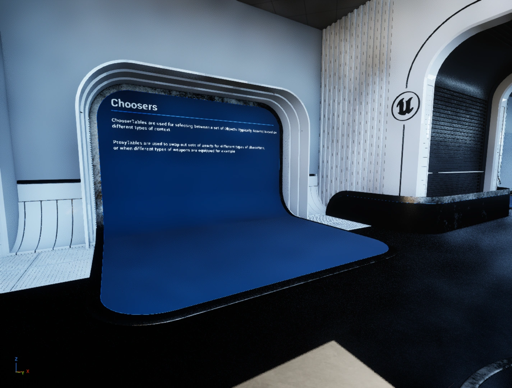
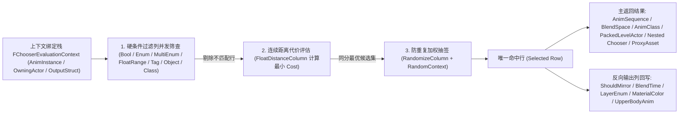
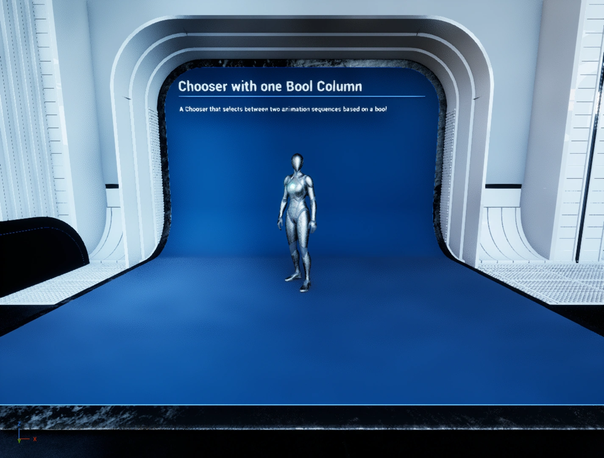
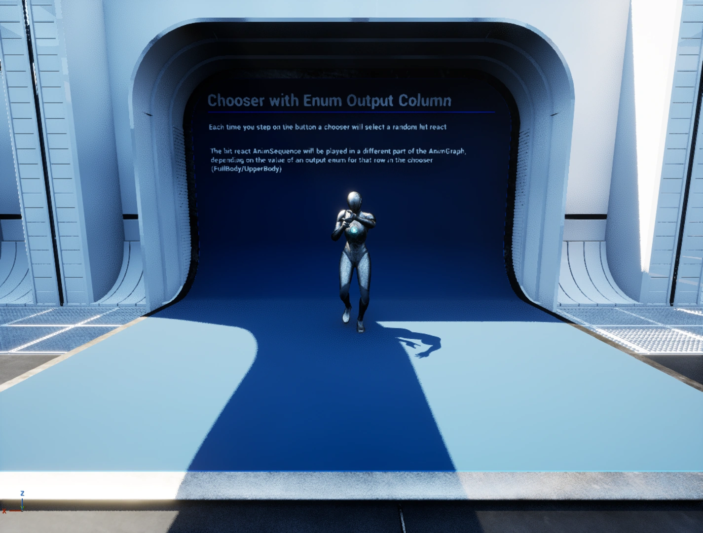
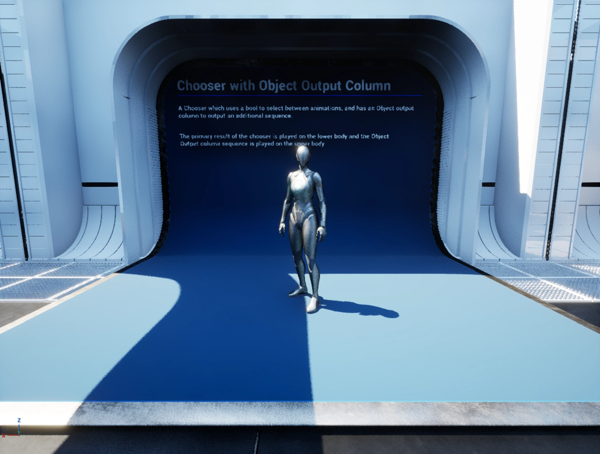
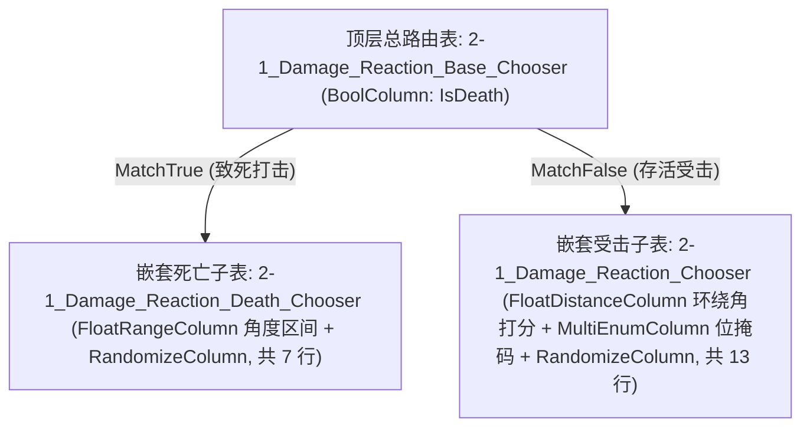
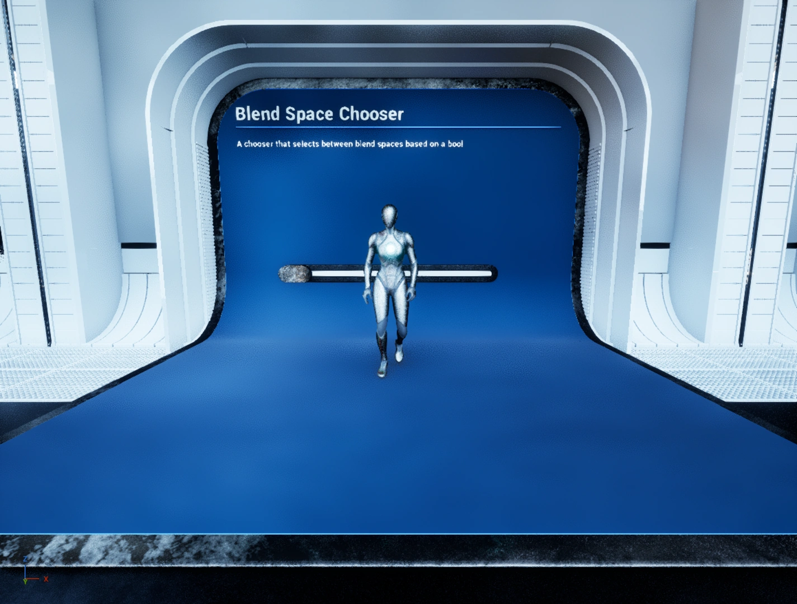
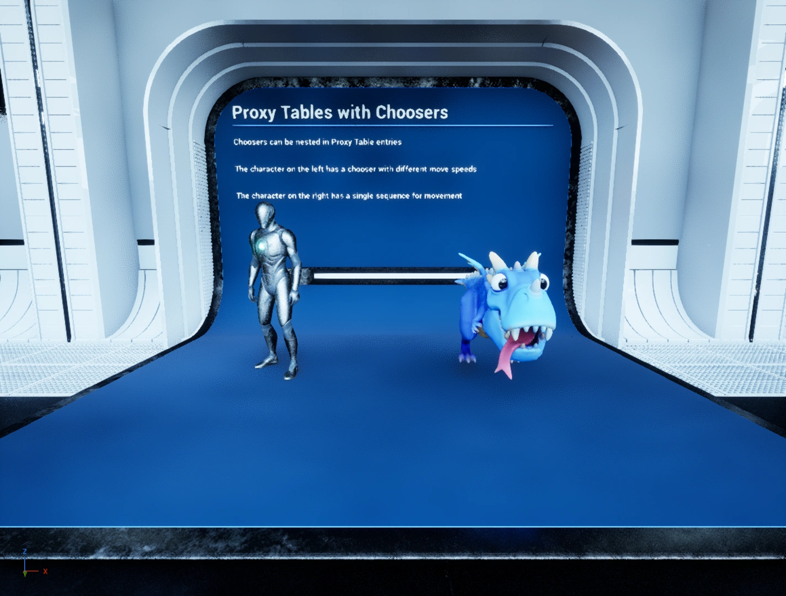

# 06 · 动态资产选择器 Chooser 多维条件评估、ProxyTable 代理寻址与 Motion Matching 衔接（`Animation_Choosers`）

> **本篇实测拆解关卡档案**
> - **主关卡路径**：`/Game/Maps/Animation/Animation_Choosers`（关卡总 Actor 数：`122` | 展台数：`24` | 示例 Actor 数：`71`）
> - **关联打包关卡 Actor（Packed Level Actor）源子关卡**：
>   - `/Game/ExampleContent/Choosers/3-14/tree1`（`Chooser_tree1`：总 Actor 数 `12` | 展台数 `0` | 核心资产 `HillTree_P2`）
>   - `/Game/ExampleContent/Choosers/3-14/tree2`（`Chooser_tree2`：总 Actor 数 `12` | 展台数 `0` | 核心资产 `SM_Dead_Tree`）
> - **关卡脚本类**：`/Game/Maps/Animation/Animation_Choosers.Animation_Choosers_C`
> - **核心资产目录**：`/Game/ExampleContent/Choosers/`（涵盖 `1-1` ~ `1-6` 七大输入过滤/打分/随机列、`1-10` ~ `1-15` 五大反向参数输出列与对象类路由、`2-1` ~ `2-3` 多维受击嵌套树/混合空间/动态链接子图、`3-1` ~ `3-5` 与 `3-10`、`3-14` ProxyAsset 代理令牌、ProxyTable 代理表及跨领域 PackedLevelActor 动态生成，共 **88+ 个核心资产**）

---

## 一、 为什么传统动画状态机在次世代 3A 大作面前“彻底爆线”了？

如果你拆解过十年前的动作或射击游戏动画蓝图（`AnimBlueprint`），一定见过那张令所有新入职程序员与动画师头皮发麻的“恐怖蜘蛛网”：一开始状态机里只有 `Idle -> Walk -> Run -> Jump` 四个清爽的圆圈；但随着项目推进，策划陆续提出合理需求：
- “角色需要区分 **空手 / 持步枪 / 搬运重箱 / 潜行蹲姿** 4 种姿态”；
- “需要感知脚下 **水泥地 / 湿滑冰面 / 沼泽泥潭** 3 种物理地形”；
- “受击动画要按 **前/后/左/右 4 个方向 × 轻/中/重 3 档力度 × 存活/致死 2 种结果** 细腻区分，而且相同条件下要从 4 个变体里随机抽选且**禁止连续两次播同一个动作**”；
- “项目新增了女性主角 Quinn、矮人战士甚至宠物恐龙 Dino，要求复用同一套状态逻辑，但女性角色的过渡混合时间要比男性更柔和……”

在传统动画状态机或 `Blend Poses by Bool / Enum / Int` 节点树下，这叫作**笛卡尔积组合爆炸（Combinatorial Explosion）**：$4 \times 3 \times 3 = 36$ 个运动子状态两两相连能长出数百根过渡箭头（**Spaghetti Monster 意大利面条连线灾难**）！更致命的是，所有候选动画序列被硬编码挂死在动画蓝图节点上——不仅每次加新动作都要动蓝图逻辑代码，更会导致打开一张主动画蓝图瞬间把几百兆不同武器、不同体型的动画资产全部连坐加载进内存！



为了从架构根源上终结这场灾难，Epic Games 在《堡垒之夜（Fortnite）》第五章及次世代标杆工程 **Game Animation Sample（`GASP`）** 中正式祭出了动画数据驱动革命的杀手锏——**`ChooserTable`（动态上下文选择器表）** 与 **`ProxyTable`（虚拟代理映射表）**！

### 1.1 降维打击：把“蜘蛛网连线图”压扁成一张“多维关系型查询表”
打开任意一个 `ChooserTable` 资产，你会发现所有复杂的 `if-else` 分支与枚举 Switch 节点全都消失了，取而代之的是一张极度清爽的**二维决策矩阵**：
- **上下文绑定栈（`ContextData` — `FChooserEvaluationContext`）**：声明本次查表允许访问哪些对象或结构体（例如只读 `Read` 访问当前 `AnimInstance` 读取速度与标签，或者开启读写 `ReadWrite` / 纯写 `Write` 访问自定义输出结构体）。底层通过编译期解析的 **`ChooserPropertyBinding`（属性偏移链）** 直接从内存地址读取变量，开销趋近于原生 C++ 结构体字段读取！
- **横向列（`ColumnsStructs` — 筛选器 + 打分器 + 随机化器 + 反向回写器）**：
  1. **硬条件过滤列（Filter Columns）**：`BoolColumn`、`EnumColumn`、`MultiEnumColumn`（位掩码多选）、`FloatRangeColumn`、`GameplayTagColumn`、`ObjectColumn`、`ObjectClassColumn`。一行必须同时满足所有过滤列（逻辑 `AND`）才能进入候选池。
  2. **软距离代价打分列（Cost Scoring Column）**：`FloatDistanceColumn` 为每个存活候选行计算数值距离代价 $\text{Cost} = w \cdot |x_{\text{input}} - x_{\text{row}}|$，自动挑出得分最优（代价最小）的行！
  3. **有状态防重复随机列（Anti-Repeat Randomization）**：当多行并列最优（差值小于 `equalCostThreshold`）时，`RandomizeColumn` 结合持久化的 `RandomContext` 按权重抽签，并可通过 `repeatProbabilityMultipliers = [0]` 彻底杜绝连续两次抽到同一段动画！
  4. **反向参数输出列（Output Columns）**：`OutputBoolColumn`、`OutputFloatColumn`、`OutputEnumColumn`、`OutputStructColumn`、`OutputObjectColumn`——**查表命中某行资产的同时，顺带把该行配置的“是否镜像 `ShouldMirror`”、“混入时间 `BlendTime`”、“受击部位枚举”甚至“第二段上半身附加动画”反向写回给调用者！**
- **纵向行结果（`ResultsStructs` — 多态 `FObjectChooserBase`）**：每一行不仅能填单个动画序列/混合空间（`AssetChooser`），还能填蓝图类（`ClassChooser`）、**嵌套另一张子选择器表（`EvaluateChooser`）** 或 **抽象代理资产令牌（`LookupProxy`）**！



### 1.2 全馆南北双廊 24 座展台空间导览图
`/Game/Maps/Animation/Animation_Choosers` 展厅长达 **165 米**（`X` 坐标从 `500` 延伸至 `16975`），巧妙采用**南北双走廊对位布局**：
- **北侧主廊（`Y = -900`）**：沿 `1-1` ~ `1-6`、`2-1` ~ `2-3`、`3-1` ~ `3-5` 演进，主讲**输入查询条件列、多维嵌套受击总成、混合空间/子图切换与 ProxyTable 代理表体系**；
- **南侧对位廊（`Y = +850 ~ +900`）**：沿 `1-10` ~ `1-15`、`3-10`、`3-14` 展开，与北廊遥相呼应，专攻**反向输出列（Output Columns）、跨物种对象类路由、代理表结构体回写与非动画领域的 `PackedLevelActor` 动态生成**！

下面，我们按官方展台编号 `#1` 至 `#24` 逐台进行 100% 零遗漏深度拆解！

---

## 二、 第一阶段（展台 #1 ~ #14）：输入过滤列、代价打分、反向输出列与防重随机全解

### 展台 #1：`Choosers` — 展厅核心定义与双核概念立碑

- **空间元数据**：展牌 Label `0-0_Title` | 坐标 `(500, -900, 0)`
- **官方展牌原文说明**：*ChooserTables are used for selecting between a set of Objects (typically Assets) based on different types of context. ProxyTables are used to swap out sets of assets for different types of characters, or when different types of weapons are equipped for example*

#### 1.1 展台基础设施与一句话区分 `ChooserTable` vs `ProxyTable`
展台内陈列着标准 `10 : 3` 高清光场（`DirectionalLight`、`SkyLight`、`SkyAtmosphere`、`ExponentialHeightFog`、调试 `Actor` 与 `CameraActor`）。展牌用最精炼的两句话点破了全馆两大主角的分工：
- **`ChooserTable`（怎么选动作？）**：负责在**同一套动作语义内部**，根据瞬息万变的实时游戏状态（速度、角度、受伤轻重、地面材质、随机种子）做多维逻辑决策；
- **`ProxyTable`（谁来播动作？）**：负责在**不同角色体型、性别或武器套装之间**，像“皮肤主题包”一样成批替换动作资产映射，让一套动画蓝图通吃全游戏所有英雄与怪物！

---

### 展台 #2：`Chooser with one Bool Column` — 最简入门：布尔列与动态序列惯性混合

- **空间元数据**：展牌 Label `1-1_BoolColumn` | 坐标 `(1975, -900, 0)`
- **官方展牌原文说明**：*A Chooser that selects between two animation sequences based on a bool*



#### 2.1 展台交互与蓝图调用链深拆
- **陈列 Actor（共 2 个）**：
  - `BP_ChooserCharacterDisplay`（通用展示台角色基类 `/Game/ExampleContent/Choosers/Shared/BP_ChooserCharacterDisplay`，挂载 `SKM_Manny_Simple` 与动画蓝图 `1-1_ABP_BoolColumn`）；
  - `BP_PressureButton_BPIInteract_Child5`（地面压力感应发光按钮）：当你操控角色踩上按钮时，通过 `BPI_Interactions` 接口翻转展示角色的 `boolVariable`（`false <-> true`）。
- **核心选择器 `/Game/ExampleContent/Choosers/1-1/1-1BoolColumn_Chooser` 决策矩阵**：
  - **Context 绑定**：`[0]` 只读（`Read`）绑定至 `1-1_ABP_BoolColumn_C`；
  - **返回类型**：`ObjectResult`（`/Script/Engine.AnimSequenceBase`）。

| 行号 | 结果资产 (`AssetChooser`) | 列 1：`BoolColumn` (绑定 `BoolVariable`) |
| :--- | :--- | :--- |
| **Row 0** | `/Game/Characters/Mannequins/Animations/Quinn/MF_Idle` | `MatchFalse` (`false` 时播放待机) |
| **Row 1** | `/Game/Characters/Mannequins/Animations/Quinn/MF_Walk_Fwd` | `MatchTrue` (`true` 时播放前进走) |

- **动画蓝图 `1-1_ABP_BoolColumn` 是如何在没有状态机的情况下丝滑切换两段动画的？**
  实测提取其字节码函数引用可见一条贯穿全馆基础示例的标准 **Dynamic Sequence + Inertialization（动态序列播放器 + 惯性化过渡）** 管线：
  ```text
  [Update Animation 线程安全更新函数]
    MakeChooserEvaluationContext(Self) ──► K2Node_EvaluateChooser2(1-1BoolColumn_Chooser)
      ──► 输出 AnimSequenceBase 动态绑定至 AnimNode_SequencePlayer (开启 bStartFromMatchingPose 姿态相位对齐!)
            ──► 串联 AnimNode_Inertialization (惯性化混合节点: 资产切换瞬间自动捕获骨骼速度差平滑衰减，零状态机连线!)
                  ──► AnimNode_Root
  ```

---

### 展台 #3：`Chooser with Bool Output Column` — 查表顺带改逻辑！布尔反向输出列控制镜像

- **空间元数据**：展牌 Label `1-10_OutputBoolColumn` | 坐标 `(1975, 900, 0)` *(位于 `#2` 正对面南廊)*
- **官方展牌原文说明**：*A Chooser that uses a bool output column to control mirroring of the selected animation*

#### 3.1 颠覆传统认知的设计：表格不仅能“读变量”，还能“写变量”！
假设动画师只做了一段“重心偏右站立待机（`MF_Idle`）”，你想在状态切换时用同一段资产表现出“左倾待机”与“右倾待机”两种站姿。在 `#3` 号展台，Chooser 展示了强大的**双向上下文通信（`EContextObjectDirection::ReadWrite`）**！

- **陈列 Actor（共 2 个）**：`BP_ChooserCharacterDisplay21`（挂载 `1-10_ABP_BoolOutputColumn`）+ `BP_PressureButton_BPIInteract_Child4`。
- **选择器 `/Game/ExampleContent/Choosers/1-10/1-10BoolOutputColumn_Chooser` 矩阵**：

| 行号 | 结果资产 (`AssetChooser`) | 输入列：`BoolColumn` (`BoolVariable`) | **输出列：`OutputBoolColumn` (写回 `ShouldMirror`)** |
| :--- | :--- | :--- | :--- |
| **Row 0** | `MF_Idle` | `MatchFalse` | **`false`**（原样播放右倾待机） |
| **Row 1** | `MF_Idle` *(复用同一资产!)* | `MatchTrue` | **`true`**（自动激活左右骨骼镜像翻转！） |

- **AnimGraph 联动**：`1-10_ABP_BoolOutputColumn` 在 `AnimNode_SequencePlayer` 后方串联了 **`AnimNode_Mirror`**（挂载人形镜像映射表 `/Game/Characters/Mannequins/Meshes/MDT_Mannequin`），其 `bMirror` 引脚直接读取刚刚被 Chooser 反向写回的 `ShouldMirror` 布尔变量，再经 `AnimNode_Inertialization` 平滑过渡——省去一半对称动画制作量！

---

### 展台 #4：` Chooser with one Float Range Column` — 浮点闭区间过滤三档移速

- **空间元数据**：展牌 Label `1-2_FloatColumn` | 坐标 `(2995, -900, 0)` | **3D 文字标签**：`0.0` | `1.0`
- **官方展牌原文说明**：*A chooser that chooses between 3 animation sequences based on a float Using a Float Range column*

#### 4.1 实测资产与区间路由拆解
- **陈列 Actor（共 2 个）**：交互滑杆 `BP_Slider`（范围 `[0.0, 1.0]`）+ `BP_ChooserCharacterDisplay2`（挂载 `1-2_ABP_FloatColumn`，持有变量 `"float Variable"`）。
- **选择器 `/Game/ExampleContent/Choosers/1-2/1-2FloatColumn_Chooser`**：
  配置单列 **`FloatRangeColumn`**（绑定 `FloatVariable`），将 `[0.0, 1.0]` 切分为三个互不重叠的数值窗口（如 `[0.0, 0.33]`、`[0.33, 0.66]`、`[0.66, 1.0]`，每个单元格支持独立勾选 `bNoMin` 负无穷开区间或 `bNoMax` 正无穷开区间），当滑块推过阈值时，依次精确挑出 **`MF_Idle`**（待机）$\rightarrow$ **`MF_Walk_Fwd`**（步行）$\rightarrow$ **`MF_Run_Fwd`**（奔跑）！

---

### 展台 #5：`Chooser with Float Output Column` — 非对称美感：急促起步与柔和急停的动态混入时间回写

- **空间元数据**：展牌 Label `1-11_OutputFloatColumn` | 坐标 `(3025, 900, 0)` *(南廊)*
- **官方展牌原文说明**：*A Chooser that uses a float output column to control the blend time you should see a short blend into Run, and a long blend into Idle*

#### 5.1 资深动作设计师的不传之秘：非对称混合时间（Asymmetric Blend Time）
为什么有些游戏的角色操作起来像踩在棉花上一样粘滞？因为程序员给状态切换写死了固定的 `0.4s` 过渡时间！在真实的 3A 手感调校中：**玩家推摇杆起步冲刺（`Idle -> Run`）必须用极短混入时间（如 `0.1s ~ 0.15s`）保证跟手爆发力；而松开摇杆停步回待机（`Run -> Idle`）则需要较长混入时间（如 `0.5s ~ 0.8s`）展现身体惯性卸力与呼吸平复！**

- **陈列 Actor（共 2 个）**：`BP_PressureButton_BPIInteract_Child3` + `BP_ChooserCharacterDisplay22`（挂载 `1-11_ABP_FloatOutputColumn`）。
- **上下文双槽位架构（`/Game/ExampleContent/Choosers/1-11/1-11_FloatOutputColumn_Chooser`）**：
  - `Context[0]`：`1-11_ABP_FloatOutputColumn_C`（读取 `BoolVariable`）；
  - `Context[1]`：自定义结构体 **`/Game/ExampleContent/Choosers/1-11/BlendTimeOutputStruct`**（方向 `EContextObjectDirection::Write` 纯写入！）。
  - 表格内置 **`OutputFloatColumn`**：当命中 `MF_Run_Fwd` 行时，向 `BlendTimeOutputStruct` 写入极短混合时长；当命中 `MF_Idle` 行时，写入长混合时长。动画蓝图通过 `K2Node_MakeStruct_BlendTimeOutputStruct` 传入上下文，评估后由 **`GetChooserStructOutput`** 拆包拿到专属 BlendTime 喂给惯性过渡器！

---

### 展台 #6：`Chooser with one Float Distance Column` — 最小代价打分、`GetSequenceSpeed` 自动填表蓝图与 `ChooserPlayer` 初登场！

- **空间元数据**：展牌 Label `1-2_FloatColumn2` | 坐标 `(4025, -900, 0)`
- **官方展牌原文说明**：*A chooser that chooses between 3 animation sequences based on a float Using a Float Distance column, and choosing the best scoring option. Cells are auto populated based on animation speed using a custom populator blueprint*

#### 6.1 三大硬核黑科技齐聚一台！
这座看似与 `#4` 相似的滑杆展台（`BP_Slider5` + `BP_ChooserCharacterDisplay26`），底层其实暗藏了三项工业级重磅升级：
1. **从“死区间硬切”进化为“最近邻代价打分（`FloatDistanceColumn`）”**：
   在 `#4` 的 `FloatRangeColumn` 中，你必须手工精确拼好 `[0, 150]`、`[150, 350]` 的边界，一旦漏了缝隙就会匹配失败返回空指针！而 **`FloatDistanceColumn`** 只需在每行填一个**理想特征标量值**（比如待机行填 `0`、步行填 `200`、跑步填 `500`），运行时自动计算输入 `MoveSpeed` 到每行的绝对距离，无脑挑出离当前速度最近的那段动画，永不断档！
2. **自定义编辑器自动填充器蓝图 `/Game/ExampleContent/Choosers/GetSequenceSpeed`**：
   如果有 200 段不同移速的动画，难道要人工算每段动画每秒走多少厘米填进单元格吗？工程在这里编写了继承自 **`/Script/ChooserEditor.FloatAutoPopulatorBlueprint`** 的工具蓝图 **`GetSequenceSpeed`**（调用 `AnimationBlueprintLibrary` 自动提取动画根骨骼位移速率），挂载到列的 `AutoPopulator` 槽位上——把动画拖进表格的瞬间，**单元格数值全自动提取填好**！
3. **`AnimNode_ChooserPlayer` + `AnimNode_BlendStack_Standalone` 混合栈节点正式亮相**：
   不同于前几台在蓝图图表里手动调 `EvaluateChooser`，`1-2_ABP_FloatDistanceColumn` 直接在 `AnimGraph` 里放了一颗次世代一体化播放器节点 **`AnimNode_ChooserPlayer`**（`EvaluationFrequency = OnUpdate`）！它内部自带独立的 **`AnimationBlendStackGraph`（混合栈）**，当 `1-2FloatDistanceColumn_Chooser` 选出新动画时，自动将旧动画压入后台衰减栈（可配置 `MaxActiveBlends` 最大并发混合层数与 `StitchDatabase` 缝合库），一行蓝图代码都不用写！

---

### 展台 #7：`Chooser with Enum Output Column` — 枚举反向输出列动态分流“全身 vs 半身”动画图路径

- **空间元数据**：展牌 Label `1-11_OutputBoolColumn` | 坐标 `(4025, 900, 0)` *(南廊，展牌内部 Label 沿用了 1-11 前缀但绑定的是 `1-12` 资产族)*
- **官方展牌原文说明**：*Each time you step on the button a chooser will select a random hit react The hit react AnimSequence will be played in a different part of the AnimGraph, depending on the value of an output enum for that row in the chooser (FullBody/UpperBody)*



#### 7.1 动作游戏痛点：轻伤不能打断双腿跑动，重伤必须全身硬直踉跄！
在射击游戏中，角色正在持枪前进（播放 `/Game/Characters/Mannequins/Animations/Manny/MM_Rifle_Walk_Fwd`）：被小口径手枪擦中肩膀时，双腿应该继续往前走，只让腰部以上播放耸肩受击（**`UpperBody` 半身叠加**）；但一旦被霰弹枪正面轰中胸口，就必须瞬间切断走路，接管全身播放大幅度后仰硬直（**`FullBody` 全身覆盖**）！

- **陈列 Actor（共 2 个）**：`BP_PressureButton_BPIInteract_Child2` + `BP_ChooserCharacterDisplay23`（挂载 `1-12_ABP_EnumOutputColumn`）。
- **核心资产 `/Game/ExampleContent/Choosers/1-12/1-12_EnumOutputColumn_Chooser` 拆解**：
  - **候选受击池（共 8 段）**：涵盖 `MM_HitReact_Back_Lgt_01`、`MM_HitReact_Front_Lgt_02/03`、`MM_HitReact_Left_Lgt_01`、`MM_HitReact_Front_Med_01/02`、`MM_HitReact_Left_Med_01` 以及重击 **`MM_HitReact_Front_Hvy_01`**。
  - **列组合**：`RandomizeColumn`（随机抽取受击动作）+ **`OutputEnumColumn`**（绑定自定义枚举 `/Game/ExampleContent/Choosers/1-12/DamageReactionMode`，写入结构体 `DamageReactionOutputStruct`）。
  - **AnimGraph 动态路由**：轻中度受击行在 `OutputEnumColumn` 里填 `UpperBody`，送入 `AnimNode_LayeredBoneBlend`（`ELayeredBoneBlendMode::BranchFilter`）叠加在 `MM_Rifle_Walk_Fwd` 缓存姿势（`SaveCachedPose`）之上；而 `MM_HitReact_Front_Hvy_01` 重击行填 `FullBody`，通过 `K2Node_SwitchEnum` 直接触发全身受击状态通道！动作师在表里改一下下拉菜单，就能决定任何一段受击是播全身还是播半身！

---

### 展台 #8：`Chooser with Struct Output Column` — 结构体整包回写跨界驱动角色动态材质变色

- **空间元数据**：展牌 Label `1-14_OutputStructColumn` | 坐标 `(4995, 900, 0)` *(南廊，绑定 `1-13` 资产族)*
- **官方展牌原文说明**：*A Chooser which uses a bool to select between animations, and has a Struct Output column writing a different color for each result (which is then being applied as a material parameter by the character)*

#### 8.1 跨子系统协同：一次查表，同时换动作 + 刷材质发光色！
- **陈列 Actor（共 2 个）**：`BP_PressureButton_BPIInteract_Child` + `BP_ChooserCharacterDisplay24`（开启实例参数 **`enableCustomColor = true`**，挂载 `1-13_ABP_StructOutputColumn`）。
- **核心机制（`/Game/ExampleContent/Choosers/1-13/1-13_StructOutputColumn_Chooser`）**：
  除了用 `BoolColumn` 在 `MF_Idle` 与 `MF_Run_Fwd` 间切换外，新增了一列 **`OutputStructColumn`**，直接绑定动画蓝图上的 `FLinearColor` 结构体属性 `color`！当踩下按钮切换到奔跑行时，Chooser 直接把整包 RGB 颜色结构体覆写进 `1-13_ABP_StructOutputColumn.color`，宿主 Actor `BP_ChooserCharacterDisplay24` 读取该颜色立即刷新全身动态材质参数——在实战中，你可以把“冰霜受击全身泛蓝光”、“火焰重击泛红光 + 屏幕震动幅度”统统打包进一个结构体列随动画一并吐出！

---

### 展台 #9：`Chooser with one Enum Column` — 离散枚举列清晰管理多姿态步态

- **空间元数据**：展牌 Label `1-3_EnumColumn` | 坐标 `(5035, -900, 0)` | **3D 文字标签**：`Normal` | `Carry` | `Rifle`
- **官方展牌原文说明**：*A chooser that selects between 3 animation sequences based on an enumeration value*

#### 9.1 实测资产拆解
- **陈列 Actor（共 2 个）**：三档滑杆 `BP_Slider2` + `BP_ChooserCharacterDisplay3`（挂载 `1-3_ABP_EnumColumn`，持有枚举变量 `"enum Variable"`，类型为 `/Game/ExampleContent/Choosers/Shared/ChooserTestEnumeration`）。
- **选择器 `/Game/ExampleContent/Choosers/1-3/1-3EnumColumn_Chooser`**：
  通过 **`EnumColumn`** 精确匹配三档枚举值：
  - `Normal`（普通空手） $\rightarrow$ `/Game/Characters/Mannequins/Animations/Manny/MM_Walk_Fwd`
  - `Carry`（双手搬重物） $\rightarrow$ `/Game/Characters/Mannequins/Animations/Manny/MM_CarryWalking`
  - `Rifle`（端步枪警戒） $\rightarrow$ `/Game/Characters/Mannequins/Animations/Manny/MM_Rifle_Walk_Fwd`
  徹底取代了动画图里占满半个屏幕的 `Blend Poses by Enum` 节点！

---

### 展台 #10：`Chooser with one Gameplay Tag Column` — 与 GAS 技能系统无缝接轨的层级标签列

- **空间元数据**：展牌 Label `1-4_GameplayTagColumn` | 坐标 `(5995, -900, 0)`
- **官方展牌原文说明**：*A chooser that selects between two aniamtion sequences based on if a gameplay tag*

#### 10.1 现代 UE5 项目的灵魂纽带：`FGameplayTagContainer`
在使用 **Gameplay Ability System（GAS）** 或 `StateTree` 的现代项目中，角色身上的 Buff、姿态与异常状态不再用零散的布尔变量维护，而是统一挂载在层级化的 **`GameplayTagContainer`** 中（例如 `State.Movement.Falling`、`Status.Debuff.Stunned`）。

- **陈列 Actor（共 2 个）**：定制展示蓝图 **`1-4_BP_ChooserCharacterDisplay`**（内部调用 `BlueprintGameplayTagLibrary::AddGameplayTag` 与 `RemoveGameplayTag` 动态增删标签容器 `gameplayTagVariable`）+ `BP_PressureButton_BPIInteract_Child6`。
- **选择器 `/Game/ExampleContent/Choosers/1-4/1-4_GameplayTagColumn_Chooser` 实测配置深拆**：
  - 列类型：**`/Script/Chooser.GameplayTagColumn`**（绑定 `1-4_ABP_GameplayTagColumn` 的 `GameplayTagVariable`）；
  - 匹配策略：`tagMatchType = "Any"`（满足任一标签即命中），`tagMatchDirection = "RowValueInInput"`，`bMatchExact = false`（支持父子层级前缀包含匹配！），`bInvertMatchingLogic = false`；
  - **行映射数据**：
    - **Row 0**：当输入容器包含标签 `"Input"` 或 `"UI.Action.Cancel"` 时，匹配命中浮空下落动画 **`MM_Fall_Loop`**；
    - **Row 1**：默认空标签兜底行 `gameplayTags = []`，播放正常前进 **`MM_Walk_Fwd`**！

---

### 展台 #11：`Chooser with Object Output Column` — 一表双雕！对象输出列并发派发上下半身成套动画

- **空间元数据**：展牌 Label `1-13_OutputObjectColumn` | 坐标 `(5975, 900, 0)` *(南廊，绑定 `1-14` 资产族)*
- **官方展牌原文说明**：*A Chooser which uses a bool to select between animations, and has an Object output column to output an additional sequence. The primary result of the chooser is played on the lower body and the Object Output column sequence is played on the upper body*



#### 11.1 为什么“一次查表吐出两个动画资产”如此实用？
在制作“一边下半身慢跑，一边上半身喝药水/装填弹药”或者“主武器开火动画 + 角色手部配套拉栓动画”时，上下半身或者人枪两段动画往往是**严格成对配置**的。如果建两张 Chooser 表分别查一次，不仅浪费双倍 CPU，还容易因为改漏其中一张表导致上下半身动作错配！

- **陈列 Actor（共 2 个）**：`BP_ChooserCharacterDisplay25`（挂载 `1-14_ABP_ObjectOutputColumn`）+ `BP_PressureButton_BPIInteract_Child21`。
- **选择器 `/Game/ExampleContent/Choosers/1-14/1-14_ObjectOutputColumn_Chooser` 架构**：
  - **主返回值（Primary Result）**：选出下半身基础步态序列（如 `MF_Walk_Fwd` / `MF_Run_Fwd`），喂给 `AnimNode_LayeredBoneBlend` 的 `BasePose` 引脚；
  - **附加对象输出列（`OutputObjectColumn`）**：将配套的第二段动画序列（如 `MF_Idle` 等上半身动作）写入自定义结构体 **`/Game/ExampleContent/Choosers/1-14/ObjectOutputStruct`**，拆包后直接喂给 `AnimNode_LayeredBoneBlend` 的 `BlendPoses[0]` 上半身引脚！一次评估，全身成套动作原子级同步切换！

---

### 展台 #12：`Chooser with one Object Column` — 射线感知地面 `PhysicalMaterial` 资产引用自动切换步态

- **空间元数据**：展牌 Label `1-5_ObjectColumn` | 坐标 `(7065, -900, 0)`
- **官方展牌原文说明**：*A chooser that selects an animation based on a physics material reference*

#### 12.1 地面材质感知实战：踩上蓝色冰面自动打滑浮空！
- **陈列 Actor（共 3 个）**：
  - `BP_ChooserCharacterDisplay4`：开启实例开关 **`enableMaterialLineTrace = true`**！每帧从脚底向下发射 `LineTraceSingleForObjects` 检测地板碰撞体的物理材质，转为软引用 `Conv_ObjectToSoftObjectReference` 存入 `1-5_ABP_ObjectColumn` 的 `materialReferenceVar` 变量；
  - `1-5_LevelSequence`（`/Game/ExampleContent/Choosers/1-5/1-5_LevelSequence`，`30 fps`，区间 `[0, 150]` 帧）：通过 `MovieScene3DTransformTrack_0` 拉动角色在铺有不同材质的 `Display_Main_B` 台面上往返平移！
- **选择器 `/Game/ExampleContent/Choosers/1-5/1-5_ObjectColumn_Chooser` 实测数据**：
  - 列类型：**`/Script/Chooser.ObjectColumn`**（约束允许类 `allowedClass = /Script/PhysicsCore.PhysicalMaterial`）；
  - **Row 0**：`comparison = "MatchEqual"`，当检测到脚下物理材质等于 **`/Game/ExampleContent/Destruction/FX/Materials/PM_Blue`** 时，立即切换为失重滑行姿势 **`MM_Fall_Loop`**；
  - **Row 1**：`comparison = "MatchAny"` 兜底，在普通台面上稳步播放 **`MM_Walk_Fwd`**！

---

### 展台 #13：`Chooser with Object Class Column` — 恐龙与人类共用一张动画蓝图！按类继承树多态选片

- **空间元数据**：展牌 Label `1-15_ObjectClassColumn` | 坐标 `(7025, 900, 0)` *(南廊)*
- **官方展牌原文说明**：*A Chooser which uses the class of an input object to select which assets to play These actors use the same Animation Blueprint, but it selects which assets to play based on the Class type of the owning Actor. This example also shows using the ChooserPlayer AnimGraph node to play a blend space (in the case of the walk/run on the Mannequin).*

#### 13.1 跨物种多态奇观：`ObjectClassColumn` + `ChooserPlayer` 混播序列与混合空间！
看一眼 `#13` 号展台上的奇妙组合：左边是一只大摇大摆的双足恐龙 **`BP_Chooser_Dino_Character`**（网格体 `/Game/ExampleContent/IKRig/Mesh/DinoDragon/SK_DinoDragon`，继承自父类 `BP_ChooserCharacterDisplay`），右边是标准人形模特 **`BP_ChooserCharacterDisplay27`**（`SKM_Manny_Simple`），中间共享同一根调速滑杆 `BlendSpaceSlider3`（范围 `[-180, 180]`）。不可思议的是：**恐龙和人类挂载的竟然是同一个 `animClass`——`/Game/ExampleContent/Choosers/1-15/1-15_ABP_ObjectClassChooser`！**

- **选择器 `/Game/ExampleContent/Choosers/1-15/1-15_ObjectClassChooser` 双列协同**：
  1. **`ObjectClassColumn`**：支持 `Equal`（精确类匹配）与 **`SubClassOf`（派生子类匹配）**！检查当前宿主 Actor 是 `BP_Chooser_Dino_Character_C` 还是基类 `BP_ChooserCharacterDisplay_C`；
  2. **`FloatDistanceColumn`**：绑定 `WalkSpeed` 评估移速；
  3. **多态异构资产返回**：如果是恐龙，返回恐龙专属单段序列 **`Dino_Idle`** 或 **`Dino_Walk`**；如果是人类，待机时返回序列 **`MF_Idle`**，移动时直接返回一整张一维/二维混合空间 **`/Game/ExampleContent/Choosers/1-15/mf_walkrun_bs`**（混合 `MF_Walk_Fwd` 与 `MF_Run_Fwd`）！
  4. **`AnimNode_ChooserPlayer` 无缝通吃**：动画图里的 `ChooserPlayer` 节点根本不在乎表里吐出来的是 `AnimSequence` 还是 `BlendSpace`——遇到混合空间自动将 `BlendSpaceX`（绑定滑杆移速）喂入采样，真正实现了“万物皆可塞进同一张表”！

---

### 展台 #14：`Chooser with Randomization` — 告别“复读机动作”：有状态防连续重复随机 vs 纯随机对比

- **空间元数据**：展牌 Label `1-6_Randomization` | 坐标 `(8055, -900, 0)`
- **官方展牌原文说明**：*Selects randomly The chooser on the left will avoid picking the same sequence twice in a row*

#### 14.1 为什么“真随机”在玩家眼里反而很假？
当你从 5 个待机小动作或受击反应里做纯独立均匀随机（$p = 20\%$）时，连续两次踩按钮抽到一模一样动作的概率高达 $20\%$！玩家连续看到两次完全相同的捂胸口动作，立刻就会产生强烈的“机械复读机感”。

展台并排放置了左右两组角色与按钮做盲测对比（候选动画池均为相同的 5 段动作：`MM_HitReact_Front_Lgt_01`、`MM_HitReact_Front_Med_01`、`MM_HitReact_Front_Hvy_01`、`MM_Rifle_IdleBreak_Fidget`、`MM_Rifle_IdleBreak_Scan`，每行基础权重均为 `1`）：

| 对比组 | 展示 Actor 与 AnimBP | 关联 ChooserTable | 实测字节码核心差异 (`RandomizeColumn`) | 实际抽样表现 |
| :--- | :--- | :--- | :--- | :--- |
| **左侧（智能去重）** | `BP_ChooserCharacterDisplay20` (`1-6_ABP_Randomize1`) | **`1-6_Randomize_Chooser`** | • `inputValue` 绑定成员变量 **`RandomContext`** (`FChooserRandomizationContext`)<br>• **`repeatProbabilityMultipliers = [0]`** | 上一次刚抽中过的那一行，在下一轮评估中概率乘子直接归 **`0`**！**100% 保证绝不连续两次播同一个动作**！（你甚至可以配成 `[0, 0.5]`，代表刚播过的禁播，上上次播过的概率减半！） |
| **右侧（无状态纯随机）** | `BP_ChooserCharacterDisplay5` (`1-6_ABP_Randomize2`) | **`1-6_Randomize_Chooser1`** | • `propertyBindingChain = []`（未绑定历史记忆上下文）<br>• **`repeatProbabilityMultipliers = []`** | 每次独立掷骰子，频繁出现连续两三次抽中同一个动作的呆板现象。 |

---

## 三、 第二阶段（展台 #15 ~ #17）：工业级受击嵌套决策树、混合空间切换与动态链接子图

学完了单列积木，现在进入 `#15` ~ `#17` 号展台，见证如何把多列条件、子表嵌套与高级资产类型组装成真正的商业大作系统！

---

### 展台 #15：`Damage Reaction Example` — 五列联立 + 三表嵌套！3A 受击/死亡响应总成全解剖

- **空间元数据**：展牌 Label `2-1_DamageReactions` | 坐标 `(9505, -900, 0)`
- **3D 悬浮文字标签**：`Damage Direction` | `Damage Strength` | `Death?` | `Light` | `Medium` | `Hard` | `False` | `True`
- **官方展牌原文说明**：*Choose the best damage reaction animation based on multiple parameters Randomization will be applied when there are multiple valid options with the same score Uses: Bool, Multi Enum, Float Range, Float Distance, and Randomize Columns.*

#### 15.1 展台交互控制台与三表分治嵌套树（Nested Choosers）
展台前方竖立着三根独立参数滑杆——受击角度 **`DamageDirectionSlider`**（`[-180°, +180°]`）、受击强度 **`DamageStrengthSlider`**（映射枚举 `DamageReactionStrength`：`Light` / `Medium` / `Hard`）、是否致死 **`DeathSlider`**（`False` / `True`）以及一枚开火触发按钮 `BP_PressureButton_BPIInteract_Child9`。

角色 `BP_ChooserCharacterDisplay6` 挂载的 `2-1_ABP_DamageReaction`（内置 `AnimNode_ChooserPlayer` + `AnimNode_BlendStack_Standalone`）并没有把 19 段受击和死亡动画全塞进一张乱糟糟的大表里，而是采用了清晰优雅的**两级三表嵌套树（Nested Chooser Tree）**：



#### 15.2 实测提取：两张嵌套子表的完整内部参数大起底！
根据实测提取出的 `all_dissected_assets.json` 原始结构体数组，我们来看看 Epic 官方动画师是如何精妙设计这两张子表的：

1. **致死子表 `/Game/ExampleContent/Choosers/2-1/2-1_Damage_Reaction_Death_Chooser`（共 7 行）**：
   - 使用 **`FloatRangeColumn`**（绑定 `DamageDirection`）+ **`RandomizeColumn`**（`repeatProbabilityMultipliers = [0]`）：
     - 正面扇区 `[-45°, +45°]`：配置 `MM_Death_Front_01~03`；
     - 左侧扇区 `[-135°, -45°]`（2 行）与右侧扇区 `[+45°, +135°]`（2 行）：覆盖左右倒地死亡 `MM_Death_Left_01` / `MM_Death_Right_01` 及正面变体；
     - 背面跨界扇区 `[-180°, -135°]` 与 `[+135°, +180°]`（拆为 2 行闭区间）：指向 `MM_Death_Back_01`。
2. **非致命受击子表 `/Game/ExampleContent/Choosers/2-1/2-1_Damage_Reaction_Chooser`（共 13 行，两大神级技巧！）**：
   - **神技一：`FloatDistanceColumn` 开启 `bWrapInput = true`（角度环绕连续寻优）**！
     在圆周角 $[-180^\circ, +180^\circ]$ 中，$-179^\circ$ 和 $+179^\circ$ 都在正后方，实际仅相差 $2^\circ$（而不是算术相减的 $358^\circ$！）。开启 **`bWrapInput = true`** 后，距离打分器自动按圆周最短弧长计算角度偏差，表格里 `0°`（7 行正面）、`-90°`（2 行左侧）、`+90°`（2 行右侧）、`180°`（2 行背面）无需像死亡子表那样把背面拆成两段区间！
   - **神技二：`MultiEnumColumn` 位掩码（Bitmask）一格多选省去重复行**！
     正面受击资源最丰富，拥有轻伤 4 套（`MM_HitReact_Front_Lgt_01~04`，位掩码 `value = 1` 即 `0b001 = Light`）、中伤 2 套（`Med_01~02`，`value = 2` 即 `0b010 = Medium`）、重伤 1 套（`Hvy_01`，`value = 4` 即 `0b100 = Hard`）。但侧面与背面没有单独做重伤动画怎么办？动画师直接在侧/背面中伤行的 **`MultiEnumColumn`** 里同时勾上了 `Medium` 和 `Hard`（实测序列化位掩码 **`value = 6` = `2 | 4` = `0b110`**）！这样无论是中击还是重击打在背后，都能直接命中同一行复用 `MM_HitReact_Back_Med_01`，连一行多余的拷贝都不用建！

#### 15.3 `2-1_Damage_Reaction_Chooser` 全部 13 行原始序列化矩阵完整复原

| 行号 | 候选动画序列 (`MM_HitReact_*`) | 列 1：`FloatDistanceColumn` (`DamageDirection`, `bWrapInput=true`) | 列 2：`MultiEnumColumn` (`DamageStrength` 位掩码) | 列 3：`RandomizeColumn` (`Weight`, 防重乘子 `[0]`) |
| :--- | :--- | :--- | :--- | :--- |
| **Row 0 ~ 3** | `Front_Lgt_01` / `02` / `03` / `04` *(4 变体)* | `0°`（正前方受击） | `1` (`0b001` = **Light**) | `1.0`（4 选 1 且禁连抽同款） |
| **Row 4 ~ 5** | `Front_Med_01` / `Front_Med_02` *(2 变体)* | `0°`（正前方受击） | `2` (`0b010` = **Medium**) | `1.0`（2 选 1 交替播放） |
| **Row 6** | `Front_Hvy_01` *(正面重创)* | `0°`（正前方受击） | `4` (`0b100` = **Hard**) | `1.0` |
| **Row 7** | `Left_Lgt_01` | `-90°`（左侧受击） | `1` (**Light**) | `1.0` |
| **Row 8** | `Left_Med_01` | `-90°`（左侧受击） | **`6`** (`0b110` = **Medium \| Hard** 双档通吃!) | `1.0` |
| **Row 9** | `Right_Lgt_01` | `+90°`（右侧受击） | `1` (**Light**) | `1.0` |
| **Row 10** | `Right_Med_01` | `+90°`（右侧受击） | **`6`** (`0b110` = **Medium \| Hard** 双档通吃!) | `1.0` |
| **Row 11** | `Back_Lgt_01` | `180°`（正后方环绕匹配 `-180°/+180°`） | `1` (**Light**) | `1.0` |
| **Row 12** | `Back_Med_01` | `180°`（正后方环绕匹配 `-180°/+180°`） | **`6`** (`0b110` = **Medium \| Hard** 双档通吃!) | `1.0` |

---

### 展台 #16：`Blend Space Chooser` — 动态切换整张混合空间并衔接惯性化混合

- **空间元数据**：展牌 Label `2-2_BlendSpace` | 坐标 `(10505, -900, 0)`
- **官方展牌原文说明**：*A chooser that selects between blend spaces based on a bool*



#### 16.1 实测资产与无跳变混合空间切换函数
- **陈列 Actor（共 3 个）**：调速滑杆 `BlendSpaceSlider` + `BP_ChooserCharacterDisplay11`（挂载 `2-2_ABP_BlendSpaceChooser`）+ 拔枪/收枪切换按钮 `BP_PressureButton_BPIInteract_Child10`。
- **选择器 `/Game/ExampleContent/Choosers/2-2/2-2BlendSpace_Chooser`**：
  - `outputObjectType` 设为 **`/Script/Engine.BlendSpace`**；
  - `BoolVariable == false` $\rightarrow$ 返回空手走跑混合空间 **`2-2_BlendSpace1`**（采样点：`X=0.21 -> MM_Walk_Fwd`，`X=99.89 -> MM_Run_Fwd`）；
  - `BoolVariable == true` $\rightarrow$ 返回持枪走跑混合空间 **`2-2_BlendSpace2`**（采样点：`X=0 -> MM_Rifle_Walk_Fwd`，`X=99.82 -> MM_Rifle_Jog_Fwd`）。
- **蓝图关键函数调用**：在 `2-2_ABP_BlendSpaceChooser` 的节点更新回调中，并非生硬赋值覆盖 BlendSpace 引脚，而是通过 `ConvertToBlendSpacePlayerPure` 获取播放器引用后，显式调用 **`BlendSpacePlayerLibrary::SetBlendSpaceWithInertialBlending`** 触发下游 `AnimNode_Inertialization`，使拔枪/收枪切换瞬间双腿相位与上半身持枪姿态丝滑过渡！

---

### 展台 #17：`Anim Class Choosers` — `ClassResult` 热插拔整张链接动画子蓝图（`Linked AnimGraph`）

- **空间元数据**：展牌 Label `2-3_AnimClassChoosers` | 坐标 `(11475, -900, 0)`
- **官方展牌原文说明**：*Proxy Tables and Choosers can be used to slect Animation Bluprints to Link This example is linking a different anim graph when you are on/off the button, using a chooser with a bool column*

#### 17.1 模块化大作架构：用 Chooser 动态路由武器/载具专属子状态机！
在大型开放世界游戏中，滑翔伞、游泳、骑马、重机枪各自拥有完全不同的 IK 逻辑与状态图，全塞进主 `AnimBP` 会引发灾难性的团队合并冲突。UE 提供了 **`AnimNode_LinkedAnimGraph`（链接动画图）** 槽位，而 `#17` 号展台展示了如何用 Chooser 动态决定“往槽位里插哪张卡带”：

- **陈列 Actor（共 2 个）**：`BP_ChooserCharacterDisplay16`（挂载宿主蓝图 `2-3_ABP_LinkedGraphs`）+ `BP_PressureButton_BPIInteract_Child11`。
- **选择器 `/Game/ExampleContent/Choosers/2-3/2-3_LinkedAnimGraphChooser`**：
  - 注意！此处的 **`resultType = "ClassResult"`**（返回类引用而非对象实例！），`outputObjectType = /Script/Engine.AnimInstance`；
  - `MatchFalse` $\rightarrow$ 返回子蓝图类 **`/Game/ExampleContent/Choosers/2-3/2-3_ABP_LinkedGraph1`**（内部播放女性休闲待机 `MF_Idle`）；
  - `MatchTrue` $\rightarrow$ 返回子蓝图类 **`/Game/ExampleContent/Choosers/2-3/2-3_ABP_LinkedGraph2`**（内部播放男性步枪举镜瞄准 `MM_Rifle_Idle_ADS`）。
- **运行时挂载**：`2-3_ABP_LinkedGraphs` 检测到布尔状态改变时，评估 Chooser 拿到目标 `UClass`，直接调用 **`LinkAnimGraphByTag`** 动态热替换子图实例，并经 `AnimNode_Inertialization` 无缝衔接！

---

## 四、 第三阶段（展台 #18 ~ #24 + `tree1`/`tree2` 子关卡）：ProxyTable 虚拟资产解耦与跨领域关卡预制件生成

进入 `X = 12975` 之后的第三展区，全馆迎来了架构抽象的最高峰——**`ProxyAsset`（虚拟代理资产令牌）** 与 **`ProxyTable`（代理映射表）**，并在第 `#23` 号展台彻底跨出角色动画边界，动态生成包含独立子关卡的 **`PackedLevelActor`**！

---

### 展台 #18：`Proxy Tables` — 虚拟资产寻址：让人类与恐龙零修改共享同一套状态机

- **空间元数据**：展牌 Label `3-1_ProxyTables` | 坐标 `(12975, -900, 0)`
- **官方展牌原文说明**：*These two characters share the same animation blueprint. Animations are selected using Proxy Assets and Proxy Tables*

#### 18.1 什么是 `ProxyAsset`？给动画资产起一个“接口虚函数名”！
在面向对象编程中，父类只调用虚函数 `PlayWalk()`，具体执行人类走路还是恐龙走路取决于子类虚函数表（vtable）。**`ProxyAsset` 就是动画系统里的“纯虚函数令牌”，而 `ProxyTable` 就是每个角色身上挂载的“虚函数映射表（vtable）”！**

- **陈列 Actor（共 4 个）**：左展示角色 `BP_ChooserCharacterDisplay7` + 按钮 `Child12`，右展示角色 `BP_ChooserCharacterDisplay8` + 按钮 `Child13`。两者**完全共用同一个动画蓝图 `3-1_ABP__ProxyTables`**！
- **三层解耦实测数据还原**：
  1. **纯虚令牌（`ProxyAsset`）**：动画蓝图 `3-1_ABP__ProxyTables` 里不引用任何具体的 `.uasset` 动画序列，只调用 `K2Node_EvaluateProxy2`（底层 `MakeLookupProxyWithOverrideTable`）查询两枚空壳令牌：**`3-1_PA_IdleProxy`** 与 **`3-1_PA_WalkProxy`**。
  2. **左侧角色代理表 `/Game/ExampleContent/Choosers/3-1/3-1_PT_Mannequin`**：
     - `3-1_PA_IdleProxy` $\rightarrow$ `/Game/Characters/Mannequins/Animations/Manny/MM_Idle`
     - `3-1_PA_WalkProxy` $\rightarrow$ `/Game/Characters/Mannequins/Animations/Manny/MM_Walk_Fwd`
  3. **右侧角色代理表 `/Game/ExampleContent/Choosers/3-1/3-1_PT_Dino`**：
     - `3-1_PA_IdleProxy` $\rightarrow$ `/Game/ExampleContent/IKRig/Animations/Dino_Idle`
     - `3-1_PA_WalkProxy` $\rightarrow$ `/Game/ExampleContent/IKRig/Animations/Dino_Walk`
  *(注：`ProxyTable` 还原生支持 `inheritEntriesFrom` 表继承——新英雄只需继承基础人类表，只覆写他独特的两三个技能动画即可！)*

---

### 展台 #19：`3.10. Proxy Table Struct Outputs` — 代理表回写差异化结构体：阳刚瞬切 vs 柔美缓入

- **空间元数据**：展牌 Label `3-10_ProxyStructOutputs` | 坐标 `(12985, 900, 0)` *(南廊)*
- **官方展牌原文说明**：*This example has Proxy Tables where each entry outputs a blend time to a struct as well as an anim sequence. The masculine proxy table has short blend times The feminine proxy table has long blend times*

#### 19.1 不仅换动作，连角色性格手感参数都随 `ProxyTable` 一起换！
- **陈列 Actor（共 4 个）**：左侧女性化配置角色 `BP_ChooserCharacterDisplay18` + 按钮 `Child19`，右侧男性化配置角色 `BP_ChooserCharacterDisplay19` + 按钮 `Child20`，共用 `3-10_ABP_OutputStruct` 与 `3-10_StructOutput_Chooser`。
- **实测提取 `outputStructData` 精确对比**：
  两枚代理令牌 `3-10_PA_IdleProxy` 与 `3-10_PA_WalkProxy` 声明了写入上下文 `Context[1] = /Game/ExampleContent/Choosers/3-10/TestOutputStruct`：
  - **`3-10_PT_Feminine`（女性化代理表）**：映射 `MF_Idle` 与 `MF_Walk_Fwd`，同时在每条 `outputStructData` 中回写 **`TestOutputStruct.blendTime = 1.0`** 秒（动作切换如行云流水般柔美舒缓）；
  - **`3-10_PT_Masculine`（男性化代理表）**：映射 `MM_Idle` 与 `MM_Walk_Fwd`，同时回写 **`TestOutputStruct.blendTime = 0.0`** 秒（干脆利落瞬间切换）！

---

### 展台 #20：`Proxy Tables with Choosers` — 代理表内嵌选择器（`Proxy -> Chooser`）：主角精细多档与小怪极简同构

- **空间元数据**：展牌 Label `3-2_ProxyTablesWithChoosers` | 坐标 `(13975, -900, 0)`
- **官方展牌原文说明**：*Choosers can be nested in Proxy Table entries The character on the left has a chooser with different move speeds The character on the right has a single sequence for movement*



#### 20.1 极其聪明的非对称复杂度设计：英雄用复杂表，杂兵用单动画！
在同屏百人的游戏里，玩家主角的“移动”需要根据速度细分慢走、快走、慢跑、冲刺多档动画，而背景里的普通杂兵或小动物只需要播一段走路循环就够了。难道要给主角和杂兵写两套不同的 `AnimBlueprint` 吗？完全不需要！

- **陈列 Actor（共 5 个）**：共享移速滑杆 `BP_Slider4`（`[0, 1]`）+ 左侧主角 `BP_ChooserCharacterDisplay9` + 右侧简配角色 `BP_ChooserCharacterDisplay10` + 两枚触发按钮，**依然共用 `#18` 那张极简的 `3-1_ABP__ProxyTables`**！
- **核心奥秘：拆解 `/Game/ExampleContent/Choosers/3-2/3-2_PT_Mannequin` 的 `valueStruct`**：
  - 右侧角色挂载 `3-1_PT_Dino`：`3-1_PA_WalkProxy` 词条的 `valueStruct` 是普通的静态资产 `/Script/Chooser.AssetChooser`（固定返回 `Dino_Walk`，无视滑杆速度变化）；
  - 左侧角色挂载 **`3-2_PT_Mannequin`**：其 `3-1_PA_WalkProxy` 词条的 `valueStruct` 被换成了动态嵌套求值器 **`/Script/Chooser.EvaluateChooser`**，指向子表 **`/Game/ExampleContent/Choosers/3-2/3-2Mannequin_Walk_Chooser`**（内部含 `FloatRangeColumn` 绑定 `WalkSpeed`，自动在 `MF_Walk_Fwd` 与 `MF_Run_Fwd` 间随滑杆切换）！

---

### 展台 #21：`Choosers With Proxy Assets` — 选择器内嵌代理令牌（`Chooser -> Proxy`）及双向嵌套选型法则

- **空间元数据**：展牌 Label `3-3_ChoosersWithProxies` | 坐标 `(14925, -900, 0)`
- **官方展牌原文说明**：*Proxy Assets can be nested inside of Choosers These two characters are evaluating the same chooser, and the chooser is evaluating proxy assets, which map to different sequences for each character.*

#### 21.1 与 `#20` 镜像反转的架构：先走统一决策表，最后一步才查角色代理表！
- **陈列 Actor（共 3 个）**：滑杆 `BP_Slider3` + 左侧角色 `BP_ChooserCharacterDisplay14`（配 `3-2_PT_Mannequin`）+ 右侧角色 `BP_ChooserCharacterDisplay15`（配 `3-1_PT_Dino`），共用 `3-3_ABP__Chooser_With_ProxyAssets`。
- **内部链路**：先评估统一的 **`/Game/ExampleContent/Choosers/3-3/3-3_Walk_Chooser`**（按 `WalkSpeed` 浮点区间判断当前该待机还是该移动），但行的返回结果填的是 **`LookupProxy`**（查询 `3-1_PA_IdleProxy` 或 `3-1_PA_WalkProxy`），再拿着选出的令牌去查各自角色身上的 `ProxyTable`！

#### 21.2 架构师必背口诀：到底该用 `#20 (Proxy 包 Chooser)` 还是 `#21 (Chooser 包 Proxy)`？
| 嵌套范式 | 评估链路 | 最佳适用工程场景 |
| :--- | :--- | :--- |
| **`#20` ProxyTable 内嵌 Chooser** | `AnimBP -> ProxyAsset -> ProxyTable -> (各自独立的 Chooser)` | **不同角色的状态划分规则本身就不一样！** 例如：人类主角按 `速度 × 8方向 × 瞄准` 选片，而史莱姆怪物只按 `血量百分比` 选片。 |
| **`#21` Chooser 内嵌 ProxyAsset** | `AnimBP -> 公共 Chooser -> ProxyAsset -> ProxyTable -> 具体动画` | **所有角色的决策条件规则 100% 相同，仅仅底层动画美术资源不同！** 例如：男女 20 个英雄都严格遵守同一套 13 行受击方向/力度规则，共用一张受击 Chooser 表即可维护全员规则！ |

---

### 展台 #22：`Anim Class Proxies` — 切换整张 `ProxyTable` 实现武器动画层（`Linked AnimGraph`）一键换装

- **空间元数据**：展牌 Label `3-4_AnimClassProxies` | 坐标 `(16005, -900, 0)`
- **官方展牌原文说明**：*Proxy Tables and Choosers can be used to select Animation Bluprints to Link This example is linking a different anim graph when you are on/off the button by changing which proxy bank is bound*

#### 22.1 《堡垒之夜》武器库热切标准解法
- **陈列 Actor（共 2 个）**：`BP_ChooserCharacterDisplay12`（挂载 `3-4_ABP_LinkedGraphs`）+ `BP_PressureButton_BPIInteract_Child16`。
- **实测机制拆解**：
  - 定义一枚返回类型为 `ClassResult`（`AnimInstance`）的代理令牌 **`/Game/ExampleContent/Choosers/3-4/3-4_PA_LinkedGraph`**；
  - 制作两份武器/姿态主题代理表：**`3-4_PT_ProxyTable1`**（将令牌映射至子蓝图类 `3-4_ABP_LinkedGraph1` 播 `MF_Idle`）与 **`3-4_PT_ProxyTable2`**（将令牌映射至子蓝图类 `3-4_ABP_LinkedGraph2` 播 `MM_Rifle_Idle_ADS`）；
  - 当玩家踩下按钮（模拟游戏内拾取并切换主武器），只需把角色身上的 `ProxyTable` 指针从 `Table1` 换成 `Table2`——不仅普通动作变了，连整张 `AnimNode_LinkedAnimGraph` 子图都瞬间同步热插拔完成！

---

### 展台 #23：`Packed Level Actor Chooser`（含嵌套子关卡 `Chooser_tree1` / `Chooser_tree2` 联拆）— 破圈神作！跨出动画边界动态生成世界预制件

- **空间元数据**：展牌 Label `3-4_PackedLevelActorChooser` | 坐标 `(15945, 850, 0)` *(南廊，绑定 `3-14` 资产族)*
- **官方展牌原文说明**：*Proxy Tables and Choosers can be used to select other types of non animation related classes like Packed Level Actors This example will spawn a packed level actor when you step on the button - choosing a different class depending on if the slider is left or right*

#### 23.1 为什么动画展厅里突然种起了树？揭开 Chooser 作为“全引擎通用规则引擎”的真面目！
走到南廊尽头的 `#23` 号展台，场上竟然没有半个角色模特，只有一枚交互按钮 **`BP_Button1`**（类 **`/Game/ExampleContent/Choosers/3-14/TreeButton`**）和一根左右拨动滑杆 **`TypeSlider`**（`BP_Slider`，区间 `[-180, 180]`）！

官方放置这座展台的用意极为深远：**`ChooserTable` 底层位于独立的 `/Script/Chooser` 模块（根本不依赖 `AnimGraph`！），它可以基于任意游戏上下文动态挑选任何 `UObject` 资产或 `UClass` 蓝图类**——无论是挑选 MetaSound 脚步声、Niagara 爆炸粒子、掉落战利品数据资产，还是像这里一样动态生成整座打包关卡建筑/植被预制件（`PackedLevelActor`）！

#### 23.2 `TreeButton` $\rightarrow$ `TreeChooser` $\rightarrow$ `BPP_tree1` / `BPP_tree2` 及双子关卡全链路实测深拆
结合主关卡实测档案与两份独立子关卡实测档案（`Chooser_tree1_dossier.md` 与 `Chooser_tree2_dossier.md`），完整还原整条跨领域生成流水线：
1. **交互触发器 `/Game/ExampleContent/Choosers/3-14/TreeButton`**：
   当玩家踩下按钮时，读取 `BoolSlider`（即 `TypeSlider` 处于左半区还是右半区），构造 `ChooserEvaluationContext` 调用 `K2Node_EvaluateChooser2` 评估 **`/Game/ExampleContent/Choosers/3-14/TreeChooser`**。
2. **类选择器 `/Game/ExampleContent/Choosers/3-14/TreeChooser`**：
   - `resultType = "ClassResult"`（输出继承自 `/Script/Engine.PackedLevelActor` 的蓝图生成类）；
   - 单列 `BoolColumn`：根据滑杆布尔状态，二选一返回 **`/Game/ExampleContent/Choosers/3-14/BPP_tree1`** 或 **`/Game/ExampleContent/Choosers/3-14/BPP_tree2`**，随后交由 `K2Node_SpawnActorFromClass`（`BeginDeferredActorSpawnFromClass`）当场生成在展台中央！
3. **两座嵌套源子关卡（Sublevels）实测档案逐一拆解**：
   - **活树预制件 `BPP_tree1` $\leftarrow$ 源子关卡 `/Game/ExampleContent/Choosers/3-14/tree1`（`Chooser_tree1`）**：
     - 关卡总 Actor 数 `12` 个，核心封装示例 Actor 为静态网格体 **`HillTree_P2`**，引用资产 **`/Game/ExampleContent/ScriptExamples/PivotPainter2/StaticMesh/HillTree_P2`**（这是一棵携带有 PivotPainter 2.0 逐树枝枢轴与风场层级烘焙数据的繁茂绿叶山丘树！）及 `ChaosDebugDrawComponent_0` 辅助 Actor。当滑杆拨向一侧踩下按钮，展台上瞬间拔地而起一棵枝繁叶茂的绿树！
   - **枯树预制件 `BPP_tree2` $\leftarrow$ 源子关卡 `/Game/ExampleContent/Choosers/3-14/tree2`（`Chooser_tree2`）**：
     - 关卡总 Actor 数 `12` 个，核心封装示例 Actor 为静态网格体 **`SM_Dead_Tree`**，引用资产 **`/Game/ExampleContent/Landscapes/Meshes/SM_Dead_Tree`**（地形生态展区同款苍劲荒原枯树）及 `ChaosDebugDrawComponent_0` 辅助 Actor。把滑杆拨向另一侧再次踩下按钮，生成的瞬间切换为荒凉枯树！
   > **工程启示**：在开放世界地牢或肉鸽（Roguelike）关卡中，你完全可以用一张 `ChooserTable` 结合当前生物群系 `GameplayTag`（森林/荒漠/雪原）、难度等级 `FloatRange` 与防连续重复 `RandomizeColumn`，零代码动态抽取刷出千变万化的 `PackedLevelActor` 房间与遭遇战预制件！

---

### 展台 #24：`Blend Space Proxies` — 全馆收官：代理表无感替换男女性别差异化混合空间

- **空间元数据**：展牌 Label `3-5_BlendSpaceProxies` | 坐标 `(16975, -900, 0)`
- **官方展牌原文说明**：*Masculine/feminine variants of a blend space are selected using proxy tables*

#### 24.1 实测资产与收官闭环拆解
- **陈列 Actor（共 5 个）**：共享调速滑杆 `BlendSpaceSlider2` + 左侧男性角色 `BP_ChooserCharacterDisplay17` + 右侧女性角色 `BP_ChooserCharacterDisplay13` + 两枚启停按钮，共用动画蓝图 **`3-5_ABP_BlendSpaceProxies`**。
- **双类型代理令牌 + 男/女代理表映射对照**：
  `3-5_ABP_BlendSpaceProxies` 内部声明查询两枚异构类型的代理令牌：`3-5_PA_IdleProxy`（类型 `AnimSequenceBase`）与 **`3-5_PA_WalkProxy`（类型 `BlendSpace`）**，同样使用 `SetBlendSpaceWithInertialBlending` 平滑过渡：
  - **左侧 `3-5_PT_Masculine`**：`IdleProxy -> MM_Idle`，`WalkProxy -> 3-5_BlendSpace_Masculine`（内部混合男性阳刚步态 `MM_Walk_Fwd` 与 `MM_Run_Fwd`）；
  - **右侧 `3-5_PT_Feminine`**：`IdleProxy -> MF_Idle`，`WalkProxy -> 3-5_BlendSpace_Feminine`（内部混合女性轻盈步态 `MF_Walk_Fwd` 与 `MF_Run_Fwd`）。
  拖动同一根滑杆，男女角色同步加速奔跑却各自展现出截然不同的肢体韵律，为 24 座展台画下完美句号！

---

## 五、 登顶次世代 3A 运动架构：Chooser + Motion Matching（Pose Search）+ Blend Stack 双核协同全解

逛完 `Animation_Choosers` 全馆，一个最关键的高阶架构问题呼之欲出：**既然有了无需状态机的 Motion Matching（运动匹配 / `PoseSearch`），为什么 UE5 次世代官方角色模板（`GASP`）还要把 `ChooserTable` 放在整个动画蓝图的最核心C位？**

### 5.1 为什么单靠 Motion Matching 救不了大型商业项目？
**Motion Matching（运动匹配）** 的原理是：每帧预测角色未来 1 秒的移动轨迹（Trajectory）并提取当前脚踝/骨盆骨骼位置与速度，拼成一个高维特征向量 $\mathbf{q}$，去动画数据库（`UPoseSearchDatabase`）的数万帧切片里做 KD-Tree 最近邻搜索，挑出特征欧氏距离最小的那一帧切过去播放：
$$i^* = \arg\min_{i \in \mathcal{D}} \left( w_{\text{traj}} \|\mathbf{t}_{\text{query}} - \mathbf{t}_i\|^2 + w_{\text{pose}} \|\mathbf{p}_{\text{query}} - \mathbf{p}_i\|^2 + w_{\text{vel}} \|\mathbf{v}_{\text{query}} - \mathbf{v}_i\|^2 \right)$$

如果你傻乎乎地把角色所有的 **空手走跑、持枪瞄准走、潜行猫步、受伤跛行、水中趟水** 共 500 段动画全塞进**同一个巨型 `PoseSearchDatabase`** 里会发生什么？
1. **语义串台灾难（Semantic Ambiguity）**：“空手慢走”和“潜行猫步”的移动轨迹与脚部速度几乎一模一样！纯靠几何速度特征搜索，角色走着走着就会莫名其妙在潜行和正常走之间来回鬼畜乱跳！
2. **算力与内存浪费**：每帧在包含十万帧无关姿态的巨库里检索，白白消耗数倍 CPU 缓存带宽。

### 5.2 次世代“铁三角”黄金流水线：`Chooser` 语义粗筛 $\rightarrow$ `Motion Matching` 轨迹精搜 $\rightarrow$ `Blend Stack` 无状态混合

在 UE 5.4 ~ 5.7+ 现代角色架构中，三大系统组成了严丝合缝的**三级火箭流水线**：


1. **第一级（离散语义大脑 —— `ChooserTable` + `ProxyTable`）**：
   先由 `ChooserTable` 读取 `MovementMode`（地面/空中）、`Stance`（站立/下蹲）、`Gait`（步行/奔跑/冲刺）与武器 `ProxyTable`，把 500 段动画瞬间窄化为当前唯一合法的那一个微型数据库（例如仅含 8 段动画的 `PSD_Rifle_Stand_Run`）！**语义边界 100% 绝对隔离，绝不串台！**
2. **第二级（连续运动小脑 —— `Pose Search / Motion Matching`）**：
   在 `Chooser` 选定的纯净小型数据库内部，`Motion Matching` 节点专注发挥它最擅长的连续几何匹配能力——无论是急停折返 $180^\circ$、斜向 $45^\circ$ 起步还是绕圈走弧线，自动在毫秒内挑出脚部相位与转向曲率最贴合的那一帧！
3. **第三级（无状态合成器与物理修型 —— `Blend Stack` + `Control Rig`）**：
   挑出的动画片段直接推入展台 `#6`、`#13`、`#15` 同款的 **`AnimNode_BlendStack`** 自动管理多段交叉淡化或惯性化衰减，最后流经我们在上一章（`05_Animation_ControlRig`）精研的 **`CR_GroundAlignment` / `Foot IK` 与 `Aim`** 程序化控制绑定完成斜坡贴地与枪口瞄准——**整张主 `AnimGraph` 不超过 10 个节点，却能支撑起上千段动作的顶级 3A 丝滑手感！**

### 5.3 生产环境 Chooser 落地避坑指南

> [!IMPORTANT]
> **警惕巨型单表的硬引用内存连坐（Hard Reference Chain）！**
> 单个 `ChooserTable` 对其行内直接填入的 `AssetChooser` 默认持有强引用（或随宿主加载）。在拥有几十套英雄皮肤与上百把武器的大型网游中：
> 1. **必须使用 `ProxyAsset` + 按需异步加载的 `ProxyTable`（展台 `#18` ~ `#24` 范式）**：主 `AnimBlueprint` 与公共 `ChooserTable` 里只放几十字节的轻量 `ProxyAsset` 令牌；当玩家实际装备某把武器或生成某个英雄时，再通过 DataAsset / Modular Gameplay Feature 挂载对应的 `ProxyTable`，彻底切断全图资产连坐加载！
> 2. **善用 `AutoPopulator`（展台 `#6` `GetSequenceSpeed`）与 `MultiEnumColumn`（展台 `#15`）**：用自动化编辑器蓝图代替手工填表，用多选枚举位掩码消灭冗余重复行，让策划与动作师真正享受“改表即改玩法”的工业化自由！

### 5.4 三大调用节点对比与全馆 24 座展台（含双嵌套子关卡）速查词典

在工程落地时，本馆共展示了三种不同的 Chooser / Proxy 评估入口，按需选用：
1. **`K2Node_EvaluateChooser2`（通用蓝图节点）**：适用于任意 Actor 蓝图（如 `#23 TreeButton` 生成 `PackedLevelActor`）、Montage 选择、或在线程安全更新函数 `BlueprintThreadSafeUpdateAnimation` 中配合 `AnimNode_SequencePlayer` / `SetBlendSpaceWithInertialBlending` 手动精细控制播放逻辑。
2. **`K2Node_EvaluateProxy2`（代理解析蓝图节点）**：当动画蓝图只需按角色身上的 `ProxyTable` 查出对应令牌资产（如 `#18`、`#22`、`#24`）时直接调用。
3. **`AnimNode_ChooserPlayer`（AnimGraph 原生播放器节点）**：内置 `AnimNode_BlendStack_Standalone` 混合栈（如 `#6`、`#13`、`#15`），原生混播 `AnimSequence` 与 `BlendSpace`，是现代零状态机角色运动图的首选主力节点！

| 展台编号与标题 | 空间坐标 `(X, Y, Z)` | 核心 `AnimBP` / 交互蓝图 | 核心 `ChooserTable` / `ProxyTable` 资产与关键特性 |
| :--- | :--- | :--- | :--- |
| **`#1` Choosers** | `(500, -900, 0)` | 展厅导览光场 | 定义 `ChooserTable`（条件选片）与 `ProxyTable`（角色/武器资产替换） |
| **`#2` Bool Column** | `(1975, -900, 0)` | `1-1_ABP_BoolColumn` | `1-1BoolColumn_Chooser` (`BoolColumn` 选 `MF_Idle` / `MF_Walk_Fwd`) |
| **`#3` Bool Output Column** | `(1975, 900, 0)` | `1-10_ABP_BoolOutputColumn` | `1-10BoolOutputColumn_Chooser` (`OutputBoolColumn` 回写 `ShouldMirror`) |
| **`#4` Float Range Column** | `(2995, -900, 0)` | `1-2_ABP_FloatColumn` | `1-2FloatColumn_Chooser` (`FloatRangeColumn` 闭区间三档速度切换) |
| **`#5` Float Output Column** | `(3025, 900, 0)` | `1-11_ABP_FloatOutputColumn` | `1-11_FloatOutputColumn_Chooser` (`BlendTimeOutputStruct` 非对称混入时长) |
| **`#6` Float Distance Column** | `(4025, -900, 0)` | `1-2_ABP_FloatDistanceColumn` | `1-2FloatDistanceColumn_Chooser` + `GetSequenceSpeed` 自动填表 + `ChooserPlayer` |
| **`#7` Enum Output Column** | `(4025, 900, 0)` | `1-12_ABP_EnumOutputColumn` | `1-12_EnumOutputColumn_Chooser` (`DamageReactionMode`: FullBody vs UpperBody) |
| **`#8` Struct Output Column** | `(4995, 900, 0)` | `1-13_ABP_StructOutputColumn` | `1-13_StructOutputColumn_Chooser` (`OutputStructColumn` 写回颜色刷角色材质) |
| **`#9` Enum Column** | `(5035, -900, 0)` | `1-3_ABP_EnumColumn` | `1-3EnumColumn_Chooser` (`Normal` / `Carry` / `Rifle` 三姿态步态路由) |
| **`#10` Gameplay Tag Column** | `(5995, -900, 0)` | `1-4_ABP_GameplayTagColumn` | `1-4_GameplayTagColumn_Chooser` (`GameplayTagColumn` 对接 GAS 层级标签) |
| **`#11` Object Output Column** | `(5975, 900, 0)` | `1-14_ABP_ObjectOutputColumn` | `1-14_ObjectOutputColumn_Chooser` (单次查表并发输出下肢与上肢双序列) |
| **`#12` Object Column** | `(7065, -900, 0)` | `1-5_ABP_ObjectColumn` | `1-5_ObjectColumn_Chooser` + `1-5_LevelSequence` (感知地面物理材质 `PM_Blue`) |
| **`#13` Object Class Column** | `(7025, 900, 0)` | `1-15_ABP_ObjectClassChooser` | `1-15_ObjectClassChooser` (`BP_Chooser_Dino_Character` 恐龙与人类共用 AnimBP) |
| **`#14` Randomization** | `(8055, -900, 0)` | `1-6_ABP_Randomize1` / `2` | `1-6_Randomize_Chooser` (`repeatProbabilityMultipliers=[0]` 防连重) vs `Chooser1` |
| **`#15` Damage Reaction** | `(9505, -900, 0)` | `2-1_ABP_DamageReaction` | `2-1_Damage_Reaction_Base_Chooser` 嵌套致死子表 (7行) 与存活子表 (13行) |
| **`#16` Blend Space Chooser** | `(10505, -900, 0)` | `2-2_ABP_BlendSpaceChooser` | `2-2BlendSpace_Chooser` (`2-2_BlendSpace1` vs `2` + `SetBlendSpaceWithInertialBlending`) |
| **`#17` Anim Class Choosers** | `(11475, -900, 0)` | `2-3_ABP_LinkedGraphs` | `2-3_LinkedAnimGraphChooser` (`ClassResult` 动态挂载 `LinkedGraph1` / `2`) |
| **`#18` Proxy Tables** | `(12975, -900, 0)` | `3-1_ABP__ProxyTables` | `3-1_PA_IdleProxy/WalkProxy` + `3-1_PT_Mannequin` vs `3-1_PT_Dino` |
| **`#19` Proxy Struct Outputs** | `(12985, 900, 0)` | `3-10_ABP_OutputStruct` | `3-10_PT_Feminine` (`blendTime=1.0`) vs `3-10_PT_Masculine` (`blendTime=0.0`) |
| **`#20` Proxy w/ Choosers** | `(13975, -900, 0)` | `3-1_ABP__ProxyTables` | `3-2_PT_Mannequin` 词条内嵌 `EvaluateChooser` (`3-2Mannequin_Walk_Chooser`) |
| **`#21` Choosers w/ Proxies** | `(14925, -900, 0)` | `3-3_ABP__Chooser_With_ProxyAssets` | `3-3_Walk_Chooser` 行结果内嵌 `LookupProxy` 令牌再查角色专属 `ProxyTable` |
| **`#22` Anim Class Proxies** | `(16005, -900, 0)` | `3-4_ABP_LinkedGraphs` | `3-4_PA_LinkedGraph` + 切换 `3-4_PT_ProxyTable1` / `2` 整包换装子动画图 |
| **`#23` Packed Level Actor** | `(15945, 850, 0)` | `TreeButton` (`BP_Button1`) | `TreeChooser` 动态生成 `BPP_tree1` (`tree1`: `HillTree_P2`) 与 `BPP_tree2` (`tree2`: `SM_Dead_Tree`) |
| **`#24` Blend Space Proxies** | `(16975, -900, 0)` | `3-5_ABP_BlendSpaceProxies` | `3-5_PT_Masculine` vs `3-5_PT_Feminine` 代理替换男女差异化走跑混合空间 |
