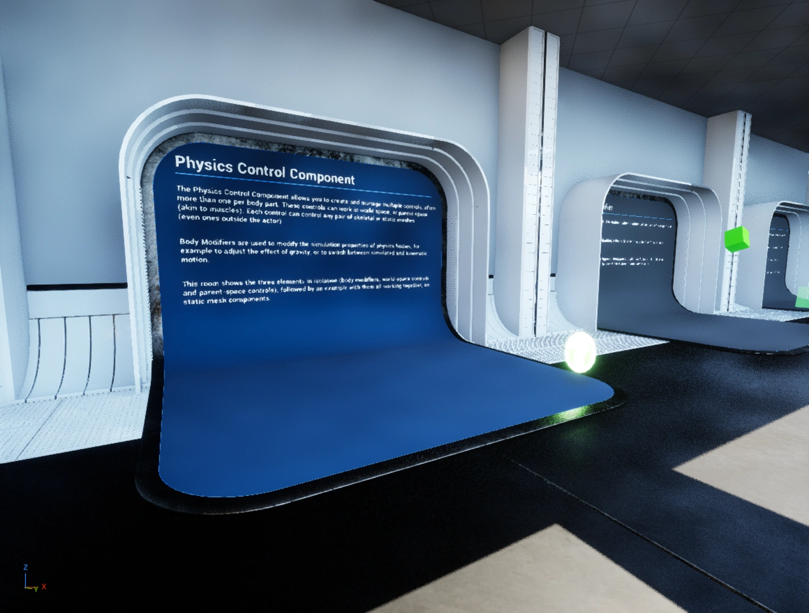
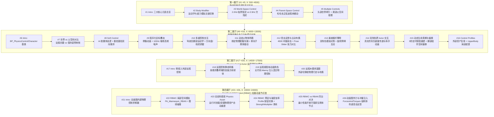
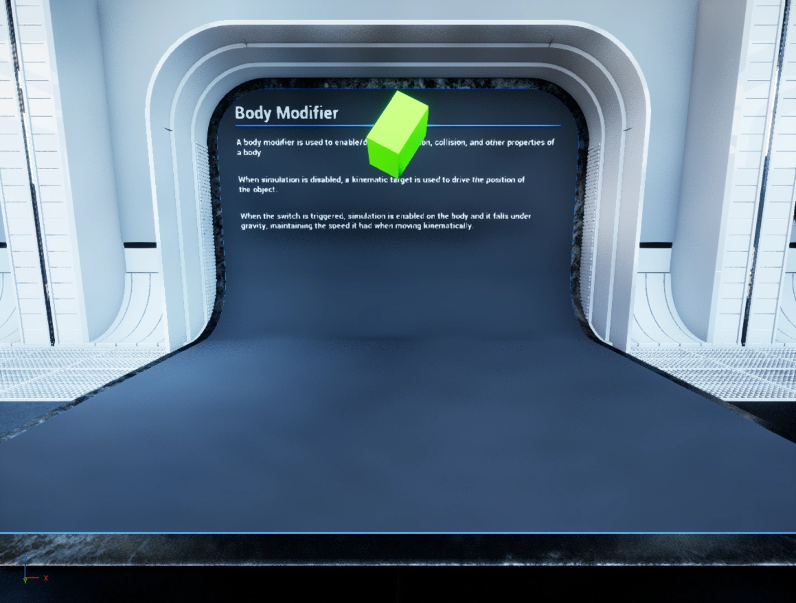
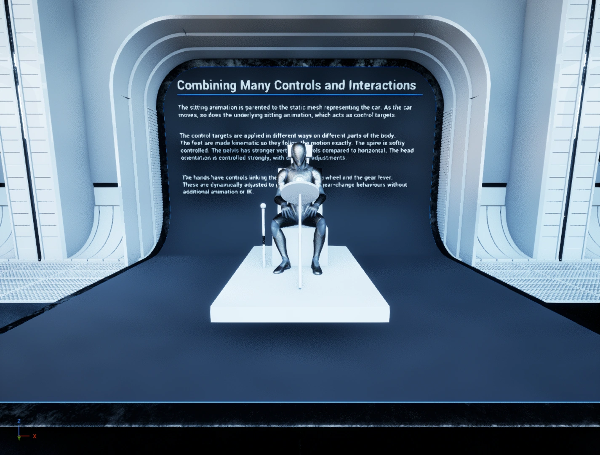
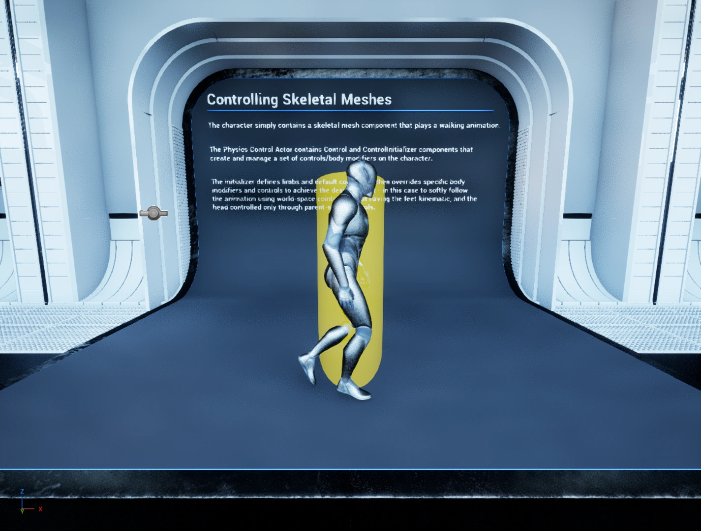

# 07 · 物理控制组件：双空间弹簧阻尼驱动与受击平衡恢复（`Animation_PhysicsControl`）

> **本篇实测拆解关卡档案**
> - **关卡路径**：`/Game/Maps/Animation/Animation_PhysicsControl`（关卡总 Actor 数：`146` | 展台数：`26` | 示例 Actor 数：`102`）
> - **关卡脚本类**：`/Game/Maps/Animation/Animation_PhysicsControl.Animation_PhysicsControl_C`
> - **核心资产目录**：`/Game/ExampleContent/PhysicsControl/Blueprints/`（涵盖静态网格基础控制蓝图、角色物理控制基类 `BP_PhysicsControlCharacter` 及其 8 大派生类、数据驱动配置资产 `UE5_Mannequin_PhysicsControlAsset` / `UE5_MannequinSpecialized_PhysicsControlAsset`、以及动画图节点 `RigidBodyWithControl` 配套的 `ABP_*_RBWC` 与 `PA_Mannequin_RBAN`）

---

## 一、 从“死板播片”与“烂泥布偶”的二元对立，走向双空间弹簧阻尼融合

在 3A 动作与射击游戏研发中，角色动画师与物理程序员之间曾经横亘着一道长达二十年的鸿沟：
- **纯运动学关键帧动画（Kinematic Animation）** 拥有大师级的发力节奏与招式美感，但它对物理世界是“盲目且霸道”的——角色挥拳砸向铁墙会直接穿模，高速旋转的摆锤撞在肩膀上角色却纹丝不动；
- **传统纯布偶模拟（Passive Ragdoll）** 虽然百分百遵守牛顿力学与碰撞响应，但一旦切入模拟，角色瞬间就像被抽干了骨头与神经一样瘫软如泥，既无法维持站立平衡，也无法抓握方向盘或单杠。
- 即便早期的 **`PhysicalAnimationComponent`**（我们将在下一篇 `08_PhysicalAnimation` 详拆）引入了关节马达驱动，它依然受限于单一 `PhysicsAsset` 内部的父子骨骼对约束，不仅弹簧刚度参数（动辄 `5000 ~ 50000` 的原始力矩系数）与刚体质量强耦合、极难跨体型调参，更无法优雅地表达**“跨越两个独立 Actor 的双手抬人”**或**“手掌动态抓握颠簸车厢方向盘”**。

为了彻底终结这一痛点，虚幻引擎 5 推出了次世代物理与动画融合架构——**`Physics Control`（物理控制系统）**！

欢迎来到全教程规模最宏大的物理动画实验室之一：**`/Game/Maps/Animation/Animation_PhysicsControl`**。这条全长 **240 米**（`X` 坐标从 `500` 一路延伸至 `24000`）、纵跨 **四大主题展厅、整整 26 座受控实验展台** 的走廊，将 `Physics Control` 的三大基石原语与三种工程承载形态拆解得淋漓尽致。

### 1.1 直击内核：`Physics Control` 为什么比传统关节电机好调十倍？

在踏入 26 座展台之前，我们必须先吃透它的两项底层数学与架构突破：

1. **三大正交控制原语（Three Core Primitives）**
   - **`Body Modifier`（刚体修饰器）**：独立接管任意单个物理刚体的模拟状态（`Simulated` 物理模拟 vs `Kinematic` 运动学直驱）、重力倍率（`GravityMultiplier`）、碰撞开关、物理混合权重（`PhysicsBlendWeight`）以及运动学目标偏移空间（`KinematicTargetSpace`）。最重要的一点是：当刚体从运动学切入物理模拟的瞬间，它能**完美继承前一帧的运动学线速度与角速度**，实现零顿挫抛射与入戏！
   - **`World-Space Control`（世界空间弹簧控制器）**：相当于在世界空间（或某个外部动态父物体如颠簸汽车底盘）的目标位姿与角色骨骼刚体之间拉起一根“无形提线弹簧”。它赋予角色**抵抗重力站立、沿着动画轨迹迈步前行、以及手掌精准抓握外部物体**的绝对空间定位能力。
   - **`Parent-Space Control`（父骨骼空间弹簧控制器）**：相当于连接在相邻父子刚体之间的**生物骨骼肌与肌腱（Muscles & Tendons）**。它完全不关心角色在世界里是站着还是摔倒在空中，只负责把子骨骼相对于父骨骼的夹角推向目标动画姿势——哪怕角色被炸飞进入布偶状态，开启 `Parent-Space Control` 也能让他在空中展现出挣扎蜷缩的鲜活肌肉张力，而不是死尸般松垮乱甩！

2. **质量无关的二阶弹簧阻尼参数化（Frequency & Damping Ratio in Hz）**
   打开本关任意展台的 `ControlData`（实测默认均开启 **`bUseAccelerationDriveMode = true`**），你会惊讶地发现：这里的 `LinearStrength`（线性强度）和 `AngularStrength`（角度强度）数值不再是令人头秃的 `15000.0`，而是清爽直观的 **`0.5`、`2.0`、`10.0`**！
   因为在加速度驱动模式下，引擎将弹簧控制器严格建模为**经典二阶谐振子微分方程**，其中 `Strength` 直接定义为**无阻尼固有振荡频率 $f$（单位：赫兹 $\text{Hz}$，角频率 $\omega_n = 2\pi f$）**，`DampingRatio` 定义为**无量纲阻尼比 $\zeta$**：
   $$\mathbf{a} = (2\pi f)^2 \left(\mathbf{x}_{\text{target}} - \mathbf{x}\right) + 4\pi \zeta f \left(m_v \dot{\mathbf{x}}_{\text{target}} - \dot{\mathbf{x}}\right) - d_{\text{extra}} \dot{\mathbf{x}}$$
   - 当 **`Strength = 2.0`（$2\,\text{Hz}$）**：意味着如果没有阻尼，刚体每秒围绕目标点往复摆动 2 次，响应干脆利落；当 **`Strength = 0.5`（$0.5\,\text{Hz}$）**：需要 2 秒才完成一次慢悠悠的漂移周期，手感轻柔松软。
   - 当 **`DampingRatio = 1.0`（临界阻尼 $\zeta = 1$）**：刚体以最快速度收敛到目标位置且**绝不产生任何过冲震荡**；当 **`DampingRatio = 0.1 ~ 0.3`（欠阻尼 $\zeta < 1$）**：碰撞后会产生 Q 弹的余振回弹；若将 `Strength` 设为 `0` 而把 **`ExtraDamping` 拉到 `10`**（如资产中的 `"posingInTreacle"` 糖浆模式），刚体就会像浸在浓稠蜂蜜里一样缓慢滞留！
   - 更妙的是，由于直接求解目标加速度 $\mathbf{a}$（底层再自动乘以刚体质量张量 $M$ 与转动惯量 $I$ 转化为力与力矩），**50 公斤的胸腔与 0.2 公斤的手指在填入相同的 `Strength = 3.0, DampingRatio = 1.0` 时，会表现出完全一致的收敛速率与物理质感！**

### 1.2 四大展厅空间布局与架构演进路线图

现在，让我们沿着展厅坐标轴，从 `#1` 号展台走到 `#26` 号展台，逐台解剖全部 **102 个示例 Actor** 与底层资产参数！

---

## 二、 第一展厅（#1 ~ #5）：静态网格原语隔离实验室

第一间展厅刻意避开了复杂的全身人体骨骼，纯粹使用最简单的立方体、球体与圆柱体静态网格（`StaticMeshComponent`），将 `Physics Control Component` 的三大核心武器拆开给你看个通透。

### 展台 #1：`Physics Control Component` — 三大控制原语导览与基准光场

- **空间元数据**：展牌 Label `BP_DemoDisplay_Intro1` | 坐标 `(500, -900, 0)`
- **官方展牌核心要义**：`Physics Control Component` 允许你为每个身体部位创建并管理一个或多个控制器。控制器既可工作在 **World Space（世界空间）**，也可工作在 **Parent Space（父空间，如同肌肉）**，并能连接任意一对骨骼或静态网格（甚至跨 Actor 连接！）；而 **Body Modifiers（刚体修饰器）** 则用于动态修改重力倍率或在模拟/运动学状态间无缝切换。
- **展台陈列环境与调试 Actor（共 6 个）**：
  - **`DirectionalLight`**：`Intensity = 10`，纯白光，`CastShadows = true`，`Mobility = Movable`（高对比度动态主光，便于清晰观察刚体碰撞形变与地面投影）。
  - **`SkyLight`**：`Intensity = 3`，纯白光，`CastShadows = true`，`Mobility = Movable`。
  - **`SkyAtmosphere`** 與 **`ExponentialHeightFog`**：标准室外大气散射与远景高度雾。
  - **`Actor`（挂载 `ChaosDebugDrawComponent_0`）**：Chaos 物理引擎底层调试绘制宿主组件，开启控制台 `p.Chaos.DebugDraw.Enabled 1` 时负责渲染约束轴线与目标弹簧线框。
  - **`Documentation Actor`**（`/Script/Engine.DocumentationActor`）：官方文档锚点。

---

### 展台 #2：`Body Modifier` — 运动学巡航与物理重力抛射的动量无缝继承

- **空间元数据**：展牌 Label `BP_DemoDisplay2` | 坐标 `(1500, -900, 0)`

#### 2.1 核心原理解析
如果在传统蓝图里直接暴力调用 `SetSimulatePhysics(true/false)`，当一个正在被代码推着走的运动学物体切入物理模拟时，经常会出现原地顿挫丢失动量，或者切回运动学时发生生硬瞬移。
而在 `BP_PhysicsBox` 中，通过 `PhysicsControl` 组件为方块注册一个 **Body Modifier**：
- 未踩下地面压力开关时，修饰器处于 **`Kinematic`（运动学状态）**，蓝图子图 `CalculateTargetPosition` 每帧计算往复运动轨迹并喂给运动学目标（Kinematic Target）驱动方块平滑巡航；
- 当玩家走上 `BP_PressureButton_PhysicsControl` 触发按钮瞬间，修饰器将 `MovementType` 切换为 **`Simulated`**——注意看！方块并**不是直挺挺垂直掉下去**，而是完美继承了切换前一刹那的运动学水平速度，沿着一条真实的抛物线飞出并砸在下方 `CollisionPlatform` 台面上！

#### 2.2 展台陈列 Actor 与资产参数深拆（共 3 个）
- **`BP_PhysicsBox`**（`/Game/ExampleContent/PhysicsControl/Blueprints/BP_PhysicsBox.BP_PhysicsBox_C`，父类 `Actor`）：
  - **组件结构**：静态网格 `Cube`（覆写材质 `BasicAsset03`） + `PhysicsControl` 组件。
  - **成员变量与子图**：包含 `InitialPosition`、`InitialOrientation`，事件图内嵌折叠子图 `StoreInitialTransform` 与 `CalculateTargetPosition`，实现 `BPInterface_Button` 交互接口。
- **`BP_PressureButton_PhysicsControl`**（父类 `BP_PressureButton_Parent_C`）：实测 `tiggeredActors` 精确指向 `BP_PhysicsBox_C_1`，发光材质默认值 `defaultEmissiveValue = (0.905, 0.822, 0.433, 0.957)`。
- **`CollisionPlatform`**（`StaticMeshActor`）：承接方块坠落碰撞的基座平台。

---

### 展台 #3：`World-Space Control` — 强临界阻尼（2.0 Hz）与弱欠阻尼（0.5 Hz）的直觉调参

- **空间元数据**：展牌 Label `BP_DemoDisplay` | 坐标 `(2500, -900, 0)`

#### 3.1 核心原理解析：为什么用赫兹（Hz）定强度如此优雅？
展台中央的 `BP_PhysicsControlBox` 每隔 **`targetInterval = 3` 秒** 在左右两块半透明挡板（`CollisionA`、`CollisionB`）之间更新一次目标位置与朝向（折叠子图 `Update Target Location` 与 `Draw Target`），并用一个 **World-Space Control** 牵引全程处于物理模拟状态的 `Cube` 追逐目标点，同时与挡板发生柔和的真实物理挤压碰撞。
通过压力开关，蓝图在两套预设结构体之间实时切换——请直接对比 MCP 提取出的精确参数表：

| 参数字段 | 远距离默认弱控制（`controlDataWeak`） | 踩下开关强控制（`controlDataStrong`） | 物理运动学表现差异 |
| :--- | :--- | :--- | :--- |
| **`linearStrength`（线性频率）** | **`0.5` Hz** | **`2.0` Hz** | 强控制牵引刚度提升 $4^2 = 16$ 倍（加速度正比于 $f^2$），迅速贴合目标点！ |
| **`linearDampingRatio`（线性阻尼比）** | **`0.2`**（严重欠阻尼） | **`1.0`**（严格临界阻尼） | 弱控制到达目标后反复来回晃荡；强控制稳稳刹停、零过冲震荡！ |
| **`angularStrength`（角频率）** | **`0.5` Hz** | **`2.0` Hz** | 控制方块旋转对齐目标姿态的扭矩响应速率。 |
| **`angularDampingRatio`（角阻尼比）** | **`0.2`** | **`1.0`** | 消除旋转过冲摆动。 |
| **`bUseAccelerationDriveMode`** | `true` | `true` | 启用质量与转动惯量无关的二阶频率加速度驱动模式。 |

#### 3.2 展台陈列 Actor 清单（共 5 个）
- **`BP_PhysicsControlBox`**（`/Game/ExampleContent/PhysicsControl/Blueprints/BP_PhysicsControlBox.BP_PhysicsControlBox_C`）：含变量 `TargetPosition`、`TargetInterval (3)`、`TargetTimer (9999)`、`TargetOrientation`、`InitialPos`、`ControlDataWeak`、`ControlDataStrong`、`ControlName`。
- **`CollisionA` & `CollisionB`**（`StaticMeshActor`，材质 `/Engine/VREditor/TransformGizmo/Main`）、**`CollisionPlatform`**、以及触发开关 **`BP_PressureButton_PhysicsControl2`**。

---

### 展台 #4：`Parent-Space Control` — 仿生毛毛虫的正弦波局部空间“肌肉蠕动”

- **空间元数据**：展牌 Label `BP_DemoDisplay11` | 坐标 `(3500, -900, 0)`

#### 4.1 核心原理解析
如果不用任何世界空间牵引，只靠身体内部关节的屈伸，生物能自己往前爬吗？
展台上的 **`BP_PhysicsControlSnake`**（蓝图类名 `BP_PhysicsControlCaterpillar_C`，一条造型滑稽可爱的三段式方块毛毛虫）给出了绝佳示范：
- 它的身体由 **`Head`（头）— `Middle`（中躯）— `Tail`（尾）** 三块立方体通过两个物理铰链约束（`PhysicsConstraint_HeadMiddle`、`PhysicsConstraint_MiddleTail`）串联而成，头上还装了红色圆柱嘴巴 `Mouth`（材质 `/Game/ExampleContent/IKRig/Mesh/Starfish/M_Red`，`RGB = (1, 0, 0.022)`）和两颗黑色球体眼睛 `EyeLeft` / `EyeRight`（材质 `M_NOSSS`，纯黑 `Roughness = 0.5`），外加三块配重组件 `Weight` / `Weight1` / `Weight2`。
- 蓝图中完全没有创建 World-Space Control，而是在头-中、中-尾之间创建了两个 **Parent-Space Controls**！实测 `parentSpaceControlData` 配置为：**`linearStrength = 0`**（不拉扯关节间距，交由底层刚性 `PhysicsConstraint` 锁定位置），**`angularStrength = 3`（$3\,\text{Hz}$）**，**`angularDampingRatio = 0.3`**（保留微弱肌肉弹性）。
- 当踩下 `BP_PressureButton_PhysicsControl3` 激活控制器后，事件图中的两个折叠子图 `OrientationForHeadMiddle` 与 `OrientationForMiddleTail` 按相位差喂入正弦波（Sine Wave）目标旋转角——毛毛虫就像真正收缩腹足肌肉一样，依靠地面摩擦力一拱一拱地在 `CollisionPlatform3` 上扭动爬行！

---

### 展台 #5：`Multiple Controls` — 三位一体：头部世界牵引 + 尾部父空间高频摇摆

- **空间元数据**：展牌 Label `BP_DemoDisplay1` | 坐标 `(4500, -900, 0)`

#### 5.1 核心原理解析
这是第一展厅的毕业综合题！**`BP_PhysicsControlCompoundBox`** 将 `#2`、`#3`、`#4` 学的三招合体到了同一个多刚体 Actor 上：
1. **组件拓扑**：由 `Head`（头部方块）、`TailBase`（尾根方块）与 `TailTip`（尾尖方块）通过 `PhysicsConstraint` 与 `PhysicsConstraint1` 铰链连接而成。
2. **Body Modifier 切换**：踩下开关 `BP_PressureButton_PhysicsControl4` 前，`Head` 为运动学状态；踩下后切换为物理模拟状态。
3. **World-Space Control（牵引头部巡航）**：实测 `headControlData` 设为 `linearStrength = 1, linearDampingRatio = 1, angularStrength = 2, angularDampingRatio = 1`，每 `targetInterval = 2` 秒更新一次目标点，柔和地拉着头部在空中游走。
4. **Parent-Space Control（程序化摇尾巴）**：实测 `wagglerControlData` 设置了高达 **`angularStrength = 1000`（超刚性角频率驱动！）** 与 `angularDampingRatio = 1`、`linearStrength = 0`——让两节尾巴无视头部在世界里怎么碰撞转向，始终在局部父空间里像欢快的小狗尾巴一样高速摆动！

---

## 三、 第二展厅（#6 ~ #16）：骨骼网格（Skeletal Meshes）全身主动布偶实战馆

走出静态网格新手村，从 `#6` 号展台开始，我们正式进入含金量最高的人形角色骨骼网格（`SKM_Manny` / `SKM_Manny_Simple`）实战区！

### 展台 #6：`Controlling Skeletal Meshes` — 角色物理控制基类 `BP_PhysicsControlCharacter` 架构解构

- **空间元数据**：展牌 Label `BP_DemoDisplay_Intro2` | 坐标 `(6000, -900, 0)`
- **核心工程模式拆解**：
  人体拥有几十块物理刚体，难道要在每个角色蓝图里手动连几十次 `CreateControl` 节点吗？当然不用！官方在这里提炼出了一个极其优雅的面向对象模板基类 **`/Game/ExampleContent/PhysicsControl/Blueprints/BP_PhysicsControlCharacter`**（展台 `#7`、`#9`、`#10`、`#11`、`#12`、`#13`、`#14`、`#15` 全部继承自它！）。
  通过 MCP 实测拆解其 `Limb Setup Data`（肢体分组初始化数组），所有标准 Manny 角色在初始化时被自动划分为 **6 大解剖学肢体集合（Sets）**：
  1. **`Head`**：起始骨骼 `neck_01`（`bIncludeParentBone = false`）
  2. **`ArmLeft`**：起始骨骼 `clavicle_l`（`bIncludeParentBone = false`）
  3. **`ArmRight`**：起始骨骼 `clavicle_r`（`bIncludeParentBone = false`）
  4. **`LegLeft`**：起始骨骼 `thigh_l`（`bIncludeParentBone = false`）
  5. **`LegRight`**：起始骨骼 `thigh_r`（`bIncludeParentBone = false`）
  6. **`Spine`**：起始骨骼 `spine_02`（注意唯一开启 **`bIncludeParentBone = true`**，自动向上囊括 `spine_01` 与核心根刚体 `pelvis`！）
  基类一次性为全部 6 大肢体批量生成 `All World Space Controls`、`All Parent Space Controls` 与 `All Body Modifiers` 字典映射，并默认加载 `PA_Mannequin` 中的关节约束配置（如 `HingesOnly`，防止手肘膝盖侧向扭折），派生子类只需按肢体名字开关或覆写参数即可！

---

### 展台 #7：`World and Parent Space Comparison` — 一键看懂“世界提线”与“自体肌肉”的本质分野

- **空间元数据**：展牌 Label `BP_DemoDisplay5` | 坐标 `(7000, -900, 0)`

#### 7.1 实验现象与底层机理
展台上的 **`BP_PhysicsControlWalker`** 正在原地播放前走动画 `MM_Walk_Fwd`，身旁一根半透明橙色旋转横杆 `BP_RotatingObstacle1`（材质 `M_Translucent_VolDirectional`，以 `rotationRate = 90` 度/秒匀速扫掠）不断撞击他的身体：
- **未踩开关时（World-Space Controls 生效）**：每个身体部位都在世界空间中被柔和拉向行走动画的目标坐标（注意开启了 **`bOnlyControlChildObject = true`**，使弹簧只拉动角色骨骼而不反推世界锚点）。当横杆扫过胸口时，角色顺力后仰变形卸力，横杆转过去后立刻稳稳立直继续原地踏步，**绝不会摔倒**！
- **踩下 `BP_PressureButton_PhysicsControl5` 时（切换为 Parent-Space Controls，`angularStrength = 10, angularDampingRatio = 1`）**：世界空间的“无形吊威亚”瞬间撤除！此时角色虽然全身肌肉依然努力维持着双腿交替迈步的局部关节角度（看起来还在“走”），但因为人类单脚触地面积极小且没有前庭平衡反馈算法，他在重力和横杆推搡下**一边蹬着正步一边失去重心摔倒在 `CollisionPlatform` 上**！
> **一句话顿悟**：`Parent-Space` 管**“姿势像不像人”**，`World-Space` 管**“在世界里站不站得住、跟不跟得上轨迹”**——把两者按部位混搭，才是主动布偶的灵魂！

---

### 展台 #8：`Soft Control` — 真实移动胶囊体（`ACharacter`）与场景垂挂物的双向物理推挤

- **空间元数据**：展牌 Label `BP_DemoDisplay15` | 坐标 `(7000, 850, -20)`（位于 `#7` 号展台走廊正对面！）

#### 8.1 为什么这个展台对实战项目最具参考价值？
前面 `#7` 的角色是站在原地不动的 `Actor`，而真实游戏里的主角和 AI 都是带着 `CapsuleComponent` 与 `CharacterMovementComponent` 满地图跑的 **`ACharacter`**！
这里的 **`BP_PhysicsControlWalkAndMove`** 正是直接继承自 `/Script/Engine.Character`（由 `AIController` 驱动，在 `TargetPoint`、`TargetPoint2`、`TargetPoint3`、`TargetPoint4` 四个巡逻点之间循环走动，挂载动画蓝图 `ABP_PhysicsControlIdleWalkRun` 根据 `NormalizedSpeed` 混合走跑）：
- 天花板方块 `Cube4`、`Cube5` 下方用 `PhysicsConstraint` 悬挂着 6 根可自由摆动的物理圆柱体（`Cylinder`、`Cylinder2` ~ `Cylinder6`）。
- 角色在蓝图函数 `CreateControls` 与 `UseWorldSpaceControls` 中，对上半身同时施加柔和的 **World-Space + Parent-Space 软控制**，并将 `Body Modifier` 的 `gravityMultiplier` 设为 `0`（避免下半身移动时上半身受额外重力下坠拉扯）。
- 当角色穿过垂挂圆柱林时，出现了令人拍案叫绝的**双向物理交互（Two-Way Interaction）**：角色的手臂和胸膛真实地把沉重的圆柱体撞得荡秋千般飞起，同时圆柱体的反作用力也把角色的手臂和肩膀自然地向后推开，再顺滑地弹回摆臂节奏！

---

### 展台 #9：`Skeletal Animation and Procedural Targets` — 骨骼动画叠加 100 Hz 程序化噪声实现“高压触电痉挛”

- **空间元数据**：展牌 Label `BP_DemoDisplay3` | 坐标 `(8000, -900, 0)`

#### 9.1 核心原理解析
`Physics Control` 的目标位姿并不局限于死板读取动画序列（`bUseSkeletalAnimation = true`），你还可以在每帧动画骨骼姿态之上**实时叠加程序化目标偏移（Target Offset）**！
在 **`BP_PhysicsControlShaker1`**（`BP_PhysicsControlShaker_C`）中：
- 常态下由 `worldSpaceControlData`（`linearStrength = 3, angularStrength = 3`）稳定驱动行走动画；
- 当踩下 `BP_PressureButton_PhysicsControl6` 瞬间，蓝图削弱世界空间控制，开启 `parentSpaceControlData`（`angularStrength = 10`），并调用父类内置的噪声生成函数（`GetNoiseVector` / `GetPerlinNoiseVector`），按照实测参数 **`shakeStrength = 20`、`shakeAmplitude = 20`、`shakeFrequency = 100`** 向全身关节目标连续注入高频随机抖动旋转！
- 无需美术多做一帧“触电动画”，角色当场呈现出双脚发软、全身肌肉在高压电流下剧烈高频抽搐的逼真物理效果，且倒地碰撞完全贴合台面！

---

### 展台 #10：`Combining Many Controls and Interactions` — 零额外动画、零 IK 解算的全身协同驾驶室

- **空间元数据**：展牌 Label `BP_DemoDisplay4` | 坐标 `(9000, -900, 0)`

#### 10.1 分部位精细化控制教科书（`BP_PhysicsControlDriver`）
请仔细端详上面这张视口实拍图！角色 Manny 坐在一辆简易敞篷车架上，底层其实**只播放了一段静态的坐姿循环动画 `SitChairLoop`**，全身没有任何打方向盘动画，也没有挂载任何 Control Rig 或 IK 节点！但当你踩下 `BP_PressureButton_PhysicsControl7` 让车身开始剧烈颠簸晃动（`position Amplitude = 20`）并转动方向盘时，他却做出了一整套鲜活无比的驾驶动作——秘诀全在**分部位差异化物理策略**：

1. **双脚（Feet）$\rightarrow$ 纯运动学锁定（`Kinematic`）**：通过 Body Modifier 将双脚设为运动学，严丝合缝踩死在车厢底板 `Floor` 踏板上，绝不滑脱穿模。
2. **骨盆（Pelvis）$\rightarrow$ 各向异性刚度**：垂直方向控制较强（贴合座椅支撑），水平方向控制较软，允许身体随急转弯产生自然的侧倾惯性！
3. **脊柱（Spine）$\rightarrow$ 柔和弹簧控制**：颠簸时上半身自然起伏缓冲。
4. **头部（Head）$\rightarrow$ 强角度稳定控制（`headAngularStrength = 5`）**：如同现实中老司机的前庭眼动反射，不管车体怎么晃，视线始终稳定朝向前方道路并根据转向角微调注视方向！
5. **双手（Hands）$\rightarrow$ 跨组件动态抓握控制器（`grabControlData`）**：
   实测 `grabControlData` 参数极具启发意义：**`linearStrength = 40`（$40\,\text{Hz}$ 极高刚度锁死手心位置！）、`angularStrength = 30`、`bUseSkeletalAnimation = false`（脱离原坐姿手部位置）、`bDisableCollision = true`（关闭手掌与方向盘/档把之间的碰撞互斥防止炸飞！）、`bOnlyControlChildObject = true`**！蓝图函数 `CalculateGrabTarget` 动态将左手绑定在方向盘上随转向旋转，右手则在方向盘与换挡杆（`SteerStick`）之间动态切换抓握目标——纯靠物理弹簧拉动整条手臂关节链自然随动，连全身体 IK 都省了！

---

### 展台 #11：`World Space Controls and Dynamic Object` — 绑定独立物理模拟车厢与单向耦合铁律

- **空间元数据**：展牌 Label `BP_DemoDisplay16` | 坐标 `(9000, 850, 0)`（位于 `#10` 号展台走廊正对面！）

#### 11.1 核心痛点：当角色坐在一辆本身也在跑物理模拟的车上，世界空间参考系该挂在哪？
如果的世界空间控制器永远以绝对世界原点 $(0,0,0)$ 为基准，车一开走，角色就会被世界弹簧生生从座位上扯下来留在原地！
因此，对面的 **`BP_PhysicsControlDriver2`**（与 `#10` 共用同一个蓝图类，但开启了 `gravityMultiplier = 1`，且实例属性 **`objectToAttachTo`** 指向了下方的蓝色物理悬浮平台 **`BP_PhysicalPlatform`**）展示了动态参考系重定向机制：
- **`BP_PhysicalPlatform`**：由四角弹簧约束（`CornerConstraint1~4` + `CornerCube1~4`）支撑的独立物理模拟蓝色平台（材质 `MI_Template_BaseBlue`），启动 **`delayBeforeMoving = 4` 秒** 后，开始沿 Y 轴以 `linearMotionAmount = (0, 1000, 0)`、`linearMotionFrequency = 0.5` 大幅往返移动并叠加 `WobbleObject` 颠簸。
- **单向物理力隔离（`bOnlyControlChildObject = true`）**：延迟 4 秒到达后，驾驶员调用 `AttachToWorldObject` 将所有 World-Space Controls 的父参考组件动态挂载到这块蓝色物理平台上！更关键的是，控制器勾选了 **`bOnlyControlChildObject = true`**——这意味着**颠簸行驶的汽车底盘会通过弹簧把惯性甩力百倍真实地传递给驾驶员，但驾驶员身体晃动的反作用力绝对不会反向拉偏汽车的物理行驶轨迹**！这在载具驾驶、电梯打斗、甲板颠簸场景中是必勾的黄金属性！（注：本展台区域还包含 1 个全局寻路边界体积 `NavMeshBoundsVolume`。）

---

### 展台 #12：`Hit Reactions` — 子弹受击卸力恢复与“死尸感消除器（Pose Slider）”

- **空间元数据**：展牌 Label `BP_DemoDisplay6` | 坐标 `(10000, -900, 0)`
- **展台内 3D 悬浮文字标签**：`Pose amount`

#### 12.1 两种核心受击范式与 `PoseSlider` 的神来之笔
走近 **`BP_PhysicsControlHitReact`**（挂载状态机动画蓝图 `ABP_PhysicsControlHitReact`，含 `Locomotion` 行走与 `Reaction` 下落循环 `MM_Fall_Loop` 两个状态），直接对准角色身体任意部位按下**鼠标左键射击**（通过 `BPI_HitReaction` 接口对命中的 `hitBoneName` 施加高达 **`hitStrength = 4500`** 的瞬时冲量）：
1. **开关未激活（局部受击融合恢复，`useRagdoll = false`）**：角色平时处于低开销的 `Kinematic` 运动学行走状态；中弹瞬间切入模拟，受击部位顺着子弹方向猛烈后仰甩开，随后在 `WorldSpace (Strength = 3)` + `ParentSpace (AngularStrength = 10)` 双弹簧牵引下自然稳住身形，通过 `SK Timeline` 平滑淡出物理切回运动学行走！
2. **踩下 `BP_PressureButton_PhysicsControl8` 激活开关（击毙切入主动布偶，`useRagdoll = true`）**：中弹后关闭世界空间支撑倒地不起，但保留了由 **`PoseSlider`**（范围 `0 ~ 1`，初始值 `1`）控制强度的 **Parent-Space Controls**，驱动角色在倒地前几帧努力维持 `MM_Fall_Loop` 失衡扑腾姿势！
   - 把 `PoseSlider` 拉到 `1.0`：角色中枪后像真人演员一样捂胸弓腰、带着肌肉紧绷感沉重栽倒在后方 `CollisionBack` 挡墙上；
   - 把 `PoseSlider` 拉到 `0.0`：完全关闭父空间肌肉张力，角色中枪瞬间就像断线木偶一样四肢诡异反折瘫软——对比极其震撼！

---

### 展台 #13：`Ledge Hanging` — 悬崖横杆攀爬：纯动画 vs 全身分肢物理模拟同台盲测

- **空间元数据**：展牌 Label `BP_DemoDisplay7` | 坐标 `(11000, -900, 0)`

#### 13.1 同一个动画，为什么左边角色活灵活现，右边角色僵硬如铁板？
横杆 `HangingPole`（架在两根立柱 `HangingPosts` 上）下方并排吊着两个播放完全相同攀爬横移状态机动画（`ABP_PhysicsControlHanger`：`MM_HangingIdle`、`MM_HangingLeftShimmy`、`MM_HangingRightShimmy`）的角色：
- **右侧 `BP_PhysicsControlHanger2`（`usePhysics = false`）**：传统纯运动学播放，双腿摆动死板重复，用鼠标左键射击他毫无反应。
- **左侧 `BP_PhysicsControlHanger1`（`usePhysics = true`，约束配置 `NoLimits`）**：展示了教科书级的**分肢体混合空间参数配置**：
  - **`worldSpace Arm Params`**：`linearStrength = 4, angularStrength = 4`（强世界弹簧把双手牢牢抓握在横杆上，同时允许手腕随身体摆动自然微旋）；
  - **`worldSpace Spine Params` & `Head Params`**：`Spine (linear = 2, angular = 2)`、`Head (linear = 0, angular = 2)`（柔和辅助躯干朝向）；
  - **`parentSpace Leg / Spine / Head Params`**：`Leg (angular = 10)`、`Spine (angular = 10)`、`Head (angular = 5)`（双腿完全不挂世界弹簧，纯靠局部肌肉挂在骨盆下方自然垂荡！）。
  踩下 `BP_PressureButton_PhysicsControl9` 启动中央圆柱障碍物 `BP_RotatingObstacle2`（`rotationRate = 60`）旋转碰撞，或者用左键射击（`hitStrength = 4000`），左边角色的双腿和腰腹会与横杆障碍发生极其逼真的缠绕避让与受击晃动！

---

### 展台 #14：`Character Interactions` — 跨 Actor 双骨骼网格物理绑定：真枪实弹的“负重抬人”

- **空间元数据**：展牌 Label `BP_DemoDisplay8` | 坐标 `(12000, -900, 0)`

#### 14.1 打破单一骨架边界的跨 Actor 物理连接
传统动画做“A 角色抱起/背起 B 角色”，只能做双人同步烘帧动画并把 B 硬绑在 A 的插槽（Socket）上，一旦撞墙或加速转弯，B 的四肢完全没有真实的惯性重量感。
而在 `#14` 号展台中，背负者 **`BP_PhysicsControlCarrier`**（动画蓝图 `ABP_PhysicsControlCarrier`，在 `MM_CarryWalking` 与 `MM_CarryRunning` 间按 `Speed` 混合，每 `timeToChangeDirection = 3` 秒随机转向）与被抱起者 **`BP_PhysicsControlCarried`**（动画蓝图 `ABP_PhysicsControlCarried`，含 `MM_CarriedIdle` 与 `MM_CarriedWave` 挥手状态）是**两个完全独立模拟物理的 Actor**！
- **真实重量耦合**：两个蓝图创建了**直接连接双方骨骼刚体的跨 Actor 控制器**，并且**没有勾选单向隔离**——这意味着被抱起角色的真实物理重力（`gravityMultiplier = 1`）实打实地压在下方搬运工的双臂与脊柱上！搬运工必须启用高达 **`linearStrength = 8, angularStrength = 7`** 的强悍 `worldSpaceControlData` 才能稳住下盘抗住两个人的体重！
- **精妙的无位移姿态稳定**：观察被抱起的 `BP_PhysicsControlCarried` 参数——他的 `spine WorldSpace Params`（`linearStrength = 0, angularStrength = 8`）和 `head WorldSpace Params`（`linearStrength = 0, angularStrength = 3`）全都把**线性强度设为 `0`，只保留世界角度强度**！这样他的身体位置 100% 跟随搬运工双臂颠簸起伏，但上身和脑袋又能主动保持水平不至于翻折垂落；当你离开按钮走远时，他还会通过左锁骨（`clavicle Left: angularStrength = 20`）与左臂（`arm Left: angularStrength = 5`）的父空间肌肉弹簧，在颠簸中冲你自然地挥手致意！

---

### 展台 #15：`Miscellaneous Features` — 运行时动态销毁/重建控制器、混合权重与脚部组件空间偏移

- **空间元数据**：展牌 Label `BP_DemoDisplay13` | 坐标 `(13000, -900, 0)`
- **展台内 3D 悬浮文字标签**：`Blend weight` | `Foot offset`

#### 15.1 三大实用工程特性一网打尽
展台上的 **`BP_PhysicsControlWalkerBlendWeight2`** 配合脚下两根交互滑块（`PhysicsBlendWeightSlider` 与 `FootOffsetSlider`），验证了三个高频进阶需求：
1. **运行时任意时刻销毁与重建（Dynamic Lifecycle）**：控制器绝非只能在 `BeginPlay` 里静态创建！该蓝图每隔 **`interval = 5` 秒** 就会彻底销毁全身所有控制器，过几秒再重新动态创建——角色在“瞬间瘫倒成布偶 $\rightarrow$ 重新激活肌肉从地上爬起来继续走”之间循环往复，证明动态增删控制器的开销极低且状态安全。
2. **连续物理混合权重（`Blend weight` 滑块）**：实时调节 Body Modifier 中的 `physicsBlendWeight`（`0.0 ~ 1.0`），在最终骨骼输出阶段平滑插值纯动画姿态与物理模拟姿态。
3. **运动学目标空间偏移（`Foot offset` 滑块 + `OffsetInComponentSpace`）**：双脚被设为 `Kinematic`，且其 Body Modifier 的 **`kinematicTargetSpace`** 专门改成了 **`OffsetInComponentSpace`（组件空间偏移）**（而非默认的 `OffsetInBoneSpace` 骨骼局部空间）！拖动滑块即可沿着角色组件前方/上方平整地偏移双脚踏步落点，而不会随着脚踝骨骼自身的旋转乱飞。

---

### 展台 #16：`Control Profiles` — 逻辑与数据彻底解耦：`PhysicsControlAsset` 与上半身局部遮罩

- **空间元数据**：展牌 Label `BP_DemoDisplay18` | 坐标 `(13000, 900, 0)`（位于 `#15` 号展台走廊正对面！）

#### 16.1 告别蓝图硬编码：用专用资产管理全项目物理手感预设
如果把几十个肢体的 `Strength`、`DampingRatio` 全塞在蓝图结构体变量里，技术美术（TA）每次调手感都要改蓝图重新编译。
因此，**`BP_PhysicsProfiles`** 彻底抛弃了复杂的蓝图建控代码，直接引用了独立的**物理控制资产 `/Game/ExampleContent/PhysicsControl/Blueprints/UE5_MannequinSpecialized_PhysicsControlAsset`**（其父资产 `parentAsset` 继承自基础资产 **`UE5_Mannequin_PhysicsControlAsset`**）！
让我们揭开 MCP 实测提取出的这两份资产内部的完整预设库（`myProfiles`）：
- **基类资产 `UE5_Mannequin_PhysicsControlAsset`** 定义了 6 大肢体、4 个修饰器集合（`Feet`、`UpperBody`、`LowerBody`、`Hands`）以及 3 套基础 Profile：
  - **`kinematic`**：`All` 刚体设为 `Kinematic`；
  - **`ragdoll`**：禁用 `All` 弹簧控制，`All` 刚体设为 `Simulated`（重力 `1`）；
  - **`ragdollExceptPelvis`**：全身模拟软垂，唯独将 `pelvis` 骨盆锁定为 `Kinematic` 悬吊。
- **派生特化资产 `UE5_MannequinSpecialized_PhysicsControlAsset`** 在此基础上新增了 4 套风格化 Profile：
  - **`bouncyWalk`（Q 弹零阻尼行走）**：`WorldSpace (linear = 2, angular = 1, dampingRatio = 0!)`，`All` 模拟且 `gravityMultiplier = 0`，`Feet` 保持 `Kinematic`；
  - **`softWalk`（稳健软物理行走）**：`WorldSpace (linear = 5, angular = 2, dampingRatio = 1)`，`Feet` 保持 `Kinematic`；
  - **`softControlsOnly`**：仅修改弹簧为 `linear = 2, angular = 2, damping = 0`，不改动刚体模拟/运动学模式；
  - **`posingInTreacle`（浓稠糖浆定格）**：禁用动画追踪（`bUseSkeletalAnimation = false`），`Strength = 0`，但将世界与父空间的 **`ExtraDamping` 全部拉到 `10`**——把角色撞歪成什么姿势，他就慢动作凝固在那个姿势！

展台地面并排放置了三个压力按钮，分别通过 `triggerId` 一键调用 `InvokeControlProfile`：
- `BP_PressureButton_PhysicsControl17` $\rightarrow$ **`"BouncyWalk"`**
- `BP_PressureButton_PhysicsControl18` $\rightarrow$ **`"SoftWalk"`**
- `BP_PressureButton_PhysicsControl19` $\rightarrow$ **`"Ragdoll"`**
更有意思的是左侧的 **`ProfileSlider`（`useMaskSlider`）**：当滑块在左端（`0`）时，Profile 作用于全身；将滑块推向右端（`1`）时，调用时传入集合掩码 **`UpperBody`**——此时哪怕你踩下 `"Ragdoll"` 按钮，角色双腿依然稳稳迈步，只有腰部以上的胸膛、脑袋和双臂变成软体布偶被旁边的 `BP_RotatingObstacle7` 来回拍打！

---

## 四、 第三展厅（#17 ~ #20）：`Physics Control Actor` 零侵入远程提线木偶馆

如果关卡里有一些现成的静态场景道具或过场 `SkeletalMeshActor`，你**既不想修改它们的蓝图类，也不想往它们身上挂载新组件**，能不能从外部“隔空”给它们注入全套弹簧肌肉物理？第三展厅给出了完美答案。

### 展台 #17：`Physics Control Actor` — 外部远程初始化器设计哲学

- **空间元数据**：展牌 Label `BP_DemoDisplay_Intro3` | 坐标 `(14500, -900, 0)`
- **核心机制**：引擎内置的原生 C++ 类 **`/Script/PhysicsControl.PhysicsControlActor`** 内部成对封装了两个组件：`MyControlComponent`（运行时执行器）与 **`MyControlInitializerComponent`（初始化配置器）**。你只需在关卡编辑器 Details 面板里把外部目标 Actor 拖进 `ControlInitializerComponent` 的目标槽位，`BeginPlay` 瞬间它就会自动为远处的目标建立全套控制器与修饰器！

---

### 展台 #18：`Controlling Static Meshes` — 隔空拯救折叠坍塌的铰链石块与石球

- **空间元数据**：展牌 Label `BP_DemoDisplay9` | 坐标 `(15500, -900, 0)`
- **展台陈列 Actor 与实验拆解（共 5 个）**：
  - 展台台面 `CollisionPlatform5` 上摆放着两个完全普通的原生 `StaticMeshActor`——立方体 **`Cube`** 与球体 **`Sphere`**（均覆写石材材质 `/Game/ExampleContent/Destruction/FX/Materials/M_Stone`，橄榄灰绿色 `(0.571, 0.672, 0.202)`），两者仅由一个原生铰链 **`PhysicsConstraintActor`** 相连。
  - 如果没有外部干预，一进运行模式这两个沉重的石头刚体就会沿着铰链轴无力地折叠瘫倒；
  - 旁边的 **`PhysicsControlActor3`** 通过 `MyControlInitializerComponent` 在运行瞬间远程在 `Cube` 与 `Sphere` 之间架起了一根充满弹性的角度弹簧控制器（Angular Control），硬生生把石球稳稳托举支撑起来！

---

### 展台 #19：`Controlling Skeletal Meshes` — 零蓝图代码接管原生 `SkeletalMeshActor`

- **空间元数据**：展牌 Label `BP_DemoDisplay10` | 坐标 `(16500, -900, 0)`

- **展台陈列 Actor 与实验拆解（共 3 个）**：
  - 看视口中央正在迎着旋转横杆 `BP_RotatingObstacle3` 行走的 **`SKM_Manny`**：注意它的类是纯正的引擎原生 **`/Script/Engine.SkeletalMeshActor`**！它身上没有一行蓝图代码，也没有挂 `PhysicsControlComponent`，只是傻傻地循环播着一段走路动画。
  - 真正让它拥有鲜活物理防撞能力的幕后推手，是旁边静静伫立的 **`PhysicsControlActor2`**！它在 `MyControlInitializerComponent` 中直接为远处的 `SKM_Manny` 定义了四肢分组，开启全身柔和 World-Space 追随、将双脚覆写为 `Kinematic` 锁地、并将头部单独覆写为仅受 `Parent-Space` 脖子肌肉控制——真正做到了**对目标角色资产的 0% 代码侵入**！

---

### 展台 #20：`Physics Control Actor Blueprint` — 外部木偶师蓝图动态切换行走与布偶

- **空间元数据**：展牌 Label `BP_DemoDisplay12` | 坐标 `(17500, -900, 0)`
- **展台陈列 Actor 与实验拆解（共 4 个）**：
  - 与 `#19` 一脉相承，台面 `CollisionPlatform2` 上的 **`SKM_Manny2`** 依然是零逻辑的纯 `SkeletalMeshActor`，面对 `BP_RotatingObstacle4` 的旋转扫击。
  - 区别在于控制者升级为了继承自 `PhysicsControlActor` 的蓝图子类 **`BP_PhysicsControlActor`**（`/Game/ExampleContent/PhysicsControl/Blueprints/BP_PhysicsControlActor.BP_PhysicsControlActor_C`）：它在 `EventGraph` 中编写了简单的定时切换逻辑，像提线木偶大师（Puppeteer）一样远程操纵 `SKM_Manny2` 在“软物理行走（双脚运动学）”与“全身松垮布偶倒地”之间周期性来回切换！

---

## 五、 第四展厅（#21 ~ #26）：`RigidBodyWithControl`（RBWC）轻量动画图节点馆

前三个展厅使用的 `PhysicsControlComponent` 运行在主世界 Chaos 物理场景（**World Solver**）中，功能最全（支持跨 Actor 抬人、场景双向重物推挤），但主物理世界同步开销相对较高。
如果你希望像传统 **`RigidBody`（RBAN，轻量级刚体动画节点）** 一样，在**角色局部组件空间、多线程动画工作线程（Animation Worker Thread）**里高速解算物理控制，同时继续沿用一模一样的 Hz 弹簧与 Control Profile 体系——欢迎来到压轴的第四展厅：**`RigidBodyWithControl`（简称 RBWC）**！

### 展台 #21：`RigidBodyWithControl` — 动画蓝图里的次世代 RBAN 进化版

- **空间元数据**：展牌 Label `BP_DemoDisplay_Intro4` | 坐标 `(19000, -900, 0)`
- **架构定位**：`RigidBodyWithControl` 是一个直接放置在 `AnimGraph`（动画图表）中的核心姿态解算节点。它在原生 `RigidBody`（RBAN）的高性能局部求解器之上，完整移植了 `PhysicsControlComponent` 的全部概念、术语与 `PhysicsControlAsset` 预设体系！

---

### 展台 #22：`Controlling Skeletal Meshes` — 局部空间 RBAN 物理资产配置与环境碰撞

- **空间元数据**：展牌 Label `BP_DemoDisplay14` | 坐标 `(20000, -900, 0)`

#### 22.1 深度对比：`PA_Mannequin_RBAN` 与主世界 `PA_Mannequin` 有何不同？
展台上的 **`BP_PhysicsControlWalker_RBWC`** 挂载了动画蓝图 **`ABP_PhysicsControl_RBWC`**，并在网格组件上专门将物理资产覆写为了 **`/Game/Characters/Mannequins/Rigs/PA_Mannequin_RBAN`**！
对比 MCP 实测提取出的两份物理资产底层属性，一眼看穿局部求解器的调优玄机：

| 物理资产核心参数 | 主世界 `PA_Mannequin`（前 3 厅使用） | 局部节点 `PA_Mannequin_RBAN`（第 4 厅使用） | 底层物理引擎设计考量 |
| :--- | :--- | :--- | :--- |
| **`solverType`（求解器类型）** | **`"World"`**（主世界全局 Chaos 求解器） | **`"RBAN"`**（动画线程独立微型求解器） | RBAN 与主场景解耦，可在多线程 `AnimGraph` 并行批量评估几十个 NPC！ |
| **`positionIterations`（位置迭代数）** | `6` | **`8`** | 局部微型世界刚体数量少，提升位置迭代次数至 8 次换取更紧致的关节防拉裂精度。 |
| **`projectionIterations`（投影迭代）** | `1` | **`0`** | 搭配 `bUseLinearJointSolver = true` 保证高速稳定收敛。 |
| **`constraintProfiles`（约束配置）** | `Locked`, `RagdollNoDrives`, `NoLimits`, `HingesOnly` | `RagdollNoDrives`, `NoLimits`, `HingesOnly` | 按需动态限制手肘膝盖单轴弯曲。 |

- **三种运行模式切换**：`BP_PhysicsControlWalker_RBWC` 内置 `Kinematic Parameters`、`Soft Walking Parameters`（`WorldSpace: linear = 2, angular = 2, dampingRatio = 0.1` 欠阻尼弹性，双脚 `Kinematic`）与 `Ragdoll Parameters`（`ParentSpace: angularStrength = 100`），踩下 `BP_PressureButton_PhysicsControl11` 即可切换。
- **局部模拟如何与外界互动？** 虽然模拟是局部于角色自身的（角色不能反过来把外界重物撞飞太远），但 RBWC 节点可以将周围静态/动态碰撞体采集进局部模拟空间！走过去用你的玩家胶囊体推动悬挂在半空的单摆白球 **`SwingingShape`**，让白球荡向角色，你会看到角色被摆球精准撞弯腰肢！

---

### 展台 #23：`Dynamically Changing the Physics Asset` — 运行时热插拔物理资产与控制器自动重建

- **空间元数据**：展牌 Label `BP_DemoDisplay21` | 坐标 `(21010, -900, 0)`
- **核心机制拆解**：注意看展台上的 **`BP_PhysicsControlWalker_RBWC2`**（`mode = 1`）：它的 `SkeletalMesh` 组件上的 `physicsAssetOverride` 初始值是 **`"None"`**！
  在动画蓝图 **`ABP_PhysicsControl_RBWC`** 中，官方为 `RigidBodyWithControl` 节点绑定了线程安全的 **`OnUpdate` 更新函数**。每当你踩下压力按钮 `BP_PressureButton_PhysicsControl12` 时，更新函数就在运行时动态将物理资产挂载（Assign）或卸载移除（Remove）——每当物理资产发生变更，RBWC 节点会自动安全地重置并重新创建所有弹簧控制器，迎击旁边的旋转横杆 `BP_RotatingObstacle6`！这在角色变身、穿脱重型机甲外骨骼或远景 LOD 彻底剥离物理模拟时极其实用。

---

### 展台 #24：`Control Profiles` — RBWC 节点挂载预设资产与全局强度倍率滑块（`Control Multiplier`）

- **空间元数据**：展牌 Label `BP_DemoDisplay19` | 坐标 `(22000, -900, 0)`
- **展台陈列 Actor 与参数联动（共 7 个）**：
  - 核心角色 **`BP_RBWC_Profiles`**（挂载动画蓝图 **`ABP_RBWC_Profiles`**，直接注册复用我们在 `#16` 拆解过的 **`UE5_MannequinSpecialized_PhysicsControlAsset`**！）。
  - 三个压力按钮按名字直接向动画图触发不同 Profile（离开按钮区域时自动切回 `"kinematic"` 省电模式）：
    - `BP_PressureButton_PhysicsControl13` $\rightarrow$ **`"Ragdoll"`**
    - `BP_PressureButton_PhysicsControl14` $\rightarrow$ **`"SoftWalk"`**
    - `BP_PressureButton_PhysicsControl15` $\rightarrow$ **`"BouncyWalk"`**
  - **`BP_Slider`（`strengthSlider`）与 `Control Multiplier`**：无需修改 Profile 内部的原始频率值，拖动滑块即可更新动画蓝图中的 `StrengthMultiplier`（`0.0 ~ 1.0`），通过 **Control Multiplier** 批量等比缩放所有活动控制器的弹簧刚度，在 `BP_RotatingObstacle` 与碰撞台 `ExtraCollisionForRBWC` 之间实时观察从软绵无力到刚劲有力的连续过渡！

---

### 展台 #25：`Rigid Body With Control and RBAN` — 同台对决：零成本平替原生 `RigidBody` 节点

- **空间元数据**：展牌 Label `BP_DemoDisplay20` | 坐标 `(23000, -900, 0)`
- **实验对照设计（共 3 个 Actor）**：
  很多开发者担心：“把项目里现有的 `RigidBody (RBAN)` 节点换成 `RigidBodyWithControl (RBWC)`，会不会性能暴跌或者破坏美术已经在 Physics Asset 里调好的运动学/模拟标记？”
  官方特意并排摆了两个完全使用同一套 `ABP_RBWC_Profiles` 的实例来打消你的顾虑：
  - **右侧 `BP_RBWC_Profiles3`（`useRBWC = false`）**：走传统的原生 `RBAN` 分支，模拟部位完全随重力松垂摆动，毫无主动控制力。
  - **左侧 `BP_RBWC_Profiles2`（`useRBWC = true, toggleEnableControls = true`）**：走全新的 `RBWC` 分支！未踩开关时，两者均严格遵从物理资产原本烘好的 `Kinematic / Simulated` 初始设置，视觉与性能开销几乎毫无二致；而一旦踩下中间的 `BP_PressureButton_PhysicsControl16`（触发 **`"SoftControlsOnly"`**——仅启用 `2.0 Hz` 软弹簧而不改动任何刚体的 Body Modifier 状态），左侧角色原本软塌塌下垂的物理部位立刻注入了鲜活的弹簧控制力！**结论：新项目可以直接用 `RBWC` 无痛平替原生 `RBAN`，先当普通刚体用，随时按需点亮弹簧控制！**

---

### 展台 #26：`Applying forces and impulses` — 动画图外力结构体注入：用 RBWC 复刻低开销受击反馈

- **空间元数据**：展牌 Label `BP_DemoDisplay22` | 坐标 `(24000, -900, 0)`（240 米长廊压轴终站！）
- **与展台 `#12` 的架构闭环对比**：
  还记得 140 米外 `#12` 号展台用 `PhysicsControlComponent` 做的左键射击受击反应吗？在局部空间的 `RBWC` 动画节点里，因为刚体并不存在于主世界物理池中，你不能直接对 `SkeletalMeshComponent` 调用常规的 `AddImpulseAtLocation`！
  为此，压轴展台的 **`BP_PhysicsControlHitReact_RBWC`**（配合专属动画蓝图 **`ABP_PhysicsControlHitReact_RBWC`**）演示了标准的数据驱动注入管线：
  1. 当玩家用鼠标左键射击角色时，Actor 蓝图捕获命中骨骼 `hitBoneName` 与冲量大小（`hitStrength = 4000`），将其打包进专用的 **`Forces And Torques`（外力与力矩映射结构体）** 以及 `ControlAndModifierParameters`（在 `animationParameters`、`reactParameters` 与 `ragdollParameters` 三套参数包间切换，踩下 `BP_PressureButton_PhysicsControl20` 切换是否进入 `useRagdoll`）；
  2. 每一帧将这些参数结构体传给 `ABP_PhysicsControlHitReact_RBWC`，再由动画图表直接喂入 `RigidBodyWithControl` 节点的输入引脚！
  3. 局部求解器在动画线程内瞬间解算出中弹骨骼的后仰冲量与弹簧恢复轨迹，在后方挡墙 `CollisionBack2` 与双层地台 `CollisionPlatform8` 上呈现出与 `#12` 几乎难分伯仲的受击物理演出，同时将主世界物理引擎负担降到了最低！

---

## 六、 三代角色物理融合方案选型总表与实战避坑铁律

逛完这整整 26 座展台，当你回到自己的项目准备落地受击反馈、软物理交互或主动布偶时，请直接对照下表做出架构决策：

| 评估维度 | 传统 `PhysicalAnimationComponent`（详见第 08 篇） | **`PhysicsControlComponent`（本篇第 1~3 厅）** | **`RigidBodyWithControl` / RBWC（本篇第 4 厅）** |
| :--- | :--- | :--- | :--- |
| **底层物理求解器** | 主世界 Chaos World Solver | 主世界 Chaos World Solver | **动画工作线程局部微型求解器（RBAN 级）** |
| **支持控制空间** | Local / World（仅限自身骨架内父子关节） | **World-Space + Parent-Space（支持跨任意 Actor！）** | **World-Space + Parent-Space（限自身组件空间）** |
| **弹簧参数化模型** | 原始力/刚度乘数（与骨骼质量强耦合，难调） | **二阶固有频率（Hz）+ 无量纲阻尼比（质量无关！）** | **与 `PhysicsControlComponent` 100% 通用同源！** |
| **资产化复用** | 寄生在 `PhysicsAsset` 内部的子表 | **独立可继承的 `PhysicsControlAsset` + 集合遮罩** | **直接共用同一份 `PhysicsControlAsset`！** |
| **双向场景交互力** | 强（主世界刚体直碰） | **极强（支持双人背负重量传递、撞飞场景重物）** | 弱（可被环境碰撞推挤，但不主导推动外界重物） |
| **最佳工程落地场景** | 维护老旧 UE4 迁移项目的简易受击晃动 | **主角高交互驾驶、攀爬抓握、双人擒拿投技、Boss 重型物理博弈** | **同屏几十名小兵的低开销受击反馈、穿戴挂件可控摆动、远景平替 RBAN** |

> [!IMPORTANT]
> **三条实战调参保命铁律**
> 1. **永远优先开启 `bUseAccelerationDriveMode = true`**：一般柔和跟随设 **`1.5 ~ 3.0 Hz`**，紧凑动作追随设 **`5.0 ~ 10.0 Hz`**，手掌死锁方向盘/单杠设 **`30.0 ~ 40.0 Hz`**；除非刻意做触电/果冻效果，阻尼比默认从 **`DampingRatio = 1.0`（临界阻尼）** 起步！
> 2. **动态父物体与抓握必查两个布尔开关**：当把角色挂在移动载具或外部物体上时，务必勾选 **`bOnlyControlChildObject = true`**（防止角色体重把载具拉歪）；当手掌贴死握把时，务必对抓握控制器勾选 **`bDisableCollision = true`**（防止手骨碰撞盒与握把碰撞盒互相死顶引发物理爆炸）！
> 3. **运动学切模拟防飞天**：在常态省电时将全身或双脚设为 `Kinematic`，切入 `Simulated` 时善用 `Body Modifier` 的 **`bUpdateKinematicFromSimulation = true`**，确保进出物理模拟的双向过渡丝滑无瞬移！

理解了这套代表 UE5 巅峰水准的 `Physics Control` 架构后，下一篇我们将回溯它的前身——走进短小精悍的 **`08_PhysicalAnimation`** 展厅，看清传统物理混合权重（`Physics Blend Weight`）、约束配置表（`Constraint Profiles`）与经典 `PhysicalAnimationComponent` 的底层运作脉络。
