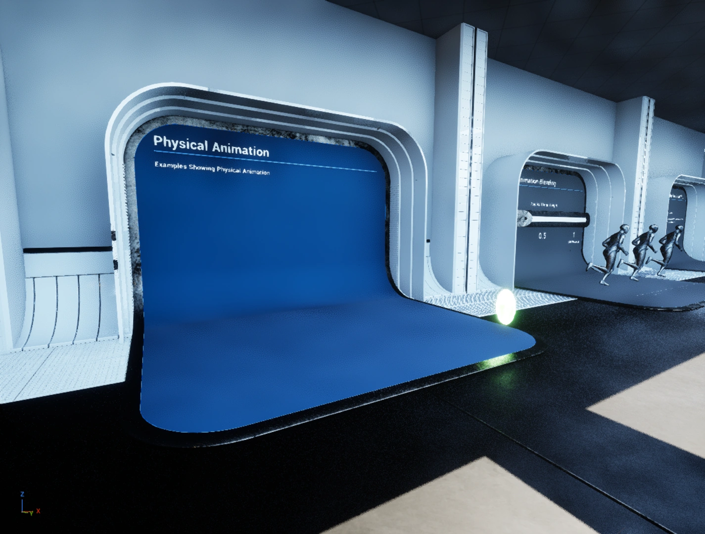
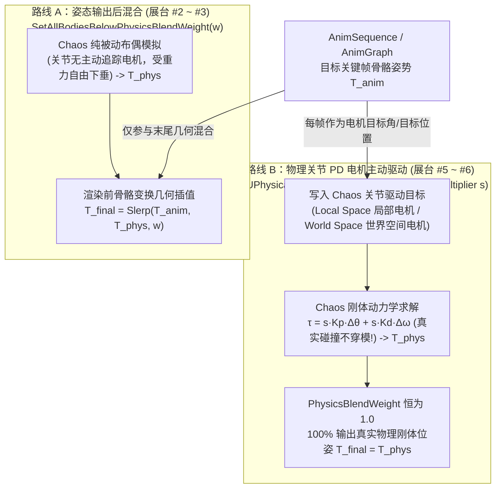
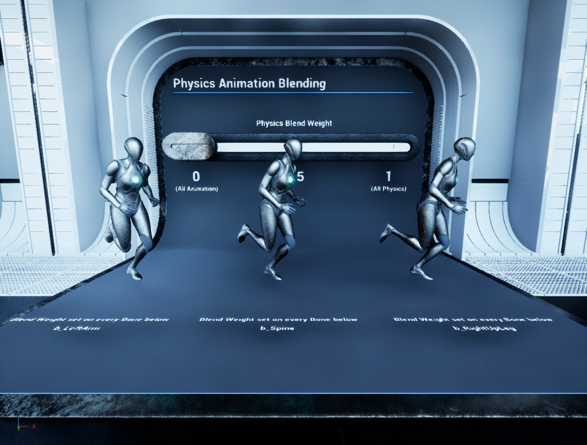
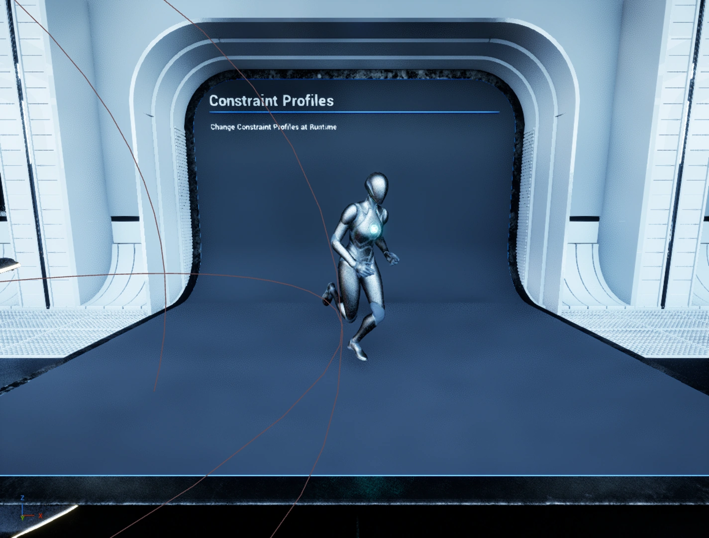
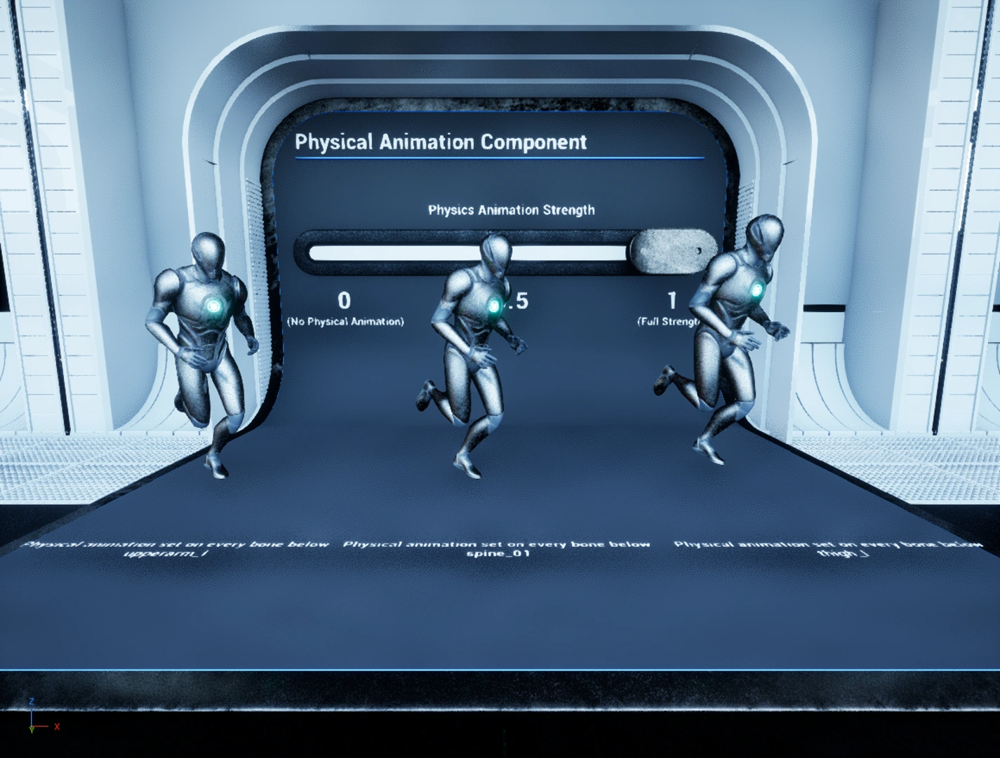

# 08 · 物理动画组件：电机强度曲线、物理混合权重与主动布娃娃（`PhysicalAnimation`）

> **本篇实测拆解关卡档案**
> - **关卡路径**：`/Game/Maps/Animation/PhysicalAnimation`（关卡总 Actor 数：`68` | 展台数：`6` | 示例 Actor 数：`20`）
> - **关卡脚本类**：`/Game/Maps/Animation/PhysicalAnimation.PhysicalAnimation_C`
> - **核心资产目录**：`/Game/ExampleContent/Physics/Blueprints/`（涵盖姿态后混合 `PhysicsAnimationBlending`、时间轴受击反应 `PhysicsAnimationBlendingHittReaction`、运行时约束配置切换 `PhysicsAnimationConstraintProfiles`、电机强度驱动 `PhysicsAnimationBlendingPhysicalAnimationComponent` 与全身开合跳物理驱动 `PhysicsAnimationBlendingFull`）

---

## 一、 同样是“一边播动画一边算物理”，混合权重（Blend Weight）与物理电机（Physical Animation）到底差在哪？

在上一篇 `07_Animation_PhysicsControl` 中，我们领略了 UE5 次世代双空间弹簧系统的强大威力。但在大量跨世代商业项目以及轻量级受击反馈实现中，虚幻引擎内置已久的经典物理动画管线——**`Physics Blend Weight`（物理混合权重）** 与 **`UPhysicalAnimationComponent`（物理动画组件）**——依然凭借零插件依赖、API 极简直接而被广泛使用。

然而，哪怕是有三年经验的虚幻开发者，在面试或调参时也常常把这两套机制混为一谈：
- **误区**：“把 `SetAllBodiesBelowPhysicsBlendWeight` 调成 `0.5`，不就是让手臂有一半肌肉力量去抗重力吗？”
- **真相**：**完全不是！** `Physics Blend Weight = 0.5` 时，物理引擎内部的那条手臂其实是 **100% 毫无肌力的死尸布偶**，只是在渲染输出骨骼变换的最后一刻，用数学插值把“死尸下垂的位置”和“动画挥手的位置”硬生生取了个几何中点！而真正的“用关节电机发力追赶动画”，则是 `#5` 与 `#6` 号展台主角 **`PhysicalAnimationComponent`** 的职责！

走进 **`/Game/Maps/Animation/PhysicalAnimation`** 这座紧凑精炼的 **6 展台对照实验室**（`X` 坐标从 `501.5` 延伸至 `5488.5`），官方将这两种截然不同的融合哲学摆在同一条走廊里同台竞技。我们先用一张底层数据流对比图厘清全貌：

接下来，让我们逐一拆解全部 **6 座展台** 的实验现象、MCP 实测参数与底层物理公式！

---

## 二、 `PhysicalAnimation` 逐展台（#1 ~ #6）100% 零遗漏实测拆解

### 展台 #1：`Physical Animation` — 标准物理评测光场与调试基座

- **空间元数据**：展牌 Label `BP_DemoDisplay2` | 坐标 `(501.5, -900, 0)`
- **官方展牌原文**：`Examples Showing Physical Animation`
- **展台陈列环境与调试 Actor（共 6 个）**：
  - **`DirectionalLight`**（`Intensity = 10`，纯白动态光，`CastShadows = true`）与 **`SkyLight`**（`Intensity = 3`，动态天光）：提供清晰的地面肢体投影以观察布偶下垂高度。
  - **`SkyAtmosphere`**、**`ExponentialHeightFog`**：构建标准展厅大气背景。
  - **`Actor`（挂载 `ChaosDebugDrawComponent_0`）**：支持运行期可视化物理胶囊体（PhAT Bodies）与关节约束锥。
  - **`Physics-Based Animation Doc Actor`**（`/Script/Engine.DocumentationActor`，坐标 `(717.25, -464.81, 60)`）：官方文档跳转锚点。

---

### 展台 #2：`Physics Animation Blending` — 骨骼子树物理混合权重（`BlendWeight`）的真相与穿模隐患

- **空间元数据**：展牌 Label `BP_DemoDisplay` | 坐标 `(1471.5, -900, 0)`
- **展台内 3D 悬浮文字标签（共 12 个 `TextRenderActor`）**：
  - 滑块刻度区：`Physics Blend Weight` | `0` `(All Animation)` | `0.5` | `1` `(All Physics)`
  - 地面三角色脚下说明：`Blend Weight set on every Bone below b_LeftArm` | `... b_Spine` | `... b_RightUpLeg`

#### 2.1 底层机制深扒：为什么 `w = 0.5` 时角色既不像纯动画，又可能会撞墙穿模？
展台上并排站立着 3 个正在原地播放奔跑动画（`/Game/Characters/Mannequins/Animations/Quinn/MF_Run_Fwd`）的女性人体模特 **`SKM_Quinn_Simple`**，全部受控于墙面滑块 **`BP_Slider`**（初始值 `startValue = 0`，行程 `205.55 cm`，归一化输出范围 `[0, 1]`）。
在蓝图 **`PhysicsAnimationBlending`** 中，初始化时对指定起始骨骼及其所有子孙骨骼开启物理模拟 `SetAllBodiesBelowSimulatePhysics(BoneName, true)`，随后每帧根据滑块值更新 **`SetAllBodiesBelowPhysicsBlendWeight(BoneName, BlendWeight)`**：
$$\mathbf{q}_{\text{final}} = \text{Slerp}\left(\mathbf{q}_{\text{anim}},\, \mathbf{q}_{\text{ragdoll}},\, w\right), \quad \mathbf{p}_{\text{final}} = (1 - w)\mathbf{p}_{\text{anim}} + w\mathbf{p}_{\text{ragdoll}}$$
- 当滑块在最左端 **`0`（All Animation）**：虽然物理引擎后台仍在模拟下垂的布偶胶囊体，但最终网格顶点 `100%` 采纳奔跑动画姿势；
- 当滑块推到中间 **`0.5`**：左臂/上半身/左腿呈现出一种“半抬不抬、僵硬折中”的混合姿态——**致命缺陷在于**：假如这时有一堵墙挡在 `T_phys` 外侧，物理刚体确实被墙挡住了，但几何插值算出来的 `0.5` 中点或回弹路径并不受碰撞检测约束，极易直接穿透角色自己的胸腔肋骨！
- 当滑块推到最右端 **`1`（All Physics）**：对应骨骼子树彻底沦为无肌力被动布偶——左臂软垂拍打大腿、脊柱向后折断瘫软、单腿跪折悬吊！

#### 2.2 MCP 实测细节彩蛋：从 UE4 到 UE5 骨骼命名的跨代痕迹
细心对比展台地面 3D 文字标签与 MCP 抓取的 3 个蓝图实例真实属性（`bp_props`），你会发现一处极有趣的引擎演进细节：

| 实例 Label | 地面历史遗留 3D 文字标签（UE4 旧骨架名） | MCP 实测蓝图真实生效 `boneName`（UE5 标准骨架名） | 受控骨骼子树范围 |
| :--- | :--- | :--- | :--- |
| **`PhysicsAnimation`** | `b_LeftArm` | **`"upperarm_l"`** | 左大臂、左前臂、左手掌及全部左手指骨 |
| **`PhysicsAnimation_2`** | `b_Spine` | **`"spine_01"`** | 第一腰椎以上整个躯干、双臂与头颈（骨盆与双腿仍保持奔跑！） |
| **`PhysicsAnimation_3`** | `b_RightUpLeg` *(注：文字写右腿，实际绑左腿)* | **`"thigh_l"`** | 左大腿、左小腿与左脚掌 |

---

### 展台 #3：`Physics Animation Blending Hit Reaction` — 经典时间轴权重脉冲受击法

- **空间元数据**：展牌 Label `BP_DemoDisplay1` | 坐标 `(2485, -900, 0)`
- **展台内 3D 悬浮文字标签**：`Left Click to cause hit reaction. Go to the Outliner Panel and click "Edit PhysicsAnimationBlendingHittReaction" to edit the Blueprint setup for the hit reaction.`

#### 3.1 零电机调参的“快餐式”受击反馈流水线
展台上站着一名奔跑中的男性模特 **`SKM_Manny_Simple`**，实例名为 **`PhysicsAnimationBlendingHittReaction`**（注：官方资产原名确实多打了一个字母 `t`！实现接口 `BPI_HitReaction`，内部挂载了时间轴组件 **`Timeline_0`**，默认变量 `blendWeight = 0, isHit = false, boneName = "b_RightArm"`——运行期由鼠标射线命中点实时覆写受击骨骼名）。
当你对准他的肩膀或手臂点击**鼠标左键**时，触发了一套 UE4 时代最经典的五步受击宏：
1. **射线检测定位骨骼**：捕获左键点击命中的骨骼名 `BoneName`（若点中核心根骨骼则保护性过滤，避免整个人掉出地面）与射线冲击方向；
2. **唤醒子树模拟并注入冲量**：对该骨骼以下调用 `SetAllBodiesBelowSimulatePhysics(true)` 并施加 `AddImpulseAtLocation`；
3. **Timeline 曲线驱动 `BlendWeight` 瞬升缓降**：`Timeline_0` 瞬间将 `BlendWeight` 拉高至接近 `1.0`（完全展现被砸飞的物理后仰），随后在约 `0.5 ~ 0.8` 秒内沿平滑曲线衰减回 `0.0`；
4. **休眠回收零开销**：Timeline 播放完毕（`Finished` 引脚触发）时，调用 `SetAllBodiesBelowSimulatePhysics(false)` 彻底关闭物理模拟，角色恢复零物理开销的纯奔跑状态！
> **工程评价**：这套写法最大的优点是**省电且不用调电机刚度**；缺点是在衰减回 `0.0` 的后半程，如果手臂被打到了背后，Slerp 最短路径插值可能会让胳膊直接从肚子中间“穿膛而过”回到胸前。

---

### 展台 #4：`Constraint Profiles` — 运行时一键热切换关节约束配置表

- **空间元数据**：展牌 Label `BP_DemoDisplay5` | 坐标 `(3498.5, -900, 0)`
- **官方展牌原文**：`Change Constraint Profiles at Runtime`

#### 4.1 什么是 `Constraint Profile`（约束配置表）？
打开任意骨骼网格关联的物理资产（如 `/Game/Characters/Mannequins/Rigs/PA_Mannequin`），除了胶囊体碰撞盒之外，连接每对相邻骨骼的 **`PhysicsConstraintTemplate`（关节约束）** 上都有几十个参数：Swing1 / Swing2 / Twist 三个旋转自由度的角度限位（比如手肘只能向内折 $130^\circ$，绝不能向外反折）、关节线性断裂阈值（Linear Breakable，用于机械断肢！）、以及角速度阻尼。
如果角色在“正常站立受击”时需要较紧的关节角度保护防止扭成麻花，而在“被高爆手雷炸飞死亡”时需要放开关节限位或允许四肢关节被炸断，逐一遍历修改几十个关节太慢了——**`Constraint Profiles`** 允许你在物理资产编辑器中预先建好几套命名快照（例如我们在 `PA_Mannequin` 中实测看到的 `"Locked"`、`"RagdollNoDrives"`、`"NoLimits"`、`"HingesOnly"`）！

#### 4.2 展台陈列 Actor 与触发机制（共 2 个）
- **`BP_DemoTrigger`**（交互按钮台，坐标 `(3337, -394.7, 1.23)`）：实例属性 `tiggered Actor` 绑定至展台中央的 `PhysicsAnimationConstraintProfiles_120`。
- **`PhysicsAnimationConstraintProfiles`**（搭载 `SKM_Quinn_Simple` 与奔跑动画 `MF_Run_Fwd`）：每当你走近按下按钮触发 `BPInterface_Button` 事件，蓝图立即调用 **`SetConstraintProfileForAll`** 在紧致约束配置与松散约束配置之间热切换，你可以直观看到模拟肢体的摆动幅度与关节软硬限位瞬间发生质变！

---

### 展台 #5：`Physical Animation Component` — 真正的关节 PD 电机主动驱动登场！

- **空间元数据**：展牌 Label `BP_DemoDisplay3` | 坐标 `(4498.5, -900, 0)`
- **展台内 3D 悬浮文字标签（共 9 个）**：
  - 滑块刻度区：`Physics Animation Strength` | `0` `(No Physical Animation)` | `0.5` | `1` `(Full Strength)`
  - 地面三角色说明：`Physical animation set on every bone below upperarm_l` | `... spine_01` | `... thigh_l`

#### 5.1 核心革命：和 `#2` 号展台到底有什么本质区别？
请站在 `#5` 号展台前，对比回忆刚才 `#2` 号展台的画面！
同样是墙上一个滑块（**`BP_Slider2`**，注意这里的初始值 **`startValue = 1, value = 1`**，一上来就是满强度！）控制底下三个分别作用于 **`"upperarm_l"`**、**`"spine_01"`**、**`"thigh_l"`** 的奔跑角色（`SKM_Manny_Simple`），但这次三个蓝图实例 **`PhysicsAnimationBlendingPhysicalAnimationComponent`（1 / 2 / 3）** 身上全部多挂了一个核心组件：**`/Script/Engine.PhysicalAnimationComponent`**！

在它的底层，受控骨骼子树的 **`PhysicsBlendWeight` 全程死锁为 `1.0`（100% 纯物理模拟，绝不做任何几何插值作弊！）**。那么角色为什么没有瘫倒，反而能虎虎生风地摆臂奔跑呢？
因为 `PhysicalAnimationComponent` 每帧都在读取 `MF_Run_Fwd` 动画序列的目标骨骼变换，将其转化为 **Chaos 关节角度/位置马达（Joint Drives）的 PD 控制器目标**，实时输出真实物理扭矩 $\boldsymbol{\tau}$：
$$\boldsymbol{\tau} = s \cdot \Big[ K_p \cdot \Delta \mathbf{q}_{\text{target}} + K_d \cdot (\boldsymbol{\omega}_{\text{target}} - \boldsymbol{\omega}_{\text{body}}) \Big], \quad \|\boldsymbol{\tau}\| \le \tau_{\max}$$
其中，`FPhysicalAnimationData` 结构体的六大核心参数各司其职：
- **`bIsLocalSimulation`**：
  - `true`（局部电机模式，类比 `Parent-Space`）：电机安装在父子骨骼关节上，驱动子骨骼相对于父骨骼旋转到目标夹角（遵守牛顿第三定律，子骨骼发力会反推父骨骼）；
  - `false`（世界空间模式，类比 `World-Space`）：直接把每块骨骼朝它在组件/世界空间里的动画目标位姿牵引，抗重力不倒但缺少关节间的反作用力传递。
- **`OrientationStrength` ($K_p^{\text{rot}}$) & `AngularVelocityStrength` ($K_d^{\text{rot}}$)**：角度比例刚度与角速度阻尼增益；
- **`PositionStrength` ($K_p^{\text{lin}}$) & `VelocityStrength` ($K_d^{\text{lin}}$)**：线性位置刚度与线速度阻尼增益；
- **`MaxLinearForce` & `MaxAngularForce`**：最大力量上限（设为 `0` 表示无限力矩，设为有限值则重锤砸下时电机会自然“力竭屈服”！）。

拖动 **`BP_Slider2`** 改变全局强度乘数 `SetStrengthMultiplyer(Strength)`（即公式中的缩放因子 $s \in [0, 1]$）：
- 当滑块在 **`1.0`（Full Strength）**：电机火力全开，三条受控肢体紧跟奔跑节奏，且如果此时拿一个物理球砸向他的左臂，手臂会**真实地绕开球体滑过，绝不会像 `#2` 号展台那样穿进自己胸口**！
- 当滑块拉向 **`0.5`**：电机力量减半，摆臂幅度在重力和奔跑惯性甩动下变得沉重滞后，如同精疲力竭的伤员；
- 当滑块拉到 **`0.0`（No Physical Animation）**：电机彻底断电（$s=0$），由于底层本身就是 100% 物理模拟，左臂/上半身/左腿立刻顺着惯性自然垂落成纯布偶！

---

### 展台 #6：`Component Transform is kinematic` — 全身开合跳与运动学根锚点铁律

- **空间元数据**：展牌 Label `BP_DemoDisplay4` | 坐标 `(5488.5, -900, 0)`
- **展台内 3D 悬浮文字标签（共 6 个）**：`Physics Animation Strength` | `0` `(No Physical Animation)` | `0.5` | `1` `(Full Strength)`

#### 6.1 为什么全身都开了物理模拟，角色却没有掉穿地板或满屋乱滚？
来到走廊尽头的 `#6` 号展台，这里只有一名正在原地欢快做着**开合跳动画**（`/Game/ExampleContent/ControlRig/Animations/JumpingJacks`）的角色 **`PhysicsAnimationBlendingFull`**（挂载 `SKM_Manny_Simple` + `PhysicalAnimationComponent`，受滑块 **`BP_Slider3`** 控制，初始值 `value = 1`）。
查看 MCP 实测抓取的实例属性，注意一个关键差异：在 `#5` 号展台里 `boneName` 填的是局部肢体名，而这里的 **`boneName` 填的是 `"None"`（代表作用于根骨骼以下全身每一块物理刚体！）**。

既然全身上下每一块骨头都在跑物理模拟，为什么当你把滑块 `BP_Slider3` 拉低甚至拉到 `0` 时，角色只是瘫挂在原地，而没有滚下展台台面？
展牌标题 **`Component Transform is kinematic`（组件根变换始终保持运动学）** 一语道破天机：
1. 在虚幻骨骼层次结构的最顶端，除了 `pelvis`（骨盆，通常是第一个拥有碰撞胶囊体的物理刚体）之外，还有一个无碰撞体积的 **`root` 根骨骼** 以及承载整个网格的 **`SkeletalMeshComponent` 组件世界变换（Component Transform）**；
2. 只要不对整个 `SkeletalMeshComponent` 本身开启顶层组件级自由落体，**组件原点与 `root` 骨骼在世界空间里永远是一个纹丝不动的 `Kinematic`（运动学）铁锚**！
3. 当 `Physics Animation Strength = 1.0` 时，`PhysicalAnimationComponent`（配合世界空间目标或与 `root` 相连的骨盆驱动）赋予全身充足刚度，角色在原地生龙活虎地做着大幅度开合跳，手臂拍击与落地顿挫都带着微妙的真实物理惯性颤动；当你把滑块往左拉低至 `0.0`，全身电机卸力，躯干与四肢受重力下坠，被根关节约束牵制在展台原点周围瘫软垂落！

*(注：关卡持久层另含 1 个未归属特定展牌的全局空容器 `InstancedFoliageActor1`，坐标 `(700, 1000, 0)`。)*

---

## 三、 本章实战总结：`PhysicalAnimation` 四步标准接入法与演进对照

走完 `PhysicalAnimation` 全部 6 座展台，如果你需要在不开启额外实验插件的前提下用原生 `PhysicalAnimationComponent` 快速实现高品质主动布偶，只需严格遵循以下 **标准四步调用链（缺一不可，顺序不能颠倒！）**：

1. **绑定目标骨骼网格**：在 `BeginPlay` 中调用 **`PhysicalAnimation->SetSkeletalMeshComponent(SkeletalMesh)`**（若漏掉这步，后续所有调用全部静默失效！）；
2. **下发电机参数结构体**：调用 **`ApplyPhysicalAnimationSettingsBelow(BoneName, PhysicalAnimationData, bIncludeSelf)`**（或者加载物理资产中预设好的 Profile：`ApplyPhysicalAnimationProfileBelow`）；
3. **唤醒对应骨骼子树物理模拟**：在 `SkeletalMesh` 上调用 **`SetAllBodiesBelowSimulatePhysics(BoneName, true, bIncludeSelf)`**（记住：永远不要对 `root` 根骨骼本身开模拟，从 `pelvis` 或 `spine_01` 开始往下开！）；
4. **运行期动态调节强度曲线**：受击或体力衰减时，随时调用开销极低的 **`SetStrengthMultiplyer(Strength)`** 动态缩放全身电机刚度！

| 对比维度 | `#2~#3` `Physics Blend Weight` | `#5~#6` `PhysicalAnimationComponent` | 第 07 篇 `PhysicsControlComponent` |
| :--- | :--- | :--- | :--- |
| **手部/躯干防穿模能力** | 差（几何插值回弹易穿过胸膛或墙壁） | **优（全程 100% 物理刚体碰撞约束）** | **极优（支持按控制器精细开关碰撞）** |
| **调参友好度** | 极简（仅 `0~1` 权重曲线） | 中偏难（`OrientationStrength` 常需填 `1000~50000`，随骨骼质量波动） | **极佳（`bUseAccelerationDriveMode` 直接填 `1~10 Hz` 频率与阻尼比）** |
| **跨 Actor 交互与双空间混搭** | 不支持 | 仅支持整组切换 `bIsLocalSimulation`（Local 或 World 二选一） | **同一根骨头可同时叠加 World + Parent 双弹簧及外部抓握！** |

掌握了角色骨架层面的物理碰撞与弹簧肌肉驱动后，让我们把视线进一步推向微观顶点级别——当角色的手肘大幅度弯曲或手腕旋转 $180^\circ$ 时，为什么网格表面会拧成难看的“糖果包装纸”？下一篇 **`09_Animation_Deformer`**，我们将深入 GPU Compute Shader 腹地，彻底解锁 **Optimus Deformer Graph** 网格变形器框架！
