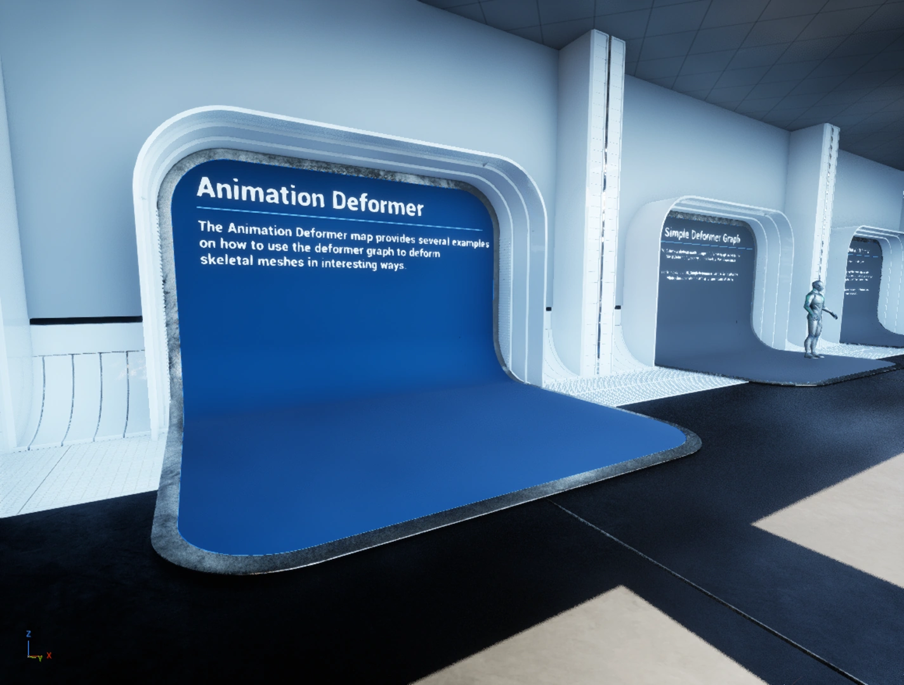
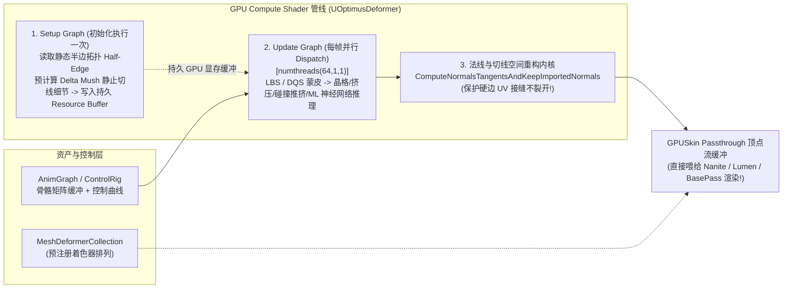
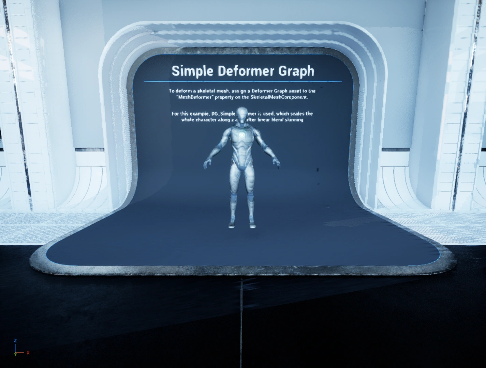
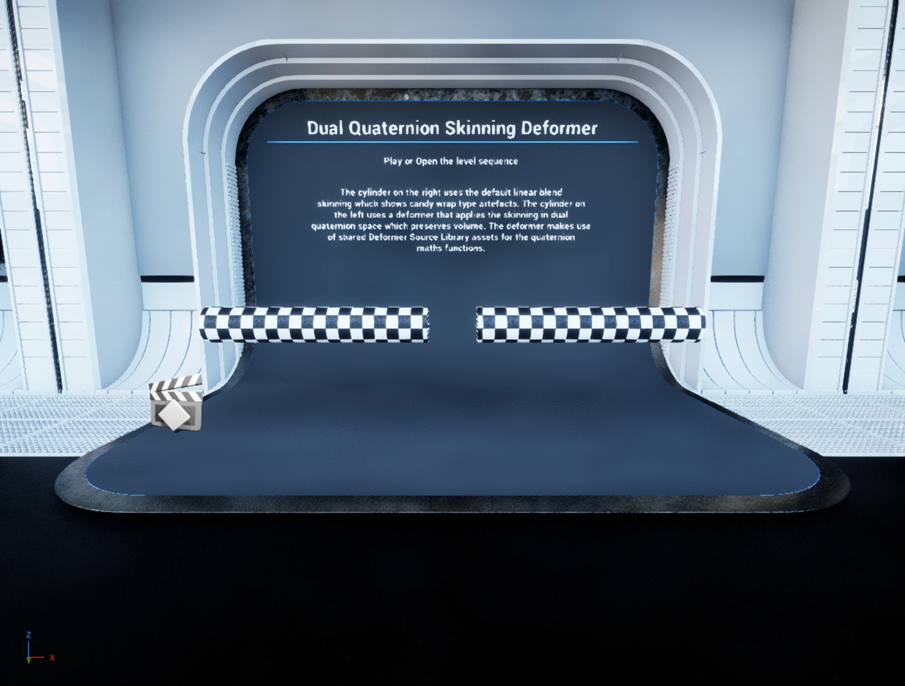
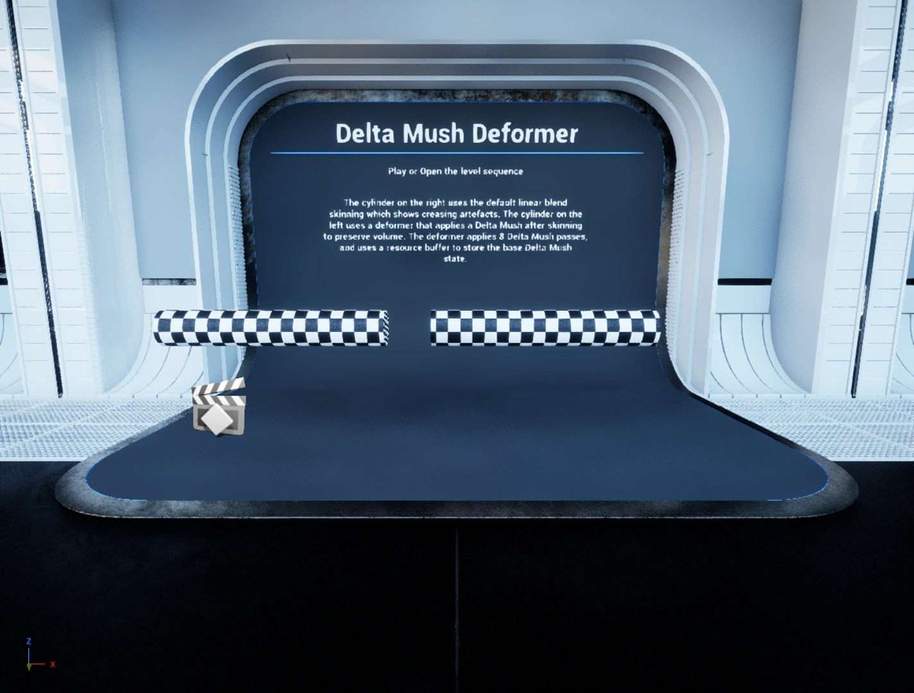

# 09 · 机器学习与 GPU 计算着色器网格变形器全解（`Animation_Deformer`）

> **本篇实测拆解关卡档案**
> - **关卡路径**：`/Game/Maps/Animation/Animation_Deformer`（关卡总 Actor 数：`39` | 展台数：`6` | 示例 Actor 数：`19`）
> - **关卡脚本类**：`/Game/Maps/Animation/Animation_Deformer.Animation_Deformer_C`（属性：`{"oldPawn": "None"}`）
> - **核心资产目录**：`/Game/ExampleContent/AnimationDeformer/`（涵盖 Optimus 变形图 `DG_SimpleDeformer`、`DG_DualQuatDeformerDemo`、`DG_DeltaMushDeformerDemo`、`DG_RigDrivenDeformerDemo`、着色器预编译集合 `DA_MeshDesformerCollections`、按需挂载绑定 `CRD_RigDrivenDeformerDemo`、Animator Kit 晶格序列 `LS_AnimatorKitDeformerDemo` 与测试圆柱资产 `SKM_Cylinder`）

---

## 一、 为什么顶尖绑定师刷了三天蒙皮权重，手肘和手腕一拧还是会“塌陷穿模”？

在实时计算机图形学过去三十年的历史里，几乎所有游戏引擎渲染角色骨骼网格时，在 GPU 顶点工厂（`GPUSkinVertexFactory`）里默认跑的都是同一行古老的数学公式——**线性混合蒙皮（Linear Blend Skinning，简称 LBS）**：
$$\mathbf{v}'_{\text{LBS}} = \sum_{i=1}^{K} w_i \left(\mathbf{M}_i \mathbf{v}_0\right) = \left(\sum_{i=1}^{K} w_i \mathbf{M}_i\right) \mathbf{v}_0, \quad \sum_{i=1}^{K} w_i = 1$$
其中 $\mathbf{v}_0$ 是静止绑定姿势（Bind Pose）下的顶点坐标，$\mathbf{M}_i \in \mathbb{R}^{4\times 4}$ 是第 $i$ 根骨骼相对于绑定姿势的变换矩阵，$w_i$ 是绑定师刷在顶点上的蒙皮权重。

LBS 之所以统治游戏界三十年，是因为它快到极致（几次矩阵乘加即可完成）。但它的数学基因里藏着一个**永远无法靠刷权重修好的致命绝症**：**旋转矩阵的线性加权平均值，根本不再是一个正交旋转矩阵！**

让我们做一个最直观的极简推演：假设角色小臂手腕处的圆柱网格（正如本关 `#4` 号展台的 `SKM_Cylinder`），一端骨骼保持单位阵 $\mathbf{R}_0 = \mathbf{I}$，另一端手腕骨骼绕 Z 轴旋转 $180^\circ$（$\mathbf{R}_{\pi} = \text{diag}(-1, -1, 1)$）。处在正中间（权重 $w_0 = 0.5, w_1 = 0.5$）的一圈顶点会发生什么？
$$\mathbf{R}_{\text{blend}} = 0.5 \begin{bmatrix} 1 & 0 & 0 \\ 0 & 1 & 0 \\ 0 & 0 & 1 \end{bmatrix} + 0.5 \begin{bmatrix} -1 & 0 & 0 \\ 0 & -1 & 0 \\ 0 & 0 & 1 \end{bmatrix} = \begin{bmatrix} \mathbf{0} & 0 & 0 \\ 0 & \mathbf{0} & 0 \\ 0 & 0 & 1 \end{bmatrix}$$
看清楚了吗？！矩阵的 X 行和 Y 行**直接抵消归零（奇异坍缩）**！整圈顶点的半径瞬间缩成了 $0$，在视觉上拧成了一个干瘪扭曲的**“糖果包装纸结（Candy-Wrapper Artifact）”**！同理，当手肘或大腿根部折弯超过 $90^\circ$ 时，内侧顶点会生硬地互相挤压穿透，形成刀割般的死折痕（Creasing Artifact）。

为了把影视级角色变形管线（双四元数蒙皮、Delta Mush 平滑肌肉体积保持、FFD 自由晶格形变、碰撞推挤变形乃至 **ML Deformer 神经网络肌肉拟合**）彻底搬上实时 60 帧的显卡，虚幻引擎 5 构建了底层代号为 **Optimus** 的现代可编程 GPU 计算框架——**`Deformer Graph`（网格变形器图，`UOptimusDeformer`）**！

### 1.1 直击内核：Optimus `Deformer Graph` 是如何在 GPU Compute Shader 上重塑几何的？

在传统渲染管线中，蒙皮死死焊死在材质 Vertex Shader 前端，你除了用材质里的 `World Position Offset`（WPO，拿不到邻接拓扑，也没法跨帧缓存重算法线切线）做点简单风吹抖动外，根本插不上手。
而 **Optimus（`/Script/OptimusCore` + `/Script/ComputeFramework`）** 直接在渲染依赖图（**RDG, Render Dependency Graph**）的前端开辟了完整的 **GPU Compute Shader 几何前处理管线**：

吃透这套架构，必须抓住它的四大核心工程支柱：
1. **双执行图分离架构（`Setup Graph` vs `Update Graph`）**：
   - **`Setup Graph`**：仅在组件初始化时在 GPU 上跑**唯一一次**！专门用来干“重活”——例如遍历网格半边邻接表（Half-Edge Connectivity），把静止模型平滑 8 遍算出基础高频凹凸差值，存入一块**跨帧持久驻留的 GPU Resource Buffer**；
   - **`Update Graph`**：每帧在 RDG 中按 `[numthreads(64, 1, 1)]` 高并发调度 HLSL Compute Kernel，直接消费骨骼矩阵与持久缓冲，极速写出变形后的顶点坐标。
2. **数据接口（Data Interfaces）与源码库（Deformer Source Libraries, `DSL_*`）**：
   Compute Kernel 本身是纯函数，通过绑定 `Skinned Mesh`、`Skeleton`、`HalfEdge`、`Cloth/Collision` 等 Data Interface 安全读写底层显存；复杂的四元数、双四元数与矩阵代数则封装在可全局复用的源码库资产中（如 MCP 实测捕获的 `/DeformerGraph/SourceLibraries/DSL_Quaternion`、`DSL_DualQuaternion`、`DSL_Matrix`）。
3. **重算法线却不破坏硬边接缝（`KeepImportedNormals`）**：
   顶点被大幅拉伸挤压后，如果不重算法线切线，高光与法线贴图就会彻底错乱；但如果无脑对相邻三角面法线求平均，原本角色盔甲硬边或 UV 接缝处的分裂顶点法线又会被抹糊或撕裂！因此官方变形图统一调用了核心内置函数 **`DG_Function_ComputeNormalsTangentsAndKeepImportedNormals`**——通过旋转变换与邻域加权保留原始导入法线的硬软边连续性特征！
4. **着色器排列预注册机制（`DA_MeshDesformerCollections`）**：
   细看 MCP 对本关 `SKM_Manny`、`SKM_Manny_Simple` 与 `SKM_Bot` 三个骨骼网格的依赖深拆，你会发现它们全部暗中引用了一份隐藏幕后功臣：**`/Game/ExampleContent/AnimationDeformer/AnimBlueprints/DA_MeshDesformerCollections`**（`MeshDeformerCollection` 资产，内部注册了本关全部 4 张变形器图）！这是因为使用 Deformer Graph 需要材质编译对应的 `GPUSkinPassThrough` 顶点工厂变体，将该集合挂载到骨骼网格资产的 `Mesh Deformer Collections` 槽位，才能保证打包与运行时按需动态生成变形器不丢 Shader！

现在，让我们沿着这条长 55 米的精品长廊，逐台拆解全部 **6 座展台** 的实测配置与算法内核！

---

## 二、 `Animation_Deformer` 逐展台（#1 ~ #6）100% 零遗漏实测拆解

### 展台 #1：`Animation Deformer` — 展厅总览与动态光影评测环境

- **空间元数据**：展牌 Label `BP_DemoDisplay2` | 坐标 `(500, -900, 0)`
- **官方展牌原文**：`The Animation Deformer map provides several examples on how to use the deformer graph to deform skeletal meshes in interesting ways.`
- **展台陈列环境与调试 Actor（共 5 个）**：
  - **`DirectionalLight`**（`Intensity = 10`，纯白光，`Mobility = Movable`，旋转角 `Pitch = -60, Yaw = -160, Roll = -85`）：高斜射角强光，专门用来放大检验网格变形后的表面法线折痕（Creasing）与高光平滑度！
  - **`SkyLight`**（`Intensity = 3`，动态天光）、**`SkyAtmosphere`**、**`ExponentialHeightFog`**、以及挂载 `ChaosDebugDrawComponent_0` 的调试 **`Actor`**。

---

### 展台 #2：`Simple Deformer Graph` — 最小闭环：接管 LBS 后置顶点缩放与法线重构

- **空间元数据**：展牌 Label `BP_DemoDisplay1` | 坐标 `(1501.5, -900, 0)`

#### 2.1 如何把一张变形器图挂到角色身上？
最直接的静态挂载方式就在展台中央的 **`SKM_Manny_Simple`**（`SkeletalMeshActor`，坐标 `(1500, -610, 30)`，实际内部骨骼资产为 `SKM_Manny`）上：打开 `SkeletalMeshComponent0` 的 Details 面板，在 **`MeshDeformer`** 属性槽中直接指定 **`/Game/ExampleContent/AnimationDeformer/AnimBlueprints/DG_SimpleDeformer`**！（注：本展台旁还放置了 1 个预计算可见性体积 `PrecomputedVisibilityVolume1`。）

#### 2.2 `DG_SimpleDeformer` 内部依赖与计算流水线深拆
一旦挂载了 `MeshDeformer`，引擎就会关闭默认的固定管线蒙皮，将顶点控制权 100% 移交给 `DG_SimpleDeformer`。根据 MCP 实测提取的依赖链，它的 `Update Graph` 由三个极简清晰的标准阶段串联而成：
1. **阶段一：仅位置线性混合蒙皮** —— 调用内置变形器函数 **`/DeformerGraph/DeformerFunctions/DG_Function_LinearBlendSkin_PositionOnly`**（依赖 `/DeformerGraph/SourceLibraries/DSL_Quaternion`），先在 Compute Shader 中算出常规 LBS 蒙皮后的顶点坐标 $\mathbf{p}_{\text{LBS}}$（省去了此时还不需要的切线蒙皮开销）；
2. **阶段二：自定义 HLSL Compute Kernel 变换** —— 对每个线程处理的顶点执行自定义逻辑（将整个角色的 Z 轴高度按比例拉伸/压扁：$\mathbf{p}' = (p_x, p_y, s_z \cdot p_z)$）；
3. **阶段三：高质量法线切线重构并输出** —— 调用 **`/DeformerGraph/DeformerFunctions/DG_Function_ComputeNormalsTangentsAndKeepImportedNormals`**，根据非均匀缩放后的新顶点位置重新正交化切线空间（Tangent / Binormal / Normal），最终写入 `Write Skinned Mesh` 输出接口！

---

### 展台 #3：`Animator Kit Deformer` — 告别手写 HLSL：开箱即用的 $3\times 3\times 3$ 自由变形晶格（FFD Lattice）

- **空间元数据**：展牌 Label `BP_DemoDisplay2` | 坐标 `(2500, -900, 0)`

#### 3.1 动画师零代码福利：什么是 `Animator Kit` 插件与 `CRD_Lattice_3x3x3`？
如果每次做卡通挤压回弹、重拳砸脸凹陷都要让动画师去写 Compute Shader，生产效率就太低了。为此，虚幻内置了 **`Animator Kit`（动画师工具包）插件**——它把常用的三维自由变形晶格（Free-Form Deformation, **FFD**，如 **`CRD_Lattice_3x3x3`**）、非线性弯曲扭曲（Bend / Twist / Squash）预先封装成带可视化 Gizmo 手柄的 **Deformer Control Rigs**！
在数学上，$3\times 3\times 3$ 晶格利用三元二次伯恩斯坦多项式（Trivariate Bernstein Polynomials $B_{i,2}(u) B_{j,2}(v) B_{k,2}(w)$）构建包围盒局部参数空间 $(u,v,w) \in [0,1]^3$：动画师只需在视口里拖拽晶格笼子的 27 个控制点 $\mathbf{P}_{ijk}$，笼子内部的成千上万个头部网格顶点就会在 GPU 上丝滑地随笼子产生橡胶般的体积凹陷与弹回！

#### 3.2 展台关卡序列 `LS_AnimatorKitDeformerDemo` 轨道解剖
展台由自动无限循环播放（`bAutoPlay = true, loopCount = -1`）的 **`LS_AnimatorKitDeformerDemo`**（帧率 `30 fps`，播放区间 `0 ~ 56` 帧）驱动 **`SKM_Manny_Simple`**（注意此时 Actor 身上的静态 `MeshDeformer` 槽是 `"None"`，变形器完全由 Sequencer 里的 Control Rig 轨道按需动态生成！）：
- **绑定对象 1：`Sphere`（Spawnable 动态生成飞球）** —— 包含 `MovieSceneSpawnTrack_4` 与 `MovieScene3DTransformTrack_4`，在序列中生成一颗飞球迎面砸向 Manny 的额头；
- **绑定对象 2：`SKM_Manny_Simple`** —— 挂载了 `MovieScene3DTransformTrack_2`、`MovieSceneSkeletalAnimationTrack_2` 以及**两条独立的 Control Rig 参数轨道**（`MovieSceneControlRigParameterTrack_6` 与 `Track_7`）：一条控制身体受击骨骼动作，另一条专门把 **`CRD_Lattice_3x3x3`** 晶格笼子套在 Manny 的脑袋上，在球体撞击瞬间精确 K 出头部向后扁平凹陷、再 Q 弹震荡恢复的卡通冲击形变！

---

### 展台 #4：`Dual Quaternion Skinning Deformer` — 根治 $180^\circ$ 拧麻花坍缩：双四元数保体积蒙皮

- **空间元数据**：展牌 Label `BP_DemoDisplay3` | 坐标 `(3500, -900, 0)`

#### 4.1 视口震撼实拍对比：左边浑圆饱满 vs 右边拧成麻花死结！
请看上方 `#4` 号展台的实拍截图！关卡序列 **`LS_DualQuatDeformerDemo`**（`30 fps`，区间 `0 ~ 270` 帧）通过两条 `CR_Cylinder` Control Rig 轨道，同步将左右两根拥有 4 节骨骼（`SK_Cylinder`）且贴有黑白棋盘格材质（`M_Cylinder`，调用材质函数 `CheckerPattern`）的圆柱体 **`SKM_Cylinder`** 大幅度往复旋转扭曲：
- **右侧 `BP_Cylinder_DQ_Off`（`MeshDeformer = "None"`，默认 LBS 蒙皮）**：当顶部骨骼扭转接近 $180^\circ$ 时，圆柱体腰部像被无形大手死死掐住一样向中心坍缩成极细的沙漏尖刺，棋盘格纹理严重撕裂畸变！
- **左侧 `BP_Cylinder_DQ_On`（挂载 `DG_DualQuatDeformerDemo`）**：哪怕扭转整整半圈，圆柱体的横截面直径依然**分毫不差地保持正圆，总体积 100% 守恒**，棋盘格螺旋缠绕顺滑自然！

#### 4.2 双四元数蒙皮（DQS）底层代数全解（`DSL_DualQuaternion`）
MCP 实测显示，`DG_DualQuatDeformerDemo` 直接引用了引擎共享源码库 **`/DeformerGraph/SourceLibraries/DSL_DualQuaternion`**。它是如何在 GPU 上消灭坍缩的？
在克利福德代数（Clifford Algebra）中，引入满足 **$\varepsilon^2 = 0$（$\varepsilon \neq 0$）的对偶数单位 $\varepsilon$**，即可将任意刚体旋转四元数 $\mathbf{q}_r$ 与平移向量 $\mathbf{t} = (0, t_x, t_y, t_z)$ 统一编码为一个 8 维的**单位双四元数（Unit Dual Quaternion）**：
$$\hat{\mathbf{q}} = \mathbf{q}_r + \varepsilon \mathbf{q}_d = \mathbf{q}_r + \varepsilon \left(\frac{1}{2} \mathbf{t} \mathbf{q}_r\right)$$
对于受 $K$ 根骨骼影响的顶点，DQS 执行**双四元数线性混合并归一化（DLB）**：
$$\hat{\mathbf{b}} = \frac{\sum_{i=1}^{K} w_i s_i \hat{\mathbf{q}}_i}{\left\| \sum_{i=1}^{K} w_i s_i \mathbf{q}_{r,i} \right\|}$$
这里藏着两个至关重要的 HLSL 工程细节（均已封装在 `DSL_DualQuaternion` 中）：
1. **同半球最短路径符号对齐（Antipodal Sign Flip $s_i$）**：因为四元数 $\mathbf{q}$ 与 $-\mathbf{q}$ 代表同一个三维旋转，若 $\mathbf{q}_{r,0} \cdot \mathbf{q}_{r,i} < 0$，直接相加会绕 $360^\circ$ 远路相消！因此必须先令 $s_i = \text{sign}(\mathbf{q}_{r,0} \cdot \mathbf{q}_{r,i})$ 强制对齐到同一超半球；
2. **严格流形投影**：归一化后的 $\hat{\mathbf{b}}$ **100% 仍是一个纯正的刚体旋转+平移变换（属于特殊欧氏群 $SE(3)$ 流形，绝不含任何缩放分量！）**。因此无论怎么旋转混合，截面半径永远不可能坍缩！

---

### 展台 #5：`Delta Mush Deformer` — 8 遍拉普拉斯平滑与切线空间细节回填：消灭关节死折痕

- **空间元数据**：展牌 Label `BP_DemoDisplay4` | 坐标 `(4500, -900, 0)`

#### 5.1 为什么 DQS 还不够？弯曲折痕（Creasing）与关节膨胀怎么破？
虽然 `#4` 的双四元数（DQS）完美解决了绕轴旋转坍缩，但在手肘、膝盖、腹股沟做大幅度**横向折弯（Bending）**时：LBS 会导致关节内侧顶点生硬对穿形成“死折痕”（如上图右侧 **`BP_Cylinder_DM_Off`** 弯折内侧明显的硬角凹陷！），而纯 DQS 有时又会在肘部外侧产生轻微的“关节鼓包（Joint Bulging）”。
2014 年 SIGGRAPH 经典论文提出的 **Delta Mush 算法**，就是影视特效界公认的“免刷权重自动救场王牌”，而左侧的 **`BP_Cylinder_DM_On`**（挂载 **`DG_DeltaMushDeformerDemo`**，由序列 `LS_DeltaMushDeformerDemo` 在 `0 ~ 270` 帧驱动大角度折弯）正是它在 GPU Compute Shader 上的原生实时复刻！

#### 5.2 `DG_DeltaMushDeformerDemo` 的 Setup + Update 双阶段核心管线拆解
为什么展牌上特别强调 **“applies 8 Delta Mush passes, and uses a resource buffer to store the base Delta Mush state”**？让我们拆开它的 GPU 两步魔术：

1. **初始化阶段（`Setup Graph` $\rightarrow$ 写入持久 `Resource Buffer`）**：
   - 读取静止绑定姿势网格顶点 $\mathbf{v}_0$，沿网格半边邻接拓扑执行 **8 遍拉普拉斯邻域均匀平滑（Laplacian Smoothing）**：$\bar{\mathbf{v}}_0 = \mathcal{S}^8(\mathbf{v}_0)$，抹平表面细节得到光滑包络基底；
   - 在平滑基底每个顶点上构建局部正交切线标架 $\mathbf{F}_0 = [\mathbf{t}_0, \mathbf{b}_0, \mathbf{n}_0]$，算出原始高精度顶点相对于平滑基底的**局部切线空间偏移向量（Mush Delta）**：
     $$\boldsymbol{\delta}_0 = \mathbf{F}_0^T \left(\mathbf{v}_0 - \bar{\mathbf{v}}_0\right)$$
   - 将每个顶点的 $\boldsymbol{\delta}_0$ 永久存入 GPU **Resource Buffer**（整个游戏生命周期只算这一次！）。
2. **每帧运行阶段（`Update Graph` $\rightarrow$ 8 遍实时平滑 + 细节无损回填）**：
   - 先做一遍最便宜的粗略 LBS 蒙皮得到带折痕的顶点 $\tilde{\mathbf{v}}$；
   - 在 Compute Shader 中对 $\tilde{\mathbf{v}}$ 同样跑 **8 遍拉普拉斯平滑 Pass**：$\bar{\mathbf{v}} = \mathcal{S}^8(\tilde{\mathbf{v}})$——原本手肘内侧难看的穿插死折痕和糟糕的蒙皮过渡瞬间被揉得像丝绸一样圆润饱满！
   - 最后重构变形后的切线标架 $\mathbf{F}$，从 Resource Buffer 取出静止细节偏移 $\boldsymbol{\delta}_0$ 还原叠加回去：
     $$\mathbf{v}'_{\text{DM}} = \bar{\mathbf{v}} + \mathbf{F} \boldsymbol{\delta}_0$$
   - **奇迹发生了**：大尺度上关节弯曲极其圆润饱满无折痕（看上图左侧圆柱柔顺的弧线！），而微观尺度上角色皮肤的肌肉纹理、血管起伏、盔甲铆钉（$\boldsymbol{\delta}_0$）又毫发无损地保留在表面，没有因为平滑而变糊一分一毫！

---

### 展台 #6：`Creating a Rig-driven Deformer` — Control Rig 动态生成内嵌变形器与烘焙管线解耦

- **空间元数据**：展牌 Label `BP_DemoDisplay5` | 坐标 `(5500, -900, 0)`

#### 6.1 核心工程架构：为什么要把“动骨头的 Rig”和“加变形器的 Rig”拆成两条轨道？
来到压轴的 `#6` 号展台，主角换成了萌萌的小机器人 **`SKM_Bot`**（`/Game/Characters/StackOBot/Mesh/SKM_Bot`），由序列 **`LS_RigDrivenDeformer`**（资产 `LS_RigDrivenDeformerDemo`，`30 fps`，区间 `0 ~ 30` 帧）驱动循环跳跃。
注意看 MCP 实测提取出的两个极关键工程细节：
1. **按需动态挂载内嵌变形器（On-Demand Spawning）**：
   场景里的 `SKM_Bot` 组件上 `MeshDeformer` 填的同样是 `"None"`！变形器资产 **`DG_RigDrivenDeformerDemo`**（依赖 `DSL_Matrix`、`DSL_Quaternion` 与法线重构函数）是**直接内嵌在 Control Rig 资产 `CRD_RigDrivenDeformerDemo` 的 Rig 图表里动态生成的**！
   更精妙的是它的分层叠算方式：`DG_RigDrivenDeformerDemo` 并不重新从头写一遍蒙皮，而是通过 **`Read Skinned Mesh`（读取已蒙皮网格）数据接口**，直接承接上游默认蒙皮器的输出几何体，然后**仅对小机器人的头部顶点区域施加程序化挤压与拉伸（Squash and Stretch）矩阵变换**！
2. **双 Rig 职责分离黄金法则（`Track_0` vs `Track_1`）**：
   查看 `LS_RigDrivenDeformerDemo` 对 `SKM_Bot` 的轨道绑定，官方专门挂了**两条并行的 `MovieSceneControlRigParameterTrack`**！展牌给出了极其深刻的工业管线解释：
   - **第一条 Rig 轨道** 只负责驱动骨骼运动（FK / IK）；
   - **第二条 Rig 轨道（`CRD_RigDrivenDeformerDemo`）** 专门负责挂载并驱动 GPU 顶点变形器参数！
   - **为什么必须拆开？** 因为在游戏开发中，过场调完后往往需要执行 **Bake to Animation Sequence（烘焙为标准骨骼动画序列 `.uasset`）** 供状态机复用——把顶点变形器拆在独立的第二层 Rig 里，烘焙骨骼序列时就能干干净净地只烘骨骼轨迹，绝不污染底层骨骼数据！

*(注：关卡持久层另含 2 个未归属特定展牌的全局体积 Actor：`InstancedFoliageActor1` 与 `LightmassImportanceVolume1`。) *

---

## 三、 进阶视野拓展：从碰撞推挤变形到 `ML Deformer` 神经网络肌肉拟合

掌握了本关全部 6 座展台的 Optimus 核心底座后，你在阅读虚幻引擎前沿角色工程（如《黑客帝国觉醒》MetaHuman 与肌肉演示工程）时，会发现另外两把最顶级的变形武器同样 100% 运行在我们刚刚拆解的这套 **`Deformer Graph`** 之上：

1. **GPU 实时碰撞推挤变形（Collision Push-Out Deformer）**：
   在 Deformer Graph 中引入 `Scene / Physics Collision` 或有向距离场（SDF）数据接口，当角色手指按压脸颊、或者皮靴踩进软垫时，Compute Kernel 直接检测落入碰撞体内部（$\phi(\mathbf{v}) < 0$）的顶点，沿梯度方向 $\nabla \phi$ 将顶点推挤到碰撞表面外侧，并利用相邻半边拓扑将挤压体积向四周扩散隆起（Bulge），最后调用 `ComputeNormalsTangentsAndKeepImportedNormals` 生成逼真的按压凹痕高光！
2. **机器学习网格变形器（`ML Deformer` —— Neural Morph Model & Nearest Neighbor Model）**：
   如果在 Houdini Vellum 或 Maya Ziva VFX 里解算一套包含骨骼、真实解剖学肱二头肌/胸大肌滑动、筋膜包裹与外层战术背心布料褶皱的超高精度角色，离线渲染一帧就要十几秒，根本不可能在游戏里实时跑有限元（FEM）。
   **`ML Deformer`** 的破局思路堪称降维打击：
   - **离线训练阶段**：在 DCC 软件中生成 5000 帧随机极限动作的骨骼姿态 $\{\boldsymbol{\theta}_k\}$ 与对应的离线 FEM 真实高精度网格顶点结果，导入 UE5 内置的 PyTorch 训练框架，训练一个轻量级多层感知机（MLP 神经网络），学会从**“当前骨骼旋转角 $\boldsymbol{\theta}$”直接预测“相对于线性蒙皮 LBS 的逐顶点非线性肌肉隆起与布料褶皱残差 $\Delta \mathbf{v}_{\text{ML}}(\boldsymbol{\theta})$”**！
     - **`Neural Morph Model`（神经变形目标模型）**：网络输出一组压缩潜空间动态 Morph Target 权重，显存极省（几 MB）、泛化极强，适合全身肌肉与紧身衣；
     - **`Nearest Neighbor Model`（最近邻补偿模型）**：在神经网络主干预测之上，叠加基于 K-Nearest Neighbors 的高频关键帧细节检索，连松散西装裤腿最细微的折痕都能分毫不差地复现！
   - **实时推理阶段**：运行时的载体**正是一张标准的 `Deformer Graph`（如系统内置的 `DG_MLDeformerModel`）**！骨骼姿势喂入 NNE / GPU Compute Kernel，在短短 **`0.1 ~ 0.3 ms`** 内跑完前向矩阵乘法算出 $\Delta \mathbf{v}_{\text{ML}}$，叠加到 LBS/DQS 顶点上重算法线输出——让玩家在千元显卡上实时看到媲美电影 CG 的肱二头肌充血隆起与肩甲挤压褶皱！

---

## 四、 本章实战总结与变形器选型决策矩阵

| 变形需求场景 | 推荐 `Deformer Graph` 方案 | 对应本关核心参考资产 | GPU 开销与工程注意事项 |
| :--- | :--- | :--- | :--- |
| **手腕/前臂/肩膀 $180^\circ$ 旋转防拧麻花** | **双四元数蒙皮（DQS）** | `DG_DualQuatDeformerDemo` + `DSL_DualQuaternion` | **极低**（仅比 LBS 多一次归一化与叉乘），写实人形角色手臂首选！ |
| **省去繁琐刷权重、自动消除肘胯折弯死折痕** | **Delta Mush 变形器** | `DG_DeltaMushDeformerDemo`（Setup 持久缓冲 + 8 Pass） | **中等**（开销与平滑迭代次数 $N$ 及顶点数成正比，建议仅对 LOD0 开启）。 |
| **过场动画局部卡通夸张挤压、受击凹陷** | **Animator Kit / Rig 内嵌变形器** | `LS_AnimatorKitDeformerDemo` (`CRD_Lattice_3x3x3`) / `CRD_RigDrivenDeformerDemo` | **按需激活**（平时 `MeshDeformer = None` 零开销，切入镜头由第二条 Control Rig 轨道动态挂载！）。 |
| **电影级解剖学肌肉滑动与多层复杂衣物褶皱** | **`ML Deformer` 神经网络变形器** | 基于 `OptimusDeformer` + `MeshDeformerCollection` 管线扩展 | **低至中**（LOD0 约 `0.2 ms`，务必将变形器加入 `DA_MeshDesformerCollections` 预编译材质变体！）。 |

现在，我们的次世代角色已经拥有了灵活的物理弹簧骨架与饱满无折痕的 GPU 肌肉皮肤，只差最后一块通往“照片级数字人类（MetaHuman）”的皇冠拼图——**几万根在聚光灯下闪烁双层高光、既能随物理摆动又能用 Control Rig 手动精修造型的真实发丝（Groom）**！让我们立刻迈入本章收官大作：**`10_Animation_Grooms`**！
