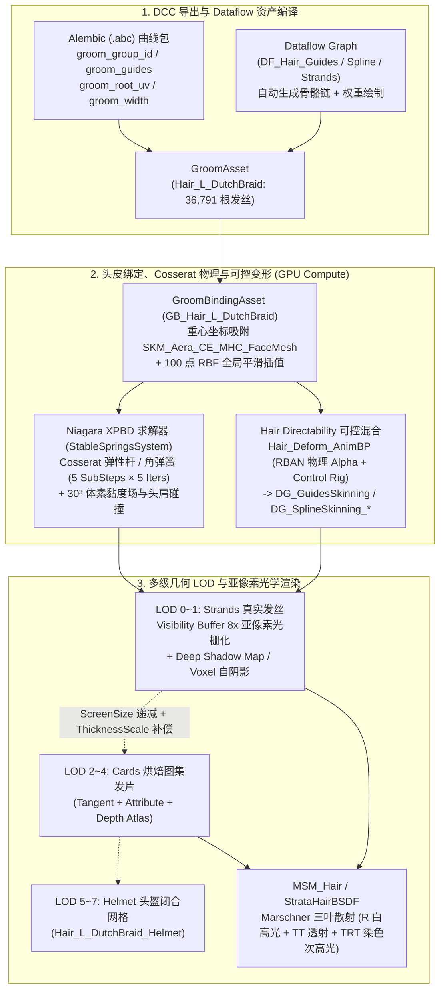
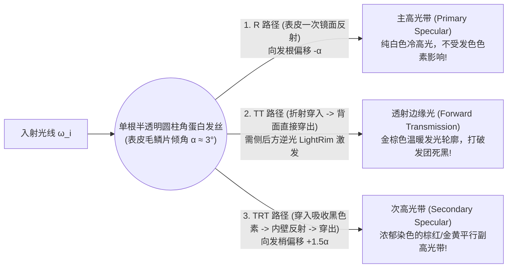

# 10 · Alembic 发丝级毛发渲染、Cosserat 物理模拟、Dataflow 可控绑定与三级 LOD 管线（`Animation_Grooms`）

> **本篇实测拆解关卡档案**
> - **关卡路径**：`/Game/Maps/Animation/Animation_Grooms`（展厅房间名：`"Groom Hall"` | 关卡总 Actor 数：`31` | 展台数：`4` | 示例 Actor 数：`15`）
> - **核心角色与毛发资产目录**：`/Game/MetaHumans/Aera_MHC/` & `/Game/Characters/Aera/`（涵盖数字人类 `BP_Aera` 及其三大可控毛发派生类 `BP_Aera_Guides_Child` / `BP_Aera_Spline_Child` / `BP_Aera_Strands_Child`、36,791 根发丝的荷兰辫资产 `Hair_L_DutchBraid` 三变体、Dataflow 图 `DF_Hair_Guides` / `DF_Hair_Spline` / `DF_Hair_Strands`、内置变形器 `DG_GuidesSkinning` / `DG_SplineSkinning_*`、眉毛 `Eyebrows_L_Shaded`、睫毛 `Eyelashes_L_SlightCurl`、双点摄影棚布光蓝图 `BP_HairLgt` 与序列 `HairDirectability_Seq`）

---

## 一、 告别“塑料插片头”：虚幻引擎是如何在一帧之内渲染并模拟 36,791 根独立发丝的？

在实时角色渲染领域，“毛发（Hair & Fur）”与“皮肤、眼睛”并称为跨越恐怖谷效应的三座珠穆朗玛峰。
在 PS4 世代以前，实时游戏里的长发几乎清一色采用 **Hair Cards（半透明多边形发片）** 手工插片而成：远看尚可，一旦拉近过场特写，发片边缘僵硬的折角、穿插闪烁的 Alpha 排序伪影以及缺乏体积纵深的死黑阴影就会瞬间出戏。

开启虚幻引擎的 **`HairStrands`（Groom）系统**后，美术师无需再痛苦地拓扑插片，而是直接从 Maya XGen、Houdini Groom、Ornatrix 或 Blender Curves 导出包含**数万根真实三维样条曲线的 Alembic（`.abc`）缓存**直入引擎！以本关主角 MetaHuman **`Aera`** 头上那条精致的荷兰麻花辫（`Hair_L_DutchBraid`）为例，MCP 实测解包显示它单单头发一个部位就由 **36,791 根独立渲染发丝曲线（共计 809,830 个曲线控制顶点！）** 构成！

面对单角色 **81 万个亚像素级曲线顶点**，虚幻引擎必须在短短几毫秒预算内同时攻克四大世界级图形与物理难题——这也是贯穿本章的四大技术支柱：

1. **导入契约与引导丝降维插值（Alembic Schema & Guide-to-Strand Interpolation）**：不可能对 81 万个顶点直接跑碰撞解算，如何用不到 `2.5%` 的稀疏引导丝（Guides）带动满头秀发？
2. **Cosserat 弹性杆物理模拟 vs 艺术可控性（Hair Directability）**：纯物理模拟的长辫子在翻滚攀爬时容易缠在脖子上挡住主角的脸；如何通过 **Dataflow 程序化自动建骨 + RBAN 刚体物理 + Control Rig K 帧 + GPU 样条变形器**，实现“既有物理甩动惯性，又听导演指挥摆造型”？
3. **Marschner 双高光纤维散射与深度毛发阴影（Optical BSDF & Deep Shadow Maps）**：为什么人类的黑棕色头发在逆光和侧光下会同时浮现出一道白亮高光、一道暖棕副高光与金边透射光？直径不到 `0.1 毫米`（小于屏幕 1 个像素！）的发丝如何抗锯齿并投出蓬松柔和的自阴影？
4. **Strands $\rightarrow$ Cards $\rightarrow$ Helmet Meshes 三级无缝 LOD 与头皮蒙皮绑定管线**：当摄像机拉远到 15 米开外，如何将 81 万顶点的发丝平滑退化为发片与头盔网格，保住百人同屏帧率？

在逐一走进 4 座展台之前，先通过下面这张 **UE5 次世代 Groom 全栈管线架构图** 打通任督二脉：

---

## 二、 四大底层技术内核深度全解（结合本关 MetaHuman `Aera` 实测资产数据）

在看展台差异之前，我们先直接拆开 MCP 从 `#1` 号展台主角 **`BP_Aera`** 身上扒下来的全套真实生产级资产参数，将上述四大内核彻底讲透！

### 2.1 Alembic `.abc` 导入规范与三组发束（Hair Groups）解剖

当从 DCC 导出 `.abc` 给虚幻时，引擎通过标准的 `groom_*` 几何属性识别曲线语义：
- **`groom_group_id` / `groom_group_name`**：将不同物理特性的毛发拆分为独立组（比如额前碎发紧贴头皮不动，胸前长麻花辫大幅度摆动！）；
- **`groom_guides`**：标记 `1` 的曲线直接作为稀疏物理**引导丝（Sim Guides）**，标记 `0` 的作为高密**渲染丝（Render Strands）**（若未导引导丝，引擎可按 `hairToGuideDensity = 0.1` 自动抽稀生成）；
- **`groom_root_uv`**：记录每根发丝毛囊扎在头皮 UV 上的精确坐标 $(u,v)$，供材质 `HairAttributes` 节点采样发际线肤色过渡与发根染色；
- **`groom_width`**：沿发根到发梢的物理直径（配合 `hairRootScale` 与 `hairTipScale` 塑造发梢自然变细的锥度！）。

看看 **`/Game/MetaHumans/Aera_MHC/Grooms/Hair_L_DutchBraid`** 被 MCP 实测拆出的惊人分组工业标准：

| 分组编号与名称 (`groupName`) | 渲染发丝数 (`numCurves`) | 渲染总顶点数 (`numCurveVertices`) | 物理引导丝数 (`numGuides`) | 引导丝顶点数 (`numGuideVertices`) | 最大弧长 (`maxCurveLength`) | 渲染线宽 (`hairWidth`) | 工程分治设计深意 |
| :--- | :--- | :--- | :--- | :--- | :--- | :--- | :--- |
| **`0_braid`（胸前主麻花辫）** | `2,253` 根 | `257,133` | **仅 `1` 根！** | **`31` 个点** | **`82.53 cm`** | `0.010 cm` | 整条长达 82 厘米的紧密编织麻花辫绝对不能散架！用**唯一 1 根 31 节点的中心脊柱引导丝**统领 2253 根编发（顶点压缩比高达 **8294 : 1**！），保证怎么甩辫子花纹都严丝合缝！ |
| **`1_pulled_hair`（头顶向后束发）** | **`32,968` 根** | `538,040` | `781` 根 | `19,823` 个点 | `19.86 cm` | `0.026 cm` | 覆盖整个头盖骨的主体发量，LOD0 开启 `curveDecimation = 0.2` 并将 `thicknessScale` 补偿至 `1.1`，兼顾丰盈浓密度与光栅化吞吐！ |
| **`2_hairline`（前额胎毛发际线）** | `1,570` 根 | `14,657` | `72` 根 | `1,299` 个点 | `5.36 cm` | `0.016 cm` | 打破CG假发套生硬边缘的灵魂细节！5 厘米短绒碎发柔和衔接额头皮肤次表面散射。 |

再加上面部独立挂载的眉毛 **`Eyebrows_L_Shaded`**（`1,436` 根曲线，`maxCurveLength = 0.86 cm`，`hairRootScale = 0.8`）与微卷睫毛 **`Eyelashes_L_SlightCurl`**（`550` 根曲线，`379` 根引导丝，`hairWidth = 0.007 cm`，`hairTipScale = 0.8` 尖端收细），共同拼成了毫发毕现的数字人类面部生态！

---

### 2.2 Guide Strands 引导丝物理（Cosserat 杆 / 角弹簧）与 `GroomBindingAsset` 头皮插值

1. **为什么发丝模拟要用 Cosserat 弹性杆与 $30^3$ 欧拉体素场？**
   观察 MCP 提取出的 `hairGroupsPhysics` 底层配置：求解器挂载了内置 Niagara 粒子发射器系统 **`/HairStrands/Emitters/StableSpringsSystem`**（`niagaraSolver = "AngularSprings"` / 可选 `CosseratRods`），每帧执行 **`subSteps = 5` 子步 $\times$ `iterationCount = 5` 次 XPBD 约束迭代**（重力 `gravityVector = (0, 0, -981)`，空气阻力 `airDrag = 0.1`）：
   - 普通质点弹簧（Mass-Spring）只能限制拉伸长度，没法抗拒扭转，卷发或麻花辫一模拟就会像面条一样被重力拉直；而 **Cosserat 杆模型（Cosserat Rods）与角弹簧（Angular Springs）** 为每段引导丝轴线段维护完整的局部物质标架（Material Frame 四元数），同时求解**拉伸刚度（`stretchStiffness = 1.0`，严格不可拉长！）**与**弯曲抗扭刚度（`bendStiffness = 0.01, bendDamping = 0.005`）**，让发卷回弹如初！
   - **群体黏滞与防穿模**：几百根引导丝之间如果做两两胶囊体碰撞会瞬间卡死，因此引擎在头部周围建立了一个 **`gridDimension = (30, 30, 30)` 的三维欧拉速度体素网格**，通过 **`strandsViscosity = 1.0`（发束黏滞度）** 在体素格内平滑相邻发丝的速度场，模拟真实头发成绺抱团飘动的流体质感，同时配合从发根 `1.0` 渐变到发梢 `0.1` 的 `collisionRadius` 曲线与角色头肩 PhAT 刚体做投影防穿插（`projectCollision = true`）！

2. **`GroomBindingAsset` 是如何把毛发死死“种”在会做表情的脸皮上的？**
   查看 **`GB_Hair_L_DutchBraid`**、**`Eyebrows_L_Shaded_Binding`** 与 **`Eyelashes_L_SlightCurl_Binding`**（注意睫毛专门锁定到了眼睑网格区段 `matchingSection = 8`！）：
   - 它们的 `targetSkeletalMesh` 全部指向面部高精度网格 **`SKM_Aera_CE_MHC_FaceMesh`**；
   - 离线烘培绑定资产时，系统找到每根发丝毛囊落点最近的头皮/眼皮三角形，记录**重心坐标 $(u,v,w)$ 与切线局部旋转偏移**；同时开启 **`enableGlobalInterpolation = true`**（采样 **`numInterpolationPoints = 100`** 个径向基函数 RBF 控制锚点）与 `hairInterpolationType = "SmoothTransform"`——当 Aera 挑眉、眨眼（睫毛跟着上眼皮自然扇动！）或大幅度捏脸调整头骨胖瘦时，所有毛囊与整根发丝都会严丝合缝地随表皮变形而绝不浮空脱发！

---

### 2.3 Marschner 毛发三叶光学散射模型与深度阴影（Deep Shadow Map）

为什么 `#1 ~ #4` 号展台里的每一个 Aera 角色脚下，都专门配了一座一模一样的双聚光灯摄影架 **`BP_HairLgt`（`1~4`）**？
拆开 `BP_HairLgt` 的组件参数：它包含一盏侧前方主光 **`LightKey`（`Intensity = 4, AttenuationRadius = 400`）** 和一盏侧后方逆光轮廓灯 **`LightRim`（`Intensity = 3, AttenuationRadius = 400`）**！这正是为了完美激发 **Marschner 圆柱介质散射模型**（对应材质着色模型 **`MSM_Hair`** 或 Substrate 架构下的 **`MaterialExpressionStrataHairBSDF`**，如工程内的 `M_Substrate_Hair`）的三大物理光路：

- **发丝材质的细节魔法（对照 `M_Substrate_Hair` 实测节点）**：利用 `HairAttributes` 节点读取沿发长归一化的 $U \in [0,1]$ 与每根发丝唯一的随机种子 `Seed`，在发根色 `RootColor (0.25, 0.155, 0.087)` 与发梢色 `TipColor (0.234, 0.164, 0.105)` 之间渐变，按 `Pepper Ratio = 0.15` 随机混入深色杂发（Salt & Pepper 自然杂色），并将发梢粗糙度乘以 `Roughness Tip Mult = 1.1` 模拟发梢风化磨损！
- **亚像素可见性缓冲（Visibility Buffer）与深度毛发阴影**：
  一根 `0.01 cm` 宽的发丝在 1080p 屏幕上往往只占 `0.15` 个像素宽，普通光栅化会疯狂闪烁断裂！开启实测属性中的 **`bUseStableRasterization = true`** 后，引擎利用硬件 **8x MSAA 覆盖掩码与亚像素可见性缓冲（Hair Visibility Buffer）** 先做精确像素覆盖率累积，再按材质聚类统一着色。而在阴影端，针对特写主光生成多层半透明衰减的 **Deep Shadow Map（深度不透明度阴影图 DOM）**，并开启 **`bVoxelize = true`**（`hairShadowDensity = 1`）将发丝体素化注入 Virtual Shadow Maps 与 Lumen 全局光照，让蓬松的麻花辫层层叠叠投出丝绒般细腻的体积自阴影！

---

### 2.4 Strands $\rightarrow$ Cards $\rightarrow$ Meshes 三级无缝 LOD 管线实测解剖

千万不要以为用了 Groom 就得在远景也硬扛 36,000 根曲线！MCP 对眉毛资产 **`Eyebrows_L_Shaded`** 的 `hairGroupsLOD` 完整解包，为我们呈现了一份教科书级的 **8 级（`LOD 0 ~ LOD 7`）三级几何形态平滑降级表**：

| LOD 层级 | 触发屏幕占比 (`screenSize`) | 几何渲染形态 (`geometryType`) | 曲线/顶点保留率 (`Decimation`) | 粗细光学补偿 (`thicknessScale`) | 物理模拟状态 (`simulation`) | 挂载替身资产与性能策略 |
| :--- | :--- | :--- | :--- | :--- | :--- | :--- |
| **LOD 0** | `1.00`（近景特写） | **`Strands`（真实发丝）** | `100%` | `1.0` | `Auto` | 100% 原始发丝与亚像素 Visibility Buffer 渲染。 |
| **LOD 1** | `0.50`（半身镜头） | **`Strands`（抽稀发丝）** | `100%` *(主发束 `20%`)* | **`1.1 ~ 1.3`** | `Auto` | 抽稀曲线数的同时**自动加粗剩余发丝直径 `10%~30%`**，保证总遮光面积不变、绝不露头皮！ |
| **LOD 2** | `0.25`（全身中景） | **`Cards`（多边形发片）** | `25%` | `1.0` | `Auto` | 自动切入烘焙好的多边形插片网格 `Eyebrows_L_Shaded_CardsMesh_Group0_LOD1` + 切线/属性图集（`Layout2`），脱离高昂的亚像素管线！ |
| **LOD 3 ~ 4** | `0.125 ~ 0.0625` | **`Cards`（精简发片）** | `12.5% ~ 6.25%` | `1.0` | **`Disable`** | 切换至更低面数的 `CardsMesh_Group0_LOD3`，并**彻底关停物理模拟**省下 GPU Compute 开销！ |
| **LOD 5 ~ 7** | `0.03125 ~ 0.0078` | **`Meshes`（闭合头盔网格）** | `< 3.1%` | `1.0` | **`Disable`** | 细小眉毛直接设为 `bVisible = false` 剔除；主头发则切换为单张不透明/遮罩头盔网格 **`Hair_L_DutchBraid_Helmet`**，配合 `BP_Aera` 身上的 **`LODSync` 组件**与脸部 `FaceMesh` 同步跳变无闪烁！ |

---

## 三、 `Animation_Grooms` 逐展台（#1 ~ #4）100% 零遗漏实测拆解：Dataflow 毛发可控性（Hair Directability）三阶对比！

理解了上述底层渲染与物理全貌后，再走进本关 `"Groom Hall"` 的 **4 座展台**，你会立刻明白 UE 5.5~5.8 最新重磅特性——**由 Dataflow 驱动的毛发艺术可控性（Hair Directability）**——究竟解决了什么痛点！

在影视过场或高规格战斗特写（例如本关序列播放的攀爬绳索动作 `Climbing_A_Rope_Anim`）中，动画师既想要物理惯性甩动，又希望能在 Sequencer 里像掰手指骨头一样用 **Control Rig** 把挡脸的麻花辫拨到肩膀后面。为此，展台 `#2`、`#3`、`#4` 使用同一个全局关卡序列 **`HairDirectability_Seq`**（`30 fps`，`0 ~ 283` 帧，同时驱动三台 Aera 的 `Body` 攀爬动画轨道与 `Hair_Deform` Control Rig 参数轨道！），横向对比了**三种不同精度的骨骼驱动毛发变形管线**！

### 展台 #1：`Grooms` — MetaHuman 标准 6 槽毛发装配与 Dataflow 程序化工作流总览

- **空间元数据**：展牌 Label `BP_DemoDisplay4` | 坐标 `(510, -900, 0)`
- **官方展牌核心要义**：介绍由 **Dataflow** 驱动的 Hair Directability 特性——支持在引擎内直接进行权重绘制（Paint Workflows）、程序化自动沿发束创建骨骼链（Automatic Joint Creation）以及 Control Rig 控制，赋予美术师对发丝级 Groom 的绝对掌控力。
- **展台陈列 Actor 清单（共 8 个）**：
  - **`BP_Aera`**（`/Game/MetaHumans/Aera_MHC/BP_Aera.BP_Aera_C`，坐标 `(500, -600, 10)`）：标准 MetaHuman 装配蓝图，包含身体 `SKM_Aera_CE_MHC_BodyMesh`、面部 `SKM_Aera_CE_MHC_FaceMesh`（挂载虚拟纹理皮肤材质实例 `MID_MI_Face_Skin_Baked_LOD1/3/5to7_VT`）、服装 `Aera_CE_MHC_Outfits`（短裤 `MID_M_DG_bodyShapeA_Short_66` + 衬衫 `Shirt_67`）、`LODSync` 同步组件，以及完整的 **6 大 `GroomComponent` 插槽**：`Hair`（`Hair_L_DutchBraid`）、`Eyebrows`（`Eyebrows_L_Shaded`）、`Eyelashes`（`Eyelashes_L_SlightCurl`）与留空的女性 `Fuzz` / `Mustache` / `Beard` 插槽。
  - **`BP_HairLgt`**：双聚光灯人像发丝布光架（`LightKey = 4, LightRim = 3`）。
  - **环境与后处理基座（6 个）**：`DirectionalLight2`（`Intensity = 10`）、`SkyLight2`（`Intensity = 3`）、`SkyAtmosphere2`、`ExponentialHeightFog`、全屏无限边界后处理体积 `PostProcessVolume`（`bUnbound = true`）以及 `ChaosDebugDrawComponent_0` 宿主 `Actor`。

---

### 展台 #2：`Hair Directability`（方案一）— 关节链 + 引导丝线性混合蒙皮（`DG_GuidesSkinning`）

- **空间元数据**：展牌 Label `BP_DemoDisplay` | 坐标 `(2010, -900, 0)`

#### 3.1 底层绑定与混合架构拆解（`BP_Aera_Guides_Child`）
展台陈列着派生蓝图 **`BP_Aera_Guides_Child`**、灯光架 **`BP_HairLgt2`** 与主控序列器 **`HairDirectability_Seq`**。打开它的依赖链与 `GroomAsset` 配置，一条精巧的“物理+手K混合驱动链”跃然纸上：
1. **Dataflow 自动生成代理骨骼网格**：在 `Hair_L_DutchBraid` 的 `dataflowSettings` 中挂载了 **`/Game/MetaHumans/Aera_MHC/Grooms/DF_Hair_Guides`**，自动沿着长辫生成带骨骼链的条带代理骨骼网格 **`Hair_L_DutchBraid_Tri`**（挂载在角色蓝图的附加组件 `Hair_Deform` 上）。
2. **`Hair_Deform_AnimBP` 物理与手 K 实时混合**：该代理网格运行专属动画蓝图 **`/Game/MetaHumans/Aera_MHC/Hair_Deform_AnimBP`**——其内部同时串联了 **RBAN 轻量刚体物理节点**（提供麻花辫随身体攀爬自然甩动的次级动力学）与 **Control Rig 节点**（响应 Sequencer 里的 `MovieSceneControlRigParameterTrack_0` 手动摆姿），并暴露出一个可在运行期或 Sequencer 中平滑拉动的 **`Physics Alpha` 混合权重变量**！
3. **变形方式 —— 引导丝线性混合蒙皮（Linear Skinning on Guides）**：
   底层调用内置毛发变形器 **`/HairStrands/Deformers/DG_GuidesSkinning`**，直接用 `Hair_L_DutchBraid_Tri` 的骨骼矩阵对那根中心引导丝（Guides）执行经典 **Linear Blend Skinning（LBS）**，再由引导丝插值带动 2,253 根辫子渲染丝！
   - **优缺点评价**：**计算开销在三种方案中最低！** 但由于关节之间是分段线性折线过渡，当动画师用 Control Rig 把辫子掰出急转弯大弧度时，引导丝在骨骼关节交界处可能会流露出轻微的折角生硬感。

---

### 展台 #3：`Hair Directability`（方案二）— 关节链 + 引导丝样条曲线变形器（`DG_SplineSkinning_Guides`）

- **空间元数据**：展牌 Label `BP_DemoDisplay2` | 坐标 `(3000, -900, 0)`

#### 3.2 升级样条插值消除关节折角（`BP_Aera_Spline_Child`）
来到 `#3` 号展台，角色换成了 **`BP_Aera_Spline_Child`**（搭配灯光架 `BP_HairLgt3`），其 `Hair` 组件挂载了第二个毛发变体资产 **`/Game/MetaHumans/Aera_MHC/Grooms/Hair_L_DutchBraid_Spline`**：
- **Dataflow 图升级**：切换为 **`DF_Hair_Spline`**；
- **变形器升级**：底层切换为 **`/HairStrands/Deformers/DG_SplineSkinning_Guides`**！
- **核心改进原理**：它不再用生硬的 LBS 矩阵直接硬拽引导丝顶点，而是先以代理骨骼链的各节关节（Joints）作为控制点实时拟合出一条 **$C^2$ 连续的光滑三次样条曲线（Cubic Spline）**，再沿着光滑样条切线弧长对 **Groom Guides（引导丝）** 进行流形空间映射变形，最后插值出全量渲染丝！
- **工程定位**：彻底消除了 `#2` 号展台大角度弯折时的关节折线感，而由于样条计算依然只作用于稀疏的引导丝（主辫子仅 1 根 31 个顶点！），**GPU 额外开销几乎可以忽略不计——是绝大多数 3A 游戏主角可控长发的性价比最优解！**

---

### 展台 #4：`Hair Directability`（方案三）— 关节链 + 全量渲染发丝直接样条变形（`DG_SplineSkinning_Strands`）

- **空间元数据**：展牌 Label `BP_DemoDisplay3` | 坐标 `(4000, -900, 0)`

#### 3.3 电影特写终极画质：跳过引导丝中转，直接重塑 81 万渲染顶点（`BP_Aera_Strands_Child`）
走到走廊终点的 `#4` 号展台，压轴登场的是 **`BP_Aera_Strands_Child`**（搭配灯光架 `BP_HairLgt4`），挂载第三个毛发变体资产 **`/Game/MetaHumans/Aera_MHC/Grooms/Hair_L_DutchBraid_Strands`**（展牌原文注：`deforming the groom Stands [Strands] with a Spline deformer`）：
- **Dataflow 图与变形器**：切换为 **`DF_Hair_Strands`** + **`/HairStrands/Deformers/DG_SplineSkinning_Strands`**！
- **核心差异与视觉极限**：
  在 `#2` 和 `#3` 中，如果一条宽扁蓬松的马尾辫或散落披肩发内部只有寥寥几根引导丝，当整束头发发生螺旋扭转或挤压时，“先变引导丝 $\rightarrow$ 再刚性插值周围几千根渲染丝”的两步中转偶尔会导致外围发丝截面略微扁平或交错。
  而 `#4` 的 `DG_SplineSkinning_Strands` 火力全开——直接在 GPU Compute Shader 上，将**全部 36,791 根渲染发丝（809,830 个顶点）逐顶点直接绑定到光滑样条变形场（Spline Deformer）中独立解算形变**！
- **工程取舍**：曲线弧度最极致丝滑、编发体积细节保留 `100%` 无损，但因为每帧直接驱动 81 万个渲染顶点做样条投影，GPU Compute 开销显著高于前两者——专为 **电影级虚拟制片渲染（MRQ 离线出片）或超近景主角面部特写镜头** 量身定制！

---

## 四、 本章实战总结：可控毛发三方案选型表与 Groom 性能调优铁律

逛完 `Animation_Grooms` 全部 4 座展台，我们将三种 Hair Directability 方案与全流程优化要点浓缩为以下实战速查表：

| 对比展台与方案 | Dataflow 资产 | 底层 GPU 变形器 | 变形作用目标 | 弯曲平滑度 | 性能开销与推荐适用场景 |
| :--- | :--- | :--- | :--- | :--- | :--- |
| **`#2` 引导丝线性蒙皮** | `DF_Hair_Guides` | `DG_GuidesSkinning` | **稀疏 Guides**（31 顶点） | 良（急弯略带关节折角） | **极低开销** —— 适合中景可交互 NPC、短马尾、胡须与大场面动作游戏。 |
| **`#3` 引导丝样条变形** | `DF_Hair_Spline` | `DG_SplineSkinning_Guides` | **稀疏 Guides**（31 顶点） | **极优（样条连续无折痕）** | **低开销（黄金甜点！）** —— 3A 游戏可操控男女主角实时过场与战斗首选！ |
| **`#4` 渲染丝直接样条变形** | `DF_Hair_Strands` | `DG_SplineSkinning_Strands` | **全量 Strands**（81万顶点） | **完美电影级保体积** | **高开销** —— 适合电影级 Sequencer 特写镜头、离线 Movie Render Queue 渲染。 |

> [!TIP]
> **Groom 生产环境落地三大黄金优化法则**
> 1. **善用“分组物理隔离”省下 90% 模拟算力**：千万不要给整头头发无脑开模拟！严格效仿本关 `Hair_L_DutchBraid` 的三组拆分法——将占总发量 `94%` 的贴头皮束发（`1_pulled_hair`, 32,968 根）与发际线胎毛（`2_hairline`, 1,570 根）设为 `enableSimulation = false` 仅跟头皮蒙皮走，**只对真正悬空摆动的长辫子/刘海组（`0_braid`）开启物理或骨骼变形**！
> 2. **抽稀必配 `ThicknessScale` 光学密度补偿**：在 LOD 0/1 适度调低 `curveDecimation`（如从 `1.0` 降至 `0.2~0.5`）是立竿见影的提帧手段，但务必同步把对应 LOD 的 **`thicknessScale` 调高至 `1.1 ~ 1.3`**，弥补发丝变少后的透光漏洞，视觉上几乎看不出减面痕迹！
> 3. **控制台性能诊断利器**：在实机评测发丝开销时，随时呼出控制台输入 `stat Groom` 或开启可视化视图 `r.HairStrands.DebugMode`（查看每根引导丝簇映射、体素密度与 LOD 层级颜色），确保摄像机拉远至屏幕占比 `< 0.25` 时准时切入 **Cards / Helmet Meshes**！

至此，`06_Animation_角色动画与控制绑定` 的核心物理控制（`PhysicsControl` & `PhysicalAnimation`）、GPU 网格变形器（`Deformer Graph`）与真实毛发管线（`Grooms`）四大前沿专章已全部深度解锁！
