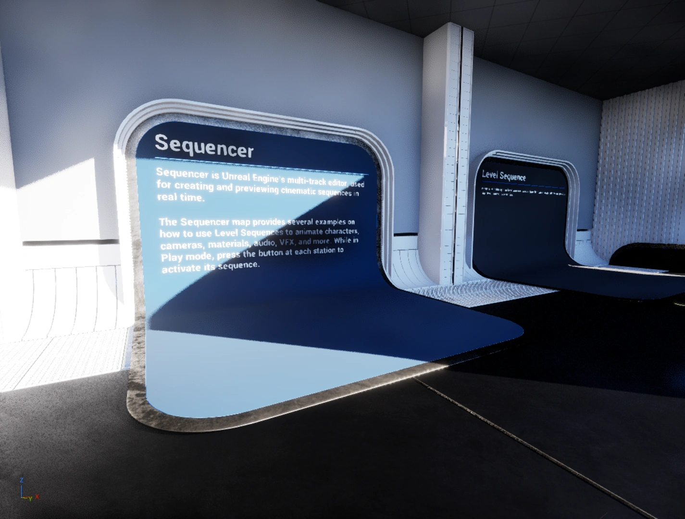
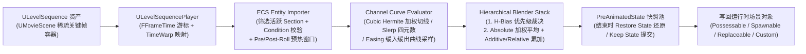
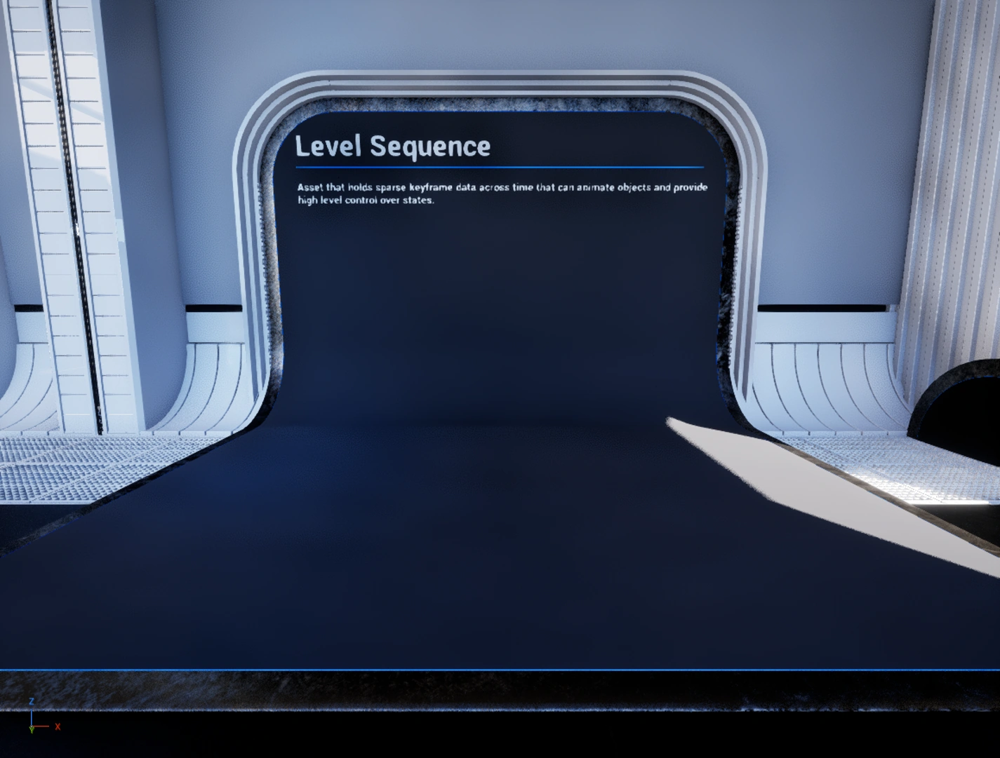
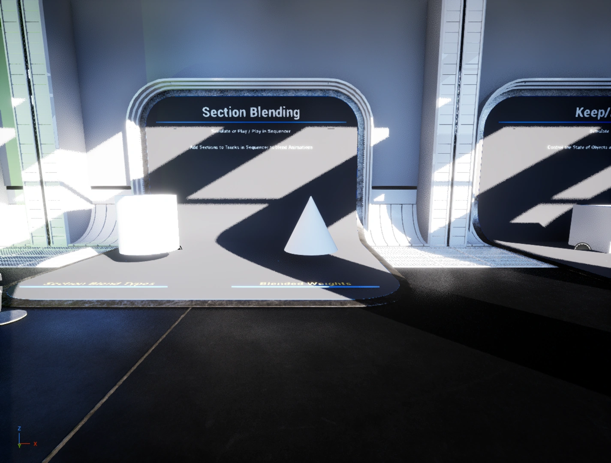
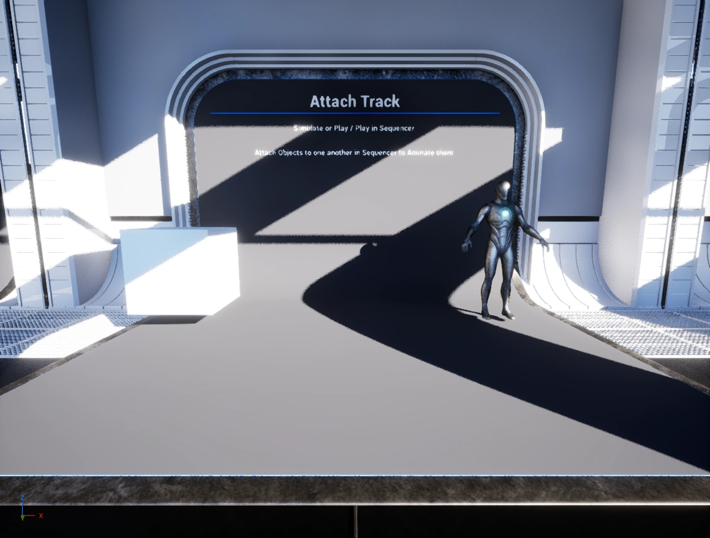
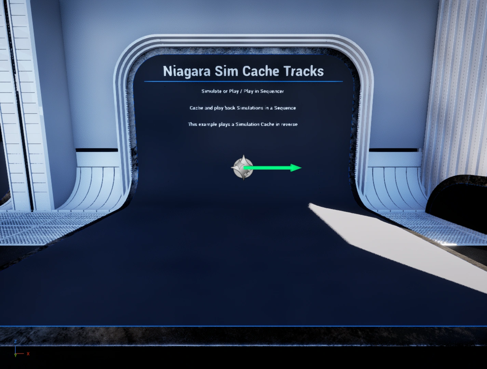
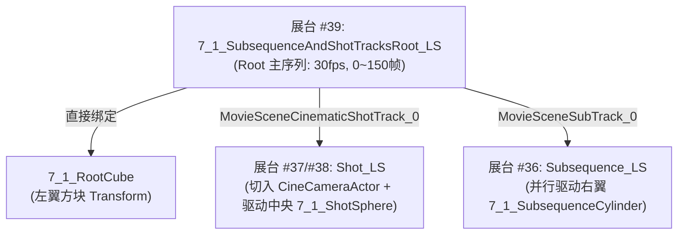
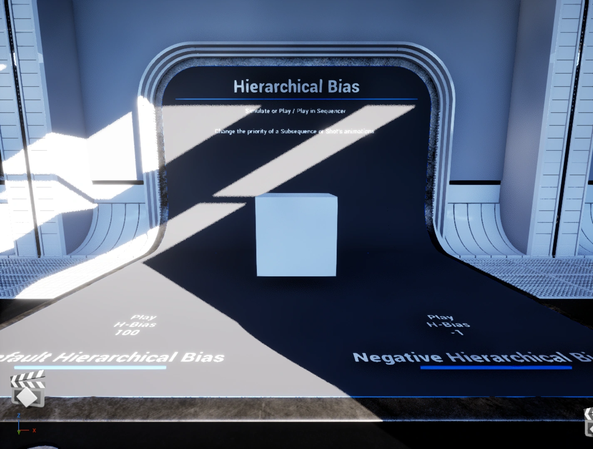

# 11 · 非线性电影过场动画、轨道关键帧、相机切换与动态绑定全解（`Sequencer`）

> **本篇实测拆解关卡档案**
> - **关卡路径**：`/Game/Maps/Animation/Sequencer`（关卡总 Actor 数：`179` | 展台数：`51` | 示例 Actor 数：`114`）
> - **关卡脚本类**：`/Game/Maps/Animation/Sequencer.Sequencer_C`（纯数据驱动关卡，所有交互均由各展台独立触发器蓝图闭环控制）
> - **核心资产目录**：`/Game/ExampleContent/Sequencer/`（涵盖 `0_LevelIntro_LS` 至 `8_2_TimeWarpSkelAnim_LS` 共 **27 个核心 `LevelSequence` 资产**、通用单次触发器 `BP_SequenceTrigger`、状态复位器 `BP_ActorOriginReset`、静态网格切换器 `BP_SetStaticMesh`、喷泉粒子 `Fountain_FXS` 以及次世代毛发角色 `BP_EchoHair` 与标准模特 `SKM_Manny_Simple` / `SKM_Quinn_Simple`）

---

## 一、 为什么现代 3A 过场不再是“播一段预渲染 MP4 视频”？

在传统游戏时代，每逢剧情高潮，屏幕一黑就开始播放一段提前离线压制好的 `.mp4` / `.bk2` 视频文件——视频里的主角永远穿着默认新手布衣、手里拿的不是你刚刚强化满级的传说巨剑、外面的天气也不会跟随当前关卡的暴雨或黄昏变化；更致命的是，视频结束切回实机操作的那一瞬间，镜头位置与光影色调往往发生剧烈的撕裂跳变。

虚幻引擎的 **Sequencer（非线性多轨实时影视导演系统）** 彻底终结了“实机玩法”与“电影叙事”之间的次元壁。走进本工程规模最宏大的走廊之一——长达 **308 米**（`X` 坐标从 `510` 一路延伸至 `30,800`）、密集排布着 **51 座受控实验展台** 的 `/Game/Maps/Animation/Sequencer` 展厅，你将亲眼见证一套跨学科的实时导演引擎是如何在同一条时间轴上统御 **对象生命周期、9 轴空间变换、骨骼动画混合、Control Rig 引擎内 K 帧、材质 MID / MPC 实时驱动、Niagara 模拟缓存倒放、电影级镜头推拉摇移与焦点追踪、多层级分镜嵌套（Subsequence / Shot）以及局部非线性时间扭曲（Time Warp）** 的！

### 1.1 从 `Evaluation Template` 到 `Entity Component System (ECS)`：Sequencer 底层求值管线揭秘

在逐台体验这 51 座展台之前，我们必须先看懂当你按下每个展台前的按钮（`BP_SequenceTrigger` 调用 `LevelSequenceActor->SequencePlayer->Play()`）时，虚幻引擎底层在毫秒之间究竟执行了什么：

1. **双精度帧时间与子帧插值（`FFrameRate` & `FFrameTime`）**
   - 打开本关任意一个 `LevelSequence` 资产，MCP 实测提取到的显示帧率（Display Rate）均为 `rate = {'numerator': 30, 'denominator': 1}`（30 FPS），而引擎底层内部 Tick 分辨率（Tick Resolution）默认高达 **24,000 Hz**（最小公倍数时间基准，可无损整除 24 / 25 / 30 / 60 / 120 FPS）。
   - 游戏运行时的帧率是波动的（比如 47 FPS 或 144 FPS），Sequencer 每次求值传入的是带有小数部分（Sub-frame `0.0 ~ 0.9999`）的 **`FFrameTime`**，从而在任意刷新率屏幕上都能对连续曲线做丝滑无抖动的亚帧级数学插值；同时支持在时间轴上打上语义化的 **标记帧（Marked Frames，`marks`，如 `"HitImpact"`、`"IntroEnd"`）** 供蓝图 `PlayToMarkedFrame` 按标签精准寻址跳转。
2. **从求值模板编译（Evaluation Template）到现代 ECS 实体混合栈（`UMovieSceneEntitySystemLinker`）**
   - 早期 UE4 将轨道预编译为线性的 `FMovieSceneEvaluationTemplate` 逐轨顺序覆盖；而在现代 UE5 中，Sequencer 核心已全面演进为高性能 **MovieScene Entity System（ECS 架构）**：
   - **导入阶段（Import）**：激活区间内的每个 Section（片段）将自己的通道（Float / Double / Transform / SkeletalAnim / Material）实例化为紧凑的 ECS Entity，并打上绑定对象 ID、**层级偏置（Hierarchical Bias）**、混合类型（Absolute / Additive / Relative）与条件掩码（Condition）。
   - **求值与混合阶段（Evaluate & Blend）**：同类型属性通道在 SIMD 友好的连续内存块中批量采样曲线值与缓动权重（Easing / Manual Weight），送入专用混合器系统（如 `UMovieScenePiecewiseDoubleBlenderSystem`），严格按照 **先按 `HierarchicalBias` 分出高下、同级再做归一化加权平均 + 叠加层累加** 的数学秩序合成唯一终值。
   - **状态快照与写回阶段（Pre-Animated State & Apply）**：在第一次改写任何 Actor 的坐标、材质或可见性之前，ECS 自动捕获该属性的原始快照令牌（`PreAnimatedState`）；当片段离开或序列结束时，依据 **`CompletionMode`（`Keep State` vs `Restore State`）** 决定是永久保留演出结果，还是瞬间无痕还原现场。

### 1.2 全馆 51 座展台八大主题分区导览图

为了把复杂的影视工程讲透，官方设计师沿着 `X = 510` 到 `X = 30,800` 精心规划了 **序厅 + 八大主题实验区（`0_x` ~ `8_x`）**，并在多处采用了 **“后排 `Y = -900` 主概念展牌 + 前排 `Y = -708`（或左右并列）受控对比子展台”** 的立体阵列布局：

| 主题分区 | 展台编号范围 | X 坐标跨度 | 核心验证命题与对应 `LevelSequence` 资产族 |
| :--- | :--- | :--- | :--- |
| **0. 序厅与序列资产总览** | `#1` ~ `#2` | `510` ~ `1,461` | Sequencer 交互总则、多轨声画光影微缩大片 `0_LevelIntro_LS` |
| **1. 四大对象绑定范式** | `#3` ~ `#8` | `2,750` ~ `5,000` | Possessable / Spawnable / Replaceable、`Multi-Binding`、接管玩家角色的 `Custom Bindings` (`1_1` ~ `1_3`) |
| **2. 变换曲线、混合、状态与条件** | `#9` ~ `#17` | `6,500` ~ `9,500` | 9 轴 Transform、Section 缓动与手动权重混合、Keep/Restore 三态博弈、运行时动态 `Conditionals` (`2_1` ~ `2_4`) |
| **3. 材质、附着、音频与黑场转场** | `#18` ~ `#24` | `10,750` ~ `14,000` | MID 参数轨 / 材质切换轨 / Groom 毛发全局 MPC 轨、`Attach Track` 父子挂接、`Audio` 与 `Fade` (`3_1` ~ `3_4`) |
| **4. 骨骼动画混合与 Control Rig** | `#25` ~ `#29` | `15,500` ~ `17,647` | 骨骼动画播放与动作混合、逆向烘焙 `Baked to Control Rig` vs 非破坏性 `Layered Control Rig` (`4_1` ~ `4_3`) |
| **5. Niagara 粒子特效与模拟缓存** | `#30` ~ `#32` | `19,000` ~ `21,000` | 粒子生命周期激活、HDR 颜色 `User Parameter` 驱动、`Sim Cache` 确定性缓存与**时间倒流播放** (`5_1` ~ `5_3`) |
| **6. 电影摄影机运镜、过渡与震动** | `#33` ~ `#35` | `22,500` ~ `24,500` | `Camera Cut` 多机位硬切与景深对焦、实机视角丝滑切入切出 `Blending Cameras`、相机模板与震动 (`6_1` ~ `6_3`) |
| **7. 子序列/分镜嵌套、H-Bias 与原点重载** | `#36` ~ `#45` | `25,850` ~ `28,135` | `Subsequence` vs `Shot` 独奏与合奏、`Hierarchical Bias` 正负优先级夺权、动态 `Transform Origin` 重定向 (`7_1` ~ `7_3`) |
| **8. 事件脉冲与四维 Time Warp 时间扭曲** | `#46` ~ `#51` | `29,500` ~ `30,800` | 双轨 `Event Track` 暂停/恢复 Echo 布料解算、全序列/子序列/骨骼动画三级 `Time Warp` 曲线变速 (`8_1` ~ `8_2`) |

下面，让我们严格按照展厅编号顺序，对全部 **51 座展台（`#1` ~ `#51`）** 进行逐号、零遗漏的深度庖丁解牛！

---

## 二、 序厅与四大对象绑定体系（展台 #1 ~ #8）

### 展台 #1：`Sequencer` — 实时多轨电影导演台总纲

- **空间元数据**：展牌 Label `BP_DemoDisplay4` | 坐标 `(510, -900, 0)`
- **官方展牌原文**：*Sequencer is Unreal Engine's multi-track editor, used for creating and previewing cinematic sequences in real time. The Sequencer map provides several examples on how to use Level Sequences to animate characters, cameras, materials, audio, VFX, and more. While in Play mode, press the button at each station to activate its sequence.*

#### 1.1 展台陈列 Actor 与交互规则解读
- **展台内陈列 Actor（1 个）**：`Actor`（`/Script/Engine.Actor`，挂载 `ChaosDebugDrawComponent_0` 作为全馆物理与调试线框绘制基座）。
- **双模式研习法则（Simulate / PIE 按钮交互 vs 编辑器内直接检视）**：
  - 正如展牌以及后续每块主展牌顶部的 `Simulate or Play / Play in Sequencer` 所强调的：进入运行模式（PIE）走到任意展台前按下交互按钮，即可在真实游戏上下文中观看过场触发、玩家视角接管与播放后状态回归；
  - 而在编辑器模式下直接双击场景中的 `LevelSequenceActor` 打开底部的 **Sequencer 面板**，则能直观看到每一条关键帧曲线、切线手柄与轨道层级。两者对照，是吃透本关 51 座展台的最佳姿势。

---

### 展台 #2：`Level Sequence` — 3 秒钟调动 8 大对象的微缩电影麻雀标本

- **空间元数据**：展牌 Label `BP_DemoDisplay` | 坐标 `(1461, -900, 0)`
- **官方展牌原文**：*Asset that holds sparse keyframe data across time that can animate objects and provide high level control over states.*

#### 2.1 展台陈列 Actor 与通用交互按钮 `BP_SequenceTrigger` 深拆（共 2 个）
1. **`BP_SequenceTrigger_0_LevelIntro`**（`/Game/ExampleContent/Sequencer/Blueprints/BP_SequenceTrigger.BP_SequenceTrigger_C`）
   - **继承链与核心机制**：父类为 `/Game/Global/Blueprints/Interactive/BP_Button_Parent_SinglePress.BP_Button_Parent_SinglePress_C`，内部暴露公有实例引用变量 **`Tiggered Actor`**（官方原工程拼写少了一个 `r`），指向本展台配对的 `LevelSequenceActor`。当玩家靠近碰撞盒 `ButtonCollision` 触发交互时，按钮材质 `MID_M_Button2_0` 点亮并调用目标 `LevelSequenceActor` 的 `SequencePlayer->Play()`。全馆所有带按钮的展台均复用这一干净解耦的单向触发器。
2. **`0_LevelIntro_LS`**（`/Script/LevelSequence.LevelSequenceActor`）
   - **相机纵横比约束**：实测属性开启了 `bOverrideAspectRatioAxisConstraint = true`，`aspectRatioAxisConstraint = AspectRatio_MaintainXFOV`（保持水平视场角恒定，确保在不同宽高比显示器上左右构图边缘不被意外裁切）。

#### 2.2 核心资产 `0_LevelIntro_LS` 实测轨道全解
- **资产路径**：`/Game/ExampleContent/Sequencer/LevelSequences/0_LevelIntro_LS`
- **时间规格**：帧率 `30 FPS`（`30/1`），播放区间 `[0, 90]`（恰好 **3.0 秒**），标记帧 `marks = []`。
- **2 条主轨道（Master Tracks，不依附任何特定 Actor 的全局导演轨）**：
  - `MovieSceneAudioTrack_0`：全局背景配乐/音效轨；
  - `MovieSceneCameraCutTrack_0`：将玩家视口强制切入过场电影摄影机 `CineCameraActor2`。
- **8 个绑定对象与 17 条子轨道协同矩阵**：
  1. **`CineCameraActor2`**：`MovieSceneSpawnTrack_0`（仅在 0~90 帧瞬态生成电影机）+ `MovieScene3DTransformTrack_0`（相机空间运镜）；
  2. **`CameraComponent`**（电影机子组件）：整整齐齐挂载 **3 条浮点属性轨道（`MovieSceneFloatTrack_0 / 1 / 2`）**，分别对应电影镜头最核心的光学三要素——**`CurrentFocalLength`（焦距 mm）**、**`CurrentAperture`（光圈 F-Stop，控制浅景深虚化半径）** 与 **`ManualFocusDistance`（手动对焦平面距离 cm）**；
  3. **`SKM_Manny_Simple`**：`SpawnTrack_2` + `3DTransformTrack_2` + `MovieSceneSkeletalAnimationTrack_0`（瞬态生成角色 Manny 并播放欢迎动作）；
  4. **`SkeletalMeshComponent0`**（Manny 的骨骼网格组件）：挂载 `MovieSceneComponentMaterialTrack_1` 与 `_2`，在动作过程中同步驱动角色身体两个材质槽的动态发光/变色参数；
  5. **`Cylinder2`** & **`StaticMeshComponent0`**：瞬态生成几何道具柱体（`SpawnTrack_1` + `3DTransformTrack_1`），并由 `ComponentMaterialTrack_0` 驱动表面材质动画；
  6. **`PointLight`** & **`LightComponent0`**：瞬态生成补光点光源（`SpawnTrack_3` + `3DTransformTrack_3`），并通过 `MovieSceneFloatTrack_3`（灯光强度 `Intensity`）与 `MovieSceneColorTrack_0`（灯光颜色 `LightColor`）完成戏剧化布光渐变！
- **设计精髓**：为什么展牌把 `LevelSequence` 定义为 *“holds sparse keyframe data across time”*（跨时间的稀疏关键帧容器）？因为它自身绝不拷贝笨重的模型网格或贴图（除了轻量的 Spawnable 模板属性），仅用几 KB 的稀疏时间点与切线斜率，就能在 3 秒内精准指挥相机、角色、骨骼、材质、灯光、音频六大子系统同台演出，播完瞬间销毁全部 Spawnable 临时演员，场景干净如初！

---

### 展台 #3：`Possessable` — 接管关卡既有存量 Actor 的软引用绑定

- **空间元数据**：展牌 Label `BP_DemoDisplay7` | 坐标 `(2750, -708, 0)`（`1_1` 绑定类型三联展台之**左翼子台**）
- **官方展牌原文**：*Possess an Object in the Level*

#### 3.1 展台陈列 Actor 与 `1_1_Binding_Types_LS` 实测数据（共 3 个）
- **陈列 Actor**：`BP_SequenceTrigger_1_1_BindingTypes`（触发器）、`1_1_BindingTypes_LS`（`LevelSequenceActor`）、以及静静摆在台面上的白色方块 **`Possessable_Cube`**（`StaticMeshActor`，使用 `/Engine/BasicShapes/Cube`）。
- **关联资产 `/Game/ExampleContent/Sequencer/LevelSequences/1_1_Binding_Types_LS`**：
  - **时间规格**：`30 FPS`，播放区间 `[0, 150]`（5.0 秒），`marks = []`，主轨道 `[]`。
  - **三大对比绑定对象**：
    1. `Possessable_Cube`：`["MovieScene3DTransformTrack_0"]`（对应本展台 `#3`）；
    2. `Spawnable_Cube`：`["MovieScene3DTransformTrack_1", "MovieSceneSpawnTrack_0"]`（对应展台 `#6`）；
    3. `Replaceable_Cube`：`["MovieScene3DTransformTrack_3", "MovieSceneBindingLifetimeTrack_1"]`（对应展台 `#5`）。

#### 3.2 `Possessable`（可接管对象）底层解析机制与工程边界
- **无 `SpawnTrack` 的常驻演员**：观察实测轨道列表，`Possessable_Cube` 只有一条 `3DTransformTrack_0`，没有任何生成生命周期轨道。因为它在序列播放前早已存在于 `Sequencer` 持久关卡（PersistentLevel）中。
- **GUID 与外部软路径映射（`FMovieScenePossessable` + `FMovieSceneBindingReferences`）**：`ULevelSequence` 是一个独立于具体地图的资产包（`.uasset`），不能硬指针强引用某张地图里的 Actor（否则打开序列就会把整张大地图连带加载进内存！）。因此 Sequencer 为 `Possessable_Cube` 分配一个唯一的 `FGuid`，并通过软对象路径（Soft Object Path / Context Relative Path）在关卡运行时动态寻址解析出真实的 `AActor*` 接管其变换控制权。
- **适用场景与局限**：最适合驱动关卡里的**既有机关大门、电梯、固定 Boss、主太阳光 `DirectionalLight` 或场景固有道具**；缺点是如果你把这同一个 `LevelSequence` 拖到另一张没有 `Possessable_Cube` 的新地图里，绑定名字会直接变红报错（Missing Object Binding），除非手动重绑定。

---

### 展台 #4：`Binding Types` — 三大原生绑定范式的架构选型决策台

- **空间元数据**：展牌 Label `BP_DemoDisplay2` | 坐标 `(3000, -900, 0)`（`1_1` 绑定类型三联展台之**后排主标题台**）
- **官方展牌原文**：*Simulate or Play / Play in Sequencer Use different methods to Bind an Object to a Level Sequence to Animate*

#### 4.1 站在 `#4` 主展牌前看懂左（`#3`）、中（`#6`）、右（`#5`）三联对照实验
`#4` 号展台位于 `Y = -900` 后墙正中，统摄前方 `Y = -708` 一字排开的三座实验基座：左台 `#3 Possessable`（`X = 2750`）、中台 `#6 Spawnable`（`X = 3000`）与右台 `#5 Replaceable`（`X = 3250`）。在未按下按钮前，你会看到一个极有意思的现象：
- 左台 `#3` 上摆着一个**方块**（`Possessable_Cube`）；
- 中台 `#6` 上**空空如也**（因为 `Spawnable_Cube` 还没出生！）；
- 右台 `#5` 上摆着一个**圆球**（`Replaceable_Sphere`）！

而一旦你在编辑器里打开 `1_1_Binding_Types_LS`（或按下按钮进入运行时播放），三种绑定范式的工程分工便一目了然：

| 绑定类型 (Binding Type) | 序列内图标标识 | 关卡常驻性 | 跨地图自包含复用 | 核心轨道特征 | 典型 3A 生产场景 |
| :--- | :--- | :--- | :--- | :--- | :--- |
| **Possessable（可接管，`#3`）** | 无特殊角标 | 必须预置于关卡或子关卡中 | 弱（强依赖目标关卡特定实例路径） | 仅属性/变换轨，无生命周期轨 | 推动当前关卡的城门、控制关卡主天光与既有 NPC |
| **Spawnable（可生成，`#6`）** | 橙色闪电角标 ⚡ | 关卡中不存在，保存在序列 `ObjectTemplate` 内 | **极强**（拖进任何空白地图即插即播） | 必带 `MovieSceneSpawnTrack`（布尔存活轨） | 过场专用 `CineCameraActor`、爆炸残骸、过场专属临时特效与道具 |
| **Replaceable（可替换，`#5`）** | 绿色双向交换角标 🔄 | 编辑器用内部预览模板，运行时接管关卡真实对象 | **兼得两者之长**！脱机关卡可独立 K 帧，进关卡无缝绑定真身 | 必带 `MovieSceneBindingLifetimeTrack` | 动画师在空场景用标准白模 K 好剧情动作，合入主城后运行时自动绑定身上穿满神装的真实英雄实例 |

---

### 展台 #5：`Replaceable` — 编辑器白模预览与运行时真身接管的次世代桥梁

- **空间元数据**：展牌 Label `BP_DemoDisplay8` | 坐标 `(3250, -708, 0)`（`1_1` 绑定类型三联展台之**右翼子台**）
- **官方展牌原文**：*Replace a Spawn Object at Runtime to be Possessed*

#### 5.1 展台陈列 Actor 清单（共 3 个）
- **`Replaceable_Sphere`**（`/Script/Engine.StaticMeshActor`）：网格体为 `/Engine/BasicShapes/Sphere.Sphere`，材质 `BasicShapeMaterial`——它就是驻留在当前关卡中等待在运行时“顶替上场”的真身演员！
- **`DirectionalLight`**（`Intensity = 10`, `Mobility = Stationary`）与 **`SkyAtmosphere`**：全局主阳光与大气散射组件，空间归属落在本展台坐标邻域内。

#### 5.2 为什么在序列里叫 `Replaceable_Cube`，在游戏运行时动起来的却是 `Replaceable_Sphere`？
这是 UE 5.4+ 引入 **Replaceable Bindings（可替换绑定）** 后彻底解决大型项目“动画组与关卡组抢地图锁”痛点的神来之笔：
1. **痛点回顾**：过去如果用 `Possessable`，过场动画师必须把庞大的主世界关卡迁出加载才能给角色 K 帧；如果用 `Spawnable`，虽然能脱机 K 帧，但到了游戏运行时会凭空多刷出一个克隆人，没法直接用关卡里已经掉了一半血、穿着玩家自定义时装的那个真实 Actor。
2. **双态架构揭秘**：查看 `1_1_Binding_Types_LS` 的实测数据，第三个绑定对象名为 `Replaceable_Cube`，挂载了 `MovieScene3DTransformTrack_3` 与 **`MovieSceneBindingLifetimeTrack_1`（绑定生命周期轨道）**。
   - **在编辑器制作态（Editor Preview）**：当没有外部覆写目标或单独在资产编辑器里预览时，它自动退化回内部的 `Preview Spawnable` 模板——生成一个**立方体**供动画师独立调曲线；
   - **在游戏运行态（Runtime Possession）**：场景中的 `1_1_BindingTypes_LS` 实例通过 `BindingOverrides` 将该可替换槽位指向了台面上的 **`Replaceable_Sphere`**！于是当你按下按钮时，立方体根本不会生成，`MovieSceneBindingLifetimeTrack_1` 在有效区间内直接接管台面上的**圆球**，让圆球沿着动画师为立方体 K 好的轨迹精准飞舞！

---

### 展台 #6：`Spawnable` — 随序列生灭的自包含瞬态演员

- **空间元数据**：展牌 Label `BP_DemoDisplay9` | 坐标 `(3000, -708, 0)`（`1_1` 绑定类型三联展台之**中央子台**）
- **官方展牌原文**：*Spawn an Object while the Sequence is Active*

#### 6.1 为什么本展台静态陈列 Actor 数量为 `0`？
仔细核对档案，`(3000, -708, 0)` 除了一块展牌 `BP_DemoDisplay9` 外，没有任何常驻示例模型——**“空无一物”恰恰是 `Spawnable` 最直观的物理铁证**！
- 在 `1_1_Binding_Types_LS` 内部，第二个绑定 `Spawnable_Cube` 将一整个 `AStaticMeshActor` 实例序列化保存在 `FMovieSceneSpawnable::ObjectTemplate` 中，并自带一条 **`MovieSceneSpawnTrack_0`（布尔型生成轨道 `UMovieSceneBoolSection`）**。
- 当你按下左侧触发按钮，`FFrameTime` 踏入第 `0` 帧，`SpawnTrack` 求值为 `true`，`FMovieSceneSpawnRegister` 立即在内存中动态 `SpawnActor` 刷出 `Spawnable_Cube`（默认打上 `RF_Transient` 瞬态标记，绝不污染地图保存状态），随后由 `MovieScene3DTransformTrack_1` 驱动它与左右两侧的 `Possessable_Cube`、`Replaceable_Sphere` 同步运动；一旦第 `150` 帧播放完毕，`SpawnTrack` 归 `false`，`Spawnable_Cube` 立即调用 `DestroyActor` 灰飞烟灭！
- **工程铁律（`SpawnOwnership` 所有权）**：在嵌套子序列中使用 Spawnable 时，务必留意其属性中的 **`Spawn Ownership`**：默认 `Inner Sequence` 表示该子镜头播完立刻销毁；若希望在 Shot 01 生成的一把插在地上的利剑在后续 Shot 02、Shot 03 中继续存在，只需将其改为 **`Root Sequence`（随根主序列销毁）** 甚至 **`External`（序列结束后彻底留在游戏世界中交由 Gameplay 管理）**！

---

### 展台 #7：`Multi-Binding` — 单槽一对多扇出绑定的批量群控术

- **空间元数据**：展牌 Label `BP_DemoDisplay3` | 坐标 `(4000, -900, 0)`
- **官方展牌原文**：*Simulate or Play / Play in Sequencer Use one Binding to bind to multiple Objects in Sequencer*

#### 7.1 展台陈列 Actor 与 `1_2_MultiBinding_LS` 实测拆解（共 5 个）
- **陈列 Actor**：`BP_SequenceTrigger_1_2_MultiBinding`、`1_2_MultiBinding_LS`、**`Cube`**（使用 `/Engine/BasicShapes/Cube`）、**`Cylinder`**（注意实测组件拆解发现：虽然 Actor 实例名叫 `Cylinder`，但它挂载的 `StaticMesh` 实际上是圆锥体 `/Engine/BasicShapes/Cone.Cone`！）、以及全馆环境天光 `SkyLight`（`Intensity = 1`, `Movable`）。
- **核心资产 `/Game/ExampleContent/Sequencer/LevelSequences/1_2_MultiBinding_LS`**：
  - **时间规格**：`30 FPS`，播放区间 `[0, 150]`（5.0 秒）。
  - **绑定对象与子轨道**：整条序列里**仅仅只有一个绑定条目**——`{"name": "StaticMeshActor (2)", "tracks": ["MovieScene_0.MovieScene3DTransformTrack_1"]}`！

#### 7.2 单一 `FGuid` 如何同时驱动多个场景对象？
很多初学者遇到“走廊两侧 20 盏壁灯同时闪烁”或“5 扇防爆闸门同步升起”时，会笨拙地把 20 个 Actor 逐一拖进 Sequencer 建 20 个绑定、复制粘贴 20 条一模一样的曲线；一旦导演说“开门速度加快 0.5 秒”，就得痛苦地改 20 遍！
- 在 UE5 的 `FMovieSceneBindingReferences` 底层数据结构中，一个绑定 `FGuid` 映射的本来就不是单个指针，而是一个**一对多数组 `TArray<FMovieSceneBindingReference>`**！
- 在本展台中，只需右键同一个绑定槽选择 **`Assign Actor -> Add Selected`**（或在蓝图中调用 `AddBinding`），将 `Cube` 与 `Cylinder`（圆锥）同时装入 `"StaticMeshActor (2)"` 槽位。ECS 导入器在求值时会自动将该槽位下的 `MovieScene3DTransformTrack_1` 扇出（Fan-out）克隆应用给列表里的每一个对象（尤其配合 **Relative 相对变换模式**，能让处在不同初始位置的多个物体各自围绕自身原地同步升降旋转，而不会全部叠到同一个绝对世界坐标点上）！

---

### 展台 #8：`Custom Bindings` — 导演蓝图自定义接管玩家 `PlayerPawn` 的杀手锏

- **空间元数据**：展牌 Label `BP_DemoDisplay5` | 坐标 `(5000, -900, 0)`
- **官方展牌原文**：*Simulate or Play / Play in Sequencer Create Custom Bindings using C++ or Blueprints to control how an Object is Bound to a Level Sequence This example shows how to take over the Player Pawn, while providing a Cube for authoring in the Editor*

#### 8.1 展台陈列 Actor 与 `1_3_CustomBindings_LS` 实测拆解（共 2 个）
- **陈列 Actor**：`BP_SequenceTrigger_1_3_CustomBindings` 与 `1_3_CustomBindings`（`LevelSequenceActor`）。注意台面上同样没有预先摆放受控角色，因为受控目标正是**正在逛展厅的你自己（`PlayerPawn`）**！
- **核心资产 `/Game/ExampleContent/Sequencer/LevelSequences/1_3_CustomBindings_LS`**：
  - **时间规格**：`30 FPS`，播放区间 `[0, 105]`（3.5 秒）。
  - **2 个绑定对象与轨道配置**：
    1. **`CustomBinding_PlayerPawnConePreview`**：挂载 `MovieScene3DTransformTrack_0` + **`MovieSceneBindingLifetimeTrack_2`**；
    2. **`Spawnable_ConeReference`**：挂载 `MovieScene3DTransformTrack_1` + `MovieSceneSpawnTrack_0`（在场内生成一个可视参考圆锥体，标示出预设动画轨迹供玩家对照）。

#### 8.2 彻底告别繁琐外部 `SetBindingByTag`：`UMovieSceneCustomBinding` 自包含动态寻址原理
在实机过场（如主角推开宝箱、主角被 Boss 投技抓住）中，主角 `PlayerPawn` 是在 `GameMode` 启动后动态生成的，关卡文件里根本没有主角实例，该如何绑定？
- **旧世代做法**：必须在关卡蓝图或触发器蓝图外部手写一堆胶水代码——先 `GetPlayerPawn(0)`，再查找 Sequence Tag 调用 `SetBindingByTag("Player", Pawn)`，导致序列资产本身无法自解释，换个触发点经常漏连线。
- **UE 5.4+ `Custom Bindings`（`UMovieSceneReplaceableDirectorBlueprintBinding` / C++ `UMovieSceneCustomBinding`）革命**：
  - 直接在 Sequencer 轨道绑定右键菜单将其转换为 **Custom Binding（导演蓝图动态绑定）**！
  - **编辑器态**：它使用内部的 `Preview Spawnable`（`PlayerPawnConePreview` 预览白模）让动画师在编辑器里直观看到主角站位与朝向；
  - **运行态**：当 `MovieSceneBindingLifetimeTrack_2` 进入激活帧时，Sequencer 内部自动回调 **Director Blueprint（导演蓝图）** 中的 **`OnResolveBinding`** 函数（内部直接执行 `GetPlayerController(0) -> GetPawn()` 返回 `FMovieSceneDynamicBindingResolveResult`）！当你站在 `#8` 号展台按下按钮的瞬间，**你所控制的玩家角色会被立刻吸入过场轨迹中跟随 `Spawnable_ConeReference` 一起移动**，105 帧播完后自动释放控制权归还给你！

---

## 三、 变换插值、片段混合、状态收尾与条件求值（展台 #9 ~ #17）

### 展台 #9：`Transform Track` — 9 通道加权切线曲线与四元数防万向节死锁

- **空间元数据**：展牌 Label `BP_DemoDisplay12` | 坐标 `(6500, -900, 0)`
- **官方展牌原文**：*Simulate or Play / Play in Sequencer Animate the Transforms of any Moveable Object in Sequencer*

#### 9.1 展台陈列 Actor 与 `2_1_TransformTracks_LS` 实测拆解（共 4 个）
- **陈列 Actor**：`BP_SequenceTrigger_2_1_TransformTrack`、`2_1_TransformTracks_LS`、圆柱体 **`Cylinder2`**（`/Engine/BasicShapes/Cylinder`），以及一盏鲜亮黄绿色的点光源 **`PointLight`**（实测 `Intensity = 8`, `LightColor = (0.6235, 1.0, 0.251, 1.0)`, `AttenuationRadius = 1000`）。
- **核心资产 `/Game/ExampleContent/Sequencer/LevelSequences/2_1_TransformTracks_LS`**：
  - **时间规格**：`30 FPS`，播放区间 `[0, 60]`（2.0 秒）。
  - **绑定对象与子轨道**：`Cylinder2`（`MovieScene3DTransformTrack_1`）与 `PointLight`（`MovieScene3DTransformTrack_2`）。

#### 9.2 曲线编辑器（Curve Editor）背后的三次埃尔米特数学与四元数插值铁律
`UMovieScene3DTransformSection` 内部由 **9 条独立的双精度浮点通道（`FMovieSceneDoubleChannel`：Location X/Y/Z、Rotation Roll/Pitch/Yaw、Scale X/Y/Z）** 加上 **1 条手动混合权重通道（Manual Weight）** 构成：
1. **三次埃尔米特插值（Cubic Hermite Spline）与切线模式**：
   在相邻两个关键帧 $(t_0, y_0)$ 与 $(t_1, y_1)$ 之间，归一化参数 $u = \frac{t - t_0}{t_1 - t_0} \in [0, 1]$，非加权切线下的插值多项式为：
   $$y(u) = (2u^3 - 3u^2 + 1)y_0 + (u^3 - 2u^2 + u)m_0 + (-2u^3 + 3u^2)y_1 + (u^3 - u^2)m_1$$
   若开启 **Weighted Tangents（加权切线）**，则升级为完整的一维三次贝塞尔曲线（Cubic Bézier），不仅能调切线倾角（斜率/初速度），还能自由拉伸左右控制柄长度精确雕刻极端急停急起节奏！常用模式包括 **`Smart Auto` / `Auto`（自动平滑防过冲钳制）**、**`User`（双侧联动平滑）**、**`Break`（打断左右手柄制作落地硬碰撞折角！）**、**`Linear`（匀速折线）** 与 **`Constant`（阶跃跳变，常用于瞬间切镜定位）**。
2. **欧拉角翻转噩梦与 `Use Quaternion Interpolation`（四元数球面插值 Slerp）**：
   - 默认情况下，Rotation 以独立的 Roll / Pitch / Yaw 三条欧拉曲线存储（方便动画师做超过 `720°` 的多圈连续自转，如风扇叶片和车轮）。
   - 但在制作飞行器翻滚或手持相机大角度斜向摇移时，当 Pitch 接近 $\pm 90^\circ$ 会触发**万向节死锁（Gimbal Lock）**，或者从 `-179°` 插值到 `+179°` 时发生诡异的 `358°` 反向大甩头！此时只需在 Transform Section 右键勾选 **`Use Quaternion Interpolation`**，底层求值器立即改用单位四元数球面线性插值：
     $$\text{Slerp}(q_0, q_1; u) = \frac{\sin((1-u)\theta)}{\sin\theta}q_0 + \frac{\sin(u\theta)}{\sin\theta}q_1$$
     保证任意两个空间朝向之间永远沿着球面最短大圆弧平滑旋转！
3. **工程排错提示（Mobility 移动性约束）**：正如此展牌原文强调 *“any Moveable Object”*——若你在关卡中给一个 `Mobility = Static`（静态）的网格体或烘焙光源强加 `TransformTrack`，运行时引擎会因静态光照与物理网格锁定而拒绝移动并抛出警告，务必确认受控对象组件已设为 `Movable`！

---

### 展台 #10：`Section Blend Types` — 绝对/相对/叠加模式与内置 Easing 缓动函数库

- **空间元数据**：展牌 Label `BP_DemoDisplay19` | 坐标 `(7356, -708, 0)`（`2_2` 片段混合三联展台之**左翼子台**）

#### 10.1 展台陈列 Actor 与 `2_2_SectionBlending_LS` 实测拆解（共 3 个）
- **陈列 Actor**：`BP_SequenceTrigger_2_2_SectionBlending`、`2_2_SectionBlending_LS`、以及左台专属演示圆柱 **`Cylinder_SectionEasingCurves`**（`/Engine/BasicShapes/Cylinder`）。
- **核心资产 `/Game/ExampleContent/Sequencer/LevelSequences/2_2_SectionBlending_LS`**：
  - **时间规格**：`30 FPS`，播放区间 `[0, 150]`（5.0 秒）。
  - **双对照绑定**：左台 `Cylinder_SectionEasingCurves`（`MovieScene3DTransformTrack_1`）对比右台 `#12` 的 `Cone_WeightBlending`（`MovieScene3DTransformTrack_0`）。

#### 10.2 四大 `EMovieSceneBlendType` 混合语义与 Easing 缓入缓出曲线
在本展台 `Cylinder_SectionEasingCurves` 的 `TransformTrack_1` 上，多段 Section 通过边缘拖拽拉出了平滑的 **Ease-In / Ease-Out 缓入缓出斜坡（Easing Curves）**，并展示了不同混合模式的数学差异：
1. **四大片段混合类型（Section Blend Types）**：
   - **`Absolute`（绝对模式）**：直接给出世界/父级空间下的目标坐标，多个重叠 Absolute 片段按各自权重做归一化加权平均；
   - **`Additive`（零基准叠加模式）**：片段内的数值被视为纯净增量 $\Delta X$（例如 Z 轴写 `+50` 就代表在已有结果上再抬高 50cm），直接累加在 Absolute 混合结果之上；
   - **`Relative`（初始态相对模式）**：神级实用模式！在片段开始求值的瞬间读取 Actor 在关卡中的原始变换 $X_{\text{initial}}$ 作为局部零点，叠加片段偏移 $X_{\text{initial}} + \Delta X$——把同一段“向上弹跳 100cm”的序列赋给散落在台阶高低不同处的十个宝箱，每个宝箱都会在自己原本的位置上原地起跳 100cm，而不会瞬移到世界原点 `(0,0,0)`！
   - **`Additive From Base`（首帧基准叠加）**：自动以该 Section 第一个关键帧的值 $X_{\text{base}}$ 为基准计算差值 $(X(t) - X_{\text{base}})$ 叠加到下层，最适合把一段已 K 好绝对坐标的微幅呼吸震颤叠加到另一段主位移上。
2. **零关键帧的数学优雅——Section Easing（片段缓入缓出）**：
   无需在曲线里苦苦手工调节手柄，直接拖拽任意 Section 左上角/右上角的圆弧手柄，即可从内置的 **10 余种解析缓动函数（Linear、Sinusoidal 正弦、Quad/Cubic/Quart/Quint 多项式幂函数、Exponential 指数、Circular 圆弧、Elastic 弹簧过冲、Bounce 落地弹跳，乃至外部自定义 `UCurveFloat` 资产）** 中任选其一，自动生成 $[0, 1]$ 权重包络！

---

### 展台 #11：`Section Blending` — ECS 多行片段混合栈的数学合成总枢

- **空间元数据**：展牌 Label `BP_DemoDisplay13` | 坐标 `(7500, -900, 0)`（`2_2` 片段混合三联展台之**后排主标题台**）
- **官方展牌原文**：*Simulate or Play / Play in Sequencer Add Sections to Tracks in Sequencer to blend Animations*

#### 11.1 `UMovieScenePiecewiseDoubleBlenderSystem` 底层混合方程精讲
站在 `#11` 主展牌前同时观察左侧 `#10`（自动 Easing 斜坡交叠）与右侧 `#12`（手动 Weight 曲线调配），它们在 Sequencer ECS 混合器底层最终汇聚为同一套严谨的合成公式。假设在同一 `HierarchicalBias` 层级下，某属性在时刻 $t$ 有 $M$ 个 `Absolute` 片段（各自采样值为 $A_i(t)$，综合权重 $w_i(t) = w_{\text{easing},i}(t) \times w_{\text{manual},i}(t)$）、$K$ 个 `Relative` 片段和 $L$ 个 `Additive` 片段同时激活，记物体进入序列前的初始状态为 $V_{\text{init}}$：

$$V_{\text{final}}(t) = \underbrace{\frac{\sum_{i=1}^{M} w_i(t) A_i(t) + \max\left(0, 1 - \sum_{i=1}^{M} w_i(t)\right) V_{\text{init}}}{\max\left(1, \sum_{i=1}^{M} w_i(t)\right)}}_{\text{Absolute 归一化加权基座（总权重不足 1 时自动与初始态平滑过渡！）}} + \underbrace{\sum_{j=1}^{K} w_j(t) R_j(t) + V_{\text{init}} \cdot \mathbb{I}_{\text{only\_rel}}}_{\text{Relative 相对偏移层}} + \underbrace{\sum_{k=1}^{L} w_k(t) \Delta D_k(t)}_{\text{Additive 增量叠加层}}$$

理解这个公式，你就能彻底明白为什么：
- 两个交叠的 `Absolute` 片段交叉淡化时（左退 $1 \to 0$，右进 $0 \to 1$，总和恒为 $1$），物体会在两条轨迹之间走平滑的插值过渡线；
- 而如果单个 `Absolute` 片段的权重从 $1.0$ 降到 $0.3$ 且没有其他片段接盘，物体会自动以 $70\%$ 的比例平滑吸回它在关卡里的初始停放点 $V_{\text{init}}$！

---

### 展台 #12：`Blended Weights` — 用手动权重曲线（Weight Channel）自由调酒

- **空间元数据**：展牌 Label `BP_DemoDisplay45` | 坐标 `(7642, -708, 0)`（`2_2` 片段混合三联展台之**右翼子台**）

#### 12.1 展台陈列 Actor 与手动权重通道实战（共 1 个）
- **陈列 Actor**：圆锥体 **`Cone_WeightBlending`**（`/Engine/BasicShapes/Cone.Cone`），由 `2_2_SectionBlending_LS` 中的 `MovieScene3DTransformTrack_0` 驱动。
- **为什么有了 `#10` 的首尾 Easing，还需要 `Blended Weights` 手动权重轨道？**
  - Easing 只能管一个片段**开头入场（Ease-In）**和**结尾退场（Ease-Out）**两个单调斜坡；
  - 而在实战中，假如你在 Row 0 铺了一段 5 秒钟的“船只在平静海面微幅摇晃”，在 Row 1 铺了一段同样 5 秒钟的“船只遭遇狂风巨浪剧烈颠簸”，并且你希望在第 1 秒浪头打来时拉高巨浪权重到 `0.9`、第 2.5 秒风平浪静降回 `0.2`、第 4 秒余波再起到 `0.6`——这种**片段中段反复起伏的非线性动态配比**，正是展开 Section 下方的 **`Weight`（手动权重浮点通道）** 大显身手的舞台！结合上方视口实拍图可见，左柱（Easing 斜坡）与右锥（Manual Weight 动态拉锯）以截然不同的时间包络演绎了同一套混合器的双重灵活度。

---

### 展台 #13：`Keep/Restore State` — 过场结束那一刻，世界该定格还是复原？

- **空间元数据**：展牌 Label `BP_DemoDisplay14` | 坐标 `(8500, -900, 0)`（`2_3` 完成状态四台阵列之**后排主标题台**）
- **官方展牌原文**：*Simulate or Play / Play in Sequencer Control the State of Objects after the Level Sequence has finished playing*

#### 13.1 90% 过场 Bug 的根源：`When Finished`（完成状态 `EMovieSceneCompletionMode`）与三级裁决链
在游戏项目联调中，最常听到的两类尖叫Bug都出在这里：
- **Bug A**：“过场里 Boss 一拳把石桥砸塌了，怎么过场刚播完，石桥‘嗖’地一下又瞬移复原回空中把玩家卡死了？！”（本该 `Keep State`，却误用了默认的 `Restore State`！）
- **Bug B**：“过场里为了特写，临时把太阳光调暗并把某个路人隐藏了，怎么过场结束后整个关卡永远黑着、路人也再也不出现了？！”（本该 `Restore State`，却误设成了 `Keep State`！）

为此，官方在 `X = 8260 ~ 8750` 搭建了极其严谨的三键对照实验台（`#14` 中间默认键、`#15` 左翼强制恢复键、`#16` 右翼强制保持键+物理重置键），揭示 Sequencer 的**三级状态收尾裁决优先级**：

$$\text{最高优先级：Player / Actor 播放级全局覆盖 (`RestoreStateOverride`)} \quad > \quad \text{中优先级：Section / Track 轨道片段局部属性 (`When Finished`)} \quad > \quad \text{最低兜底：`DefaultEngine.ini` 工程全局默认（UE5 LevelSequence 默认为 `RestoreState`）}$$

底层实现上，每当某属性即将被首次修改时，ECS 会向 `FPreAnimatedStateExtension` 登记一个轻量恢复闭包（例如原始 Transform 矩阵或原始材质槽指针）：
- 若最终裁决为 **`Restore State`**：序列/片段结束时执行恢复闭包，物体瞬间回到开播前状态；
- 若最终裁决为 **`Keep State`**：序列/片段结束时**直接丢弃（Discard）恢复闭包而不执行它**，末帧求值结果正式沉淀为该 Actor 在游戏世界中的新常态！

---

### 展台 #14：`Default (Track Options)` — 尊重每条轨道各自意愿的精细化收尾

- **空间元数据**：展牌 Label `BP_DemoDisplay18` | 坐标 `(8510, -708, 0)`（`2_3` 阵列之**中央触发台**）

#### 14.1 展台陈列 Actor 与 `2_3_Keep_Restore_State_LS` 实测拆解（共 2 个）
- **陈列 Actor**：`BP_SequenceTrigger_2_3_Default` 与 `2_3_Default_LS`（`LevelSequenceActor`）。
- **核心共用资产 `/Game/ExampleContent/Sequencer/LevelSequences/2_3_Keep_Restore_State_LS`**：
  - **时间规格**：`30 FPS`，播放区间 `[0, 60]`（2.0 秒）。
  - **4 个绑定槽同时控制一左一右两个几何体**：
    1. 左台方块 **`RestoreState_Cube`**（`MovieScene3DTransformTrack_2`）及其 `StaticMeshComponent0`（`MovieSceneComponentMaterialTrack_0`）：在序列内部的 Section `When Finished` 属性中被显式设为 **`Restore State`**；
    2. 右台圆球 **`KeepState_Sphere`**（`MovieScene3DTransformTrack_1`）及其 `StaticMeshComponent0`（`MovieSceneComponentMaterialTrack_1`）：在序列内部的 Section `When Finished` 属性中被显式设为 **`Keep State`**。
- **按下 `#14` 中央按钮的实测现象**：因为 `2_3_Default_LS` 实例没有开启任何外部强制覆盖（遵从 Track/Section Options），2 秒钟升起变色动画播完的第 `60` 帧瞬间，**左边的方块“啪”地跳回底座原位并恢复初始白色，而右边的圆球稳稳停留在半空终点并永久保持动画末帧的染色状态**！这正是一段标准剧情过场的常态：临时借用的打光与镜头辅助退场复原（Restore），而剧情推动开门、桥梁坍塌的结果永久保留（Keep）。

---

### 展台 #15：`Force Restore State` — 播放器级一票否决：强制全场回滚

- **空间元数据**：展牌 Label `BP_DemoDisplay17` | 坐标 `(8260, -708, 0)`（`2_3` 阵列之**左翼触发台**）

#### 15.1 展台陈列 Actor 与一票否决覆盖验证（共 3 个）
- **陈列 Actor**：`BP_SequenceTrigger_2_3_Restore`、`2_3_Force_Restore_LS`（`LevelSequenceActor`），以及受控左台演员 **`RestoreState_Cube`**（带动态材质实例 `BasicShapeMaterial_Animated_4`）。
- **实验对照**：`2_3_Force_Restore_LS` 引用的依然是**完全同一个资产 `2_3_Keep_Restore_State_LS`**（完全没有复制修改 `.uasset` 文件！），只是在关卡中选中 `2_3_Force_Restore_LS` 这个 Actor，将其 `Playback Settings -> Finish Completion State Override` 设为了 **`Force Restore State`**。
- **实测结果**：当你按下 `#15` 按钮时，左右两个几何体一起升空变色；但在第 `60` 帧结束瞬间，哪怕右边的 `KeepState_Sphere` 在序列内部写死了 `Keep State`，也被播放器的一票否决权强行推翻——**方块和圆球双双瞬间弹回地面原点并恢复初始材质**！这在做“技能预览回放”、“幻象推演”等绝不允许改动真实战局状态的系统时极为好用。

---

### 展台 #16：`Force Keep State` — 播放器级强制固化与 `BP_ActorOriginReset` 外部复位

- **空间元数据**：展牌 Label `BP_DemoDisplay20` | 坐标 `(8750, -708, 0)`（`2_3` 阵列之**右翼触发台**）

#### 16.1 展台陈列 Actor 与 `BP_ActorOriginReset` 蓝图深拆（共 4 个）
- **陈列 Actor**：右台受控演员 **`KeepState_Sphere`**（带 `BasicShapeMaterial_Animated_1`）、`BP_SequenceTrigger_2_3_Keep`、`2_3_Force_Keep_LS`（开启了 **`Force Keep State`** 播放器覆盖），以及本台独有的第二个复位按钮 **`BP_ActorOriginReset_2_3`**！
- **为什么要专门写一个 `BP_ActorOriginReset` 蓝图？**
  - 实测拆解 `/Game/ExampleContent/Sequencer/Blueprints/BP_ActorOriginReset`：继承自 `BP_Button_Parent_SinglePress_C`，内部拥有三个核心数组变量——**`Actors`**（实例参数注入了 `RestoreState_Cube` 与 `KeepState_Sphere` 两个引用）、**`Original Transforms`** 与 **`Original Materials`**。
  - 当你按下 `BP_SequenceTrigger_2_3_Keep` 触发 `Force Keep State` 后，不仅右边的球停在半空，**连左边原本设为 `Restore State` 的 `RestoreState_Cube` 也被迫永久定格在半空终点且变了颜色**！
  - 最关键的一课来了：**因为 `Keep State` 在序列结束时已经销毁清空了 Sequencer 的 `PreAnimatedState` 快照令牌**，此时就算你再去按 `#14` 甚至 `#15 Force Restore`，对于已经变成新“初始态”的物体而言，它们再也回不到最初的底座位置了！因此官方必须在 `BeginPlay` 关卡刚启动时用 `BP_ActorOriginReset_2_3` 提前备份一份原始变换与材质，供玩家手动点击一键清场复位——这生动揭示了 `PreAnimatedState` 只记录“本次序列开播那一刻的状态”，而非“游戏刚启动时的状态”！

---

### 展台 #17：`Conditionals` — 会看脸色行事的分支与 Tick 动态响应式序列

- **空间元数据**：展牌 Label `BP_DemoDisplay16` | 坐标 `(9500, -900, 0)`
- **官方展牌原文**：*Simulate or Play / Play in Sequencer Change what Animations are played based on Conditions authored in Blueprints or C++ Conditions can be checked once when the Level Sequence starts playing, or be checked on Tick Move around while the Sequence is playing to see the example*

#### 17.1 展台陈列 Actor 与资产内部拆解（共 5 个）
- **陈列 Actor**：
  1. `BP_SequenceTrigger_2_4_Conditionals` & `2_4_Conditionals_LS`（主序列触发组）；
  2. **`Conditional_Sphere`**（受控主角网格体，初始为 `/Engine/BasicShapes/Sphere.Sphere`，挂载动态材质 `BasicShapeMaterial_Animated_1`）；
  3. **`BP_SetStaticMesh`** 与 **`BP_SetStaticMesh2`**（两个前置状态切换按钮！实测蓝图变量为 `["Text", "Static Mesh Actor", "Static Mesh"]`，点击后可直接把台面上的 `Conditional_Sphere` 在球体、立方体等不同静态网格体之间实时切换！）。
- **核心资产 `/Game/ExampleContent/Sequencer/LevelSequences/2_4_Conditionals/2_4_Conditionals_LS`**：
  - **时间规格**：`30 FPS`，播放区间 `[0, 150]`（5.0 秒）。
  - **绑定对象与子轨道**：`Conditional_Sphere`（`MovieScene3DTransformTrack_0`）与 `StaticMeshComponent0`（`MovieScenePrimitiveMaterialTrack_0`）。

#### 17.2 UE 5.4+ `UMovieSceneCondition`：用一条序列搞定多结局、多体型、多平台变体！
过去如果一段过场需要根据“主角当前拿的是大剑还是法杖”、“当前是白天还是夜晚”、“当前平台是 PC 高配还是 Switch 低配（是否跳过高开销破碎特效）”播放不同轨道，往往得把整条序列复制成三四份维护，苦不堪言。现在，Sequencer 在 Track、Track Row 乃至单个 Section 上原生支持绑定 **`Condition`（条件对象）**：
1. **单次启动求值（Check Once on Start）**：本展台中，你先点击旁边的 `BP_SetStaticMesh` 按钮改变 `Conditional_Sphere` 当前挂载的网格体形状，再按下播放键——导演蓝图条件（`UMovieSceneDirectorBlueprintCondition`）在开播瞬间检查该 Actor 当前的 `StaticMesh` 资产是球还是方块，从而激活对应的运动轨迹与材质分支！
2. **逐帧动态重求值（Check Frequency = `OnTick`）**：更惊艳的是，将条件求值频率设为 `OnTick` 后，在 `[0, 150]` 帧的 5 秒播放途中，**只要你操纵角色在展台前走近、远离或左右移动**，条件函数每帧实时检测玩家与展台的距离/方位，ECS 导入器便在运行中途动态编译启停不同轨道片段，让动画与色彩实时对你的走位做出响应！此外引擎还内置了开箱即用的 `Group Condition`（逻辑与/或/非组合）与 `Platform / Scalability Condition`（按画质档位自动裁剪特效轨道）。

---

## 四、 材质驱动、空间附着、音频混音与黑场转场（展台 #18 ~ #24）

### 展台 #18：`Material Parameter Track` — 组件级自动 MID 材质参数实时插值

- **空间元数据**：展牌 Label `BP_DemoDisplay20` | 坐标 `(10750, -708, 0)`（`3_1` 材质三联展台之**左翼子台**）

#### 18.1 展台陈列 Actor 与 `3_1_MaterialTracks_LS` 实测拆解（共 3 个）
- **陈列 Actor**：`BP_SequenceTrigger_3_1_Material_Track`、`3_1_MaterialTracks_LS`、以及左台专属演示模特 **`SKM_Manny_Simple_MaterialParameter_Track`**（`SkeletalMeshActor`，第 1 号材质槽已被动态替换为 `MI_Manny_02_Animated_0`）。
- **核心共用资产 `/Game/ExampleContent/Sequencer/LevelSequences/3_1_MaterialTracks_LS`**：
  - **时间规格**：`30 FPS`，播放区间 `[0, 60]`（2.0 秒）。
  - **主轨道**：`MovieSceneMaterialParameterCollectionTrack_0`（对应右翼 `#20`）。
  - **组件轨道**：`SkeletalMeshComponent0` 挂载 **`MovieSceneComponentMaterialTrack_0`**（对应本台 `#18`）；`StaticMeshComponent0` 挂载 **`MovieScenePrimitiveMaterialTrack_0`**（对应中台 `#21`）。

#### 18.2 无需手写一行 `CreateDynamicMaterialInstance` 代码的秘密
在蓝图里给单个角色改材质参数，必须先在 `ConstructionScript` 或 `BeginPlay` 调用 `CreateDynamicMaterialInstance` 把返回的 MID 存成变量，否则没法改值。而在 Sequencer 的 `#18` 号展台中：
- 你只需绑定 `SKM_Manny_Simple` 的 `SkeletalMeshComponent0`，添加 **`Material Element 1`（`UMovieSceneComponentMaterialTrack`）** 并点 `+ Parameter` 勾选想要动画化的 Scalar（如粗糙度、溶解阈值、自发光强度）或 Vector（如涂装主色）参数；
- **底层自动接管**：求值启动第一帧，Sequencer 检查该组件槽位如果还是静态 `UMaterialInterface`，会**在底层自动创建一个瞬态 `UMaterialInstanceDynamic`（你看到的 `MI_Manny_02_Animated_0`！）挂上去**，每帧批量推送插值后的 Scalar/Vector 键值；若设为 `Restore State`，结束时自动销毁临时 MID 换回原静态材质实例，重新恢复静态网格合批（Mesh Draw Command Caching）性能！

---

### 展台 #19：`Material Tracks` — 三大材质动画轨道的架构选型罗盘

- **空间元数据**：展牌 Label `BP_DemoDisplay22` | 坐标 `(11000, -900, 0)`（`3_1` 材质三联展台之**后排主标题台**）
- **官方展牌原文**：*Simulate or Play / Play in Sequencer Affect the Material used on a Mesh based Actor in Sequencer*

#### 19.1 什么时候用组件参数轨（`#18`）、材质切换轨（`#21`）还是全局 MPC 轨（`#20`）？
站在 `#19` 后排主展牌前俯瞰前方三座并列实验台，一套完整的过场材质驱动方法论跃然纸上：

| 轨道类名 (C++ Track Class) | 对应展台 | 挂载位置 | 底层 GPU / RHI 行为 | 最佳工程适用场景 |
| :--- | :--- | :--- | :--- | :--- |
| **`UMovieSceneComponentMaterialTrack`** | `#18` 左台 | 单个 Mesh 组件的具体材质槽 (Slot Index) | 自动升级为单实例 `MID`，独立拷贝材质参数表 | 单个 Boss 身体局部发光、单把武器充能溶解（不影响同材质的其他小怪） |
| **`UMovieScenePrimitiveMaterialTrack`** | `#21` 中台 | 单个 Mesh 组件的具体材质槽 | 在关键帧直接调用 `SetMaterial` 整球替换指针 | 屏幕显示器切换不同频道贴图材质、角色从实体 PBR 材质瞬间切换为全息扫描半透明材质 |
| **`UMovieSceneMaterialParameterCollectionTrack`** | `#20` 右台 | **Master Track（全局主轨道）** | 每帧仅更新**唯一一份全局 Uniform Buffer (常量缓冲)**，零 MID 创建开销！ | 全场景入夜变暗/积雪融化、像 `#20` Echo 这样跨身体+眉毛+数万根发丝的多材质槽角色全身同步变色！ |

---

### 展台 #20：`Material Parameter Collection Track` — 一条主轨道统御 Echo 4.5 万根 Alembic 真发丝与全身着色器

- **空间元数据**：展牌 Label `BP_DemoDisplay22` | 坐标 `(11250, -708, 0)`（`3_1` 材质三联展台之**右翼子台**）

#### 20.1 展台陈列次世代角色 `BP_EchoHair_MPC_Track` 实测微米级资产拆解（共 1 个）
为什么官方在 `#20` 号展台没有用简单的几何球，而是专门搬出了重磅次世代女角色 **`BP_EchoHair_MPC_Track`**（`/Game/Characters/Echo/BP_EchoHair.BP_EchoHair_C`）？看看 MCP 从她体内拆出的多组件跨管线材质结构你就全懂了：
1. **`Body`（`SkeletalMeshComponent`）**：引用 `/Game/Characters/Echo/Meshes/Echo`（包含皮肤、眼球、服装衣料等多个独立材质槽）；
2. **`EyebrowsGroom`（`GroomComponent` 眉毛真发丝）**：
   - 绑定 `/Game/Characters/Echo/Hair/Eyebrows_L_Echo`（`GroomAsset`）与 `Eyebrows_L_Echo_Echo_M3D_LOD0_Binding`（`GroomBindingAsset`）；
   - **实测发丝几何规模**：**`numCurves = 1,489` 根渲染曲线**（`18,839` 个曲线控制顶点），`numGuides = 2,380` 根物理引导线，采用 `HairStrandsCore` 专用毛发材质 `MI_EchoGroom_eyebrow`；
3. **`HairGroom`（`GroomComponent` 盘发发髻真发丝）**：
   - 绑定 `/Game/Characters/Echo/Hair/Hair_S_UpdoBuns`（`GroomAsset`）与 `Hair_S_UpdoBuns_Echo_M3D_LOD0_Binding`；
   - **实测发丝几何规模**：高达 **`numCurves = 43,602` 根独立发丝曲线、整整 `519,159`（近 52 万！）个曲线顶点**，`numGuides = 3,112` 根引导线（`50,192` 引导顶点），最长发丝 `25.78 cm`，使用毛发着色材质 `MI_EchoGroom`！

#### 20.2 全局材质参数集（MPC）在复杂多组件角色与大世界过场中的降维打击
试想：如果你要让 Echo 在过场中被魔法光环笼罩（皮肤、衣服、1,489 根眉毛、43,602 根发丝同步泛起同一频率的流光色彩），用 `#18` 的组件参数轨你得分别展开 `Body` 的五六个材质槽 + `EyebrowsGroom` + `HairGroom`，建七八条轨道并维护七八套重复曲线！
而在 `3_1_MaterialTracks_LS` 中，只需让这些材质内部共同引用同一个 `MaterialParameterCollection` 节点，然后在 Sequencer 顶层添加唯一一条 **`MovieSceneMaterialParameterCollectionTrack_0`**——只调一条颜色曲线，GPU 全局 Uniform Buffer 一次刷新，Echo 从肌肤到每一根发丝毫无延迟地同频呼吸变色！

---

### 展台 #21：`Material Switcher Track` — 整球硬切着色模型的材质切换器轨道

- **空间元数据**：展牌 Label `BP_DemoDisplay21` | 坐标 `(11000, -708, 0)`（`3_1` 材质三联展台之**中央子台**）

#### 21.1 展台陈列 Actor 与 `MovieScenePrimitiveMaterialTrack` 原理（共 1 个）
- **陈列 Actor**：**`Sphere_Material_Switcher_Track`**（`StaticMeshActor`，初始挂载 `BasicShapeMaterial`）。
- **核心机制对比**：在 `#18` 中，材质的混合模式（如 `Opaque`）与着色模型（如 `DefaultLit`）在序列全程是固定不变的，变的只是同一个 Shader 里的浮点/颜色输入；但如果你的剧情要求**“实心石雕（Opaque + DefaultLit）在咒语念完瞬间切换为半透明能量流体（Translucent + Unlit Additive）”**，由于跨越了截然不同的渲染通道与 PSO（Pipeline State Object），单靠调参数会导致庞大的 Uber-Shader 分支浪费。
- 此时使用 `3_1_MaterialTracks_LS` 中的 **`MovieScenePrimitiveMaterialTrack_0`（Material Switcher 轨道）**：它的关键帧存储的不是 `float`，而是 **`UMaterialInterface*` 对象引用指针**！时间游标滑过关键帧时，精准替换 `Sphere_Material_Switcher_Track` 的 0 号材质槽资产，干净利落地完成跨管线着色器硬切（注意：若切换到一个从未编译过或贴图未流送进显存的新材质，建议在关卡预加载列表或序列引用中提前 Warm-up 防止切帧瞬间灰格闪烁）。

---

### 展台 #22：`Attach Track` — 动态父子空间约束与骨骼插槽拾取道具

- **空间元数据**：展牌 Label `BP_DemoDisplay23` | 坐标 `(12000, -900, 0)`
- **官方展牌原文**：*Simulate or Play / Play in Sequencer Attach Objects to one another in Sequencer to Animate them*

#### 22.1 展台陈列 Actor 与 `3_2_AttachTrack_LS` 实测拆解（共 4 个）
- **陈列 Actor**：父级移动平台方块 **`Cube_AttachParent`**、触发按钮 `BP_SequenceTrigger_3_2_Attach_Track`、`3_2_AttachTrack_LS`，以及子级受控角色 **`SKM_Manny_Simple`**。
- **核心资产 `/Game/ExampleContent/Sequencer/LevelSequences/3_2_AttachTrack_LS`**：
  - **时间规格**：`30 FPS`，播放区间 `[0, 152]`（约 5.07 秒）。
  - **绑定与子轨道协同**：
    1. `Cube_AttachParent`：`MovieScene3DTransformTrack_7`（父方块独自在空中平移旋转）；
    2. `SKM_Manny_Simple`：同时拥有 `MovieScene3DTransformTrack_6`、`MovieSceneSkeletalAnimationTrack_2` 以及核心的 **`MovieScene3DAttachTrack_8`（三维附着轨道）**！

#### 22.2 角色拔剑、投掷手雷与跳上移动飞船的矩阵空间切换艺术
为什么不能用两条独立的绝对世界坐标 `TransformTrack` 硬凑“Manny 站在移动方块上”或“剑握在挥舞的手掌里”？因为只要父级曲线的切线曲率与子级有一丝微米级误差，剑柄就会在角色手心里疯狂滑动脱手（Sliding）！
- **`UMovieScene3DAttachSection` 的精确层级矩阵乘算**：在 Attach Section 激活帧区间 $[t_{\text{start}}, t_{\text{end}}]$ 内，Manny（或武器道具）被动态挂载为 `Cube_AttachParent`（或目标骨骼插槽 `AttachSocketName`，如 `"hand_rSocket"`）的场景图子节点，其世界变换矩阵实时变为 $\mathbf{M}_{\text{world}} = \mathbf{M}_{\text{local\_child}} \times \mathbf{M}_{\text{parent\_socket}}$，哪怕父物体做再复杂的加减速旋转，子物体也如焊死一般严丝合缝！
- **生死攸关的 `AttachmentRule` 与 `DetachmentRule` 三枚举选型**：
  - **`KeepWorld`（保持世界坐标）**：最适合“走过去伸手抓起桌上的茶杯”或“跳到移动平台上”——挂接瞬间自动反算相对偏移矩阵 $\mathbf{M}_{\text{local}} = \mathbf{M}_{\text{child\_world}} \times \mathbf{M}_{\text{parent\_world}}^{-1}$，保证挂接与脱离（Detach 投掷出手）的那一帧**在世界空间里零像素跳变**！
  - **`SnapToTarget`（吸附对齐目标原点/插槽）**：最适合在镜头切开的瞬间让预先做好手部握持原点的刀剑直接对齐吸附进 `"hand_rSocket"`。
  - **`KeepRelative`（保持既有局部坐标数值）**：保留子物体自身的 Transform 通道数值直接作为父空间下的局部偏移。

---

### 展台 #23：`Audio Track` — 帧级音画同步、实时拖拽监听与空间化音频

- **空间元数据**：展牌 Label `BP_DemoDisplay24` | 坐标 `(13000, -900, 0)`
- **官方展牌原文**：*Simulate or Play / Play in Sequencer Play Audio in Level Sequences*

#### 23.1 展台陈列 Actor 与 `3_3_AudioTrack_LS` 实测拆解（共 2 个）
- **陈列 Actor**：`BP_SequenceTrigger_3_2_Audio_Track`（实例名历史沿用 `3_2_`，内部触发 `3_3`）与 `3_3_AudioTrack_LS`（`LevelSequenceActor`）。
- **核心资产 `/Game/ExampleContent/Sequencer/LevelSequences/3_3_AudioTrack_LS`**：
  - **时间规格**：`30 FPS`，播放区间 `[0, 150]`（5.0 秒）。
  - **主轨道**：`MovieSceneAudioTrack_0`；绑定对象 `[]`。

#### 23.2 主轨道 2D 配乐 vs Actor 绑定 3D 空间化音源与音频时钟锁相
在 Sequencer 中添加 `Audio Track` 有两种截然不同的声学空间路由：
1. **Master Audio Track（全局主音频轨，如本展台 `3_3_AudioTrack_LS` 所示）**：不挂在任何 Actor 下，作为 2D 非空间化声音（Non-Spatialized）直接送入主混音总线，专用于背景交响乐 BGM、画外旁白与全屏转场重低音（Whoosh / Boom）。
2. **Actor-Bound Spatialized Audio Track（挂载在绑定 Actor 下的 3D 空间音频轨）**：把音频片段直接拖到某个移动角色或呼啸飞过的导弹绑定下（甚至指定骨骼 `AttachSocketName` 如嘴部骨骼 `"head"`），引擎会自动创建跟随该位置的 3D `UAudioComponent`，实时解算双耳 HRTF 方位角、距离衰减（Attenuation）与空间混响遮挡！
3. **关键工程特性**：展开音频 Section 即可对 **Volume（音量包络）** 与 **Pitch（音高变速）** 独立打关键帧，甚至直接向 **MetaSounds** 图表实时馈送浮点/布尔触发器参数；对于长达数分钟的对口型台词过场，还可在 `LevelSequencePlayer` 中将时钟源 **`Clock Source` 切换为 `Audio`（音频硬件采样时钟主导）**，彻底杜绝因游戏掉帧卡顿导致的口型与人声错位！

---

### 展台 #24：`Fade Track` — 任意色相视口淡入淡出与音频联动收束

- **空间元数据**：展牌 Label `BP_DemoDisplay25` | 坐标 `(14000, -900, 0)`
- **官方展牌原文**：*Simulate or Play / Play in Sequencer Fade to any Color and Audio for Intro/Outro transitions*

#### 24.1 展台陈列 Actor 与 `3_4_FadeTrack_LS` 实测拆解（共 2 个）
- **陈列 Actor**：`BP_SequenceTrigger_3_4_Fade_Track` 与 `3_4_FadeTrack_LS`。
- **核心资产 `/Game/ExampleContent/Sequencer/LevelSequences/3_4_FadeTrack_LS`**：
  - **时间规格**：`30 FPS`，播放区间 `[0, 90]`（3.0 秒）。
  - **主轨道**：`MovieSceneFadeTrack_0`；绑定对象 `[]`。

#### 24.2 `UMovieSceneFadeTrack` 的渲染合成层级与三大实战妙用
- **曲线含义**：`Fade` 主轨道是一条取值范围 $[0.0, 1.0]$ 的浮点曲线——`0.0` 代表完全透明（正常显示实机画面），`1.0` 代表 `100%` 被纯色遮挡。底层直接驱动本地玩家 `APlayerCameraManager::SetManualCameraFade`，在全屏 Tonemapping 后、UMG UI 层之下绘制全屏纯色遮罩。
- **不止是“黑屏转场”**：
  1. **任意 `Fade Color` 戏剧转场**：除了经典的纯黑 `(0,0,0)` 章节落幕，在核爆、圣光降临或闪光弹致盲过场高潮帧，将 `Fade Color` 设为纯白 `(1,1,1)` 或血红，拉一条急速冲顶 `1.0` 再缓慢回落 `0.0` 的曲线，视觉冲击力拉满；
  2. **`Fade Audio` 一键声画同隐**：勾选属性中的 `bFadeAudio = true`，当画面淡入黑场至 `1.0` 的同时，全局环境杂音也会按同一条曲线平滑衰减至静音，无需再去手动给每条音轨 K 音量归零；
  3. **掩护流送加载（Level Streaming Mask）**：若将末帧设为 `1.0` 并配合 `Keep State`（回顾 `#13~#16`！），画面将保持全黑，直到你的异步关卡流送与角色传送全部就绪后，再播一段 `1.0 -> 0.0` 的开场序列揭开帷幕！

---

## 五、 骨骼动画混合与 Control Rig 引擎内 K 帧（展台 #25 ~ #26 铺垫）

### 展台 #25：`Skeletal Animation Tracks` — 单网格体与多组件蓝图角色的骨骼动画驱动

- **空间元数据**：展牌 Label `BP_DemoDisplay34` | 坐标 `(15500, -900, 0)`
- **官方展牌原文**：*Simulate or Play / Play in Sequencer Play Skeletal Animations in a Level Sequence*

#### 25.1 展台陈列 Actor 与 `4_1_SkeletalAnimationTracks_LS` 实测拆解（共 4 个）
- **陈列 Actor**：触发按钮 `BP_SequenceTrigger_4_3_Control_Rig_Tracks2`、`4_1_SkeletalAnimationTracks_LS`、独立骨骼网格体 Actor **`4_1_SKM_Manny_Simple`**（`/Game/Characters/Mannequins/Meshes/SKM_Manny_Simple`），以及复杂角色蓝图 **`4_1_BP_EchoHair`**（带 4.5 万根 Groom 发丝与裙摆布料的 Echo）。
- **核心资产 `/Game/ExampleContent/Sequencer/LevelSequences/4_1_SkeletalAnimationTracks_LS`**：
  - **时间规格**：`30 FPS`，播放区间 `[0, 145]`（约 4.83 秒）。
  - **两种骨骼轨道挂载层级示范**：
    1. 针对纯 `SkeletalMeshActor`（`4_3_SKM_Manny_Simple` 槽位）：`MovieSceneSkeletalAnimationTrack_0` 直接挂在顶层 Actor 绑定下；
    2. 针对复杂 `Character / Actor Blueprint`（`4_3_BP_EchoHair` 槽位）：顶层 Actor 自身 `tracks = []`，动画轨道 `MovieSceneSkeletalAnimationTrack_2` 精准挂载在其子组件 **`Body`** 下！当 `Body` 骨骼舞动时，绑定在 `Echo` 网格体上的 `HairGroom` 与 `EyebrowsGroom` 自动实时继承蒙皮变形并触发发丝动力学惯性摆动！

#### 25.2 实机 `AnimBlueprint` 与过场 `Sequencer` 如何和平交接控制权？
在实际游戏中，角色平时由动画蓝图（`UAnimInstance` 状态机）驱动。当 `MovieSceneSkeletalAnimationTrack` 开始求值时：
- 若骨骼组件没有指定 `AnimClass`（如本台 `animClass = None` 的静态陈列模特），Sequencer 会自动挂载专用的轻量级 **`UAnimSequencerInstance`** 直接求值序列片段；
- 若对象是带有完整战斗动画蓝图的实机主角，Sequencer 默认通过 **`DefaultSlot`（动画蒙太奇插槽 AnimMontage Slot）** 将过场动作注入进动画蓝图的 `Slot` 节点中！这意味着你甚至可以在动画蓝图的 `Slot` 节点**之后**保留脚底 IK 贴地（`CR_IKFootCorrection`）与物理裙摆解算，让同一段平地过场动作在斜坡地形上依然双脚稳稳踩实地面！

---

### 展台 #26：`Motion Blending` — 多段骨骼动作无缝衔接与骨骼空间自动配准（Pose Matching）

- **空间元数据**：展牌 Label `BP_DemoDisplay35` | 坐标 `(16500, -900, 0)`
- **官方展牌原文**：*Simulate or Play / Play in Sequencer Combine and blend Multiple Skeletal Animations together*

#### 26.1 展台陈列 Actor 与 `4_2_MotionBlending_LS` 实测拆解（共 3 个）
- **陈列 Actor**：**`4_2_SKM_Manny_Simple`**、`BP_SequenceTrigger_4_3_Control_Rig_Tracks3` 与 `4_2_MotionBlending_LS`。
- **核心资产 `/Game/ExampleContent/Sequencer/LevelSequences/4_2_MotionBlending_LS`**：
  - **时间规格**：`30 FPS`，播放区间 `[0, 50]`（1.67 秒紧凑连招过渡），绑定 `4_2_SKM_Manny_Simple`（`MovieSceneSkeletalAnimationTrack_0`）。

#### 26.2 告别“两段动作拼接瞬间瞬移回原点”：Root Motion 骨骼配准与混合黑科技
把两段独立的动作资产（比如“向前冲刺跳跃”接“落地翻滚起身”）首尾交叠拖到同一条 `SkeletalAnimationTrack` 上时，Sequencer 会自动在交叠区生成平滑的 S 型姿态混合权重曲线（Cross-fade）。但实战中最大的拦路虎是**空间错位**：第一段冲刺结束时角色的骨盆已经往前跑出了 3 米、朝向偏左 `45°`，如果第二段动作直接从 `(0,0,0)` 开始播，角色会在交接处鬼畜地向后滑退 3 米！
- **`Match With Bone in Previous Clip`（与前一片段骨骼空间自动配准）**：在后一段 Section 上右键选择 `Match With This Bone In Previous Clip`（通常选 `root` 或 `pelvis` 或支撑脚 `foot_l`），Sequencer 会自动计算前一动作在交接帧该骨骼的世界空间矩阵，并为后一动作生成精确的 **`Start Location Offset` 与 `Start Rotation Offset`**，让百段零散动捕素材像乐高积木一样严丝合缝地一路向前拼接演出！
- **序列内无损镜像与槽位叠加**：每个动画 Section 还直接支持挂载 `Mirror Data Table` 一键左右翻转动作，或分配到不同 `Slot Name`（如底层跑全身移动、上层叠加挥手面部表情）完成多轨姿态合成。

---

### 展台 #27：`Baked to Control Rig` — 逆向解算（Backward Solve）全量接管动捕重塑

- **空间元数据**：展牌 Label `BP_DemoDisplay46` | 坐标 `(17367, -708, 0)`（`4_3` Control Rig 三联展台之**左翼子台**）

#### 27.1 展台陈列 Actor 与 `4_3_ControlRigTracks_LS` 实测拆解（共 4 个）
- **陈列 Actor**：触发按钮 `BP_SequenceTrigger_4_3_Control_Rig_Tracks`、`4_3_ControlRigTracks_LS`、左台女模特 **`4_3_SKM_Quinn_ControlRig`**（`/Game/Characters/Mannequins/Meshes/SKM_Quinn_Simple`），以及用于在视口悬浮渲染 FK/IK 控制环形状的辅助可视化 Actor **`ControlRigControlActor`**（`/Script/ControlRig.ControlRigControlActor`）。
- **核心共用资产 `/Game/ExampleContent/Sequencer/LevelSequences/4_3_ControlRigTracks_LS`**：
  - **时间规格**：`30 FPS`，播放区间 `[0, 150]`（5.0 秒）。
  - **左右双子台轨道鲜明对比**：
    1. 左台 `4_3_SKM_Quinn_ControlRig`（本台 `#27`）：**只有一条 `MovieSceneControlRigParameterTrack_3`，没有任何 `SkeletalAnimationTrack`！**
    2. 右台 `4_3_SKM_Quinn_LayeredControlRig`（`#29`）：同时保留 `MovieSceneSkeletalAnimationTrack_0` + `MovieSceneControlRigParameterTrack_2`！

#### 27.2 `Bake To Control Rig` 的 RigVM 逆向/正向双向解算闭环
当你拿到一段光学动捕导出的 `.uasset` 动画序列，发现第 60~90 帧角色的手穿进了胸甲，或者导演临时决定把“单手叉腰”改成“双手抱胸”，再也不用导出 FBX 回 Maya 重新绑定导出了：
1. 在 Sequencer 中右键角色绑定选择 **`Bake To Control Rig`（烘焙到控制绑定）**；
2. 引擎立即启动目标 Control Rig 资产中的 **`Backward Solve`（逆向解算图）**：从第 0 帧到第 150 帧逐帧读取原始骨骼的世界/局部矩阵，反向推算出每一个 IK 脚垫、手腕控制器、极向量（Pole Vector）和脊柱 FK 环的精确变换，并密集体写入 `MovieSceneControlRigParameterTrack_3`（同时可选择智能减帧 Smart Reduce Keys 拟合为干净曲线），随后自动禁用或移除原始 `SkeletalAnimationTrack`；
3. 之后进入实时播放时，RigVM 每帧执行 **`Forward Solve`（正向解算图）**，由控制器曲线全权驱动 Quinn 的全身骨骼！本展台旁放置的 `ControlRigControlActor` 更让玩家在 PIE 运行模式下也能直观看到跟随 Quinn 全身关节同步运动的三维控制器线框！

---

### 展台 #28：`Control Rig Tracks` — 引擎内非线性角色动画制作的双轨范式

- **空间元数据**：展牌 Label `BP_DemoDisplay36` | 坐标 `(17500, -900, 0)`（`4_3` Control Rig 三联展台之**后排主标题台**）
- **官方展牌原文**：*Simulate or Play / Play in Sequencer Create Keyframe Animations on Chracters using Control Rig and Sequencer For more in-depth information, check out the ControlRig map in this Project*

#### 28.1 全量烘焙（`#27`）vs 分层叠加（`#29`）：动画总监该如何拍板？
（注：展牌原文 `Chracters` 为官方原地图拼写细节。）站在 `#28` 主展牌前左右对照两尊 Quinn 角色，我们可以提炼出 3A 工作室在 Sequencer 中使用 Control Rig 的黄金选型准则：

| 对比维度 | **Baked / Absolute Control Rig（`#27` 左台）** | **Layered / Additive Control Rig（`#29` 右台）** |
| :--- | :--- | :--- |
| **底层轨道结构** | 独占 `ControlRigParameterTrack`（替代原动画轨） | 底层 `SkeletalAnimationTrack` + 顶层 `Layered ControlRigTrack` |
| **关键帧密度** | 密集（每帧或减帧后的完整姿态关键帧） | **极度稀疏**（全长 150 帧往往只需打 2~4 个偏移关键帧！） |
| **源动捕更新联动** | 断开（若源动捕资产重导覆盖，需重新 Bake） | **无损实时继承**（底层动捕资产更新后，上层微调偏移自动叠加生效！） |
| **FK / IK 空间切换** | 完美支持任意帧无跳变切换 Space Switching 与脚部锁定 | 适合局部角度/位置增量修型（如视线转向、手部抬高、呼吸幅度增强） |

> [!TIP]
> **Control Rig 次级动力学与 `Pre-Roll Frames`（预滚动帧）**：如果角色的 Control Rig 图表里带有基于速度惯性的 `SpringInterp` 或 `Verlet` 辫子/飘带节点（参见本教程 `Animation_ControlRig` 专章），在镜头硬切到该角色的第 0 帧，弹簧如果从静止开始算会产生突兀的初态抖动。只需在 Control Rig Section 属性中开启 **`Pre-Roll Frames`（如设为 `15~30` 帧）**，Sequencer 就会在该镜头正式上屏前提前在后台静默求值 30 帧完成物理预热！

---

### 展台 #29：`Layered Control Rig` — 零破坏稀疏关键帧修型（Additive Layering）

- **空间元数据**：展牌 Label `BP_DemoDisplay47` | 坐标 `(17647, -708, 0)`（`4_3` Control Rig 三联展台之**右翼子台**）

#### 29.1 展台陈列 Actor 与分层叠加求值流水线（共 2 个）
- **陈列 Actor**：右台女模特 **`4_3_SKM_Quinn_LayeredControlRig`** 与控制器可视化辅助 Actor **`ControlRigControlActor2`**。
- **求值栈拆解**：在 `4_3_ControlRigTracks_LS` 中，右台 Quinn 的求值顺序严格遵循两阶段管线：
  1. **阶段一（Base Pose）**：先由 `MovieSceneSkeletalAnimationTrack_0` 采样原始骨骼动画序列，填充完整的局部骨骼姿势缓冲（Bone Pose）；
  2. **阶段二（Additive RigVM Pass）**：勾选了 **`Layered`（分层叠加模式）** 的 `MovieSceneControlRigParameterTrack_2` 启动——它首先执行一次瞬时逆向同步将当前帧的基础骨骼姿态映射为控制器的 `0` 基准，然后将动画师在轨道上打的稀疏偏移量（例如只给 `head_ctrl` K 了一个向左转头 `30°`、给 `hand_r_ik` K 了一个向上抬高 `25cm` 的缓入缓出曲线）叠加在基础姿态之上，再跑正向 IK 解算写回网格体！既保住了动捕演员细腻的呼吸颤动，又在 10 秒钟内完成了导演要求的镜头互动微调！

---

## 六、 Niagara 粒子生命周期、用户参数与确定性缓存倒放（展台 #30 ~ #32）

### 展台 #30：`Niagara Life Cycle Tracks` — 精确到帧的粒子启停、年龄锁定与预热（Pre-Roll）

- **空间元数据**：展牌 Label `BP_DemoDisplay37` | 坐标 `(19000, -900, 0)`
- **官方展牌原文**：*Simulate or Play / Play in Sequencer Control when a Niagara System is Active / Inactive in a Sequence*

#### 30.1 展台陈列 Actor 与 `Fountain_FXS` 粒子系统深拆（共 3 个）
- **陈列 Actor**：`BP_SequenceTrigger_5_1_Niagara_Life_Cycle_Tracks`、`5_1_NiagaraLifeCycle_LS`、以及喷泉粒子 Actor **`Fountain_FXS`**（`NiagaraActor`）。
- **关联资产 `/Game/ExampleContent/Sequencer/LevelSequences/5_1_NiagaraLifeCycle_LS`**：
  - **时间规格**：`30 FPS`，播放区间 `[0, 150]`（5.0 秒）。
  - **绑定与子轨道**：绑定 `Fountain_FXS` 的 `NiagaraComponent0`，挂载 **`MovieSceneNiagaraSystemTrack_0`（系统生命周期轨道）**。
- **核心粒子资产 `/Game/ExampleContent/Sequencer/Niagara/Fountain_FXS` 实测拓扑**：
  - 包含单个启用发射器 `"Fountain"`，解算目标 `simTarget = CPUSim`，渲染器为 `NiagaraSpriteRendererProperties`（使用 `DefaultSpriteMaterial`）；
  - 暴露一个自定义线性颜色用户变量 **`User.LinearColorParameter`**，默认值为高亮荧光绿 **`(R=0.2296, G=3.0, B=0.0, A=1.0)`**（绿色通道 `3.0` 突破 `1.0` 上限，直接激发 Lumen / Bloom 泛光辉光！）。

#### 30.2 `UMovieSceneNiagaraSystemSpawnSection` 的三大核心属性与 `DesiredAge` 时间轴拖动魔法
为什么不能简单用 `Visibility Track`（可见性轨道）来控制过场特效开关？因为隐藏粒子并不会重置它的发射计时器，再次显示时爆炸早已播到尾声了！专门设计的 **`Niagara System Life Cycle Track`** 提供了影视级精细度：
1. **区间前/区间内/区间后三态控制**：
   - 片段开始瞬间触发系统 `Activate(bReset = true)`；
   - **片段结束时的 `Section End Behavior`**：若设为 **`Set System Inactive`（默认推荐！）**，发射器停止产生新粒子，但**已经在空中的存量水珠会继续受重力自然抛物线落地消亡**，绝不会突兀地半空凭空消失；若设为 `Deactivate Immediate / Kill`，则整团粒子瞬间硬切清空（适合切镜清场）。
2. **`Age Update Mode`（年龄更新模式：`DesiredAge` vs `TickDeltaTime`）**：
   默认 `DesiredAge` 允许美术师在编辑器里**前后拖拽时间轴游标（Scrubbing）**时，Sequencer 自动从第 0 秒快速快进重算积分到当前帧年龄，让你随时定格在爆炸第 `23` 帧调灯光与构图！同时若希望镜头切过来第 `0` 帧时喷泉就已经处于满喷发稳定态，只需将生命周期片段左端拉入负帧区间或调高 **`Pre-Roll Frames`** 预热即可。

---

### 展台 #31：`Niagara User Parameter Tracks` — 跨系统曲线直驱粒子 HDR 色彩流转

- **空间元数据**：展牌 Label `BP_DemoDisplay38` | 坐标 `(20000, -900, 0)`
- **官方展牌原文**：*Simulate or Play / Play in Sequencer Control Niagara User Parameter values in a Sequence This example has a linear color user parameter keyed in the Sequence*

#### 31.1 展台陈列 Actor 与 `5_2_NiagaraUserParameter_LS` 实测拆解（共 3 个）
- **陈列 Actor**：`BP_SequenceTrigger_5_2_Niagara_User_Parameter_Tracks`、`5_2_NiagaraUserParameter_LS`、以及同款喷泉实例 **`Fountain_FXS2`**。
- **核心资产 `/Game/ExampleContent/Sequencer/LevelSequences/5_2_NiagaraUserParameter_LS`**：
  - **时间规格**：`30 FPS`，播放区间 `[0, 150]`（5.0 秒）。
  - **绑定与子轨道**：在 `NiagaraComponent0` 下直接挂载了 **`MovieSceneNiagaraColorParameterTrack_2`**！

#### 31.2 `FNiagaraUserRedirectionParameterStore` 实时参数直通车
在 `#30` 展台中，我们看到了 `Fountain_FXS` 内部预埋了名为 `User.LinearColorParameter` 的用户参数并连接到了粒子的 `ScaleColor` 模块。在本展台 `#31` 中：
- 点击 `NiagaraComponent0` 旁边的 `+ Track` 按钮，Sequencer 会通过反射自动扫描该 Niagara 资产暴露的所有 `User.*` 变量（支持 `Float`、`Vector2/3/4`、`LinearColor`、`Bool`、`Int` 等全类型），一键生成对应的专用参数轨道（此处即 `MovieSceneNiagaraColorParameterTrack_2`）；
- 在 `[0, 150]` 帧内为 R/G/B/A 四通道打上渐变关键帧后，Sequencer 每帧直接改写组件实例的 `OverrideParameters` 参数存储区，驱动喷涌而出的粒子束在空中实时变幻霓虹色彩、调整发射速率或引爆风场推力，无需编写一行蓝图胶水逻辑！

---

### 展台 #32：`Niagara Sim Cache Tracks` — 确定性流体/粒子缓存与“时间倒流”神技

- **空间元数据**：展牌 Label `BP_DemoDisplay39` | 坐标 `(21000, -900, 0)`
- **官方展牌原文**：*Simulate or Play / Play in Sequencer Cache and play back Simulations in a Sequence This example plays a Simulation Cache in reverse*

#### 32.1 展台陈列 Actor 与 `5_3_NiagaraSimCache_LS` 实测拆解（共 3 个）
- **陈列 Actor**：`BP_SequenceTrigger_5_3_Niagara_Sim_Cache_Tracks`、`5_3_NiagaraSimCache_LS`、以及第三座喷泉 **`Fountain_FXS3`**。
- **核心资产 `/Game/ExampleContent/Sequencer/LevelSequences/5_3_NiagaraSimCache_LS`**：
  - **时间规格**：`30 FPS`，播放区间 `[0, 150]`（5.0 秒）。
  - **绑定与子轨道**：`NiagaraComponent0` 同时挂载了 `MovieSceneNiagaraSystemTrack_0` 与核心杀手锏 **`MovieSceneNiagaraCacheTrack_0`（模拟缓存轨道）**！

#### 32.2 为什么实时粒子做不到“水珠倒流”，而 `Sim Cache` 可以？
任何基于欧拉/拉格朗日微分方程步进的粒子或 Grid3D 烟火流体模拟（$\mathbf{x}_{t+\Delta t} = \mathbf{x}_t + \mathbf{v}_t \Delta t$），在数学和随机数上都是单向不可逆的：
- **痛点 1（无法倒放与反向拖拽）**：在没有缓存时，你把游标从第 120 帧往回拖到第 60 帧，引擎只能清空粒子从第 0 帧重新硬算 60 帧（对于百万级 GPU 粒子或 Grid3D 火焰会瞬间卡顿数秒），而且绝对无法实现《信条（Tenet）》或《奇异博士》里**“碎石与水珠违背重力从地面倒吸飞回喷泉口”**的奇幻镜头！
- **痛点 2（离线渲染多采样闪烁）**：在使用 Movie Render Queue (MRQ) 开启 16x 时间抗锯齿子帧采样渲染大片时，实时 GPU 粒子的非确定性竞争会导致每一子帧粒子位置跳变闪烁。
- **`UNiagaraSimCache` 的完美解法**：在 Sequencer 中录制一遍 `NiagaraCacheTrack`，将每一帧所有存活粒子的 `Position`、`Velocity`、`Color`、`SpriteSize` 等属性快照序列化进 `SimCache` 缓冲区后，Niagara 解算器直接休眠停算，改为纯数据查表插值！在本展台 `#32` 中，官方直接勾选了缓存片段的 **`Reverse`（倒放）** 属性——按下按钮，你会亲眼看到满地飞溅的荧光绿水珠沿着完美的抛物线逆向腾空倒吸回喷口之中！

---

## 七、 电影摄影机语言：硬切、实机融合与程序化震动（展台 #33 ~ #35）

### 展台 #33：`Camera Cut Track` — 多机位蒙太奇剪辑、光学景深对焦与轨摇机械系统

- **空间元数据**：展牌 Label `BP_DemoDisplay40` | 坐标 `(22500, -900, 0)`
- **官方展牌原文**：*Simulate or Play / Play in Sequencer Control when to Cut to different Cameras in a Level Sequence*

#### 33.1 展台陈列 Actor 与 `6_1_CameraCutTrack_LS` 实测拆解（共 3 个）
- **陈列 Actor**：`BP_SequenceTrigger_6_1_Camera_Cut_Tracks`、`6_1_CameraCutTrack_LS`、以及女主角 **`BP_EchoHair_CameraCutTrack`**。
- **核心资产 `/Game/ExampleContent/Sequencer/LevelSequences/6_1_CameraCutTrack_LS`**：
  - **时间规格**：`30 FPS`，播放区间 `[0, 144]`（4.8 秒）。
  - **主轨道**：**`MovieSceneCameraCutTrack_0`**。
  - **7 个绑定对象展现教科书级电影片场配置**：
    1. **`Cam01` & `Cam02`（双机位瞬态电影机）**：各自拥有 `MovieSceneSpawnTrack` + `MovieScene3DTransformTrack`，且各自的 **`CameraComponent` 均独立配置了 3 条浮点轨道（`FloatTrack_0/1/2` 与 `FloatTrack_3/4/5`）** 实时动画化焦距、光圈与焦点距离！
    2. **`BP_EchoHair_CameraCutTrack` -> `Body`**：`MovieSceneSkeletalAnimationTrack_0` 播放 Echo 表演动作；
    3. **片场防穿帮巧思——`BP_SequenceTrigger_6_1_Camera_Cut_Tracks` 挂载 `MovieSceneVisibilityTrack_0`（可见性轨道）**：细品这个细节！因为展台前的交互按钮就在 Echo 正前方，低角度广角机位 `Cam01` 拍过去刚好会被按钮底座挡住下半身！于是官方直接在序列里给触发按钮加了一条 `Visibility Track`，在 0~144 帧过场期间将其设为 `HiddenInGame = true` 隐身，第 144 帧播完瞬间自动 `Restore State` 恢复显示——这就是工业级片场的标准清场手法！

#### 33.2 `CineCameraActor` 物理光学系统与 `CameraRig_Rail` / `CameraRig_Crane` 电影机械生态
在虚幻过场中，绝不使用简陋的普通 `CameraActor`，而是标配好莱坞级 **`ACineCameraActor`**：
- **真实传感器画幅（Filmback）与物理景深（Circle of Confusion）**：支持 Super 35mm、IMAX 70mm、Full Frame VistaVision 等真实胶片背板尺寸；焦距越长（如 `85mm` 人像特写）、光圈数值越小（如 `f/1.4` 大光圈），背景散景虚化（Bokeh）越浓郁。对焦既可像本台一样手 K `ManualFocusDistance` 实现移焦（Rack Focus，焦点从前景树叶推到后景 Echo 眼眸），也可将 `Focus Method` 设为 **`Tracking`（自动焦点追踪）** 绑定 Echo 的头部骨骼，无论机位怎么推拉，主角眼睫毛永远刀锋般锐利！
- **告别生硬直线平移——滑轨车 `CameraRig_Rail` 与摇臂车 `CameraRig_Crane`**：在复杂长镜头运镜中，直接对相机 XYZ K 帧很难走出平滑的弧线环绕或升降俯仰；工程最佳实践是在 Sequencer 中生成 `CameraRig_Rail`（沿三次样条曲线铺设轨道，只 K `CurrentPositionOnRail` $0.0 \to 1.0$ 即可完美弧线跟拍）或 `CameraRig_Crane`（只 K `CranePitch` 俯仰、`CraneYaw` 水平摇移与 `CraneArmLength` 臂长伸缩），再用 `#22` 学到的 Attach 将 `CineCameraActor` 挂在机械臂顶端，瞬间获得真实电影摄影棚的厚重物理质感！

---

### 展台 #34：`Blending Cameras` — 从实机自由视角到电影机位的“一镜到底”丝滑过渡

- **空间元数据**：展牌 Label `BP_DemoDisplay41` | 坐标 `(23500, -900, 0)`
- **官方展牌原文**：*Simulate or Play / Play in Sequencer Blend between different Cameras, including Gameplay Cameras*

#### 34.1 展台陈列 Actor 与 `6_2_BlendingCameras_LS` 实测拆解（共 3 个）
- **陈列 Actor**：`BP_SequenceTrigger_6_2_Blending_Cameras`、`6_2_BlendingCameras_LS`、以及 **`BP_EchoHair_BlendingCameraCuts`**。
- **核心资产 `/Game/ExampleContent/Sequencer/LevelSequences/6_2_BlendingCameras_LS`**：
  - **时间规格**：`30 FPS`，播放区间 `[0, 92]`（约 3.07 秒）。
  - **主轨道**：**`MovieSceneCameraCutTrack_0`（右键开启了 `Can Blend` 可混合模式！）**。
  - **绑定对象**：`Cam_03` 与 `Cam_04`（双瞬态电影机 + 各自 3 条光学浮点轨道）及 Echo `Body` 骨骼动画。

#### 34.2 《战神》式无缝叙事秘诀：`Camera Cut` 边缘缓动如何吃进 `Gameplay Camera`？
对比 `#33` 与 `#34` 的现场体感：在 `#33` 按下按钮瞬间，画面是“咔嚓”一下硬切（Jump Cut）到 `Cam01` 的；而在 `#34` 按下按钮瞬间，无论你当时站在展台左边还是右边、抬头还是低头，**你的第一/第三人称实机镜头会沿着一条极其柔顺的 S 型曲线飞入 `Cam_03` 机位**，随后在空中从 `Cam_03` 平滑过渡到 `Cam_04`，最后在第 92 帧结束前又丝滑地飞回你角色当前的实机视角！
- **实现步骤仅需两步**：
  1. 在 `Camera Cut` 主轨道标题上右键，勾选 **`Can Blend`（允许混合）**；
  2. 像在 `#10` 调普通 Section 一样，拉开第一个镜头 `Cam_03` 左上角的 **Ease-In 手柄**（Sequencer 自动将混入源识别为当前 `PlayerCameraManager` 的实机视角！），将中间 `Cam_03` 与 `Cam_04` 片段横向拖动交叠产生机位间插值，再拉开最后一个镜头 `Cam_04` 右上角的 **Ease-Out 手柄**（自动平滑退回实机相机，连 FOV 视场角和景深都会同步插值过渡）！
- **渲染细节注意**：当两个相隔百米、中间隔着墙壁的机位切镜时**切忌误拉交叠混合**（否则过渡途中镜头会穿墙而过！），只有同空间相邻机位才用 Blend，跨空间机位务必坚持 `#33` 的 0 帧硬切（并可触发运动模糊重置与 `#46` 布料重置）。

---

### 展台 #35：`Camera Shakes and Animations` — 拒绝污染主运镜：可复用相机动画模板与柏林噪声震动

- **空间元数据**：展牌 Label `BP_DemoDisplay42` | 坐标 `(24500, -900, 0)`
- **官方展牌原文**：*Simulate or Play / Play in Sequencer Reuse Camera Animations or add subtle Shakes for more Dynamic Behavior*

#### 35.1 展台陈列 Actor 与 `6_3_CameraShakeAndAnimations_LS` 实测拆解（共 4 个）
- **陈列 Actor**：`BP_SequenceTrigger_6_3_CameraShakesAndAnimations`、`6_3_CameraShakeAndAnimations_LS`、**`BP_EchoHair_CameraShakeAndAnimations`** 以及空间参照物方块 `Cube3`。
- **核心资产 `/Game/ExampleContent/Sequencer/LevelSequences/6_3_CameraShakesAndAnimations/6_3_CameraShakeAndAnimations_LS`**：
  - **时间规格**：`30 FPS`，播放区间 `[0, 120]`（4.0 秒）。
  - **主轨道**：`MovieSceneCameraCutTrack_0`。
  - **核心看点——`Cam_05` 身上的三层解耦轨道**：
    1. `MovieSceneSpawnTrack_0`（生成 `Cam_05`）；
    2. **`TemplateSequenceTrack_0`（模板序列轨道 `UCameraAnimationSequence`）**；
    3. **`MovieSceneCameraShakeTrack_0`（相机震动轨道 `UCameraShakeBase`）**！
    （同时 `BP_EchoHair_CameraShakeAndAnimations` 挂载 `MovieScene3DTransformTrack_5`，`Body` 挂载 `MovieSceneSkeletalAnimationTrack_0`）。

#### 35.2 为什么专业影视组严禁在相机主 `Transform` 轨道上手 K 爆炸抖动？
假如你的主镜头正在做一条极度优美的 4 秒慢推特写，第 2 秒远处发生爆炸需要镜头震颤 0.5 秒——如果你直接在 `Cam_05` 的主 `TransformTrack` 上每隔 2 帧乱打十几个抖动关键帧，整条平滑推镜曲线的切线瞬间被毁得面目全非，以后想改推镜构图根本无从下手！
本展台展示了虚幻 **分层相机修饰器（Layered Camera Modifiers）** 的工业标准解法：
1. **`Camera Shake Track`（程序化震动轨）**：挂载派生自 `UCameraShakeBase`（内部采用多层频率叠加的 **Perlin Noise 柏林噪声** 或 **Wave Oscillator 正弦振荡器**）的震动资产，以纯增量（Additive）方式实时叠加高频微抖（如手持摄影师呼吸感）或低频重击震屏，随时调大调小 `PlayScale` 强度而丝毫不碰底层构图；
2. **`Template Sequence Track`（可复用相机动画模板轨）**：将一套精心 K 好的“眩晕摇晃”、“受击仰头”或“希区柯克变焦（Dolly Zoom）”保存为独立的 **`Camera Animation Sequence` 模板资产**，在全游戏上百条不同 `LevelSequence` 乃至实机 Gameplay 中像贴纸一样随拖随用！

---

## 八、 影视工业多人协作：子序列、分镜、H-Bias 夺权与原点重定向（展台 #36 ~ #45）

> [!IMPORTANT]
> **先看懂 `7_1` 展区（展台 `#36` ~ `#39`）的精妙空间排布！**
> 在 `X = 25,850 ~ 26,150` 这 3 米宽的展位上，官方密集布置了 **4 座展牌 + 3 个独立交互按钮 + 3 个几何演员（左方块 `RootCube`、中圆球 `ShotSphere`、右圆柱 `SubsequenceCylinder`）**，完整拆解了一部大型过场电影的“总导演（Root）— 分镜师（Shot）— 部门特效灯光师（Subsequence）”三层树状工程架构！下面我们按 `#36` 到 `#39` 编号逐座拆透。

### 展台 #36：`Subsequnce` — 独立解耦的部门级子序列独奏测试

- **空间元数据**：展牌 Label `BP_DemoDisplay29` | 坐标 `(26150, -900, 0)`（`7_1` 四联展区之**最右翼独奏台**，注：展牌标题 `Subsequnce` 为官方原地图少写一个 `e` 的原始拼写）
- **官方展牌原文**：*Play Subsequence Solo*

#### 36.1 展台陈列 Actor 与 `7_1_SubsequenceAndShotTracksSubsequence_LS` 实测拆解（共 3 个）
- **陈列 Actor**：右翼圆柱体 **`7_1_SubsequenceCylinder`**（`/Engine/BasicShapes/Cylinder`）、独立触发按钮 `BP_SequenceTrigger_7_1_ShotSubsequenceTrack2` 与 `7_1_SubsequenceAndShotTracksSubsequence_LS`。
- **核心资产 `/Game/ExampleContent/Sequencer/LevelSequences/7_1_SubsequenceAndShotTracks/7_1_SubsequenceAndShotTracksSubsequence_LS`**：
  - **时间规格**：`30 FPS`，播放区间 `[0, 150]`（5.0 秒），主轨道 `[]`。
  - **绑定对象**：仅绑定右翼圆柱 **`7_1_SubsequenceCylinder`**（`MovieScene3DTransformTrack_0`）。
- **独奏验证**：按下 `#36` 按钮，只有右边的圆柱体独自起舞，左边的方块和中间的圆球纹丝不动、相机也不切镜。在百人团队中，这意味着负责背景飞船编队、环境天气或音频混音的艺术家可以独自签出（Check-out）这个 `Subsequence_LS` 资产反复调试，零冲突合入主工程！

---

### 展台 #37：`Subsequence and Shot Tracks` — 横向切镜的 `Shot` 与纵向叠层的 `Subsequence` 本质辨析

- **空间元数据**：展牌 Label `BP_DemoDisplay26` | 坐标 `(26000, -900, 0)`（`7_1` 四联展区之**中央主说明台**）
- **官方展牌原文**：*Simulate or Play / Play in Sequencer Emded one Level Sequence instide another Level Sequence*（注：`Emded` / `instide` 为官方原牌拼写）

#### 37.1 展台陈列 Actor 与 `7_1_SubsequenceAndShotTracksShot_LS` 实测拆解（共 3 个）
- **陈列 Actor**：中央圆球 **`7_1_ShotSphere`**（`/Engine/BasicShapes/Sphere`）、分镜独奏按钮 `BP_SequenceTrigger_7_1_ShotSubsequenceTrack1` 与 `7_1_SubsequenceAndShotTracksShot_LS`。
- **核心资产 `/Game/ExampleContent/Sequencer/LevelSequences/7_1_SubsequenceAndShotTracks/7_1_SubsequenceAndShotTracksShot_LS`**：
  - **时间规格**：`30 FPS`，播放区间 `[0, 150]`（5.0 秒）。
  - **主轨道**：包含独立分镜摄影机切换轨 **`MovieSceneCameraCutTrack_0`**！
  - **绑定对象**：`CineCameraActor`（带 `SpawnTrack_0` + `3DAttachTrack_0` 挂接在展牌 `BP_DemoDisplay26` 上作为局部基准 + `3DTransformTrack_2`，以及 `CameraComponent` 光学三通道 `FloatTrack_0/1/2`）与中央圆球 **`7_1_ShotSphere`**（`MovieScene3DTransformTrack_1`）。

#### 37.2 一张表分清初学者最易混淆的 `Subsequence Track` 与 `Shot Track`
两者底层都继承自 `UMovieSceneSubTrack`（都是把一个 `LevelSequence` 嵌进另一个 `LevelSequence` 里），但剪辑语义截然不同：

| 核心维度 | **`Subsequence Track`（子序列轨道，`#36`）** | **`Cinematic Shot Track`（电影分镜轨道，`#37/#38`）** |
| :--- | :--- | :--- |
| **设计隐喻** | Photoshop 的 **图层（Layers）** —— 纵向多功能叠加 | Premiere / DaVinci 的 **非线性剪辑时间线（EDL）** —— 横向镜头接力 |
| **并发关系** | 同一时刻常有 **5~10 条子序列并行同播**（如 `Sub_Lighting` + `Sub_VFX` + `Sub_SFX` + `Sub_Crowd`） | 同一时刻通常只有 **顶层唯一激活的 Shot 接管银幕相机**（Shot_010 -> Shot_020 -> Shot_030） |
| **相机接管权** | 一般不含 Camera Cut，专注驱动场景元素与环境属性 | 自带专属 `CineCameraActor` 与 `CameraCutTrack`，主序列自动串联各分镜画面 |
| **MRQ 渲染分卷** | 随所属时间段一并求值合成 | 支持按 `{shot_name}` 宏自动分文件夹输出独立 EXR 序列帧并导出 XML/OTIO 对接调色台！ |

---

### 展台 #38：`Shot` — 分镜序列的单镜头独奏审片

- **空间元数据**：展牌 Label `BP_DemoDisplay28` | 坐标 `(26000, -900, 0)`（与 `#37` 共享中央基座的**分镜按钮标识牌**）
- **官方展牌原文**：*Play Shot Solo*

#### 38.1 单镜头独立触发验证与剪辑师手柄裁切（Trim / Slip）
按下 `#38` 对应的中央按钮（驱动 `7_1_SubsequenceAndShotTracksShot_LS`），此时系统进入 **Shot Solo（单分镜审片模式）**：
- 视口立即切入 `Shot_LS` 内部生成的 `CineCameraActor` 机位，视野里只有中央的 **`7_1_ShotSphere`** 在运动，而属于根序列的左方块与属于子序列的右圆柱全部保持静止；
- 在主剪辑序列中，剪辑师可以像在 Premiere 里剪片子一样，按住 `Alt` 左右拖动 Shot 片段内容调整内部起止入点（Slip Edit），或者直接拉伸裁剪时长并给整段 Shot 设置 `Play Rate` 播放倍速，所有内部关键帧在非破坏性前提下实时对齐！

---

### 展台 #39：`Root` — 三层序列树大合奏：Root 主序列统御全局

- **空间元数据**：展牌 Label `BP_DemoDisplay27` | 坐标 `(25850, -900, 0)`（`7_1` 四联展区之**最左翼总控台**）
- **官方展牌原文**：*Play Root Sequence*

#### 39.1 展台陈列 Actor 与 `7_1_SubsequenceAndShotTracksRoot_LS` 实测拆解（共 3 个）
- **陈列 Actor**：左翼方块 **`7_1_RootCube`**（`/Engine/BasicShapes/Cube`）、总控按钮 `BP_SequenceTrigger_7_1_ShotSubsequenceTrack0` 与 `7_1_SubsequenceAndShotTracksRoot_LS`。
- **核心总控资产 `/Game/ExampleContent/Sequencer/LevelSequences/7_1_SubsequenceAndShotTracks/7_1_SubsequenceAndShotTracksRoot_LS`**：
  - **时间规格**：`30 FPS`，播放区间 `[0, 150]`（5.0 秒）。
  - **2 条主轨道同时挂载**：
    1. **`MovieSceneCinematicShotTrack_0`**（嵌入 `#37/#38` 的 `Shot_LS`）；
    2. **`MovieSceneSubTrack_0`**（嵌入 `#36` 的 `Subsequence_LS`）！
  - **自身绑定对象**：同时还亲自绑定了左翼方块 **`7_1_RootCube`**（`MovieScene3DTransformTrack_0`）！
- **合奏奇观**：当你按下 `#39 Play Root Sequence` 按钮的一瞬间，ECS 编译器将根序列、Shot 序列与 Subsequence 序列展平编译进同一个实体求值图中——**分镜相机自动切镜对准全场，左边的 `RootCube`、中间的 `ShotSphere`、右边的 `SubsequenceCylinder` 三个跨资产对象在同一帧率时钟下严丝合缝同步起舞**！

---

### 展台 #40：`Default Hierarchical Bias` — 当父子序列争抢同一个 Actor：默认 H-Bias `100` 下级优先法则

- **空间元数据**：展牌 Label `BP_DemoDisplay31` | 坐标 `(26850, -900, 0)`（`7_2` 层级偏置三联展台之**左翼触发台**）
- **官方展牌原文**：*Play H-Bias 100*

#### 40.1 展台陈列 Actor 与 `7_2_HierarchicalBiasRootDefaultHBias_LS` 实测拆解（共 2 个）
- **陈列 Actor**：`7_2_HierarchicalBiasRootDefaultHBias_LS` 与触发按钮 `BP_SequenceTrigger_7_2_HBias1`。
- **核心资产 `/Game/ExampleContent/Sequencer/LevelSequences/7_2_HierarchicalBias/7_2_HierarchicalBiasRootDefaultHBias_LS`**：
  - **时间规格**：`30 FPS`，播放区间 `[0, 150]`（5.0 秒）。
  - **冲突现场构造**：Root 主序列自身绑定了中央方块 **`7_2_HBiasCube`**（`MovieScene3DTransformTrack_0`，比如让方块做水平移动），**与此同时**，主轨道上的 `MovieSceneSubTrack_0` 嵌入了一个子序列，子序列里**也绑定了同一个 `7_2_HBiasCube` 并给了完全不同的运动轨迹（比如上下弹跳）**！

#### 40.2 为什么默认 `H-Bias = 100` 让子序列直接压倒根序列？
在电影制作流程中，根序列（Root，`HierarchicalBias = 0`）通常放全场通用的基础灯光或角色的粗略站位；而具体到某一个特写镜头（Shot / Subsequence）时，镜头师往往需要为这个特写专门微调角色位置（Cheat to Camera）或单独补高光。
- 因此，UE5 为所有新拖入的 Subsequence / Shot Section 赋予了默认的 **`Hierarchical Bias = 100`**！
- **规则铁律：H-Bias 数值越大，求值话语权越高！** 按下 `#40` 按钮（`Play H-Bias 100`），因为子序列 `100 > 0`，ECS 混合器直接采纳子序列的 `Absolute` 轨迹并彻底屏蔽掉根序列的轨迹！

---

### 展台 #41：`Negative Hierarchical Bias` — 负数偏置 `H-Bias = -1` 反转夺权实验

- **空间元数据**：展牌 Label `BP_DemoDisplay32` | 坐标 `(27145, -900, 0)`（`7_2` 层级偏置三联展台之**右翼触发台**）
- **官方展牌原文**：*Play H-Bias -1*

#### 41.1 展台陈列 Actor 与 `7_2_HierarchicalBiasRootModifiedHBias_LS` 实测拆解（共 2 个）
- **陈列 Actor**：触发按钮 `BP_SequenceTrigger_7_2_HBias2` 与 `7_2_HierarchicalBiasRootModifiedHBias_LS`。
- **核心资产 `/Game/ExampleContent/Sequencer/LevelSequences/7_2_HierarchicalBias/7_2_HierarchicalBiasRootModifiedHBias_LS`**：
  - **时间规格**：`30 FPS`，播放区间 `[0, 150]`（5.0 秒），主轨道 `MovieSceneSubTrack_0`，绑定同一个 `7_2_HBiasCube`（`MovieScene3DTransformTrack_0`）。
- **反转验证**：在这条对照序列中，官方完全没有删改子序列和根序列里的任何一颗关键帧，仅仅右键点开 `MovieSceneSubTrack_0` 上的子序列片段属性，把 **`Hierarchical Bias` 从默认的 `100` 改成了 `-1`**！
- 按下 `#41` 按钮（`Play H-Bias -1`）的一刹那，由于根序列的偏置为 `0`，而子序列变成了 `-1`（`0 > -1`），**控制权瞬间反转——根序列强势接管 `7_2_HBiasCube`，子序列里的动画被完全压制静默**！这在“子序列提供通用待机循环（设低偏置 `-10`），主序列在特定时刻覆盖插入关键交互动作（默认 `0`）”的场景下简直妙不可言！

---

### 展台 #42：`Hierarchical Bias` — 多级嵌套序列偏置累加方程精解

- **空间元数据**：展牌 Label `BP_DemoDisplay30` | 坐标 `(27000, -900, 0)`（`7_2` 层级偏置三联展台之**中央核心展示台**）
- **官方展牌原文**：*Simulate or Play / Play in Sequencer Change the priority of a Subsequence or Shot's animations.*

#### 42.1 展台陈列 Actor 与多级树状累加准则（共 1 个）
- **陈列 Actor**：受 `#40` 与 `#41` 共同争夺的唯一主角方块 **`7_2_HBiasCube`**（`/Engine/BasicShapes/Cube`）。
- **三层以上嵌套时的偏置累加公式**：如果 Root 里嵌了 Shot（偏置 $B_1$），Shot 里又嵌了孙子级 Subsequence（偏置 $B_2$），那么孙子序列中某条轨道最终参与全局 ECS 裁决的有效偏置为**沿祖先链路径的代数和**：
  $$B_{\text{effective}} = 0_{\text{Root}} + B_1 + B_2 + \dots + B_n$$
  - **不同偏置互斥（Winner-Takes-All for Absolute）**：只要 $B_A > B_B$，高偏置层的 `Absolute` 片段就完全遮蔽低偏置层（除非高偏置层自身处于 Ease-In/Out 半权重区间，此时未满 `1.0` 的剩余权重才会自动向下一级次高偏置层穿透混合！）；
  - **同偏置民主混合**：当两条并列子序列都保持默认 `H-Bias = 100` 时，它们的有效偏置同为 `100`，此时自动回退到我们在 `#11` 讲过的同级加权平均混合公式。

---

### 展台 #43：`Subsequence Overrides` — 子序列局部变换原点重载：一套动画满地图复用

- **空间元数据**：展牌 Label `BP_DemoDisplay43` | 坐标 `(27845, -900, 0)`（`7_3` 变换原点重载三联展台之**左翼触发台**）
- **官方展牌原文**：*Play Subsequence Transform Origin Override*

#### 43.1 展台陈列 Actor 与 `7_3_TransformOriginOverrideRoot_LS` 实测拆解（共 2 个）
- **陈列 Actor**：`7_3_TransformOriginOverrideRoot_LS` 与触发按钮 `BP_SequenceTrigger_7_3_OriginOverrides`。
- **核心资产 `/Game/ExampleContent/Sequencer/LevelSequences/7_3_TransformOriginOverrides/7_3_TransformOriginOverrideRoot_LS`**：
  - **时间规格**：`30 FPS`，播放区间 `[0, 150]`（5.0 秒）。
  - **主轨道与绑定**：主轨道含 `MovieSceneSubTrack_0`，绑定了瞬态方块 **`Cube2`**（`MovieScene3DTransformTrack_0` + `MovieSceneSpawnTrack_0`）。

#### 43.2 子序列片段级原点重载（`SubSection Transform Origin`）解决什么大难题？
动画师在世界原点 `(0, 0, 0)` 精心制作了一套复杂的双人拔刀拼剑子序列（全都是 `Absolute` 绝对坐标关键帧）。现在关卡设计师想在主序列里先后在 A 房间 `(1000, 200, 0)` 和 B 走廊 `(5000, -800, 300)` 旋转 `90°` 各演一遍这套动作——直接拖进去的话，角色会瞬间飞回 `(0, 0, 0)` 穿墙演出！
- 在 UE 5.3/5.4+ 中，无需给整个父序列开全局重载，**直接选中父序列 `SubTrack` 上的那一个子序列 Section，在 Details 面板开启 `Override Mask`（Translation / Rotation）填写局部偏移坐标**！
- 按下 `#43` 按钮，你会看到子序列内部原本在原点 K 帧的物体被整体平移旋转到了指定的新舞台基准点上演绎，彻底打通了过场动画作为“模块化预制件”跨空间复用的任督二脉！

---

### 展台 #44：`Override Instance Data` — 在飞驰的列车上播过场：让序列原点本身动起来！

- **空间元数据**：展牌 Label `BP_DemoDisplay44` | 坐标 `(28135, -900, 0)`（`7_3` 变换原点重载三联展台之**右翼触发台**）
- **官方展牌原文**：*Animate Origin Actor*

#### 44.1 展台陈列 Actor 与“用一条序列给另一条序列当火车头”的惊艳嵌套（共 2 个）
- **陈列 Actor**：触发按钮 `BP_SequenceTrigger_7_3_OriginOverrides2` 与 `7_3_TransformOriginOverrideAnimateLSActor_LS`。
- **核心资产 `/Game/ExampleContent/Sequencer/LevelSequences/7_3_TransformOriginOverrides/7_3_TransformOriginOverrideAnimateLSActor_LS`**：
  - **时间规格**：`30 FPS`，播放区间 `[0, 150]`（5.0 秒），主轨道 `[]`。
  - **拍案叫绝的绑定目标**：MCP 实测提取显示，这条序列绑定的受控对象竟然是隔壁 `#43` 的 **`LevelSequenceActor` 实例本身（`"7_3_TransformOriginOverrideRoot_LS"`）**，并在它身上挂了一条 **`MovieScene3DTransformTrack_0`**！

#### 44.2 `bOverrideInstanceData` + 动态 `TransformOriginActor` 实战解密
想象《神秘海域》或《最终幻想》里最经典的桥段：**两名角色在高速疾驰、颠簸转弯的火车顶或风暴中摇摆的海盗船甲板上激烈打斗并切换特写镜头**！如果船在动，难道动画师要连船的速度一起算进每一帧角色和相机世界坐标里吗？当然不用！
1. 选中负责打斗演出的 `LevelSequenceActor`（本例即 `#43` 的 `7_3_TransformOriginOverrideRoot_LS`），在其 Details 面板勾选 **`Override Instance Data = true`**；
2. 展开 `Default Instance Data`（类型为 `UDefaultLevelSequenceInstanceData`），将 **`Transform Origin Actor`** 指向火车车厢、海盗船甲板——或者像本展台一样直接指向该 `LevelSequenceActor` 自己的场景变换！
3. 当你先按下 `#43` 让序列演起来，再按下 `#44 Animate Origin Actor` 驱动 `7_3_TransformOriginOverrideRoot_LS` 这个原点 Actor 在展台间平移旋转时——**整场过场里的所有绝对坐标物体与子序列动作，立刻像站在移动花车舞台上一样，一边完美做着各自的表演，一边整体跟随动态原点实时平移转向**！

---

### 展台 #45：`Transform Origin Overrides` — 绝对坐标矩阵重定向法则与防双重变换避坑指南

- **空间元数据**：展牌 Label `BP_DemoDisplay33` | 坐标 `(28000, -900, 0)`（`7_3` 变换原点重载三联展台之**中央主标题台**）
- **官方展牌原文**：*Simulate or Play / Play in Sequencer Change the origin of all absolute Transform sections.*

#### 45.1 底层坐标合成矩阵与三大工程避坑铁律
站在 `#45` 主展牌前汇总 `#43`（静态/子序列级偏移）与 `#44`（动态 Actor 实时跟随），在 ECS 的 `UMovieSceneTransformOriginSystem` 中，任何启用了原点重载的 **Absolute 3D Transform 通道** 在写回世界变换前都会右乘原点矩阵 $\mathbf{M}_{\text{Origin}}(t)$：

$$\mathbf{M}_{\text{World}}(t) = \mathbf{M}_{\text{KeyedAbsolute}}(t) \times \mathbf{M}_{\text{SubSectionOrigin}} \times \mathbf{M}_{\text{InstanceOriginActor}}(t)$$

实战落地时请牢记三条避坑铁律：
1. **不支持非均匀缩放（Non-Uniform Scale Ignored）**：为避免旋转后产生切变扭曲（Shear）破坏刚体与骨骼正交性，Transform Origin 仅提取并应用原点的 **Location（平移）** 与 **Rotation（旋转）**，忽略 Scale 缩放分量；
2. **警惕父子双重叠加（Double Transform Trap）**：如果角色手里通过 `#22 Attach Track` 握着一把剑，角色自身的绝对坐标已经乘过一次 $\mathbf{M}_{\text{Origin}}$ 了，切记被 Attach 的子物体其局部坐标是在父物体空间算的，Sequencer 会自动跳过对已存在父级附着关系的通道重复乘算原点，但切勿在关卡树里把受控 Possessable 物体预先挂在 `TransformOriginActor` 下面再开 Origin Override（否则移动 1 米会变成飞出 2 米！）；
3. **动态交互对齐（如任意角度背刺处决）**：在触发处决动画前的一瞬间，只需在蓝图中把 `LevelSequenceActor` 开启 `OverrideInstanceData` 并把 `TransformOrigin` 设为被处决敌人的当前 `ActorTransform`，全世界任何角落、任何朝向都能完美贴合播放同一段电影级处决镜头！

---

## 九、 事件轨道交互与四维 Time Warp 时间扭曲终章（展台 #46 ~ #51）

### 展台 #46：`Event Track` — 全局与对象双事件轨：精准暂停与重启 Echo 布料物理模拟

- **空间元数据**：展牌 Label `BP_DemoDisplay48` | 坐标 `(29500, -900, 0)`
- **官方展牌原文**：*Simulate or Play / Play in Sequencer Have Sequencer call Global Events or Events on an Object This example suspends and then restarts the Cloth simulation on Echo*

#### 46.1 展台陈列 Actor 与 `8_1_EventTrack_LS` 实测拆解（共 3 个）
- **陈列 Actor**：`BP_SequenceTrigger_8_1_EventTrack`、`8_1_EventTrack_LS`、以及身着飘逸裙摆的 **`BP_EchoHair_8_1`**。
- **核心资产 `/Game/ExampleContent/Sequencer/LevelSequences/8_1_EventTrack_LS`**：
  - **时间规格**：`30 FPS`，播放区间 `[0, 150]`（5.0 秒）。
  - **双层事件轨同场亮剑**：
    1. **主轨道（Master Tracks）**：包含全局事件轨 **`MovieSceneEventTrack_1`** + `MovieSceneCameraCutTrack_0`；
    2. **对象绑定子轨道**：
       - **`BP_EchoHair_8_1`**：挂载**对象专属事件轨 `MovieSceneEventTrack_0`**（在导演蓝图生成的 Endpoint 函数引脚上，会自动传入绑定好的 `BP_EchoHair_C* Target` 引用，无需手动查找 Actor！）；
       - **`TextRenderActor`**：`SpawnTrack_1` + `3DTransformTrack_1` + `3DAttachTrack_2`（在镜头里实时生成悬浮 3D 字幕，随事件触发动态刷新文字提示当前布料模拟处于 `Cloth Suspended` 还是 `Cloth Active`！）；
       - **`CineCameraActor` & `CameraComponent`**（带 3 条光学浮点轨道）与 **`Body`**（`SkeletalAnimationTrack_1`）。

#### 46.2 为什么过场动画师把 `Event Track` 奉为物理防穿帮救星？
1. **Trigger（离散脉冲事件） vs Repeater（区间逐帧循环事件）**：
   - `Event Trigger Section` 在时间游标跨过关键帧的那一刻精准回调一次 **Director Blueprint（`ULevelSequenceDirector`）** 节点（支持前向播放触发、可选反向倒拖触发）；
   - `Event Repeater Section` 则在拉出的时间段内**每一帧 Tick 连续触发回调**（适合逐帧驱动自定义 C++ 子系统或打印调试状态）。
2. **本展台演示的 Chaos 布料黄金实战案例**：
   - 当你在本台按下按钮，Echo 翩翩起舞，裙摆随动作柔顺飘动；行至中段关键帧，`MovieSceneEventTrack_0` 触发事件调用骨骼网格体组件的 **`SuspendClothingSimulation()`（暂停布料物理模拟）**——你会亲眼看到 Echo 虽然身体还在继续旋转跳跃，但她的裙摆瞬间像被施了定身咒一样凝固在刚体蒙皮位置上；数秒后第二个事件帧到达，调用 **`ResumeClothingSimulation()`**，裙摆瞬间恢复重力与风阻解算柔顺垂落！
   - **延伸片场刚需**：当角色在两个相距 50 米的镜头间发生 1 帧瞬移（Jump Cut Teleport）时，如果不处理布料和毛发，50 米除上 `0.033s` 等于时速 5400 公里的超音速暴风，裙摆和头发会在切镜第一帧拉成横跨全屏的恐怖乱线！只需在切镜那一帧插一个 Event Trigger 调用 `ForceClothNextUpdateTeleportAndReset()`，布料即刻在新位置安静贴合！

---

### 展台 #47：`Time Warp on Subsequence` — 子序列级局部时间扭曲：好莱坞“子弹时间”环绕镜头

- **空间元数据**：展牌 Label `BP_DemoDisplay52` | 坐标 `(30585, -900, 0)`（`8_2` 时间扭曲五联终章阵列之**右二子台**）

#### 47.1 展台陈列 Actor 与 `8_2_TimeWarpSubsequence_LS` 实测拆解（共 2 个）
- **陈列 Actor**：触发按钮 `BP_SequenceTrigger_8_2_TimeWarpSubsequence` 与 `8_2_TimeWarpSubsequence_LS`。
- **核心资产 `/Game/ExampleContent/Sequencer/LevelSequences/8_2_TimeWarp/8_2_TimeWarpSubsequence_LS`**：
  - **时间规格**：`30 FPS`，播放区间 `[0, 75]`（2.5 秒）。
  - **主轨道与绑定结构**：主轨道含 `MovieSceneSubTrack_0` + `MovieSceneCameraCutTrack_0`；绑定包含 `CineCameraActor`（`3DTransformTrack_0` + `SpawnTrack_0` + `CameraComponent` 光学三轨）、`BP_EchoHair_TimeWarp`（`3DTransformTrack_1`）及 `Body`（`SkeletalAnimationTrack_0`）。

#### 47.2 为什么局部扭曲 `Subsequence` 能拍出《黑客帝国》级视觉奇观？
对比等会儿要看的 `#49`（全序列扭曲）：在 `#47` 中，根序列没有挂载全局 `TimeWarpTrack`，因此**根序列里的 `CineCameraActor` 推拉环绕运镜始终保持 100% 流畅匀速**；唯独主轨道 `MovieSceneSubTrack_0` 上的子序列片段被挂载了 **`Time Warp` 曲线修改器**！
- 按下按钮，你会看到摄影机丝滑匀速地推近环绕女主角 Echo，而被包裹在子序列时间域里的运动则在半空中急剧减速定格、甚至优雅倒流——**机位正常流逝而受拍主体时间凝固**，过去需要极其繁琐地拆开重烘焙相机与角色帧率才能凑出来的子弹时间（Bullet Time），如今一条局部 Time Warp 曲线 3 秒钟轻松拿捏！

---

### 展台 #48：`Time Warp` — 从破坏性全局 `Slomo` 到非破坏性多粒度 `Time Warp` 的架构跃迁

- **空间元数据**：展牌 Label `BP_DemoDisplay49` | 坐标 `(30500, -900, 0)`（`8_2` 时间扭曲五联终章阵列之**中央主标题台**）
- **官方展牌原文**：*Simulate or Play / Play in Sequencer Warp the Time of a Level Sequence, Subsequence, or Skeletal Animation using a Curve*

#### 48.1 展台陈列 Actor 与旧版 `Slomo Track` vs 现代 `Time Warp` 代差剖析（共 1 个）
- **陈列 Actor**：空间参照几何方块 `Cube4`。
- **为什么要彻底升级超越传统的 `Slomo Track`（`UMovieSceneSlomoTrack`）？**
  - 在早期版本中，想让过场慢放只能添加主轨道 `Slomo`（时间膨胀轨道），它底层粗暴地调用 `AWorldSettings::SetTimeDilation` 修改**整个游戏世界的全局物理 `DeltaTime`**！这带来三个致命后果：① 在多人联机游戏中，一个玩家看局部小过场会把全服其他玩家的跑步和子弹全都变慢；② `TimeDilation` 不能小于等于 `0`，因此**绝对无法实现时间完全静止（`0.0`）或时间倒流（负斜率）**；③ 无法只慢放角色而不慢放相机！
  - **UE 5.4 / 5.5+ 全新 `Time Warp`（`UMovieSceneTimeWarpGetter` / `FMovieSceneTimeWarpVariant`）架构**：它完全不动引擎全局 `WorldSettings`，而是在 Sequencer 求值树内部引入纯数学局部时间域映射函数 $\tau = W(t)$：
    - 当曲线斜率 $\frac{dW}{dt} > 1$ 时倍速快进；
    - 当 $0 < \frac{dW}{dt} < 1$ 时升格慢放（亚帧插值依然丝滑如绸！）；
    - 当 $\frac{dW}{dt} = 0$（水平直线）时完美时间冻结；
    - 当 $\frac{dW}{dt} < 0$（曲线向下走）时**无缝时间倒流**！

下面这张架构对照表，帮你一眼看懂 `8_2` 终章展区五座展台（左起 `#50`、`#49`、`#48`、`#47`、`#51`）构成的严密对照矩阵：

| 展台编号与名称 | X 坐标 | 关联 `LevelSequence` 资产 | Time Warp 挂载作用域 | 相机运镜速度 | 角色位移速度 | 骨骼动作速度 |
| :--- | :--- | :--- | :--- | :--- | :--- | :--- |
| **`#50 No Time Warp`** | `30,200` | `8_2_NoTimeWarp_LS` | 无（$W(t) = t$ 线性基准组） | 1.0x 原速 | 1.0x 原速 | 1.0x 原速 |
| **`#49 Time Warp Track`** | `30,365` | `8_2_TimeWarpTrack_LS` | **根序列主轨道 (`MovieSceneTimeWarpTrack_3`)** | **随曲线变速/倒放** | **随曲线变速/倒放** | **随曲线变速/倒放** |
| **`#48 Time Warp`** | `30,500` | *(中央总纲说明台 + `Cube4`)* | — | — | — | — |
| **`#47 Time Warp on Subsequence`** | `30,585` | `8_2_TimeWarpSubsequence_LS` | **仅 `SubTrack` 子序列片段** | 保持原速（独立于子序列） | 视所在序列层级变速 | 随子序列曲线变速 |
| **`#51 Time Warp Skel Anim`** | `30,800` | `8_2_TimeWarpSkelAnim_LS` | **仅 `Body` 骨骼动画 Section 内部** | 1.0x 原速 | 1.0x 原速 | **仅动作姿态独立变速/顿帧！** |

---

### 展台 #49：`Time Warp Track` — 一条主曲线扭曲整场电影的时空流速

- **空间元数据**：展牌 Label `BP_DemoDisplay51` | 坐标 `(30365, -900, 0)`（`8_2` 时间扭曲五联终章阵列之**左二子台**）

#### 49.1 展台陈列 Actor 与 `8_2_TimeWarpTrack_LS` 实测拆解（共 3 个）
- **陈列 Actor**：全场共用的受控女主角真身 **`BP_EchoHair_TimeWarp`**（含 4.5 万根真发丝的 Echo）、触发按钮 `BP_SequenceTrigger_8_2_TimeWarpTrack` 与 `8_2_TimeWarpTrack_LS`。
- **核心资产 `/Game/ExampleContent/Sequencer/LevelSequences/8_2_TimeWarp/8_2_TimeWarpTrack_LS`**：
  - **时间规格**：`30 FPS`，播放区间 `[0, 75]`（2.5 秒）。
  - **全区唯一带顶层 `TimeWarpTrack` 的主轨道清单**：
    1. `MovieSceneSubTrack_0`；
    2. **`MovieSceneTimeWarpTrack_3`（顶层全局时间扭曲主轨道！）**；
    3. `MovieSceneCameraCutTrack_0`。
  - **绑定对象**：`CineCameraActor`、`BP_EchoHair_TimeWarp`、`CameraComponent`、`Body`。

#### 49.2 曲线编辑器里的“斜率即流速”艺术与零副作用隔离
打开 `8_2_TimeWarpTrack_LS` 的曲线编辑器观察 `MovieSceneTimeWarpTrack_3`：横轴是**外部真实播放时间（Unwarped Time，0~75 帧）**，纵轴是**映射后的内部序列帧号（Warped Frame Number）**！
- 导演无需去动相机、焦距、角色位移、骨骼动画那十几条轨道上的任何一颗关键帧，只需拨动这一条时间映射曲线的贝塞尔手柄，整场戏从运镜到动作立即同步呈现出“极速突进 $\to$ 空中悬停慢镜特写 $\to$ 倒带回溯 $\to$ 轰然落地”的大师级剪辑节奏；
- **最棒的是**：在按下 `#49` 按钮且未锁死视口或观察场外时，整个展厅里的其他物理道具与玩家自身的移动完全保持正常 1.0x 物理时间，真正实现了**序列级沙盒化的时间操控**！

---

### 展台 #50：`No Time Warp` — 75 帧匀速演出的黄金实验对照组

- **空间元数据**：展牌 Label `BP_DemoDisplay50` | 坐标 `(30200, -900, 0)`（`8_2` 时间扭曲五联终章阵列之**最左翼基准台**）

#### 50.1 展台陈列 Actor 与 `8_2_NoTimeWarp_LS` 实测拆解（共 2 个）
- **陈列 Actor**：触发按钮 `BP_SequenceTrigger_8_2_NoTimeWarp` 与 `8_2_NoTimeWarp_LS`。
- **核心资产 `/Game/ExampleContent/Sequencer/LevelSequences/8_2_TimeWarp/8_2_NoTimeWarp_LS`**：
  - **时间规格**：`30 FPS`，播放区间 `[0, 75]`（严格 2.50 秒）。
  - **主轨道**：仅 `MovieSceneSubTrack_0` + `MovieSceneCameraCutTrack_0`（无 `TimeWarpTrack`）。
  - **绑定对象**：与 `#47`、`#49`、`#51` 完全一致地共享驱动场内的 `BP_EchoHair_TimeWarp`、`Body` 以及各自瞬态生成的 `CineCameraActor` 与 `CameraComponent`。
- **基准对照价值**：强烈建议在 PIE 运行模式下**先按一次 `#50 No Time Warp`**，记住这 2.5 秒内 Echo 标准动作的匀速节奏与镜头推进幅度；紧接着依次去按 `#49`、`#47` 和 `#51`，三种不同作用域下的时间扭曲魔法会在你的视网膜上形成最震撼的直观对比！

---

### 展台 #51：`Time Warp Skel Anim` — 单资产级动作重定时：手搓打击顿帧（Hit-Stop）与张力节奏

- **空间元数据**：展牌 Label `BP_DemoDisplay53` | 坐标 `(30800, -900, 0)`（`8_2` 时间扭曲五联终章阵列之**最东端收官展台**）

#### 51.1 展台陈列 Actor 与 `8_2_TimeWarpSkelAnim_LS` 实测拆解（共 2 个）
- **陈列 Actor**：触发按钮 `BP_SequenceTrigger_8_2_TimeWarpSkelAnim` 与收官序列 `8_2_TimeWarpSkelAnim_LS`。
- **核心资产 `/Game/ExampleContent/Sequencer/LevelSequences/8_2_TimeWarp/8_2_TimeWarpSkelAnim_LS`**：
  - **时间规格**：`30 FPS`，播放区间 `[0, 75]`（2.5 秒）。
  - **主轨道与绑定**：主轨道 `MovieSceneSubTrack_0` + `MovieSceneCameraCutTrack_0`；绑定 `CineCameraActor`、`BP_EchoHair_TimeWarp`、`CameraComponent` 与 `Body`（`MovieSceneSkeletalAnimationTrack_0`）。

#### 51.2 动画师最爱的微操利器：不改源文件重塑挥刀快慢（Animation Retiming）
站在整条 308 米长廊的终点按下 `#51` 号按钮：你会发现机位推拉匀速正常、Echo 胶囊体的整体空间走位也匀速正常，**唯独她身体骨骼挥舞的动作姿态本身呈现出极具爆发力的快慢变速（蓄力慢拉 $\to$ 瞬间闪电出招 $\to$ 收招定格顿帧）**！
- **底层实现**：直接右键 `Body` 下方的 `SkeletalAnimationSection` 添加 `Time Warp -> Curve`（或 `Play Rate` / `Loop`），即可在轨道下方展开一条专属于这一段骨骼动画采样的局部时间重映射通道！
- **生产实战神效**：同一段平平无奇的匀速挥剑动捕素材，无需回 Maya 重调时间轴导出新资产，直接在 Sequencer 骨骼片段上拉一条先缓后急再阶跃停顿 3 帧（**Hit-Stop 打击卡肉顿帧**）的 Time Warp 曲线，刀刀到肉的动作片打击张力瞬间脱胎换骨！

---

## 十、 全馆 51 座展台速查总表与 3A 过场工程实战核查清单

### 10.1 `/Game/Maps/Animation/Sequencer` 全部 51 座展台全量索引词典

| 展台号 | 官方展牌标题 | 世界坐标 `(X, Y, Z)` | 核心 `LevelSequence` 资产 (`30 FPS`) | 帧区间 | 核心轨道 / 机制关键词 |
| :---: | :--- | :---: | :--- | :---: | :--- |
| **#1** | `Sequencer` | `(510, -900, 0)` | — *(序厅总纲)* | — | 多轨实时电影编辑器交互总则 |
| **#2** | `Level Sequence` 📷 | `(1461, -900, 0)` | `0_LevelIntro_LS` | `[0, 90]` | 8 对象 17 子轨 + CameraCut/Audio 微缩大片 |
| **#3** | `Possessable` | `(2750, -708, 0)` | `1_1_Binding_Types_LS` | `[0, 150]` | 软路径 GUID 接管关卡常驻 `Possessable_Cube` |
| **#4** | `Binding Types` | `(3000, -900, 0)` | *(统摄 `1_1` 三联台)* | `[0, 150]` | 三大原生对象绑定架构对比总纲 |
| **#5** | `Replaceable` | `(3250, -708, 0)` | `1_1_Binding_Types_LS` | `[0, 150]` | `BindingLifetimeTrack` 编辑器方块预览/运行时接管圆球 |
| **#6** | `Spawnable` | `(3000, -708, 0)` | `1_1_Binding_Types_LS` | `[0, 150]` | `SpawnTrack` 序列内瞬态生成与自动销毁 |
| **#7** | `Multi-Binding` | `(4000, -900, 0)` | `1_2_MultiBinding_LS` | `[0, 150]` | 单绑定槽一对多扇出同时驱动方块与圆锥 |
| **#8** | `Custom Bindings` | `(5000, -900, 0)` | `1_3_CustomBindings_LS` | `[0, 105]` | `UMovieSceneCustomBinding` 导演蓝图动态接管 `PlayerPawn` |
| **#9** | `Transform Track` | `(6500, -900, 0)` | `2_1_TransformTracks_LS` | `[0, 60]` | 9 轴双精度曲线、加权切线与四元数 `Slerp` 插值 |
| **#10** | `Section Blend Types` | `(7356, -708, 0)` | `2_2_SectionBlending_LS` | `[0, 150]` | Absolute / Additive / Relative 与内置 Easing 缓动函数 |
| **#11** | `Section Blending` | `(7500, -900, 0)` | *(统摄 `2_2` 三联台)* | `[0, 150]` | ECS `PiecewiseDoubleBlenderSystem` 混合栈数学 |
| **#12** | `Blended Weights` 📷 | `(7642, -708, 0)` | `2_2_SectionBlending_LS` | `[0, 150]` | 手动 `Weight` 权重曲线动态调配圆锥多片段占比 |
| **#13** | `Keep/Restore State` | `(8500, -900, 0)` | *(统摄 `2_3` 四台阵列)* | `[0, 60]` | `PreAnimatedState` 快照令牌与三级完成模式裁决链 |
| **#14** | `Default (Track Options)` | `(8510, -708, 0)` | `2_3_Keep_Restore_State_LS` | `[0, 60]` | 遵从各轨道自身设置：左方块复原、右圆球保持 |
| **#15** | `Force Restore State` | `(8260, -708, 0)` | `2_3_Keep_Restore_State_LS` | `[0, 60]` | 播放器级一票否决覆盖：强制全场回滚初始态 |
| **#16** | `Force Keep State` | `(8750, -708, 0)` | `2_3_Keep_Restore_State_LS` | `[0, 60]` | 播放器强制保留末态 + `BP_ActorOriginReset` 手动清场 |
| **#17** | `Conditionals` | `(9500, -900, 0)` | `2_4_Conditionals_LS` | `[0, 150]` | `UMovieSceneCondition` 启动单次与 `OnTick` 动态分支求值 |
| **#18** | `Material Parameter Track` | `(10750, -708, 0)` | `3_1_MaterialTracks_LS` | `[0, 60]` | `ComponentMaterialTrack` 自动创建瞬态 MID 插值参数 |
| **#19** | `Material Tracks` | `(11000, -900, 0)` | *(统摄 `3_1` 三联台)* | `[0, 60]` | MID 参数轨 vs 材质切换轨 vs MPC 全局轨选型 |
| **#20** | `Material Parameter Collection Track` | `(11250, -708, 0)` | `3_1_MaterialTracks_LS` | `[0, 60]` | 主轨道 MPC 统一驱动 Echo 身体与 45,091 根 Groom 毛发 |
| **#21** | `Material Switcher Track` | `(11000, -708, 0)` | `3_1_MaterialTracks_LS` | `[0, 60]` | `PrimitiveMaterialTrack` 关键帧硬切整颗材质球指针 |
| **#22** | `Attach Track` 📷 | `(12000, -900, 0)` | `3_2_AttachTrack_LS` | `[0, 152]` | `3DAttachTrack` 动态父子空间约束与 `KeepWorld` 无损脱离 |
| **#23** | `Audio Track` | `(13000, -900, 0)` | `3_3_AudioTrack_LS` | `[0, 150]` | 2D 主混音与 3D 空间衰减音轨、音频硬件时钟防脱节 |
| **#24** | `Fade Track` | `(14000, -900, 0)` | `3_4_FadeTrack_LS` | `[0, 90]` | 任意色相视口遮罩渐变与 `bFadeAudio` 声画同步淡出 |
| **#25** | `Skeletal Animation Tracks` | `(15500, -900, 0)` | `4_1_SkeletalAnimationTracks_LS` | `[0, 145]` | 单网格 Manny 与多组件蓝图 Echo `Body` 骨骼动画播放 |
| **#26** | `Motion Blending` | `(16500, -900, 0)` | `4_2_MotionBlending_LS` | `[0, 50]` | 多动作交叉淡化与 `Match With Bone` 根位移配准拼接 |
| **#27** | `Baked to Control Rig` | `(17367, -708, 0)` | `4_3_ControlRigTracks_LS` | `[0, 150]` | `Backward Solve` 逆向烘焙全权接管 Quinn 骨骼修改 |
| **#28** | `Control Rig Tracks` | `(17500, -900, 0)` | *(统摄 `4_3` 三联台)* | `[0, 150]` | 全量烘焙 Control Rig vs 分层叠加 Control Rig 工业管线 |
| **#29** | `Layered Control Rig` | `(17647, -708, 0)` | `4_3_ControlRigTracks_LS` | `[0, 150]` | 保留底层动捕 + 顶层稀疏关键帧非破坏性修型叠加 |
| **#30** | `Niagara Life Cycle Tracks` | `(19000, -900, 0)` | `5_1_NiagaraLifeCycle_LS` | `[0, 150]` | `NiagaraSystemTrack` 激活周期、`DesiredAge` 与预热 |
| **#31** | `Niagara User Parameter Tracks` | `(20000, -900, 0)` | `5_2_NiagaraUserParameter_LS` | `[0, 150]` | `NiagaraColorParameterTrack` 直驱粒子 HDR 荧光色 |
| **#32** | `Niagara Sim Cache Tracks` 📷 | `(21000, -900, 0)` | `5_3_NiagaraSimCache_LS` | `[0, 150]` | `NiagaraCacheTrack` 确定性烘焙与喷泉水珠**时间倒流** |
| **#33** | `Camera Cut Track` | `(22500, -900, 0)` | `6_1_CameraCutTrack_LS` | `[0, 144]` | 双 `CineCamera` 硬切、焦距/光圈/对焦三轨与按钮隐身防穿帮 |
| **#34** | `Blending Cameras` | `(23500, -900, 0)` | `6_2_BlendingCameras_LS` | `[0, 92]` | `Can Blend` 实机 Gameplay 相机与多过场机位一镜到底融合 |
| **#35** | `Camera Shakes and Animations` | `(24500, -900, 0)` | `6_3_CameraShakeAndAnimations_LS` | `[0, 120]` | 分层叠加 `TemplateSequenceTrack` 与 `CameraShakeTrack` |
| **#36** | `Subsequnce` | `(26150, -900, 0)` | `7_1_...Subsequence_LS` | `[0, 150]` | 子序列独奏右翼圆柱，实现无锁多人部门协作 |
| **#37** | `Subsequence and Shot Tracks` | `(26000, -900, 0)` | `7_1_...Shot_LS` | `[0, 150]` | 纵向并行图层 `SubTrack` vs 横向剪辑线 `ShotTrack` |
| **#38** | `Shot` | `(26000, -900, 0)` | `7_1_...Shot_LS` | `[0, 150]` | 单分镜序列独奏审片（切入分镜相机驱动中央圆球） |
| **#39** | `Root` | `(25850, -900, 0)` | `7_1_...Root_LS` | `[0, 150]` | 根主序列统御全局：方块 + Shot 圆球 + Sub 圆柱大合奏 |
| **#40** | `Default Hierarchical Bias` | `(26850, -900, 0)` | `7_2_...DefaultHBias_LS` | `[0, 150]` | 默认 `H-Bias = 100 > 0`，子序列覆盖根序列控制权 |
| **#41** | `Negative Hierarchical Bias` | `(27145, -900, 0)` | `7_2_...ModifiedHBias_LS` | `[0, 150]` | 手改 `H-Bias = -1 < 0`，根序列反转夺回方块控制权 |
| **#42** | `Hierarchical Bias` 📷 | `(27000, -900, 0)` | *(统摄 `7_2` 三联台)* | `[0, 150]` | 嵌套树偏置整数累加裁决法则与 `7_2_HBiasCube` 实证 |
| **#43** | `Subsequence Overrides` | `(27845, -900, 0)` | `7_3_TransformOriginOverrideRoot_LS` | `[0, 150]` | 子序列 Section 局部原点偏移，一套动画跨房间复用 |
| **#44** | `Override Instance Data` | `(28135, -900, 0)` | `7_3_...AnimateLSActor_LS` | `[0, 150]` | 动画化 `TransformOriginActor` 实现移动载具上的动态过场 |
| **#45** | `Transform Origin Overrides` | `(28000, -900, 0)` | *(统摄 `7_3` 三联台)* | `[0, 150]` | 绝对坐标重定向矩阵乘法与防双重变换避坑铁律 |
| **#46** | `Event Track` | `(29500, -900, 0)` | `8_1_EventTrack_LS` | `[0, 150]` | 全局与对象双事件轨，实时暂停与恢复 Echo 裙摆布料物理 |
| **#47** | `Time Warp on Subsequence` | `(30585, -900, 0)` | `8_2_TimeWarpSubsequence_LS` | `[0, 75]` | 局部扭曲子序列时间域，实现匀速环绕相机的“子弹时间” |
| **#48** | `Time Warp` | `(30500, -900, 0)` | *(统摄 `8_2` 五联阵列)* | `[0, 75]` | 告别污染全局物理的 `Slomo`：局部非线性曲线时间映射 |
| **#49** | `Time Warp Track` | `(30365, -900, 0)` | `8_2_TimeWarpTrack_LS` | `[0, 75]` | 顶层 `MovieSceneTimeWarpTrack` 一键变速/定格/倒放全序列 |
| **#50** | `No Time Warp` | `(30200, -900, 0)` | `8_2_NoTimeWarp_LS` | `[0, 75]` | 1.0x 标准线性时间流速黄金对照组 |
| **#51** | `Time Warp Skel Anim` | `(30800, -900, 0)` | `8_2_TimeWarpSkelAnim_LS` | `[0, 75]` | 单条骨骼动画 Section 内部重定时与打击顿帧（Hit-Stop） |

### 10.2 交付上线前必查的五条 Sequencer 性能与稳定性军规

1. **切镜帧三件套清场保护（Anti-Artifact Cut Checklist）**：凡遇超过 5 米的 `Camera Cut` 瞬移硬切（`#33`），务必检查：① 相机切镜帧自动触发渲染器历史缓冲重置（防止 TAA / TSR 拖影与 Lumen 残影）；② 发生大位移的角色通过 `Event Track`（`#46`）触发 `ForceClothNextUpdateTeleportAndReset` 与 Groom 毛发重置；③ Niagara 爆炸/喷泉粒子开启 `Pre-Roll`（`#30`）或烘焙 `Sim Cache`（`#32`）避免首帧空屏。
2. **严控完成状态污染（Completion Mode Hygiene）**：全场临时借用的隐藏 UI、隐藏交互按钮（如 `#33` 的 `BP_SequenceTrigger` 隐身轨）、临时压暗天光等辅助轨道，一律坚守 **`Restore State`**（`#13~#15`）；只有明确改变世界剧情进度的机关状态才单独将该 Section 设为 **`Keep State`**（`#14`），切勿图省事在播放器上乱勾全局 `Force Keep State`（`#16`）。
3. **复杂角色材质驱动拒绝碎散 MID**：面对像 Echo（`#20`）这样带有多材质槽皮肤服装 + 多组数万根 Alembic 发丝的角色，优先使用主轨道 **`Material Parameter Collection Track`** 刷新单一 GPU 常量缓冲区，性能与可维护性远超十余条零散的组件材质参数轨道。
4. **用好 `Custom Bindings` 与 `Transform Origin` 消灭关卡硬编码**：实机战斗处决、宝箱开启、载具剧情一律采用 **`Custom Bindings` / `Replaceable`（`#5`, `#8`）+ `Transform Origin Overrides`（`#43~#45`）** 组合拳，让同一份 `.uasset` 序列资产摆脱固定地图坐标与固定实例路径束缚，在全游戏任意关卡即插即用。
5. **用 `Time Warp` 全面替代旧式 `Slomo`**：除非你明确希望连场外所有小怪、投射物与联机环境物理一起进入全局子弹时间，否则在 UE 5.4+ 项目中一律优先使用 **`Time Warp`（`#47~#51`）** 实现零全局副作用的局部变速、定格与时间倒流艺术！
