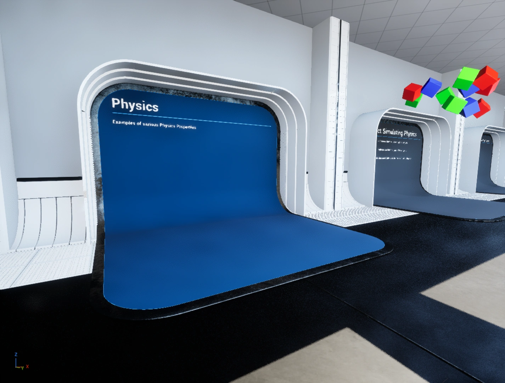
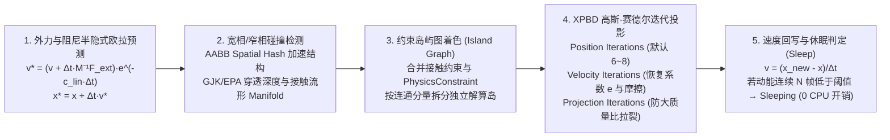
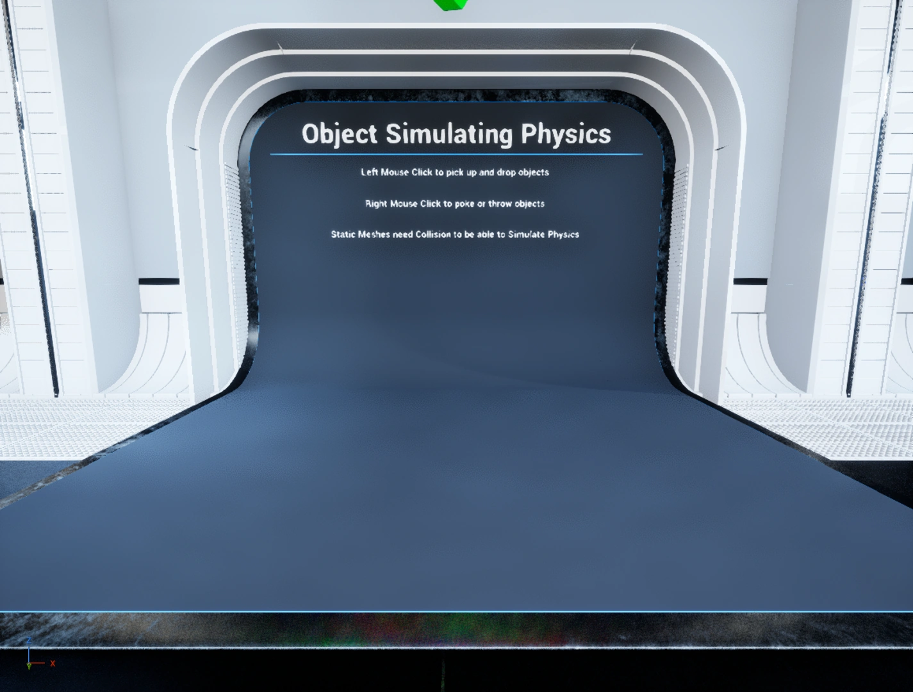
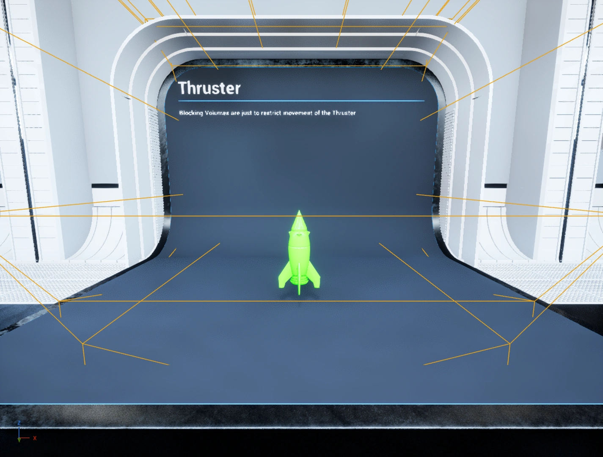
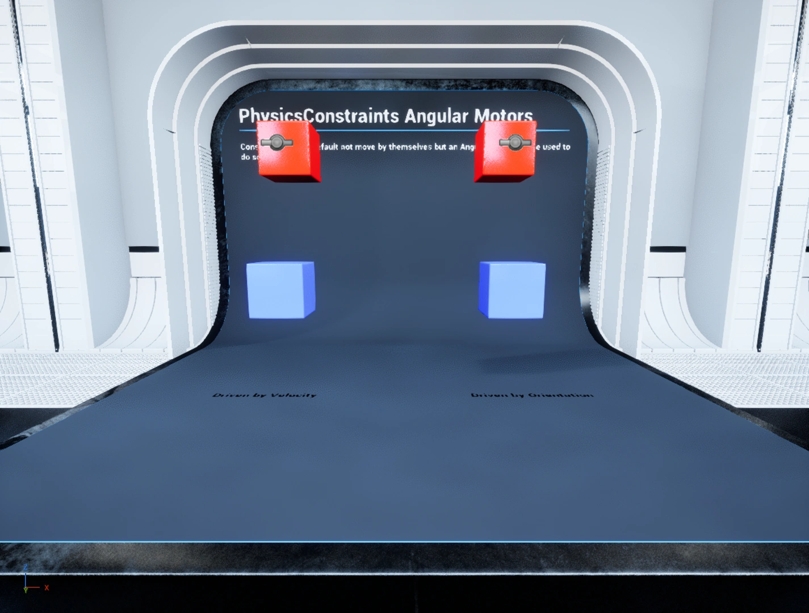

# 01 · Chaos 刚体动力学、物理约束、马达弹簧与阻尼场实例全解（`Physics`）

> **本篇实测拆解关卡档案**
> - **关卡路径**：`/Game/Maps/Physics/Physics`（关卡总 Actor 数：`114` | 展台数：`9` | 示例 Actor 数：`85` | 未归属全局 Actor：`1`）
> - **关卡脚本类**：`/Game/Maps/Physics/Physics.Physics_C`（配置了防误抓白名单 `ignore Actors = [SM_ThrusterCubeDemoAttachmentbase]` 及区域触发器事件）
> - **核心资产目录**：`/Game/ExampleContent/Physics/` 与 `/Game/Global/Meshes/`（涵盖 `SM_DemoCube`、`SK_RigidBodyDemo`、`SK_RigidBodyDemo_PhysicsAsset`、`PHYSMAT_SK_RigidBodyDemo`、零摩擦全弹性物理材质 `SlickRubberRocket`、火箭网格 `SM_ExampleMesh_Rocket` 以及 `PhysicsBSJointActor1~10` 六自由度约束关节矩阵）

---

## 一、 为什么从 PhysX 到 Chaos PBDRigids，刚体与约束是游戏物理的“第一性原理”？

在没有刚体动力学（Rigid Body Dynamics）的世界里，所有物体的运动轨迹都是美术在关键帧曲线上画死的“提线木偶”——箱子撞到墙角不会翻滚，铁链被风吹动不会摇曳，吊灯挨了一枪依然纹丝不动。而一旦为网格体挂载了简单碰撞体（Simple Collision）并勾选 **`Simulate Physics`**，虚幻引擎 5 内置的 **Chaos `PBDRigids`（基于扩展位置动力学的刚体求解器）** 便会接管它的位置 $\mathbf{x} \in \mathbb{R}^3$ 与姿态四元数 $\mathbf{q} \in \mathbb{H}$，在每一个物理子步（Sub-step）中严密演绎牛顿-欧拉运动方程与拉格朗日乘子约束。



欢迎来到物理专题的第一座基石展馆——**`/Game/Maps/Physics/Physics`**。这条长约 **85 米**（`X` 坐标从 `505` 延伸至 `8506`）、由 **9 座标准对照展台** 构成的物理实验室，用最纯粹的红、绿、蓝三色高光方块（`SM_DemoCube`）和十组精调的物理约束关节（`PhysicsBSJointActor1~10`），将 Chaos 刚体解算的四大支柱——**碰撞与惯性张量、力与冲量场、六自由度（6-DOF）空间约束、主动伺服马达与断裂阈值**——拆解得淋漓尽致。

### 1.1 直击数学内核：Chaos `PBDRigids` 单帧解算流水线

理解展台中每一个参数的物理意义之前，我们必须先看清 Chaos 物理线程（Physics Thread）在一个步长 $\Delta t$ 内究竟做了哪五件事：



1. **半隐式欧拉积分与阻尼衰减（Symplectic Euler & Damping）**：
   Chaos 首先累加重力 $\mathbf{g} = (0, 0, -980)\ \text{cm/s}^2$、推进器推力或径向力场，并按**线性阻尼（`LinearDamping` $c_{\text{lin}}$）**与**角阻尼（`AngularDamping` $c_{\text{ang}}$）**执行指数能量耗散，预测未受约束的试探位置 $\mathbf{x}^*$ 与试探四元数 $\mathbf{q}^*$：
   $$\mathbf{v}^* = \frac{\mathbf{v}_t + \Delta t \cdot m^{-1}\mathbf{F}_{\text{ext}}}{1 + c_{\text{lin}}\Delta t}, \qquad \boldsymbol{\omega}^* = \frac{\boldsymbol{\omega}_t + \Delta t \cdot \mathbf{I}^{-1}\left(\boldsymbol{\tau}_{\text{ext}} - \boldsymbol{\omega}_t \times (\mathbf{I}\boldsymbol{\omega}_t)\right)}{1 + c_{\text{ang}}\Delta t}$$
   > [!TIP]
   > **为什么 `AngularDamping` 默认是 `0.0` 而 `LinearDamping` 默认是 `0.01`？**
   > 轻微的默认线性阻尼（`0.01`）可抑制浮点微抖动并帮助物体平稳休眠；但如果圆球在平坦地面滚动久久停不下来，光加摩擦系数 `Friction` 是没用的（纯滚动接触点瞬时相对滑移速度为 $0$，库仑滑动摩擦不做负功！）——你必须把圆球的 **`AngularDamping` 调到 `0.2 ~ 0.8`** 才能模拟真实的滚动摩阻！

2. **物理材质（`UPhysicalMaterial`）的三大黄金标量与合成模式（Combine Mode）**：
   在本关关联资产库中，MCP 实测捕获了两份极具代表性的物理材质资产——骨骼刚体专用的 `PHYSMAT_SK_RigidBodyDemo` 与推进器展台专用的极端测试材质 `SlickRubberRocket`：

   | 物理材质资产路径 | `Density` ($\text{g/cm}^3$) | `Friction` (动摩擦) | `Restitution` (弹性恢复 $e$) | `RaiseMassToPower` | 休眠阈值 (`Linear` / `Angular` / `Counter`) |
   | :--- | :---: | :---: | :---: | :---: | :---: |
   | `/Game/ExampleContent/Physics/SkeletalMeshes/PHYSMAT_SK_RigidBodyDemo` | `1.0` | `0.10` | `0.30` | `0.75` | `1.0 cm/s` / `0.05 rad/s` / `4 帧` |
   | `/Game/ExampleContent/Physics/PhysicsMaterials/SlickRubberRocket` | `1.0` | **`0.00`** | **`1.00`** | `0.75` | `1.0 cm/s` / `0.05 rad/s` / `4 帧` |

   - **恢复系数（`Restitution` $e \in [0, 1]$）**：在 XPBD 的 **Velocity Solve（速度迭代步）** 中求解法向碰撞冲量，控制碰撞前后沿接触法线 $\mathbf{n}$ 的法向相对分离速度与接近速度之比：$v_{n}^+ = -e \cdot v_{n}^-$。`SlickRubberRocket` 将 `Restitution` 拉满到 `1.0` 且 `Friction = 0.0`，构造出了理想物理学中的**无摩擦完全弹性碰撞体**！
   - **质量幂次缩放（`RaiseMassToPower = 0.75`）**：这是游戏物理程序员隐藏的“稳定性外挂”！真实世界里，边长放大 $10$ 倍的大石块体积和质量会暴涨 $1000$ 倍（$10^3$）；当 $1000\ \text{kg}$ 的巨石压在 $1\ \text{kg}$ 的小木箱上时，迭代求解器的条件数恶化会导致小木箱剧烈抖动甚至被压穿地面。引擎通过 $m_{\text{eff}} \propto (\rho V)^{0.75}$ 对极端悬殊的质量比做温和非线性压缩（$1000^{0.75} \approx 177.8$），既保留了“大石头轻松撞飞小箱子”的视觉重量感，又大幅提升了接触栈的收敛稳定性！
   - **双材质合成法则（`FrictionCombineMode` / `RestitutionCombineMode`）**：两个不同物理材质 A 与 B 相撞时，默认取均值 `Average`（$(e_A + e_B)/2$）；若制作溜冰场冰面或超弹蹦床，务必勾选 `bOverrideFrictionCombineMode = true` 并将模式改为 **`Min`（冰面取最小摩擦）** 或 **`Max`（蹦床取最大弹性）**，防止被角色鞋底的普通物理材质平均稀释。

3. **XPBD 柔度方程（Compliance $\alpha$）**：
   传统 PBD 的致命缺陷是“弹簧刚度随帧率 $\Delta t$ 和迭代次数变化——60 帧下软绵绵的绳子到了 120 帧硬如钢筋”。Chaos 采用 **XPBD（Extended Position-Based Dynamics）**，引入物理柔度 $\tilde{\alpha} = \frac{\alpha}{\Delta t^2}$（其中 $\alpha = 1/k$ 为刚度倒数），每次约束投影的拉格朗日乘子增量严格与时间步长解耦：
   $$\Delta \lambda = \frac{-C(\mathbf{x}) - \tilde{\alpha}\lambda}{\nabla C \cdot \mathbf{M}^{-1} \nabla C^T + \tilde{\alpha}}, \qquad \Delta \mathbf{x} = \mathbf{M}^{-1} \nabla C^T \Delta \lambda$$
   当 $\alpha = 0$ 时退化为绝对刚性的硬约束（`Locked` / 硬 `Limited`）；当 $\alpha > 0$ 时则精确等价于胡克定律软弹簧（`Soft Constraint` 与 `Linear/Angular Drive`）！

---

## 二、 关卡全局交互架构与蓝图逻辑 DSL 拆解

在进入 `#1 ~ #9` 展台之前，先拆解本关之所以能“左键抓起方块当篮球扔、右键戳飞刚体测断裂”的全局交互框架（由玩家 Pawn / `PhysicsDemoPlayerController` 与关卡蓝图 `/Game/Maps/Physics/Physics.Physics_C` 协同驱动）：

```text
[Blueprint Logic DSL — 物理展厅全局鼠标抓取/戳击与区域触发管线]

1. 关卡蓝图属性配置 (/Game/Maps/Physics/Physics.Physics_C):
   - Variable `ignore Actors` (Array<Actor>):
     └── [0] -> PersistentLevel.SM_ThrusterCubeDemoAttachmentbase  // 保护 #5 展台火箭不被玩家射线抓走或戳出笼外！

2. 鼠标左键交互 (Left Mouse Button — 6-DOF 软弹簧物理抓取):
   On Pressed:
     LineTraceByChannel(Start = CameraLoc, End = CameraLoc + CameraFwd * GrabDistance, Channel = Visibility/PhysicsBody)
     └── Branch: HitResult.bBlockingHit && HitComponent.IsSimulatingPhysics() && !ignoreActors.Contains(HitActor)
         └── True:
             HoldDistance = VectorLength(HitResult.Location - CameraLoc)
             PhysicsHandleComponent.GrabComponentAtLocationWithRotation(
                 Component = HitResult.Component,
                 InBoneName = HitResult.BoneName,   // 对 #3 SK_RigidBodyDemo 可精准单拎起某一截骨骼刚体！
                 Location  = HitResult.Location,
                 Rotation  = HitResult.Component.GetComponentRotation()
             )
   On Tick (While Grabbing):
     TargetLoc = CameraLoc + CameraFwd * HoldDistance
     PhysicsHandleComponent.SetTargetLocationAndRotation(TargetLoc, CameraRot)
   On Released:
     PhysicsHandleComponent.ReleaseComponent()

3. 鼠标右键交互 (Right Mouse Button — 定点偏心冲量发射器):
   On Pressed:
     LineTraceByChannel(Start = CameraLoc, End = CameraLoc + CameraFwd * PokeDistance)
     └── Branch: HitResult.bBlockingHit && HitComponent.IsSimulatingPhysics() && !ignoreActors.Contains(HitActor)
         └── True:
             ImpulseVec = Normalize(HitResult.TraceEnd - HitResult.TraceStart) * PokeImpulseMagnitude
             HitResult.Component.AddImpulseAtLocation(
                 Impulse  = ImpulseVec,
                 Location = HitResult.ImpactPoint,  // 非质心命中自动产生 r × J 翻滚角冲量！
                 BoneName = HitResult.BoneName
             )
```

---

## 三、 `Physics` 逐展台（#1 ~ #9）全量实测拆解

### 展台 #1：`Physics` — 物理评测光场与 Chaos 实时调试绘制基座

- **空间元数据**：展牌 Label `BP_DemoDisplay8` | 坐标 `(505, -900, 0)`
- **官方展牌原文**：*Examples of various Physics Properties*

#### 1.1 展台陈列 Actor 与底层参数清单（共 5 个）
作为整条物理长廊的序幕展台，`#1` 号展位不放置具体刚体玩具，而是托管了全馆的光照环境与 Chaos 底层可视化调试钩子：
- **`DirectionalLight`**（`/Script/Engine.DirectionalLight`）：`Intensity = 10`，纯白光 `(1, 1, 1, 1)`，`CastShadows = true`，`Mobility = Movable`。高亮度动态平行光配合下方三原色雕塑材质（`Roughness = 0.1`），让刚体高速旋转时的镜面高光流动清晰可辨。
- **`SkyLight`**（`/Script/Engine.SkyLight`）：`Intensity = 3`，纯白光，`CastShadows = true`，`Mobility = Movable`，填补展台内凹背景板的暗部环境漫反射。
- **`SkyAtmosphere`** 与 **`ExponentialHeightFog`**：提供标准物理展厅大气散射与远景深度雾。
- **`Actor`（挂载 `ChaosDebugDrawComponent_0`）**：这是整个物理馆最关键的隐藏诊断组件！在运行（PIE）状态下按下 `~` 呼出控制台输入：
  - `p.Chaos.DebugDraw.Enabled 1`：开启 Chaos 全局调试绘制总开关；
  - `p.Chaos.DebugDraw.ShowShapes 1`：透视绘制所有刚体的真实物理碰撞凸包/胶囊体线框（区分渲染网格与物理形状）；
  - `p.Chaos.DebugDraw.ShowJoints 1` 与 `p.Chaos.DebugDraw.ShowJointFeatures 1`：实时画出 `#6 ~ #9` 号展台每一个物理约束的扇形摆动锥（Swing Cone）、扭转弧（Twist Arc）与轴向坐标系！
  - `p.Chaos.DebugDraw.ShowCenterOfMass 1`：标出每个刚体的质心（COM）与主惯性轴。

---

### 展台 #2：`Object Simulating Physics` — 静态网格刚体化、碰撞体前置铁律与三原色雕塑材质链

- **空间元数据**：展牌 Label `BP_DemoDisplay` | 坐标 `(1505, -900, 0)`
- **官方展牌原文**：*Left Mouse Click to pick up and drop objects / Right Mouse Click to poke or throw objects / Static Meshes need Collision to be able to Simulate Physics*



#### 2.1 为什么“没有简单碰撞体的 StaticMesh 绝对无法开启 Simulate Physics”？
在视口实拍图（以及展厅总览图右上角）可以看到，`#2` 号展台正上方悬空摆放了 **11 颗** `/Game/Global/Meshes/SM_DemoCube`：
- **下层 3 颗（高度 `Z = 395`）**：`SM_DemoCube_3`（绿，`X=1370`）、`SM_DemoCube`（蓝，`X=1497.5`）、`SM_DemoCube_2`（红，`X=1612.5`）；
- **上层 8 颗错位散落（高度 `Z = 472.5`）**：`SM_DemoCube_4`（蓝）、`SM_DemoCube_5`（红）、`SM_DemoCube_6`（绿）、`SM_DemoCube_7`（蓝）、`SM_DemoCube_8`（红）、`SM_DemoCube_9`（绿）、`SM_DemoCube_10`（红）、`SM_DemoCube_11`（绿）。

一旦点击运行（Play），这 11 颗错位堆叠的方块在重力下轰然坠落、棱角相撞并滚落满台。为什么展牌特意强调 **"Static Meshes need Collision to be able to Simulate Physics"**？这背后有两条物理引擎的硬性数学约束：
1. **体积与惯性张量积分（Volume & Inertia Tensor Integration）**：Chaos 需要对闭合凸体（Box / Sphere / Sphyl / Convex Hull）做多面体体积积分，才能结合物理材质密度 $\rho$ 自动算出刚体质量 $m = \iiint_\Omega \rho\,dV$ 与 $3\times 3$ 对称正定惯性张量 $\mathbf{I} = \iiint_\Omega \rho\left(\|\mathbf{r}\|^2 \mathbf{E} - \mathbf{r}\mathbf{r}^T\right)dV$。而渲染用的三角面汤（Triangle Soup / Complex Collision）可能是开口薄片或非流形网格，根本无法定义封闭体积！
2. **GJK/EPA 窄相穿透解算**：Chaos 动态刚体之间的碰撞窄相依赖**凸集支撑映射（Support Mapping）**计算穿透深度与恢复法线。将整张几万面的渲染网格設为 `Use Complex Collision As Simple`（`CTF_UseComplexAsSimple`）虽然能做**纯静态地面/墙壁**，但它的 `Simulate Physics` 复选框会被引擎强制置灰禁用！

#### 2.2 关联材质实例继承链的有趣实测细节
MCP 资产深拆揭示了贯穿全馆的三原色高光塑料材质实例链（参数均为 `Roughness = 0.1`、`RefractionDepthBias = 0`）：
- `M_LightSculpture_Red`：母材质为根材质 `/Game/Global/Materials/M_LightSculpture`，重载 `Color = (1, 0, 0, 1)`；
- `M_LightSculpture_Green`：母材质并未直接指向根材质，而是继承自材质实例 **`M_LightSculpture_Red`**（材质实例嵌套继承 Material Instance Parenting），重载 `Color = (0, 1, 0, 1)`；
- `M_LightSculpture_Blue`：又进一步继承自 **`M_LightSculpture_Green`**，形成 `M_LightSculpture → Red → Green → Blue` 的三级实例链，重载 `Color = (0, 0, 1, 1)`。

---

### 展台 #3：`SkeletalMesh RigidBody Simulating Physics` — 骨骼物理资产（`PhysicsAsset`）与布娃娃铰接链

- **空间元数据**：展牌 Label `BP_DemoDisplay1` | 坐标 `(2500, -900, 0)`
- **官方展牌原文**：*Skeletal Meshes need a PhysicalAsset*

#### 3.1 展台陈列 Actor 与关联资产深拆
- **唯一核心展品**：`SK_RigidBodyDemo`（`/Script/Engine.SkeletalMeshActor`，坐标 `(2392.5, -567.5, 137.5)`），绑定骨骼网格 `/Game/ExampleContent/Physics/SkeletalMeshes/SK_RigidBodyDemo`，覆写蓝色高光材质 `M_LightSculpture_Blue`，`animClass = None`（无动画蓝图驱动，纯物理自由解算）。
- **关联物理资产 `SK_RigidBodyDemo_PhysicsAsset` 实测求解器参数**：
  - `solverType`: `"World"`（接入主世界 Chaos `PBDRigids` 求解器，能够与玩家抓取句柄及场景中其他方块双向互撞；若角色仅需自身挂件摆动且无需被场景物体推挤，可切换为轻量局部求解器 `RBAN / Immediate Mode`）；
  - `solverSettings`: **`positionIterations = 6`**、`velocityIterations = 1`、`projectionIterations = 1`、`cullDistance = 1`；
  - 绑定专属物理材质 `PHYSMAT_SK_RigidBodyDemo`（`Density = 1.0, Friction = 0.1, Restitution = 0.3, RaiseMassToPower = 0.75`）。

#### 3.2 为什么骨骼网格不能直接勾 `Simulate Physics`，而必须依赖 `UPhysicsAsset`（PhAT）？
静态网格体对应**单个刚体（Single Rigid Body）**，而骨骼网格体（Skeletal Mesh）本质上是**一套由多根骨骼组成的树状多刚体铰接系统（Articulated Multi-Body / Ragdoll）**：
1. **`SkeletalBodySetup`（骨骼刚体形状数组）**：在物理资产编辑器（Physics Asset Editor）中，为关键骨骼（如骨盆、胸腔、上臂、小腿，切勿为手指/面部次级骨骼生成刚体！）拟合胶囊体（`SphylElem`）、盒体（`BoxElem`）或凸包，每个骨骼段成为一颗独立的 Chaos 刚体粒子；
2. **`PhysicsConstraintTemplate`（内置骨骼关节约束数组）**：沿着父子骨骼层级自动建立锥形旋转限位（如膝关节只允许单向弯曲 $0^\circ \sim 130^\circ$，严禁反向折断成鸵鸟腿！），并自动禁用相邻父子胶囊体之间的自碰撞（`Disable Collision`），从而在角色死亡或受爆震冲击瞬间呈现自然柔软的**布娃娃坍塌（Ragdoll Simulation）**。

---

### 展台 #4：`Radial Force / Impulse` — 瞬时径向冲量与持续径向力场的动力学分野

- **空间元数据**：展牌 Label `BP_DemoDisplay2` | 坐标 `(3505, -900, 0)`
- **官方展牌原文**：*Actor fires a single Impulse that affects physics and or a constant Force*

#### 4.1 展台 12 个精密陈列 Actor 空间拓扑还原
通过对比全部 12 个 Actor 的精确坐标，我们可以完整还原出这座“走廊感应引爆双子塔”的巧妙机关设计：
1. **左右对称五层积木双子塔（共 10 颗 `SM_DemoCube_13 ~ 22`）**：
   - **左塔 5 颗（`X = 3427.5, Y = -552.8`）**：`SM_DemoCube_13`（`Z = 5.49`）、`16`（`Z = 55.41`）、`17`（`Z = 105.32`）、`20`（`Z = 155.24`）、`21`（`Z = 205.16`），每层严丝合缝递增 `49.92 cm`（恰好为一颗 `50 cm` 标准立方体高度减去皮肤接触容差）！
   - **右塔 5 颗（`X = 3612.5, Y = -560.65`）**：`SM_DemoCube_14`、`15`、`18`、`19`、`22`，高度与左塔一一对应。
2. **爆心发生器 `RadialForceActor1`**（`/Script/Engine.RadialForceActor`）：埋设在两座五层方块塔正中间的台面底部 `(3506.15, -565.83, 54.66)`，挂载 `RadialForceComponent`（`ForceComponent0`）。
3. **过道红外感应体积 `TriggerVolume`**：横跨在展台正前方的观众参观走道上 `(3490, -260, 110)`！当玩家走到 `#4` 号展台正前方踏入 `TriggerVolume` 时，关卡蓝图接收 `OnActorBeginOverlap` 事件，立即调用 `RadialForceActor1.ForceComponent0.FireImpulse()`，瞬间将左右两座五层积木塔向四周炸飞！

#### 4.2 工程核心辨析：`Impulse`（冲量）vs `Force`（力）与 `bImpulseVelChange`
许多初学者在写手雷爆炸或黑洞吸引技能时经常混用 `FireImpulse` 与 `AddForce`，两者的量纲与帧率表现截然不同：

| 维度 | 瞬时径向冲量 (`FireImpulse`) | 持续径向力 (`ForceStrength` + `bAutoActivate`) |
| :--- | :--- | :--- |
| **物理量纲与数学本质** | **动量阶跃** $\Delta \mathbf{p} = \mathbf{J}\ (\text{kg}\cdot\text{cm/s})$，单帧一次性直接叠加在速度 $\Delta \mathbf{v} = \mathbf{J}/m$ 上 | **连续加速度积分** $\mathbf{F}\ (\text{kg}\cdot\text{cm/s}^2)$，必须每帧 Tick 持续作用：$\Delta \mathbf{v} = \frac{\mathbf{F}}{m}\Delta t$ |
| **帧率依赖陷阱** | **只能单次事件调用**！若误放在 `Event Tick` 里每帧调 `FireImpulse`，120 FPS 玩家受到的推力将是 30 FPS 玩家的 4 倍！ | **专为持续状态而生**！内部自动乘以物理步长 $\Delta t$，30 FPS 与 120 FPS 下速度曲线一致 |
| **`bImpulseVelChange` 开关** | 设为 `false` 时按真实质量分配速度（重铁块炸不动，轻木片飞上天）；设为 **`true`** 时忽略质量直接把 `ImpulseStrength` 当作速度增量 $\Delta \mathbf{v}$，确保大小碎片整齐飞散 | 持续力不支持忽略质量（若需无视质量的持续匀加速场，应使用 Chaos Field 的线性速度场或重力缩放） |
| **典型游戏场景** | 手雷破片冲击波、霰弹枪近距击退、重锤砸地震飞 | 龙卷风持续卷吸（负值 `ForceStrength < 0`）、磁铁吸附、太空失重气流 |

---

### 展台 #5：`Thruster` — 局部空间火箭推进器与 22 面零摩擦全弹性碰撞笼

- **空间元数据**：展牌 Label `BP_DemoDisplay3` | 坐标 `(4505, -900, 0)`
- **官方展牌原文**：*Blocking Volumes are just to restrict movement of the Thruster*



#### 5.1 为什么一个火箭展台要摆 22 个 `BlockingVolume` 并列入关卡蓝图白名单？
仔细观察实拍图中的橙色线框与实测 Actor 清单（共 **23 个 Actor**）：
1. **主角火箭 `SM_ThrusterCubeDemoAttachmentbase`**：位于展台中央 `(4502.5, -572.5, 77)`，使用绿色高光火箭模型 `/Game/ExampleContent/Materials/ExampleAsset/Mesh/SM_ExampleMesh_Rocket`，其尾喷口挂载了 `PhysicsThruster`（推进器组件）。同时它绑定了我们在 1.1 节深拆过的专属物理材质 **`SlickRubberRocket`（`Friction = 0.0, Restitution = 1.0`）**！
2. **22 面立体防逃逸笼（`BlockingVolume`、`BlockingVolume6~7`、`13~15`、`17~32`）**：在 `X ∈ [4228, 4777]`、`Y ∈ [-981, -432]`、`Z ∈ [-22, 428]` 的立方空间四周及顶底拼接出双层斜切导流挡板与外围封顶护栏！
   - **设计巧思**：一旦开启模拟，推进器沿着火箭**局部坐标系（Local Space）的 $-X$ 轴反向持续喷射推力**（火箭头朝向 $+X$ 前进）。每当火箭撞上斜角 `BlockingVolume`，依靠 `Friction = 0, Restitution = 1.0` 的零损耗全弹性碰撞，车头瞬间偏转角度，推进器推力方向也随之实时跟着箭体姿态旋转，于是绿色小火箭就像桌面冰球一样在隐形透明笼子里永不停歇地高速穿梭弹射！
   - **防破坏保护**：倘若玩家此时用鼠标左键把高速乱窜的火箭拽出 `BlockingVolume` 笼子，火箭就会一路冲破天花板飞向宇宙深处再也回不来——这正是关卡蓝图 `Physics_C` 特意将 `SM_ThrusterCubeDemoAttachmentbase` 塞进 **`ignore Actors`** 白名单的根本原因！

#### 5.2 `UPhysicsThrusterComponent` 的三大实战准则
1. **推力轴向永远固定为组件自身的 `-X`（负前向轴）**：在编辑器视口旋转推进器组件，让红色箭头（$+X$）指向**尾焰喷出方向**，实际施加在父刚体上的反作用推力则是朝向 $-X$ 轴的 `ThrustStrength`！
2. **必须正确挂接（Attach）在开启模拟的根组件或指定骨骼上**，并且**施力点就是推进器组件自身的相对坐标**！
   - 若将推进器精确放在父刚体的**质心（Center of Mass）**上，产生纯直线加速；
   - 若故意将左右两台推进器对称挂在飞船两翼（偏离质心 $\mathbf{r}$），差动调节左右 `ThrustStrength`，无需写一行旋转代码就能靠真实力矩 $\boldsymbol{\tau} = \mathbf{r} \times \mathbf{F}$ 实现物理飞船的偏航（Yaw）与翻滚（Roll）姿态控制（如《星际拓荒》宇航服喷气背包）！

---

### 展台 #6：`PhysicsConstraints` — 六自由度（6-DOF）空间关节的四大经典拓扑

- **空间元数据**：展牌 Label `BP_DemoDisplay4` | 坐标 `(5502, -900, 0)`
- **官方展牌原文**：*Constant Force Actor is used to display movement / Constraints would by default not move by it self*

#### 6.1 展台 14 个 Actor 配对矩阵完全拆解
如展牌所言，被动的物理约束关节本身不产生能量，若无外力扰动只会静静下垂。因此官方在展台旁部署了扰动源 `RadialForceActor2` `(5611.15, -480.83, 54.66)`（以及后方关联推进器 `PhysicsThruster1`），并由左至右在高度 `Z = 204.66` 处一字排开 **4 组“上红锚块 + 下蓝摆块”的双刚体约束实验对**：

| 关节 Actor 名称 | X 坐标 | `ConstraintActor1` (上方红色锚点块 `Z=217.5`) | `ConstraintActor2` (下方蓝色受控块 `Z=140`) | 演示的 6-DOF 自由度开放组合原型 |
| :--- | :---: | :--- | :--- | :--- |
| **`PhysicsBSJointActor1`** | `5327.48` | `SM_DemoCube_26` | `SM_DemoCube_25` | **单轴铰链（Hinge / Revolute）**：锁定全部 3 平移 + 锁定 2 旋转轴，仅放开单个旋转轴（如门合页、秋千） |
| **`PhysicsBSJointActor2`** | `5449.98` | `SM_DemoCube_28` | `SM_DemoCube_27` (`SM_DemoCube_49`) | **棱柱滑轨/线性限位（Prismatic）**：锁定旋转，沿单一线性轴开放 `Limited` 滑动区间（如抽屉、电梯导轨） |
| **`PhysicsBSJointActor3`** | `5559.98` | `SM_DemoCube_30` | `SM_DemoCube_29` | **锥形球窝摆（Cone / Ball-and-Socket）**：锁定 3 平移，开放 `Swing1` 与 `Swing2` 受限圆锥角（如吊灯、链球） |
| **`PhysicsBSJointActor4`** | `5652.48` | `SM_DemoCube_32` | `SM_DemoCube_31` | **扭转/复合自由关节（Twist / Multi-DOF）**：测试绕长轴自旋 `Twist` 限位或弹性恢复限位 |

#### 6.2 深入骨髓：彻底看懂虚幻 6-DOF 旋转坐标系（`Swing1` / `Swing2` / `Twist`）
为什么虚幻的旋转约束不叫简单的 `Roll / Pitch / Yaw` 欧拉角，而要拆分成诡异的 **`Twist`、`Swing1`、`Swing2`**？
- **万向节死锁灾难（Gimbal Lock）**：传统欧拉角一旦俯仰角走到 $\pm 90^\circ$，偏航轴与翻滚轴重合，雅可比矩阵秩亏导致关节瞬间抽搐爆炸！
- **Swing-Twist 四元数分解（四元数球面锥分解）**：Chaos 将两个刚体约束局部坐标系之间的相对四元数 $\mathbf{q}_{\text{rel}}$ 唯一分解为两部分 $\mathbf{q}_{\text{rel}} = \mathbf{q}_{\text{swing}} \otimes \mathbf{q}_{\text{twist}}$：
  1. **`Twist`（扭转角，对应约束组件红轴 `X` 轴）**：绕主轴自身拧麻花自旋（例如拧门把手、车轮轴或人体前臂旋前旋后）；
  2. **`Swing1`（绕绿轴 `Y` 轴左右摆动，视口显示为水平绿色扇面）** 与 **`Swing2`（绕蓝轴 `Z` 轴上下摆动，视口显示为垂直圆锥扇面）**：共同张成一个光滑无奇点的椭圆摆动锥（Swing Cone）！对于人类肩关节或吊灯挂钩，用椭圆锥限制活动范围加独立轴向扭转限制，既符合解剖学，又从数学根源上彻底消灭了万向节死锁！

---

### 展台 #7：`PhysicsConstraints Angular Motors` — 角速度驱动与 PD 朝向扭簧伺服马达

- **空间元数据**：展牌 Label `BP_DemoDisplay5` | 坐标 `(6495, -900, 0)`
- **官方展牌原文**：*Constraints will by default not move by themselves / but an Angular Motor can be used to do so*
- **展台内 3D 悬浮文字标签**：`Driven by Velocity` | `Driven by Orientation`



#### 7.1 展台两组红蓝马达对的实测架构与控制律数学方程
观察实拍图，上方红色方块（`Z = 217.5`）固定在背景墙前充当马达定子基座，关节中心架设在 `Z = 242.5`，下方蓝色方块（`Z = 85`）充当带摆臂半径的转子负载：

1. **左组：`Driven by Velocity`（角速度恒流源驱动）**
   - **配对 Actor**：`PhysicsBSJointActor6` `(6380, -622.5, 242.5)` 连接定子 `SM_DemoCube_36` 与转子 `SM_DemoCube_35`。
   - **控制方程**：勾选 `Drives -> Angular Velocity Target` 并赋予阻尼增益 `Strength (Damping)` $k_d$，马达持续输出追赶目标角速度 $\boldsymbol{\omega}_{\text{target}}$ 的主动扭矩：
     $$\boldsymbol{\tau}_{\text{motor}} = \text{clamp}\Big(k_d \cdot (\boldsymbol{\omega}_{\text{target}} - \boldsymbol{\omega}),\ -\tau_{\max},\ +\tau_{\max}\Big)$$
   - **实战用途**：电风扇扇叶、水车轮、坦克主动履带轮、旋转自动门或机关绞肉机——而且它不是死板的运动学 `AddLocalRotation`！当玩家扔一个重箱子卡进扇叶时，只要阻力矩超过 `Max Force` $\tau_{\max}$，扇叶就会真实地减速甚至被卡停！

2. **右组：`Driven by Orientation`（PD 角度位置/扭簧伺服驱动）**
   - **配对 Actor**：`PhysicsBSJointActor5` `(6595, -622.5, 242.5)` 连接定子 `SM_DemoCube_34` 与转子 `SM_DemoCube_33`。
   - **控制方程**：勾选 `Drives -> Angular Orientation Target`，构成经典的二阶 **PD（比例-微分）扭力弹簧控制器**：
     $$\boldsymbol{\tau}_{\text{motor}} = k_p \cdot \Delta\boldsymbol{\theta}(\mathbf{q}_{\text{target}} \otimes \mathbf{q}^{-1}) - k_d \cdot \boldsymbol{\omega}$$
     其中 `Strength (Spring)` 为比例刚度系数 $k_p$，`Damping` 为阻尼系数 $k_d$。当玩家右键一枪把蓝色方块打偏时，扭簧立刻将其拉回目标角度并伴随阻尼震荡回中！
   - **实战避坑（`SLERP` vs `Twist and Swing` 驱动模式）**：
     - 若关节的 **3 个旋转轴全部设为 `Free` 或 `Limited`（没有任何一个旋转轴是 `Locked`！）**，强烈推荐使用 **`SLERP`（球面线性插值模式）**，它会沿着四元数测地线最短弧平滑发力；
     - **致命陷阱**：只要 `Swing1`、`Swing2`、`Twist` 中**有任何一个轴被设为了 `Locked`（锁定）**，Chaos 编辑器甚至会直接屏蔽 `SLERP` 模式，此时**必须使用 `Twist and Swing` 分轴驱动模式**！常见应用场景包括西部酒馆双向自动回弹木门、主动物理动画（Physical Animation）骨骼肌肉跟随。

---

### 展台 #8：`PhysicsConstraints Linear Motors` — 线性速度液压缸与胡克弹簧减震器

- **空间元数据**：展牌 Label `BP_DemoDisplay6` | 坐标 `(7510, -900, 0)`
- **官方展牌原文**：*Constraints will by default not move by themselves / but an Angular Motor can be used to do so* *(注：此处为 Epic 关卡设计师复制 `#7` 号展牌时的历史笔误彩蛋，实际演示的完全是 `Linear Motor` 线性平移马达！)*
- **展台内 3D 悬浮文字标签**：`Driven by Velocity` | `Driven by Position`

#### 8.1 展台两组线性活塞对的实测坐标与阻尼比调参公式
在 `#8` 号展台中，上下方块贴近台面布置，放开线性平移轴（如 `Z Motion` 或 `X/Y Motion`）并锁定全部旋转自由度，构建出两套精密的直线作动器：

1. **左组：`Driven by Velocity`（线性恒速推进器）**
   - **配对 Actor**：`PhysicsBSJointActor8` `(7420, -667.5, 85.5)` 连接 `SM_DemoCube_39` (`Z=78`) 与 `SM_DemoCube_40` (`Z=27.5`)。
   - **控制律**：$F_{\text{motor}} = k_d (v_{\text{target}} - v)$。适合制作物理传送带推杆、液压升降台（遇重物超载时真实压停）。
2. **右组：`Driven by Position`（线性位置弹簧/悬挂减震器）**
   - **配对 Actor**：`PhysicsBSJointActor7` `(7612.5, -666.5, 74)` 连接 `SM_DemoCube_38` (`Z=16.5`) 与 `SM_DemoCube_37` (`Z=67`)。
   - **控制律与临界阻尼公式**：完全遵循经典受迫阻尼谐振子方程：
     $$m\ddot{x} + k_d \dot{x} + k_p (x - x_{\text{target}}) = F_{\text{ext}}$$
     调校越野车悬挂弹簧、蹦床踏板或受击缓冲垫时，切忌凭感觉乱填 `Strength` ($k_p$) 和 `Damping` ($k_d$)！记住**临界阻尼系数公式** $c_{\text{crit}} = 2\sqrt{m \cdot k_p}$，定义阻尼比 $\zeta = \frac{k_d}{2\sqrt{m k_p}}$：
     - **欠阻尼（$\zeta \in [0.15, 0.4]$）**：踩上去上下欢快弹跳 2~3 次才停稳，适合卡通弹簧板、果冻平台；
     - **临界阻尼（$\zeta \approx 1.0$）**：被压下后以最快速度精准回弹至原位且**绝不过冲震荡**，适合硬派赛车竞技悬挂与高精度机械臂！

---

### 展台 #9：`PhysicsConstraints Breakable` — 拉格朗日乘子超限与可断裂关节机制

- **空间元数据**：展牌 Label `BP_DemoDisplay7` | 坐标 `(8506, -900, 0)`（长廊压轴展台）
- **官方展牌原文**：*Use Right Mouse button to poke object and eventually break the Constraint*
- **展台内 3D 悬浮文字标签**：`Angular Breakable` | `Linear Breakable`

#### 9.1 展台两组可断裂关节实测配对与断键判据
站在 `#9` 号展台前，瞄准下方悬挂的方块连续点击鼠标右键发射冲量：
1. **左组：`Angular Breakable`（抗弯/抗扭力矩超限折断）**
   - **配对 Actor**：`PhysicsBSJointActor9` `(8401.48, -571.98, 204.66)` 连接上方红块 `SM_DemoCube_42` (`Z=217.5`) 与下方蓝块 `SM_DemoCube_41` (`Z=133.5`)。
   - **底层机制**：勾选 `Angular Breakable` 并设定阈值 `Angular Break Threshold` $\tau_{\text{break}}$。在 XPBD 每步约束求解结束后，Chaos 将关节旋转约束累积的拉格朗日乘子换算为等效约束力矩 $\boldsymbol{\tau}_c = \boldsymbol{\lambda}_{\text{ang}} / \Delta t^2$；一旦玩家偏心射击造成的撬动力矩满足 $\|\boldsymbol{\tau}_c\| > \tau_{\text{break}}$，约束即刻永久失效（Broken），蓝块轰然脱落摔向台面！
2. **右组：`Linear Breakable`（抗拉/抗剪约束力超限崩断）**
   - **配对 Actor**：`PhysicsBSJointActor10` `(8606.48, -571.98, 204.66)` 连接右侧悬挂方块组（`SM_DemoCube_43` / `SM_DemoCube_44`）。
   - **底层机制**：勾选 `Linear Breakable` 并设定 `Linear Break Threshold` $F_{\text{break}}$。当悬挂重物过重或玩家猛力拽拉导致关节维持点重合所需的拉力 $\|\mathbf{F}_c\| = \|\boldsymbol{\lambda}_{\text{lin}}\| / \Delta t^2 > F_{\text{break}}$ 时，挂钩瞬间崩断！
   - **蓝图事件闭环**：在业务开发中，只需绑定 `PhysicsConstraintComponent` 的 **`OnConstraintBroken(int32 ConstraintIndex)`** 委托，即可在木牌掉落、吊灯坠毁的同一帧触发金属崩裂音效（MetaSound）与电火花粒子（Niagara）！

*(注：关卡持久层另含 1 个全局空容器 `InstancedFoliageActor1` 位于 `(700, 1000, 0)`。)*

---

## 四、 经典物理实验台进阶实战：用 Chaos 刚体与 6-DOF 约束拼装四大核心游戏机关

掌握了 `#1 ~ #9` 展台的原子能力后，在真实 3A 关卡设计中，几乎所有复杂的物理交互玩具都是上述原语的组合演化。下面我们从首席物理程序员视角，给出**牛顿摆、吊桥链条、弹射器与布娃娃受击响应**四套黄金工程配方与防崩避坑指南：

### 4.1 实验台一：牛顿摆（Newton's Cradle）—— 为什么新手搭的牛顿摆撞两下就全粘在一起摆了？
如果你想用 5 颗金属球和 `PhysicsConstraintActor` 还原“拉起最左球撞击，中间 3 颗纹丝不动，最右球等高弹起”的教科书级牛顿摆，默认设置 100% 会失败（撞一次五颗球就抱团晃动并迅速停下）。**满分调参四步法**：
1. **零耗散弹性物理材质**：参考本关 `#5` 展台的 `SlickRubberRocket`，创建专属物理材质设 **`Restitution = 1.0`**、**`RestitutionCombineMode = Max`**、**`Friction = 0.0`**；同时将每颗球的组件 **`LinearDamping = 0.0`**、**`AngularDamping = 0.0`**。
2. **严丝合缝的微间隙排列（Micro-Gap）**：如果初始状态 5 颗球完全紧贴（接触距离 $= 0$），高斯-赛德尔单次扫描会把它们视为同时接触的连通簇，冲量会在同一帧内平均摊薄给中间球！**工程秘诀**：每两颗半径 $R$ 的球心间距设为 $2R + 0.05\ \text{cm}$，将并联多体同时碰撞转化为纯粹的从左至右级联二体弹性碰撞！
3. **V 型双线单自由度约束**：将每颗球的 `X/Y/Z Linear Motion` 全设为 `Locked`，`Swing2` 与 `Twist` 设为 `Locked`，**仅将摆动平面内的 `Swing1` 设为 `Free`**，杜绝球体侧向偏摆跑偏。
4. **提高局部速度迭代次数**：在物理求解器或组件 `Solver Iterations` 中将 **`Velocity Iterations` 提升至 `4 ~ 8`**，确保恢复系数 $e=1$ 的动量与动能双守恒方程高精度收敛。

### 4.2 实验台二：吊桥与重型铁链（Suspension Drawbridge & Chain）—— 攻克“大质量比拉裂与面条化”
当用 10 节 `1 kg` 的小铁环 `PhysicsConstraint` 串联吊起一块 `500 kg` 的沉重木吊桥桥面时，最常见的噩梦是：铁链像橡皮筋一样被拉长半米，甚至疯狂抽搐抖动。**Chaos 专属三大定海神针**：
1. **开启位置投影（`Enable Projection`）**：在每个 `PhysicsConstraintComponent` 上勾选 `Projection`，将 `Projection Linear Tolerance` 设为 `1.0 ~ 2.0 cm`、`Projection Angular Tolerance` 设为 `5°`。当 XPBD 常规迭代因质量悬殊没拉住关节时，Chaos 会在末尾强行执行一步**非线性几何硬纠偏**，彻底消灭铁链拉长裂口！
2. **开启父级主导（`Parent Dominates`）或调平惯性质量比**：对于挂在重型桥体上的装饰挂链，勾选单向权重 `Parent Dominates`，令轻质子刚体 100% 服从重型父刚体而不反向拖拽父体；对于承重主链，将单节铁环的 `Mass Scale` 手动放大至 `20 ~ 50`，把相邻关节质量比严格控制在 **`1 : 5` 以内**！
3. **桥端绞盘收放**：吊桥根部用 `Hinge` 铰链固定在石墙上，桥头两侧用开放 `Linear X Limited` 的长索约束连至城楼绞盘，通过动态修改 `Linear Limit Size` 或驱动 `#8` 展台的 `Linear Position Motor` 即可实现丝滑放桥与砸地反弹！

### 4.3 实验台三：扭簧/配重弹射器（Catapult / Trebuchet）—— 角马达蓄力与高速防穿隧（CCD）
制作一台能把火药桶轰向敌方城墙（或打进第 03 篇 `Physics_Destruction` 石柱群！）的物理投石机：
1. **不对称铰链支点**：在长木杆靠近配重端 $1/4$ 处放置 `PhysicsConstraintActor`（锁定平移及 `Swing2/Twist`，开放 `Swing1 Limited` 仰角区间 $[0^\circ, 85^\circ]$）。
2. **双驱动方案**：
   - **中世纪配重式（Trebuchet）**：短臂端悬挂一颗 `Density = 10` 的超高密度配重铅块，发射前用一把 `Linear Breakable` 插销锁住长臂末端；拔销瞬间重力势能自然转化为长臂角加速度！
   - **扭力弹簧式（Onager）**：直接启用 `#7` 展台的 **`Angular Orientation Motor`**，将目标角度设为 $80^\circ$、刚度 `Strength = 50000`、阻尼 `Damping = 500`，一触发开关瞬间暴力弹射！
3. **铁律：为抛射物勾选 `Use CCD`（连续碰撞检测）**：弹射出的炮弹初速往往高达 `3000+ cm/s`（每帧移动超过 `50 cm`），普通离散检测（Discrete Collision）极易在一帧之内直接跳过薄墙而不触发碰撞（**穿隧效应 Tunneling**）。务必在抛射物刚体面板勾选 **`Use CCD`（Continuous Collision Detection，扫掠体射线检测）**！

### 4.4 实验台四：布娃娃局部受击响应（Ragdoll Hit Reaction）
结合 `#2` 展台的 `AddImpulseAtLocation` 与 `#3` 展台的 `PhysicsAsset`，现代射击游戏绝不会在角色挨第一枪时就把全身切成死鱼一样的纯 Ragdoll，而是采用**局部骨骼物理混合**：
- 平时角色 `SkeletalMeshComponent` 处于动画驱动态，胶囊体承担移动碰撞；
- 当子弹射线命中右肩骨骼 `upperarm_r` 时，调用 `SetAllBodiesBelowSimulatePhysics("clavicle_r", true, true)` 配合 `SetAllBodiesBelowPhysicsBlendWeight("clavicle_r", 0.6)`，并对 `upperarm_r` 施加 `AddImpulseAtLocation`；
- 右臂在物理冲量下真实向后甩动卸力，随后在 `0.3 秒` 内将 `PhysicsBlendWeight` 平滑插值回 `0.0` 无缝归还给持枪动画！（若与第 06 专题的 `PhysicalAnimationComponent` 或 `PhysicsControl` 结合，更能实现全身带肌肉张力的次时代物理交互。）

---

## 五、 本篇实战总结与刚体排错速查表

| 常见线上物理 Bug 现象 | 根因诊断 | Chaos 标准工程解法 |
| :--- | :--- | :--- |
| **勾选 `Simulate Physics` 复选框是灰色的** | 静态网格缺少简单碰撞体，或碰撞复杂度被设为了 `Use Complex As Simple` | 打开静态网格编辑器，添加 Box/Sphere/Capsule 或 `Auto Convex Collision`，碰撞复杂度改回 `Project Default` |
| **圆球在平地上滚几百米都停不下来** | 库仑滑动摩擦对纯滚动质心不做负功，且默认 `AngularDamping = 0` | 将刚体组件的 **`Angular Damping` 调至 `0.2 ~ 0.6`**，并检查物理材质休眠阈值 |
| **铁链/吊灯关节被重物拉出大裂缝且狂抖** | 相邻约束刚体质量比超过 `1:10`，高斯-赛德尔单步迭代欠收敛 | 将轻刚体质量调大拉近质量比（$<1:5$），在约束上勾选 **`Enable Projection`** 或 **`Parent Dominates`** |
| **角马达开启 `SLERP` 后不转或报警告** | 关节的 `Swing1 / Swing2 / Twist` 中存在被设为 `Locked` 的轴 | 存在锁定旋转轴时严禁用 `SLERP`，将 `Angular Drive Mode` 切换为 **`Twist and Swing`** |
| **高速射出的物理子弹直接穿墙而过** | 单帧位移 $\Delta x = v\Delta t$ 大于墙体厚度与球体直径之和（穿隧） | 在高速刚体上勾选 **`Use CCD`（连续碰撞检测）**，避免将墙体做成零厚度的单面片 |

当我们把单颗刚体切得越来越薄、把成百上千颗质点用柔韧的经纬拉伸弹簧与弯曲铰链编织成一张网格时，刚体动力学便华丽蜕变为柔体织物模拟。下一篇，让我们走进隔壁的 **`02_Physics_Cloth`**，彻底揭开 **Chaos XPBD 布料解算器、距离蒙皮遮罩、空气动力学升阻风场与防穿模双保险** 的全部秘密！
