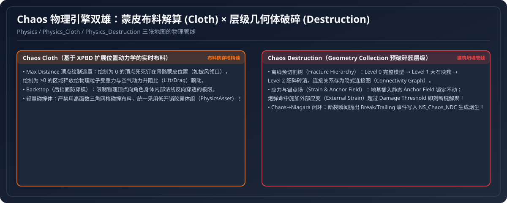
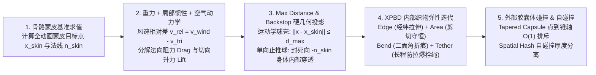

# 02 · Chaos 布料解算、距离蒙皮权重、风场空气动力学与碰撞穿插防护全解（`Physics_Cloth`）

> **本篇实测拆解关卡档案**
> - **关卡路径**：`/Game/Maps/Physics/Physics_Cloth`（关卡总 Actor 数：`99` | 展台数：`7` | 示例 Actor 数：`29` | 未归属全局 Actor：`1`）
> - **关卡脚本类**：`/Game/Maps/Physics/Physics_Cloth.Physics_Cloth_C`
> - **核心资产目录**：`/Game/ExampleContent/Cloth/` 与 `/Game/Characters/Echo/`（涵盖 `CLOTH_SimpleCloth`、麻布/真丝/橡胶/重皮革四质感对照资产组、`M_ClothingMaterial` 次世代织物着色器、`CLOTH_SimpleCollision` / `ComplexCollision`、`CLOTH_Backstop`、自碰撞搅拌球 `Clothspheres_SCOn/Off` 以及完整主角集成范例 `BP_Echo_3rdPersonPawn`）

---

## 一、 为什么实时角色布料是物理引擎里“最娇贵也最惊艳”的皇冠明珠？

在上一篇 `01_Physics` 中，一颗刚体无论长得多复杂，都只需要追踪质心位置 $\mathbf{x}$ 与旋转四元数 $\mathbf{q}$ 共 **6 个自由度**。但一件随风翻涌的骑士披风或百褶长裙，是由成百上千颗相互牵连的网格顶点组成的**二维柔体流形（2D Deformable Manifold）**——如果有 $1500$ 个布料模拟顶点，求解器在每一毫秒内就要同时协调 **$4500$ 个平移自由度**、数千条经纬拉伸/剪切/弯曲弹簧约束、三维风场升阻力以及与高速奔跑角色双腿之间的防穿模碰撞！

稍有不慎，你就会在项目里见到经典的三大车祸现场：
1. **“拉面披风”**：角色骑马冲刺时，披风因为迭代不足被惯性拉长两米远；
2. **“穿肚兜”**：角色急停倒退时，胸前或后背的布料一头扎进身体胸腔模型里穿帮；
3. **“水泥板或塑料袋”**：不管做粗麻披肩、真丝飘带还是厚重皮甲，飘起来全都像一张毫无重量层次的卫生纸。



为了彻底驯服实时织物模拟，虚幻引擎 5 全面弃用了早期的 NVIDIA APEX / NvCloth 黑盒库，全面拥抱自研的 **Chaos Cloth（基于 XPBD 扩展位置动力学与长程测地栓绳架构）**。步入 **`/Game/Maps/Physics/Physics_Cloth`** 这座长约 **65 米**（`X` 坐标从 `500` 延伸至 `6489`）、精炼排布 **7 座实战展台** 的布料专精实验室，我们将从底层 XPBD 数学公式一直拆解到主角 `Echo` 奔跑转身时的每一项生产级防穿模参数。


---

## 二、 直击 Chaos Cloth 数学内核：四大约束算子与空气动力学方程

在逐台拆解之前，让我们先把 Chaos Cloth Solver（`FClothingSimulationSolver`）在每个子步（Substep）内依次投影求解的**五重数学约束**彻底吃透：



### 2.1 `Max Distance` 球壳蒙皮桥接（Kinematic-Dynamic Blending）
布料网格的每一个顶点 $i$ 在骨骼蒙皮阶段都会先算出一个纯动画位置 $\mathbf{x}_i^{\text{skinned}}$，并在布料笔刷（Cloth Paint）中拥有一个浮点权重 $d_{\max}(i) \ge 0$：
- **当 $d_{\max}(i) = 0$（视口显示为品红色/纯黑）**：该粒子的逆质量被强制清零（$w_i = m_i^{-1} = 0$），退化为绝对服从骨骼动画的**运动学锚点（Kinematic Pin）**，死死钉在角色肩甲或腰带扣环上；
- **当 $d_{\max}(i) > 0$（渐变涂白，如 $0 \to 120\ \text{cm}$）**：粒子获得真实质量（由面密度 `Density` 乘以邻接三角形面积算出）自由受风力与重力摆动，但在每步末尾受球壳不等式约束：
  $$\|\mathbf{x}_i - \mathbf{x}_i^{\text{skinned}}\| \le d_{\max}(i)$$
  这种从领口 `0 cm` 到下摆 `120 cm` 的平滑渐变，正是让硬质铠甲与柔软衣摆无缝融合的核心桥梁。

### 2.2 长程防拉伸栓绳（Long-Range Attachment / `Tether` 约束）—— 终结“拉面披风”的神来之笔
为什么传统弹簧质点模型（Mass-Spring）在游戏仅允许每帧跑 `2 ~ 4` 次迭代的严苛预算下，一挂重物就会像橡皮糖一样无限拉长？
因为局部边约束（Edge Constraint）每次迭代只能把领口钉子的拉力往下一排网格传递 **1 跳（1-Hop）**！如果一件长披风从领口到下摆纵向有 $40$ 排网格，哪怕刚度填成无穷大，只迭代 $4$ 次时第 $40$ 排顶点根本还没收到领口拽住它的信号！
Chaos Cloth 采用 **LRA / Geodesic Tethers（长程测地栓绳）**：
1. 在编辑器离线构建布料资产时，沿着网格表面跑一遍 Dijkstra 最短路径，为每一个动态粒子 $i$ 找出离它最近的运动学锚点 $k$（满足 $d_{\max}(k) = 0$），记下静止测地线总长 $L_{ik}^{\text{geo}}$；
2. 在运行时直接拉起一根跨越几十排网格的**单向不可伸长栓绳**（允许向内折叠松弛，严禁向外超限拉长）：
   $$C_{\text{tether}}(\mathbf{x}_i) = \|\mathbf{x}_i - \mathbf{x}_k^{\text{kin}}\| - \underbrace{s_{\text{tether}}}_{\text{Tether Scale}} \cdot L_{ik}^{\text{geo}} \le 0$$
   只需 **1 次迭代**，就能把最底端裙摆牢牢拴在领口锚点半径之内！我们在 `#3` 展台看到的 `Tether Stiffness` 与 `Tether Scale` 正是这根定海神针的控制旋钮！

### 2.3 空气动力学（Aerodynamics）：为什么既要有 `Drag`（阻力），又必须有 `Lift`（升力）？
在 `#2` 与 `#3` 展台中，风场通过流体力学升阻力模型作用于每一个面积为 $A$、单位法线为 $\hat{\mathbf{n}}$ 的布料三角形。设风场速度与布料三角形质心速度之差为相对气流速度 $\mathbf{v}_{\text{rel}} = \mathbf{v}_{\text{wind}} - \mathbf{v}_{\text{tri}}$，攻角余弦与正弦由 $\hat{\mathbf{v}}_{\text{rel}} \cdot \hat{\mathbf{n}}$ 决定：
$$\mathbf{F}_{\text{drag}} = \frac{1}{2}\rho_{\text{air}} A C_{\text{drag}} \|\mathbf{v}_{\text{rel}}\| (\mathbf{v}_{\text{rel}} \cdot \hat{\mathbf{n}})\hat{\mathbf{n}}, \qquad \mathbf{F}_{\text{lift}} = \frac{1}{2}\rho_{\text{air}} A C_{\text{lift}} \|\mathbf{v}_{\text{rel}}\|^2 \Big(\hat{\mathbf{n}} \times (\hat{\mathbf{v}}_{\text{rel}} \times \hat{\mathbf{n}})\Big)$$
- **`Drag`（风压法向阻力系数 $C_{\text{drag}}$）**：迎风面越大（法线正对风向），把布料顺风推开的力越强；
- **`Lift`（伯努利切向升力系数 $C_{\text{lift}}$）**：当旗帜几乎顺着风向平展时（掠射角），气流掠过微曲布面产生的横向抽吸升力会打破静力平衡，激发出行波状的**猎猎扑翼波纹（Vortex-Induced Fluttering）**！如果把 `Lift` 设为 `0`，旗帜被吹起后只会死板地斜停在半空，完全失去丝绸随风翻浪的灵动感！

---

## 三、 `Physics_Cloth` 逐展台（#1 ~ #7）全量实测拆解

### 展台 #1：`Cloth` — Chaos 布料评测光场与骨骼网格内置创作管线

- **空间元数据**：展牌 Label `BP_DemoDisplay6` | 坐标 `(500, -900, 0)`
- **官方展牌原文**：*Unreal Engine 5 supports Chaos Cloth. This map shows a selection of tips and techniques to get you started using cloth in your games. Note: Cloth can be authored using the Skeletal Mesh Editor in Unreal Engine 5.*

#### 1.1 展台陈列 Actor 与底层参数清单（共 5 个）
- **`DirectionalLight`**（`Intensity = 10`, `Movable`）与 **`SkyLight`**（`Intensity = 3`, `Movable`）：高达 `10 : 3` 的主辅光比能够锐利地勾勒出丝绸微细褶皱的高光起伏与织物边缘绒毛逆光（Cloth Fuzz Sheen）。
- **`SkyAtmosphere`**、**`ExponentialHeightFog`** 与 **`Actor`（挂载 `ChaosDebugDrawComponent_0`）**：与刚体馆一脉相承，为 `#2` 和 `#6` 号展台的压力可视化踏板提供底层 Chaos 线框绘制支持。

> [!NOTE]
> **UE5 布料创作双轨工作流演进**
> 正如展牌提示，常规角色披风/裙摆可直接在 **Skeletal Mesh Editor（骨骼网格编辑器）** 中右键材质槽点击 `Create Clothing Data from Section` 并切换 `Activate Cloth Paint` 直接绘制 `Max Distance` 与 `Backstop`；而在 UE 5.3 ~ 5.5+ 大型服装工程中，Epic 还进一步引入了独立的 **`ChaosClothAsset`（Panel Cloth 裁片缝合 Dataflow 图表）**，支持直接导入 Marvelous Designer 的 2D 服装板片与高精度模拟网格再通过传输蒙皮驱动 3D 渲染高模！

---

### 展台 #2：`Chaos Cloth and WindDirectionalSource` — 实时方向风源耦合与 Chaos 调试踏板蓝图拆解

- **空间元数据**：展牌 Label `BP_DemoDisplay` | 坐标 `(1472, -900, 0)`
- **官方展牌原文**：*SkeletalMesh with a Chaos Cloth Asset*


#### 2.1 展台 3 个核心陈列 Actor 与资产配对
1. **`CLOTH_SimpleCloth_2`**（`/Script/Engine.SkeletalMeshActor`）：挂载基础正方形垂挂布料网格 `/Game/ExampleContent/Cloth/CLOTH_SimpleCloth`，顶部一排顶点 `Max Distance = 0` 固定在横杆骨骼上，其余区域完全自由垂落。
2. **`WindDirectionalSource1`**（`/Script/Engine.WindDirectionalSource`）：挂载 `WindDirectionalSourceComponent0`（注意实拍图左侧标志性的三道弧形风向箭头图标！），向右侧旗面持续吹送具有 `Strength`（风力强度）、`Speed`（风速频率）与阵风扰动（Gust）的平行气流场。
   - **实战要点**：Chaos Cloth 支持两种受风模式——若使用上述标准 `WindDirectionalSource` 结合布料自身的 `Drag / Lift` 空气动力学方程（推荐！物理最真实且支持任意方向来风与角色自身奔跑迎面风），请确保布料配置中的 `Use Point Based Wind Model (Legacy)` **保持未勾选**！
3. **`BP_Visulizer_PressureButton`**（位于展台正前方地面 `(1471.5, -195.59, 0)`）：交互式物理调试透视踏板！

#### 2.2 深度拆解 `BP_Visulizer_PressureButton` 蓝图实例参数与控制台指令 DSL
MCP 实测完整提取了脚下这块发光方形按钮 `/Game/Global/Blueprints/Interactive/BP_Visulizer_PressureButton` 的全部成员变量与关卡实例覆写值：
- **组件层级**：`Button base`（网格 `SM_VizButton`，动态自发光材质实例 `MID_M_VisulizerEmissive_Inst_0`，默认暖金发光色 `(0.905, 0.822, 0.433)`）、碰撞盒 `Trigger`、下压动画块 `Press` 与地面文字提示组件 `ConsoleText`。
- **精确执行指令流（Blueprint Logic DSL）**：

```text
[Blueprint Logic DSL — BP_Visulizer_PressureButton 交互式 Chaos 调试线框开关]

Instance Overrides on BP_Visulizer_PressureButton & BP_Visulizer_PressureButton2:
  - UseExitCommand? = true
  - EnterCommand    = "p.Chaos.DebugDraw.Enabled 1"
  - ExitCommand     = "p.Chaos.DebugDraw.Enabled 0"
  - ShowCommandText = true

Event OnComponentBeginOverlap (Trigger):
  └── Branch: OverlappedActor == PlayerPawn
      └── OverlappedActors.AddUnique(OtherActor)
          ├── Play Button Press Timeline & Set MID Emissive Active LED
          └── ExecuteConsoleCommand(Command = EnterCommand)  // 开启 p.Chaos.DebugDraw.Enabled 1！

Event OnComponentEndOverlap (Trigger):
  └── OverlappedActors.Remove(OtherActor)
      └── Branch: OverlappedActors.Length == 0 && UseExitCommand?
          ├── Reverse Button Timeline & Restore DefaultEmissiveValue
          └── ExecuteConsoleCommand(Command = ExitCommand)   // 离开踏板自动关闭调试线框！
```

> [!TIP]
> **进阶控制台组合拳**：站上踏板激活 `p.Chaos.DebugDraw.Enabled 1` 后，你还可以配合输入 `p.ChaosCloth.DebugDrawParticleIndices 1`、`p.ChaosCloth.DebugDrawBackstops 1`、`p.ChaosCloth.DebugDrawMaxDistances 1` 或 `p.ChaosCloth.DebugDrawSelfCollision 1`，直接在运行视口里透视每一颗布料粒子的球壳半径、止推法线与胶囊碰撞体！

---

### 展台 #3：`Chaos Cloth Properties` — 四大经典织物（粗麻/真丝/橡胶/重皮革）40 项实测参数完全对照字典

- **空间元数据**：展牌 Label `BP_DemoDisplay1` | 坐标 `(2485, -900, 0)`
- **官方展牌原文**：*Note: Use these values as an idea. There is no one size fits all setting that can be applied to simulation meshes due to the variety of mesh resolutions and sim settings involved.*

#### 3.1 为什么这是全馆含金量最高的一座“调参圣经”展台？
许多美术和 TA 调布料时最大的痛苦是“面对十几个刚度、阻尼、空气动力学滑条毫无手感基准”。在 `#3` 号展台上，Epic 工程师用完全相同的网格拓扑，并排陈列了 **8 个 `SkeletalMeshActor`**（分为 `Burlap`、`Silk`、`Rubber`、`Heavy Leather` 四列，每列采用**“一素模 + 一写实渲染材质”**双样本对照；*注：MCP 实测发现第一列 Actor 标签虽误写为 `CLOTH_SimpleCloth_Leather` 与 `Leather_2`，但其底层绑定的 `SkinnedAsset` 实打实均为 `/Game/ExampleContent/Cloth/CLOTH_SimpleCloth_Burlap`*），并在台面上用 **44 个 `TextRenderActor`** 将全部 **40 项黄金实测数值** 逐行刻在了地板上！

我们将全部 MCP 实测提取的 40 个物理参数与渲染材质拆解汇总为下面这张可直接抄进项目的**工业级织物物理参数速查表**：

| 物理参数 / 渲染资产 | 1. `Burlap` (粗麻布) | 2. `Silk` (轻盈真丝) | 3. `Rubber` (弹性橡胶片) | 4. `Heavy Leather` (重型皮甲) | 参数背后的 XPBD 物理力学机制解读 |
| :--- | :---: | :---: | :---: | :---: | :--- |
| **骨骼布料资产** | `CLOTH_SimpleCloth_Burlap` | `CLOTH_SimpleCloth_Silk` | `CLOTH_SimpleCloth_Rubber` | `CLOTH_SimpleCloth_HeavyLeather` | 相同顶点拓扑，纯靠解算器参数塑形 |
| **`Density`** (面密度 $\text{kg/m}^2$) | `0.25` | **`0.10`** (最轻) | `0.50` | **`0.60`** (最重) | 决定布料惯性与碰撞动量：真丝轻如鸿毛（`0.1`），重皮甲沉甸甸（`0.6`） |
| **`Bend Stiffness`** (弯曲刚度) | `0.85` | **`0.76`** (最软) | `0.85` | **`0.99`** (极硬挺) | 二面角抗折刚度：`0.76` 折叠出密集细碎的水波纹，`0.99` 几乎弯不出死折痕，呈大片硬板摆动！ |
| **`Area Stiffness`** (面/剪切刚度) | `0.85` | `0.70` | `0.70` | **`0.95`** | 限制三角形面片斜向剪切变形：皮革 `0.95` 严禁斜拉变形，真丝/橡胶 `0.70` 允许柔顺垂坠斜展 |
| **`Tether Stiffness`** (长程栓绳刚度) | `1.00` | **`0.85`** | `1.00` | `1.00` | 控制 LRA 长程测地栓绳的硬约束程度：麻布与皮革 `1.0` 锁死长度，真丝 `0.85` 保留微弱丝滑缓冲 |
| **`Tether Scale`** (栓绳倍率 $s_{\text{tether}}$) | **`0.99`** | `1.025` | **`1.05`** (可拉长 5%) | `1.00` | **点睛之笔**！麻布设 `0.99` 略微预紧绝不拉长；橡胶设 **`1.05`** 故意放宽 5% 栓绳上限，受扯动时呈现真实的橡胶弹性拉伸回弹！ |
| **`Friction`** (摩擦系数) | `0.80` | `0.80` | `0.90` | **`0.95`** | 控制布料蹭过胶囊碰撞体时的阻滞力：橡胶与粗革高摩擦贴身不易滑脱 |
| **`Damping`** (全局速度阻尼) | `0.03` | `0.025` | **`0.01`** (极低耗散) | **`0.25`** (高内耗) | **决定质感灵魂的隐藏参数**！橡胶 `Damping = 0.01` 能量几乎不损耗，一抖动就果冻般持续弹颤；重皮革 **`Damping = 0.25`**（高出 25 倍！）内部纤维摩擦极大，摆动两下立刻沉稳停住！ |
| **`Drag`** (风阻系数 $C_D$) | `0.15` | **`0.30`** (最吃风) | `0.12` | **`0.072`** (最抗风) | 真丝不仅密度只有重革的 $1/6$，风阻系数还是重革的 $4$ 倍以上——微风一吹真丝早已漫天飞舞，重皮甲才微微晃动！ |
| **`Lift`** (升力系数 $C_L$) | `0.07` | **`0.09`** (最高翻浪) | `0.08` | `0.06` | 真丝拥有最高 `Lift = 0.09`，在风中激发出最丰富的高频波浪翻卷 |
| **`Gravity Scale`** (重力倍率) | `1.05` | **`0.90`** (微飘浮) | `1.00` | **`1.20`** (强下坠) | 艺术化夸张重感：真丝降为 `0.9` 延长滞空飘逸感，重皮甲加码至 `1.2` 强化垂直坠感！ |

#### 3.2 关联织物渲染材质（`M_ClothingMaterial` 与四套实例）节点深拆
物理动态必须配合物理光学才能以假乱真！MCP 对 `#3` 展台绑定的材质体系进行了像素级拆解：
- **核心织物母材质 `/Game/ExampleContent/Cloth/M_ClothingMaterial`**：
  - **根属性**：`blendMode = BLEND_Masked`（边缘破损镂空遮罩，`opacityMaskClipValue = 0.3333`）、**`shadingModel = MSM_Cloth`（专为织物绒毛边缘逆散射打造的 Cloth 着色模型）**、`twoSided = true`、`bUsedWithSkeletalMesh = true`。
  - **14 个表达式连线逻辑**：
    - `MP_BaseColor`：采样编织纹理 `/Game/Global/Textures/T_Fabric_Weave` 乘以主色向量参数 `Color = (1.0, 0.362, 0.0)`；
    - `MP_Normal`：通过 `TexCoord * Scale(5.0)` 高频平铺采样布纹法线 `/Game/ExampleContent/Audio/Textures/T_Fabric_N`；
    - `MP_OpacityMask`：读取旗帜破边遮罩 `/Game/ExampleContent/Materials/Flag/Textures/T_Flag_M` 的 **`B` 通道**；
    - **`MP_SubsurfaceColor`（在 `MSM_Cloth` 下充当 `Fuzz Color` 表面微绒毛散射色）**：经去色与 `Fuzz_Intensity (1.0)` 调制后连入，赋予布料褶皱隆起边缘一圈温暖柔和的天鹅绒泛光！
- **四套质感材质实例差异化调校**：
  - **`M_Burlap_Inst`**（母材质 `M_Burlap`）：低平铺 `Scale = 2.25` 凸显粗大麻绳经纬颗粒，`Roughness = 0.671`，暖棕麻色 `(0.397, 0.278, 0.175)`；
  - **`M_Silk_Inst`**（母材质 `M_Silk`）：超高频平铺 **`Scale = 19.75`** 令丝线细腻到肉眼难辨，`FlattenNormal = 0.697` 抚平法线起伏，深酒红色 `(0.233, 0.012, 0.018)`；
  - **`M_Rubber`**（同源于 `M_Silk`）：将 **`FlattenNormal` 拉高至 `0.938`** 几乎彻底抹平织物纹理，深炭黑 `(0.0086, 0.0086, 0.0086)` 配 `Roughness = 0.795` 还原哑光黑橡胶质感；
  - **`M_Leather_Inst`**（母材质 `M_Leather`）：通过高低粗糙度双参数 `RoughnessHigh = 0.414` / `RoughnessLOW = 3.951` 刻画皮革毛孔与油脂包浆的微反差光泽。

---

### 展台 #4：`Chaos Cloth Collision` — 为什么角色防穿模严禁用复杂网格，而必须用胶囊体/截头圆锥？

- **空间元数据**：展牌 Label `BP_DemoDisplay2` | 坐标 `(3504, -900, 0)`
- **官方展牌原文**：*Cloth Collision is limited / Cloth does not collide with any objects by default / But within a Cloth Asset it is possible to use Capsule Rigid Bodies for collision / This prevents cloth from intersecting with parts of the SkeletalMesh that are not simulating cloth*


#### 4.1 展台 2 个对照 Actor 与碰撞算法复杂度解剖
实拍图中展示了一块水平展开的深红布片坠落在右侧银白色圆台立柱上的对比实验，包含两个骨骼网格 Actor：
- **`CLOTH_SimpleCollision`**（关联 `CLOTH_SimpleCollision_PhysicsAsset`）与 **`CLOTH_ComplexCollision`**（关联 `CLOTH_ComplexCollision_PhysicsAsset`，实测两者 `PhysicsAsset` 底层配置均为 `positionIterations = 6, velocityIterations = 1, projectionIterations = 1`）。

为什么展牌开宗明义指出 **"Cloth does not collide with any objects by default"**，并且强制推荐在角色自身的 `PhysicsAsset` 中用少量**胶囊体（Capsule / Tapered Capsule）**做碰撞？
1. **默认隔离世界碰撞的性能考量**：如果场景里有 20 个穿披风的 NPC，每件披风 1000 个顶点都去跟全场景的静态楼梯、桌椅跑窄相碰撞，CPU 帧时间会瞬间爆表（若确需主角披风拂过特定场景道具，需显式勾选组件上的 **`Collide with Environment`** 并严格限制最大碰撞体数量上限 `Chaos.Cloth.MaxCollisionPrimitives`）。
2. **胶囊体 $O(1)$ 解析解 vs 多面体凸包 $O(F)$ 遍历**：
   - 判断一颗布料质点 $\mathbf{x}_i$ 是否穿入一颗**胶囊体（Sphyl）**，只需算一次点到球心线段 $\overline{\mathbf{a}\mathbf{b}}$ 的投影参数 $t = \text{clamp}\left(\frac{(\mathbf{x}_i-\mathbf{a})\cdot(\mathbf{b}-\mathbf{a})}{\|\mathbf{b}-\mathbf{a}\|^2}, 0, 1\right)$，比较距离与半径 $R$ 即可——**纯解析几何、零分支循环、SIMD 向量化一次算 8 颗粒子**！
   - 更进一步，在 UE5 Physics Asset Editor 中用 **`Weld / Cloth Tapered Capsule`（连接两颗不同半径的球体构成截头圆锥体）** 包裹上粗下细的大腿与小腿，仅需 **5 ~ 9 根圆锥胶囊体**（躯干 2 根 + 左右大腿 2 根 + 左右小腿 2 根 + 臀胯 1 根）即可实现丝滑顺畅、绝不卡布角的全身腿部裙摆碰撞！而若塞入几百个凸多面体截面（`ComplexCollision`），不仅耗时暴涨十倍，多面体棱边缝隙还极易“咬住”布料顶点引发抽搐！

---

### 展台 #5：`BackStop` — 零碰撞迭代开销的“单向隐形止推球”数学几何全解

- **空间元数据**：展牌 Label `BP_DemoDisplay3` | 坐标 `(4518, -900, 0)`
- **官方展牌原文**：*Another method to prevent intersections is the Backstop (better for performance) / It sets the distance it can move from the bone it is weighted to. This is a similar result as the collision with Capsule Rigid Bodies, but depends on Bone Weighting / Both methods can be combined to get the best result*


#### 5.1 唯一展品 `CLOTH_Backstop` 背后的几何精算方程
对于贴在角色后背的单面披风、胸前的领巾或挂在腰间的绶带，其实布料**永远只应该往身体外侧（蒙皮法线 $+\hat{\mathbf{n}}$ 方向）飘起，绝不允许往身体内侧（$-\hat{\mathbf{n}}$ 方向）凹陷哪怕 1 厘米**！如果为了防胸腔穿模去塞一堆胶囊体，既浪费算力又贴合不准胸肌弧度。

**`Backstop`（后挡面约束）** 给出了一个优雅到极致的 $O(1)$ 几何解法——在**每一颗布料顶点自己的蒙皮原位背后**，藏一颗半径为 $R_b$（`Backstop Radius`）、表面离蒙皮顶点距离为 $d_b$（`Backstop Distance`）的**专属隐形单向止推球**！
设顶点 $i$ 当前帧跟随骨骼蒙皮求出的基准位置为 $\mathbf{x}_i^{\text{skin}}$、蒙皮单位外法线为 $\hat{\mathbf{n}}_i^{\text{skin}}$，则隐形止推球的球心 $\mathbf{c}_i$ 为：
$$\mathbf{c}_i = \mathbf{x}_i^{\text{skin}} - \left(R_b(i) + d_b(i)\right)\hat{\mathbf{n}}_i^{\text{skin}}$$
每步只需执行一次球外排斥投影：若 $\|\mathbf{x}_i - \mathbf{c}_i\| < R_b(i)$，直接沿球心连线将 $\mathbf{x}_i$ 推回球面 $\mathbf{c}_i + R_b(i)\frac{\mathbf{x}_i - \mathbf{c}_i}{\|\mathbf{x}_i - \mathbf{c}_i\|}$！
- **调参口诀**：
  1. 先把整块后背披风的 **`Backstop Radius` 刷成足够大的值（如 `30 ~ 50 cm`，球半径越大，挡面越接近一块平坦的后背钢板！）**；
  2. 再把 **`Backstop Distance` 刷为 `0 cm`（或微留 `1 ~ 2 cm` 衣服厚度余量）**——此时止推球前表面严丝合缝贴合角色后背模型表面！披风向外扬起 `100 cm` 畅通无阻，一旦逆风往后背压，刚碰到 `0 cm` 界面立刻被隐形钢板稳稳托住，**CPU 开销几乎为零**！
  3. 正如展牌结语所言：**上半身贴背区域靠 `Backstop` + 下半身跨步踢腿区域靠 `Capsule Rigid Bodies`**，两者强强联手就是 3A 角色披风防穿模的终极标准答案！

---

### 展台 #6：`Self Collision` — 布料自碰撞的空间哈希代价与网格细分警告

- **空间元数据**：展牌 Label `BP_DemoDisplay4` | 坐标 `(5505, -900, 0)`
- **展台内 3D 悬浮文字标签**：`Self Collision` `OFF` | `Self Collision` `ON` | **`Warning: Self-Collisions can be expensive! (More iterations/subdivisions will be needed)`**


#### 6.1 展台 5 个动态搅拌实验 Actor 完整拆解
为了制造最极端的“布料自身折叠拧麻花互相穿插”压力测试，官方在 `#6` 号展台布置了一套旋转球搅拌机：
1. **左组 `ClothSpheresSpinner2`（`OFF` 对照组）**：绑定骨骼网格 `/Game/ExampleContent/Cloth/Clothspheres_SCOff`，由专属旋转动画蓝图 `/Game/ExampleContent/Cloth/ClothSpheresSpinner.ClothSpheresSpinner_C` 驱动球体循环旋转拨弄布片——由于关闭了自碰撞，多层卷曲折叠的布料彼此像幽灵一样互相穿透重叠，皱成扁平死板的一团。
2. **右组 `ClothSpheresSpinner`（`ON` 实验组）**：绑定开启了自碰撞的 `/Game/ExampleContent/Cloth/Clothspheres_SCOn`，挂载完全相同的旋转动画蓝图 `ClothSpheresSpinner_C`——布料层与层相碰时以厚度半径 $2r_{\text{sc}}$ 真实互相顶开，堆叠出蓬松饱满的立体折层体积感！
3. **辅助风源与调试开关**：配备 `WindDirectionalSource2` 加剧飘动交叠、`TriggerBox1` `(5981.78, -29.57, 12.55)` 区域触发控制，以及正前方第二块压力调试踏板 **`BP_Visulizer_PressureButton2`** `(5495.76, -195.59, 0)`（踩上即刻执行 `p.Chaos.DebugDraw.Enabled 1` 观察自碰撞粒子排斥球！）。

#### 6.2 为什么官方专门在地板上写下那句长长的性能警告？
开启 `Enable Self Collision` 后，为什么不仅 CPU 耗时翻倍，而且提示 **“(More iterations/subdivisions will be needed)”**？
1. **空间哈希搜索开销（Spatial Hashing $O(N \log N)$）**：不同于外部只有区区几根胶囊体，自碰撞需要在**每一帧重新构建所有 $N$ 颗布料粒子的均匀三维空间网格哈希表（Spatial Hash Grid）**，对每颗粒子查找邻域内非拓扑相连的其他粒子对 $(i, j)$，强制维持最小间距 $\|\mathbf{x}_i - \mathbf{x}_j\| \ge 2 \cdot \text{SelfCollisionThickness}$。
2. **点对点碰撞的“漏网穿插”效应（为什么需要更高细分 Subdivisions）**：Chaos 的实时自碰撞主要是**粒子球对粒子球（Point-Point Sphere Repulsion）**（或轻量点面碰撞）。如果布料三角形网格太稀疏（边长 $L = 15\ \text{cm}$），而自碰撞球半径 `SelfCollisionThickness` 只有 `2 cm`，两颗球之间的空隙高达 `11 cm`——另一层布料的顶点会直接从两颗球中间的窟窿钻过去并被卡死在反面（锁死穿模伪影）！因此开启自碰撞要求网格边长与碰撞厚度匹配（更高 `Subdivisions`），且需要更多 `Num Iterations` 解开多层挤压冲突。
   - **生产级铁律**：全场杂兵与远景 NPC **一律关闭 `Self Collision`**；仅对过场动画特写主角的多层蓬蓬裙、宽袍大袖在 **LOD 0** 按需开启，并在 LOD 1 以外通过布料 LOD 立即自动剥离自碰撞！

---

### 展台 #7：`Character with Cloth` — 次世代主角 `Echo` 全身布料运动耦合与局部惯性防爆实战

- **空间元数据**：展牌 Label `BP_DemoDisplay5` | 坐标 `(6489, -900, 0)`（长廊压轴展台）

#### 7.1 展台 4 个巡逻实测 Actor 与 `BP_Echo_3rdPersonPawn` 复杂组件树深拆
在走廊尽头（亦可从上文全景图远端看到），官方直接搬出了 UE5 标志性次世代女主角 **`BP_Echo_3rdPersonPawn`**，配合交互按钮让你亲眼检验真实第三人称角色在加减速奔跑、180 度急转弯时的全身衣袍动态表现：
1. **`BP_DemoTrigger`** `(6630.65, -407.86, -0.34)`：标准立柱按钮（网格 `Display_Button`），其实例引用 `tiggered Actor` 精确指向场景中的 **`BP_Echo_3rdPersonPawn_C_0`**！按下按钮后，驱动 Echo 由 AI 控制器在巡逻路点 **`TargetPoint2`** `(6483.04, 73.44, 86.32)` 与 **`TargetPoint3`** 之间往返慢跑与转身。
2. **`BP_Echo_3rdPersonPawn` 组件栈实测拆解**：
   - `CollisionCylinder` + `CharMoveComp`：标准角色胶囊体与移动组件；
   - **`CharacterMesh0`**：绑定高精度全身骨骼网格 `/Game/Characters/Echo/Meshes/Echo` 与全套运动状态机 `/Game/Characters/Echo/Rig/ABP_Echo_3rdPersonPawn.ABP_Echo_3rdPersonPawn_C`，其宽松披肩、腰间垂挂布带与裙摆均挂载了精调过 `Max Distance`、`Backstop` 与腿部圆锥胶囊体碰撞的 Chaos Cloth 资产；
   - **`HairMesh`**：绑定网格体长发 `/Game/Characters/Echo/Meshes/Echo_Hair` 与专属头发动画蓝图 `Echo_Hair_AnimBP_C`（注：实例上还预留了发丝资产槽 `HairGroom` 与眉毛槽 `EyebrowsGroom`，本关为聚焦布料性能将 Groom 槽置为 `None`，专注展示骨骼动画 + Chaos 布料衣饰协同）。

*(注：关卡持久层另含 1 个全局空容器 `InstancedFoliageActor1` 位于 `(700, 1000, 0)`。)*

#### 7.2 角色布料上线前必调的终极救命参数：`Velocity Scale`（局部参考系惯性缩放）与 `Teleport Threshold`
为什么你的布料在 `#2` 号展台原地挂着吹风时美若天仙，一挂到像 `#7` 号展台 `Echo` 这样时速 `600 cm/s` 狂奔、闪避、甚至过场切镜瞬移的角色身上，裙子就瞬间炸飞糊在角色脸上？
- **世界空间解算灾难**：如果布料 100% 在世界空间（World Space）承受角色移动加速度，角色一个冲刺闪避或从传送门瞬移 `5000 cm`，在一帧 $\Delta t = 16.6\ \text{ms}$ 内产生的等效迎面狂风高达 $3000\ \text{m/s}$（近十倍音速！），任何 XPBD 约束都会当场爆炸！
- **Chaos 局部参考骨速度缩放（Reference Bone `Linear / Angular Velocity Scale`）**：
  Chaos Cloth 并非傻算世界坐标，而是以根骨骼（或指定参考骨 `Reference Bone`，如 `pelvis` 骨盆）构建**局部非惯性移动参考系**！角色整体位移只按比例参数 **`Linear Velocity Scale`（默认建议设在 `0.35 ~ 0.75`）** 和 **`Angular Velocity Scale`（转身离心力缩放，建议 `0.3 ~ 0.6`）** 折算为温和的虚拟惯性力（Fictitious Force）注入局部求解器！
  - 想让角色时速 `1000 cm/s` 骑快马时披风依然优雅拉出 45 度弧线而不是糊成一团乱麻？把 **`Linear Velocity Scale` 降到 `0.4`**、**`Fictitious Angular Scale` 降到 `0.3`** 立竿见影！
- **过场切镜与复活瞬移保护（`Teleport Distance Threshold` & `Teleport Rotation Threshold`）**：
  在 `SkeletalMeshComponent -> Clothing` 面板务必设定 `Teleport Distance Threshold = 300.0`（厘米）与 `Teleport Rotation Threshold = 45.0`（度）。一旦单帧位移超过 `300 cm`（如 Sequencer 切机位、角色闪现技能），引擎会自动调用 `ForceClothNextUpdateTeleportAndReset()`，把整件衣服连同相对姿态干净利落地整体平移过去并清零残余动量，**彻底杜绝切镜头第一帧裙摆拉丝横跨半个屏幕的恶性 Bug**！

---

## 四、 本篇实战总结与布料性能优化/排错速查表

| 常见布料线上痛点与 Bug | 物理根因诊断 | Chaos Cloth 标准工程处方 |
| :--- | :--- | :--- |
| **布料在风中死气沉沉斜飘，毫无丝绸波浪感** | 漏调空气动力学升力 `Lift = 0`，或误勾了旧版 `Legacy Wind` | 取消旧版风模型，使用 `WindDirectionalSource`，适当调高 **`Lift` (`0.07 ~ 0.12`)** 并降低 `Bend Stiffness` |
| **角色奔跑时披风被越拉越长像宽面条** | 缺少长程测地栓绳约束，或 `Tether Scale` 设得过大 | 确保领口存在 `Max Distance = 0` 的纯黑锚点，将 **`Tether Stiffness = 1.0`**、**`Tether Scale = 0.99 ~ 1.0`** |
| **后背披风在角色后退时穿进胸腔/脊背** | 后背无碰撞体，或胶囊体圆弧无法贴合扁平胸背 | 在 Cloth Paint 切换至 **`Backstop`**，刷大半径 `Backstop Radius = 40 cm`、贴面距离 `Backstop Distance = 0 ~ 1 cm` |
| **长裙在跨步踢腿时被大腿多面体棱角卡住抽搐** | 使用了盒体/多凸包碰撞，或胶囊体数量过多（$>16$ 个） | 清理冗余刚体，用 **5 ~ 9 根圆锥胶囊体（Tapered Capsules）** 包裹臀腿部，严禁使用复杂网格碰撞布料 |
| **主角闪现/切机位第一帧衣服拉出十米长残影** | 未配置瞬移距离阈值，瞬移位移被当作超高初速度 | 设置 `Teleport Distance Threshold = 300`（或在蓝图传送节点后手动调用 `ForceClothNextUpdateTeleport`） |

至此，我们已经征服了刚体关节（`Physics`）与二维柔体织物（`Physics_Cloth`）。现在，是时候端起武器，推开物理殿堂最震撼、最狂暴的第三扇巨门——走进拥有 **27 座展台、216 个关卡 Actor、横跨 200 米六重破坏大厅** 的 **`03_Physics_Destruction`**，把 **Chaos 几何体集合（`GeometryCollection`）、Dataflow 程序化切割管线、层级簇应力连接图与 Field 力场系统** 炸个痛快、拆个通透！
