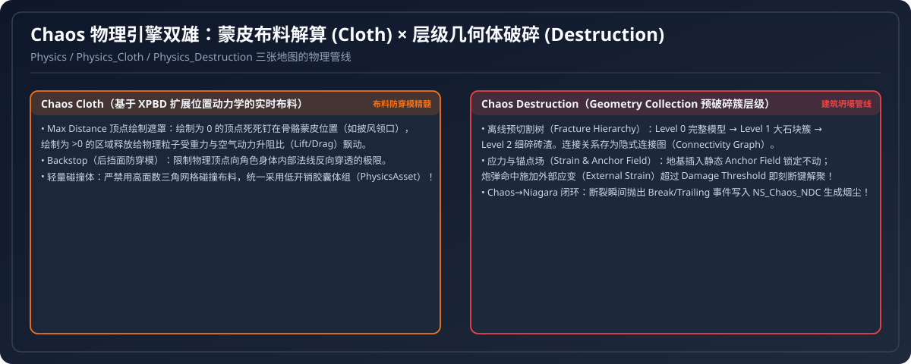
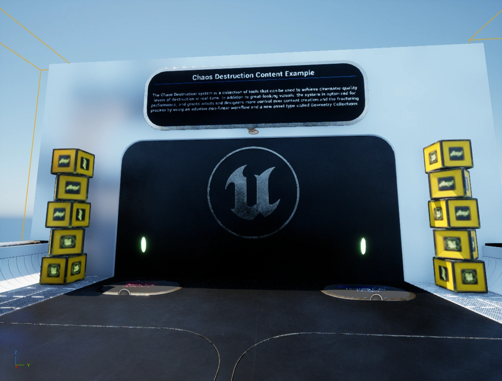
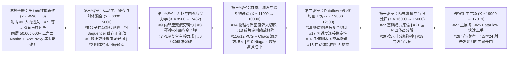
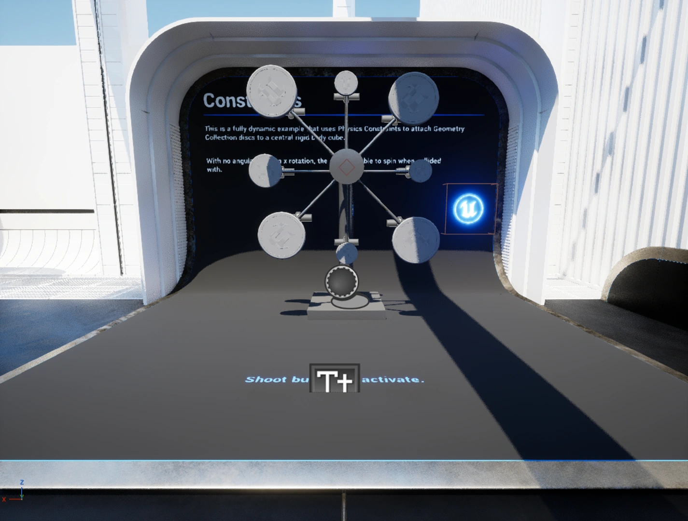
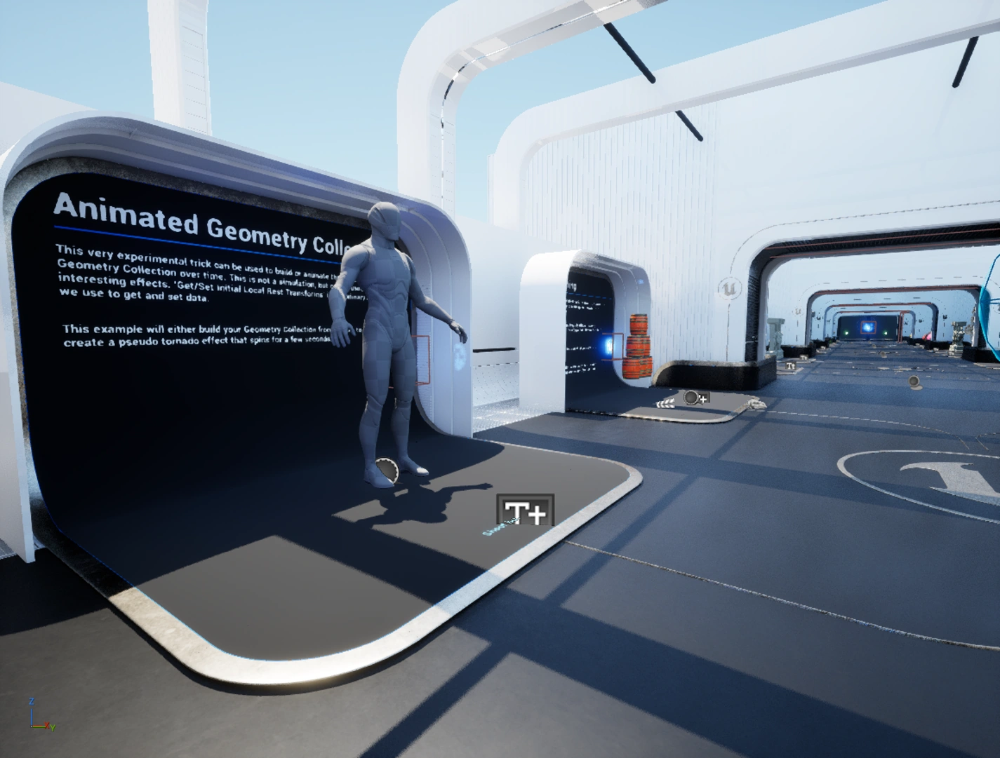
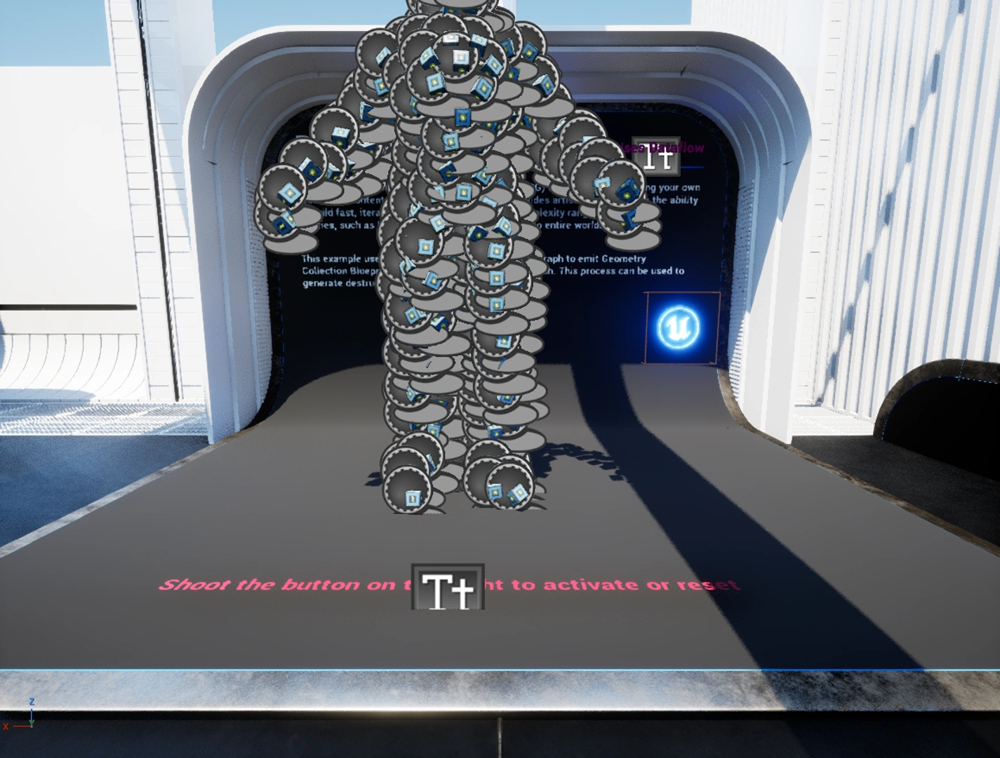
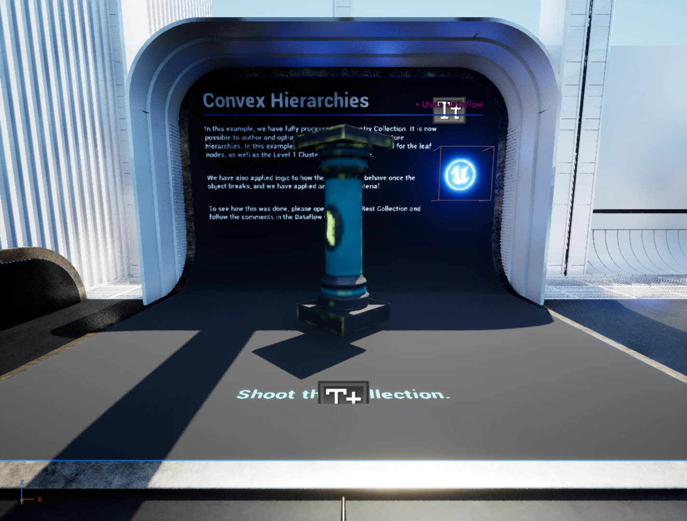

# 03 · Chaos 几何体集合、层级簇破碎连接图与 Field 力场系统全解（`Physics_Destruction`）

> **本篇实测拆解关卡档案**
> - **关卡路径**：`/Game/Maps/Physics/Physics_Destruction`（关卡总 Actor 数：`216` | 展台数：**`27`** | 归属展台示例 Actor 数：`138` | 全局/长廊陈列示例 Actor 数：`53`）
> - **核心资产规模**：横跨 `/Game/ExampleContent/Destruction/` 逾 **500+ 个工程资产**（涵盖 `UGeometryCollection` 几何体集合、`Dataflow` 非破坏性程序化切割图表、`ChaosCacheCollection` 确定性回放缓存、`FS_MasterField` / `FS_SleepDisable_Generic` 力场系统、`NDC_Chaos` Niagara 数据通道、7 套定制物理材质 `PM_*` 以及 PCG 动态可破坏生成图）

---

## 一、 为什么实时大规模建筑坍塌被称为游戏引擎的“算力绞肉机”？Chaos 如何破局？

想象你要在射击游戏里做一根能被火箭筒轰塌的罗马雕花石柱。如果按最朴素的刚体思路，美术在 DCC 软件里把它切成 $300$ 块独立 `StaticMeshActor` 摞在场景里：
1. **未开火时白交税**：哪怕玩家一枪没开，渲染器每帧也要提交 $300$ 次骨骼/网格变换，Chaos 宽相树要维护 $300$ 个刚体包围盒；
2. **一碰就碎成渣（雪崩塌陷）**：子弹轻轻擦过柱头一角，整根石柱从底座到柱顶 $300$ 块碎石在同一帧全部散架塌成一滩烂泥，既没有“上半截保持整体倾斜折断、砸地后二次摔成细渣”的体量层次感，底座也没能像真实钢筋混凝土一样锚定在地基里！



为了在 **60 FPS 实时帧率预算** 下交付好莱坞视效级（VFX-Grade）的实时破坏体验，虚幻引擎 5 打造了庞大而精密的 **Chaos Destruction（几何体集合 + 层级簇应力连接图 + Dataflow 程序化图 + Field 力场系统）**。而 **`/Game/Maps/Physics/Physics_Destruction`** 正是整个 Content Examples 工程中体量最宏伟、技术栈跨度最广的殿堂级关卡！



### 1.1 逛展必读空间导览：为什么 `#27` 号展台在出生点，而 `#1` 号展台在最深处的终极圣殿？

初次在编辑器中打开 `Physics_Destruction` 对照坐标时，你会发现一个非常有趣的**“逆向倒叙空间长廊”**设计——全长整整 **200 米**（`X` 坐标横跨 `0` 至 `19990`），共划分为 **1 座迎宾广场 + 5 座射击激活密室（由 `BP_RoomTrigger` 自动管理房间生命周期）+ 1 座 5000 万面终极长廊**：



- **关卡专属交互快捷键（运行 PIE 时随时可用，见各展台 `TextRenderActor` 提示）**：
  - **`鼠标左键（LMB）`**：发射标准物理弹丸，射击发光的蓝色 UE Logo 门锁（`BP_Destruction_Double_Doors`）或各展台右侧的重置/激活按钮（`BP_KioskButton`）；
  - **`按键 M`（#6 展台）**：发射射线并在命中点生成高开销精细 `Master Field` 力场引爆物体；
  - **`按键 N`（#8 / #10 展台）**：发射低开销高性能 `BP_ChaosProjectile`，命中瞬间调用 `Apply External Strain` + `Add Breaking Linear Velocity`；
  - **`按键 I`（#9 展台）**：发射专门削弱内部键强度的 `Internal Strain` 腐蚀弹丸；
  - **`按键 B`（#14 展台）**：在轻质（`Density = 2`）、中质（`Density = 5`）、超重穿甲（`Density = 10`）三种物理材质弹丸之间循环切换！

---

## 二、 直击 Chaos Destruction 数学与架构内核

在逐一拆解全部 **27 座展台** 之前，先握紧贯穿全馆的四大核心理论钥匙：

### 2.1 `UGeometryCollection` 层级簇树（Cluster Hierarchy）与 `RootProxyRenderer`
当你用 Voronoi（泰森多边形，将空间按种子点 $\{\mathbf{s}_k\}$ 划分为凸胞 $V_k = \{\mathbf{x} \mid \|\mathbf{x}-\mathbf{s}_k\| \le \|\mathbf{x}-\mathbf{s}_j\|\}$）、径向蛛网（Radial）、平面木纹切片（Planar）或砖墙错缝（Brick）将一根石柱切碎后，Chaos 将其组织为一棵**变换骨骼树（Transform Hierarchy）**：
- **`Level 0`（Root Bone 根节点）**：代表 100% 完好无损的整根石柱。MCP 实测显示，本关绝大多数资产（如 `GC_SM_PillarHorse`）都配置了 `"customRendererType": "GeometryCollectionRootProxyRenderer"`——**只要石柱还没挨枪子破损，引擎直接用原本合并好的单个 `SM_PillarHorse`（支持 Nanite！）替代渲染，DrawCall = 1，物理碰撞也只是一颗单一根凸包！**
- **`Level 1`（Cluster Nodes 中间大块簇）**：将相邻的十几块小碎石聚合成一块沉重的大石板，配置较高的第 1 级伤害阈值（如 `damageThreshold[0] = 300,000`）；
- **`Level 2`（Leaf Nodes 叶节点碎渣）**：最底层的独立凸多面体碎块，配置较低的第 2/3 级伤害阈值（如 `[50,000, 5,000]`）。当炮弹轰中石柱时，先解聚脱落出震撼的 `Level 1` 大石块，大石块重重砸在地面二次受冲击，才二次解聚（Crumble）散落成满地 `Level 2` 细碎石渣！

### 2.2 内部应力连接图（Connectivity Graph）与断键方程
同一个簇内部的相邻碎块并不是靠昂贵的 `PhysicsConstraint` 连起来的，而是离线预计算为一张无向图 $G = (V, E)$！在本关 MCP 资产拆解中，我们捕获到了 Chaos 两种核心建图拓扑：
1. **`Chaos_BoundsOverlapFilteredDelaunayTriangulation`**（包围盒重叠过滤的 Delaunay 三角剖分，如 `GC_SM_PillarHorse`）：连接所有质心 Delaunay 邻接且包围盒实际接触的碎块对；
2. **`Chaos_MinimalSpanningSubsetDelaunayTriangulation`**（最小生成树精简子集，如 `GC_Column_ConvexHiearchy`）：剔除冗余斜角弱边，生成更干脆利落的断裂面。

每条连接边 $e_{ij} \in E$ 承载一个抗断阈值（Strain Threshold）$\sigma_{\max}$。当碰撞冲量 $\mathbf{J}_{\text{col}}$ 或外部应变场（External Strain $\sigma_{\text{ext}}$）传入时，Chaos 计算等效冲击应变：
$$\sigma_{\text{applied}} = \max\left(\sigma_{\text{ext}},\ \frac{\|\mathbf{J}_{\text{col}}\|}{\text{Mass / DamageModifier}}\right)$$
一旦 $\sigma_{\text{applied}} \ge \sigma_{\max}(e_{ij})$，边 $e_{ij}$ 立即从图 $G$ 中剪断！若某个连通分量与被 **`Anchor Field`（静态锚点场，将地基碎块强制锁为 `Chaos_Object_Static`）** 焊死的根基失去了路径连通，该连通分量瞬间在 Chaos 求解器中分裂生成一颗全新的动态刚体簇自由坠落！

### 2.3 Chaos 对象四大物理状态（`EObjectStateTypeEnum`）与 Field 力场矩阵
每个 `GeometryCollectionComponent`（或单个簇节点）在运行时可在四种状态间受控跃迁：
- **`Chaos_Object_Static`**：绝对静止锚定（如插入地基的柱脚，零动力学解算）；
- **`Chaos_Object_Kinematic`**：运动学驱动（如 `#3` 动画重组雕像、`#4` 缓存回放木桶，位置由曲线/Sequencer 决定，但受强应变触发时可随时切换为 `Dynamic` 炸裂！）；
- **`Chaos_Object_Sleeping`**：休眠待命态（如 `#11` PCG 生成在角色身上的百颗方块，未受碰触前冻结在空中零 CPU 消耗，一碰即醒！）；
- **`Chaos_Object_Dynamic`**：完全实时刚体与应力模拟态。

而 **Chaos Field System（力场系统，`UFieldSystemComponent`）** 则是向空间区域广播物理指令的“无形指挥棒”：支持按球形/盒形衰减（`RadialFalloff` / `BoxFalloff`）叠算标量场（**External/Internal Strain 应变场**、**Kill/Disable 禁用场**）、整数场（**DynamicState 动态状态切换场**、**ActivateDisabled 唤醒场**）与向量场（**LinearForce / RadialVector 推拉爆炸场**、**AngularTorque 漩涡场**）！

---

## 三、 `Physics_Destruction` 全部 27 座展台（#1 ~ #27）零遗漏实测全解

> [!IMPORTANT]
> 为方便读者在工程大纲与资产检索词典中精准对号，下文严格按照关卡档案编号 **`#1` 至 `#27` 逐台独立成节**，绝不跳号省略！

---

### 展台 #1：`50+ Million Triangles` — 同屏五千万三角面石马柱阵与 `RootProxy` + Nanite 性能奇迹

- **空间元数据**：展牌 Label `BP_DemoDisplay_Info10` | 坐标 `(4530, 18, 569)`（高悬于终极圣殿双开大门正上方）
- **展台归属陈列 Actor（7 个）与圣殿关联阵列（47+ 个）**：
  - 门禁与房间控制器：`BP_Destruction_Double_Doors`（双开金属大门）、`BP_KioskButton_Big`（大型重置/开门锁扣，`respawn = true`）、`UELogo4`（金属徽章）、`BP_RoomTrigger6`（第 6 展区生命周期触发器）；
  - 门前先锋样本：`BP_Horse193`、`BP_Horse194`、`BP_Horse195`，以及门后终极长廊（`X = 4500 → 0`）两侧结合 `CH_PCG2` 列阵排开的 **`BP_Horse149 ~ BP_Horse197`（整整 50 尊高精度石马立柱蓝图实例！）**。

#### 1.1 为什么同屏摆 50 尊高精度可破碎雕像（总计 5000 万+ 三角面）还能丝滑满帧？
MCP 对核心资产 `/Game/ExampleContent/Destruction/Modules/ChaosProps/PIllarHorse/GC/GC_SM_PillarHorse` 与蓝图 `BP_Horse` 进行了完整解剖：
- **单尊雕像物理体量**：单尊总质量高达 **`5876.96 kg`（近 6 吨石雕！）**，共包含 **`162` 个层级骨骼变换节点**（`breadthFirstTransformIndices: [0..161]`），挂载三级递进伤害阈值 **`damageThreshold = [300000, 50000, 5000]`**，开启 `bAutomaticCrumblePartialClusters = true`，物理材质绑定真实花岗岩 `PM_Stone`（密度 $2.4\ \text{g/cm}^3$）。
- **两大性能黑科技支撑 5000 万面**：
  1. **`GeometryCollectionRootProxyRenderer`（静态网格根代理渲染）**：在玩家开炮轰击某尊石马之前，Chaos 根本不去渲染那 `162` 块碎片的独立网格，而是直接展示挂载了 **Nanite 虚拟微多边形** 的完整源静态网格 `SM_PillarHorse`！50 尊千万面雕像在 GPU 眼里只是极低开销的 Nanite 簇光栅化；
  2. **按需局部唤醒与 Dataflow 预烘焙**：该资产由非破坏性图表 `DF_ChaosProp_PillarHorse` 构建，只有真正被炮弹波及的 1~2 尊石马才会从 `RootProxy` 无缝切换为分块破碎网格并激活 `GameplayEventDispatcher` 喷发烟尘（`color_Smoke = (0.39, 0.38, 0.33)`），其余 48 尊稳坐钓鱼台！

---

### 展台 #2：`Constraints` — 物理约束关节（`PhysicsConstraint`）与可破碎几何体集合的刚柔混联

- **空间元数据**：展牌 Label `BP_DemoDisplay25` | 坐标 `(5000, 900, 0)`
- **官方展牌原文**：*This is a fully dynamic example that uses Physics Constraints to attach Geometry Collection discs to a central rigid body cube. With no angular limit on x rotation, the discs are able to spin when collided with.*
- **展台内 3D 悬浮文字标签**：`Shoot button to activate.`



#### 2.1 展台 2 个核心 Actor 与混联架构深拆
1. **`BP_ConstrainedPlates`**（`/Game/ExampleContent/Destruction/Blueprints/OtherBP/BP_ConstrainedPlates`）与激活锁扣 **`BP_KioskButton8`**：
   - 观察实拍图：中央是一套覆写黑金属材质 `M_Black_Metal`（`Metallic = 0.6, Roughness = 0.1`）的 `Cube` 与放射状金属连杆 `Cylinder_Body1`；
   - 连杆末端通过我们在第 01 篇熟悉的 **`PhysicsConstraintComponent`**（放开 `X` 轴 `Twist = Free` 无限旋转自由度，锁定其余轴），悬挂了 8 枚印有 UE 浮雕徽章的可破碎圆盘 **`GC_UELogo_Hanging`**（绑定易碎陶瓷物理材质 `PM_Ceramic`：`Density = 1.0, Friction = 0.2, Restitution = 0.15`）！
2. **核心工程启示**：`GeometryCollection` 绝不是一座只能孤立摆在地上的信息孤岛！它可以作为 `PhysicsConstraint` 的受控端与普通 `StaticMesh` 刚体自由混联——轻射边缘时圆盘绕轴欢快旋转卸力；正面重炮轰击超过陶瓷断裂阈值时，圆盘直接在旋转半空中爆裂成飞溅的碎瓷片！

---

### 展台 #3：`Animated Geometry Collections` — 逆天改命的 `Initial Local Rest Transforms` 龙卷风重组魔术

- **空间元数据**：展牌 Label `BP_DemoDisplay_AGC` | 坐标 `(5001, -903, 0)`
- **官方展牌原文**：*This very experimental trick can be used to build or animate the pieces of your Geometry Collection over time. This is not a simulation, but can be used for interesting effects. 'Get/Set Initial Local Rest Transforms' is the primary node that we use to get and set data. This example will either build your Geometry Collection from bottom to top or create a pseudo tornado effect that spins for a few seconds.*
- **展台内 3D 悬浮文字标签**：`Shoot button to play`



#### 3.1 展台 Actor `BP_Animated_GC0` 蓝图时间轴与非物理碎块动画 DSL
如上方实拍图左侧所示，展台中央伫立着一尊由 **259 个骨骼节点** 构成的破碎人体雕像 `GC_SM_Manny2`（初始设为运动学态 **`objectType = Chaos_Object_Kinematic`**，超高保护阈值 `[2000000, 50000, 5000]`），搭配激活按钮 `BP_KioskButton3`：
- **核心数学原理**：在 `Chaos_Object_Kinematic` 状态下，Chaos 不跑重力和碰撞积分，而是直接读取每个碎块的局部静止变换数组。`BP_Animated_GC` 在初始化时通过 **`GetInitialLocalRestTransforms`** 备份全部 259 块碎片的完美拼合原位 `RestPositions`；当射击按钮启动 `animDuration = 4.0s` 的 `Timeline` 时：
  - **自底向上乐高筑造模式（`building = true`）**：根据每块碎片的高度归一化权重 `(z - zMin) / (zMax - zMin)` 与曲线 `Ratio` 插值计算 `CurrentPositions`，每帧调用 **`SetInitialLocalRestTransforms`** 令碎片从地面螺旋升空严丝合缝拼成完整人形！
  - **伪龙卷风漩涡模式**：围绕 `XY_Center` 叠加极坐标旋转角 `RotationAmount` 与径向扩散偏移 `(xDistance, yDistance, zDistance)`，零物理算力开销实现《控制（Control）》或魔法遗迹中“满地乱石悬浮拼合成 Boss 魔像，拼好瞬间切回 `Chaos_Object_Dynamic` 投入真实战斗”的惊艳视效！

---

### 展台 #4：`Chaos Caching` — 零实时解算开销的 Sequencer 缓存变速回放与时光倒流

- **空间元数据**：展牌 Label `BP_DemoDisplay21` | 坐标 `(6000, -903, 0)`
- **官方展牌原文**：*This example plays a Chaos Cache Collection via sequencer. By animating the 'Static Pose' attribute, we can control the speed of the cache and even play the simulation in reverse. You can create a Chaos Cache Manager by selecting a Geometry Collection and clicking 'Actor/Chaos/Create Cache Manager' from the UE menu. The resulting Chaos Cache Collection can be played in your level or triggered via Sequencer. You can also cache a simulation and then use the 'To Mesh' tool in Fracture mode to create a Static Mesh version of your simulation results.*
- **展台内 3D 悬浮文字标签**：`Shoot button to play cached simulation`

#### 4.1 展台 6 个 Actor 与 `SEQ_Barrel_CH_C1` 时间倒流架构深拆
MCP 完整扒出了这组“炸碎的木桶在半空定格并倒放飞回原状”的全部底层绑定数据：
1. **双缓存播放器接力架构**：场景中放置了 `BarrelB_Cache_CHC_1`（`cacheMode = None`，受控于关卡序列）与 `BarrelB_Cache_CHC_2`（`cacheMode = Play`），两者均引用缓存集合 `/Game/ExampleContent/Destruction/Caches/BarrelB_Cache_001`（内含 `GC_ChaosBarrel_B_0 ~ B6_5` 共 6 只高精度 641 节点木桶的运动轨迹，四元数球面插值模式 **`interpolationMode = QuatInterp`**！），木桶组件全部处于 **`Chaos_Object_Kinematic`**。
2. **Sequencer 序列 `SEQ_Barrel_CH_C1` 轨道解密**：帧率 `30 FPS`，播放区间 `[0, 294]` 帧（共 `9.8 秒`），由蓝图控制器 `BP_PlaySeq_CHC`（被按钮 `BP_KioskButton_Caching` 触发）驱动：
   - 轨道 `MovieSceneFloatTrack_0` 直接对 `ChaosCachePlayer` 的时间游标属性（`StartTime / Static Pose`）打关键帧曲线——斜率为正时正常慢放炸裂，斜率归零时实现《黑客帝国》**子弹时间空中悬停**，斜率为负时**所有木条碎片逆着重力时光倒流重新箍成完好木桶**！
   - **生产救命价值**：对于大型战役过场（如整座大坝决堤、摩天大楼倾覆），在编辑器里开启高迭代录制好 `ChaosCacheCollection`，上线运行时 CPU 刚体碰撞解算开销为 **0.00 ms**，且多端回放轨迹 100% 确定性一致；若只想用崩塌后的废墟当静态掩体，更可在 Fracture Mode 点击 **`To Mesh`** 一键把某一帧残骸烘焙成普通 Nanite `StaticMesh`！

---

### 展台 #5：`Parenting Geometry Collections` — 局部锚定（Base Anchoring）挂载动态运动学父体

- **空间元数据**：展牌 Label `BP_DemoDisplay24` | 坐标 `(6000, 900, 0)`
- **官方展牌原文**：*This example uses a simple setup to parent Geometry Collections to animated Static Meshes. Each disc is anchored at its base and parented to the main structure. The animation is done using a Blueprint Timeline.*
- **展台内 3D 悬浮文字标签**：`Shoot button to activate`

#### 5.1 `BP_SpinningPlates` 与 `#2` 号展台的本质区别是什么？
对比马路对面的 `#2 Constraints` 展台：
- `#2` 号展台是**纯物理双刚体关节（`PhysicsConstraint`）**，主架固定，圆盘被打中会自由自旋；
- 而 `#5` 号展台的 **`BP_SpinningPlates`**（配 `BP_KioskButton7`）是用 Blueprint Timeline 直接旋转黑金属支架 `Cylinder_Body1 / Body2 / BodyR`（运动学动画父组件），并将多枚可破碎圆盘 `GC_UELogo` 作为子组件直接 **Attach（父子挂载）** 在旋转臂上！
- **防甩飞秘诀**：如果直接把全动态的 `GeometryCollection` 挂在高速旋转的机械臂上，一开机圆盘就会连根脱落甩飞出去！必须将每枚圆盘**与机械臂接触的根部碎块（Base Pieces）设为 `Anchored / Static/Kinematic`（静态/运动学锚定）**——如此一来，锚定根部死死跟着 Timeline 机械臂公转，而外圈陶瓷盘面依然保持 `Dynamic` 可破坏性，成为完美的**移动打靶射击标靶**（如Boss背上的发光可破坏弱点核心）！

---

### 展台 #6：`Field Destruction` — 传统 `Master Field` 精准爆破与生产环境性能权衡

- **空间元数据**：展牌 Label `BP_DemoDisplay22` | 坐标 `(7482, -900, 0)`
- **官方展牌原文**：*Fields have traditionally been the easiest way to destroy Geometry Collections in Unreal. While extremely powerful, complex fields are often too expensive in a production environment. We currently recommend using the 'Apply External Strain' node in Blueprint for player/destructble interaction. Check out the 'PlayerCharacter_Physics' Blueprint to see how we're spawning and triggering a Master Field when the player hits 'm'. Fields are often the best choice when creating a complex effect that needs specific timing and control.*
- **展台内 3D 悬浮文字标签**：`Hit 'm' to perform a trace and spawn a field that breaks the object` | `* Uses Dataflow`

#### 6.1 展台 5 个陈列 Actor 与 Epic 官方生产架构忠告
展台上并列摆放了 3 尊石马立柱 `BP_Horse8`、`BP_Horse9`、`BP_Horse10`（`damageThreshold = [300000, 50000, 5000]`）、重置按钮 `BP_KioskButton` 与第 5 房间触发器 `BP_RoomTrigger5`。按下键盘 **`M` 键**，玩家角色执行视线 `LineTrace`，在命中点动态 `SpawnActor(FS_MasterField)`，一次性叠加球形衰减外部应变（External Strain）+ 径向冲量（Radial Vector）+ 环形扭矩（Torque）将石马炸开。
- **为什么官方展牌坦诚警告“复杂 Master Field 在生产环境中往往过于昂贵”？**
  内置通用模板 `FS_MasterField` 内部串联了十余个复合场节点（RadialFalloff × NoiseField × CullingField + Delay 二次力场），若 10 名玩家拿冲锋枪每秒射出 100 发子弹，每发子弹都 Spawn 一个 `FS_MasterField` Actor 去遍历全空间体素求值，游戏线程与物理线程将被瞬间拖垮！
  - **黄金分工准则**：高频枪械/近战交互请一律改用 `#8` 展台的轻量级 **`Apply External Strain`** 节点；**仅在定制低频大型脚本演出（如 Boss 蓄力震地波、定时定向爆破大楼承重柱）时动用 `FS_MasterField`**！

---

### 展台 #7：`Fields` — 单一 `Master Field` 衰减曲线塑造“外推内吸”奇异引力漩涡

- **空间元数据**：展牌 Label `BP_DemoDisplay_Fields` | 坐标 `(7500, 895, 0)`
- **官方展牌原文**：*This example uses Master Fields to create an interesting effect. By adjusting falloff values you can make one field push and pull objects at the same time. Shoot projectiles into the mass of pieces to push them around more.*

#### 7.1 展台 5 个 Actor 与推拉平衡势阱数学原理
展台配置了可重构碎块体 `BP_FieldExample`（采用 `GC_SM_Manny2` 结合混凝土材质 `PM_Concrete`，阈值降至 `[50000, 50000, 5000]` 极易解聚）、按钮 `BP_KioskButton6`，并在空间中交叠架设了 **3 座常驻主控力场：`FS_MasterField3`、`FS_MasterField4`、`FS_MasterField5`**（均挂载 `FieldSystemComponent` 与预览盒 `MI_FieldRadiusPreview`）。
- **“同时又推又拉”是怎么算出来的？**
  在 Chaos Field 中，径向向量场 $\mathbf{F}(\mathbf{r}) = M \cdot f\left(\frac{\|\mathbf{r}-\mathbf{c}\| - R_{\min}}{R_{\max} - R_{\min}}\right) \frac{\mathbf{r}-\mathbf{c}}{\|\mathbf{r}-\mathbf{c}\|}$ 的衰减函数 $f(u)$ 支持重映射区间（Min/Max Range 可跨越正负号，或外层套用负向向心拉力 `RadialVector(-Pull)` 叠加内核正向排斥力 `RadialVector(+Push)`）！
  - 在球壳外缘（$r > R_{\text{eq}}$），场强为负指向球心，把快飞散的碎石块吸回来；
  - 在核心内部（$r < R_{\text{eq}}$），场强反转为正指向外侧，防止所有石块挤压坍缩成一个点！
  两者在平衡球面 $r = R_{\text{eq}}$ 处形成三维势能阱（Potential Well），使数百块碎石像行星小行星带一样悬浮翻滚，玩家朝碎石团里开枪还能激起壮观的涟漪扰动！

---

### 展台 #8：`Collision + External Strain` — 射击游戏首选的高性能无力场爆破管线（`Apply External Strain`）

- **空间元数据**：展牌 Label `BP_DemoDisplay23` | 坐标 `(8500, -900, 0)`
- **官方展牌原文**：*Hit 'n' to fire a projectile that applies external strain and breaking velocity when it hits a GC. We can get more control than simply using collisions without the overhead of using a field. Applying a trace in the Blueprint and using the 'Apply External Strain' node can be an inexpensive method of forcing a break. This method can be used with or without a projectile to simulate destruction caused by bullets or laser beams. You can also use the 'Add Breaking Linear Velocity' node for a bigger effect. See BP_ChaosProjectile for an example.*
- **展台内 3D 悬浮文字标签**：`Hit 'n' to apply external strain and collision together` | `* Uses Dataflow`

#### 8.1 展台 4 个 Actor 与 `BP_ChaosProjectile` 黄金蓝图逻辑 DSL
面对台上的 `BP_Horse4`、`BP_Horse5`、`BP_Horse11`（配按钮 `BP_KioskButton9`），按下 **`N` 键** 发射定制物理弹丸 `BP_ChaosProjectile`。为什么这是全书最推荐在生产级 FPS/ACT 游戏中落地的标准写法？请看其精简到极致的蓝图逻辑 DSL：

```text
[Blueprint Logic DSL — BP_ChaosProjectile 零 Field Actor 开销的高性能子弹爆破]

Event OnComponentHit (CollisionComp -> HitComponent, HitActor, ImpactPoint, NormalImpulse, Hit):
  └── Cast HitComponent to GeometryCollectionComponent
      └── Valid:
          // 1. 直接在 C++ 组件内部局部空间注入球形点状外部应变，免去 Spawn FieldSystemActor！
          HitGC.ApplyExternalStrain(
              Location        = ImpactPoint,
              Radius          = StrainRadius (如 65.0 cm),
              Iterations      = PropagationDepth (1~2 跳传播层数),
              CollisionSample = 1,
              StrainMagnitude = 500000.0  // 精确击穿 Level 1 [300,000] 与 Level 2 [50,000] 键！
          )
          // 2. 为刚刚解聚脱落的碎块精准赋予向外炸开的初始线速度（避免碎片原地死沉垂直掉落）
          HitGC.ApplyBreakingLinearVelocity(
              ItemIndex = Hit.Item,
              LinearVelocity = ProjectileDirection * BurstSpeed
          )
```
无论是实体抛射物 `OnHit` 还是即时命中激光枪（Hitscan `LineTraceByChannel`），这套两节点组合拳**不生成任何额外 Actor、不构建全局场求值树**，单发耗时低至微秒级！

---

### 展台 #9：`Internal Strain` — 随时间风化崩解与多枪累积金属疲劳（耐久度递减机制）

- **空间元数据**：展牌 Label `BP_DemoDisplay20` | 坐标 `(8500, 900, 0)`
- **官方展牌原文**：*Internal Strain can be used to decrement or decay the strength of a Geometry Collection over time. On the left, we are using a field that weakens the GC every tick. Hit 'i' to fire a projectile that applies internal strain when it hits the GC on the right. After a couple of hits, the weakened area will break.*
- **展台内 3D 悬浮文字标签**：`Hit 'i' to apply internal strain and break the object after a few hits`

#### 9.1 精确区分 `External Strain`（瞬时峰值）与 `Internal Strain`（永久扣血腐蚀）
许多开发者分不清外部应变和内部应变！观察 `#9` 号展台的 `BP_InternalStrainExampleEnable`（内含左右两座初始阈值高达 **`damageThreshold = [800000, 50000, 5000]`** 的蓝灰色长方体 `GC_ChaosPrim_Cuboid_Test1`）、持续腐蚀场 `FS_MasterField_InternalStrain` 与重置按钮 `BP_KioskButton4`：
- **`External Strain`（外部应变，如 `#8` 展台）是“无记忆单次检定”**：就像用 200,000 的锤子敲阈值 800,000 的防弹墙——敲一千下，每次 $200,000 < 800,000$，墙体永远完好无损！
- **`Internal Strain`（内部应变，本展台）是“有记忆永久扣减连接键剩余血量 HP”**：
  $$S_{\text{remaining}}(t + \Delta t) = S_{\text{remaining}}(t) - \Delta \sigma_{\text{internal}}$$
  - **左侧长方体**：笼罩在每帧 Tick 持续扣减内部键强度的 `FS_MasterField_InternalStrain` 中——哪怕没有任何外力撞击，几秒钟后内部键剩余强度归零，石块像被强酸腐蚀或烈火焚烧一样自发由外向内层层风化剥落！
  - **右侧长方体**：按下 **`I` 键** 射击，第一枪打上去纹丝不动（剩余阈值从 $80$ 万扣到 $50$ 万），第二枪扣到 $20$ 万，**第三枪命中同一部位瞬间击穿剩余阈值轰然炸开缺口**！这就是制作《彩虹六号》“掩体墙需要连打三枪才破洞”的原生底层机制！

---

### 展台 #10：`Niagara Data Channel` — 告别“一碎一组件”灾难：用 `NDC` 实现全图统一破碎烟尘池

- **空间元数据**：展牌 Label `BP_DemoDisplay14` | 坐标 `(10000, -900, 0)`
- **官方展牌原文**：*Niagara Data Channels can be used to facilitate communication between Chaos Destruction and Niagara. This blueprint writes data to a Niagara Data Channel that calls a Niagara system to emit particles. In this example, we use a Chaos Break Event to pass color, size, and particle count information. Using this method, we can control particle events per actor, and apply the Niagara system to multiple assets across a level.*
- **展台内 3D 悬浮文字标签**：`Hit 'n' to fire a projectile that applies strain for a bigger bang` | `* Uses Dataflow`

#### 10.1 展台 `BP_Horse_NDC` 定制色彩注入与 `NDC_Chaos` 数据通道架构
传统做法在每个破碎物上挂一个独立 `NiagaraComponent`，50 座雕像同时碎裂就会创建 50 套粒子系统实例。而在 `#10` 展台中，官方为 `BP_Horse_NDC`（配按钮 `BP_KioskButton10` 与 `BP_RoomTrigger4`）特意覆写了一套极具辨识度的赛博撞色实例参数以便肉眼验证数据通道传参：
- `color_Debris_Large` = 深海蓝 `(0.0037, 0.0625, 0.479)`；
- `color_Debris_Small` = 绯红 `(0.792, 0.0003, 0.094)`；
- `color_Smoke` = 品紫烟雾 `(0.729, 0.0119, 0.303)`；
- 单次断裂发射粒子数区间 `countMin = 2, countMax = 45`，伤害阈值 `[200000, 50000, 5000]`。

**闭环数据流**：组件勾选 `Notify Breaks = true` 并挂载 `ChaosGameplayEventDispatcher` $\rightarrow$ 断裂瞬间触发蓝图 `OnChaosBreakEvent(BreakEvent)` $\rightarrow$ 根据碎块体积与层级过滤微小碎屑，调用 **`WriteToNiagaraDataChannel`（写入 `/Game/ExampleContent/Destruction/FX/NiagaraSystems/NDC_Chaos`）** 将断裂点坐标 `Location`、初速度 `Velocity`、块体尺寸与上述定制颜色批量推入全局共享数据总线 $\rightarrow$ 全关卡共享的唯一一套 `NS_Chaos_NDC` 粒子系统批量读取缓冲区，一帧之内在精确裂缝处喷出彩色碎屑与滚滚浓烟！

---

### 展台 #11：`PCG + Chaos` — 程序化内容生成框架（PCG）沿网格表面批量散布休眠可破坏体

- **空间元数据**：展牌 Label `BP_DemoDisplay16` | 坐标 `(10000, 900, 0)`
- **官方展牌原文**：*The Procedural Content Generation Framework (PCG) is a toolset for creating your own procedural content inside Unreal Engine. PCG provides artists and designers the ability to build fast, iterative tools and content of any complexity ranging from asset utilities, such as buildings or biome generation, up to entire worlds. This example uses the 'Spawn Actor' node in a PCG Graph to emit Geometry Collection Blueprints along the surface of a static mesh. This process can be used to generate destructible content throughout a level.*
- **展台内 3D 悬浮文字标签**：`*Uses Dataflow` | `Shoot the button on the right to activate or reset`



#### 11.1 展台 4 个 Actor 与“休眠态生成（`Chaos_Object_Sleeping`）”设计精髓
观察实拍图，一尊巨大的人形轮廓浑身上下长满了密密麻麻带蓝色发光印记的小方块！MCP 实测拆解了其 4 个协同 Actor：
1. **`BP_PCG_Example`**：内含 `PCGComponent`（运行图表 `/Game/ExampleContent/Destruction/PCG/PCG_MannyExample`，触发时机 `GenerateOnLoad`，固定随机种子 **`seed = 42`**），对 `SM_Manny` 网格表面执行 `Surface Sampler` 均匀点采样后，通过 **`Spawn Actor`** 节点在每个采样点法线方向生成可破坏方块蓝图；
2. **`BP_PCG_Results`**（及戳记辅助体 `BP_PCG_Example_PCGStamp`、开关 `BP_KioskButton12`）：承载生成的低面数可破坏盒体 `GC_ChaosPrim_Box_Low`（5 个变换节点，伤害阈值 `[100000, 50000, 5000]`）。
- **核心性能秘诀**：注意看 MCP 抓取到的组件状态——**`"objectType": "Chaos_Object_Sleeping"`**！PCG 一次性在半空中生成上百个互不支撑的 `GeometryCollection`，如果默认设为 `Dynamic`，地图一加载它们就会在重力下稀里哗啦全掉在地上；设为 **`Sleeping`（休眠态）** 后，它们在半空中保持晶簇铠甲造型且 **0 物理消耗**，只有被玩家子弹击中或射击右侧按钮激活唤醒时，被命中的局部区域才会苏醒崩落！

---

### 展台 #12：`PCG` — 展位嵌套辅助标识展牌与 PCG 破坏物资产工作流补充

- **空间元数据**：展牌 Label `BP_DemoDisplay26` | 坐标 `(10000, 926, -7)`
- **官方展牌原文**：*Example paragraph line 1 / Example paragraph line 2*

#### 12.1 空间实测勘误与工程背景解读
通过对比 `#11` 展台坐标 `(10000, 900, 0)` 与 `#12` 展台坐标 `(10000, 925.62, -6.87)` 可以清晰看出：`BP_DemoDisplay26` 是关卡设计师在搭建 `#11 PCG + Chaos` 展位时叠放在背板后方仅偏移 `25.6 cm` 的一块未清理默认模板副展牌（保留了 `BP_DemoDisplay` 母类的默认占位文本 *"Example paragraph line 1/2"*）。
在实际开放世界工程中，将 **PCG 森林/废墟散点管线** 与 **Chaos 破坏物** 结合时，除 `#11` 演示的 `Spawn Actor` 外，对于满地成千上万块可撞碎的木栅栏、陶罐与矿石晶簇，生产最佳实践是：**PCG 默认生成零开销 `InstancedStaticMesh (ISM)`，在实例命中/受爆炸重叠瞬间，通过 PCG / Gameplay 管理器原地将该下标 ISM 实例替换为同坐标 `GeometryCollectionActor` 并立即注入冲量爆裂（ISM-to-GC Hot Swapping）**，从而兼顾百万级植被密度与全场景可破坏交互！

---

### 展台 #13：`Removal` — 破碎残骸定时消隐（`Remove on Break` vs `Remove on Sleep`）内存与帧率净水器

- **空间元数据**：展牌 Label `BP_DemoDisplay13` | 坐标 `(11000, -900, 0)`
- **官方展牌原文**：*We can clean up our scene and improve performance by using removal timers on our Geometry Collection. In this example, pieces are removed 1-3 seconds after breaking. Clusters are crumbled, and then their individual pieces are removed. Removal settings can be applied per bone to control performance and limit visual noise. This is different from the 'Remove on Sleep' attribute on an asset in that we explicitly control how long pieces hang around. Both removal options can be used together and controlled via asset or actor.*
- **展台内 3D 悬浮文字标签**：`Shoot the statue to see Removal in action. Shoot the button to respawn` | `* Uses Dataflow`

#### 13.1 `BP_Horse_Removal` 实测配置与两大残骸清理机制对比
展台陈列了调低了一级断裂阈值的石马 `BP_Horse_Removal`（`damageThreshold = [20000, 50000, 5000]`，一枪即碎，开启 **`bScaleOnRemoval = true`**）与重生按钮 `BP_KioskButton2`。开枪打碎石马后，大块簇先解聚为细块，落地翻滚 **`1 ~ 3 秒`** 后，碎石块平缓缩小（Scale Down）并从物理世界与渲染世界彻底销毁：

| 清理机制 | 触发计时起点 | 缩放/淡出控制 | 最佳适用碎片类型 |
| :--- | :--- | :--- | :--- |
| **`Remove on Break`（按断裂后读秒移除）** | 碎块从父簇断键分离的那一帧起算（如 `Post-Break Timer = 1.0 ~ 3.0s` + `Removal Duration = 0.5s`） | 支持按骨骼（Per-Bone）精细设定：可勾 `CrumbleSmallestClusters` 先自动解聚再缩放消失 | **高频交战区细小碎渣（Level 2 Leaf）**——不管有没有滚停，3 秒内强制清空腾出物理算力！ |
| **`Remove on Sleep`（按休眠静止后移除）** | 碎块在地面完全停稳进入 `Sleeping` 状态后才开始读秒（`bRemoveOnMaxSleep`） | 支持 `Maximum Sleep Time` 与 `Removal Duration` 平滑缩小沉地 | **滚动时间不确定的斜坡滚石与中型残骸**——绝不会在半空飞翔或顺坡翻滚途中突兀凭空消失！ |

---

### 展台 #14：`Physical Materials` — 三档不同密度穿甲弹丸切换与真实材质动量博弈

- **空间元数据**：展牌 Label `BP_DemoDisplay15` | 坐标 `(11000, 900, 0)`
- **官方展牌原文**：*You can control the behavior of every physics asset in your game with physical materials. Real world density values are a good place to start and they can be found for most material types. Physical Materials can be set/changed via asset, actor or Blueprint. Please note that objects with different masses will often look similar until Friction and Restitution are dialled in.*
- **展台内 3D 悬浮文字标签**：`*Uses Dataflow` | `Hit 'b' to switch between projectiles of varying density`

#### 14.1 本关全部 7 套定制物理材质（`PM_*`）MCP 实测参数大起底
站在 `BP_Horse6`、`BP_Horse7`、`BP_Horse8`（配 `BP_KioskButton5`）前按下 **`B` 键**，玩家枪口会在三套不同密度的弹丸物理材质间循环切换。我们将 MCP 从资产库深拆出的全部 **7 套破坏专用物理材质** 精确汇总如下：

| 物理材质资产名称 | `Density` ($\text{g/cm}^3$) | `Friction` | `Restitution` | 组合覆盖模式 | 材料抗拉/抗压/抗剪强度 (`Strength` MPa) | 实战角色定位 |
| :--- | :---: | :---: | :---: | :---: | :---: | :--- |
| **`PM_ChaosProjectile`** | **`2.0`** | `0.30` | `0.02` | Average | `2 / 20 / 6` | **轻质石弹（档位 1）**：动量较小，仅能磕破石马表层边角 |
| **`PM_ChaosProjectile_B`** | **`5.0`** | `0.30` | `0.02` | Average | `2 / 20 / 6` | **中质铁弹（档位 2）**：5 倍水密度，可轰断中型石块簇 |
| **`PM_ChaosProjectile_C`** | **`10.0`** | `0.20` | `0.02` | Average | `2 / 20 / 6` | **重型铅芯穿甲弹（档位 3）**：10 倍高密度巨量动能，一炮贯穿石柱核心并将残骸撞飞数米！ |
| **`PM_Stone`** | `2.4` | `0.65` (`Static=1.0`) | `0.10` | **`Friction=Max`, `Restitution=Min`** | `2 / 20 / 6` | **花岗岩石雕材质**：强制最大摩擦+最小弹性，石块落地死沉稳重绝不乱蹦！ |
| **`PM_Concrete`** | `2.4` | `0.30` | `0.05` | Average | `2 / 20 / 6` | **混凝土结构材质**：极低恢复系数 `0.05`，模拟脆性水泥块落地闷响停滞 |
| **`PM_Ceramic`** | `1.0` | `0.20` | `0.15` | Average | `2 / 20 / 6` | **薄脆陶瓷盘材质**（用于 `#2` / `#5` 靶盘）：轻盈滑溜清脆 |
| **`PM_NDC_Rock`** | `1.0` | `0.70` | `0.30` | Average (`Power=0.75`) | `2 / 20 / 6` | **高弹碎岩材质**：允许适度弹跳以拉长烟尘轨迹 |

> [!TIP]
> 注意细品 `PM_Stone` 的神级调校：**`bOverrideFrictionCombineMode = true (Max)` + `bOverrideRestitutionCombineMode = true (Min)`**！为什么很多新手做的碎石块掉在地上像乒乓球一样蹦跶滑行？因为默认 `Average` 把地面材质的弹性平均给了石头！强制 `Restitution = Min (0.1)` 与 `StaticFriction = 1.0`，碎石落地的沉重吨位感瞬间拉满！

---

### 展台 #15：`Internal Materials` — Dataflow `AutoUV` 与 `Texture Bake` 自适应烘焙内断面材质

- **空间元数据**：展牌 Label `BP_DemoDisplay6` | 坐标 `(12500, -900, 0)`
- **官方展牌原文**：*As geometry complexity trends upward with advances in technology, the old days of adding a tiling material to fractures is becoming aesthetically less acceptable. There are a number of approaches to authoring internal materials, and dataflow makes this process adaptive to changing tuneable fracture patterns. In this example, note how these two distinct, but similar, assets are using the same graph. By use of the AutoUV and Texture Bake nodes, we are able to target material instances and texture assets that are unique to them. If we change the fracture recipe, so too, will those results adapt to the changing nature of the object. A great time-saver, and one that can quickly be used to sort through a whole family of objects.*
- **展台内 3D 悬浮文字标签**：`* Uses Dataflow`

#### 15.1 一张 Dataflow 图通吃全族资产：`DF_ChaosPrim_SimpleSliceSetup` 管线揭秘
展台上的 `BP_InternalMaterialsExample`（配 `BP_KioskButton13` 与 `BP_RoomTrigger3`）并排展示了圆柱体 `GC_ChaosPrim_Cylinder_InternalMatExample` 与胶囊体 `GC_ChaosPrim_Capsule_InteralMatExample`（伤害阈值均为 `[150000]`）：
- **告别“一眼假”的平铺断面贴图**：早期破碎只是给切开的内部截面简单赋一个奇数年 Material ID（Interior Material）贴一张无限平铺的噪波砖纹——切口边缘跟外表面毫无过渡（没有边缘风化磨损与环境光遮蔽 AO），就像切开的塑料夹心饼干。
- **Dataflow 程序化纹理烘焙闭环**：这两个形状不同的资产**复用了同一张 Dataflow 图表 `DF_ChaosPrim_SimpleSliceSetup`**！在图表内部，切割生成内表面后，自动串联 **`AutoUV`（自动展开无重叠内部 UV）** $\rightarrow$ **`BakeTexture`（烘焙厚度/环境光遮蔽/内外边界距离场遮罩）**，分别自动输出专属遮罩贴图 `T_M_ChaosPrim_Cylinder_InteriorMask` 与 `T_M_ChaosPrim_Capsule_InteriorMask` 并驱动材质实例 `M_ChaosInteriorMaskingExample_*_Inst`！哪怕策划明天把切割碎块数从 20 块改成 80 块，点击一键重算，UV 与断面边缘过渡遮罩全自动重新烘焙适配！

---

### 展台 #16：`Mesh and Point Operations` — Dataflow 融合 Geometry Script 实时布尔掏空与内部撒点填充

- **空间元数据**：展牌 Label `BP_DemoDisplay8` | 坐标 `(12500, 900, 0)`
- **官方展牌原文**：*Dataflow offers a number of ways to operate on meshes as part of your fracture recipes. This object began as a simple Static Mesh and leveraged Geometry Script to create a tunable hollowing inside of it via the Mesh Boolean tool. We are also able to use Point Sampling in order to drive our fractures. In this case, we also filled the hollowing with points and scattered a number of meshes on them to fill the cone. See the graph on this asset for a detailed walkthrough of the process.*
- **展台内 3D 悬浮文字标签**：`*Uses Dataflow` | `Shoot to open.`

#### 16.1 实心圆锥变“惊喜糖果罐”：`BP_ChaosCone` 与 `DF_ChaosPrim_Cone_GeoScript`
展台陈列了 `BP_ChaosCone`（包含 **213 个变换节点** 的 `GC_ChaosPrim_Cone_GeometryScript`，伤害阈值 `[75000, 50000, 5000]`）与按钮 `BP_KioskButton11`：
- 美术交付的原始输入仅仅是一颗最普通的实心圆锥静态网格 `SM_ChaosPrim_Cone`！
- 在 Dataflow 图表 `DF_ChaosPrim_Cone_GeoScript`（结合自定义工具 `/Game/ExampleContent/Destruction/FractureRecipes/GeometryScript/DataflowGeoScriptTools/GS_HollowOut`）中：
  1. **Mesh Boolean 布尔掏空**：复制缩小一颗内圆锥做布尔差集（Subtract），把实心圆锥变成壁厚可调的**空心脆壳圆锥**；
  2. **Point Sampling 驱动非均匀切割与内腔撒点**：一方面采样外壳表面点作为 Voronoi 种子切碎外壳，另一方面在内腔空洞体积内做泊松点采样（Poisson Point Sampling），在每个内部点上散射填充大量小型独立网格块！
  3. 当玩家一枪打碎圆锥薄壳（*Shoot to open*），肚子里藏着的满腔宝石/零件哗啦一下倾泻而出——做宝物陶罐、虫族卵囊、中空石膏像再也不用美术手动建模掏洞塞零件了！

---

### 展台 #17：`Proximity` — 预切割拼装模型（Kitbash）的邻近度连接图与“危险尖角弱连接”剔除

- **空间元数据**：展牌 Label `BP_DemoDisplay5` | 坐标 `(13500, -900, 0)`
- **官方展牌原文**：*When we cluster a Geometry Collection that has been fractured in Chaos, it is usually quite a stable process because, as the fractured geometry is created, the tools are able to define which pieces are connected to which others (these are known as Precise connections). However, when we convert a number of predefined meshes that may not be touching at all into a Geometry Collection, we may well want to have them behave (and therefore cluster) as if they are physically connected. Proximity allows us to define this relationship. It also allows us to prevent pieces connecting via slim connections that are less believeable, and harder to make efficient when authoring collision geometry.*
- **展台内 3D 悬浮文字标签**：`Stable Clusters (no corner connections)` | `Bad Clusters (corners connected)` | `Check the Dataflow Graph for this asset to see how Proximity can be defined.` | `* Uses Dataflow`

#### 17.1 为什么“对角线尖对尖连在一起的碎块簇”是物理与视觉的双重灾难？
展台并列展示了八面体组 `BP_ProximityExample`（`GC_ChaosPrim_Octa` / `DF_ChaosPrim_Octas_Proximity`）与正反面教材对比组 **`BP_ProximityClustersExample`**（正面教材 `GC_ChaosPrim_Box_StableEx01/02` vs 反面教材 `GC_ChaosPrim_Box_BadEx01/02`，配 `BP_KioskButton14` 与 `BP_RoomTrigger_Room2`）：
1. **拼装建筑的悬空连接难题**：很多木屋是由美术用几十根彼此留有 `1~2 cm` 缝隙的独立木梁 `ChaosPrim_Box_NonIntersecting_SM` 拼搭而成的。直接转成 GC 时因为没有精确共面切口（Precise Connection），一运行整座木屋原地散架！Dataflow 中的 **`Proximity`（邻近度建图节点）** 允许按距离容差把互不接触但靠近的木梁自动焊接进连接图！
2. **剔除尖角连接（`Bad Clusters` vs `Stable Clusters`）**：如果无脑按距离阈值建边，国际象棋棋盘上两个**只靠一个顶点或一条细棱对角擦边**的方块也会被连成同一个 Cluster（`Bad Clusters: corners connected`）：
   - **视觉灾难**：中间支撑块明明已经被打飞了，右上角的砖块竟然靠着左下角一毫米的尖角凭空悬在半空违背牛顿力学！
   - **碰撞包膨胀灾难**：为这两个对角相连的方块合并生成外接凸包（Cluster Convex Hull）时，凸包会把原本空出来的另外两个象限硬生生包成实心，挡住子弹和玩家视线！
   - **Dataflow 正解（`DF_ChaosPrim_StableProximity`）**：在 `Proximity` 节点中将连接判定切换为**共面接触面积过滤（Contact Area / Face Overlap Threshold）**，强制要求两块砖必须有足够大的面对面贴合面积才允许建立物理连接边，彻底斩断脆弱诡异的对角尖连接！

---

### 展台 #18：`Combined Fractures` — 零重力“剥洋葱”多层复合程序化切割配方

- **空间元数据**：展牌 Label `BP_DemoDisplay7` | 坐标 `(13500, 900, 0)`
- **官方展牌原文**：*In this example, we can see how various fracture techniques can be automated in sequence with Dataflow. By defining certain attributes as we author the asset, we are also able to expose parameters that allow us to tune the asset to our liking. If you go into Fracture Mode, you will see two such parameters you can adjust to fracture an outer and inner layer respectively. Clicking 'Update Asset from Dataflow' will evaluate your selections. Each of these layers has materials applied in the graph, its collision generated, and removal timers set automatically. For extra satisfaction, we've also disabled gravity on this actor.*
- **展台内 3D 悬浮文字标签**：`* Uses Dataflow` | `Shoot to peel...`

#### 18.1 `BP_ChaosPrim_Bully_InteriorEx` 分层参数化 Dataflow 流水线
展台悬浮着一颗蓝色双层球体 `BP_ChaosPrim_Bully_InteriorEx`（`GC_ChaosPrim_Bully_InteriorEx`，共 60 个变换节点，伤害阈值 `[150000, 50000, 5000]`，关闭重力以营造太空失重漂浮剥离感）。
打开其绑定的 Dataflow 图表 `DF_ChaosPrim_Bully_InteriorEx`，你会看到现代工业化程序化资产的终极形态——将**外壳切割参数**与**内核切割参数**暴露在面板外部：一条流水线串起 **内外层分层几何生成 $\rightarrow$ 各自独立 Voronoi 切割点数控制 $\rightarrow$ 自动赋予外壳蓝漆材质 `M_ChaosPrim_Sphere_Inst_Blue` 与内核层叠材质 `M_ChaosPrim_SphereLayered_Int` $\rightarrow$ 自动生成凸包碰撞 $\rightarrow$ 自动写入定时移除属性**。开枪射击时，外层蓝色装甲片如剥洋葱般在失重空间一片片优雅飘散，露出内部截然不同的核心结构！

---

### 展台 #19：`Convex Hierarchies` — 全层级骨骼树（Root $\to$ Cluster $\to$ Leaf）凸包碰撞优化管线

- **空间元数据**：展牌 Label `BP_DemoDisplay2` | 坐标 `(15000, -900, 0)`
- **官方展牌原文**：*In this example, we have fully processed a Geometry Collection. It is now possible to author and optimize convex hulls for entire fracture hierarchies. In this example, collisions have been generated for the leaf nodes, as well as the Level 1 Clusters and Root Bone. We have also applied logic to how the rigid bodies behave once the object breaks, and we have applied an internal material. To see how this was done, please open the Asset Rest Collection and follow the comments in the Dataflow Graph.*
- **展台内 3D 悬浮文字标签**：`Shoot this collection.` | `* Uses Dataflow`



#### 19.1 为什么不仅叶节点要有凸包，连 `Root Bone` 和 `Level 1 Clusters` 也必须定制层级凸包？
观察实拍图中的古典蓝金石柱 `BP_ConvexHierarchies`（`GC_Column_ConvexHiearchy`，共 34 个层级骨骼节点，三级伤害阈值 `[150000, 75000, 5000]`，配按钮 `BP_KioskButton15`）：
- 如果只在最底层 30 个叶节点（Leaf Nodes）上生成 30 个独立小凸包，那么当石柱还没碎（处于 `Root Bone`）或断成上半截（处于 `Level 1 Cluster`）时，Chaos 如果去遍历底下 30 个子凸包的联合体（Union of Convexes）做窄相碰撞，接触流形计算量会居高不下；
- 通过 Dataflow 图表 `DF_Column_ConvexHierarchy` 中的层级凸包合并与简化节点（`GenerateClusterConvexHulls` / `MergeConvexHulls`），在 `Root` 层只用极少数几颗贴合柱身轮廓的大凸包，在 `Level 1` 簇使用中级合并凸包，直到真正碎裂到 `Leaf` 叶节点才激活精细小凸包——**任何破碎阶段都只向 Chaos 暴露当前激活层级的最简凸包集合**！

---

### 展台 #20：`Size Specific Data` — 264 颗碎渣零卡顿秘诀：按相对尺寸自动降级为极简球体碰撞！

- **空间元数据**：展牌 Label `BP_DemoDisplay4` | 坐标 `(15000, 900, 0)`
- **官方展牌原文**：*This object has been constructed manually and clustered into 15 clusters. It has also had crumbling and removal timers applied to its transforms via the Set Removal On Break tool in Fracture Mode. Consequently, it will always break down to its leaf nodes, of which there are 264. Since we are releasing lots of small transforms at once, it would be a good idea to optimize those. Within this asset's properties, we have modified the Size Specific Data Array. The size value is always relative to the largest leaf node, which has a Relative Size of 1. (See the Fracture Mode, Fracture Hierarchy with the Outliner's Column Mode set to 'Size' to view the sizes of all transforms). By adding an entry to the data table of 1.01, we are able to ensure that all leafs use cheap Sphere Collisions, whereas the root and clusters above them use more accurate Convex Collision.*
- **展台内 3D 悬浮文字标签**：`Shoot this collection.`

#### 20.1 `GC_Stack_SizeSpecificDataExample` 的 `1.01` 相对尺寸分水岭与 `FS_SleepDisable_COL_B` 休眠场双剑合璧
这座展台堪称**“大规模碎渣性能优化教科书”**！MCP 实测捕获了全部 3 个协同 Actor：
1. **`BP_SizeSpecificData`**（配 `BP_KioskButton16`）：引用 `GC_Stack_SizeSpecificDataExample`，内含 **15 个中层簇** 与多达 **264 个自动实例化叶节点（`"numInstances": 264`）**，单级低阈值 `[50000]` 一触即溃！
   - **神来之笔 `MaxSize = 1.01`**：Chaos 将整个集合中**体积最大的那颗叶节点（Leaf）的 `Relative Size` 归一化定义为 `1.0`**，而所有上层合并簇（Clusters & Root）体积必然大于单个叶节点（即 `Relative Size > 1.01`）！因此，在资产细节面板 `Size Specific Data` 数组中新增一项阈值 **`Max Size = 1.01` $\rightarrow$ `Implicit Type = Sphere`**，就能用一行配置精准实现：**未碎和半碎的大块（$>1.01$）走高精度 `Convex` 多面体碰撞，一旦崩解成 264 颗满地乱滚的细碎颗粒（$\le 1.01$），瞬间全部降级为 $O(1)$ 零开销的 `Implicit Sphere` 隐式球碰撞**！
2. **`FS_SleepDisable_COL_B`**（`/Engine/EditorResources/FieldNodes/FS_SleepDisable_Generic.FS_SleepDisable_Generic_C`）：在台面周边额外布设了一道 `BoxFalloff + CullingField` **休眠/禁用收割力场**——滚落进该区域的碎渣被强制置入 `Sleeping / Disabled` 冻结态，双管齐下守死帧率底线！

---

### 展台 #21：`Convex Generation` — 拯救甜甜圈空洞：单凸包封死 vs Dataflow 保形凸分解（Convex Decomposition）

- **空间元数据**：展牌 Label `BP_DemoDisplay1` | 坐标 `(16000, -900, 0)`
- **官方展牌原文**：*Recent additions to UE5 greatly improve what is possible when creating collisions. Single convex hulls, while more accurate than simple primitives, still fail to encapsulate more complex, concave geometry. The torus on the left uses a standard, auto-generated convex hull. The torus on the right has its collision generated using dataflow. If you open the asset Rest Collection you will find an annotated graph to see how this was done. The Rest Collection can be accessed via the Details Panel, or inside of the View Settings panel in Fracture Mode. It is worth noting that Modeling Mode offers a number of convex decomposition options for static meshes.*
- **展台内 3D 悬浮文字标签**：`Single Convex` | `Convex Decomposition (Dataflow w/t shape protection)` | `*Uses Dataflow`

#### 21.1 展台左右双圆环穿环测试（`Torus` + `Cone`）直观拆解
窗户框、拱门洞、轮胎圆环（Torus）是物理碰撞里经典的**非凸流形（Concave / Genus $\ge 1$）**。展台通过按钮 `BP_KioskButton18` 同时释放两套“圆环套圆锥（`SM_ChaosPrim_Cone`）”碰撞测试：
- **左组 `BP_ConvexStandard1`（`Single Convex`）**：使用单凸包资产 `GC_ChaosPrim_Torus_SingleConvex`。单凸包就像用保鲜膜把整个甜甜圈紧紧包起来——中间的圆孔被保鲜膜彻底封死成了实心圆饼！圆锥掉下来直接卡在半空穿不过圆环孔洞，玩家对着窗户洞开枪子弹也会凭空撞在隐形空气墙上！
- **右组 `BP_ConvexGeneration0`（`Convex Decomposition w/t shape protection`）**：使用 Dataflow 图表 `DF_ChaosPrim_Torus_ConvexDecomp` 构建的 `GC_ChaosPrim_Torus_ConvexDecomp`——利用开启了**负空间保形（Shape / Negative Space Protection）**的体积凸分解算法（V-HACD / Chaos Convex Decomposition），自动将圆环分解为一圈首尾相接的扇形小凸包环，完美让出中央通透孔洞，圆锥顺畅穿过圆心！

---

### 展台 #22：`Implicit Collisions - Primitives` — 四大隐式碰撞原语的算力阶梯谱系

- **空间元数据**：展牌 Label `BP_DemoDisplay17` | 坐标 `(16000, 900, 0)`
- **官方展牌原文**：*Geometry Collection Assets allow a number of automatically populated collision options. These shapes can be assigned within a size threshold found in the 'Size Specific Data' array of the asset's details. For example, small, numerous pieces might benefit from using sphere, whereas convexes might be applied to the less numerous large clusters.*
- **展台内 3D 悬浮文字标签**：`Sphere` | `Capsule` | `Box` | `Convex` | `(Cheapest collision type show from Left to Right)` | `Play/Reset`

#### 22.1 从左至右算力消耗递增表（`BP_ImplicitCollisionPrimitives`）
射击 `BP_KioskButton17` 激活 `BP_ImplicitCollisionPrimitives` 上的四组基础几何体集合（`GC_ChaosPrim_Bully`、`GC_ChaosPrim_Capsule`、`GC_ChaosPrim_Box`、`GC_ChaosPrim_Icosagon` 二十面体），直观建立窄相碰撞（Narrowphase）的算力成本直觉：
1. **`Sphere`（隐式球，最廉价）**：仅需比较球心欧氏距离 $\|\mathbf{x}_A - \mathbf{x}_B\| < R_A + R_B$，连旋转四元数都不用管！**海量细碎石米、灰渣唯一指定碰撞体**；
2. **`Capsule`（隐式胶囊体，次廉价）**：线段间最短距离解析解，极适合木条、钢筋、碎骨长条形残骸；
3. **`Box`（隐式有向包围盒 OBB，中等开销）**：通过分离轴定理（SAT，15 轴测试）精确还原砖块、方木箱的平直落地面；
4. **`Convex`（凸多面体，开销最高但贴合最准）**：运行 GJK + EPA 支撑点迭代并构建多点接触流形，专供大体积主结构簇（Level 0 / Level 1）使用！

---

### 展台 #23：`[门禁操作引导牌]` — 射击发光 UE 徽章门锁交互机制与菲涅尔自发光材质

- **空间元数据**：展牌 Label `BP_DemoDisplay30` | 坐标 `(17300, 0, -5)`（立于迎宾广场通往破坏大厅第一道大门正前方）
- **官方展牌原文**：*Shoot Glowing UE logo to Open Door (Left Mouse Button)*

#### 23.1 发光门锁材质 `M_UE_Logo_Doors` 节点深拆
为了让玩家在 200 米深的展馆中一眼认出所有可射击交互的机关锁扣（`SM_DoorLock`），MCP 拆解了锁扣绑定的高动态自发光材质 `/Game/Global/Materials/M_UE_Logo_Doors`：
- 底色采用深邃午夜蓝 `ColorBase = (0.0043, 0.0148, 0.102)`，`Roughness = 0.1`；
- 自发光通道 `MP_EmissiveColor` 由 `Fresnel(Exponent = 3.0)` 经 `OneMinus` 反转后乘以超亮电光蓝 HDR 辐射色 **`Color = (0.637, 4.19, 25.0)`**！当玩家左键发射的弹丸撞击门锁碰撞盒 `Box` 时，触发 `BPInterface_Button` 接口，驱动双开门向两侧滑开。

---

### 展台 #24：`Chaos Destruction Hall` — 破坏主厅门楣横匾与 `BP_RoomTrigger` 分室流送重置架构

- **空间元数据**：展牌 Label `BP_DemoDisplay_Info9` | 坐标 `(17019, 19, 569)`（高悬于主厅入口双开门上方）
- **展台陈列 Actor（2 个）**：`BP_Destruction_Double_Doors2`（主厅首道电动双开门，挂载 `Right door` / `Left door` / `Lock` / `Open/close` 时间轴）与金属徽章 `UELogo2`。

#### 24.1 为什么 200 米大厅要设计 6 道双开门与 `BP_RoomTrigger`？
细心的读者一定注意到了：我们在 `#1`、`#6`、`#10`、`#15`、`#17` 展台连续见到了 `BP_RoomTrigger_Room2 ~ Room6`！这绝非单纯的美术隔断，而是教科书级的**物理沙盒分室隔离（Compartmentalized Simulation Culling）**设计：
- 假如玩家把前五个房间的石马、圆锥、百颗 PCG 方块全炸碎后不清理就冲进第六个五千万面圣殿，残留在身后的上千块动态刚体将白白挤占物理线程预算；
- 每当玩家穿过一道 `BP_Destruction_Double_Doors` 踏入下一个 `BP_RoomTrigger` 时，蓝图自动通过 `DoorCloseEvent` 事件分发器合拢身后大门遮挡视线，并静默停止/休眠或重置已离开房间的重型动画与约束转盘（如 `BP_Animated_GC`、`BP_SpinningPlates`、`BP_ConstrainedPlates`），确保无论玩家折腾多久，当前活动房间的帧率永远洁净如初！

---

### 展台 #25：`[DataFlow for Destruction Quickstart]` — 迎宾广场左侧靶塔与 Dataflow 非破坏性革命

- **空间元数据**：展牌 Label `BP_DemoDisplay32` | 坐标 `(19740, -390, -5)`（见篇首迎宾总览图左侧五层黄黑方块塔）
- **官方展牌原文**：*DataFlow for Destruction Quickstart*
- **展台陈列 Actor（7 个）**：5 颗垂直叠放的可破坏标准方块 `GC_ChaosPrim_Box`、`GC_ChaosPrim_Box2 ~ Box5`（均绑定 `/Game/ExampleContent/Destruction/Modules/ChaosPrimitives/GC/Sources/GC_ChaosPrim_Box`，三级阈值 `[500000, 50000, 5000]`）、区域物理体积 `PhysicsVolume2` 以及官方在线文档跳转锚点 `DocumentationActor2`。

#### 25.1 为什么 UE5 强烈推崇用 `Dataflow Graph` 取代传统手动点击切割？
在旧版手工工作流中，一旦美术切完 3 层 Voronoi 后发现原始模型有个破洞或者想改第一层切块大小，只能推倒重来全部重切。而本关半数以上带 `* Uses Dataflow` 标记的展台所采用的 **Dataflow 节点图**，将“导入网格 $\to$ 布尔掏空 $\to$ 多级切割 $\to$ 邻近度建图 $\to$ 自动烘焙内材质 $\to$ 层级凸包生成”彻底变成了**像 Houdini SOP 一样的纯程序化有向无环图（DAG）**——换一个静态网格输入，一秒钟自动跑完十步破碎工艺！

---

### 展台 #26：`[Chaos Destruction Learning Path Content]` — 迎宾广场右侧靶塔与热身射击场

- **空间元数据**：展牌 Label `BP_DemoDisplay31` | 坐标 `(19740, 390, -5)`（见篇首迎宾总览图右侧五层黄黑方块塔）
- **官方展牌原文**：*Chaos Destruction Learning Path Content*
- **展台陈列 Actor（7 个）**：与左侧镜像对称的 5 颗五层叠放方块塔 `GC_ChaosPrim_Box6 ~ GC_ChaosPrim_Box10`（同源资产 `GC_ChaosPrim_Box`，开启 `bEnableNaniteFallback = true`，最小生成树连接拓扑 `Chaos_MinimalSpanningSubsetDelaunayTriangulation`）、`PhysicsVolume` 以及文档锚点 `DocumentationActor`。玩家刚进入关卡即可直接拿左右这两座五层高塔练手试射，直观感受底层方块被轰碎后上层四颗方块失稳倾覆的动量传递！

---

### 展台 #27：`Chaos Destruction Content Example` — 迎宾广场巨幅总纲横匾与全局环境总览

- **空间元数据**：展牌 Label `BP_DemoDisplay19` | 坐标 `(19990, 0, 640)`（见篇首 `Physics_Destruction_00_overview.webp` 正上方弧形主标题牌）
- **官方展牌原文**：*The Chaos Destruction system is a collection of tools that can be used to achieve cinematic-quality levels of destruction in real-time. In addition to great-looking visuals, the system is optimized for performance, and grants artists and designers more control over content creation and the fracturing process by using an intuitive non-linear workflow and a new asset type called Geometry Collections.*

#### 27.1 关卡全局/未归属特定单台展牌的 53 个持久层 Actor 完整清点
至此，`#1 ~ #27` 全部展台已逐一拆解完毕。为做到全关卡 216 个 Actor 100% 闭环对账，最后清点持久层（PersistentLevel）中的 53 个全局/跨区 Actor：
- **全局光影与大气（4 个）**：`DirectionalLight` (`Intensity = 2`, `Movable`)、`SkyLight` (`Intensity = 4`, `Movable`，高天光比确保室内六大密室暗部清晰通透)、`SkyAtmosphere`、`ExponentialHeightFog`；
- **全局 Chaos 调试器（1 个）**：`Actor`（挂载 `ChaosDebugDrawComponent_0`，支持随时运行 `p.Chaos.DebugDraw.Enabled 1` 透视连接图与凸包层级）；
- **终极圣殿 PCG 与石马军团（48 个）**：`PCGWorldActor0`、生成体积 `CH_PCG2` `(2012.6, 3.0, 8.9)` 以及与 `#1` 号展台共同组成五千万面圣殿阵列的 **46 尊 `BP_Horse149 ~ BP_Horse192`、`BP_Horse196 ~ BP_Horse197`**！

---

## 四、 首席物理程序员结语：Chaos 大规模破碎上线避坑黄金十律

走完 `Physics`、`Physics_Cloth` 与 `Physics_Destruction` 全部 **43 座展台（9 + 7 + 27）** 的深度长征，请收好这份浓缩了全套实测档案精髓的 **Chaos 生产环境上线验收清单**：

1. **永远为未破损建筑启用 `GeometryCollectionRootProxyRenderer` + Nanite**（见 `#1`）：没挨炸前它就是 1 个静态网格，绝不提前为碎片交渲染税。
2. **墙根地基必插 `Anchor Field`（静态锚点场）或锁定底部骨骼**（见 `#5`）：彻底根绝“打碎二楼一块砖，整栋十层大楼连地基一起散架”的新手惨剧。
3. **至少划分 2 ~ 3 层簇阈值（如 `[300000, 50000, 5000]`）**（见 `#1 / #19`）：空中脱落大块保视觉冲击力，触地二次撞击碎成小渣保真实物理层次。
4. **高频枪械射击一律用 `Apply External Strain` 取代 `Spawn MasterField`**（见 `#6 vs #8`）：把昂贵的复合 `FS_MasterField` 留给低频 Boss 大招与过场爆破。
5. **需要做“连打多枪才破洞的掩体墙”时，用 `Internal Strain` 扣减连接键血量**（见 `#9`）。
6. **在 `Size Specific Data` 中设 `Max Size = 1.01` 将全部细碎叶节点降级为 `Sphere` 隐式球碰撞**（见 `#20 / #22`），并在地面铺设 `Sleep/Disable` 收割场。
7. **凹体门框/圆环孔洞切忌用单凸包（`Single Convex`），务必在 Dataflow 中跑保形凸分解**（见 `#21`）。
8. **Kitbash 拼装建筑用 `Proximity` 建连接图时，务必过滤掉尖角对角弱连接**（见 `#17`）。
9. **高频战斗碎渣必配 `Remove on Break`（`1~3s` 缩放消隐）+ 全局单一 `Niagara Data Channel` 烟尘池**（见 `#10 / #13`）。
10. **史诗级固定剧情大崩塌（桥梁断裂、巨塔倾覆）一律离线录制 `ChaosCacheCollection` 走运动学回放**（见 `#4`），用 **0.00 ms 物理算力** 换取 100% 电影级确定性奇观！
