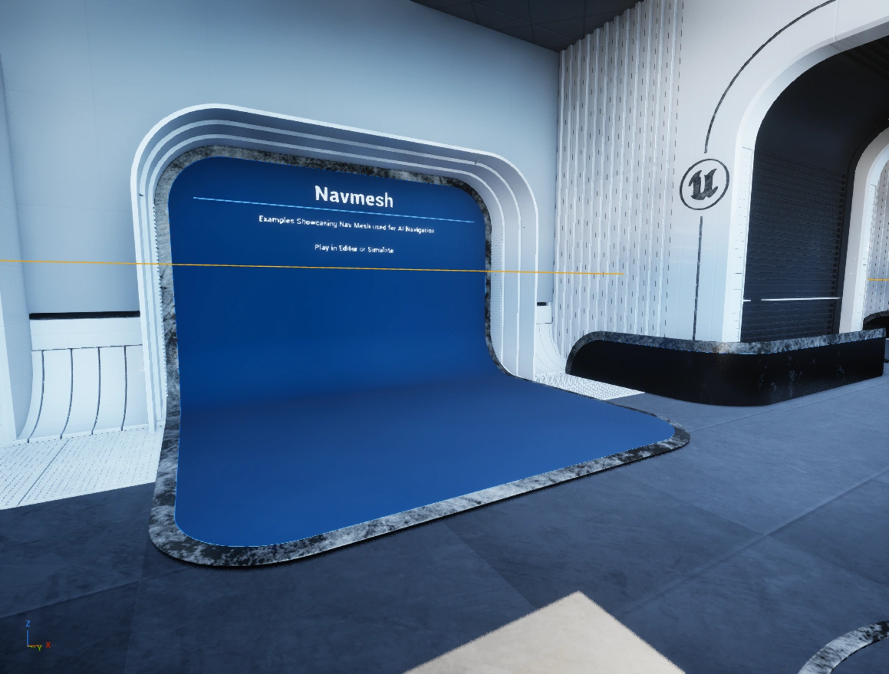
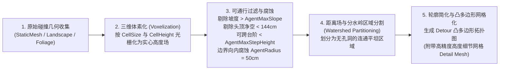
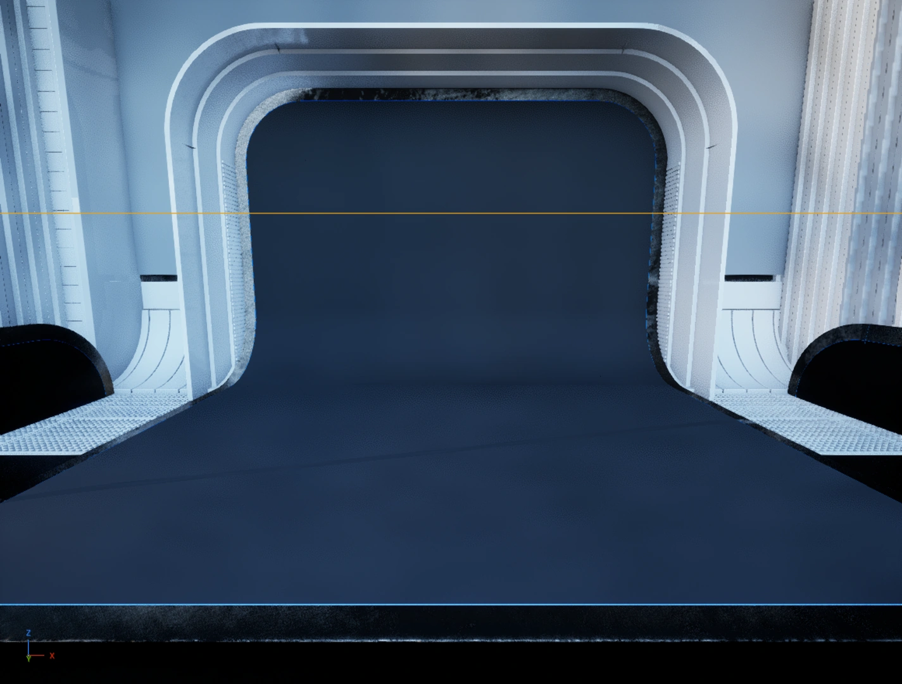
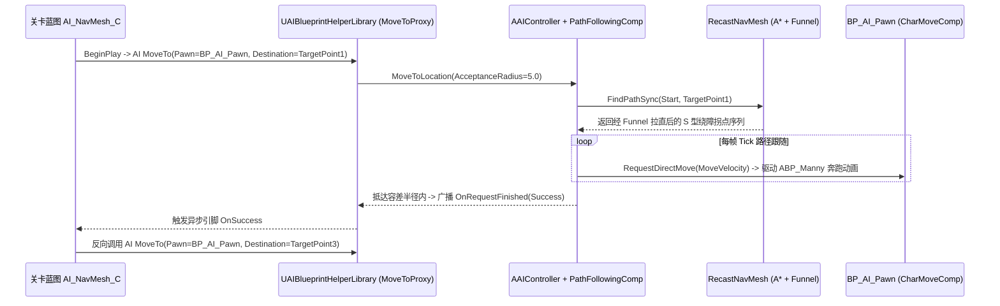
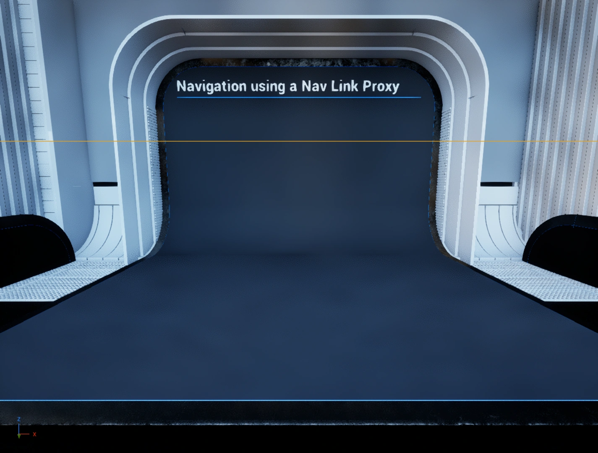
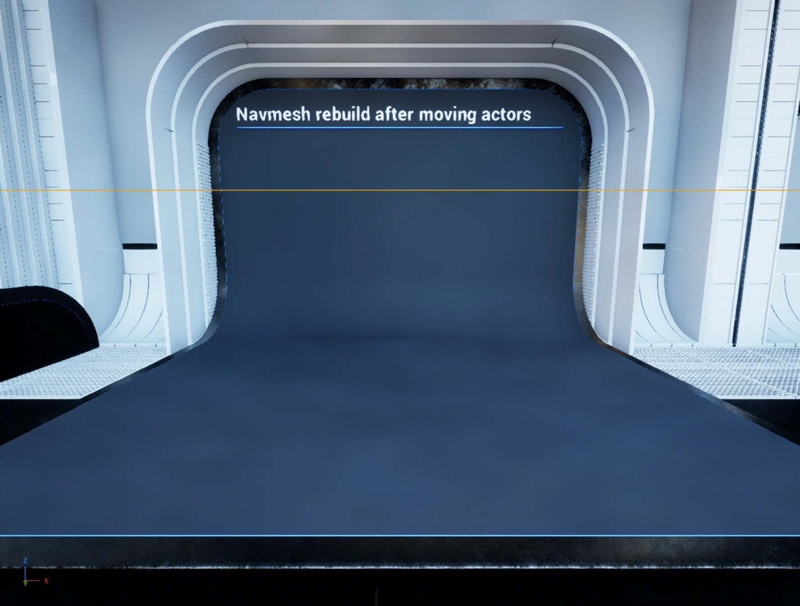

# 01 · 导航网格寻路、动态障碍、NavLink 跳点与区域代价路由（`AI_NavMesh`）

> **本篇实测拆解关卡档案**
> - **关卡路径**：`/Game/Maps/AI/AI_NavMesh`（关卡总 Actor 数：`46` | 物理展牌数：`4` + 全局及代价路由扩展专席 `#5` | 示例 Actor 数：`27`）
> - **关卡脚本类**：`/Game/Maps/AI/AI_NavMesh.AI_NavMesh_C`（核心属性：`obstacle start location = (0, 0, 0)`）
> - **工程实测导航配置（`DefaultEngine.ini`）**：`RecastNavMesh.bRebuildAtRuntime = true` | `AgentRadius = 50.0` | `AgentHeight = 144.0` | `ActiveTilesUpdateInterval = 1.0s` | `CrowdManagerClass = /Script/AIModule.CrowdManager`
> - **核心资产目录**：`/Game/ExampleContent/Navmesh/Blueprints/BP_AI_Pawn`、`/Script/AIModule.NavLinkProxy`、`/Script/NavigationSystem.NavMeshBoundsVolume`

---

## 一、 空间智能的第一块基石：为什么现代 3D 游戏离不开 Recast / Detour？

在赋予游戏 AI 任何战术思考（何时巡逻、何时掩体射击、何时包抄逃跑）之前，它必须先回答一个最朴素的几何问题：**“我脚下哪块地面能站人？从 A 点走到 B 点怎样才不会一头撞在墙上或掉进深渊？”**

早期 2D/伪 3D 游戏习惯手工摆放路点图（Waypoint Graph）或均匀二维方格网（2D Grid）：前者在复杂高低起伏的地形中连线工作量呈指数级爆炸，且 AI 只能死板地沿着路点连线走“折线广播体操”；后者在千米级开放世界中动辄产生上亿个格点，内存与搜索耗时双双崩盘。

虚幻引擎自 UE4 时代起深度集成了业界公认的导航黄金搭档——由 Mikko Mononen 缔造并经 Epic 大幅工程化改造的 **Recast（体素化导航网格构建器）+ Detour（多边形走廊寻路与漏斗拉直运行库）**。任意凹凸不平的三维网格、楼梯、斜坡与碎石堆，只需拖入一个 **`NavMeshBoundsVolume`** 并按下键盘 **`P`** 键，引擎便会自动烘焙出一层严丝合缝的翠绿色凸多边形可通行表面。

### 1.1 Recast 体素化烘焙五步流水线与“墙边内缩腐蚀带”真相

许多初学者第一次按 `P` 键观察绿网时都会疑惑：**“为什么绿色的导航网格没有铺满整个地板，而是在所有墙壁和箱子四周都留出了一圈空白缝隙？”**

这正是 Recast 最精妙的**配置空间（Configuration Space / Minkowski Erosion）降维思想**：如果导航网格贴死墙根，寻路时就必须拿着角色的三维胶囊体一路做昂贵的物理扫掠碰撞；反之，只要在烘焙阶段预先把所有障碍物向外“膨胀”（等价于把可行走地面向内“腐蚀”）一个角色胶囊体半径 **`AgentRadius`**，那么在运行时，**整个庞大的人形角色就可以被退化为一个零体积的数学质点**！只要质点不走出绿网边界，角色的肩膀就绝对不会擦碰到墙壁。

结合当前工程 `Config/DefaultEngine.ini` 中 `[/Script/NavigationSystem.NavigationSystemV1]` 的实测参数（`AgentRadius = 50.0 cm`，`AgentHeight = 144.0 cm`），Recast 在后台对每个三维瓦片（Tile）执行以下五步流水线：

### 1.2 Detour 寻路双阶段：A* 多边形走廊搜索 + Funnel 漏斗拉直算法

当蓝图或 StateTree 调用一行 `AI MoveTo` 时，Detour 并不是在三维像素级网格上盲目搜索，而是分两步在微秒级完成路径求解：

1. **第一阶段：凸多边形拓扑图上的 A* 搜索（Corridor Search）**
   将每个凸多边形视为图节点，共享边（Portal Edge）与跨崖跳点（`NavLink` Off-Mesh Connection）视为有向边，求解启发式评估函数：
   $$f(n) = g(n) + h(n)$$
   其中 $h(n)$ 为当前多边形到终点的欧氏距离下界，而从多边形 $i$ 跨入相邻多边形 $j$ 的精确增量代价为：
   $$\Delta g(i \to j) = d(p_i, p_j) \cdot w_{\text{travel}}(\text{Area}_j) + c_{\text{enter}}(\text{Area}_j)$$
   这里 $w_{\text{travel}}$ 是目标区域的**单位距离通行代价倍率（Travel Cost）**，$c_{\text{enter}}$ 是首次踏入该异质区域时的**固定进入惩罚（Fixed Area Entering Cost）**。A* 搜索结束后，得到的是一串从起点通往终点的**凸多边形序列（又称“走廊 Corridor”）**。
2. **第二阶段：简单漏斗拉直算法（Simple Stupid Funnel Algorithm / String Pulling）**
   如果直接连接每个多边形的中心点，AI 走出来会是荒诞的“之字形醉步”。Detour 利用凸多边形走廊内部任意两点连线必在多边形内的几何性质，从当前立足拐点（Apex）出发，维护一左一右两条视线边界构成一个不断收窄的“视锥漏斗（Funnel）”，逐一扫描走廊中的每一条共享门户边（Portal）：
   - 若新门户的左/右端点使漏斗变窄，则收紧左/右边界；
   - 一旦左边界跨过了右边界（说明走廊在这里拐弯挡住了直线视线！），就立刻把被跨过的那个门户顶点钉死为新的路径拐点（New Apex），像拉紧一根穿过走廊的棉线（String Pulling）一样，在 $O(k)$ 线性时间内抽出**紧贴障碍物外角的欧氏几何最短折线路径**！

---

## 二、 `AI_NavMesh` 逐展台（#1 ~ #5）全量实测拆解

本关卡沿着 `X = 500` 至 `X = 6000` 铺设了一条由 4 段房间组成的 60 米演示长廊（其中第 4 段房间为双倍长度 `length = 2`），陈列了 **4 座官方 `BP_DemoDisplay` 物理展台** 与 **2 个全局未归属特定展牌的场景 Actor**。下面按 `#1 ~ #5` 逐节深度拆解全部展品与隐藏在关卡蓝图中的驱动机制。

---

### 展台 #1：`Navmesh` — 导航评测光场与运行态先决契约

- **空间元数据**：展牌 Label `BP_DemoDisplay4` | 坐标 `(500, -900, 0)` | 朝向 `Yaw = 90°`
- **官方展牌原文**：
  > *Examples Showcasing Nav Mesh used for AI Navigation. Play in Editor or Simulate.*

#### 1.1 为什么看导航演示必须开启 PIE 或 Simulate（`Alt + S`）？
在纯编辑器静态视口中，虽然按下 **`P`** 键（等价于 `ShowFlag.Navigation 1`）可以预览静态烘焙好的绿色 `RecastNavMesh` 多边形，但场上的 `BP_AI_Pawn` 尚未完成 `AAIController` 的自动附身（Possess），关卡蓝图中的 `Event BeginPlay` 也未点火。只有点击 **Play in Editor（PIE）** 或 **Simulate In Editor（`Alt + S` 模拟运行，无需切换玩家视角即可自由飞行观察全厅 AI 走位！）**，引擎才会实例化 `AIController`、`PathFollowingComponent` 与动态导航脏区更新队列。

#### 1.2 展台陈列 Actor 与底层参数清单（共 5 个）
- **`DirectionalLight`**（`/Script/Engine.DirectionalLight`）：`Intensity = 10`，纯白光 `(1, 1, 1, 1)`，旋转 `(Pitch = -60°, Yaw = -160°, Roll = -85°)`，`CastShadows = true`，`Mobility = Movable`。高亮度斜射主光让白色演示方块与角色胶囊体投出清晰阴影，便于观察拐角贴墙距离。
- **`SkyLight`**（`/Script/Engine.SkyLight`）：`Intensity = 3`，纯白光，`CastShadows = true`，`Mobility = Movable`，提供柔和的阴影区漫反射补光。
- **`SkyAtmosphere`** 与 **`ExponentialHeightFog`**：构建标准大气天空与远景深度过渡。
- **`Actor`**（`/Script/Engine.Actor`）：挂载 `ChaosDebugDrawComponent_0`，为物理与导航碰撞可视化提供底层调试绘制通道。

---

### 展台 #2：`Simple navigation around obstacles` — 静态绕障、自动附身与 `AI MoveTo` 异步闭环

- **空间元数据**：展牌 Label `BP_DemoDisplay1` | 坐标 `(2000, -900, 0)`

#### 2.1 展台陈列 Actor 空间拓扑与 MCP 实测参数（共 5 个）
在第二间展室地面上，两个错位摆放的立方体挡住了左右两端目标点之间的直线通路：
1. **`BP_AI_Pawn`**（`/Game/ExampleContent/Navmesh/Blueprints/BP_AI_Pawn.BP_AI_Pawn_C`，坐标 `(1569.64, 9.64, 88.06)`）：
   - **父类**：`/Script/Engine.Character`。
   - **核心 AI 附身属性**：`autoPossessPlayer = Disabled`，**`autoPossessAI = PlacedInWorld`**（仅对预先摆放在关卡中的实例自动生成 AIController；若项目中有运行时 `SpawnActor` 刷出的怪物，务必改为 **`PlacedInWorldOrSpawned`**，否则刷出来的怪会像木头人一样站在原地！），`aIControllerClass = /Script/AIModule.AIController`。
   - **组件构成**：`CollisionCylinder`（胶囊体碰撞）、`CharMoveComp`（`UCharacterMovementComponent`，消费路径速度向量驱动地面行走）、`CharacterMesh0`（骨骼网格体 `SKM_Manny_Simple` + 标准运动状态机动画蓝图 `ABP_Manny_C`）。
2. **`TargetPoint3`**（`/Script/Engine.TargetPoint`，坐标 `(1645, 90, 0.06)`）：西侧巡逻折返锚点。
3. **`TargetPoint1`**（`/Script/Engine.TargetPoint`，坐标 `(2480, -30, 0.06)`）：东侧巡逻折返锚点。
4. **`SM_DemoCube_2`**（坐标 `(1880, 120, -0.10)`）与 **`SM_DemoCube_5`**（坐标 `(2220, -80, -0.10)`）：均引用 `/Game/Global/Meshes/SM_DemoCube`，一北一南交错阻断通道中央，迫使路径构成 S 型绕弯。

#### 2.2 资产深拆与关卡蓝图还原：为什么 `BP_AI_Pawn` 内部图表是空的？
通过资产深拆 `/Game/ExampleContent/Navmesh/Blueprints/BP_AI_Pawn` 可以发现一个极易被忽略的细节：**`BP_AI_Pawn` 的 `Variables`、`Event Dispatchers` 与 `EventGraph` 全部为空！**

它的往返巡逻逻辑完全由关卡脚本 **`/Game/Maps/AI/AI_NavMesh.AI_NavMesh_C`** 集中编排：

> [!TIP]
> **工程避坑：`Simple Move to Location` vs 异步 `AI MoveTo` 节点**
> 蓝图中有两个名字极像的移动节点：`Simple Move to Location` 是“射后不理（Fire-and-Forget）”的普通函数，没有到达回调引脚；而带右上角小钟表图标的 **`AI MoveTo`** 底层会创建 `UAIAsyncTaskBlueprintProxy` 对象监听 `AAIController::ReceiveMoveCompleted` 委托，提供 **`OnSuccess`** 与 **`OnFail`** 两个延迟执行引脚，是快速原型搭建往返巡逻链的标准写法。

---

### 展台 #3：`Navigation using a Nav Link Proxy` — 打通断崖高台的有向跳点注入机制

- **空间元数据**：展牌 Label `BP_DemoDisplay2` | 坐标 `(3500, -900, 0)`

#### 3.1 为什么连续斜坡能自己连上绿网，而高台断崖必须靠 `NavLinkProxy`？
Recast 体素化算法只能将高度差小于等于 **`AgentMaxStepHeight`**（默认约 `35 cm`）且坡角小于等于 **`AgentMaxSlope`**（默认约 `44°`）的相邻体素合并为连通区域。一旦遇到二楼阳台、断桥、战壕、矮墙翻越或跳台边缘，上下两块平面的绿色多边形在拓扑图上就是**两个互不相连的孤岛（Disconnected Islands）**。

此时，**`NavLinkProxy`（导航链接代理）** 就像一条人工架设在 Detour 多边形图里的“虫洞边（Off-Mesh Connection）”，告诉 A* 搜索器：*“虽然这两块绿网物理上断开了，但允许智能体从左锚点跨到右锚点！”*

#### 3.2 展台 9 个陈列 Actor 与 `NavLinkProxy6` 全字段深度破译
仔细对照展台空间坐标与 MCP 提取的 `NavLinkProxy6` 实例参数，整套精妙的**“去程爬坡跳崖、返程平地绕行”非对称动线**一目了然：

1. **斜坡与高台几何组（4 个 `SM_DemoCube`）**：
   - **`SM_DemoCube`** `(3323.58, -100, -48.46)` 与 **`SM_DemoCube_4`** `(3323.58, +100, -48.46)`：旋转角 **`Roll = -32.20°, Yaw = -90°`**。因为 `32.2° < 44°`（小于最大爬坡角），Recast 直接在斜坡表面烘焙出了连续爬升的绿色导航网！
   - **`SM_DemoCube_6`** `(3430, -100, -10)` 与 **`SM_DemoCube_7`** `(3430, +100, -10)`：水平拼接成高台顶面，其东侧边缘形成一道垂直断崖，下方直接面向地面。
2. **智能体与折返路点**：
   - **`BP_AI_Pawn_2`** `(2869.64, 4.64, 88.05)`：往返于西侧坡底 **`TargetPoint4`** `(2975, 10, 95)` 与东侧崖底 **`TargetPoint2`** `(3785, 40, 95)` 之间。
   - **`NavMeshBoundsVolume`** `(3680, 30, -50)`：笼罩全展厅的导航生成包围盒。
3. **核心主角：`NavLinkProxy6`（坐标 `(3590, -30, 10)`）精确属性表**：

| `pointLinks[0]` 实测字段 | 实测数值 | 底层几何与 Detour 拓扑物理含义 |
| :--- | :--- | :--- |
| **`left`（左端点局部偏移）** | `(-340, 30, 50)` | 换算世界坐标为 **`(3250, 0, 60)`**，精准落在高台顶面边缘的绿色多边形上！ |
| **`right`（右端点局部偏移）** | `(140, 30, 30)` | 换算世界坐标为 **`(3730, 0, 40)`**，精准落在东侧崖底地面的绿色多边形上！ |
| **`direction`（通行方向）** | **`LeftToRight`** | **单向有向边！** 仅允许从高台（`left`）跳往地面（`right`），禁止从地面凭空吸上高台！ |
| **`snapRadius` / `snapHeight`** | `30` / `50` (`bUseSnapHeight = true`) | 端点向周围半径 `30cm`、垂直高度 `50cm` 范围内自动吸附最近的合法导航多边形表面。 |
| **`maxFallDownLength`** | `1000` | 向下投射寻找落脚导航面的最大垂直跌落搜索距离（`10 米`）。 |
| **`bSnapToCheapestArea`** | `true` | 当吸附半径内存在多种代价区域时，优先吸附通行代价最低的多边形。 |
| **`areaClass`** | `NavArea_Default` | 该跨崖跳点边自身的通行代价类别（默认普通代价）。 |
| **`SmartLinkComp`** | `UNavLinkCustomComponent` | 智能动态链接组件，支持绑定 **`OnSmartLinkReached`** 事件实现自定义跳跃弧线与开关控制。 |

#### 3.3 动线推演与 `Point Link` vs `Smart Link` 实战进阶
- **去程（`TargetPoint4` $\to$ `TargetPoint2`）**：A* 发现顺着 `32.2°` 斜坡爬上高台，再走 `NavLinkProxy6` 的 `LeftToRight` 单向边直接跳下断崖抵达 `TargetPoint2`，总欧氏距离显著短于从南北两侧大绕弯，于是 `BP_AI_Pawn_2` 潇洒地冲上斜坡纵身跃下！
- **返程（`TargetPoint2` $\to$ `TargetPoint4`）**：由于 `direction = LeftToRight` 在反方向上权重为无穷大（不可逆），A* 自动放弃断崖，规划出沿高台南北外侧平地绕回 `TargetPoint4` 的折返路径！
- **实战中如何让 AI “从低处起跳翻上高台”或“等吊桥放下才过河”？**
  普通的 `PointLinks` 只负责把路径引导到崖边让角色自然走落（Walking off ledge）；若要实现**向上起跳、蹬墙翻越、溜索滑行或动态开关门桥**，只需在 `NavLinkProxy` 细节面板勾选 **`bSmartLinkIsRelevant = true`**：
  1. 当吊桥升起时调用 `SetSmartLinkEnabled(false)`，Detour 立即将该 Off-Mesh 边标记为断开，正在过桥的 AI 瞬间重寻路改道；
  2. 当 AI 踩中跳点起点触发 **`ReceiveSmartLinkReached(Agent, Destination)`** 事件时，调用 `UGameplayStatics::SuggestProjectileVelocity_CustomArc` 计算抛物线初速度并赋给 `LaunchCharacter()`（或播放 Root Motion 翻越蒙太奇），落地后调用 `ResumePathFollowing(Agent)` 将控制权交还寻路系统！

---

### 展台 #4：`Navmesh rebuild after moving actors` — 移动障碍物与瓦片级动态重烘（Tile Rebuild）

- **空间元数据**：展牌 Label `BP_DemoDisplay3` | 坐标 `(5010, -890, 0)`

#### 4.1 展台陈列 Actor 与关卡脚本动态障碍机制（共 6 个）
在最后一间双倍长度的宽敞展室中，西东两侧各有一座 `15°` 缓坡桥面（`SM_DemoCube_10` 位于 `(5272.24, 0, -58.98)`，`Roll = -15°`；`SM_DemoCube_11` 位于 `(5712.24, 0, -58.98)`，`Roll = -15°, Yaw = 90°`），`BP_AI_Pawn_3` `(5024.63, -10.35, 88.06)` 在西端 **`TargetPoint6`** `(5100, -7.5, 60)` 与东端 **`TargetPoint5`** `(5990, -7.5, 60)` 之间不断折返。

而横亘在两座缓坡正中央 `(5490, 400, -20)` 的 **`SM_DemoCube_8`**，正是关卡脚本 `AI_NavMesh_C` 中变量 **`obstacle start location`** 所控制的动态移动路障！
- 游戏启动瞬间，关卡蓝图记录 `SM_DemoCube_8` 的初始坐标至 `obstacle start location`，随后通过时间轴/帧更新驱动该方块沿 `Y` 轴在通道中央往复横移；
- 按下 **`P`** 键实时观察地面：方块扫过之处，原本完整的绿色多边形立刻被“切开”一道含 `50 cm` 膨胀边距的矩形缺口；方块移开后，缺口处的绿网在极短延迟内重新愈合；
- 正在行进中的 `BP_AI_Pawn_3` 一旦检测到当前走廊内的多边形被脏区重烘失效，无需等到撞上墙体，半途即刻丝滑转向从方块侧后方绕过！

#### 4.2 底层揭秘：为什么 `SM_DemoCube_8` 一动，整张地图不会卡顿掉帧？
答案在于 Recast 的 **二维规则瓦片分块架构（Tiled NavMesh Architecture）** 与本工程 `DefaultEngine.ini` 的两项关键配置：
1. **`RecastNavMesh.bRebuildAtRuntime = true`（对应编辑器 `Runtime Generation = Dynamic`）**：解锁运行时几何体素重烘焙管线。
2. **局部脏区包围盒（Dirty Area）+ 后台工作线程异步重烘**：
   当 `SM_DemoCube_8` 发生位移时，`UNavigationSystemV1` 仅将其**旧包围盒**与**新包围盒**标记为 `FNavigationDirtyArea`。Recast 将大场景切分为独立的正方形 Tile（默认 `TileSizeUU = 1000` 左右），**只有与脏区包围盒相交的那 1~2 块局部 Tile 会被丢进后台 TaskGraph 异步线程重新跑体素化五步流水线**，其余 95% 的展厅绿网纹丝不动！重烘完成后按照 `ActiveTilesUpdateInterval = 1.0s`（或帧预算内即时合并）原子替换旧瓦片并通知受影响的 `UPathFollowingComponent` 重新规划路径。

#### 4.3 三大 `Runtime Generation` 模式工程选型铁律

| 运行时生成模式 | 底层计算范围 | CPU 单次更新开销 | 适用工程场景与开放世界最佳实践 |
| :--- | :--- | :--- | :--- |
| **`Static`（纯静态）** | 仅编辑器烘焙，运行时完全冻结 | **0 ms** | 走廊射击、固定箱庭关卡（所有门开关仅通过 `SmartLink` 控制）。 |
| **`Dynamic Modifiers Only`（仅动态修改器）** | **不重跑三维体素化！** 仅用 `NavModifier` 凸包切割现有多边形并改写 `NavArea` 属性 | **极低（数十微秒）** | **高帧率竞技/战术游戏首选！** 适合开关门阻断（`NavArea_Null`）、火墙毒圈动态扩散等地形高度不变的场景。 |
| **`Dynamic`（全动态体素重烘）** | 局部脏瓦片完整重跑三维体素化与分水岭分割 | 中高（视瓦片内三角面密度而定，异步线程池执行） | 沙盒建造、物理坍塌地形改变；**在超大开放世界中必须开启 `bGenerateNavigationOnlyAroundNavigationInvokers = true`（导航唤醒器）**，仅在有 AI 活动的周身半径内动态流送烘焙瓦片！ |

---

### 展台 #5（全局扩展与代价路由专席）：关卡全局未归属 Actor 与 `NavModifierVolume` 危险区域代价路由全解

- **空间元数据**：涵盖实测档案第 4 节全局未归属 Actor（`SM_DemoCube_9` 与 `InstancedFoliageActor1`）及 Detour 区域代价路由核心机制。

#### 5.1 关卡全局未归属 Actor 实测盘点与植被导航性能暗礁
在实测扫描本关全部 `46` 个 Actor 时，除了上述 4 座展牌配对的展品外，场内还存在 2 个全局级示例 Actor：
1. **`SM_DemoCube_9`**（`/Script/Engine.StaticMeshActor`，坐标 `(4390, 550, 10)`，`Yaw = -90°`）：位于 `#3` 号跳台展区与 `#4` 号动态重烘展区交界北侧的边界参考几何体，演示静态世界阻挡物在瓦片交界处的边缘腐蚀缝合。
2. **`InstancedFoliageActor1`**（`/Script/Foliage.InstancedFoliageActor`，坐标 `(990, 1000, -250)`）：关卡实例化植被管理器。
   > [!WARNING]
   > **百万级植被地图的 NavMesh 烘焙头号杀手！**
   > 在实际森林开放世界项目中，`InstancedFoliageActor` 往往承载数十万棵灌木、野草与碎石。如果美术忘记在草丛 `FoliageType` 中取消勾选 **`Can Ever Affect Navigation`（可影响导航）**，哪怕草丛没有阻挡玩家的碰撞，或者带了细碎碰撞盒，动态重烘一个瓦片时 `DataGatheringMode = Instant` 就会瞬间导出成千上万个三角面塞爆 Recast 体素器！**铁律：只有真正挡住 AI 脚步的粗壮树干与巨石才允许勾选 `bCanEverAffectNavigation = true`！**

#### 5.2 进阶核心：`NavModifierVolume` 与危险区域代价路由（Travel Cost vs Entering Cost）
学会了“绕开死墙（`NavArea_Null`）”之后，真实战术 AI 立刻会遇到更高阶的需求：**面前有一条 10 米长的岩浆火海近路，和一条 25 米长的安全石板绕行远路——普通哥布林应该乖乖绕远路保命，但残血狂暴的火焰巨人却应该直接蹚过火海抄近道砍玩家！**

如果用碰撞盒把火海堵死（`NavArea_Null`），火焰巨人也过不去；如果不堵，普通哥布林又会傻乎乎走直线烧死在火海里。虚幻解决这一矛盾的核心武器正是 **`NavModifierVolume` + 自定义 `UNavArea` + `UNavigationQueryFilter`**！

让我们回到 1.2 节的 Detour 边代价公式：
$$\Delta g(i \to j) = d(p_i, p_j) \cdot \underbrace{w_{\text{travel}}(\text{Area}_j)}_{\text{DefaultCost (通行倍率)}} + \underbrace{c_{\text{enter}}(\text{Area}_j)}_{\text{FixedAreaEnteringCost (进入门槛)}}$$

这两个参数看似都在“加代价”，但在几何寻路上有着天壤之别：

| 属性维度 | `DefaultCost`（Travel Cost 通行代价倍率） | `FixedAreaEnteringCost`（Entering Cost 踏入固定惩罚） |
| :--- | :--- | :--- |
| **默认值（`NavArea_Default`）** | `1.0`（每走 `1 cm` 计 `1.0` 代价） | `0.0`（跨入多边形边界不收门票） |
| **内置 `NavArea_Obstacle` 值** | 高倍率（如 `10.0`） | 高门槛 |
| **物理量纲** | **无量纲斜率倍率**（与穿过危险区的路径长度 $d$ 成正比） | **绝对距离等价常量（单位：cm）**（无论踩进去 `1 cm` 还是 `1000 cm`，跨过边界瞬间一次性扣除！） |
| **只调它不调另一个的致命后果** | **“擦边烫脚”Bug！** 若只设 `TravelCost = 5.0`、`EnteringCost = 0`，当火海多边形某个尖角刚好挡在拐弯内侧 `10 cm` 宽时，踩过去只需 $10 \times 5 = 50\text{ cm}$ 代价，比绕开尖角多走 $60\text{ cm}$ 还便宜，AI 就会故意踩一脚火海边缘触发燃烧 Debuff！ | 若只设 `EnteringCost = 2000`（等价多绕 `20 米`）、`TravelCost = 1.0`，只要绕路超过 `20 米`，AI 一旦决定交门票进火海，就会在火海正中间肆无忌惮地慢悠悠走最长对角线，而不会尽快最短路径穿出火海！ |

**黄金配置范式**：
1. 新建蓝图继承 `UNavArea`（如 `NavArea_FireHazard`），同时设置 **`DefaultCost = 5.0`**（促使一旦被迫进入时以最短垂直距离逃离火海）+ **`FixedAreaEnteringCost = 1500.0`**（除非安全绕路比直穿远出 `15 米` 以上，否则绝不沾火海半根毫毛！），并赋予醒目的橙红色调试颜色（按 `P` 键一眼可见红绿分界！）。
2. 在火海区域放置 `NavModifierVolume`（或在火焰蓝图 Actor 内挂载 `UNavModifierComponent`），将 `AreaClass` 设为 `NavArea_FireHazard`。配合 `Dynamic Modifiers Only` 模式，火球落地瞬间即可在绿网上切出橙红色高危区！
3. 新建 `UNavigationQueryFilter` 子类 `Filter_FireImmune`（火焰巨人专用），在 `Areas` 覆写列表中将 `NavArea_FireHazard` 的 `TravelCostOverride` 重置为 `1.0`、`EnteringCostOverride` 重置为 `0.0`，甚至设为 `0.8`（优先走火海回血加速！），在调用 `AI MoveTo` 或 StateTree `MoveToTask` 时传入该 `FilterClass`——**同一张底层 NavMesh，瞬间涌现出千人千面的战术路由智商！**

---

## 三、 本篇核心总结与下章预告

在本篇 `AI_NavMesh` 的拆解中，我们打通了虚幻空间寻路的底层经脉：
1. **Recast 体素烘焙**利用 `AgentRadius (50 cm)` 边界腐蚀将三维体积碰撞降维为凸多边形质点拓扑；
2. **Detour 双阶段寻路**依靠 A* 算出走廊，再借 Funnel 漏斗拉直算法在微秒级生成贴角平滑折线；
3. **`NavLinkProxy`** 通过注入单向/双向 Off-Mesh 有向边与 `SmartLink` 事件，打通了垂直高台断崖与动态机关桥；
4. **瓦片级动态重烘（Tile Rebuild）与 `NavModifier` 代价过滤**让移动路障与危险地形的实时响应既丝滑又不伤帧率。

当智能体已经拥有了敏捷稳健的“双腿”，接下来该用什么架构赋予它敏捷清晰的“大脑”？请进入下一篇 **`02 · 轻量级层级状态树全解（AI_StateTree）`**，看 UE5 如何用强类型属性绑定与事件驱动层级状态树彻底终结传统行为树黑板的繁琐时代！
